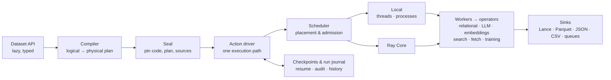

<div align="center">

# DemiFlow

**The crash-safe dataset engine for AI data pipelines.**

Call LLMs, embed, search, fetch and even train models inside one lazy Dataset pipeline.<br>
Run it on a laptop or on Ray — and resume after any crash without paying twice.

[](#installation)
[](#project-status)
[](https://github.com/lancedb/lance)
[](#one-api-laptop-to-cluster)
[](#license)

**English** · [简体中文](README.zh-CN.md)

</div>

---

## Why DemiFlow?

Most AI data work still lives in scripts: a loop that calls a model API, writes a file, and hopes nothing breaks.
At hour three something does. You rerun, the provider bills you again, half-written outputs get mixed with new ones,
and nobody can tell which model produced which row.

**DemiFlow turns that loop into a pipeline the engine can reason about.**
Model calls, embeddings, web search and downloads are ordinary Dataset operators.
The engine plans the work, keeps memory inside the budget you set, checkpoints progress *and* external effects,
and commits results to versioned [Lance](https://github.com/lancedb/lance) tables.
If the process dies, you resume from the last confirmed point.

## Highlights

- 🧠 **AI-native operators.** `map_prompt` calls any OpenAI-compatible or Azure model and returns schema-validated JSON, with retries and a hard request budget. You also get async prompts, multi-turn agents (`agentmap_async`), embeddings, vector search, web search, raw fetch and document parsing.
- 🛟 **Crash-safe by design.** Every action records checkpoints in a run journal. Resume with the original `RunRef`:
  - confirmed rows are not recomputed;
  - replays never spend new model requests;
  - a call whose outcome is unknown is not blindly re-sent;
  - table writes are reconciled with their original transaction.
- 🗂️ **Lance-native data.** Reads are pinned to a table version. Writes support `create`, `append`, `overwrite` and keyed `merge`. When the update allows it, a merge rewrites only the changed columns; it always checks key uniqueness before an atomic commit. Key-only anti-joins, lookups and vector indexes come built in.
- ⚖️ **Bounded by construction.** Memory, batch, spill and concurrency budgets are enforced from reading to writing, so wide tables and long jobs fit on modest machines.
- 🚀 **One API, laptop to cluster.** The same Dataset code runs on local threads, local processes or Ray Core. Scheduling, retries and recovery follow one execution path.
- 🎯 **Train and evaluate in the same graph.** `fit` a model on a pinned dataset, select checkpoints by step, and `predict` on a holdout set. Every score traces back to its sample, model weights and data version.
- 🖥️ **Workbench and Forge.**
  - **Workbench** is a web console for projects, runs, data tables and notebooks.
  - **Forge** is a CLI that lets you, or your coding agent, discover the SDK, scaffold pipelines and check their wiring before anything runs.

## Installation

DemiFlow requires Python 3.10+. This release supports **Linux x86_64 (glibc 2.35 or newer)**.

```bash
# 1. Lance with two upstream Arrow fixes (see the note below)
pip install "https://github.com/vincent9299/demiflow/releases/download/v0.3.0/pylance-12.0.0+demiflow.arrowfix1-cp310-abi3-manylinux_2_35_x86_64.whl"
# 2. DemiFlow
git clone https://github.com/vincent9299/demiflow.git
cd demiflow
pip install -e ".[llm]"          # core + LLM clients
# optional extras: ray, embeddings, search, fetch, crawl, images, pdf, analysis, notebook
```

> **Why a separate Lance wheel?** Official `pylance` up to 14.0.3 crashes when it writes sliced or nullable nested structs. The wheel above is Lance 12.0.0 rebuilt with the two Apache Arrow fixes that address this ([#10835](https://github.com/apache/arrow-rs/pull/10835), [#10709](https://github.com/apache/arrow-rs/pull/10709)); the patches and build steps are in [patches/lance-12.0.0](patches/lance-12.0.0/README.md). DemiFlow will return to the official package once a release includes them.

## Quickstart

```python
from pathlib import Path
from demiflow import data

papers = data.from_items([
    {"id": 1, "title": "Attention Is All You Need", "year": 2017},
    {"id": 2, "title": "Lance A Modern Columnar Format", "year": 2024},
    {"id": 3, "title": "Ray A Distributed Framework", "year": 2018},
])

def is_recent(row):
    return row["year"] >= 2018

def add_slug(row):
    return {**row, "slug": row["title"].lower().replace(" ", "-")}

uri = str(Path("papers.lance").absolute())
papers.filter(is_recent).map(add_slug).write_lance(uri, mode="create")   # lazy until here

table = data.read_lance(uri, version=1)   # every read is pinned to a table version
print(table.count())                      # 2
```

Joins, anti-joins and incremental updates use the same API:

```python
authors = data.from_items([{"id": 2, "author": "Lance team"}, {"id": 3, "author": "Moritz et al."}])
table.join(authors, on="id").take_all()                        # inner/left/semi/anti
table.exclude_keys(data.from_items([{"id": 3}]), on="id")       # key-only anti-join

patch = data.from_items([{"id": 2, "year": 2025}])
patch.write_lance(uri, mode="merge", on="id", update_columns=["year"])   # updates only "year"
```

## Add an LLM in three lines

Describe the model call once, in a versioned prompt pack. Secrets stay in environment variables:

```yaml
# prompts.yaml
schema_version: demiflow_prompt_pack_v2
prompts:
  summarize:
    version: summarize-v1
    model:
      name: gpt-4o-mini                  # any OpenAI-compatible model
      transport: openai_compatible
      base_url_env: MODEL_BASE_URL
      api_key_env: MODEL_API_KEY
    schema_retries: 1
    response_schema:
      type: object
      additionalProperties: false
      required: [summary]
      properties:
        summary: {type: string, maxLength: 280}
    template: |
      Summarize this paper title in one sentence for a newsletter:
      {{ title }}
```

Then use it like any other transform:

```python
summaries = table.map_prompt(
    "summarize", config="prompts.yaml",
    inputs={"title": "title"}, output="summary",
    max_requests=1_000,                   # hard budget for new provider requests
)
summaries.write_lance(str(Path("summaries.lance").absolute()), mode="create")
```

Responses are validated against the schema, retried once if invalid, and recorded together with token usage.

## Resume where you stopped

```python
from demiflow.execution import RunContext, RunRef

with RunContext.start("runs/newsletter") as run:
    print(run.ref)          # RunRef(directory=..., run_id=...) — keep it
    summaries.write_lance(out_uri, mode="create")
```

If the process is killed halfway, re-enter the same pipeline with the original reference:

```python
with RunContext.resume(RunRef(directory, run_id)):
    summaries.write_lance(out_uri, mode="create")    # continues from the last checkpoint
```

> We killed a 2,000-row pipeline with `kill -9` after about 900 rows and resumed it in a new process.
> The resumed run did not redo finished work: across both processes the row function ran 2,010 times for 2,000 rows (only the 10 rows in flight at the kill ran again), and the output table got all 2,000 rows in a single Lance version.

## Train and evaluate in one pipeline

```python
fitted = train.fit(recipe=recipe, monitors={"validation": validation})
scores = (
    fitted.checkpoints.select(steps=[400, 800])
    .predict(on=holdout, inputs={"prompt": "question"})
    .map(score_sample)
)
scores.write_lance(scores_uri, mode="create")
```

You provide the recipe, the trainer and the predictor. The engine pins the data versions, reuses a finished training run across actions, and supervises engine-managed jobs on local CPUs and GPUs, or tracks jobs run by an external provider.
See the [training guide](docs/dataset-training.md).

## How it works



Each public Dataset action goes through exactly one execution path.
The compiler picks the physical plan, the sealed program pins what will run, and workers execute operators under explicit resource grants.
Checkpoints capture progress and the outcome of every external effect, so recovery never has to guess.

## What's inside

| Area | APIs |
|---|---|
| **Read** | `from_items` `range` `read_lance` `read_parquet` `read_json` `read_csv` `read_text` `read_images` `read_sql` `read_queue` |
| **Transform** | `map` `flat_map` `filter` `map_batches` `map_async` `batch_map` `select_columns` `sort` `aggregate` `deduplicate` |
| **Relational** | `join` `exclude_keys` `lookup_lance` `union` `group_batches` `reduce_by_key` |
| **AI** | `map_prompt` `map_prompt_async` `agentmap_async` `map_embeddings` `search_vectors` `vector_search_lance` |
| **Acquisition** | `search_web` `fetch` `read_documents` `decode_document` `encode_image` |
| **Streaming & queues** | `run_stream` `enqueue` `read_queue` `ack_queue` `admit_rows`, on SQLite or PostgreSQL |
| **Write** | `write_lance` (create / append / overwrite / merge) `save_lance` `write_parquet` `write_json` `write_csv` `materialize` |
| **Train & evaluate** | `fit` → `checkpoints.select` → `predict` |
| **Tooling** | `demiflow run --backend local\|ray` · `demiflow workbench` · Forge CLI |

## One API, laptop to cluster

Package a pipeline as a bundle, then choose the backend at launch:

```bash
demiflow run --root ./my_pipeline --backend local
demiflow run --root ./my_pipeline --backend ray --ray-job-api-address http://ray-head:8265
```

A bundle is a directory with a `PipelineProgram` entry point; see [`demiflow/pipeline/`](demiflow/pipeline/). A step-by-step guide is on the way.

Open the Workbench to browse projects, runs and result tables:

```bash
demiflow workbench console --registry ~/demiflow/console.json add /path/to/my_pipeline
demiflow workbench console --registry ~/demiflow/console.json serve --port 59865
```

## When to use DemiFlow

**A great fit:**
- **Row-level AI enrichment over large tables:** labeling, extraction, scoring, translation, embeddings.
- **Long-running acquisition pipelines:** search, crawl, fetch and parse, which must survive restarts and must not re-download or re-bill.
- **Dataset ablations and model evaluation:** you need lineage from every score back to its sample, model weights and data version.

**Not the right tool:**
- **Interactive SQL over a large warehouse.** Use DuckDB or Spark; DemiFlow reads and writes Lance and Parquet, so it fits next to them.
- **Generic job orchestration** (cron, DAGs of shell tasks). Use Airflow or Dagster; a DemiFlow pipeline can be one step.

## Documentation

| Topic | Guide |
|---|---|
| Streaming `map` and concurrency | [docs/streaming-map.md](docs/streaming-map.md) |
| LLM operators and HTTP contract | [docs/prompt_http.md](docs/prompt_http.md) |
| Multi-turn agent operators | [docs/operator_environment.md](docs/operator_environment.md) |
| Embeddings and vector search | [docs/embeddings.md](docs/embeddings.md) · [docs/vector_search.md](docs/vector_search.md) |
| Fetch, queues and acquisition | [docs/dataset-fetch.md](docs/dataset-fetch.md) |
| Lance merge semantics | [docs/lance_merge.md](docs/lance_merge.md) |
| Training and evaluation | [docs/dataset-training.md](docs/dataset-training.md) |
| Workbench and Forge | [docs/forge-workspace.md](docs/forge-workspace.md) · [docs/forge-cli.md](docs/forge-cli.md) |
| Engine architecture | [docs/dataset-engine-architecture.md](docs/dataset-engine-architecture.md) |

> Most guides are currently written in Chinese. English versions are on the roadmap, and contributions are welcome.

## Project status

DemiFlow **0.3** is the first public release and should be treated as beta.

- **Supported surface:** the `demiflow.data` Dataset API, prompt packs, `RunContext` and the `demiflow` CLI.
- **May change without notice:** internal modules under `demiflow.execution` and `demiflow.planning`.
- **Validated environments:** Linux on a single machine, and single-host Ray.
- **Not yet validated:** multi-host Ray, and paid third-party training providers.

## Contributing

Issues and pull requests are welcome. Before sending code, please read:

- [Repository rules](docs/repository-rules.md): branches, review gates and release flow;
- [Finite-resource constraints](AGENTS.md): every change keeps memory, batch and spill bounds;
- [Engine architecture](docs/dataset-engine-architecture.md): one owner per responsibility across 17 engine modules.

## License

DemiFlow is licensed under the [Apache License 2.0](LICENSE).

The Workbench bundles a few front-end libraries under their own permissive licenses; their notices sit next to the files in `demiflow/workbench/web/`.

## Acknowledgements

DemiFlow stands on the shoulders of
[Apache Arrow](https://arrow.apache.org/), [Lance](https://github.com/lancedb/lance),
[Apache DataFusion](https://datafusion.apache.org/), [Ray](https://www.ray.io/),
[SearXNG](https://github.com/searxng/searxng) and [Crawl4AI](https://github.com/unclecode/crawl4ai).
It was spun out of [Demiurge](https://github.com/vincent9299/Demiurge) in September 2026.

<div align="center">

If DemiFlow saves you a rerun, please consider giving it a ⭐

</div>
