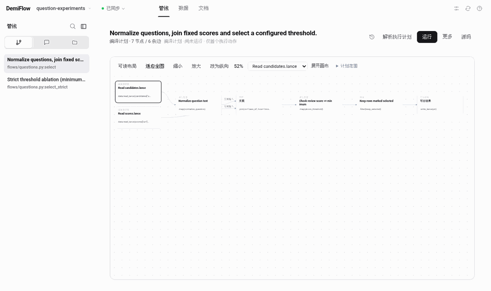
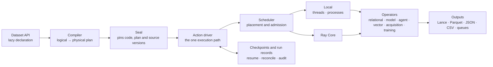
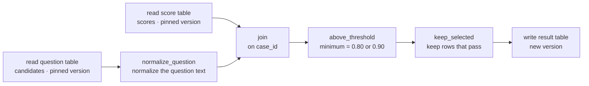
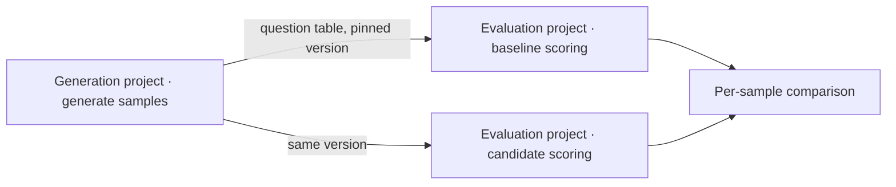

<div align="center">

# DemiFlow

**The AI data platform built for the age of AI coding assistants.**

The whole path of producing, synthesizing and experimenting with data: start from raw material; clean, label or generate samples; compare data recipes; then check the effect with training and evaluation.<br>
Pipelines are written by AI coding assistants, constrained by the platform and verified by people.

[](#installation)
[](#project-status)
[](#designed-for-ai-development)
[](https://github.com/lancedb/lance)
[](#the-engine-one-execution-path-bounded-resources)
[](#license)

**English** · [简体中文](README.zh-CN.md)

</div>

---

## Why DemiFlow

Most data pipelines are now written by AI coding assistants. Generating the first version is easy. What comes after is hard:

- After thirty rounds of changes and several assistants, can a new assistant still look up the **real interfaces**, find the **implementations that already exist**, and change only what should change?
- Does a pipeline written by an assistant quietly swallow failed rows, overrun the model budget, or exhaust memory?
- How do people know which logic actually ran, and whether this round made the samples better or worse?

Teams that build training and evaluation data change their recipe every day: a new prompt, a different filter threshold, one more synthesis branch. Each change raises three questions:

> **Which rule did this change? Which samples changed because of it? Is the change worth keeping?**

DemiFlow is designed for this way of working: an API that assistants can state clearly and look up, engineering tools that keep assistants on track, a Workbench that takes people from the graph down to single samples, and underneath an execution engine that keeps resources and failures under control.

## Designed for AI development

### 1. One semantic API: assistants write intent, not glue

Every step is declared with the same Dataset API: joins, model calls, multi-turn agents, vector search, web search, fetching, training. Which column a step reads, where its result goes, where failures go and how many requests it may spend are all stated at the call site, with no default behaviour hidden elsewhere.

```python
labeled = (
    questions
    .map_prompt_async(
        "classify", config="prompts.yaml",          # versioned prompt and reply format
        inputs={"text": "question"}, output="label",
        error_output="label_error",                 # failed rows stay, with their reason
        concurrency=8, max_requests=1_000,          # concurrency and budget are explicit hard limits
    )
    .join(reviews, on="case_id", how="left")
)
labeled.write_lance(out_uri, mode="create")         # nothing runs before this; the result is a versioned table
```

The design makes it **hard for an assistant to get wrong** and **easy for a person to review**:

- **Declarative, with no hidden behaviour.** The platform never retries, truncates or switches models silently. An exceeded budget or an invalid input is a clear error.
- **One style across all operators.** `inputs`, `output`, `error_output`, `concurrency` and `max_requests` mean the same on model, agent, vector and search operators; learn one and you know them all.
- **Interfaces can be queried.** Every public interface is registered with its signature, description and semantics (which data it reads and writes, whether it touches the network, whether it streams or batches). An assistant looks them up instead of reading sources or guessing from memory.

### 2. Forge: the harness for coding assistants

Forge is a set of commands that people and assistants share. It answers the questions an assistant runs into in every round:

| What the assistant needs to know | How Forge provides it |
|---|---|
| What does this project already have? | `forge context`: registered pipelines, directories and configurations on one screen |
| What does this SDK really provide? | `forge context --api <symbol>`: real signature, description and semantics of the installed version |
| Where does new code go? | `forge add`: pipelines, operators, prompts and configurations each have a fixed place |
| Did I get it right? | `forge check`: a static check that runs no code and verifies wiring, parameters, layout and operator descriptions |
| What did I miss? | `forge review`: an independent read-only review by another model session, with file and line for every finding |
| How do I finish? | `forge develop`: hands check and review findings back to the original assistant until they pass |

This is real output of `forge context --api` (excerpt). The assistant gets the facts of the current version, not an old impression from its training data:

```text
## 当前版本 DemiFlow 原生 API   (native API of the current DemiFlow version)

- demiflow.data:Dataset.map_prompt_async (self, prompt: 'str', *, config: 'str | Path | PromptPack',
      inputs: 'Mapping[str, str] | Sequence[str]', output: 'Optional[str]' = None, ...)
  来源：demiflow/data/dataset.py   (source)
  原生语义：{"contract_id": "demiflow.prompt.stream", "effects": ["network"], "execution": "stream", ...}
  Native streaming prompt actor, sharing map_prompt's prompt-pack contract. ...
```

Forge does not need the Workbench and works alone in a terminal or in CI. It looks after compliant wiring and long-term maintainability; business quality is still judged from samples and experiments.

### 3. Self-describing operators: the code is the documentation, the graph is the fact

Every operator in a project declares its fields with types and documents its business meaning, its parameters and one minimal input/output example in the docstring:

```python
class ScoredRow(TypedDict):
    case_id: str
    score: float


def above_threshold(row: ScoredRow, *, minimum: float) -> bool:
    """Keep a question only when its review score reaches the threshold.

    Args:
        minimum: lowest score that still passes, between 0 and 1

    Example:
        Input: {"case_id": "c02", "score": 0.84}
        Output: True
    """
    return row["score"] >= minimum
```

The description has three readers: the next assistant finds and reuses the operator through it; `forge check` verifies that it is complete; the Workbench shows it directly on the node of the operator graph. Description and code live together and cannot drift apart unnoticed.

## The Workbench: from the operator graph down to single samples

Assistants write code fast; judging whether the result is right is still up to people. The Workbench is the browser interface for people. It opens the same project directory as Forge, and there is no second copy of the state.

<p align="center">
  
  <br />
  <sub>Live walkthrough on <a href="examples/forge_workspace/README.md"><code>examples/forge_workspace</code></a>: real-code operator DAG → node I/O, example &amp; Python implementation → side-by-side pipeline source → sealed run &amp; versioned outputs → project Notebook &amp; semantic <code>data_tools</code>.</sub>
</p>

**Understand a pipeline**

- **The operator graph comes from the real code.** It is generated from the Python entry and needs no manual upkeep. Nodes show the business description of their operator.
- **Open any node** to see the fields it reads and writes, its actual parameters, the Python source behind it and the location of anything a check found.
- **Several configurations of one pipeline** can be selected side by side, which makes the difference between two recipes easy to see.

**Run and trace**

- **A whole run from the interface**: pick a configuration, check, submit, follow progress and logs, cancel or resume after an interruption.
- **Every run leaves a record**: the graph, source, configuration and input versions it pinned, and the versions of its output tables. Two runs can be compared directly.
- **Orchestration across projects**: connect registered pipelines of several projects into one graph, with tables or model artifacts published upstream feeding the downstream; rerun from the node you changed.

**Look at the data**

- **Browse tables by version**: open exactly the version a run produced, sample it, view images, read samples one by one.
- **Project notebooks**: Jupyter is built in, and the kernel runs inside the project's sandbox and permissions.
- **Notebook assistant**: works around the cell you selected; it first looks up which tables and ready-made tools the project has, then writes code and actually runs it to show you the result.
- **Data tools accumulate**: viewing, quality-check and annotation code that is used again and again is saved as the project's `data_tools/` and called from the tool catalogue next time; annotations stay with the samples.

**Let an assistant change the project from the interface**

- **Development assistant**: ask a coding assistant in a conversation to change the project. After every round of changes a Forge check runs automatically, and changes to protected files are pointed out.

**Safe defaults**

- The service listens locally only and access needs a token; use SSH port forwarding for remote work.
- Read-only by default. Running and writing configuration each have to be turned on explicitly, both when a project is registered and when the service is started.

How to start it: see the [quick start](#look-at-a-real-pipeline-in-the-browser) and [Forge and the Workbench](docs/en/forge-cli.md).

## The engine: one execution path, bounded resources

A pipeline written by an assistant can be run with confidence because the engine keeps these things under control.



- **One owner per responsibility.** The engine consists of 17 modules, and every responsibility has exactly one owning module; every public action takes one execution path, and Local and Ray share the same compilation, sealing, scheduling and recovery. See the [DemiFlow architecture specification](docs/demiflow-architecture.md) (in Chinese).
- **Resource management is the engine's job, not the user's luck.** Concurrency, queues, batch sizes, memory and temporary disk have explicit limits and are admitted before execution starts; when the downstream slows down, the upstream waits; an exceeded budget fails clearly instead of quietly exhausting the machine.
- **Every run is sealed.** Source, plan and source versions are pinned before execution, so at any later time you can say exactly what a run used.
- **Resume where it stopped.** Progress and the outcomes of external calls go into the run record. Resuming with the original run reference reuses confirmed batches, reconciles table writes with the original transaction, and never blindly resends an external call whose outcome is unknown.
- **Versioned data.** Reads are pinned to an explicit table version; writes support create, append, overwrite and a keyed merge that updates only some columns.

## A rich set of operators, AI operators above all

The AI operators are made for **data synthesis** and **machine labeling**, and they are first-class citizens the engine understands, not black boxes wrapped in `map`, which is why the engine can rate-limit, count, record and resume them.

| What you want to do | Which operators |
|---|---|
| **Machine labeling**: label, score, classify or extract fields from existing samples | decision models (System 1) for filtering and scoring at volume; thinking models (System 2) for structured labels under a JSON Schema; an agent that checks documents before deciding when verification is needed |
| **Data synthesis**: generate questions, answers, dialogues, captions, images | thinking models (System 2) generate text samples from a template and a reply format; image output generates or edits images; search and fetching supply source material; an agent handles samples that need several steps of lookup and assembly |

Every labeling or generation step carries a prompt version, reply validation, a request budget and a failure column, so for any batch of machine-labeled or synthetic data you can find out afterwards which prompt version and model produced it and which rows failed.

| Kind | Operators | What for |
|---|---|---|
| **LLM · decision models (System 1)** | `map_prompt_async` with `transport: systemone` in the model declaration | Decide directly: ask yes/no questions about a text or an image and get a probability between 0 and 1; one request can carry several questions. Suited to filtering and scoring at volume |
| **LLM · thinking models (System 2)** | `map_prompt` · `map_prompt_async` | Reason and generate: versioned prompts, replies validated against a JSON Schema and retried when invalid; OpenAI-compatible endpoints and Azure, with per-row routing to different models |
| **Agents** | `agentmap_async` | Multi-turn tool use within one row: read documents, search vectors, call the project's own functions; turns, calls and context all have budgets |
| **Vectors** | `map_embeddings` · `search_vectors` | Embedding of text, images and document spans; index building; per-row search |
| **Images** | `map_prompt_async` (image output) · `encode_image` | Image generation and editing; preparing images as model input |
| **Search** | `search_web` | More than thirty built-in sources covering web search and image search; your own sources can be plugged in. With caching, rate limits and per-source failure records |
| **Download** | `fetch` | Downloads the address of each row completely as a raw object and verifies size and digest; HTTP(S) and object storage; task queues let several processes share the work |
| **Documents** | `read_documents` · `decode_document` · `read_object` | Parses web pages and PDFs into documents organized in blocks and selects the relevant content for a prompt |
| **Relational and batch** | `join` · `reduce_by_key` · `group_batches` · `sort` · `aggregate` · `exclude_keys` · `lookup_lance` | Joins, grouping, sorting and aggregation, spilling to disk when data exceeds memory |
| **Training and evaluation** | `fit` → `checkpoints.select` → `predict` | Train on pinned data, pick checkpoints by step, predict on a holdout set and score every sample |
| **Streaming and queues** | concurrency parameters of `map` / `map_async` · `enqueue` · `read_queue` | Streaming execution over bounded queues; several processes sharing tasks, on SQLite or PostgreSQL |

Decision models and thinking models are two kinds of LLM operators and fit into one pipeline: a decision model cheaply filters out most samples, and what is left goes to a thinking model or an agent for careful work. Every step has its own budget and failure column.

## Data ablation experiments: what a general data engine does not give you

A general data engine is done once the data is computed. A data team also has to know **what this one change, taken alone, actually did.** DemiFlow builds the conditions of an ablation experiment into the platform:

- **Change one thing.** One pipeline can be registered with several configurations (for example thresholds 0.80 and 0.90); everything else is the same code and the same pinned version of the input.
- **Keep both results.** Every run writes its own table versions and never overwrites another; the source, configuration and input versions of the run are sealed with it. `demiflow workbench run compare` compares the records of two runs.
- **Compare sample by sample.** Read both results back by version and see which samples were kept, which were dropped and whose labels changed.
- **Follow up with the effect.** Train on each of the two datasets, predict on the same holdout set and score every sample. When only the downstream scoring rule changes, the finished training is reused.
- **Redo only what changed.** In an experiment made of several connected pipelines, rerun from the node you changed; upstream results that still qualify are reused.

So each of the three opening questions has a place where it is answered:

| Question | How DemiFlow answers it |
|---|---|
| Which rule changed? | Pipelines are plain Python. Operators, prompts and parameters each have a fixed place, and every run seals the source and configuration it used. |
| Which samples changed? | Data is written as versioned [Lance](https://github.com/lancedb/lance) tables. Two runs have two version numbers and can be compared row by row. |
| Is it worth keeping? | Train, pick checkpoints, predict on a holdout set and score every sample inside the same pipeline to get a controlled comparison. |

## Installation

Python 3.10 or newer. This release supports **Linux x86_64 (glibc 2.35+)**.

```bash
# 1. Lance with two upstream Arrow fixes (see the note below)
pip install "https://github.com/vincent9299/demiflow/releases/download/v0.3.0/pylance-12.0.0+demiflow.arrowfix1-cp310-abi3-manylinux_2_35_x86_64.whl"
# 2. DemiFlow
git clone https://github.com/vincent9299/demiflow.git
cd demiflow
pip install -e ".[llm]"          # core + LLM clients
# optional extras: ray, embeddings, search, fetch, images, pdf, notebook and more, see pyproject.toml
```

> **Why a separate Lance?** The official `pylance`, up to 14.0.3, crashes when it writes sliced or nullable nested structs. The wheel above is Lance 12.0.0 plus two fixes that are already merged upstream in Apache Arrow ([#10835](https://github.com/apache/arrow-rs/pull/10835), [#10709](https://github.com/apache/arrow-rs/pull/10709)). Patches and build steps are in [patches/lance-12.0.0](patches/lance-12.0.0/README.md).

## Quick start

### Change one score and keep both versions

Run this in an empty directory. Suppose a human review changes the score of `c02` from 0.7 to 0.9: commit only that column, then read the same question back at the version of each write.

```python
from pathlib import Path
from demiflow import data

uri = str(Path("scores.lance").resolve())
first = data.from_items([
    {"case_id": "c02", "question": "Which bird is pictured?", "score": 0.7}
]).write_lance(uri, mode="create", return_receipt=True)

reviewed = data.from_items([{"case_id": "c02", "score": 0.9}]).write_lance(
    uri, mode="merge", on="case_id", update_columns=["score"],
    expected_version=first.committed_version, return_receipt=True,
)

for version in (first.committed_version, reviewed.committed_version):
    row = data.read_lance(uri, version=version).take(1)[0]
    print(version, row["case_id"], row["score"])

# 1 c02 0.7
# 2 c02 0.9
```

`expected_version` keeps this update from overwriting a change someone else has just committed. Put the version numbers into your experiment report and the data of that moment stays readable later. See [Writing Lance tables](docs/en/lance-write.md).

### Look at a real pipeline in the browser

Run this from the repository root. It creates a self-contained question-filtering project with sample tables and starts the Workbench:

```bash
pip install -e ".[images]"
demo_dir="$(mktemp -d)/questions"
python examples/forge_workspace/make_demo.py "$demo_dir"
demiflow workbench view "$demo_dir"
```

Open the local address printed in the terminal, go to the pipeline list and choose `flows/questions.py:select`. This is the operator graph the Workbench generates from that Python code:



Open any node to see the fields it reads and writes, its actual parameters and the Python function behind it.

The example compares the thresholds 0.80 and 0.90 on the same input: the first keeps `c01` and `c02`, the second only `c01`. Which question was dropped and what its score was can be read from the two output versions. That is the smallest example of "which samples changed because of it". More in the [example project](examples/forge_workspace/README.md).

### Let a coding assistant use the same project

```bash
demiflow forge context --root "$demo_dir"                                      # overview: registered entries, configurations, directories
demiflow forge context --root "$demo_dir" --api demiflow.data:Dataset.filter   # the real signature of one interface
```

These two outputs are what an assistant reads first when it takes over a project: what the project already has, and what the SDK really provides. After a change, `demiflow forge check` checks it statically (without running business code); with a review model configured, `demiflow forge review` starts a separate read-only session that reviews the change. The whole flow, starting from an empty directory, is in [Forge and the Workbench](docs/en/forge-cli.md).

## More examples

### Resume where you stopped

```python
from demiflow.execution import RunContext, RunRef

with RunContext.start("runs/newsletter") as run:
    run_ref = run.ref                     # keep this: RunRef(directory, run_id)
    summaries.write_lance(out_uri, mode="create")

# after the process was killed, in a new process:
with RunContext.resume(run_ref):
    summaries.write_lance(out_uri, mode="create")
```

One measurement: a 2,000-row pipeline was killed with `kill -9` at about row 900 and resumed from the original run. The two processes together ran the row function 2,010 times (only the 10 rows in flight at the kill ran again), and the output table has 2,000 rows in a single Lance version. The count is of Python row-function calls. The recovery boundary of model calls is described in [Calling LLMs](docs/en/llm.md): confirmed batches are not called again, and a batch that was not confirmed at the interruption may be.

New runs bundle Python modules imported by name from the same project source root, including imports inside row functions. If an older run omitted a required local module, already committed output remains readable. Continuing computation requires a new run because the original source version cannot be verified.

### Train and evaluate in one pipeline

```python
fitted = train.fit(recipe=recipe, monitors={"validation": validation})
scores = (
    fitted.checkpoints.select(steps=[400, 800])
    .predict(on=holdout, inputs={"prompt": "question"})
    .map(score_sample)
)
scores.write_lance(scores_uri, mode="create")
```

The trainer, the predictor and the scoring rule come from the project. When only the downstream scoring rule or the holdout set changes, a committed training result is reused. See [Training and evaluation](docs/en/dataset-training.md).

### Connect several pipelines

A generation project publishes a table; an evaluation project runs the same scoring pipeline with two configurations and compares them sample by sample:



A project declares this graph in `workflows/*.json` and refers to the table or model artifact actually published upstream with `$from`. To redo only the candidate scoring:

```bash
demiflow workbench workflow resume ./my_project RUN_ID --from-node eval_candidate
```

It reruns that node and everything downstream of it and reuses the other successful results that still qualify.

### A complete experiment you can verify

The repository contains a multimodal controlled experiment that asks: **for the same question, does the model do better with a reference image?**

| What keeps the two groups comparable | What the example does |
|---|---|
| Do both groups get the same question? | It reads concepts, images and relations from three pinned tables, publishes questions and reference images first, and then generates the with-image and without-image answers from the same question. |
| Do both scorers see the same answer image? | Two scorers read the same generated image. Failed and undecidable samples are listed separately, and the summary keeps the original denominator. |
| What if the last table write was confirmed and the outer run then died? | Resuming from the original run record yields the same data; neither the number of model requests nor the versions of the two tables increase. |

The example uses a local service that returns preset model replies and needs no keys. What it verifies is pipeline behaviour: compilation, branching, image reads and writes, model requests, table writes and recovery all go through the real engine. Judging model quality needs real models.

[Pipeline source](examples/refgen_reference_case/flows/reference.py) · [How to run it](examples/refgen_reference_case/README.md) · [Recovery tests](tests/test_refgen_reference_case.py)

## What's inside

| Area | Interfaces |
|---|---|
| **Read** | `from_items` `range` `read_lance` `read_parquet` `read_json` `read_csv` `read_text` `read_images` `read_sql` `read_queue` |
| **Transform** | `map` `flat_map` `filter` `map_batches` `map_async` `batch_map` `select_columns` `sort` `aggregate` `deduplicate` |
| **Relational** | `join` `exclude_keys` `lookup_lance` `union` `group_batches` `reduce_by_key` |
| **Models and agents** | `map_prompt` `map_prompt_async` `agentmap_async` `map_embeddings` `search_vectors` `vector_search_lance` · image generation |
| **Acquisition** | `search_web` `fetch` `read_documents` `decode_document` `encode_image` |
| **Streaming and queues** | `run_stream` `enqueue` `read_queue` `ack_queue`, on SQLite or PostgreSQL |
| **Write** | `write_lance` (create / append / overwrite / partial-column merge) `write_parquet` `write_json` `write_csv` `materialize` |
| **Train and evaluate** | `fit` → `checkpoints.select` → `predict` |
| **Forge** | `demiflow forge init` · `context` · `add` · `check` · `review` · `develop` |
| **Workbench** | `demiflow workbench console` · `view` · `run` · `workflow` · `table` |

## Documentation

| Topic | Guide |
|---|---|
| Streaming execution and concurrency | [docs/en/streaming-map.md](docs/en/streaming-map.md) |
| Joins, grouping and sorting | [docs/en/relational.md](docs/en/relational.md) |
| Writing Lance tables and partial-column merge | [docs/en/lance-write.md](docs/en/lance-write.md) |
| Calling LLMs | [docs/en/llm.md](docs/en/llm.md) |
| Agent operators | [docs/en/agents.md](docs/en/agents.md) |
| Image generation | [docs/en/image_generation.md](docs/en/image_generation.md) |
| Embeddings, vector index and vector search | [docs/en/vectors.md](docs/en/vectors.md) |
| Web search | [docs/en/web-search.md](docs/en/web-search.md) |
| Fetching, queues and documents | [docs/en/fetch.md](docs/en/fetch.md) |
| Training and evaluation | [docs/en/dataset-training.md](docs/en/dataset-training.md) |
| Forge and the Workbench | [docs/en/forge-cli.md](docs/en/forge-cli.md) |
| Platform and engine architecture (in Chinese) | [DemiFlow architecture specification](docs/demiflow-architecture.md) |

> Every guide has a Chinese version under [docs/](docs/) with the same file name.

## Project status

DemiFlow **0.3** is the first public release and should be treated as beta.

- **Supported surface:** the `demiflow.data` Dataset API, prompt packs, `RunContext` and the `demiflow` CLI.
- **May change without notice:** internal modules under `demiflow.execution` and `demiflow.planning`.
- **Validated environments:** Linux on a single machine, and single-host Ray.
- **Not yet validated:** multi-host Ray, and paid third-party training providers.

## Contributing

Issues and pull requests are welcome. Before sending code, please read:

- [Repository rules](docs/repository-rules.md): branches, review gates and release flow (in Chinese);
- [Finite-resource constraints](AGENTS.md): every change keeps memory, batch and spill bounds;
- [DemiFlow architecture specification](docs/demiflow-architecture.md) covers platform boundaries and the 17 engine modules (in Chinese).

## License

DemiFlow is licensed under the [Apache License 2.0](LICENSE). The Workbench bundles a few front-end libraries under their own permissive licenses; their notices sit next to the files in `demiflow/workbench/web/`.
