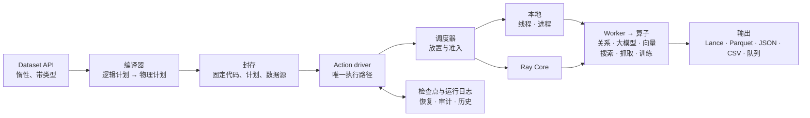

<div align="center">

# DemiFlow

**面向 AI 数据管线、崩溃后可续跑的 Dataset 引擎。**

在一条惰性 Dataset 管线里调用大模型、做向量化、搜索、抓取，甚至训练模型。<br>
笔记本上能跑，Ray 集群上也能跑；中途崩溃可以从断点接着跑，已完成的行不重算，模型费用不重复付。

[](#安装)
[](#项目状态)
[](https://github.com/lancedb/lance)
[](#一套-api从单机到集群)
[](#许可证)

[English](README.md) · **简体中文**

</div>

---

## 为什么需要 DemiFlow？

今天大多数 AI 数据处理还停留在脚本阶段：一个循环调用模型 API、写文件，然后祈祷别出错。
跑到第三个小时，总会出点事。于是重跑：模型厂商再收一次钱，写了一半的结果和新结果混在一起，
也没人说得清哪一行是哪个模型生成的。

**DemiFlow 把这个循环变成引擎能理解的管线。**
模型调用、向量化、网页搜索、文件下载，都是普通的 Dataset 算子。
引擎负责规划执行、把内存控制在你设定的预算内、记录进度和每一次外部调用的结果，
再把结果提交到带版本的 [Lance](https://github.com/lancedb/lance) 表。
进程挂了，就从最近一个确认点接着跑。

## 核心特性

- 🧠 **AI 原生算子。** `map_prompt` 可调用任意 OpenAI 兼容模型或 Azure 模型，返回按 schema 校验过的 JSON，自带重试和请求数硬上限。此外还有异步 prompt、多轮 Agent（`agentmap_async`）、向量化、向量检索、网页搜索、原始抓取和文档解析。
- 🛟 **天生抗崩溃。** 每个 action 都把检查点记进运行日志。用原来的 `RunRef` 恢复时：
  - 已确认的行不重算；
  - 重放不消耗新的模型请求；
  - 结果不明的调用不会被盲目重发；
  - 写表会和原事务对账，不会重复写入。
- 🗂️ **原生 Lance 数据。** 读取固定在某个表版本上。写入支持 `create`、`append`、`overwrite` 和按键 `merge`：条件允许时只重写改动的列，提交前一律校验键唯一，并保证原子提交。只用键的反连接、按键查表、向量索引都是内置能力。
- ⚖️ **资源有界。** 内存、批大小、落盘量和并发预算从读取一直贯穿到写出，宽表和长任务在普通机器上也能跑。
- 🚀 **一套 API，从单机到集群。** 同一份 Dataset 代码可以跑在本地线程、本地进程或 Ray Core 上。调度、重试和恢复都走同一条执行路径。
- 🎯 **训练和评测在同一张图里。** 在固定版本的数据上 `fit` 模型，按步数挑选权重，再在留出集上 `predict`。每一条评分都能追溯到对应的样本、模型权重和数据版本。
- 🖥️ **Workbench 与 Forge。**
  - **Workbench** 是 Web 控制台，用来管理项目、运行记录、数据表和 Notebook；
  - **Forge** 是命令行工具，你或你的编程 Agent 可以用它查询 SDK、搭建管线，并在运行前检查接线是否正确。

## 安装

需要 Python 3.10 及以上。本版本支持 **Linux x86_64（glibc 2.35 及以上）**。

```bash
# 1. 带两个上游 Arrow 修复的 Lance（原因见下方说明）
pip install "https://github.com/vincent9299/demiflow/releases/download/v0.3.0/pylance-12.0.0+demiflow.arrowfix1-cp310-abi3-manylinux_2_35_x86_64.whl"
# 2. DemiFlow
git clone https://github.com/vincent9299/demiflow.git
cd demiflow
pip install -e ".[llm]"          # 核心 + 大模型客户端
# 可选 extras：ray、embeddings、search、fetch、images、pdf、analysis、notebook
```

> **为什么要单独装一个 Lance？** 官方 `pylance` 直到 14.0.3，写入切片过或可空的嵌套 struct 时会崩溃。上面的 wheel 是 Lance 12.0.0 加上两个已合入 Apache Arrow 上游的修复（[#10835](https://github.com/apache/arrow-rs/pull/10835)、[#10709](https://github.com/apache/arrow-rs/pull/10709)）重新构建的，补丁和构建步骤见 [patches/lance-12.0.0](patches/lance-12.0.0/README.md)。官方版本带上这两个修复后，DemiFlow 会改回官方包。

## 快速上手

```python
from pathlib import Path
from demiflow import data

papers = data.from_items([
    {"id": 1, "title": "Attention Is All You Need", "year": 2017},
    {"id": 2, "title": "Lance A Modern Columnar Format", "year": 2024},
    {"id": 3, "title": "Ray A Distributed Framework", "year": 2018},
])

def is_recent(row):
    return row["year"] >= 2018

def add_slug(row):
    return {**row, "slug": row["title"].lower().replace(" ", "-")}

uri = str(Path("papers.lance").absolute())
papers.filter(is_recent).map(add_slug).write_lance(uri, mode="create")   # 到这里才真正执行

table = data.read_lance(uri, version=1)   # 每次读取都固定在某个表版本上
print(table.count())                      # 2
```

关联、反连接和增量更新用的是同一套 API：

```python
authors = data.from_items([{"id": 2, "author": "Lance team"}, {"id": 3, "author": "Moritz et al."}])
table.join(authors, on="id").take_all()                        # inner/left/semi/anti
table.exclude_keys(data.from_items([{"id": 3}]), on="id")       # 只用键的反连接

patch = data.from_items([{"id": 2, "year": 2025}])
patch.write_lance(uri, mode="merge", on="id", update_columns=["year"])   # 只更新 year 列
```

## 三行接入大模型

先把一次模型调用写进带版本的 prompt pack，密钥留在环境变量里：

```yaml
# prompts.yaml
schema_version: demiflow_prompt_pack_v2
prompts:
  summarize:
    version: summarize-v1
    model:
      name: gpt-4o-mini                  # 任意 OpenAI 兼容模型
      transport: openai_compatible
      base_url_env: MODEL_BASE_URL
      api_key_env: MODEL_API_KEY
    schema_retries: 1
    response_schema:
      type: object
      additionalProperties: false
      required: [summary]
      properties:
        summary: {type: string, maxLength: 280}
    template: |
      Summarize this paper title in one sentence for a newsletter:
      {{ title }}
```

然后像普通变换一样使用：

```python
summaries = table.map_prompt(
    "summarize", config="prompts.yaml",
    inputs={"title": "title"}, output="summary",
    max_requests=1_000,                   # 新请求数的硬上限
)
summaries.write_lance(str(Path("summaries.lance").absolute()), mode="create")
```

模型返回的结果会按 schema 校验，不合格时重试一次，同时记录 token 用量。

## 从中断处继续

```python
from demiflow.execution import RunContext, RunRef

with RunContext.start("runs/newsletter") as run:
    print(run.ref)          # RunRef(directory=..., run_id=...)，请保存好
    summaries.write_lance(out_uri, mode="create")
```

如果进程中途被杀掉，用原来的引用重新进入同一条管线即可：

```python
with RunContext.resume(RunRef(directory, run_id)):
    summaries.write_lance(out_uri, mode="create")    # 从最近的检查点继续
```

> 我们做过一个测试：一条 2000 行的管线跑到约第 900 行时用 `kill -9` 杀掉，再在新进程里恢复。
> 恢复后不重做已完成的部分：两个进程加起来，2000 行的函数共执行 2010 次（只有被杀时正在处理的 10 行重跑了一次），输出表 2000 行齐全，只有一个 Lance 版本。

## 在一条管线里训练和评测

```python
fitted = train.fit(recipe=recipe, monitors={"validation": validation})
scores = (
    fitted.checkpoints.select(steps=[400, 800])
    .predict(on=holdout, inputs={"prompt": "question"})
    .map(score_sample)
)
scores.write_lance(scores_uri, mode="create")
```

训练配方、训练函数和预测器由你提供。引擎负责：
- 固定数据版本；
- 在不同 action 之间复用已完成的训练；
- 引擎托管时，在本机 CPU 或多块 GPU 上监管训练进程；交给外部服务托管时，跟踪外部作业。

详见[训练与评测指南](docs/dataset-training.md)。

## 工作原理



每个公开的 Dataset action 只走一条执行路径：
1. 编译器选定物理计划；
2. 封存环节固定要运行的程序；
3. worker 在明确的资源授权下执行算子。

检查点同时记下进度和每一次外部调用的结果，所以恢复时不需要靠猜。

## 能力一览

| 类别 | API |
|---|---|
| **读取** | `from_items` `range` `read_lance` `read_parquet` `read_json` `read_csv` `read_text` `read_images` `read_sql` `read_queue` |
| **变换** | `map` `flat_map` `filter` `map_batches` `map_async` `batch_map` `select_columns` `sort` `aggregate` `deduplicate` |
| **关系运算** | `join` `exclude_keys` `lookup_lance` `union` `group_batches` `reduce_by_key` |
| **AI** | `map_prompt` `map_prompt_async` `agentmap_async` `map_embeddings` `search_vectors` `vector_search_lance` |
| **数据获取** | `search_web` `fetch` `read_documents` `decode_document` `encode_image` |
| **流式与队列** | `run_stream` `enqueue` `read_queue` `ack_queue` `admit_rows`，后端为 SQLite 或 PostgreSQL |
| **写出** | `write_lance`（create / append / overwrite / merge）`save_lance` `write_parquet` `write_json` `write_csv` `materialize` |
| **训练与评测** | `fit` → `checkpoints.select` → `predict` |
| **工具** | `demiflow run --backend local\|ray` · `demiflow workbench` · Forge CLI |

## 一套 API，从单机到集群

把管线打包成 bundle，启动时再选后端：

```bash
demiflow run --root ./my_pipeline --backend local
demiflow run --root ./my_pipeline --backend ray --ray-job-api-address http://ray-head:8265
```

bundle 是一个带 `PipelineProgram` 入口的目录，见 [`demiflow/pipeline/`](demiflow/pipeline/)。分步指南正在编写中。

打开 Workbench，浏览项目、运行记录和结果表：

```bash
demiflow workbench console --registry ~/demiflow/console.json add /path/to/my_pipeline
demiflow workbench console --registry ~/demiflow/console.json serve --port 59865
```

## 什么时候该用 DemiFlow

**适合：**
- **大表上的逐行 AI 加工：** 打标、抽取、打分、翻译、向量化。
- **长时间运行的数据获取管线：** 搜索、抓取、解析，必须扛得住重启，不能重复下载，也不能重复计费。
- **数据消融和模型评测：** 需要从每一条评分追溯到样本、模型权重和数据版本。

**不适合：**
- **在大型数仓上做交互式 SQL 分析。** 请用 DuckDB 或 Spark；DemiFlow 读写 Lance 和 Parquet，可以和它们搭配使用。
- **通用的作业编排**（定时任务、Shell 任务的 DAG）。请用 Airflow 或 Dagster；DemiFlow 管线可以作为其中一步。

## 文档

| 主题 | 指南 |
|---|---|
| 流式 `map` 与并发 | [docs/streaming-map.md](docs/streaming-map.md) |
| 调用大模型：prompt pack、额度、失败处理、多模型路由 | [docs/llm.md](docs/llm.md) |
| 图片生成 | [docs/image_generation.md](docs/image_generation.md) |
| Agent 算子：行内多轮调用工具 | [docs/agents.md](docs/agents.md) |
| 关联、分组与排序 | [docs/relational.md](docs/relational.md) |
| 向量编码、建索引与检索 | [docs/vectors.md](docs/vectors.md) |
| 抓取、队列与数据获取 | [docs/dataset-fetch.md](docs/dataset-fetch.md) |
| 写入 Lance 表与部分列合并 | [docs/lance-write.md](docs/lance-write.md) |
| 训练与评测 | [docs/dataset-training.md](docs/dataset-training.md) |
| Workbench 与 Forge | [docs/forge-workspace.md](docs/forge-workspace.md) · [docs/forge-cli.md](docs/forge-cli.md) |
| 引擎架构 | [docs/dataset-engine-architecture.md](docs/dataset-engine-architecture.md) |

## 项目状态

DemiFlow **0.3** 是第一个公开版本，目前处于 beta 阶段。

- **稳定支持的接口：** `demiflow.data` Dataset API、prompt pack、`RunContext` 和 `demiflow` 命令行。
- **可能随时调整：** `demiflow.execution`、`demiflow.planning` 下的内部模块。
- **已验证的环境：** Linux 单机，以及单机 Ray。
- **尚未验证：** 多机 Ray，以及付费的第三方训练服务。

## 参与贡献

欢迎提 Issue 和 Pull Request。提交代码前请先阅读：

- [仓库规范](docs/repository-rules.md)：分支、评审门禁和发版流程；
- [有限资源约束](AGENTS.md)：所有改动都要守住内存、批大小和落盘上限；
- [引擎架构规约](docs/dataset-engine-architecture.md)：17 个引擎模块，每项职责只有一个负责模块。

## 许可证

DemiFlow 采用 [Apache License 2.0](LICENSE) 许可。

Workbench 内置了少量前端库，它们各自采用宽松许可，声明文件与对应文件一起放在 `demiflow/workbench/web/`。

## 致谢

DemiFlow 构建在这些优秀项目之上：
[Apache Arrow](https://arrow.apache.org/)、[Lance](https://github.com/lancedb/lance)、
[Apache DataFusion](https://datafusion.apache.org/)、[Ray](https://www.ray.io/)、
和 [SearXNG](https://github.com/searxng/searxng)。
项目于 2026 年 9 月从 [Demiurge](https://github.com/vincent9299/Demiurge) 独立出来。

<div align="center">

如果 DemiFlow 帮你省掉了一次重跑，欢迎点个 ⭐

</div>
