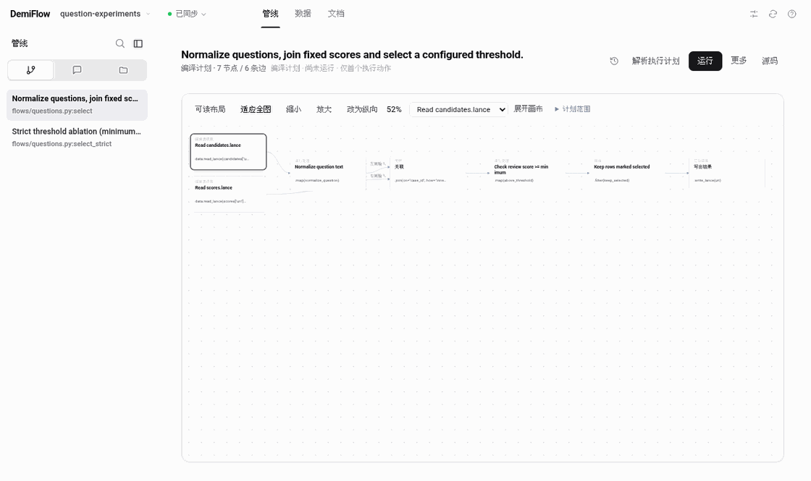
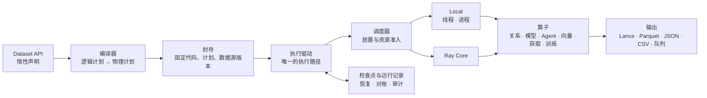
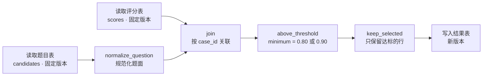
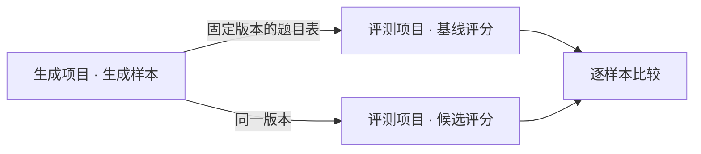

<div align="center">

# DemiFlow

**为 AI 编程助手时代设计的 AI 数据平台。**

数据生产、合成与实验的全链路：从原始资料出发，清洗、标注或生成样本，比较数据配方，再用训练和评测检验效果。<br>
管线由 AI 编程助手来写，由平台来约束，由人来核对。

[](#安装)
[](#项目状态)
[](#为-ai-开发而设计)
[](https://github.com/lancedb/lance)
[](#引擎一条执行路径资源有上限)
[](#许可证)

[English](README.md) · **简体中文**

</div>

---

## 为什么需要 DemiFlow

现在的数据管线大多是 AI 编程助手写的。第一轮生成代码很容易，难的是之后：

- 改到第三十轮、换过几个助手之后，新来的助手还能不能查到**真实的接口**，找到**已有的实现**，只改该改的地方？
- 助手写出来的管线，会不会悄悄吞掉失败的行、超出模型预算、把内存撑爆？
- 人怎么知道实际跑的是什么逻辑，这一轮改动到底让样本变好了还是变坏了？

做训练数据和评测数据的团队每天都在改配方：换一版提示词，调一个筛选阈值，多加一路合成。每改一次，都要回答三个问题：

> **这次改了哪条规则？哪些样本因此改变？这个改变值不值得保留？**

DemiFlow 是为这种工作方式设计的：给助手一套说得清、查得到的 API，给项目一套约束助手的工程工具，给人一个能从图一路看到样本的工作台，底下是一个把资源和失败管住的执行引擎。

## 为 AI 开发而设计

### 1. 统一的语义 API：助手写的是意图，不是胶水

所有步骤都用同一套 Dataset API 声明：关联、模型调用、多轮 Agent、向量检索、网页检索、下载、训练。每一步读哪一列、结果写到哪一列、失败写到哪里、最多花多少次请求，都写在调用处，没有藏在别处的默认行为。

```python
labeled = (
    questions
    .map_prompt_async(
        "classify", config="prompts.yaml",          # 带版本的提示词和返回格式
        inputs={"text": "question"}, output="label",
        error_output="label_error",                 # 失败的行留下来，写明原因
        concurrency=8, max_requests=1_000,          # 并发和预算是显式的硬上限
    )
    .join(reviews, on="case_id", how="left")
)
labeled.write_lance(out_uri, mode="create")         # 到这里才执行，写成带版本的表
```

这样设计是为了让助手**不容易写错**，也让人**一眼能审**：

- **声明式，没有隐藏行为。** 平台不会悄悄重试、悄悄截断、悄悄换模型。超出预算或输入不合法时明确报错。
- **同一种写法贯穿全部算子。** `inputs`、`output`、`error_output`、`concurrency`、`max_requests` 在模型、Agent、向量、检索算子上含义一致，学会一个就会全部。
- **接口可以查询。** 每个公开接口都登记了签名、说明和语义信息（读写哪些数据、有没有网络访问、是流式还是批式），助手可以直接查，不用翻源码或凭记忆猜。

### 2. Forge：驾驭编程助手的工程工具

Forge 是一组命令，人和助手用同一套。它回答助手在每一轮都会遇到的问题：

| 助手需要知道 | Forge 怎么给 |
|---|---|
| 这个项目里已经有什么？ | `forge context`：已登记的管线、目录、配置，一屏看完 |
| 这个 SDK 到底提供什么？ | `forge context --api <符号>`：当前安装版本的真实签名、说明和语义 |
| 新代码该放在哪里？ | `forge add`：管线、算子、提示词、配置各有固定位置 |
| 我改对了吗？ | `forge check`：不执行代码的静态检查，核对接线、参数、目录和算子说明 |
| 还有什么没想到？ | `forge review`：另一个模型会话做只读的独立评审，意见带文件和行号 |
| 怎么收尾？ | `forge develop`：把检查和评审意见交回原助手返工，直到通过 |

下面是 `forge context --api` 的真实输出（节选）。助手拿到的是当前版本的事实，而不是训练数据里的旧印象：

```text
## 当前版本 DemiFlow 原生 API

- demiflow.data:Dataset.map_prompt_async (self, prompt: 'str', *, config: 'str | Path | PromptPack',
      inputs: 'Mapping[str, str] | Sequence[str]', output: 'Optional[str]' = None, ...)
  来源：demiflow/data/dataset.py
  原生语义：{"contract_id": "demiflow.prompt.stream", "effects": ["network"], "execution": "stream", ...}
  Native streaming prompt actor, sharing map_prompt's prompt-pack contract. ...
```

Forge 不依赖工作台，可以单独在终端或 CI 里使用。它管的是接线合规和长期可维护；业务效果仍然由样本和实验判断。

### 3. 算子自带说明：代码就是文档，图就是事实

项目里的每个算子都用类型声明字段，在函数说明里写清业务含义、参数和一个最小的输入输出例子：

```python
class ScoredRow(TypedDict):
    case_id: str
    score: float


def above_threshold(row: ScoredRow, *, minimum: float) -> bool:
    """Keep a question only when its review score reaches the threshold.

    Args:
        minimum: lowest score that still passes, between 0 and 1

    Example:
        Input: {"case_id": "c02", "score": 0.84}
        Output: True
    """
    return row["score"] >= minimum
```

这份说明有三个读者：下一位助手靠它找到并复用已有算子；`forge check` 核对它是否齐全；工作台把它直接显示在算子图的节点上。说明和代码写在一起，不会各走各的。

## 工作台：从算子图一路看到样本

助手写代码很快，判断结果对不对仍然要靠人。工作台是给人用的浏览器界面，打开的是和 Forge 同一个项目目录，没有第二份状态。

<p align="center">
  
  <br />
  <sub>基于 <a href="examples/forge_workspace/README.md"><code>examples/forge_workspace</code></a> 实机录制：真实代码生成算子 DAG → 节点数据流、示例与源码 → 管线源码并排对照 → 封存运行与版本化输出 → 项目 Notebook 与语义化 <code>data_tools</code>。</sub>
</p>

**看懂管线**

- **算子图来自真实代码。** 图从 Python 入口生成，不需要手工维护。节点上直接显示算子的业务说明。
- **点开任意节点**，看到它读写的字段、实际参数、对应的 Python 源码，以及检查发现的问题所在的位置。
- **同一条管线的多套配置**并排可选，方便对照两种配方的差别。

**运行和追踪**

- **在界面里完成一次运行**：选配置、检查、提交、看进度和日志，需要时取消或从中断处恢复。
- **每次运行都留有记录**：当时固定的图、源码、配置、输入版本和输出表版本。两次运行可以直接对比。
- **跨项目编排**：把多个项目里已登记的管线接成一张图，上游发布的表或模型产物接到下游；改了哪个节点就从哪个节点重跑。

**看数据**

- **按版本浏览数据表**：打开某次运行产出的那个版本，取样、看图、逐条看样本。
- **项目 Notebook**：内置 Jupyter，内核运行在项目的沙箱和权限范围内。
- **Notebook 助手**：围绕你选中的单元格工作，先查项目里有哪些表和现成工具，再写代码并实际运行给你看结果。
- **数据工具可以沉淀**：反复用到的看图、质检、人工标注代码保存为项目的 `data_tools/`，下次从工具目录直接调用；标注结果和样本放在一起。

**让助手在界面里改项目**

- **开发助手**：在工作台里用对话让编程助手修改项目。每一轮修改之后自动做 Forge 检查，改动了受保护的文件会被指出来。

**安全默认值**

- 服务只监听本机，访问需要令牌；远程使用时通过 SSH 端口转发。
- 默认只读。运行、写配置都要在登记项目和启动服务时分别显式开启。

启动方式见[快速上手](#在浏览器里看一条真实的管线)和 [Forge 与工作台](docs/forge-cli.md)。

## 引擎：一条执行路径，资源有上限

助手写的管线要能放心地跑，靠的是引擎把这些事管住。



- **架构职责单一。** 引擎由 17 个模块组成，每项职责只有一个负责模块；每个公开动作只走一条执行路径，本地和 Ray 共用同一套编译、封存、调度和恢复。见[引擎架构](docs/dataset-engine-architecture.md)。
- **资源管理是引擎的职责，不是使用者的运气。** 并发、队列、批大小、内存和临时磁盘都有明确上限，在开始执行之前做准入检查；下游变慢时上游自动等待；超出预算时明确失败，而不是悄悄撑爆机器。
- **每次运行都被封存。** 执行前固定源码、计划和数据源版本，之后任何时候都能说清这次运行用的是什么。
- **中断后从断点继续。** 进度和外部调用的结果都记入运行记录。用原来的运行引用恢复时，已确认的批次直接复用，写表与原事务对账，结果不明的外部调用不会被盲目重发。
- **数据带版本。** 读取固定在明确的表版本上；写入支持新建、追加、覆盖和只更新部分列的按键合并。

## 丰富的算子，尤其是 AI 算子

AI 算子是专门为**数据合成**和**机器标注**准备的，而且是引擎理解的一等公民，不是包在 `map` 里的黑盒，所以引擎能对它们限流、计数、记录和恢复。

| 你要做的事 | 用哪些算子 |
|---|---|
| **机器标注**：给已有样本打标签、打分、分类、抽取字段 | 决策模型（System 1）做大批量筛选和打分；思考模型（System 2）按 JSON Schema 产出结构化标签；需要查证时用 Agent 对照文档再下结论 |
| **数据合成**：生成题目、答案、对话、描述、图片 | 思考模型（System 2）按模板和返回格式生成文本样本；图片输出生成或编辑图片；检索和下载提供素材；Agent 负责需要多步查找和组织的样本 |

每个标注或生成步骤都带提示词版本、返回格式校验、请求预算和失败列，所以一批机标或合成数据是哪一版提示词、哪个模型产出的，哪些行失败了，事后都查得到。

| 类别 | 算子 | 用途 |
|---|---|---|
| **大模型 · 决策模型（System 1）** | `map_prompt_async`，模型声明 `transport: systemone` | 直接做判断：对文本或图片提出是非问题，得到 0–1 的概率；一次请求可以带多个问题。适合大批量筛选和打分 |
| **大模型 · 思考模型（System 2）** | `map_prompt` · `map_prompt_async` | 推理和生成：带版本的提示词，返回按 JSON Schema 校验，不合格可重试；支持 OpenAI 兼容接口和 Azure，可按行路由到不同模型 |
| **Agent** | `agentmap_async` | 在一行之内多轮调用工具：读文档、查向量、调用项目自己的函数；轮数、调用次数和上下文都有预算 |
| **向量** | `map_embeddings` · `search_vectors` | 文本、图片、文档片段编码；建索引；逐行检索 |
| **图片** | `map_prompt_async`（图片输出）· `encode_image` | 图片生成与编辑；为模型输入准备图片 |
| **检索** | `search_web` | 内置三十多个来源，覆盖网页搜索和图片搜索；可以接入自己的来源。带缓存、限速和逐来源的失败记录 |
| **下载** | `fetch` | 把每行的地址完整下载为原始对象，校验大小和摘要；支持 HTTP(S) 和对象存储；可用任务队列让多个进程分担 |
| **文档** | `read_documents` · `decode_document` · `read_object` | 把网页和 PDF 解析成按块组织的文档，为提示词挑选相关内容 |
| **关系与批计算** | `join` · `reduce_by_key` · `group_batches` · `sort` · `aggregate` · `exclude_keys` · `lookup_lance` | 关联、分组、排序、聚合，数据超过内存时自动落盘 |
| **训练与评测** | `fit` → `checkpoints.select` → `predict` | 在固定版本的数据上训练，按步数选 checkpoint，在留出集上预测并逐样本打分 |
| **流式与队列** | `map` / `map_async` 的并发参数 · `enqueue` · `read_queue` | 有界队列的流式执行；多进程分担任务，支持 SQLite 和 PostgreSQL |

决策模型和思考模型是两类大模型算子，可以放在同一条管线里：先用决策模型低成本地筛掉大部分样本，再把剩下的交给思考模型或 Agent 仔细处理。每一步都有自己的预算和失败列。

## 数据消融实验：比一般数据引擎多出来的部分

一般的数据引擎把数据算出来就结束了。做数据的团队还要知道：**这一处改动，单独拿出来，到底起了什么作用。** DemiFlow 把消融实验需要的条件做进了平台：

- **只变一处。** 同一条管线可以登记多套配置（例如阈值 0.80 和 0.90），其余部分是同一份代码、同一个固定版本的输入。
- **两次结果都留着。** 每次运行写出自己的表版本，互不覆盖；运行时的源码、配置和输入版本一并封存。`demiflow workbench run compare` 可以对比两次运行的记录。
- **逐样本对比。** 按版本读回两次结果，直接看哪些样本被留下、哪些被丢掉、哪些的标注变了。
- **接着验证效果。** 用两份数据各自训练，在同一份留出集上预测并逐样本打分。只改下游评分规则时，已完成的训练直接复用。
- **只重做变了的部分。** 多条管线接成的实验里，改了哪个节点就从哪个节点重跑，上游符合条件的结果直接复用。

于是开头的三个问题各有出处：

| 问题 | 在 DemiFlow 里怎么回答 |
|---|---|
| 改了哪条规则？ | 管线是普通 Python。算子、提示词、参数各有固定位置，每次运行封存当时的源码和配置。 |
| 哪些样本因此改变？ | 数据写成带版本的 [Lance](https://github.com/lancedb/lance) 表。两次运行各有版本号，可以逐条对比。 |
| 值不值得保留？ | 在同一条管线里训练、选 checkpoint、在留出集上预测并逐样本打分，得到对照结果。 |

## 安装

需要 Python 3.10 及以上。本版本支持 **Linux x86_64（glibc 2.35 及以上）**。

```bash
# 1. 带两个上游 Arrow 修复的 Lance（原因见下方说明）
pip install "https://github.com/vincent9299/demiflow/releases/download/v0.3.0/pylance-12.0.0+demiflow.arrowfix1-cp310-abi3-manylinux_2_35_x86_64.whl"
# 2. DemiFlow
git clone https://github.com/vincent9299/demiflow.git
cd demiflow
pip install -e ".[llm]"          # 核心 + 大模型客户端
# 可选 extras：ray、embeddings、search、fetch、images、pdf、notebook 等，见 pyproject.toml
```

> **为什么要单独装一个 Lance？** 官方 `pylance` 直到 14.0.3，写入切片过或可空的嵌套 struct 时会崩溃。上面的 wheel 是 Lance 12.0.0 加上两个已合入 Apache Arrow 上游的修复（[#10835](https://github.com/apache/arrow-rs/pull/10835)、[#10709](https://github.com/apache/arrow-rs/pull/10709)）。补丁和构建步骤见 [patches/lance-12.0.0](patches/lance-12.0.0/README.md)。

## 快速上手

### 改一条评分，两个版本都留着

在一个空目录里运行。假设人工复核把 `c02` 的评分从 0.7 改成 0.9：只提交这一列，然后按两次写入各自的版本号读回同一道题。

```python
from pathlib import Path
from demiflow import data

uri = str(Path("scores.lance").resolve())
first = data.from_items([
    {"case_id": "c02", "question": "Which bird is pictured?", "score": 0.7}
]).write_lance(uri, mode="create", return_receipt=True)

reviewed = data.from_items([{"case_id": "c02", "score": 0.9}]).write_lance(
    uri, mode="merge", on="case_id", update_columns=["score"],
    expected_version=first.committed_version, return_receipt=True,
)

for version in (first.committed_version, reviewed.committed_version):
    row = data.read_lance(uri, version=version).take(1)[0]
    print(version, row["case_id"], row["score"])

# 1 c02 0.7
# 2 c02 0.9
```

`expected_version` 防止这次更新盖掉别人刚提交的修改。实验报告里写上版本号，以后重看仍能读到当时的数据。详见[写入 Lance 表](docs/lance-write.md)。

### 在浏览器里看一条真实的管线

在仓库根目录运行。它会创建一个独立的题目筛选项目和样例表，然后启动工作台：

```bash
pip install -e ".[images]"
demo_dir="$(mktemp -d)/questions"
python examples/forge_workspace/make_demo.py "$demo_dir"
demiflow workbench view "$demo_dir"
```

打开终端打印的本机地址，进入管道列表，选 `flows/questions.py:select`。工作台从这段 Python 代码生成的算子图是这样的：



点开任意节点，可以看到它读写的字段、实际参数和对应的 Python 函数。

这个示例用同一份输入比较 0.80 和 0.90 两个阈值：前者保留 `c01`、`c02`，后者只保留 `c01`。被筛掉的是哪道题、它的评分是多少，打开两个输出版本就能看到。这就是“哪些样本因此改变”的最小例子。说明见[示例项目](examples/forge_workspace/README.md)。

### 让编程助手用同一个项目

```bash
demiflow forge context --root "$demo_dir"                                      # 项目概况：已登记的入口、配置、目录
demiflow forge context --root "$demo_dir" --api demiflow.data:Dataset.filter   # 查某个接口的真实签名
```

助手接手一个项目时先看这两份输出：项目里已经有什么，SDK 实际提供什么。改完之后用 `demiflow forge check` 做静态检查（不执行业务代码）；配置评审模型后，`demiflow forge review` 会另起一个只读会话评审改动。从空目录新建项目的完整流程见 [Forge 与工作台](docs/forge-cli.md)。

## 更多例子

### 从中断处继续

```python
from demiflow.execution import RunContext, RunRef

with RunContext.start("runs/newsletter") as run:
    run_ref = run.ref                     # 保存下来：RunRef(directory, run_id)
    summaries.write_lance(out_uri, mode="create")

# 进程被杀之后，在新进程里：
with RunContext.resume(run_ref):
    summaries.write_lance(out_uri, mode="create")
```

一次实测：一条 2,000 行的管线跑到约 900 行时被 `kill -9` 杀掉，然后从原运行恢复。两个进程合计执行行函数 2,010 次（只有被杀瞬间还在处理的 10 行重跑了），输出表 2,000 行、一个 Lance 版本。这里统计的是 Python 行函数的调用次数。模型调用的恢复边界见[调用大模型](docs/llm.md)：已确认的批次不再调用，中断时尚未确认的一批可能重新调用。

### 在一条管线里训练和评测

```python
fitted = train.fit(recipe=recipe, monitors={"validation": validation})
scores = (
    fitted.checkpoints.select(steps=[400, 800])
    .predict(on=holdout, inputs={"prompt": "question"})
    .map(score_sample)
)
scores.write_lance(scores_uri, mode="create")
```

训练器、预测器和评分规则由项目提供。只改下游的评分规则或留出集时，已提交的训练结果可以复用。详见[训练与评测](docs/dataset-training.md)。

### 把多条管线接起来

生成项目发布一张表，评测项目用两套配置跑同一条评分管线，再逐样本比较：



项目在 `workflows/*.json` 里声明这张图，用 `$from` 引用上游实际发布的表或模型产物。只想重做候选评分时：

```bash
demiflow workbench workflow resume ./my_project RUN_ID --from-node eval_candidate
```

它重跑这个节点及其下游，其余符合条件的成功结果直接复用。

### 一个完整、可复核的对照实验

仓库里有一个多模态对照实验，研究的问题是：**同一道题，有参考图时模型表现会更好吗？**

| 怎么保证两组可比 | 示例里的做法 |
|---|---|
| 两组拿到的题面相同吗？ | 从三张固定版本的表读取概念、图片和关联，先发布题目和参考图，再从同一题面生成有图、无图两组答案。 |
| 两路评分看到的是同一张作答图吗？ | 两个评分器读取同一张生成图。失败和无法判断的样本单独列出，汇总时保留原来的分母。 |
| 最后一次写表已确认，外层运行却意外中断，会怎样？ | 用原运行记录恢复后得到相同的数据，模型请求数和两张表的版本号都没有增加。 |

这个例子用本地服务返回预设的模型回复，不需要密钥。它验证的是管线行为：编译、分支、图片读写、模型请求、写表和恢复都经过真实的引擎。要评价模型质量，需要换成真实模型。

[管线源码](examples/refgen_reference_case/flows/reference.py) · [运行说明](examples/refgen_reference_case/README.md) · [恢复测试](tests/test_refgen_reference_case.py)

## 能力一览

| 领域 | 接口 |
|---|---|
| **读取** | `from_items` `range` `read_lance` `read_parquet` `read_json` `read_csv` `read_text` `read_images` `read_sql` `read_queue` |
| **变换** | `map` `flat_map` `filter` `map_batches` `map_async` `batch_map` `select_columns` `sort` `aggregate` `deduplicate` |
| **关系运算** | `join` `exclude_keys` `lookup_lance` `union` `group_batches` `reduce_by_key` |
| **模型与 Agent** | `map_prompt` `map_prompt_async` `agentmap_async` `map_embeddings` `search_vectors` `vector_search_lance` · 图片生成 |
| **数据获取** | `search_web` `fetch` `read_documents` `decode_document` `encode_image` |
| **流式与队列** | `run_stream` `enqueue` `read_queue` `ack_queue`，支持 SQLite 和 PostgreSQL |
| **写出** | `write_lance`（新建 / 追加 / 覆盖 / 部分列合并）`write_parquet` `write_json` `write_csv` `materialize` |
| **训练与评测** | `fit` → `checkpoints.select` → `predict` |
| **Forge** | `demiflow forge init` · `context` · `add` · `check` · `review` · `develop` |
| **工作台** | `demiflow workbench console` · `view` · `run` · `workflow` · `table` |

## 文档

| 主题 | 指南 |
|---|---|
| 流式执行与并发 | [docs/streaming-map.md](docs/streaming-map.md) |
| 关联、分组与排序 | [docs/relational.md](docs/relational.md) |
| 写入 Lance 表与部分列合并 | [docs/lance-write.md](docs/lance-write.md) |
| 调用大模型 | [docs/llm.md](docs/llm.md) |
| Agent 算子 | [docs/agents.md](docs/agents.md) |
| 图片生成 | [docs/image_generation.md](docs/image_generation.md) |
| 向量编码、建索引与检索 | [docs/vectors.md](docs/vectors.md) |
| 网页检索 | [docs/web-search.md](docs/web-search.md) |
| 获取、队列与文档 | [docs/fetch.md](docs/fetch.md) |
| 训练与评测 | [docs/dataset-training.md](docs/dataset-training.md) |
| Forge 与工作台 | [docs/forge-cli.md](docs/forge-cli.md) |
| 平台与引擎架构 | [docs/architecture-master-intent-v1.md](docs/architecture-master-intent-v1.md) · [docs/dataset-engine-architecture.md](docs/dataset-engine-architecture.md) |

## 项目状态

DemiFlow **0.3** 是第一个公开版本，目前处于 beta 阶段。

- **稳定支持的接口：** `demiflow.data` Dataset API、prompt pack、`RunContext` 和 `demiflow` 命令行。
- **可能随时调整：** `demiflow.execution`、`demiflow.planning` 下的内部模块。
- **已验证的环境：** Linux 单机，以及单机 Ray。
- **尚未验证：** 多机 Ray，以及付费的第三方训练服务。

## 参与贡献

欢迎提 Issue 和 Pull Request。提交代码前请先阅读：

- [仓库规范](docs/repository-rules.md)：分支、评审门禁和发版流程；
- [有限资源约束](AGENTS.md)：所有改动都要守住内存、批大小和落盘上限；
- [引擎架构规约](docs/dataset-engine-architecture.md)：17 个引擎模块，每项职责只有一个负责模块。

## 许可证

DemiFlow 采用 [Apache License 2.0](LICENSE) 许可。工作台内置了少量前端库，它们各自采用宽松许可，声明文件与对应文件一起放在 `demiflow/workbench/web/`。
