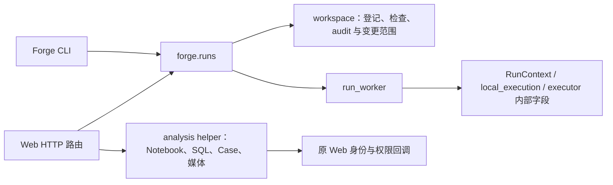

# 当前实现与架构总意图的边界 Review

依据：[架构总意图 v1.0](architecture-master-intent-v1.md)。审阅时间：2026-11-07T19:12:42+08:00（Asia/Singapore）。实现范围为当前固定 Source35；37 个关键文件与安装字节一致。扫描 483 个非 vendor Python 文件，仅作静态依赖核查，不把它当运行验收。

**结论：需要调整，重点是 Forge 与运行管理、共享操作及上下文的边界；现有功能主体可以保留。** 当前交付不等待新引擎。用户已明确允许 SQL 暂时耦合在 Notebook 中，独立查询接口和大范围目录整理均移出近期必改项。

## 重点一 Forge 工程规则与运行管理分责

当前 [runs._prepare](/yzp/zhaozy/yangzepeng/0905/_demiflow/forge_coordination_20261104/workflow_workbench_20261105/P2/integration-source-input-35/source/demiflow/forge/runs.py:232) 同时负责加载工作区、核对开发变更范围、调用流程检查、封存输入和创建运行；[workspace](/yzp/zhaozy/yangzepeng/0905/_demiflow/forge_coordination_20261104/workflow_workbench_20261105/P2/integration-source-input-35/source/demiflow/forge/workspace.py:187) 同时承载项目/数据/平台声明与 audit/change_scope。运行管理仍直接知道 Forge 工作区格式和私有检查函数。

应保留执行时的真实性与保护检查，但拆清来源：Forge 负责规范、开发范围和证据；SDK/引擎负责程序能力和执行契约；运行管理负责本次运行身份、封存、当前权限、预算和可执行状态。Forge 向运行管理传递明确可核验的准入依据，运行管理不导入 Forge 的开发任务实现。

这是优先设计和后续渐进抽取的边界。不能简单删掉 `_verify_change_scope` 或把 `checked=true` 作为可信通行证；适用规则仍在真实操作时验证。查询、日志和停止只检查所需权限与当前状态，恢复另核封存与兼容，不统一重跑开发验收。

## 重点二 CLI 和 Web 共享同一套 Forge 操作

已具备的重要基础：[CLI](/yzp/zhaozy/yangzepeng/0905/_demiflow/forge_coordination_20261104/workflow_workbench_20261105/P2/integration-source-input-35/source/demiflow/forge/run_cli.py:39) 与 [Web 路由](/yzp/zhaozy/yangzepeng/0905/_demiflow/forge_coordination_20261104/workflow_workbench_20261105/P2/integration-source-input-35/source/demiflow/forge/workspace_view.py:823) 都调用 `runs.prepare/start/resume/cancel`，Web 没有通过 shell 执行 Forge CLI 来实现这些操作。这部分应复用。

尚需在 Forge 边界上归一的是操作合同：入口的命令/HTTP 参数、适用工程规则、返回结果、错误与未知语义、前置条件和副作用说明。目前它们分散在 CLI 注册、HTTP 路由、workspace/run_admission 与各用例中。应在实际功能演进时沉淀共享用例及工具描述，入口只完成解析、认证、调用和呈现。

Web 的远端身份认证与本地 CLI 的可信调用身份可以不同；这不是将所有动作强制走 HTTP 的理由，也不能据此直接断言现有 CLI 越权。验收重点是同一受管动作采用一致的领域条件与适用 Forge 规则，取消和未知结果不能因入口不同而自动重试。

## 重点三 Forge Context 与 Tools 引用独立领域能力

`forge` 包当前容纳了运行、Notebook/SQL、Case、媒体、项目目录、开发会话及 Web。包名本身不是故障，但不能据此把这些领域的状态和资源控制都定义成 Forge 工作流。

Forge Context 从各领域读取有来源的事实并形成有界上下文；Forge Tools 将受控操作映射到共享用例。run/attempt 仍由运行管理负责，Notebook 的文档/代次/单格执行和 Case 答案仍由原领域负责。Forge 运维按场景组织诊断和控制，引用操作结果，不复制第二份运行账本，也不重建 Agent Harness。

[development.tasks](/yzp/zhaozy/yangzepeng/0905/_demiflow/forge_coordination_20261104/workflow_workbench_20261105/P2/integration-source-input-35/source/demiflow/forge/development/tasks.py:67) 与 [lifecycle](/yzp/zhaozy/yangzepeng/0905/_demiflow/forge_coordination_20261104/workflow_workbench_20261105/P2/integration-source-input-35/source/demiflow/forge/lifecycle.py:16) 分别已有任务基线和项目 review/freeze 形态。应说明其适用对象和证据如何衔接，再提取可复用规则；不能因为名称相似就合并历史或重置基线。

## 当前调用关系与目标边界

目标调整是使共享用例明确调用 Forge 规则与独立运行领域，运行领域通过合同消费规则依据及引擎能力。它不要求立即拆进程、迁数据库或搬全部文件。

## 保留和延后的部分

| 范围 | 实现事实与判断 | 安排 |
|---|---|---|
| 计算核心 | 显式 Python 导入检查中未发现 SDK/计算/执行模块反向导入 Forge；顶层 CLI 注册 Forge 属于入口 | 保持依赖方向；静态检查不等于所有动态插件均已证明独立 |
| 原生事实 | `runs` 和 `run_worker` 复用原生 RunJournal；已有 run/attempt 和封存来源 | 保留，避免在新分层里复制第二份成功或恢复账本 |
| 引擎接线 | [run_worker](/yzp/zhaozy/yangzepeng/0905/_demiflow/forge_coordination_20261104/workflow_workbench_20261105/P2/integration-source-input-35/source/demiflow/forge/run_worker.py:97) 直接调用 `local_execution` 并设置 `_executor` 内部字段 | 当前版继续；按双方 C1–C6 约定，新引擎验收后适配 |
| SQL 与 Notebook | [Operations.Scope](/yzp/zhaozy/yangzepeng/0905/_demiflow/forge_coordination_20261104/workflow_workbench_20261105/P2/integration-source-input-35/source/demiflow/forge/analysis/operations.py:22) 和 `admit` 要求活跃 session/generation/cell；查询复用 DataFusion，未创建 Pipeline run | 用户允许当前耦合；独立消费者出现时再抽查询 scope/接口 |
| Web 权限适配 | [Authority](/yzp/zhaozy/yangzepeng/0905/_demiflow/forge_coordination_20261104/workflow_workbench_20261105/P2/integration-source-input-35/source/demiflow/forge/analysis/authority.py:24) 绑定原 Web 身份；[set_capabilities](/yzp/zhaozy/yangzepeng/0905/_demiflow/forge_coordination_20261104/workflow_workbench_20261105/P2/integration-source-input-35/source/demiflow/forge/console.py:189) 依赖具体 WebService | 当前保留部署方式与严格校验；将来新增独立工具消费者时再用中立身份/权限合同适配，不能靠去掉身份绑定解耦 |
| 分析控制 | Controller 统一装配会话、读取、媒体和执行 backend；已有 ExecutionBackend 协议 | 可以保留当前进程和装配；通用资源的后续抽取与引擎 A 共同主写，禁止另造 allocator |
| Notebook 与 Case 存储 | [Records](/yzp/zhaozy/yangzepeng/0905/_demiflow/forge_coordination_20261104/workflow_workbench_20261105/P2/integration-source-input-35/source/demiflow/forge/analysis/records.py:73) 中共存文档、视图和答案方法，领域记录和事务已有区别 | 按消费者逐步拆仓库接口，保留同库及答案/event/media_basis 原事务，无需先拆数据库 |
| 页面、富输出及开发连接 | D1.9、历史富输出和 existing_http 已有实现及阶段证据 | 保留既有成果，只验受影响部分；不为架构图重写 UI 或 Harness |

## 对当前交付的影响

当前仍以固定版产品收口为先：媒体读取异常及其后续图片重开、资源性能与当前版页面提交链尚未全部验收。架构 Review 不增加 SQL 独立化、通用资源重建或新引擎完成等前置条件。

后续 Forge 边界调整按三个可验收切口准备：共享操作合同；工程准入依据与运行领域的接口；Context/Tools 对领域查询和控制的适配。每个切口先列保留行为和受影响调用者，再做最小抽取。独立职责可以先在原目录中形成，目录迁移与兼容入口清理随相应切口完成。

本次完成的是定版文档与实现 Review，未修改产品源码、环境或服务，未新派发架构重构。所有已完成的产品阶段保留原证据，整体交付仍未收口。

证据：[固定源及安装字节审计](../../_demiflow/forge_coordination_20261104/architecture_baseline_20261107/source35-review.json)、[双方接口约定](../../_demiflow/platform_coordination_20261104/forge_kernel_alignment_20261107/final_agreement_v1.json)、[当前产品阶段](../../_demiflow/forge_coordination_20261104/stage_review_20261107_1816/review.json)。

## 第一轮接口设计

按当前版本逐步调整，先设计三个边界。现有 `runs` 用例、运行记录和引擎调用保留；共享操作合同先落实到已有用例，随后抽取工程依据验证，最后由 Context/Tools 消费这些接口。下面是供独立 Review 的接口方案，不增加本次媒体修复的发布前置。

| 操作 | Forge 提供的规则和上下文 | 运行管理必须保留的判断 |
|---|---|---|
| prepare | 项目、规则版本、开发范围及检查/验证依据 | 固定代码、参数、平台和输入输出；创建运行身份；预算检查；封存结束前再次确认依据仍适用 |
| start | 对原封存对象复核适用工程依据 | 锁内核对准备凭证、目标 attempt、封存、当前执行权限和资源；不把当前编辑替换历史封存 |
| show、list、logs | 汇总带来源和时间的运行上下文 | 读取权限、明确 run/attempt、有界分页和日志游标；不重新执行工程验收 |
| cancel | 明确停止目标、影响范围和适用授权 | 当前控制权限、目标版本和合法状态转移；停止请求已受理与实际退出分别表示 |
| resume | 对原封存与当前操作复核适用依据 | 原执行已停止、清理和最终计量完成、剩余总预算、原生恢复兼容性；保留旧 attempt 和原生提交事实 |

工程依据合同包含规则及版本、项目/代码/参数/平台/输入绑定、开发范围和基线引用、检查与验证原件引用、适用操作。运行模块定义它所需的验证接口；受信装配提供 Forge 规则实现，运行模块不导入 Forge 开发工作流。需要的规则未配置或依据过期时明确拒绝。摘要只绑定对象，不能授予权限；客户端的 `checked=true` 不能替代实际验证。此方案复用原证据与记录，不引入中央票据或第二份运行账本。

CLI 与 API 的共享操作合同应列出输入类型、目标及 expected 绑定、前置条件、副作用、结果、错误、超时和取消语义。本地可信调用与 Web 认证分别适配操作上下文；存在活动状态所有者时通过其既有接口访问。操作受理、实际结果和资源清理分别表达，未知结果先按原身份查询，不自动重新派发。

Context 只汇总有界事实和引用，例如 run/attempt、观察时间、日志范围、产物来源和权限。Tools 调用共享操作；开发任务基线、运行事实、Notebook 与 Case 状态仍归各自领域。运维流程可以组合查询、诊断、停止及受支持恢复，不增加自己的调度器或状态副本。

后续实现按每个切口验收：等价主体和输入经 CLI/API 得到一致的适用规则及结果；过期依据、状态冲突、未知启动和未完成清理继续被正确拒绝；旧命令、接口、封存和历史可读。抽取替代的分支同批清理，只补受影响路径。SQL 暂随 Notebook、现有数据库与部署方式保持；新引擎适配按双方 C1–C6/R1–R4 在其验收后进行。

设计原件及源码锚点：[Forge 边界首轮设计 Review](../../_demiflow/forge_coordination_20261104/stage_review_20261107_1925/forge-boundary-design-review.json)。
