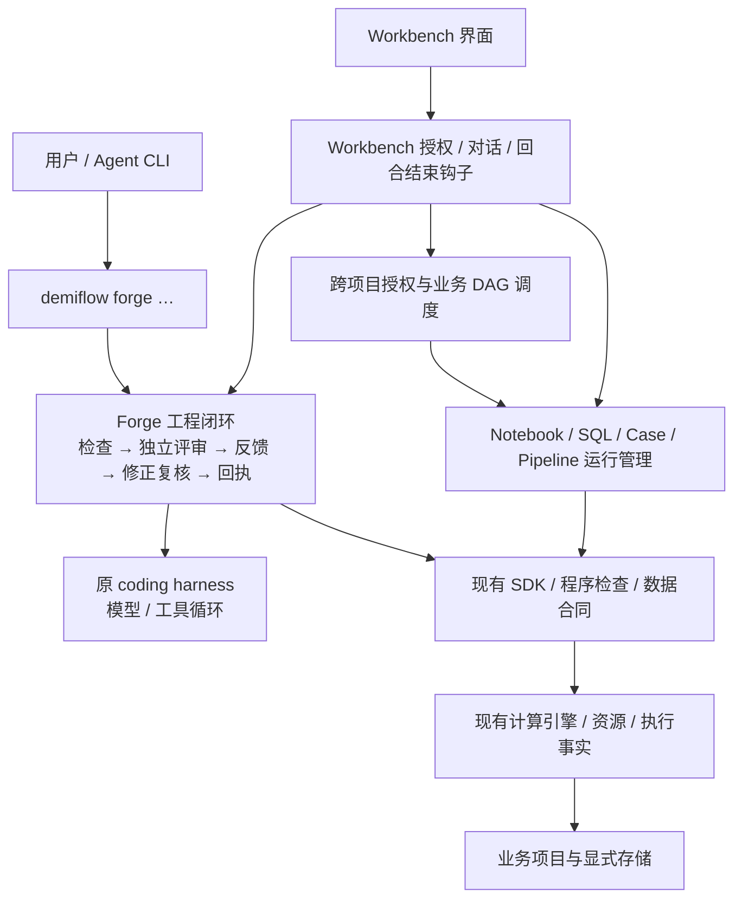

# DemiFlow 架构总意图与职责边界

版本 v1.5，2026-11-26。本文是平台架构、Forge 与工作台方案和代码的现行规约。
继承 v1.3 的三块划分、单向依赖、唯一事实所有者及历史保护要求，并落实真人确认的 Forge 独立闭环边界。
以下职责、权威状态、产品意图和底层合同均为现行规范。
规约规定目标与约束，实际交付须有对应代码和验收证据。

## 原始意图与三块职责

产品意图保持为统一、真正可用的 DemiFlow 工作台，让用户看懂、配置和运行 Pipeline，并灵活分析、比较和评测数据。
Forge 同时服务终端用户和 Agent，可以脱离工作台完成工程工作。

| 模块 | 拥有的职责 | 依赖边界 |
|---|---|---|
| 计算底座 | SDK、算子、程序检查、计算执行、封存、恢复、资源、固定版本数据与结果合同 | 不依赖 Forge 或工作台；继续复用既有执行及资源实现 |
| Forge | 有来源的 context、规范、受控工程操作、静态检查、验证与独立评审、开发交付回合编排及回执 | 不导入工作台实现，不要求其服务、私有数据库或浏览器存在 |
| Workbench | 项目授权、产品 API/UI、开发对话与 provider 连接、人工队列、Notebook/SQL、Case、媒体、Pipeline 运行管理 | 单向复用 Forge 工程用例和底座合同；拥有自身交互与生命周期 |

三块可以同仓、同包、同进程部署。依赖箭头表示代码调用，不要求新建网络服务。
业务项目的源码、参数、数据、run/attempt、日志、checkpoint 和结果留在原项目及显式配置存储。
项目登记只保存发现与授权引用；工程交付回执不能成为第二份 Pipeline 运行账本。

图中 Forge 向原 harness 反馈，使用中立传输合同。终端由 Forge 的 CLI 实现该传输；工作台上下文由宿主传入实际连接及授权能力。
该能力注入不授权 Forge 读取工作台存储，也不把工程决策委托回工作台。

## Forge 独立闭环

1. 公开入口统一为 `demiflow forge …`。CLI 与工作台调用同一 Forge 工程用例。Agent 传输是内部实现细节，不另建平行的 Forge 产品入口。
2. Forge 必须能在没有工作台服务、UI 或数据库时，把原始需求交给 coding Agent，接收其回合结束事实，完成检查、独立评审、反馈原 Agent、有限修正和同范围复核，留下可查询回执。仅独立执行一次 `check` 或 `review` 不构成此闭环。
3. Forge 编排工程交付回合。模型推理与工具调用循环仍归原 coding harness；Forge 不复制该循环、通用 Agent 框架或计算执行器。
4. 工作台须在作者回合结束后可靠触发 Forge，避免依赖 Agent 自觉调用；Agent 也可主动请求。两种触发复用范围、策略、候选身份与去重规则，显式缩小范围必须在回执中可见，不得默认只取首个 Flow。
5. Forge 拥有适用检查、完整目标覆盖、评审有效性、反馈内容、返工预算、复核与完成判定。工作台负责授权、真实传输、会话/人工队列、进程与资源执行边界和展示，不再实现另一份工程状态机。
6. 原作者会话、提交、候选源码身份与评审身份必须关联。反馈针对已验证的当前候选并回到原会话；后续修正形成新候选，重新检查和评审。进程、Web 回合与工程交付、Pipeline run/attempt 分别标识。
7. 对外副作用之前先持久化反馈决定及稳定发送身份，投递、确认、完成分别记录。未知 ACK 不当成失败或成功，也不自动重发；崩溃恢复不得重置返工预算。宿主可用自身事务持久化 Forge 定义的回执和待发送记录，Forge 不要求第二份宿主数据库。
8. 人工排队消息保持顺序和语义。工程反馈不得静默丢弃、抢占用户新要求或以过期候选驱动修改；等待、被新要求替代、取消及需重新核验均明确记录。
9. 静态规范检查与付费独立评审的开关分开。免费检查失败仍可驱动有限修正；未要求独立评审不得表示已经评审通过。文档改动的自动评审按适用性决定，手动请求仍可执行。
10. 检查、评审不能代替真实项目测试。只在项目显式提供解释器和验证命令且获准时执行；不得使用工作台 Python 猜测业务环境，不自动运行生产 Pipeline 或付费业务模型。

编排声明 `workflows/*.json` 由 Forge 定义、登记和静态检查。独立评审按实际本项目节点关联源码、参数和消费者。外部项目的入口及运行授权由持有登记事实的宿主核验。运行产物引用由执行端在上游提交后核验。工作台通过同一回合授权向 Codex 和 DeepSeek 提供项目目录与受控操作，恢复原会话时重新绑定当前授权。

## 必须保持的工程不变量

- 独立评审使用与作者分离的会话，保持现有无工具、只读证据模型。受限宿主继续以 OS 边界和固定模型通道隔离，凭据不进入不可信作者/评审环境；可信终端如实报告其执行保证。
- 作者完成且清理已确认后才开始独立评审，可复用同一宿主执行槽位。未知清理继续保留所有权。普通开发回合的 warm reuse、模型连接及协议身份不因抽取工作流而丢失。
- 分片、补读、格式修复与返工共享明确的总请求/时间/字节预算。每片获得的是剩余预算；不能每调用一次重新给满额。不可拆的超预算对象明确 incomplete，不能悄悄删除目标、截断源码或扩额。
- 所有目标先固定为一个候选；按受影响 Flow、共享依赖和未归属改动划分检查材料，聚合后仍核对完整覆盖和全部源码身份。删除文件、无 Git 项目和原参数绑定均保留来源。
- 源码引用须精确到文件、前后版本、行号与字面摘录，校验失败不成为可执行反馈。报告完整度与已验真的阻断项分别表达；少量无效条目不能抹去其余合法证据，也不能被默默忽略后标为 passed。
- 完成评审和派发修正之前重新校验候选。有效旧结论保留历史身份，不能被用作当前版本的通过证明。
- 真人原始需求及已接收的补充要求具有显式来源；自动返工、评审触发、工具输出不伪装成新需求。预算不足要说明缺口，不能静默截断意图。
- 终端和工作台对同一物理根及父子根使用同一写入准入事实，保留实际进程 lease/清理证据。检查通过不授予文件、网络、模型、数据或运行权限。
- 受保护内容、宿主合法的目录操作、既有 dirty/staging、Notebook、对话及历史记录保持原义。平台会话只改平台，通过规范和反馈驱动开发助手修正业务源码。

## 既有模块边界继续有效

`workbench/process.py` 只识别调用方已持有的辅助进程身份。Notebook、数据/媒体、开发对话直接使用它，不能为此依赖 `workbench/runs/`；该模块不反向依赖各领域，不建立 run/attempt 或中央调度器。
共享宿主配置继续由现有 `workbench/host_partition.py` 提供。

`workbench/runs/` 保持 Pipeline 提交、运行记录、停止与恢复。工程工作流调用适用的既有底座代码，运行仍有唯一控制 owner、预算、ACK、fence 和提交事实。
查询、日志、停止不追加开发评审前置。运行严格准入必须显式启用，不能借本次改造把历史 observe 行为升级成强制门禁。

Notebook、SQL、Case 和开发对话各自保留语义、事务及生命周期。SQL 可继续随 Notebook；本轮不抽取统一运行 SDK、运行中心、资源账本或 C1–C6 同名适配层。
底层原 C1–C6/R1–R4 的版本、能力、取消、未知状态、恢复和资源合同保持有效，实际使用以现行引擎接口为准。

## 架构意图的七个分支与二十七项职责

以下编号用于下拆任务和验收，不要求二十七个包或服务。表中最后一列界定职责范围。

### AR.1 入口与界面

| 意图编号与职责 | 拥有的能力 | 依赖 | 职责限制 |
|---|---|---|---|
| AR.1.1 Forge CLI | Agent和人的受控命令入口。命令发现/帮助/结构化参数和有界JSON结果。稳定操作ID与错误、取消和查询交互 | Forge工具与开发/运维用例。需要时使用领域所有者的远程接口 | 重复领域状态机与授权规则。新增裸计算CLI作为默认入口。强制所有静态本地动作经过HTTP |
| AR.1.2 结构化API与传输适配 | 认证与协议转换。路由/序列化/连接流。请求边界与取消传递 | 工作台自身领域用例、按需复用的Forge公共用例及底层合同。中立身份/授权上下文 | 业务状态机。依赖Forge私有实现。要求领域回调具体WebService |
| AR.1.3 Web工作台 | D1.9导航/四tab/共享选择上下文。图/源码/日志的展示。Notebook/Case/开发交互。响应式与错误可达 | HTTP能力接口。通用展示组件 | 直接编排Python进程。重复规范或运行/评测逻辑 |
| AR.1.4 通用展示组件 | 表格/消息/文本/代码/JSON/HTML。图像缩放与音视频播放。不可信内容处理。局部展开/解码/订阅 | 呈现描述和固定引用。媒体/分页读取接口 | 答案权威记录。执行器/内核控制。业务数据变换 |

### AR.2 Forge上下文、工具与工作流

| 意图编号与职责 | 拥有的能力 | 依赖 | 职责限制 |
|---|---|---|---|
| AR.2.1 Forge上下文 | 汇集项目规范、任务范围、SDK能力、源码和数据说明。按任务聚合运行日志/状态/故障及可用操作。标注来源、版本、时间和有界摘要 | Forge自身只读接口。底层公开事实/SDK描述合同。调用方通过中立合同提供的事实。Forge开发/运维记录 | 复制运行或数据的权威状态。以旧上下文代替操作时权限/状态检查 |
| AR.2.2 Forge受控工具契约 | 工具发现、结构化输入输出和能力说明。读写/副作用/适用范围与前置条件表达。将工具调用映射到共享用例或领域操作 | Forge自身开发/运维和运行用例。中立底层公开操作合同 | 自己运行Agent思考/工具循环。复制领域规则或执行器。只在CLI或提示词落实约束 |
| AR.2.3 Forge开发与交付工作流 | 规范版本和项目结构约定。初始化、范围、baseline 和构建。检查、独立评审、向原作者反馈、有限修正与复核，直至 Freeze/handoff 及证据归档 | SDK/算子/程序公开合同。源码与构建测试工具。按验证类型使用Forge自身运行管理或底层通用执行接口 | 重新实现计算引擎。将应用运行/Notebook/SQL/Case状态混同开发任务。以代理文字结论代替验证事实 |
| AR.2.4 Forge运维工作流 | 故障上下文及操作目标/影响范围。诊断、前置检查、操作预览和必要的审批依据。组织适用授权下的停止/恢复等运维动作及结果关联 | Forge自身运行管理及底层受控接口。可观测信息/项目数据/授权机制 | 复制工作台运行状态或底层执行事实。任意自动重试或无授权执行。每个查询/停止都重跑开发验收。接管Agent自身会话生命周期 |

### AR.3 独立应用能力

| 意图编号与职责 | 拥有的能力 | 依赖 | 职责限制 |
|---|---|---|---|
| AR.3.1 各应用的Pipeline运行管理 | Forge与工作台各自组织封存、准入及查询/停止/恢复流程。run/attempt及request_id沿用业务项目记录，明确关联底层执行身份 | 同一SDK程序/执行能力合同、C1–C6、共享资源与固定数据/产物引用。各自适用的中立授权/依据合同 | 依赖另一应用运行管理。复制底层调度、launcher、提交或资源事实。同一执行被双重接管。强制所有SDK调用建应用run |
| AR.3.2 交互查询与统计 | SQL文本/参数/表绑定。query operation/取消。有界结果与来源。目录统计/枚举计算 | 数据目录和访问合同。中立查询后端适配。工作台公共进程工具与既有执行后端。结果发布 | 查询不创建 Pipeline run。当前允许依附 Notebook。独立接口按新增消费者需求提取。 |
| AR.3.3 Notebook文档与会话 | 文档/cell/revision。session/generation。单格execution/输出。中断重启/旧代拒绝。显式Python↔SQL结果桥接 | Jupyter/Python适配。查询能力。数据/结果合同。工作台公共进程工具与既有执行后端 | Pipeline checkpoint语义。强制用户Python导入DemiFlow SDK。打开历史时重放代码 |
| AR.3.4 Case组织与评测 | 稳定Case/方案/字段身份。分组筛选选样翻页。可配置材料/问题/布局描述。答案head/event/revision及media_basis同事务。草稿/下一条/恢复与历史 | 固定表和结果引用。有界查询。中立呈现描述契约与媒体访问。领域记录仓库 | 直接依赖前端渲染组件。Notebook或Pipeline正在运行。为展示固化业务A/B/C分支。重新执行生产者 |
| AR.3.5 Agent会话与Harness连接 | conversation/turn/event和交互历史。可复用Harness/provider连接与工具交互。会话取消/恢复及未知结果呈现。使用所属应用自己的上下文与工具 | 所属应用的上下文/工具接口（工作台可复用Forge）。现有代码代理/provider。项目权限。中立命令协议。工作台公共进程工具 | 代替Forge验收。算子内agentmap。所有Agent必须经Web。等同Pipeline run或算子内Agent生命周期。为架构重划自建完整Harness |
| AR.3.6 外部能力与模型服务管理 | 服务声明/端点/租约。启动/观察/停止的独立生命周期 | 服务后端。环境与进程资源机制 | 在导入SDK/加载配置时隐式启动。把服务状态等同Pipeline attempt |

### AR.4 计算核心

| 意图编号与职责 | 拥有的能力 | 依赖 | 职责限制 |
|---|---|---|---|
| AR.4.1 计算 SDK | 数据/类型/函数与Actor合同。Dataset逻辑计划。PipelineProgram与配置。能力描述与计划检查 | 数据/类型合同。按需算子与连接器。执行器接口（契约独立，具体引擎按需装配） | Web/CLI/Notebook/Forge任务和界面状态 |
| AR.4.2 算子与工具库 | 普通fn/Actor实现。模型/检索/媒体算子。算子内Agent循环及行预算 | SDK合同。第三方客户端/工具。受控数据与执行上下文 | 开发代理会话。为工具调用另建Dataset执行体系。业务规则转换 |
| AR.4.3 计算引擎 | 物理计划和stage/task。批次/背压/Actor/spill。计算提交与checkpoint。真实执行观测 | SDK计算合同。算子实现。查询/数据格式后端适配。低层执行和资源机制 | Forge开发任务。Notebook代次。Web图布局。Case答案 |

### AR.5 项目、数据与结果

| 意图编号与职责 | 拥有的能力 | 依赖 | 职责限制 |
|---|---|---|---|
| AR.5.1 项目与能力登记 | workspace/root身份。公开声明发现。项目能力/授权引用 | 文件/声明协议。授权接口 | 吞并Forge开发项目配置。仅展示就授权执行 |
| AR.5.2 数据目录与访问 | 表/schema/固定版本。别名条件绑定。来源许可与有界读取 | 中立连接器/格式适配。资源所属的权限策略 | 重建存储引擎。访问数据必须经过Dataset计算 |
| AR.5.3 结果与来源 | ResultRef/ArtifactRef。生产者/输入/代码/环境引用。预留/发布/ready/保留。不可变内容及旧版本兼容 | 现有文件/对象存储与格式。发布事务及来源校验 | 统一所有对象为一个snapshot。把字节hash当授权。重新改写旧producer |
| AR.5.4 媒体访问 | 受控固定材料/capture。probe/HEAD-range/ticket/read。当前权限与历史来源核验。读任务取消和实际释放 | 结果/来源合同。原权限接口。媒体工具/字节读取适配。工作台公共进程工具与既有执行后端 | 媒体业务算子。Notebook内核必须活着。浏览器卸载即算已清理 |

### AR.6 执行与资源基础

本职责描述执行与资源合同，不要求集中成一个模块。引擎内部 worker 与资源实现仍归计算底座。工作台已持有子进程的身份查询落在 `workbench/process.py`，领域生命周期仍留在各应用中。公共进程工具不承载本节全部资源准入和计量能力。

| 意图编号与职责 | 拥有的能力 | 依赖 | 职责限制 |
|---|---|---|---|
| AR.6.1 执行与资源基础 | 执行后端/环境绑定和精确执行实例身份。启动握手/停止/退出/清理/退休。CPU/内存/磁盘/FD/并发的准入、计量与归还。同部署域共享资源核算和任务归属。有界IPC与数据传递 | OS/隔离后端/时钟/基础记录 | 通用业务run/session状态机。所有工作共享一个业务队列。将主动采样称为硬隔离 |

### AR.7 公共机制、后端适配与部署装配

| 意图编号与职责 | 拥有的能力 | 依赖 | 职责限制 |
|---|---|---|---|
| AR.7.1 授权与身份机制 | 主体/项目/来源能力上下文。会话/对端身份认证。当前授权复查接口 | 已有身份与权限数据源 | 统一业务授权规则。把Web进程身份写死进底层接口。把提示词当权限 |
| AR.7.2 领域记录与持久化适配 | 各领域仓库接口。事务/expected版本条件更新。文件原子发布/必要同步 | SQLite/文件/对象后端 | 中央CAS产品或万能状态服务。合并业务状态权威。为迁模块复制第二份账本 |
| AR.7.3 通用故障与观测原语 | deadline/取消信号。日志/计时/错误与资源采样 | 时钟和日志基础 | 统一重试所有操作。隐藏unknown执行事实 |
| AR.7.4 中立第三方后端适配 | 查询/表格式/字节读写。Jupyter/模型客户端等小接口 | 当前受支持第三方库或服务 | 反向依赖Pipeline/Forge/UI。为了通用抽象重写第三方引擎 |
| AR.7.5 组合与交付 | 按需依赖与后端选择。构建包/安装/来源一致。领域迁移组织/备份/切换。测试装配与能力声明 | 各领域的公开构造接口与迁移入口 | 在核心SDK导入所有工作台依赖。把逻辑边界强制做成微服务 |

## 状态的唯一归属

各领域可以共用现有 SQLite、文件系统及事务机制。拆逻辑仓库时保留需要一起提交的原事务。不以新建数据库或复制记录来证明解耦。

| 对象 | 权威归属 | 状态边界 |
|---|---|---|
| 业务程序/计算计划 | 业务项目 + SDK | 代码、配置、逻辑计划。不同于一次运行 |
| Forge 工程交付 | Forge 开发与交付工作流 | task、baseline、check、verify、review、原作者反馈及 ACK、修正、freeze 和 handoff，绑定候选身份 |
| 业务编排运行 | 工作台编排调度与业务项目记录 | wf_run_id、编排 attempt、依赖、节点与子 run 引用。子运行执行事实由原 Pipeline 记录提供 |
| 开发对话 | 开发会话 | conversation/turn/event。不代表验收状态 |
| Pipeline应用运行 | 业务 pipeline 项目的运行记录 | run/attempt/封存输入关联实际执行身份。工作台与 Forge 按权限读写同一记录。控制操作由原控制机制核验，不按入口复制账本。恢复消费原checkpoint |
| 引擎执行 | 业务项目中的执行记录，由引擎/执行SDK产生 | stage/task/batch/checkpoint/提交事实。引擎提供读写和观察能力，不拥有独立产品状态服务 |
| Notebook文档 | Notebook文档模块 | revision/cell输入。可脱离内核保存重开 |
| Notebook会话 | Notebook会话模块 | session/generation/内存/连接 |
| 单格执行 | Notebook执行模块 | execution/code hash/dispatch/output |
| SQL查询 | 查询模块 | operation/SQL/绑定/取消/结果引用 |
| 数据来源 | 数据目录与访问 | 表版本/schema/alias。业务数据留原后端 |
| 结果/产物 | 结果与来源 | 不可变对象/ready/producer。不拥有生产者生命周期 |
| 媒体读取 | 媒体访问 | ticket/range/read/capture。直接使用工作台进程工具，生命周期仍归媒体领域 |
| Case视图 | Case模块 | 分组/方案/字段身份与配置revision |
| 评测答案 | Case评测仓库 | head+event+media_basis同事务。expected更新 |
| 资源所有权 | 对应执行后端与所属领域 | lease/slot/cleanup 关联所属领域ID。工作台公共进程工具只读取身份，不另存权威状态、不接管引擎 worker |
| 环境与发布 | 交付装配 | 安装/依赖/工具版本。保留历史producer版本 |
| 项目与访问身份 | 项目登记 + 授权机制 | root映射与grant分开。Forge项目配置另有用途 |
| 模型服务 | 模型服务管理 | service/endpoint/lease。独立于run/attempt |
| 受控运维操作计划 | Forge运维工作流 | 目标/影响范围/授权或审批依据/执行关联与操作记录。引用领域结果，不成为第二份运行状态。 |

Forge 与工作台可以读取同一业务项目的运行记录。各自入口和工作流不代表独立的状态权威。同一次底层执行的控制机制必须明确且唯一，查询许可不自动包含控制权限。应用控制状态、命令受理、宿主进程退出、引擎提交结果和资源清理是不同事实。引擎 RunJournal/commit 是原生执行事实来源。应用可建立查询视图，但不能另造成功判断。Notebook 重启、SQL 取消、Pipeline checkpoint 恢复和 Agent 会话恢复分别解释。

## 与引擎升级线共同固定的接口语义

下表“运行管理”适用于 Forge 和工作台各自的代码/SDK 调用。“接口”不要求常驻服务、HTTP 或 RPC。记录在业务项目或其显式配置的存储，读取历史无需引擎服务在线。底层合同、执行事实和资源实现保持共用。应用身份如何映射到既有执行身份，在适配中保持或明确核验，不凭本文声称新增字段已获引擎支持。

| 合同 | 生产方与消费方 | 固定的语义 |
|---|---|---|
| C1 能力与版本 | 引擎 → Forge/工作台各自运行管理 | 支持模式、操作、协议和平台版本。未支持能力明确拒绝 |
| C2 固定运行输入 | 运行管理 → 引擎整作业入口 | 代码、平台、环境、入口、配置、输入输出和总预算的不可变引用。秘密只引用，不复制进上下文 |
| C3 控制与身份 | 运行管理 → 引擎 | start/observe/cancel/受支持 resume。run/attempt 映射、操作身份、expected 版本和期限。受理不等于完成 |
| C4 事实与结果 | 原生引擎 → Forge/工作台各自的观测适配 | 实际状态、有界日志指标、节点映射及新鲜度、已提交结果引用、独立的清理状态 |
| C5 恢复与兼容 | 引擎声明，运行管理核验后请求 | checkpoint/schema/工件兼容、剩余预算、未知语义。旧 attempt 和封存保持，跨版本恢复需明确验收支持 |
| C6 资源职责 | 运行管理 → E → A | 总额度准入、worker 需求、分配观察归还。说明支持的限制方式、总量与单 worker 口径及部分失败清理 |

**R1**　公共 ExecutionUnit/ResourceLease 与 A 复用同一资源执行实现。一个物理实例只有一个有效生命周期 owner 和计量事实。

**R2**　各应用运行管理核验本次总额度，E 形成需求，A 在同一部署域公共资源树分配和对账，不因应用分开而各自独占一份宿主总额度。driver、supervisor、worker 与退出未确认的占用都计入。父额度与子占用不双计，不能让每个 worker 各拿完整总额度。

**R3**　公共基础不依赖 Forge/Web/Pipeline 业务状态或引擎 D 实现。引擎的原生 fence 通过中立绑定验证。Notebook/SQL/媒体仍核验自己的权限和生命周期。

**R4**　引擎侧牵头 A 和 provider。工作台侧给出现有消费者和兼容要求并联审。共享 helper 每个补丁只有一个主写者。基础 IPC 与 C 的路由、背压、seal/barrier 语义分别负责。

以上是已对齐语义。精确类名、方法、编码和包路径在详细设计中固定。复用已有合同和实现，避免同时建设两个 launcher、调度器、恢复账本或资源分配器。

## 原始产品意图的架构落点

| 原始叶意图 | 必须保留的产品结果 | 主要架构职责 |
|---|---|---|
| R.1.1 | 项目侧栏、开发/管道/数据/Readme 四 tab 与既有开发历史 | AR.1、AR.3.5、AR.5.1 |
| R.1.2 | D1.9 的结构、层级、常用交互及自然响应式 | AR.1.3、AR.1.4 |
| R.1.3 | 紧凑上下文、目录收起释放空间、可达操作与清楚错误 | AR.1、AR.7.3 |
| R.2.1 | 实际代码的算子图、输入输出、参数和源码 | AR.4.1、AR.3.1、AR.1.3 |
| R.2.2 | 配置、检查、定位处理到真实提交 | AR.1.2、AR.3.1、AR.4 |
| R.2.3 | 每个 run/attempt 的封存图、观测、日志、结果、停止和受支持恢复 | AR.3.1、AR.4.3、AR.6 |
| R.3.1 | 数据目录、表字段版本与统计分布 | AR.5.2、AR.3.2 |
| R.3.2 | 同一 Notebook 的 Python/SQL、取消恢复、保存重开和结果互用 | AR.3.2、AR.3.3、AR.5.3、AR.6 |
| R.3.3 | 表格、message/dialogue、text/md/code/json、图片、音频、视频、tag、html | AR.1.4、AR.5.3、AR.5.4 |
| R.4.1 | 分组、筛选、选样、翻页与真实服务端标注状态条件 | AR.3.4、AR.3.2 |
| R.4.2 | 共享输入参考、多方案多字段、可配置角色预览与布局 | AR.3.4、AR.1.4 |
| R.4.3 | Case/方案/字段评测隔离、保存下一条、草稿历史冲突 | AR.3.4、AR.7.2 |
| R.5.1 | 单一平台、合理职责、复用和同批清理 | AR 全部 |
| R.5.2 | 有界资源、真实正常失败取消恢复及性能验证 | AR.6、AR.7、各领域 |
| R.5.3 | 保护业务、dirty/staging、Notebook/开发历史、权限来源持久化 | AR.2.3、AR.5、AR.7、各领域 |

## 实施与验收

按真实消费者抽取能力并同批切换、清理旧策略；禁止兼容垫片、无消费者的层、业务个性化硬编码和例外的反向依赖。
拆分须列明对应产品意图与 AR 职责、状态所有者、调用方向、权限与预算、受影响消费者以及正常与失败验收。新增实体须说明其唯一职责及现有实体为何无法承载。资源上界在读取、分配和调度前落实。

方案与代码分别通过独立架构、质量门禁；负责人对照真人意图裁定反馈，修正实质问题。
验收必须涵盖无 Workbench 导入的真实 CLI 进程闭环、原会话回传和复核、工作台同策略、取消/失联/重启/人工队列/候选变化、资源与历史保护。
源码、验收、合流、发布和预览分别记录，遵循 [发版规范](repository-rules.md)。
