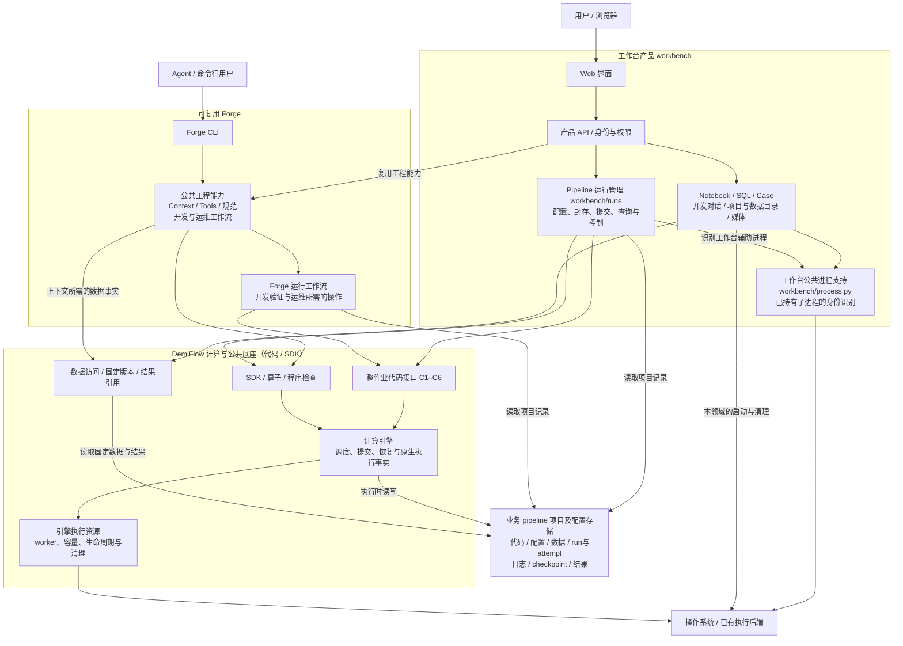
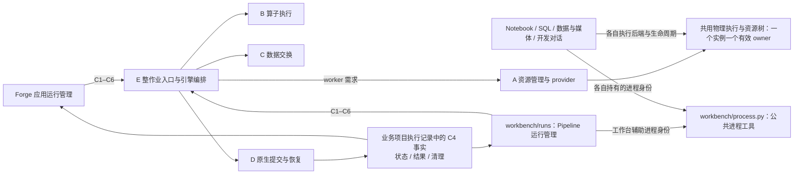

# DemiFlow 架构总意图与职责边界

**2026-11-19 开发 Harness 试用已交付**：G2 自动门禁/独立审阅/有限续修、B1 进程外执行边界和 I1 显式严格运行准入已在指定 worktree 实现并通过模块、联合与真实连续两轮开发验收。原预览 59866 已切到代码提交 `20581ae`；真人明早体验验收待进行。[试用交付记录](forge-development-harness-delivery-20261119.md)保留证据及限制。CLI 拥有 coding loop，Forge 拥有唯一规范与开发证据，工作台消费并编排；未新增计算引擎或运行账本。

**2026-11-18 已确认的开发入口意图补充 DH-20261118**：工作台开发入口复用通用 coding harness；harness 拥有模型/工具循环，Forge 拥有唯一规范、受控开发操作和版本绑定的检查/验证/Review/交付门禁，工作台拥有交互、会话及领域入口。以实际权限边界保护规则与验收记录，避免把提示词或代理答复当成强制约束。用户自然交互，后台自动完成规范装配与常规修复；真实缺口和必要决策可见。工作台→Forge 的单向依赖及既有计算、运行、数据 owner 保持。完整[真人原意图 DH.1—DH.9](../../../forge_coordination_20261104/original_task_intents.md#dh-20261118开发入口-harness-与-forge-硬规范原始意图)是本专项审阅依据；[详细方案 v2](forge-development-harness-design-20261118-v2.md)保留设计沿革，实际实现与验收以上方最新状态及实施契约为准。下方 v1.3 原有架构与历史交付说明保持。

版本：v1.3。状态：**真人已明确工作台进程支持与 Pipeline 运行管理的边界；非引擎代码合入主仓；计算底座保持原样，服务发布单独处理**。v1.0 定版时间：2026-11-07T19:12:42+08:00；本次更新：2026-11-08T01:28:22+08:00（Asia/Singapore）。

本次按真人最新要求修订：**工作台产品可以依赖并复用 Forge；Forge 不反向依赖工作台。Pipeline 的代码、配置、运行记录、日志和 checkpoint 归业务项目及其显式配置的存储；工作台和 Forge 通过可复用代码/SDK 读取、执行和管理它。引擎是被调用的能力，不要求提供独立服务。** 本文路径保留便于引用，版本与修订内容以正文为准。本轮真人已审图并授权按此更新文档、整理目录和代码，要求复用已有能力、同批清理旧实现、不加垫片和无用中间层、没有例外依赖。原始产品 root、AR 编号以及底层 C1–C6/R1–R4 语义保留；修订不表示产品代码已经完成解耦。

本基线用于总控拆任务、审方案和验收边界。原始产品目标 R 保持不变；AR 是从 R 推导的架构总意图，主要承接 R.5.1，并支撑全部产品分支。架构定版与产品交付、代码迁移分别记录。

**原始 root 意图 R**：之前的开发意图，是做一个统一、真正可用的 DemiFlow 工作台，让你看懂、配置和运行 pipeline，并灵活分析、比较和评测数据。

**架构总意图 AR**：组织为计算底座、工作台产品、可独立复用的 Forge 三块。底座提供 SDK、算子、引擎、共享执行资源及数据结果合同；工作台承载 Web 产品及其应用领域；Forge 为 Agent 及人提供有来源的上下文、受控工具和开发/运维工作流。工作台可通过 Forge 公共接口使用其上下文、工具、工程规则及开发/运维工作流；Forge 本身可以脱离工作台使用，不导入工作台实现或依赖其服务与状态存储。双方拥有各自的操作入口、权限和工作流，面向同一获准业务项目，通过代码/SDK 取得执行能力和该项目的运行事实；不是分别建立一份运行状态库。Agent 优先使用 Forge CLI，工作台使用自己的结构化 API；共用底层操作保持同一执行合同，各应用保留各自适用的业务规则。

当前 R.5.1 同时落实职责、调用与目录边界，工作台产品代码收敛到 `workbench/`，可复用 Forge 留在 `forge/`；已有计算底座按引擎线分工维护。**继续基于当前已验固定引擎交付，不等待新引擎；SQL 当前可以继续耦合在 Notebook 中。** 目录归属调整不要求拆服务或迁数据库。`projects/`、`catalog/` 是平台功能代码；业务 pipeline 代码、配置、数据和运行记录仍留在业务项目原有或显式配置的位置。通用管理实现留在平台包中复用，不要求每个业务项目复制一套管理代码。

**当前实现与后续迁移**：按真人最新确认，本轮保留上层直接操作业务项目运行目录和记录的方式，继续复用已有 RunJournal、原生执行/提交及进程观测代码。不先抽取新的统一运行 SDK，不增加引擎服务、统一运行中心或第二份状态库。C1–C6 表达能力与语义约定，不要求本轮制造同名适配层；待 DemiFlow 底层改造完成且有真实复用收益，再评估是否迁移。项目登记只维护发现与授权引用，宿主资源记录只管理共享容量，不成为业务运行状态中心。

**工作台进程支持与 Pipeline 运行管理**：`workbench/process.py` 是工作台内的轻量公共进程工具，当前集中识别调用方已持有的子进程身份（PID、启动时间、boot）。Notebook、数据/媒体读取、开发对话直接复用它，各自保留启动、取消、清理和恢复流程；它不查询 Pipeline 作业状态，不导入 `runs`、Notebook 或对话领域，不创建 run/attempt。`workbench/runs/` 负责 Pipeline 提交、run/attempt 状态查询及控制，对接已有引擎，也可使用这个公共工具确认工作台自己持有的辅助进程。公共工具不接管引擎内部 worker，不新增调度器、资源账本或进程管理服务。

共享资源配置读取集中在已有 `workbench/host_partition.py`。Notebook/分析部署、开发对话和 Pipeline 运行管理直接使用该公共配置模块；Notebook/分析和开发对话不再为了读取配置而依赖 `runs`。

本批计算底座不改：`execution/process_observation.py`、`execution/__init__.py` 和 `execution/run_journal.py` 保持主仓现有实现。历史运行记录的有界只读查询归现有 `workbench/runs/storage.py`，沿用项目记录与原容量检查语义，不新增引擎接口、记录库或服务。待引擎升级后再评估必要对接。

## 定版的核心决定

1. 依赖方向为工作台 → Forge。工作台作为产品可以复用 Forge 的公共 Context、Tools、工程规则及开发/运维用例；Forge 保持独立可用，不反向导入工作台或要求工作台服务、数据库存在。计算底座不依赖两者。
2. Forge 拥有 context、tools、规范、开发/运维工作流及其实际需要的应用运行管理。工作台拥有自己的运行管理、Notebook/SQL、Case、开发对话及产品 API/UI。各自运行管理指各自入口所需的封存、准入、权限、预算和控制流程；run/attempt 对应业务项目中的实际运行，复用其既有记录，不按入口复制状态库。工作台复用 Forge 工程能力不意味着运行必须经 Forge 自己的运行管理转发。
3. 两边各自通过 C1–C6 的适用代码/SDK 合同调用 DemiFlow。接口不等于网络服务，不新增引擎 HTTP/RPC 服务。历史和已落盘状态可直接经读取库查询项目记录；实时观察与停止/恢复调用 SDK 对应的进程或执行后端能力，不能靠改状态文件控制真实作业。SDK/程序检查、原生执行、提交/恢复与资源约束只有既有底层实现；不能为了应用独立再造 launcher、allocator、原生成功账本或恢复引擎。
4. CLI 和 HTTP 是各自应用的入口适配。Forge CLI/Tools 共享 Forge 用例；工作台 HTTP 调用工作台领域接口。工作台调用 Forge 功能时与 Forge CLI/Tools 复用同一 Forge 用例；工作台自己的运行操作使用自身 handler。共用底层操作的输入、身份、错误、取消及 unknown 语义一致，不把不同应用的运行流程强并为一个 handler。
5. SQL、Notebook、Case、开发会话、模型服务分别保留语义和生命周期。当前 SQL 随 Notebook 提供，不因此变成 Pipeline run。工作台的开发对话拥有自己的 provider 连接与会话历史，可复用 Forge 上下文和工具；会话身份、权限与交付记录由产品装配明确传入，Forge 不读取工作台私有存储。SDK 检查和中立数据协议归底座。
6. 应用管理记录与底层执行事实分开。同一次底层执行只有一个明确的控制归属；项目记录关联底层执行身份，工作台与 Forge 可按权限读取同一份记录，控制动作仍核对当前执行身份与授权。底层 RunJournal/commit/ACK/fence 是执行事实来源，资源实例也只有一个有效生命周期 owner 和计量事实。
7. 三块可以在同仓、同包发布物、同进程部署，目录表达真实职责和依赖边界。按最新真人要求直接更新受影响消费者并删除旧实现，不增加兼容垫片、转导入模块或无实际消费者的中间层；不保留例外的反向依赖。原持久化事务、历史身份和业务数据位置保持，不为目录调整复制数据库或接管旧运行。

## 预期架构图



图中工作台 API 可以调用 Forge 的公共工程能力，Forge 没有反向指向工作台的依赖。Notebook、数据读取和开发对话指向工作台公共进程工具，不指向 Pipeline 运行管理；进程工具也没有指向这些领域的反向依赖。OS/已有后端是现存能力，图中箭头不新增资源分配实现。双方各自的运行管理是应用内能力，均消费底层合同；工作台运行管理继续围绕管道 tab 的算子图与运行记录服务，不新增独立运行页面。Forge 只实现其已有开发验证、诊断与受控操作实际需要的运行流程，不因目录对称扩建另一套工作台产品。



图中箭头是代码能力调用或项目记录读写，不表示部署了引擎服务。第二图沿用双方已约定的引擎 A–E、C1–C6 和 R1–R4 语义，只明确两个独立应用消费者；它不宣称新的精确接口或引擎已经可用。Pipeline 执行请求绑定所属应用、run/attempt 与底层执行身份；Notebook、查询、媒体和开发对话使用各自的会话/操作身份，不因此建立 Pipeline run/attempt。不自动接管对方的运行，不把同一次执行记成两次可独立控制的作业。A 和公共资源基础复用同一实现，按同部署域总量核算两个应用的资源需求。

## 本轮目录落点

```text
demiflow/
├── data/、pipeline/、execution/、算子与资源模块  # 现有计算底座
├── forge/                                    # 可独立使用的工程能力
│   ├── cli.py、context.py、tools.py
│   ├── development/                          # 项目开发标准、任务与交付
│   └── audit.py、检查/规范/验证/运行及检查工具
└── workbench/                                # Web 产品
    ├── api.py、cli.py、worker.py、reader.py
    ├── process.py                           # 工作台公共进程工具，不依赖 runs 或应用领域
    ├── web/                                 # 界面资源
    ├── projects/                            # 登记、权限、项目配置与发现
    ├── catalog.py                           # 固定数据引用与读取
    ├── runs/                                # Pipeline 提交、run/attempt 查询与控制，对接已有引擎
    ├── graph/                               # 算子图、参数与源码呈现
    ├── analysis/                            # Notebook/SQL、Case、输出和媒体
    └── conversations/                       # 开发对话、provider与会话历史
```

这是平台代码归属，不是业务项目的数据目录。业务 pipeline 的代码、配置、数据、运行记录和结果留在项目原位置或显式配置的位置；`projects/` 与 `catalog.py` 负责访问和组织这些事实。Notebook/SQL、Case与媒体本轮保留已有协作和事务实现，归入同一个工作台产品。根 `demiflow.cli` 只装配两个应用入口：工程命令使用 `demiflow forge …`；产品命令使用 `demiflow workbench …`。旧产品模块和旧命令注册直接移除，既有持久化格式与历史封存保持原义。

## 应用规则与底层合同

| 归属 | 负责什么 | 实际约束位置 |
|---|---|---|
| Forge Context / Tools | 来源、版本、时间、有界事实、工具描述与映射 | 使用 Forge 自身记录、底层公开事实及调用方通过中立合同传入的上下文/工具适配；执行时重新校验，不导入工作台或要求其 HTTP 服务 |
| Forge 开发与运维 | scope/baseline/check/verify/review/freeze/handoff、诊断和操作关联 | Forge 公共用例落实适用规则，工作台可直接复用；不把开发验收强加为普通查询、停止和历史读取的前置 |
| 工作台应用 | 项目授权、配置检查、应用运行管理、Notebook、Case、开发对话及历史 | 工作台自己的领域用例；工程能力按需复用 Forge 公共接口，程序合法性和执行能力复用 SDK/底层公共检查 |
| 工作台公共进程支持 | 已持有子进程的身份识别；供各领域安全核对原进程 | `workbench/process.py`；只用操作系统事实，各领域仍自行管理生命周期，不接管引擎 worker、不建运行记录 |
| 中立底层能力 | 版本化程序与执行合同、SDK检查、数据引用及公共授权机制 | 归属公共底座；Forge工程规则与工作流可以由Forge提供给工作台，不因产品复用而复制到公共层 |
| 引擎及资源基础 | 实际执行准入、能力、执行身份、提交/恢复、预算及物理资源 | 在真正执行和资源分配处强制；应用上下文、历史许可或 `checked=true` 不授予执行权限 |

例如，Forge 的验证运行先满足 Forge 适用工程规则，再由自己的运行管理请求底层执行；工作台提交由自己的应用规则和运行管理准备输入、核验当前授权，再请求同一底层执行合同；其中适用的 Forge 工程校验可通过其公共接口复用。现有必需校验不能因目录迁移被删除，Forge依据通过中立合同交给实际准入处核验，不承载长期有效的权限。查询、日志、停止只检查对应权限和状态；恢复核验原封存版本、剩余额度和底层支持范围；未知结果不能自动重放。

CAS 在这里指“仅在对象仍是预期版本时更新”，用于答案冲突、登记绑定和资源 owner 释放。它是对应领域仓库的并发机制，不新增中央 CAS 服务，也不决定领域如何划分。

## 架构意图的七个分支与二十七项职责

以下编号用于下拆任务和验收，不要求二十七个包或服务。表中的“边界”说明职责，不禁止已明确允许的阶段性同包实现。

### AR.1 入口与界面

| 意图编号与职责 | 拥有的能力 | 依赖 | 边界 |
|---|---|---|---|
| AR.1.1 Forge CLI | Agent和人的受控命令入口；命令发现/帮助/结构化参数和有界JSON结果；稳定操作ID与错误、取消和查询交互 | Forge工具与开发/运维用例；需要时使用领域所有者的远程接口 | 重复领域状态机与授权规则；新增裸计算CLI作为默认入口；强制所有静态本地动作经过HTTP |
| AR.1.2 结构化API与传输适配 | 认证与协议转换；路由/序列化/连接流；请求边界与取消传递 | 工作台自身领域用例、按需复用的Forge公共用例及底层合同；中立身份/授权上下文 | 业务状态机；依赖Forge私有实现；要求领域回调具体WebService |
| AR.1.3 Web工作台 | D1.9导航/四tab/共享选择上下文；图/源码/日志的展示；Notebook/Case/开发交互；响应式与错误可达 | HTTP能力接口；通用展示组件 | 直接编排Python进程；重复规范或运行/评测逻辑 |
| AR.1.4 通用展示组件 | 表格/消息/文本/代码/JSON/HTML；图像缩放与音视频播放；不可信内容处理；局部展开/解码/订阅 | 呈现描述和固定引用；媒体/分页读取接口 | 答案权威记录；执行器/内核控制；业务数据变换 |

### AR.2 Forge上下文、工具与工作流

| 意图编号与职责 | 拥有的能力 | 依赖 | 边界 |
|---|---|---|---|
| AR.2.1 Forge上下文 | 汇集项目规范、任务范围、SDK能力、源码和数据说明；按任务聚合运行日志/状态/故障及可用操作；标注来源、版本、时间和有界摘要 | Forge自身只读接口；底层公开事实/SDK描述合同；调用方通过中立合同提供的事实；Forge开发/运维记录 | 复制运行或数据的权威状态；以旧上下文代替操作时权限/状态检查 |
| AR.2.2 Forge受控工具契约 | 工具发现、结构化输入输出和能力说明；读写/副作用/适用范围与前置条件表达；将工具调用映射到共享用例或领域操作 | Forge自身开发/运维和运行用例；中立底层公开操作合同 | 自己运行Agent思考/工具循环；复制领域规则或执行器；只在CLI或提示词落实约束 |
| AR.2.3 Forge开发与交付工作流 | 规范版本和项目结构约定；初始化/任务范围/baseline/构建；检查/验证/Review/Freeze/handoff及证据 | SDK/算子/程序公开合同；源码与构建测试工具；按验证类型使用Forge自身运行管理或底层通用执行接口 | 重新实现计算引擎；将应用运行/Notebook/SQL/Case状态混同开发任务；以代理文字结论代替验证事实 |
| AR.2.4 Forge运维工作流 | 故障上下文及操作目标/影响范围；诊断、前置检查、操作预览和必要的审批依据；组织适用授权下的停止/恢复等运维动作及结果关联 | Forge自身运行管理及底层受控接口；可观测信息/项目数据/授权机制 | 复制工作台运行状态或底层执行事实；任意自动重试或无授权执行；每个查询/停止都重跑开发验收；接管Agent自身会话生命周期 |

### AR.3 独立应用能力

| 意图编号与职责 | 拥有的能力 | 依赖 | 边界 |
|---|---|---|---|
| AR.3.1 各应用的Pipeline运行管理 | Forge与工作台各自组织封存、准入及查询/停止/恢复流程；run/attempt及request_id沿用业务项目记录，明确关联底层执行身份 | 同一SDK程序/执行能力合同、C1–C6、共享资源与固定数据/产物引用；各自适用的中立授权/依据合同 | 依赖另一应用运行管理；复制底层调度、launcher、提交或资源事实；同一执行被双重接管；强制所有SDK调用建应用run |
| AR.3.2 交互查询与统计 | SQL文本/参数/表绑定；query operation/取消；有界结果与来源；目录统计/枚举计算 | 数据目录和访问合同；中立查询后端适配；工作台公共进程工具与既有执行后端；结果发布 | 查询不创建 Pipeline run。当前允许依附 Notebook；独立接口按新增消费者需求提取。 |
| AR.3.3 Notebook文档与会话 | 文档/cell/revision；session/generation；单格execution/输出；中断重启/旧代拒绝；显式Python↔SQL结果桥接 | Jupyter/Python适配；查询能力；数据/结果合同；工作台公共进程工具与既有执行后端 | Pipeline checkpoint语义；强制用户Python导入DemiFlow SDK；打开历史时重放代码 |
| AR.3.4 Case组织与评测 | 稳定Case/方案/字段身份；分组筛选选样翻页；可配置材料/问题/布局描述；答案head/event/revision及media_basis同事务；草稿/下一条/恢复与历史 | 固定表和结果引用；有界查询；中立呈现描述契约与媒体访问；领域记录仓库 | 直接依赖前端渲染组件；Notebook或Pipeline正在运行；为展示固化业务A/B/C分支；重新执行生产者 |
| AR.3.5 Agent会话与Harness连接 | conversation/turn/event和交互历史；可复用Harness/provider连接与工具交互；会话取消/恢复及未知结果呈现；使用所属应用自己的上下文与工具 | 所属应用的上下文/工具接口（工作台可复用Forge）；现有代码代理/provider；项目权限；中立命令协议；工作台公共进程工具 | 代替Forge验收；算子内agentmap；所有Agent必须经Web；等同Pipeline run或算子内Agent生命周期；为架构重划自建完整Harness |
| AR.3.6 外部能力与模型服务管理 | 服务声明/端点/租约；启动/观察/停止的独立生命周期 | 服务后端；环境与进程资源机制 | 在导入SDK/加载配置时隐式启动；把服务状态等同Pipeline attempt |

### AR.4 计算核心

| 意图编号与职责 | 拥有的能力 | 依赖 | 边界 |
|---|---|---|---|
| AR.4.1 计算 SDK | 数据/类型/函数与Actor合同；Dataset逻辑计划；PipelineProgram与配置；能力描述与计划检查 | 数据/类型合同；按需算子与连接器；执行器接口（契约独立，具体引擎按需装配） | Web/CLI/Notebook/Forge任务和界面状态 |
| AR.4.2 算子与工具库 | 普通fn/Actor实现；模型/检索/媒体算子；算子内Agent循环及行预算 | SDK合同；第三方客户端/工具；受控数据与执行上下文 | 开发代理会话；为工具调用另建Dataset执行体系；业务规则转换 |
| AR.4.3 计算引擎 | 物理计划和stage/task；批次/背压/Actor/spill；计算提交与checkpoint；真实执行观测 | SDK计算合同；算子实现；查询/数据格式后端适配；低层执行和资源机制 | Forge开发任务；Notebook代次；Web图布局；Case答案 |

### AR.5 项目、数据与结果

| 意图编号与职责 | 拥有的能力 | 依赖 | 边界 |
|---|---|---|---|
| AR.5.1 项目与能力登记 | workspace/root身份；公开声明发现；项目能力/授权引用 | 文件/声明协议；授权接口 | 吞并Forge开发项目配置；仅展示就授权执行 |
| AR.5.2 数据目录与访问 | 表/schema/固定版本；别名条件绑定；来源许可与有界读取 | 中立连接器/格式适配；资源所属的权限策略 | 重建存储引擎；访问数据必须经过Dataset计算 |
| AR.5.3 结果与来源 | ResultRef/ArtifactRef；生产者/输入/代码/环境引用；预留/发布/ready/保留；不可变内容及旧版本兼容 | 现有文件/对象存储与格式；发布事务及来源校验 | 统一所有对象为一个snapshot；把字节hash当授权；重新改写旧producer |
| AR.5.4 媒体访问 | 受控固定材料/capture；probe/HEAD-range/ticket/read；当前权限与历史来源核验；读任务取消和实际释放 | 结果/来源合同；原权限接口；媒体工具/字节读取适配；工作台公共进程工具与既有执行后端 | 媒体业务算子；Notebook内核必须活着；浏览器卸载即算已清理 |

### AR.6 执行与资源基础

本职责描述执行与资源合同，不要求集中成一个模块。引擎内部 worker 与资源实现仍归计算底座；工作台已持有子进程的身份查询落在 `workbench/process.py`，领域生命周期仍留在各应用中。公共进程工具不承载本节全部资源准入和计量能力。

| 意图编号与职责 | 拥有的能力 | 依赖 | 边界 |
|---|---|---|---|
| AR.6.1 执行与资源基础 | 执行后端/环境绑定和精确执行实例身份；启动握手/停止/退出/清理/退休；CPU/内存/磁盘/FD/并发的准入、计量与归还；同部署域共享资源核算和任务归属；有界IPC与数据传递 | OS/隔离后端/时钟/基础记录 | 通用业务run/session状态机；所有工作共享一个业务队列；将主动采样称为硬隔离 |

### AR.7 公共机制、后端适配与部署装配

| 意图编号与职责 | 拥有的能力 | 依赖 | 边界 |
|---|---|---|---|
| AR.7.1 授权与身份机制 | 主体/项目/来源能力上下文；会话/对端身份认证；当前授权复查接口 | 已有身份与权限数据源 | 统一业务授权规则；把Web进程身份写死进底层接口；把提示词当权限 |
| AR.7.2 领域记录与持久化适配 | 各领域仓库接口；事务/expected版本条件更新；文件原子发布/必要同步 | SQLite/文件/对象后端 | 中央CAS产品或万能状态服务；合并业务状态权威；为迁模块复制第二份账本 |
| AR.7.3 通用故障与观测原语 | deadline/取消信号；日志/计时/错误与资源采样 | 时钟和日志基础 | 统一重试所有操作；隐藏unknown执行事实 |
| AR.7.4 中立第三方后端适配 | 查询/表格式/字节读写；Jupyter/模型客户端等小接口 | 当前受支持第三方库或服务 | 反向依赖Pipeline/Forge/UI；为了通用抽象重写第三方引擎 |
| AR.7.5 组合与交付 | 按需依赖与后端选择；构建包/安装/来源一致；领域迁移组织/备份/切换；测试装配与能力声明 | 各领域的公开构造接口与迁移入口 | 在核心SDK导入所有工作台依赖；把逻辑边界强制做成微服务 |

## 状态的唯一归属

各领域可以共用现有 SQLite、文件系统及事务机制。拆逻辑仓库时保留需要一起提交的原事务；不以新建数据库或复制记录来证明解耦。

| 对象 | 权威归属 | 状态边界 |
|---|---|---|
| 业务程序/计算计划 | 业务项目 + SDK | 代码、配置、逻辑计划；不同于一次运行 |
| Forge开发任务 | Forge开发与交付工作流 | task/baseline/check/verify/review/freeze/handoff |
| 开发对话 | 开发会话 | conversation/turn/event；不代表验收状态 |
| Pipeline应用运行 | 业务 pipeline 项目的运行记录 | run/attempt/封存输入关联实际执行身份；工作台与 Forge 按权限读写同一记录；控制操作由原控制机制核验，不按入口复制账本；恢复消费原checkpoint |
| 引擎执行 | 业务项目中的执行记录，由引擎/执行SDK产生 | stage/task/batch/checkpoint/提交事实；引擎提供读写和观察能力，不拥有独立产品状态服务 |
| Notebook文档 | Notebook文档模块 | revision/cell输入；可脱离内核保存重开 |
| Notebook会话 | Notebook会话模块 | session/generation/内存/连接 |
| 单格执行 | Notebook执行模块 | execution/code hash/dispatch/output |
| SQL查询 | 查询模块 | operation/SQL/绑定/取消/结果引用 |
| 数据来源 | 数据目录与访问 | 表版本/schema/alias；业务数据留原后端 |
| 结果/产物 | 结果与来源 | 不可变对象/ready/producer；不拥有生产者生命周期 |
| 媒体读取 | 媒体访问 | ticket/range/read/capture；直接使用工作台进程工具，生命周期仍归媒体领域 |
| Case视图 | Case模块 | 分组/方案/字段身份与配置revision |
| 评测答案 | Case评测仓库 | head+event+media_basis同事务；expected更新 |
| 资源所有权 | 对应执行后端与所属领域 | lease/slot/cleanup 关联所属领域ID；工作台公共进程工具只读取身份，不另存权威状态、不接管引擎 worker |
| 环境与发布 | 交付装配 | 安装/依赖/工具版本；保留历史producer版本 |
| 项目与访问身份 | 项目登记 + 授权机制 | root映射与grant分开；Forge项目配置另有用途 |
| 模型服务 | 模型服务管理 | service/endpoint/lease；独立于run/attempt |
| 受控运维操作计划 | Forge运维工作流 | 目标/影响范围/授权或审批依据/执行关联与操作记录；引用领域结果，不成为第二份运行状态。 |

Forge 与工作台可以读取同一业务项目的运行记录；各自入口和工作流不代表独立的状态权威。同一次底层执行的控制机制必须明确且唯一，查询许可不自动包含控制权限。应用控制状态、命令受理、宿主进程退出、引擎提交结果和资源清理是不同事实。引擎 RunJournal/commit 是原生执行事实来源；应用可建立查询视图，但不能另造成功判断。Notebook 重启、SQL 取消、Pipeline checkpoint 恢复和 Agent 会话恢复分别解释。

## 与引擎升级线共同固定的接口语义

下表“运行管理”适用于 Forge 和工作台各自的代码/SDK 调用；“接口”不要求常驻服务、HTTP 或 RPC。记录在业务项目或其显式配置的存储，读取历史无需引擎服务在线；底层合同、执行事实和资源实现保持共用。原联合约定原件保持原值，本次变更明确应用消费者的独立归属。应用身份如何映射到既有执行身份，在适配中保持或明确核验，不凭本文声称新增字段已获引擎支持。

| 合同 | 生产方与消费方 | 固定的语义 |
|---|---|---|
| C1 能力与版本 | 引擎 → Forge/工作台各自运行管理 | 支持模式、操作、协议和平台版本；未支持能力明确拒绝 |
| C2 固定运行输入 | 运行管理 → 引擎整作业入口 | 代码、平台、环境、入口、配置、输入输出和总预算的不可变引用；秘密只引用，不复制进上下文 |
| C3 控制与身份 | 运行管理 → 引擎 | start/observe/cancel/受支持 resume；run/attempt 映射、操作身份、expected 版本和期限；受理不等于完成 |
| C4 事实与结果 | 原生引擎 → Forge/工作台各自的观测适配 | 实际状态、有界日志指标、节点映射及新鲜度、已提交结果引用、独立的清理状态 |
| C5 恢复与兼容 | 引擎声明，运行管理核验后请求 | checkpoint/schema/工件兼容、剩余预算、未知语义；旧 attempt 和封存保持，跨版本恢复需明确验收支持 |
| C6 资源职责 | 运行管理 → E → A | 总额度准入、worker 需求、分配观察归还；说明支持的限制方式、总量与单 worker 口径及部分失败清理 |

**R1**：公共 ExecutionUnit/ResourceLease 与 A 复用同一资源执行实现；一个物理实例只有一个有效生命周期 owner 和计量事实。

**R2**：各应用运行管理核验本次总额度，E 形成需求，A 在同一部署域公共资源树分配和对账，不因应用分开而各自独占一份宿主总额度。driver、supervisor、worker 与退出未确认的占用都计入；父额度与子占用不双计，不能让每个 worker 各拿完整总额度。

**R3**：公共基础不依赖 Forge/Web/Pipeline 业务状态或引擎 D 实现。引擎的原生 fence 通过中立绑定验证；Notebook/SQL/媒体仍核验自己的权限和生命周期。

**R4**：引擎侧牵头 A 和 provider；工作台侧给出现有消费者和兼容要求并联审。共享 helper 每个补丁只有一个主写者。基础 IPC 与 C 的路由、背压、seal/barrier 语义分别负责。

以上是已对齐语义；精确类名、方法、编码和包路径在详细设计中固定。复用已有合同和实现，避免同时建设两个 launcher、调度器、恢复账本或资源分配器。

## 原始产品意图的架构落点

| 原始叶意图 | 必须保留的产品结果 | 主要架构职责 |
|---|---|---|
| R.1.1 | 项目侧栏、开发/管道/数据/Readme 四 tab 与既有开发历史 | AR.1、AR.3.5、AR.5.1 |
| R.1.2 | D1.9 的结构、层级、常用交互及自然响应式 | AR.1.3、AR.1.4 |
| R.1.3 | 紧凑上下文、目录收起释放空间、可达操作与清楚错误 | AR.1、AR.7.3 |
| R.2.1 | 实际代码的算子图、输入输出、参数和源码 | AR.4.1、AR.3.1、AR.1.3 |
| R.2.2 | 配置、检查、定位处理到真实提交 | AR.1.2、AR.3.1、AR.4 |
| R.2.3 | 每个 run/attempt 的封存图、观测、日志、结果、停止和受支持恢复 | AR.3.1、AR.4.3、AR.6 |
| R.3.1 | 数据目录、表字段版本与统计分布 | AR.5.2、AR.3.2 |
| R.3.2 | 同一 Notebook 的 Python/SQL、取消恢复、保存重开和结果互用 | AR.3.2、AR.3.3、AR.5.3、AR.6 |
| R.3.3 | 表格、message/dialogue、text/md/code/json、图片、音频、视频、tag、html | AR.1.4、AR.5.3、AR.5.4 |
| R.4.1 | 分组、筛选、选样、翻页与真实服务端标注状态条件 | AR.3.4、AR.3.2 |
| R.4.2 | 共享输入参考、多方案多字段、可配置角色预览与布局 | AR.3.4、AR.1.4 |
| R.4.3 | Case/方案/字段评测隔离、保存下一条、草稿历史冲突 | AR.3.4、AR.7.2 |
| R.5.1 | 单一平台、合理职责、复用和同批清理 | AR 全部 |
| R.5.2 | 有界资源、真实正常失败取消恢复及性能验证 | AR.6、AR.7、各领域 |
| R.5.3 | 保护业务、dirty/staging、Notebook/开发历史、权限来源持久化 | AR.2.3、AR.5、AR.7、各领域 |

## 实施顺序与总控下拆要求

当前只推进已授权 R.5.1 私有修正及本架构文档更新：明确 `workbench/process.py` 与 `workbench/runs/` 的职责、目录与实际调用。主仓产品代码合并、计算底座修改、发布、安装和服务维护仍暂停；历史容量检查另待决，R.2.2 未启动。独立 R.5.2 性能专项及其他暂停任务不因本次文档修订恢复；受影响正确性、兼容性、权限和必要清理检查属于本次改动。

先固定各模块真实消费者与状态 owner，再把产品代码归入工作台、Forge可复用能力留在Forge。消除 Forge 对工作台的反向依赖，保留并规范工作台对 Forge 公共能力的单向复用；工作台使用 Forge 功能时复用其用例，各自应用运行操作采用自身合同，共用底层执行遵循 C1–C6。更新实际 Python/CLI/HTTP 消费者、入口装配、子进程路径和包资源，同批删除被替代实现；不保留旧模块垫片或两套 handler。HTTP 产品语义、已有历史记录的读取语义仍须保持。历史记录、Notebook输出、Case事务、开发对话与业务数据位置保持；SQL随Notebook、现有数据库和部署进程可以保留。目录搬迁与依赖清理共同验收。

引擎升级独立推进，不修改另一主写者的实现。当前版使用其已有真实能力和接口；新引擎独立验收后，两边各自通过 C1–C6 适配新入口，旧 run/attempt 保持原所属、封存和执行依据。对固定组合验证提交、观察、取消、失败、恢复、结果和资源清理后再采用；共享代码按原 R4 约定唯一主写。

每个后续任务必须列出：对应 R 叶意图与 AR 职责；实际用户结果；对象/状态的唯一 owner；输入输出合同及调用方向；权限与预算；保留/替换/删除清单；受影响消费者；正常与失败的验收证据。先以接口和状态归属拆职责，再决定文件和部署形式。

最小边界验收包括：Forge可脱离工作台使用、无反向导入/必需服务或私有存储依赖；工作台通过Forge公共接口复用能力，相同Forge操作共享用例；各自运行流程不依赖对方的入口，可通过项目记录与 SDK 查询同一次运行；不新增引擎服务或第二份状态库，共用底层操作符合相同合同；计算核心不加载Web/Harness；单次物理执行只有一个控制owner与原生事实；普通Python与历史Case不依赖活跃Pipeline；查询保留独立于Pipeline的语义；公共资源不导入应用状态机；新旧运行历史准确。SQL 独立于 Notebook 的入口验收在真实独立入口建设时再要求。

## 基线维护与依据

用户后续确认优先于本基线。改变领域归属、状态权威、接口语义或资源所有权时，更新版本与影响分析，并由受影响负责人集中 Review；普通类名和文件拆分不需要重新讨论 root 意图。历史裁决和原件保持原值。

- [v1.0修订前原件](../../_demiflow/forge_coordination_20261104/forge_boundary_implementation_20261107/inherited/architecture-master-intent-v1-before-app-boundary.md)
- [原始产品完整意图](../../_demiflow/forge_coordination_20261104/original_task_intents.md)
- [本次实现边界 Review](architecture-implementation-review-20261107.md)
- [113 项能力与源码清单](../../_demiflow/forge_coordination_20261104/architecture_review_20261107_1549/capability-inventory.md)
- [双方最终职责与接口约定](../../_demiflow/platform_coordination_20261104/forge_kernel_alignment_20261107/final_agreement_v1.json)
- [架构编号与全部能力映射](../../_demiflow/forge_coordination_20261104/architecture_baseline_20261107/baseline.json)

本基线取代此前架构草图中冲突的职责建议；产品当前推进及未验事项继续以 [roadmap](forge-roadmap-20261101.md) 和 [总控交接](../../_demiflow/forge_coordination_20261104/resume.md) 为准。
