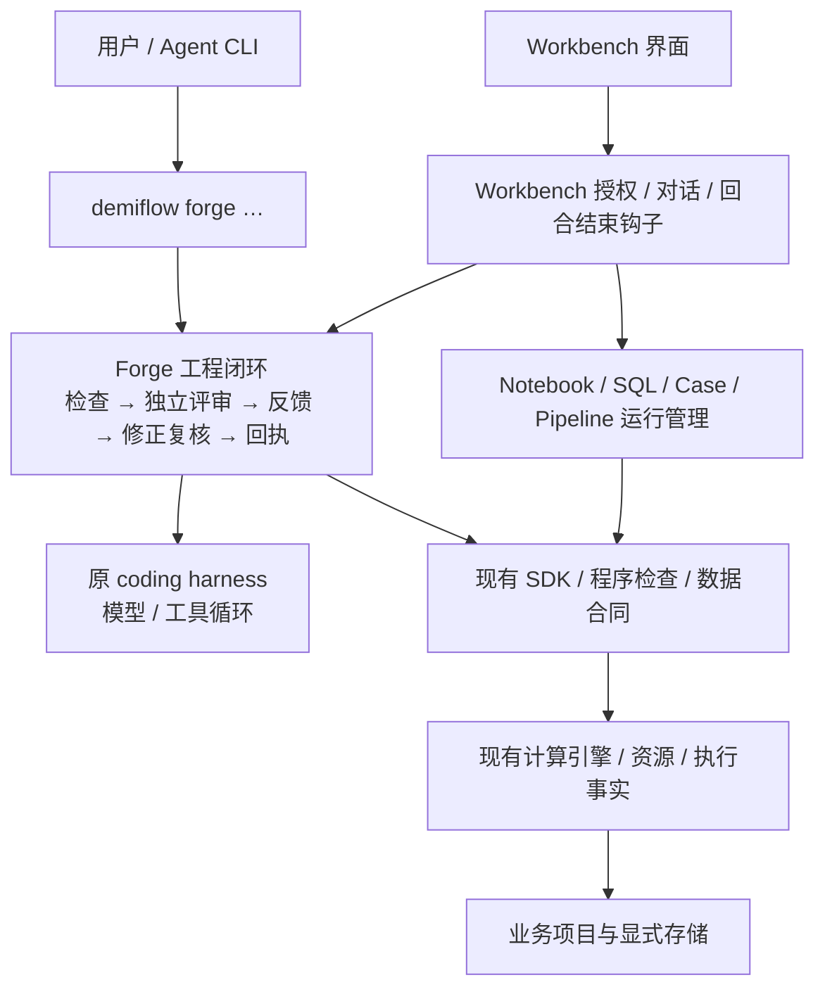

# DemiFlow 架构总意图与职责边界

版本 v1.4，2026-11-26。本文是平台架构、Forge 与工作台方案和代码的现行规约。
继承 v1.3 的三块划分、单向依赖、唯一事实所有者及历史保护要求，并落实真人确认的 Forge 独立闭环边界。
旧版可从 Git 的 `0ab29867:docs/architecture-master-intent-v1.md` 查阅；历史交付记录不作为现行实现证明。
规约规定目标与约束，实际交付须有对应代码和验收证据。

## 原始意图与三块职责

产品意图保持为统一、真正可用的 DemiFlow 工作台，让用户看懂、配置和运行 Pipeline，并灵活分析、比较和评测数据。
Forge 同时服务终端用户和 Agent，可以脱离工作台完成工程工作。

| 模块 | 拥有的职责 | 依赖边界 |
|---|---|---|
| 计算底座 | SDK、算子、程序检查、计算执行、封存、恢复、资源、固定版本数据与结果合同 | 不依赖 Forge 或工作台；继续复用既有执行及资源实现 |
| Forge | 有来源的 context、规范、受控工程操作、静态检查、验证与独立评审、开发交付回合编排及回执 | 不导入工作台实现，不要求其服务、私有数据库或浏览器存在 |
| Workbench | 项目授权、产品 API/UI、开发对话与 provider 连接、人工队列、Notebook/SQL、Case、媒体、Pipeline 运行管理 | 单向复用 Forge 工程用例和底座合同；拥有自身交互与生命周期 |

三块可以同仓、同包、同进程部署。依赖箭头表示代码调用，不要求新建网络服务。
业务项目的源码、参数、数据、run/attempt、日志、checkpoint 和结果留在原项目及显式配置存储。
项目登记只保存发现与授权引用；工程交付回执不能成为第二份 Pipeline 运行账本。

图中 Forge 向原 harness 反馈，使用中立传输合同。终端由 Forge 的 CLI 实现该传输；工作台上下文由宿主传入实际连接及授权能力。
该能力注入不授权 Forge 读取工作台存储，也不把工程决策委托回工作台。

## Forge 独立闭环

1. 公开入口统一为 `demiflow forge …`。CLI 与工作台调用同一 Forge 工程用例。Agent 传输是内部实现细节，不另建平行的 Forge 产品入口。
2. Forge 必须能在没有工作台服务、UI 或数据库时，把原始需求交给 coding Agent，接收其回合结束事实，完成检查、独立评审、反馈原 Agent、有限修正和同范围复核，留下可查询回执。仅独立执行一次 `check` 或 `review` 不构成此闭环。
3. Forge 编排工程交付回合。模型推理与工具调用循环仍归原 coding harness；Forge 不复制该循环、通用 Agent 框架或计算执行器。
4. 工作台须在作者回合结束后可靠触发 Forge，避免依赖 Agent 自觉调用；Agent 也可主动请求。两种触发复用范围、策略、候选身份与去重规则，显式缩小范围必须在回执中可见，不得默认只取首个 Flow。
5. Forge 拥有适用检查、完整目标覆盖、评审有效性、反馈内容、返工预算、复核与完成判定。工作台负责授权、真实传输、会话/人工队列、进程与资源执行边界和展示，不再实现另一份工程状态机。
6. 原作者会话、提交、候选源码身份与评审身份必须关联。反馈针对已验证的当前候选并回到原会话；后续修正形成新候选，重新检查和评审。进程、Web 回合与工程交付、Pipeline run/attempt 分别标识。
7. 对外副作用之前先持久化反馈决定及稳定发送身份，投递、确认、完成分别记录。未知 ACK 不当成失败或成功，也不自动重发；崩溃恢复不得重置返工预算。宿主可用自身事务持久化 Forge 定义的回执和待发送记录，Forge 不要求第二份宿主数据库。
8. 人工排队消息保持顺序和语义。工程反馈不得静默丢弃、抢占用户新要求或以过期候选驱动修改；等待、被新要求替代、取消及需重新核验均明确记录。
9. 静态规范检查与付费独立评审的开关分开。免费检查失败仍可驱动有限修正；未要求独立评审不得表示已经评审通过。文档改动的自动评审按适用性决定，手动请求仍可执行。
10. 检查、评审不能代替真实项目测试。只在项目显式提供解释器和验证命令且获准时执行；不得使用工作台 Python 猜测业务环境，不自动运行生产 Pipeline 或付费业务模型。

## 必须保持的工程不变量

- 独立评审使用与作者分离的会话，保持现有无工具、只读证据模型。受限宿主继续以 OS 边界和固定模型通道隔离，凭据不进入不可信作者/评审环境；可信终端如实报告其执行保证。
- 作者完成且清理已确认后才开始独立评审，可复用同一宿主执行槽位。未知清理继续保留所有权。普通开发回合的 warm reuse、模型连接及协议身份不因抽取工作流而丢失。
- 分片、补读、格式修复与返工共享明确的总请求/时间/字节预算。每片获得的是剩余预算；不能每调用一次重新给满额。不可拆的超预算对象明确 incomplete，不能悄悄删除目标、截断源码或扩额。
- 所有目标先固定为一个候选；按受影响 Flow、共享依赖和未归属改动划分检查材料，聚合后仍核对完整覆盖和全部源码身份。删除文件、无 Git 项目和原参数绑定均保留来源。
- 源码引用须精确到文件、前后版本、行号与字面摘录，校验失败不成为可执行反馈。报告完整度与已验真的阻断项分别表达；少量无效条目不能抹去其余合法证据，也不能被默默忽略后标为 passed。
- 完成评审和派发修正之前重新校验候选。有效旧结论保留历史身份，不能被用作当前版本的通过证明。
- 真人原始需求及已接收的补充要求具有显式来源；自动返工、评审触发、工具输出不伪装成新需求。预算不足要说明缺口，不能静默截断意图。
- 终端和工作台对同一物理根及父子根使用同一写入准入事实，保留实际进程 lease/清理证据。检查通过不授予文件、网络、模型、数据或运行权限。
- 受保护内容、宿主合法的目录操作、既有 dirty/staging、Notebook、对话及历史记录保持原义。平台会话只改平台，通过规范和反馈驱动开发助手修正业务源码。

## 既有模块边界继续有效

`workbench/process.py` 只识别调用方已持有的辅助进程身份。Notebook、数据/媒体、开发对话直接使用它，不能为此依赖 `workbench/runs/`；该模块不反向依赖各领域，不建立 run/attempt 或中央调度器。
共享宿主配置继续由现有 `workbench/host_partition.py` 提供。

`workbench/runs/` 保持 Pipeline 提交、运行记录、停止与恢复。工程工作流调用适用的既有底座代码，运行仍有唯一控制 owner、预算、ACK、fence 和提交事实。
查询、日志、停止不追加开发评审前置。运行严格准入必须显式启用，不能借本次改造把历史 observe 行为升级成强制门禁。

Notebook、SQL、Case 和开发对话各自保留语义、事务及生命周期。SQL 可继续随 Notebook；本轮不抽取统一运行 SDK、运行中心、资源账本或 C1–C6 同名适配层。
底层原 C1–C6/R1–R4 的版本、能力、取消、未知状态、恢复和资源合同保持有效，实际使用以现行引擎接口为准。

## 实施与验收

按真实消费者抽取能力并同批切换、清理旧策略；禁止兼容垫片、无消费者的层、业务个性化硬编码和例外的反向依赖。
新增实体须说明其唯一职责及现有实体为何无法承载。资源上界在读取、分配和调度前落实。

方案与代码分别通过独立架构、质量门禁；负责人对照真人意图裁定反馈，修正实质问题。
验收必须涵盖无 Workbench 导入的真实 CLI 进程闭环、原会话回传和复核、工作台同策略、取消/失联/重启/人工队列/候选变化、资源与历史保护。
源码、验收、合流、发布和预览分别记录，遵循 [发版规范](repository-rules.md)。
