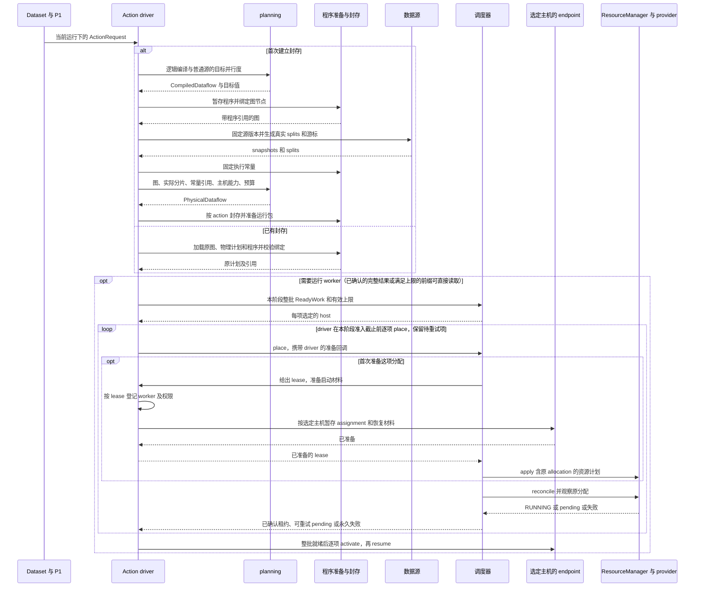
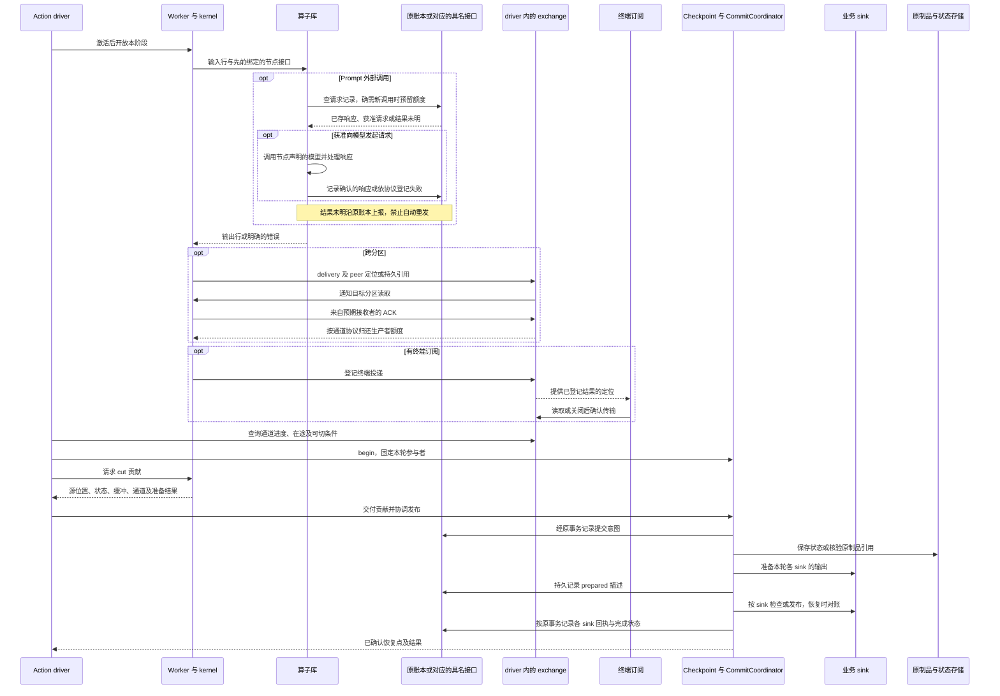
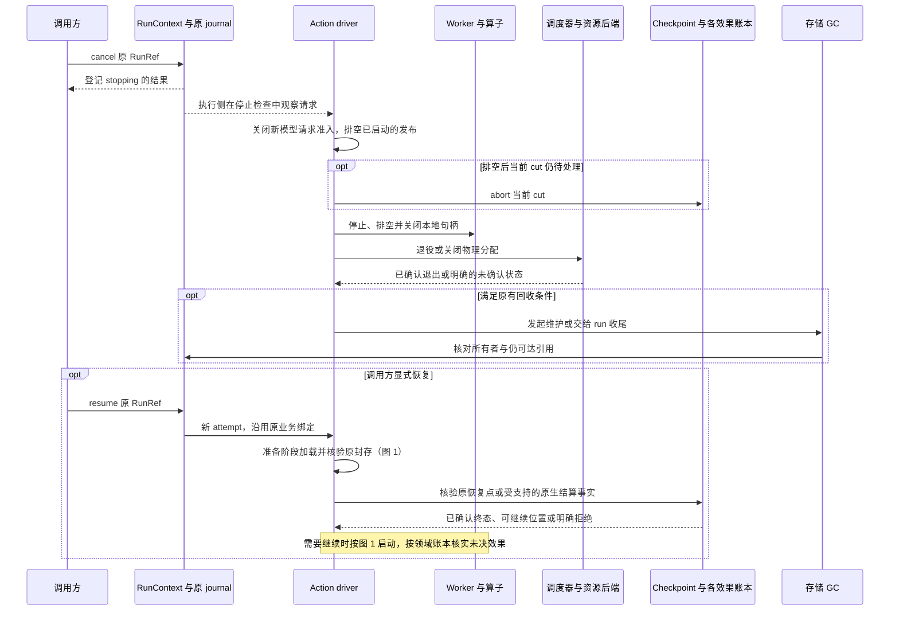

# DemiFlow Dataset 引擎项目架构规约

适用于 Dataset API、编译器、Local 与 Ray Core 运行时、平台算子库，以及受管 pipeline 进入引擎的接口。引擎改动在设计评审和固定提交的代码评审中均按本规约裁定。第一节规定模块所有权，第二节规定调用次序，第三节规定依赖方向和评审证据。合入和发版仍按[仓库发版规范](repository-rules.md)执行。

**适用顺序。** 同一事项有冲突时，依次适用最新真人明确决定、仓库发版规范、本规约、已批准的具体设计。决定或例外仅覆盖点名的对象和范围。P1、P2、P4、F2 等设计仍提供对应契约的细节和验收依据。修改本规约须在隔离任务分支提出，列明受影响的模块、调用方及既有契约，经评审后按发版规范合入。

## 一　模块职责与输入输出

一个 run 可含多个 action。编译器决定计划，数据源确定实际分片，封存模块固定这一 action 使用的程序和计划。driver 编排 action，调度器放置并准入任务，主机和资源后端负责实际分配。worker 执行分区，算子库实现行处理，Exchange 持有跨分区投递状态。Local 和 Ray 使用同一套计划、任务、提交和恢复契约。

**新增一级模块。** 提议者须在详细设计前说明现有模块为何无法承担该独立职责，在下表末尾追加稳定编号、职责、输入、输出、代码目录，并按第三节核对与现有模块的依赖。已有编号不重排。已有职责内拆文件或增加内部函数沿用原模块编号。

| 编号 | 模块 | 职责 | 输入 | 输出 | 平台代码入口 |
|---|---|---|---|---|---|
| 01 | Pipeline 入口与运行上下文 | 受管 pipeline 绑定入口、run、attempt，一个 run 可包含多个 action | 入口、参数、RunRef 或受管提交 | RunContext、RunAction、取消请求的持久状态 | [run 上下文](../demiflow/execution/run_context.py)、[pipeline 入口](../demiflow/execution/driver.py) |
| 02 | Dataset API 与执行端口 P1 | 记录声明，将终结动作交给所选 executor，交还 API 规定的结果 | source、LogicalPlan、动作及参数 | Dataset 或 typed action spec，引擎端组装 ActionRequest，返回行、迭代器、标量或回执 | [Dataset](../demiflow/data/dataset.py)、[动作契约](../demiflow/data/execution_contract.py)、[执行端口](../demiflow/execution/executors/base.py)、[动作入口](../demiflow/execution/dataflow_api.py) |
| 03 | Action driver | 管一次 action 的阶段、整批准入截止、逐项 place 的重试及终止 | ActionRequest、运行上下文、policy/bounds、worker 事件 | 启动/暂停/恢复命令、ActionHandle、终态或错误 | [DataflowExecution](../demiflow/execution/action_driver/dataflow.py) |
| 04 | 编译器 | 逻辑降级、确定目标并行度、根据实际分片做物理规划，选择 stage、融合与交换方式 | ActionRequest、CompileInputs、约束；物理阶段另收图、实际 splits、主机描述、常量引用 | CompiledDataflow、目标并行度、PhysicalDataflow | [逻辑编译](../demiflow/planning/dataflow_compile.py)、[物理规划](../demiflow/planning/dataflow_place.py)、[算子登记](../demiflow/planning/dataflow_registry.py) |
| 05 | 数据源 | 固定输入版本，按源格式生成分片和起始游标，在 worker 打开读取器 | 源声明、目标并行度、预算；恢复时给定原位置 | SourceSnapshot、SourceSplit、带来源位置的记录 | [源声明](../demiflow/data/sources.py)、[源切分](../demiflow/execution/dataflow_sources.py)、[Lance 读取](../demiflow/lance/read.py) |
| 06 | 程序准备与封存 | 固定程序引用，让 action 的图、程序、源和物理计划可重载、可校验 | 编译结果、程序/常量、实际计划、RunAction、存储 | 带程序引用的图、SealedExecution 或经核验的历史图与计划 | [程序准备与封存](../demiflow/execution/seal/plan.py) |
| 07 | 调度器 | 负责整批可行性、选机、单项准入及租约、运行和发布预留、退役等待。03 持有整批的重试与截止时间 | ReadyWork、stage profile、已探测主机、有效 worker/内存上限、当前占用 | 每项 host、WorkerLease、等待/不可行原因、退出观察结果 | [DataflowScheduler](../demiflow/execution/scheduler/placement.py) |
| 08 | 主机适配与资源管理 | 适配器在选定主机准备连接/派发任务；ResourceManager 对 provider 申请、核对和收回物理资源 | 选机、WorkerAssignment、租约与资源计划 | 可激活的 endpoint、实际分配状态、退出或待清理证据 | [主机端点](../demiflow/execution/dataflow_hosts.py)、[ResourceManager](../demiflow/resources/manager.py) |
| 09 | Worker 与计算 kernel | worker 管分区循环与控制，kernel 调用函数/actor，执行融合或专用关系计算 | WorkerAssignment、源/通道数据、业务程序、控制命令 | 行/批、进度、控制事件、分区 checkpoint 贡献 | [分区执行](../demiflow/execution/worker/dataflow_execution.py)、[图推进](../demiflow/execution/worker/dataflow_graph_runner.py)、[kernel](../demiflow/execution/kernels/) |
| 10 | 算子库、绑定与可选服务 | 领域包实现从输入行到输出行的处理与外部调用语义；worker 装配受控能力；已声明受管模型服务负责就绪/生命周期 | 行/批、算子配置、原账本接口、必要的服务或客户端 | 业务输出、已知响应、已知失败或结果未明 | [Prompt](../demiflow/operator_llm/runtime.py)、[Embedding](../demiflow/embeddings/)、[SearchWeb](../demiflow/collect/operators.py)、[模型装配](../demiflow/execution/dataflow_models.py) |
| 11 | Exchange | 管跨分区投递登记、路由、额度、确认与通道恢复状态；driver 进程负责中转通知 | ExchangeSpec、发送/接收端标识、记录定位、ACK | 下游投递、额度归还、可用于 cut 的通道进度 | [通道与传输](../demiflow/execution/exchange/)、[投递状态](../demiflow/execution/exchange/deliveries.py) |
| 12 | 终端结果与业务 sink | terminal 交付 count/take/流式读等结果；sink 实施目标格式的准备、发布、检查 | 终端记录、发布事实，或分区待写结果 | 标量、行/批、物化句柄、WriteResult 或 sink 回执 | [终端](../demiflow/execution/dataflow_terminals.py)、[sink](../demiflow/execution/dataflow_sinks.py)、[Lance 写出](../demiflow/execution/lance_sink.py) |
| 13 | Checkpoint 与提交 | 收齐参与者状态，协调一致恢复点，按 sink 协议提交/对账 | CutRequest、源位置、核与缓冲状态、通道进度、sink 准备结果 | RecoveryImage、确认的输出与原生提交事实 | [checkpoint 协调](../demiflow/execution/checkpoint/coordinator.py)、[提交](../demiflow/execution/commit.py) |
| 14 | 运行产物存储 | 保存、校验、保留、释放引用、安全回收 | 有界字节流或 ArtifactRef、owner | ArtifactRef、已校验字节、引用变更或回收结果 | [对象存储](../demiflow/execution/storage/objects.py)、[引用与租约](../demiflow/execution/storage/lease.py)、[回收](../demiflow/execution/storage/gc.py) |
| 15 | 运行账本、观测与历史接口 | 按原事务记录运行事实；写观测；按指定运行和 attempt 只读解释 | 状态变更与授权、运行事件或查询条件 | 持久事实、观测指标、只读视图 | [账本](../demiflow/execution/run_journal.py)、[观测](../demiflow/execution/run_telemetry.py)、[历史读取](../demiflow/execution/run_reader.py)、[P4 端口](../demiflow/execution/host/) |
| 16 | 声明、协议与编码 | 表达跨模块边界的既有值、身份与编码；由使用方执行具体操作 | 字段、声明和受支持协议版本 | 经校验的声明、消息、回执或错误 | [逻辑声明](../demiflow/data/plan.py)、[引擎协议](../demiflow/execution/contracts/)、[恢复协议](../demiflow/execution/recovery_contract.py)、[资源协议](../demiflow/resources/contracts.py) |
| 17 | 原生队列、获取和流式写入 | 在原生路径管理源单元、外部效果及确认，向 driver 和 checkpoint 提供可验证的事实 | 已绑定的源单元、位置、请求或分区输出 | 领取与结算事实、原生回执、可继续位置 | [原生 producer](../demiflow/execution/dataflow_producer.py)、[队列](../demiflow/execution/queue_producer.py)、[流式写出](../demiflow/execution/dataflow_stream_lance.py) |

**跨阶段的四项所有权**

- 外部操作的业务语义归算子。Prompt 的模板、请求、响应、重放及结果未明归 Prompt 领域；引擎装配当前节点的账本、额度和权限。搜索的受控执行位置可以在 driver，搜索协议仍由其领域负责。
- 产物存储持有可校验字节和引用。算子程序和随包业务源码按实际长度与摘要封存和加载。
  `max_state_bytes` 约束计算状态及其恢复镜像。输出发布由 sink 确认，恢复点由 checkpoint 协调，队列领取和确认按原生协议登记。
- 取消由 RunContext 接收，driver 停止新准入并排空在途发布，worker 关闭本地资源，调度器等待后端确认退出。存储按所有者与可达引用裁定回收。
- 观测在事件发生处产生。历史读取按指定 run、attempt 查询已持久化事实。对外检查、控制通过已有 P4 端口，控制操作沿各自授权入口执行。

## 二　模块调用时序

**资源如何进入计划。** 01 保留调用方获准的上限。04 拿到实际分片和已暂存的程序后，根据执行方式计算每个阶段需要的资源。以内存传递数据时，上下游必须同时放得下；允许持久化交接时，下游可以随后启动。04 按候选方案中实际同时驻留的阶段核算窗口和请求，06 封存选定结果。运行时，07 结合当时的占用决定能否派发，08 申请并释放实际资源。

普通算子可以只声明计算。引擎了解执行方式，负责推导资源请求。对能逐次计量的任务，接收一行、产生输出和保存状态时，09 都要把当时仍存活的数据计入已获准的工作区。对共享实例、带自定义恢复逻辑的任务等无法可靠推导占用的情形，规划保留其固定需求。

程序分发和任务状态各有自己的计量对象。需要为任务单独加载程序时，封存载荷的实际字节数可用于核算加载缓冲；Python 对象解码后的堆占用还取决于对象实现。任务可变状态和恢复镜像按原状态预算校验。命中旧封存的 action 时，执行器读取原物理计划和恢复点。

三张图沿同一次 action 展开。假设 ds 是有界输入，pack 已声明 item 和 summary。这里 take 限制交付行数，max_requests 限制本节点跨 worker 的新请求数；并发和受支持的重试会影响实际请求数。纯计算的 filter/count 跳过模型调用，写 Lance 时终端改走 sink。

```python
rows = ds.map_prompt("enrich", config=pack, inputs={"item": "text"},
                     outputs={"summary": "summary"}, max_requests=10).take(2)
```

**图 1　从 Dataset 到可激活的分区。** 新 action 的规划分两段，中间固定程序和真实源分片；找到原封存时复用原计划。虚线表示返回，箭头表示运行调用，回调不要求增加反向包导入。



**图 2　行处理、投递与提交。** 融合的相邻算子可在分区内直接传值。图中的跨分区路径只在物理计划存在对应边时经过。checkpoint 可以重复发生，订阅也可以边运行边读取。



图 2 将账本画在一列以便阅读。算子在 worker 侧经已绑定的请求接口读写领域事实；CommitCoordinator 在 driver 侧经自己的运行事务写提交事实。状态制品和 dataflow 字节对象沿各自的原存储写入。图中所示是新 cut；恢复已 prepared 的单元直接从准备描述对账。

**图 3　取消、清理与恢复。** 取消可与发布重叠。调用方关闭订阅还有独立的传输释放动作。



## 三　模块依赖规约与评审批据

这里的依赖指一段代码必须知道另一个模块的哪些类型、行为或状态才能工作。审查单位是“消费者中的具体调用点 → 提供方的具体符号 → 用途”。源码导入、函数内延迟导入、注册表中的符号路径、回调捕获的对象以及历史载荷中的限定名，都可能构成依赖。运行时从 B 回调 A，并不要求 B 导入 A 的实现。

下表按条款列出[合入闸实际选取的守卫](../tests/merge_gate.py)及其边界。右列由评审者对本次改动核实，并在涉及运行行为时引用固定提交的回归或实测。D4 至 D8 均无覆盖整条契约的专门合入守卫。

| 条款 | 合入闸已检查的部分 | 仍须评审或实测的部分 |
|---|---|---|
| D1 声明 | [P1 依赖](../tests/test_p1_dependency_boundary.py)、[关系声明](../tests/test_p1_relational_boundary.py)、[冷导入](../tests/test_package_cold_imports.py)检查既有依赖与构造行为。 | 新声明的真实提供方、持有的资源及副作用。 |
| D2 契约与装配 | [编译契约清单](../tests/test_compile_contract_inventory.py)检查已登记的分派、端口和部分实际执行判断。 | 精确识别、工厂构造、服务绑定与观测各自的类型语义，以及绑定后的实际效果。 |
| D3 计划、数据源与封存 | [包依赖](../tests/test_package_dependency_ratchet.py)、[编译输入](../tests/test_dataflow_compile_inputs.py)及编译契约清单检查规划器导入、输入解析和已盘点的隐式环境读取。 | 数据源执行实际 I/O 的位置、旧封存的分片与游标如何复用。 |
| D4 编排与资源 | 合入闸未覆盖从整批准入到进程退出的完整时序。 | 观察选机、启动材料、租约、激活和实际退役的先后。 |
| D5 计算与投递 | 编译契约清单检查已登记端口；跨分区投递与终端提交需运行验证。 | 核对通道进度、在途恢复和终端 ACK、提交的先后。 |
| D6 效果与提交 | 合入闸未覆盖从请求准入到提交确认的完整事务。 | 按所改路径核验效果账本、重入、结果未明和 sink 发布回执。 |
| D7 控制、观测与历史 | [工作台与引擎边界](../tests/test_workbench_engine_boundary.py)和[托管清理](../tests/test_p4_managed_cleanup.py)覆盖部分访问边界、取消竞态及清理。 | 指定 attempt 的历史只读、取消后排空与实际退出，以及资源是否仍可达。 |
| D8 跨版本续跑 | [旧路径保留](../tests/test_pre_v3_retention.py)检查已登记对象与调用者；[已知状态工具](../tests/test_engine_known_state.py)核对回归清单的比较规则。 | 旧版本写、新版本冷读、从原非最终恢复点续跑，核验旧回执和拒绝条件。 |
| D9 依赖可追踪 | 包依赖守卫检查私有导入预算、旧执行器导入方及失效的允许项。 | 回调、注册符号和封存限定名指向谁，新增依赖是否确有必要。 |

### D1　声明只依赖声明和无副作用的校验

**适用模块**　02 Dataset API、04 编译器、05 数据源声明、06 封存、16 声明与协议。

**允许。** 多个模块消费同一种声明值。声明可持有业务提供的程序描述、配置或已有端口引用，复用有界的字段与拓扑校验。API 按公开契约读取用户明确指定的配置文件；声明阶段不能借此打开数据源、启动 worker、创建执行中的 actor、访问当前运行账本。终结动作通过 P1 执行端口交付。

**打回。** 新的声明或逻辑规划为了表达“是什么”，需要导入 kernel、主机后端或运行期服务的具体实现；或者把排序、落盘、锁、执行缓存等实现放进声明包，再让执行模块反向导入。用第二套 DTO、转发文件或函数内导入包住同一条依赖，也须按真实提供方裁定。

**用 join 裁定。** 左右输入、键、连接类型归声明。编译器消费这些值并展开两个端口；worker 的关系 kernel 消费两个分区记录流并执行匹配。`PlanInput`、`KeyedSource`、`UnionSource` 的历史导入路径是 `execution.local_kernel`。新关系操作复用声明入口。旧程序可能按原限定名解码类对象，并在解码后复算程序身份。移动定义须同时满足 D8，兼容出口只覆盖登记的原符号和用途。[关系组装](../demiflow/data/relational_declaration.py) · [编译](../demiflow/planning/dataflow_compile.py) · [执行](../demiflow/execution/kernels/relational.py) · [历史保留依据](architecture-upgrade-20261120/G/RETAINED-OBJECTS.md)

**评审批据。** 标出同一声明的定义、生产者和消费者，确认声明阶段启动了哪些资源；检查源码导入和冷进程实际加载的模块。涉及 join 时检查左右端口、重复键多重性、空键和执行器绑定。只有触及持久身份或旧路径才追加 D8 的历史验证。

### D2　通用抽象依赖契约，具体算子由装配处选择

**适用模块**　02 Dataset API、04 编译器、06 封存、09 worker/kernel、10 算子与服务绑定、15 观测。

**允许。** 编译、调度、分区执行等通用模块依赖完成本职工作所需的契约。具体实现依该契约提供能力，装配处选择实现。编译器处理声明种类和已登记的 lowering，通用 worker 按执行规格调用已绑定的算子。具体工厂可以导入并构造 `PromptActor`；专用绑定可以核对受支持的精确类型后，注入本 action/node 的账本、请求额度和恢复能力。算子拥有字段映射、请求与响应处理、领域重放语义。领域到引擎的依赖逐符号使用已有合同、注入服务或已批准的原生装配。[算子服务契约](architecture-upgrade-20261120/F/F2-SERVICE-CONTRACTS.txt)

**打回。** 通用 kernel 为普通 map 增加某个模型、客户或服务的分支；多个消费者各自判断具体 actor 并决定绑定哪套账本；算子直接取得整个 driver、全局数据库或任意 RPC 能力。用全局运行时注册器或字符串类名绕过原生类型校验，或把构造、准入、观测和持久身份塞进一种判断，也应退回。新增平台内置种类优先使用已有登记表和工厂。

**第三方可选数据类型。** 为避免仅检查配置就加载可选库，可以按限定模块或包命名空间和已列明的类名筛选待解析的数据值（如 PyArrow 的 CSV 选项、Schema）。新增识别点须按对应格式核验类型或字段，再编码。现有 CSV 选项按具体类型与字段处理；历史 Schema 编码按模块前缀和类名调用序列化，该路径仅说明已有格式，不能据此推定完成了类型核验。仅凭名字不得认定平台原生算子、选择其程序身份算法或授予运行服务。[CSV 选项](../demiflow/planning/dataflow_compile.py) · [恢复编码](../demiflow/execution/recovery_identity.py)

**已知偏差（核对基线 `f12f2e40`）。** 编译器的 `_operation_semantic_facts` 用类名识别 `OperatorLLMMapOp`，`_source_semantic_facts` 和 `_source_kind` 用类名识别内部 `_LiteralEmptySource`。三处均应比较平台自己的真实类型。修正以真实节点的语义事实、身份字节保持一致以及伪同名对象不能命中专用途径为据。[编译器](../demiflow/planning/dataflow_compile.py)

**用 map_prompt 裁定。** 普通 `map_prompt` 在 Dataset 中追加 `OperatorLLMMapOp`，worker 依据已编译的 `kind="prompt"` 装配。`CacheCall` 包装模型时，缓存先绑定 checkpoint，随后由模型绑定模块识别内部 callable、选择本节点的账本。相同的精确类型谓词可以共用；不同输入、决定或子类语义分别由下表所列模块持有。[Dataset 声明](../demiflow/data/dataset.py) · [模型工厂](../demiflow/execution/dataflow_model_factory.py) · [kernel](../demiflow/execution/kernels/operator.py) · [模型绑定](../demiflow/execution/dataflow_models.py)

| 判断或操作 | 负责模块 | 边界 |
|---|---|---|
| “这个对象的类型恰好是受支持的原生 PromptActor” | 原生算子的类型识别与专用装配 | 相同的精确类型谓词可共用。缓存、路由、图像等调用方仍各自核验本用途的条件。外观相似的对象和子类沿原路径处理。 |
| “创建哪种 actor，绑定哪个账本” | 工厂与模型装配 | 工厂保留具体构造。绑定方按 spec、节点及受支持场景选择原有适配器。普通算子不会因此得到 Prompt 权限。 |
| “封存哪些算子事实” | 算子库提供领域事实；06 负责封存表示与校验 | 复用精确身份判断，保留 Prompt/agent 的环境校验、各自事实和原有字节。 |
| “是否计入已发生的用量或观测” | 15 观测与各指标生产者 | 保留已有 `isinstance`、路由子项和缓存解包语义。观测不能授予执行资格、扣费或证明提交。 |

**评审批据。** 给出“声明 → 工厂 → 已绑定实例 → 行结果”的一条真实链路；改哪种判断，就比较其真例、子类、伪同名类和不相关 callable 的原有结果。涉及缓存时检查 Prompt/agent 的绑定、普通缓存及重复扣费；涉及观测时检查用量；涉及封存时按 D8 验证。按实际行为裁定，无需以直接导入类的文件数作为合格线。[算子事实](../demiflow/operator_llm/flow_contract.py) · [原生模型观测](../demiflow/execution/dataflow_model_observations.py) · [用量](../demiflow/execution/dataflow_usage.py)

### D3 至 D9　各模块间允许的依赖与退回条件

| 条款 | 允许的方向和输入输出 | 应退回的变化 | 最小评审批据 |
|---|---|---|---|
| **D3　计划、数据源与封存** | 03→04 请求逻辑计划及目标并行度；03→05 获取源快照和真实分片；04 消费实际分片生成物理计划；03→06 固定程序、图、源和常量。 | 编译器读 Lance 元数据、查询当前 run 或写封存；恢复时重切原输入、用新计划替代旧封存。 | 对照图 1，分别走一次新 action 和一次命中原封存的路径，明确哪个模块执行 I/O。 |
| **D4　编排、调度与资源** | 03 管重试截止与终止；07 管整批可行性、单项准入与选机；08 负责真实分配与退出。07 经准备回调让 03 先把 assignment、权限和恢复位置交给选定端点，随后申请资源，确认就绪后才激活。 | 新增第二处 worker 数或内存准入决策；07 持有具体 driver；08 在启动材料准备好之前启动 worker；把停止请求当作已退出。 | 能区分永久不可行、暂时等待和物理退出。Local/Ray 使用相同任务与回执，后端特有行为只在适配侧取证。 |
| **D5　计算、投递与终端** | 09 执行分区内计算；11 在 driver 进程持有跨分区和终端投递、额度、ACK、持久通道在途状态；12 交付订阅结果或写出。 | worker 绕过当前协议直连；driver、订阅或算子另存一份权威投递表；用传输 ACK 代替输出提交。 | 对照图 2 验证分区内直传、跨分区 ACK 和终端关闭中本次受影响的路径；恢复证据含原通道进度。 |
| **D6　效果、提交与存储** | 算子或原生队列经具名端口登记领域效果；13 协调 cut 与提交；sink 根据 prepared 描述检查和发布；14 只持有可校验字节及其引用；15 按原事务记事实。 | 依据文件存在或观测计数判断发布成功；结果未明时自动重发；存储自行承认效果；增加并行真账本。 | 核实一次成功和一个对应的失败或重入窗口。区分请求已准入、效果已确认、提交已确认和结果未明。 |
| **D7　控制、观测与历史** | 01 接收取消，03 停止新准入并排空，09 关闭本地实例，07/08 观察实际退出，14 按可达引用回收。P4 inspection 消费指定 run/attempt 的事实，获准控制走 control。 | 通过指标推算成功或资源已释放；取消时误删旧提交；读取历史触发模型、恢复或写账本；底座反向依赖应用。 | 针对所改分支，区分停止请求、排空完成、实际退出；历史读取冷进程只读且指向指定 attempt。 |
| **D8　跨版本身份、解码与续跑** | 16 保有唯一的声明/编码；06 读取原程序与身份；13 按原恢复点继续。变更涉及限定名、编码、工厂、模块源身份或反序列化时，列出旧写端、新读端和实际载荷。保留原业务、程序和输入校验。 | 只验证新写新读，或只看历史列表就声称可续跑；改旧数据、跳过 code pin、放宽类型检查、恢复平台版本门禁，或让受支持的旧路径悄然失效。 | 从旧发布提交产生样本，新进程分别冷读已发布结果、从非最终 cut 真续跑；比较旧 seal、回执和 cut 前缀；适用时覆盖闭包引用被移动类，并保留损坏/不兼容输入的拒绝。更改兼容承诺单独裁定。 |
| **D9　依赖可追踪且与收益相称** | 新增跨模块边须指向已有合同、获准装配或实际状态所有者。函数内导入、注册符号和序列化引用一同审查。硬编码限于版本化协议枚举、字段或受支持能力；上限取自有效策略，业务参数取自声明。 | 跨包私有字段赋值、扩大白名单掩盖新依赖、以空转发或双写掩盖旧所有者；仅为减少文件数或环的数字迁移模块。 | 列清新增和删除的真实调用者；已批准的历史例外只覆盖原符号和用途。已有守卫适用时保持或收紧，静态环规模作为诊断。 |

### 如何作出评审结论

设计阶段指出受影响的模块编号、输入输出、时序步骤及 D 条款。代码阶段对固定提交检查真实调用者、写入状态的唯一所有者和所改路径的行为证据。可用一行记录：**条款编号｜消费者 → 提供方与符号｜用途｜证据｜裁定**。

- **通过**：职责、时序与依赖符合条款，有足以覆盖本次改动的证据。沿用已登记的历史例外时注明原范围。
- **需补证**：设计边界合理，但具体兼容或行为结论尚无证据。指出哪项检查能够裁定；该项通过前不将受影响变更计为验收完成。
- **退回**：出现条款中禁止的依赖、错误所有权、时序倒置或已证实的回归。说明应由哪个既有模块接手，以及修正后如何复核。

评审只对变更及其影响范围作结论。低影响的现存缺口可单独记录。架构评审、合入闸、固定提交的回归验收按各自的证据给出结果。
