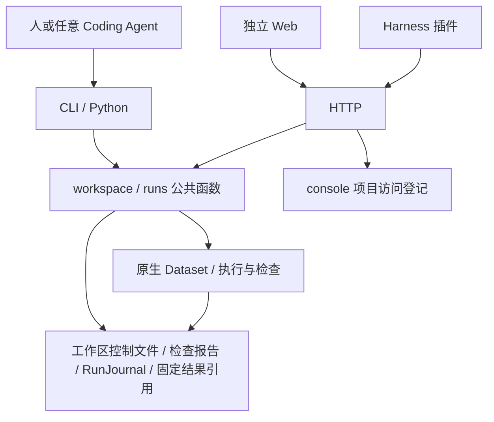

# Demi 公共能力与多端接入：中粒度方案

状态：方案已获用户批准并完成 C1–C4 实施；以下保留设计与复审基线，实际功能 / 测试 / 部署结论见 [实施验收记录](demi-public-capabilities-implementation-20261103.md)。

配套：[源码级方案](demi-public-capabilities-source-plan-20261103.md)、[复审与验收矩阵](demi-public-capabilities-review-20261103.md)。

## 1. 结论与代码归属

**Demi 的公共能力是可独立调用的 Python 能力；CLI 和 HTTP 是入口；Web 和 Harness 插件是客户端。** 同步靠读取同一个工作区的已保存事实，不靠客户端相互通知，也不靠对话内容。

目前主要代码在 `demiflow`，不需要再建立一个 `demi-server` 仓库或总服务层：

| 仓库 / 目录 | 现有职责 | 本方案的处理 |
| --- | --- | --- |
| `demiflow/demiflow/forge/` | 工作区、检查、受管运行、CLI、HTTP、Web | 公共能力和本轮后续实现的主要位置 |
| `demiflow/demiflow/execution/`、`lance/`、原生 Dataset | 实际执行、运行事实、固定数据版本及读写契约 | 继续复用；不建立另一套执行器 |
| `demiwtg/flows/`、`operators/` 等 | 真实业务接线、算子、参数及数据引用 | 是使用者，不承载跨客户端公共逻辑 |
| `Demiurge/` | DemiForge 开发规范、项目登记、源码绑定验证与交接 | 保持独立，不成为平台运行依赖 |
| `demiflow/integrations/` | 面向外部工具的接入说明 / 可选适配 | 客户端专属代码放这里，不倒灌入核心 |

“Demi 公共能力”是架构称谓，本期不更名包、CLI 或已有 `forge` 契约。

## 2. 当前已具备与实际缺口

| 方面 | 当前源码事实 | 需要补齐 |
| --- | --- | --- |
| 无 UI 使用 | `workspace_cli.py`、`run_cli.py` 直接调用 `workspace.py`、`runs.py`，无需 HTTP | 补齐 changes、源码 / 参数读取、结果登记等入口；明确机器可读错误 |
| HTTP 服务 | `WorkspaceServer` 已提供项目、表、检查、运行等 API，同时提供静态页面 | 对外契约、错误分类、完整输入检查、仅 API 启动模式 |
| 公共能力边界 | 大部分业务规则已在 workspace / runs | 源码读取、参数读取、结果登记的部分用例仍在 HTTP handler；media/evidence 直接调用 worker |
| 多端同步 | Web 已有变化查询、单链轮询、页面切换竞态保护与草稿保护 | 把保证范围写成公共契约；补独立客户端并发与失败验收 |
| 并发操作 | 已有控制文件 CAS、执行锁、manifest 摘要、attempt 隔离 | HTTP cancel / reconcile 未携带已观察 attempt；结果登记未绑定用户看到的准确结果 |
| 接入其他 Harness | 业务能力不依赖宿主；当前 Web 可独立使用 | 没有可宣称通用于各宿主的 UI 插件；现有 Origin / CSP 限制不允许随意跨域调用或 iframe 嵌入 |

这次是收拢现有能力的边界，不重写平台，不重做已经完成的左侧项目 / 顶部功能区布局。

## 3. 职责和依赖

| 部分 | 负责 | 不承担 |
| --- | --- | --- |
| 公共函数 | 工作区与对象身份、契约校验、版本检查、资源约束、检查 / 运行 / 结果操作 | HTTP、浏览器、聊天、宿主 SDK |
| CLI | 参数解析、调用公共函数、JSON 输出、退出码 | 调用 Web、先启动服务器、维护另一份运行状态 |
| HTTP | 鉴权、登记项目解析、端点参数与大小检查、传输权限、调用公共函数、响应编码 | 重新定义业务规则、直接拼运行事实、执行任意 shell / Python |
| Web | 导航、表 / Case / 图 / 运行展示、交互草稿、读取与显式操作 | 判定原生提交、直接操作服务器文件、复制执行逻辑 |
| Harness 插件 | 注册宿主入口、映射所选项目、连接 Demi、呈现或打开工作面板 | 将聊天会话作为项目 ID、重新登记同一批表 / 运行、改变平台契约 |
| 项目访问登记 | 指定服务允许访问的工作区及运行开关 | 替代 workspace.json、成为第二份业务项目库 |

不新增 `DemiService → Manager → Repository` 调用链。不为 CLI、HTTP、MCP 各造一套命令对象或业务 DTO。现有 DatasetRef、manifest、检查报告、RunJournal 保持各自的来源与版本。

## 4. 公共能力范围

第一批稳定使用面：

1. 读取工作区上下文、变化提示、已登记 Flow 与参数、受限源码。
2. 读取表元数据、固定版本 Case、已声明的图片和证据。
3. 显式检查 Flow，读取、比较检查报告。
4. prepare / start / show / list / cancel / reconcile / resume；读取日志和证据。
5. 从已验证的某次运行结果创建表别名，用于继续加工。

项目初始化、访问登记、数据位置权限、平台绑定和预算管理继续使用现有 CLI / Python。第一期不把这些管理操作全部开放到 HTTP。**公共能力可有不同入口覆盖范围；已开放的同一操作必须执行同一业务规则。**

HTTP 的 `enable_runs` 与项目 `allow_runs` 是远程入口的额外权限限制；不能把它解释为对同一操作系统用户的 CLI / 文件访问隔离。初始部署仍是受信任用户、服务器本机 loopback 加 SSH，尚不是多租户服务。

`inspect` 会保存检查报告，不是纯读取。“禁止运行”不等于“完全只读”。能力说明分别列出读取、检查、运行 / 恢复 / 结果登记权限，沿用现有权限来源，不再建立一套角色系统。

## 5. HTTP 与服务边界

### 5.1 一个服务，可选择是否带页面

继续使用 `WorkspaceServer`。在现有 `forge console ... serve` 增加 `--api-only`：

- 默认同时提供 HTTP API 和现有静态 Web。
- API-only 关闭页面资源路由，仍使用同一个 handler、登记清单、权限与资源限制。
- CLI / Python 在服务完全关闭时仍能使用公共能力。
- 不新增第二端口、第二服务器框架、独立任务队列或常驻 agent。

已有本机 `55971 → 服务器 127.0.0.1:59865` 入口保持不变。本轮方案不重启它。后续正式部署显式指定端口；端口被占用就报告错误，不自动换端口。

会话 token 属于 HTTP 启动配置，不写入工作区、业务配置或分享用深链接。默认仍随机生成；拟增加可选 `--token-file`，用于同一用户受保护的持久凭据，避免正式服务重启后仍依赖临时 launcher 保留 token。文件仅允许当前用户拥有的普通非符号链接文件、权限 0600、有界内容；不存在或非法时失败，不在后台替用户创建或更换凭据。临时交互启动保留原有授权链接输出，属于私有凭据；持久凭据模式的服务启动输出只含无 token 地址，客户端通过安全配置接入。HTTP 访问 / 错误日志不记录 token。

### 5.2 第一版正式 HTTP 契约

保留现有 `/api/projects` 与 `/api/workspaces/{workspace_id}/...` 路径，不平行维护另一套 `/v1` handler。拟增加 `/api/capabilities`，声明 `demiflow_forge_http_v1`、支持的操作和请求 / 分页预算。这个版本是 HTTP 使用约定，不是 workspace、Flow 或原生算子的版本。

HTTP 操作名称和传输边界可以作为通用协议固定；Flow 可用算子仍来自当前平台契约发现和检查结果，不能在 capabilities 中另写一份算子白名单，更不能恢复固定 `read → map → write` 接线。

此次正式化同时修正有风险的 mutation 请求：新 Web 与 API 消费者必须携带规定的 attempt / 结果身份；缺失时明确拒绝，不偷偷补成“当前最新”。已有项目深链接、历史数据格式不变。当前未版本化 API 的外部调用者需按文档更新这些写请求；不能以兼容名义保留无保护的 Web 写路径。将来真正不兼容的 HTTP 版本再明确开新版本入口，不预建通用路由版本框架。

成功响应继续用公共函数的原有结构。失败保留可读 `error`，增加稳定 `code`；CLI 保留原成功结构和退出码，在失败输出增加相同错误码。禁止客户端解析英文错误文本判断是否重试。

所有端点都使用封闭的参数字段集合、长度 / 类型 / 分页检查；不接受任意 root、命令、方法名或模块导入路径。HTTP 在已登记范围内解析 ID；配置中的本地路径不变成浏览器可指定的任意文件读取能力。

## 6. 无 UI 的实际流程

任何具备服务器文件与命令访问权的 Coding Agent 都可完成：

1. 用 `demiflow forge workspace context ROOT --json` 读取项目；打开已登记的 Flow、算子和参数文件。
2. 修改并保存代码，使用现有 `forge flow inspect` 检查准确入口与配置。
3. `workspace run prepare` 获得 run_id、manifest 摘要及 attempt，再 `start`。
4. 通过 `run show / logs / evidence` 读取运行事实；必要时显式取消、恢复或核对不确定结果。
5. 将确认的固定结果登记为表别名，再作为下次 Flow 输入。

第 5 步拟补共享 `attach_result` 用例及 CLI 命令，目前 Web 中已有部分组合逻辑。准确的新增命令和参数见源码方案。

本机没有仓库而只有远程 API 时，外部程序可按 HTTP 契约执行已开放操作；代码编辑仍属于外部开发环境，不增加 HTTP 任意代码写入接口。

通用 Coding Agent 使用说明放在 `integrations/coding-agent/`，不要求安装某个客户端。既有 `demiflow-forge` skill 面向历史 v1 生命周期，不直接改成新版 workspace skill；另写明确范围的 workspace 使用说明 / skill。MCP 是以后可选的入口，当前 CLI 已覆盖需求，不为展示完整性先建一个 MCP server。

## 7. 多端同步：读同一份事实，写时核对身份

### 7.1 什么是“同一个项目”

同一执行机器、同一物理工作区与数据位置。HTTP 客户端使用 `(连接端点, workspace_id)` 定位；CLI 的 ROOT 必须指向该工作区。界面缓存也必须带连接与 workspace ID。

不同服务器上的同名目录、不同 Git worktree、复制出的相同 ID 不是自动同步的工作区。复制 ID 的登记冲突继续拒绝；本期不做跨机器文件复制、数据库复制或分布式执行锁。

### 7.2 各类状态的所有者

| 状态 | 唯一来源 / 所有者 | 客户端行为 |
| --- | --- | --- |
| 接线、算子、参数 | 工作树中已保存文件 | 重新读取；不合并两个编辑器的未保存内容 |
| 表身份 | 表控制文件与固定 DatasetRef | 查准确版本；别名改变时提示重开，不静默换表 |
| 检查依据与图 | 保存的检查报告及绑定摘要 | 源码变化后显示 stale；刷新不自动重检 |
| 运行与输出 | manifest、指定 attempt 的 RunJournal、原生提交证据 | 进程成功、数据已提交、业务质量分别展示 |
| 列表发现 | 可重建索引及 pending 状态 | 索引不完整明确展示；不能当作“没有数据” |
| 页面选中对象、未提交表单 | 各客户端 | 保留选择和草稿，不覆盖别的客户端 |
| 对话与模型上下文 | 各 Harness | 不作为项目事实，不进行聊天同步 |

### 7.3 更新机制

复用 `workspace_changes`，单个可见 Web 页面在上一轮结束后约 3 秒查询一次。变化标记只决定重读哪些部分；未变化不反复读大报告、Case 或图片。手动刷新强制重读，隐藏时暂停，恢复时检查；失败保留旧内容并标明更新时间，连接恢复后继续读取。

标记来自有界文件元数据与索引状态，**是变化提示，不是执行校验摘要，也不是事务版本号**。不承诺跨文件原子视图、每次瞬间变化都可观察，或毫秒级实时同步。实际打开 / 执行仍校验内容摘要、固定引用及 attempt。

客户端观察的是已发布状态：通常在一次轮询间隔加查询耗时内可见。索引 pending、磁盘异常、服务停止时显式降级，不伪装最新；修复索引是显式管理操作，不由刷新偷偷执行。

Agent 下一次动作前读取新的 context / run 状态即可看到 Web 的操作。一个正在等待输入的对话不会自动知道页面变化；宿主若需要主动推送，可自行订阅变化并提供给对话，不改变核心同步协议。

### 7.4 防止旧页面操作新对象

- start / resume 使用 manifest 摘要及 attempt；cancel / reconcile 增加已观察 attempt。取消必须在 RunJournal 的事务里针对该 attempt 校验，不仅在 handler 前检查一次。
- 保留结果使用 `(run_id, attempt, output, result_digest)`；别名不存在才创建。历史 attempt 的已验证结果可明确登记，不替换成当前 attempt；底层表目录解析也不能把固定引用中的逻辑 schema 等身份字段替换掉。
- 修改已有控制文件使用原控制摘要 CAS；新建采用 create-only。已有 additive 管理命令可在锁内读改写，但这不意味着拥有“按用户所见版本编辑”的保证。
- HTTP 写请求超时或断线可能已经生效，客户端先查询，不自动重发。`prepare` 每次会创建新运行，当前不承诺 exactly-once；本期不为它增加持久请求去重表。
- 已接受并脱离请求启动的原生运行不因关闭页面而取消；不把此保证扩展成服务器进程 / 主机故障下的无条件恢复。

## 8. Harness 插件怎么接

插件是可选客户端，不是 Demi 必装组成。第一层使用服务地址、访问凭据和 workspace ID；第二层才是宿主自己的侧栏、Tab、工具声明和生命周期。

两种清晰的接法：

1. **打开独立面板**：宿主提供入口，打开现有 Forge Web。复用完整页面，最低维护成本；界面是否显示在宿主内部由其真实能力决定。
2. **宿主原生功能区**：插件按 HTTP 契约读取和操作，由插件渲染；复用结果与检查语义，不复制后端规则。必要的鉴权请求转发放在宿主可信后端，凭据留在那里。

当前 Web 禁止被 iframe 嵌入，HTTP 检查 Origin 且无跨域授权。因此方案不承诺用一个 iframe 或跨域 fetch 就完成原生插件。若宿主只能在浏览器端运行，第一期采用“打开独立面板”；以后需要嵌入时单独设计精确 origin 授权，不能放开通配 CORS / frame-ancestors。可信后端转发只允许固定 Demi 端点和有限方法 / 大小 / 超时，不变成任意 URL 代理。

第一期不导入整套 Harness、不启动 Codex CLI、不添加开发聊天 Tab，也不建立跨宿主 UI 抽象。完成通用契约后再选择实际宿主接入，其 SDK、UI 插槽与审批展示均限定在对应 `integrations/<host>/` 内。没有真实宿主测试时，只能宣称 HTTP 接入可用，不能宣称该宿主插件已交付。

## 9. 分阶段实施与验收

采用 C1–C4 编号，避免与真实项目接入的原 P0–P4 混淆。

| 阶段 | 交付 | Review 关口 |
| --- | --- | --- |
| C1 公共用例收拢 | HTTP 独有逻辑归位、无 UI 缺口、attempt / 固定结果保护、错误码传递 | 无 HTTP 依赖进入核心，无第二套业务校验，竞态测试通过 |
| C2 HTTP 正式化 | 契约、capabilities、封闭输入、结构化错误、API-only、可选受保护 token 文件 | 相同操作 CLI / HTTP 同语义；权限、路径、超限和断线行为可验证 |
| C3 Web / 多端闭环 | 现有 Web 接入收紧后的契约；两个独立客户端并发、断线、历史定位验收 | 不自动重放写请求，不污染其他项目，不覆盖草稿和历史版本 |
| C4 接入说明与整体验收 | 通用 Agent 指南、Harness 接入契约、无 UI + HTTP + Web 演示、实际三种 Flow 回归 | 不把客户端模拟器当实际宿主插件；复查代码依赖和全部验收矩阵 |

原 P3 / P4 的未完验收仍独立保留，不能被本方案或页面改版代替。两个真实 pipeline 与第三种 Flow 作为通用性回归：同一接口和页面可用，不增加业务分支；新执行只使用隔离 fixture。旧 pipeline、历史表 / 产物、Notebook 输出、整个 `training/` 不修改。

资源验收复用现有限额：访问登记最多 128 项，HTTP 请求并发 10、重工作并发 2、队列 8，请求体 64 KiB、响应 9 MiB，列表页最多 100 项。新增 CLI 读取同样沿用底层预算；取消请求不等于 worker 已释放，连接和 worker 的超时、占用与清理都要测试。预算改变必须有独立依据，不随客户端数量无上限扩大。

本期明确不做：新业务执行引擎、全项目数据库、聊天 / Agent 会话管理、跨主机强一致、角色权限平台、分布式调度、自动生产放行。具体边界与通过条件见配套验收矩阵。
