# DemiFlow 架构规约

版本 v1.11，2026-11-27。本规约以定版方案规定模块职责、调用方向、状态归属与交互契约。代码入口供定位。

[1 总体架构](#1-总体架构) · [2 分模块架构](#2-分模块架构) · [2.1 Forge](#21-forge) · [2.2 Workbench（可选）](#22-workbench可选) · [2.3 计算底座（Engine / SDK）](#23-计算底座engine--sdk)

## 1 总体架构

DemiFlow 支持开发、理解和运行 Pipeline，并分析、比较和评测数据。平台由下列三个模块组成，可同仓或同进程部署。业务项目由用户持有，保存或引用源码、配置、数据、Notebook 和运行记录。

### 1.1 模块职责与边界

| 模块 | 职责 | 边界 |
|---|---|---|
| Forge | 定义项目工程契约，组织 Agent 开发、检查、独立评审与交付，管理单项目受管 Run。终端可独立使用。 | 平台内只依赖计算底座的公开契约，通过参数或回调接收宿主授权与事实。 |
| Workbench（可选） | 提供项目登记、授权、界面、开发会话、受管 Pipeline 和交互分析。 | 调用 Forge 工程能力，也可直接使用底座公开的运行、数据及结果合同。 |
| 计算底座（Engine / SDK） | 定义并执行 Dataset 和算子，管理原生计划、提交、检查点与物理资源。 | 底座可独立运行，接收已准备的程序和环境。Forge 与 Workbench 通过公开接口取得执行事实。 |

### 1.2 模块依赖关系图

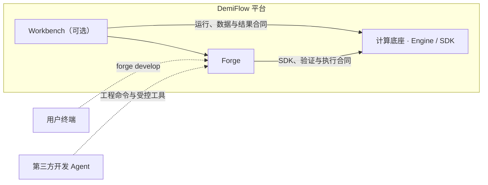

实线表示平台模块间的代码依赖，虚线表示外部调用者使用的开发入口。第三方开发 Agent（如 Codex CLI、DeepSeek CLI）是用户选择的业务 Pipeline 作者，负责理解需求、选择工具和编写业务代码。算子内 Agent 由计算底座在 Pipeline 执行时调用。

### 1.3 端到端时序图

下图按开发、交付和另行授权的运行展开。箭头方向表示消息接收方，箭头文字写明请求、返回结果及失败状态，指向自身的箭头表示内部动作。

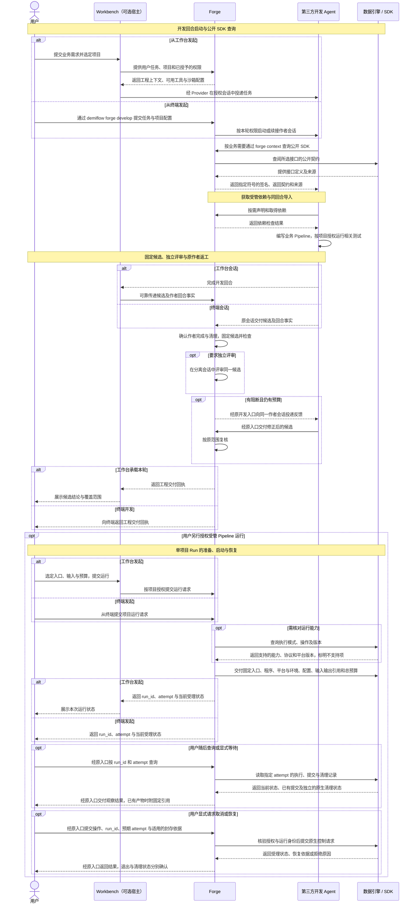

| 总图阶段 | Forge 内部展开 |
|---|---|
| 开发回合启动与公开 SDK 查询 | [2.1.2.1](#2121-开发回合启动与公开-sdk-查询) |
| 获取受管依赖与同回合导入 | [2.1.2.2](#2122-获取受管依赖与同回合导入) |
| 固定候选、独立评审与原作者返工 | [2.1.2.3](#2123-固定候选独立评审与原作者返工) |
| 单项目 Run 的准备、启动与恢复 | [2.1.2.4](#2124-单项目-run-的准备启动与恢复) |

## 2 分模块架构

### 2.1 Forge

#### 2.1.1 子模块职责与边界

| 子模块 | 职责 | 边界 | 代码入口 |
|---|---|---|---|
| 项目契约与工程入口 `project / cli` | 定义业务目录角色、Flow 入口、参数绑定、工作流节点与产物引用。demiflow forge 是终端和 Agent 共用的工程入口。 | 可脱离 Workbench 独立使用。forge develop 组织开发回合，--resume 续接原作者，forge run 管理业务运行。顶层 demiflow run --config 消费封存的 PipelineBundleRef。 | [工程命令](../demiflow/forge/cli.py)、[项目契约](../demiflow/forge/project.py)、[工作流声明](../demiflow/forge/workflow.py) |
| 依赖管理 `deps` | 解析项目唯一依赖声明 `pyproject.toml`。`[project].dependencies` 声明 A 类可安装包，`[tool.demiflow.packages]` 声明 B 类源码包。管理 A 类包核验与显式安装、B 类包获取与移除。 | 读取、摘要和获取服从沙箱范围，内容规则复用 check。vendor 校验后发布项目内受管副本，remove 删除受管副本或解除 local_ref，外部原目录由用户持有。失败或并发须保全其他变更。list/verify 读取声明与环境，受信操作者用 install 显式安装到选定 Python。旧项目沿用原依赖与共享源码，A 类项目可用空包表启用核验。 | [依赖声明与操作](../demiflow/forge/dependencies.py)、[依赖契约与用法](forge-project-dependencies.md) |
| 静态检查 `check` | 统一定义并提供单包内容、导入边界和项目依赖校验规则，静态检查 Flow 接线、目录角色及导入。诊断定位到声明项或源码行，并标明覆盖范围。 | 静态读取候选，复用同一规则检查内容、导入和依赖。仅接纳有合法名称与 `__init__.py` 的普通 Python 源码包，忽略 `__pycache__`。拒绝软链、权重、数据、归档、Notebook、二进制和对业务或平台的反向导入，含项目限定名。上限为单文件 512 KiB、单包 256 文件/8 MiB、项目 16 包/512 文件/16 MiB。诊断覆盖缺失、非法、孤立、撞名、子模块及业务导入和 A 类版本。TYPE_CHECKING 与 ImportError 只豁免对应缺失诊断。环境核验使用显式项目 Python，未核验项单列。业务测试归项目，运行准入归 runs。 | [项目检查](../demiflow/forge/pipeline_check.py)、[工程导入规则](../demiflow/forge/project_rules.py) |
| 作者上下文 `context` | 将用户要求、项目事实、Skill、编写及评审规范与当前公开 SDK 交给作者。提供按主题和符号查询的工程入口。 | SDK 定义和版本归计算底座，宿主传递任务与事实，工程材料归 Forge，推理与工具选择归第三方开发 Agent。 | [上下文查询](../demiflow/forge/context.py)、[SDK 目录](../demiflow/forge/api_reference.py)、[作者上下文拼装](../demiflow/forge/bridge/agent_context.py)、[编写规范](../demiflow/forge/standards/pipeline-authoring.md) |
| Agent 受控工具 `bridge` | 定义工具发现、参数、鉴权与分发，覆盖开发会话、Notebook 助手命令和 `run.*`。 | 开发与 Notebook 工具按当前回合开放，宿主注入输入、登记与 Cell 执行回调。开发工具包括 `manage_project_layout`、`request_pipeline_review`、`read_input`、`list_registered_projects`。`run.*` 按请求及 attempt 身份交给 `runs` 核验项目操作权限。 宿主持有凭据，作者和评审分别使用当前回合授予的模型通道。 | [工程工具](../demiflow/forge/bridge/tools.py)、[控制桥](../demiflow/forge/bridge/server.py)、[Notebook 命令](../demiflow/forge/bridge/notebook_commands.py)、[Run 工具](../demiflow/forge/bridge/run_tools.py)、[模型通道](../demiflow/forge/bridge/model_channel.py) |
| 开发与评审沙箱 `sandbox` | 依项目契约、操作角色和显式授权上限推导并执行 OS 读写边界，负责命令包装器、隔离进程与回收。 | 文件可见性与可写范围归 Forge。普通开发按 OS 权限读取并屏蔽敏感路径，只读或显式收窄回合按范围访问。作者可写 pyproject.toml，对 packages/ 与 .forge/ 只读。受控 vendor/remove 离线执行，包更新在下一条 Python 命令生效。超出显式范围须重新授权并启动沙箱，进程复用核验实际权限。终端默认受限，可信本地模式显式选择。watch 只观察变更，依赖声明不授予权限。 | [沙箱策略](../demiflow/forge/sandbox/policy.py)、[执行后端](../demiflow/forge/sandbox/backends/)、[命令包装器](../demiflow/forge/sandbox/sandbox_shims.py) |
| 独立评审 `review` | 对照需求和固定候选审查业务实现，核对引用、覆盖范围和阻断项，签发与候选绑定的评审回执。 | 独立于作者的只读、无工具模型会话。输入含保留行号的脱敏 TOML 和包摘要，源码展开止于外部包边界。声明原文与包树哈希计入 evidence_id。核对引用的文件、前后版本、行号和摘录，空文件按对应版本举证。候选变化须重核，旧回执可查。补读由 Forge 执行并与返工共用剩余预算，结论交给开发交付。 | [评审](../demiflow/forge/review.py)、[评审证据](../demiflow/forge/review_evidence.py)、[候选取证](../demiflow/forge/source_snapshot.py)、[评审指南](../demiflow/forge/standards/pipeline-review.md) |
| 开发交付 `development` | 依据用户需求组织原作者回合，固定候选、检查范围、独立评审、返工和交付回执。 | 讨论回合无业务改动时仅按显式请求评审。实施交付须有符合需求的候选或已核实的既有结果。检查和付费评审分别按策略启用。两入口共用重叠项目根的写入准入，清理未确认时保留所有权与租约。主动和自动检查共用去重，按受影响 Flow、共享依赖及未归属变更确定范围，保留删除、无 Git、参数与工作流依据。有效反馈连同发送身份交回原作者，返工后按原范围复核。各开发入口分别记录发送、投递确认和完成，ACK 未知时先核实，禁止自动重发。过期反馈保留被替代、取消或待核验状态。 | [开发回合](../demiflow/forge/development.py) |
| 项目 Python `runtime` | 使用终端显式传入或 Workbench 已选定的同一个项目 Python，提供受限启动、精确源码加载及依赖快照。业务操作需要 Python 时，解释器缺失或无效须在启动前报错。 | 解释器配置由调用方持有。加载范围限于所选包，外部父目录不加入 `sys.path`。实时或封存版本由调用场景指定。Run attempt 归 `runs`，预览和 Notebook 内核生命周期归 Workbench。 | [解释器与源码加载](../demiflow/forge/runtime.py) |
| 单项目受管运行 `runs` | 独立管理单项目的应用封存、幂等请求、槽位租约与设备配额、启停、恢复及产物和训练对账。 | Forge 是单项目受管 Run 的唯一控制方，终端和 Workbench 操作同一 run_id。prepare 按 request_id 去重，首次启动核验声明、源码和环境，秘密只存引用。后续操作核对授权、run/attempt、操作身份及适用的预期版本、期限与封存摘要，恢复核验原环境、剩余预算、前次清理及原生恢复依据。外部包升级后仍读原封存，依据不足时保留旧结果可读并提示新开运行。解释器与包加载归 runtime，原生执行、检查点与提交归底座。Workbench 注入授权和索引回调。 | [Run 生命周期](../demiflow/forge/runs/manager.py)、[运行授权](../demiflow/forge/runs/authority.py)、[受管命令](../demiflow/forge/runs/cli.py)、[PipelineBundleRef 入口](../demiflow/cli.py) |

#### 2.1.2 子模块时序图

##### 2.1.2.1 开发回合启动与公开 SDK 查询

展开总图中的“开发回合启动与公开 SDK 查询”阶段。[1.3 端到端时序图](#13-端到端时序图)

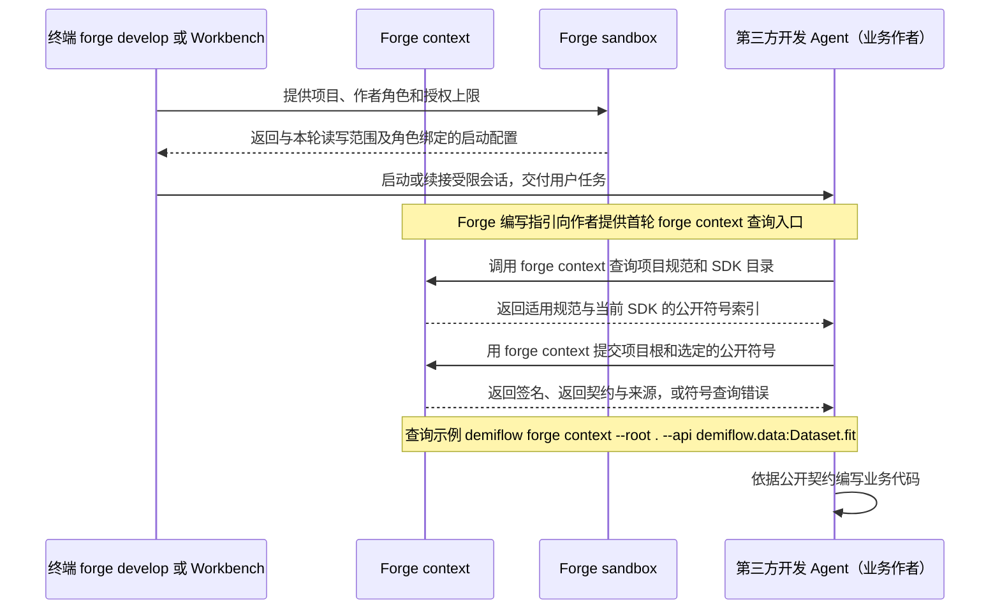

##### 2.1.2.2 获取受管依赖与同回合导入

展开总图中的“获取受管依赖与同回合导入”阶段。[1.3 端到端时序图](#13-端到端时序图)

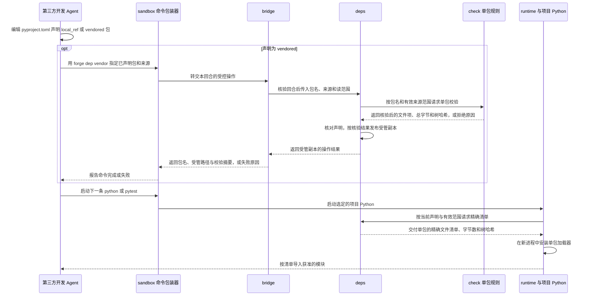

##### 2.1.2.3 固定候选、独立评审与原作者返工

展开总图中的“固定候选、独立评审与原作者返工”阶段。[1.3 端到端时序图](#13-端到端时序图)

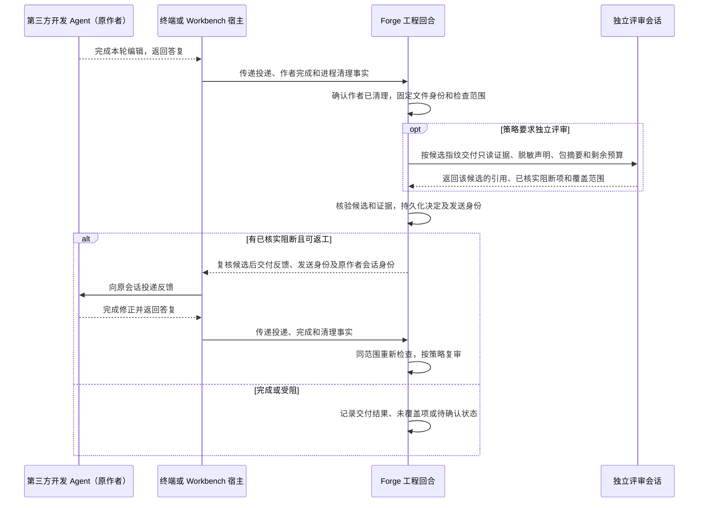

##### 2.1.2.4 单项目 Run 的准备、启动与恢复

展开总图另行授权的运行阶段，包含中断后的显式恢复。[1.3 端到端时序图](#13-端到端时序图)

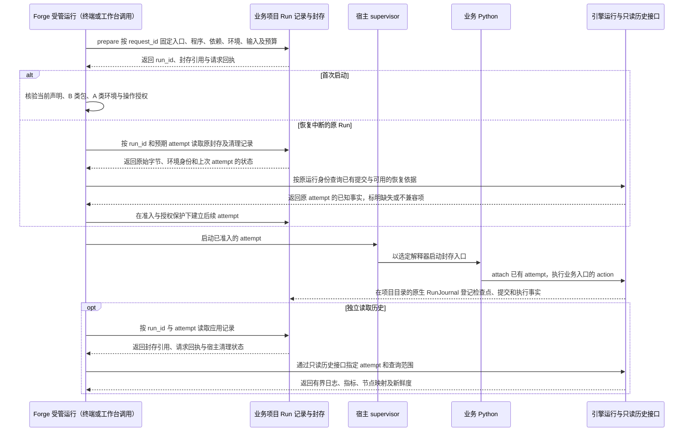

### 2.2 Workbench（可选）

#### 2.2.1 子模块职责与边界

| 子模块 | 职责 | 边界 | 代码入口 |
|---|---|---|---|
| 项目登记 `projects` | 保存用户目录引用、选定的 Python 与操作授权，按本次操作传给 Forge。 | 项目发现、登记和操作授权分别核验。Web 授权受服务上限约束，本机 CLI 的授权绑定显式项目根。文件可见性归 Forge 沙箱。依赖采用项目声明，旧登记可继续读取，无需额外目录白名单或摘要审批。 | [项目登记](../demiflow/workbench/projects/registry.py) |
| API 与传输 | 管理 HTTP 认证、路由、序列化、流式连接与取消传递。 | 路由调用所属领域的操作，状态变更归该领域。 | [API](../demiflow/workbench/api.py) |
| Web 界面 | 提供 项目导航、四个 tab、共享选择、响应式布局与错误提示。 | 算子图、源码、配置、历史和日志按用户选择的对象读取。 | [Web 入口](../demiflow/workbench/web/app.js) |
| 通用展示组件 | 依固定引用呈现表格、消息、文本、代码、JSON、HTML、图像和音视频，处理不可信内容、分页、缩放、展开与订阅。 | 答案、数据修改与运行控制由对应领域持有。 | [展示组件](../demiflow/workbench/web/workbench-presentation.js) |
| 开发会话 `conversations` | 持有会话 HTTP、SQLite 记录、Provider 传输、人工队列和回合恢复，向 Forge 传递用户要求、投递、作者完成和清理事实。 | 返工反馈返回原作者，工程回执交给发起者。重连按当前回合核权。工程上下文、工具契约、沙箱策略和交付回执归 Forge。会话、算子内 Agent 和 Pipeline attempt 各自使用原身份。 持久保存投递事实及人工队列顺序，按 Forge 的决定处理过期反馈。 | [会话调度](../demiflow/workbench/conversations/worker.py)、[会话存储](../demiflow/workbench/conversations/store.py) |
| 预览与算子图 `worker / graph` | 固定表输入，调度只读业务子进程构图，关联算子、参数与源码。 | 控制进程使用宿主 Python。业务预览统一通过 `forge.runtime` 使用显式项目 Python，在解释器启动配置生效前施加隔离。既有 `shared-sources.json` 与 `DEMIFLOW_WORKBENCH_SHARED_SOURCES` 沿原合同使用，包名冲突须报告。 | [预览调度](../demiflow/workbench/worker.py)、[算子图](../demiflow/workbench/graph/preview.py) |
| 受管运行入口 `runs` | 持有多项目授权、历史索引接入、HTTP 与视图，展示单项目 Run 的状态、attempt、产物与历史。 | Web 和 `demiflow workbench run` 按入口核验调用方的当前授权，将单项目操作统一委托 `forge.runs`。运行 supervisor 使用宿主 Python。Forge 从项目记录重建 `.forge/index.sqlite`，Workbench 读取索引。 | [运行授权](../demiflow/workbench/runs/authority.py)、[产品视图](../demiflow/workbench/runs/view.py)、[项目索引](../demiflow/forge/index.py) |
| 工作流编排 `workflows` | 管理本项目或跨项目工作流的 `wf_run_id`、编排 attempt、节点依赖和子 Run 引用。 | 子 Run 按其项目授权提交，下游按上游实际提交的产物读取。查询、日志和停止各自核权，严格运行准入须显式启用。 | [工作流调度](../demiflow/workbench/workflows/manager.py)、[项目解析](../demiflow/workbench/workflows/resolver.py) |
| Notebook `notebooks` | 持有文档与已存输出、内核连接、Cell 派发和中断。文档版本、内核代际及单格执行各有身份，历史输出可独立读取。 | 文档可脱离内核保存重开。Jupyter Server 使用宿主 Python。内核通过 `forge.runtime` 使用项目 Python 与固定包快照，调用 `forge.sandbox` 施加只读隔离。助手命令契约归 `forge.bridge`，实际 Cell 执行归 Workbench。 | [Notebook 服务](../demiflow/workbench/notebooks/service.py)、[内核启动](../demiflow/workbench/notebooks/kernel_launcher.py)、[Cell 操作](../demiflow/workbench/notebooks/cell_commands.py)、[分析会话](../demiflow/workbench/analysis/sessions.py) |
| 查询与统计 | 持有 SQL、参数、固定表绑定、查询操作、取消与有界结果。 | SQL 可随 Notebook 保存，Python 与 SQL 显式交换结果。目录统计与枚举使用查询预算。 | [查询](../demiflow/workbench/analysis/query.py) |
| 数据目录与访问 | 通过有界接口查询表、Schema、固定版本、别名和来源。 | 数据留在原后端，目录或存储核验来源许可。产品查询可独立于 Dataset 计算。 | [数据目录](../demiflow/workbench/catalog.py) |
| Case 组织与评测 | 用稳定的 Case、方案和字段身份筛选、分组和翻页，支持配置材料、问题及布局。 | 答案 head、event、revision 和 media_basis 按 expected 版本在同一事务中更新。草稿、下一条与历史引用固定材料。 | [Case 评测](../demiflow/workbench/analysis/case_review.py) |
| 媒体访问 | 持有 ticket、range、读取、采集与资源释放。 | 按当前权限和历史材料来源读取。浏览器取消后跟踪实际退出，历史媒体读取独立于 Notebook 内核。 | [媒体访问](../demiflow/workbench/analysis/media.py) |

#### 2.2.2 子模块时序图

##### 2.2.2.1 开发会话与反馈投递

展开总图中的工作台会话启动与反馈投递。[1.3 端到端时序图](#13-端到端时序图)

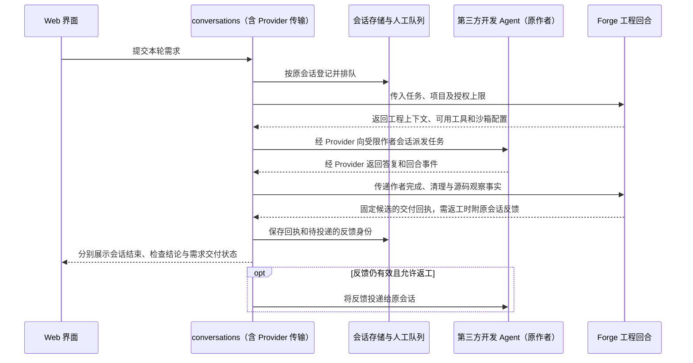

##### 2.2.2.2 只读预览与算子图

由 Workbench 预览入口按需发起，使用只读业务子进程构图。

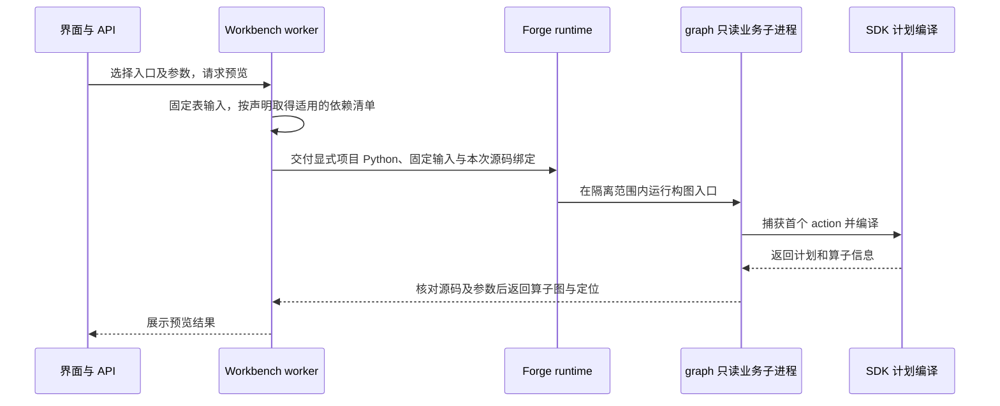

##### 2.2.2.3 工作流提交与子 Run 调度

由 Workbench 工作流入口发起，各节点复用 Forge 单项目 Run。[2.1.2.4 单项目 Run 的准备、启动与恢复](#2124-单项目-run-的准备启动与恢复)

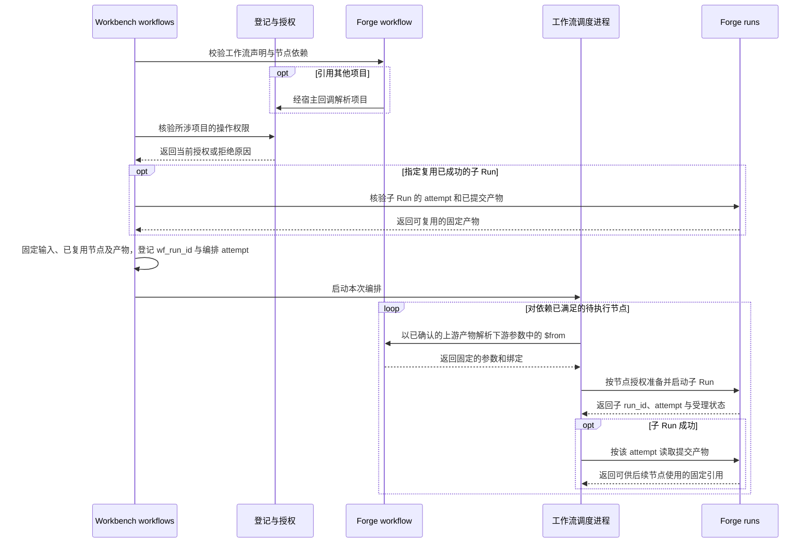

##### 2.2.2.4 Notebook 文档与内核

由 Notebook 入口发起，文档保存与内核启动各有生命周期。

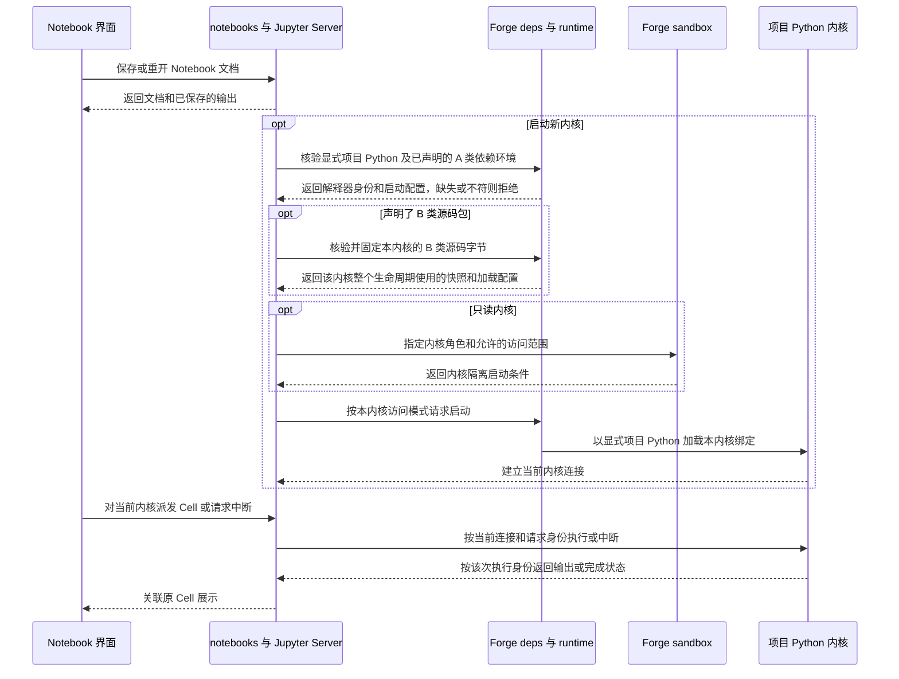

##### 2.2.2.5 数据查询、Case 与媒体访问

由数据分析入口发起，按固定材料进行查询、标注和媒体读取。

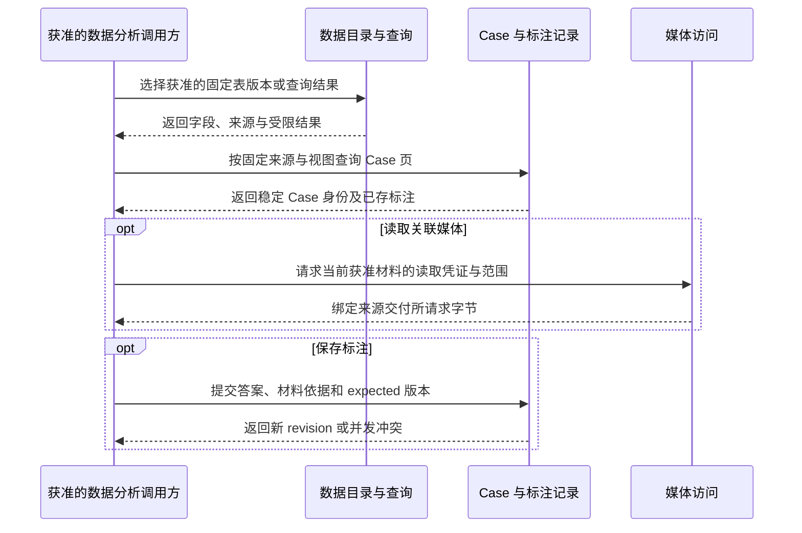

### 2.3 计算底座（Engine / SDK）

#### 2.3.1 子模块职责与边界

| 子模块 | 职责 | 边界 | 代码入口 |
|---|---|---|---|
| 01　Pipeline 入口与运行上下文 | 绑定业务入口、运行参数、run 与 attempt，管理 RunContext、RunAction 和取消请求。 | 一个 run 可以包含多个 action。受管入口提供已准入的 attempt，原生上下文绑定其运行身份。 应用核验总预算，运行上下文保留调用方获准的上限。受管入口核验项目授权，原生上下文核验运行身份与租约。停止受理、实际退出和资源清理分别确认。 | [run 上下文](../demiflow/execution/pipeline/run_context.py)、[pipeline 入口](../demiflow/execution/pipeline/driver.py) |
| 02　Dataset API 与执行端口 P1 | 定义 Dataset、数据与类型、函数与 Actor 的声明、Pipeline 配置和终结动作，记录 source 与 LogicalPlan，经 P1 交给所选 executor。 | SDK 交付公开 API 约定的行、迭代器、标量或回执。引擎一侧将带类型的动作声明组装为 ActionRequest。 executor 按需装配，SDK 冷导入独立于 Forge 和 Workbench。take 限制交付行数。 | [Dataset](../demiflow/data/dataset.py)、[动作契约](../demiflow/data/execution_contract.py)、[执行端口](../demiflow/execution/executors/base.py)、[动作入口](../demiflow/execution/executors/dataflow_api.py) |
| 03　Action driver | 处理一个 ActionRequest，协调阶段、整批准入截止、逐项放置重试和终止，持有 ActionHandle。 | 等待与重试截止归 driver，单项选机与租约归 07，物理分配和实际退出归 08。 | [DataflowExecution](../demiflow/execution/action_driver/dataflow.py) |
| 04　编译器 | 完成逻辑降级，再依据真实分片与策略选择 stage、融合及 exchange，生成逻辑和物理计划。 按实际同时驻留的阶段核算窗口和资源请求。 | 物理规划消费实际 splits、主机描述和常量引用。读取源元数据归 05，发布封存归 06。 内存交接须容纳同时驻留的上下游，持久化交接可分时启动。资源请求按执行方式推导，无法可靠推导的共享实例或自定义恢复任务保留固定需求。 | [逻辑编译](../demiflow/planning/dataflow_compile.py)、[物理规划](../demiflow/planning/dataflow_place.py)、[算子登记](../demiflow/planning/dataflow_registry.py) |
| 05　数据源 | 固定源版本并生成 SourceSnapshot、SourceSplit 与起始游标，在 worker 打开对应读取器。 普通源依据执行策略 default_partitions 切分，原生队列源沿自身布局。 | 源格式负责解析位置与产生带来源位置的记录，恢复从原位置继续。07 选机，08 在所选主机派发，09 执行分区。 | [源声明](../demiflow/data/sources.py)、[源切分](../demiflow/execution/sources/snapshots.py)、[Lance 读取](../demiflow/lance/read.py) |
| 06　程序准备与封存 | 固定程序、图、常量、源及实际物理计划，使既有 action 可重载并核验 SealedExecution。 | 引擎封存对应原生 action。项目入口、参数和应用依赖版本由上层固定，一致恢复点与提交归 13。 原 action 重载原物理计划。封存载荷字节可用于核算程序加载缓冲，解码后的 Python 堆占用仍取决于对象实现。 | [程序准备与封存](../demiflow/execution/seal/plan.py) |
| 07　调度器 | 判断整批可行性，按当前占用和有效上限逐项选机、预留、发放 WorkerLease，观察退役。 | 03 持有重试和截止时间。07 给出 host、租约或等待原因，由 08 向后端申请和归还物理资源。 | [DataflowScheduler](../demiflow/execution/scheduler/placement.py) |
| 08　主机适配与资源管理 | 在选定主机准备 endpoint 并派发任务。ResourceManager 向 provider 申请、核对和收回物理资源。 | 按给定 assignment、租约和资源计划记录实际分配、退出或待清理证据。选机归 07。ExecutionUnit 与 ResourceLease 绑定物理实例。每个实例有唯一生命周期所有者及计量记录，按部署域核算 CPU、内存、磁盘、FD 和并发。 同一部署域计入 driver、supervisor、worker 及退出未确认的占用，每个 worker 使用获配额度。后端按实际能力施加限制，部分失败时逐实例对账，未确认退出仍占额度。 | [主机端点](../demiflow/execution/hosts/endpoints.py)、[ResourceManager](../demiflow/resources/manager.py) |
| 09　Worker 与分区执行 | 执行分区循环，装配并调用算子，处理批次、进度与取消，向 checkpoint 提供分区状态。 接收输入、产生输出和保存状态时核算同时存活的数据。 | 09 驱动行或批的处理，具体算法归 10，跨分区传输和确认归 11。 工作区使用获配额度，任务状态与恢复镜像受 max_state_bytes 约束。 | [分区执行](../demiflow/execution/worker/dataflow_execution.py)、[图推进](../demiflow/execution/worker/dataflow_graph_runner.py)、[算子绑定与调用](../demiflow/execution/kernels/operator.py) |
| 10　算子实现 | 实现普通函数、Actor、关系计算、模型、检索及媒体操作，经获准的账本或服务端口处理外部效果。 | 同一算子的不同算法遵守相同公开契约。算子确认请求、响应及未明结果，服务管理器持有 service、endpoint、lease 及就绪、观察和停止。搜索与模型操作沿各自的领域协议。 算子内 Agent 受行预算和公开工具契约约束。max_requests 约束节点跨 worker 的新请求，并发与受支持的重试影响实际请求数，结果未明须沿原账本处理。 | [算子实现](../demiflow/operators/)、[关系计算](../demiflow/operators/relational.py)、[DataFusion 查询](../demiflow/operators/relational_sql.py)、[Prompt](../demiflow/operator_llm/runtime.py)、[Embedding](../demiflow/embeddings/)、数据获取类算子（[SearchWeb](../demiflow/collect/operators.py)、[Fetch](../demiflow/collect/fetch_flow.py)、[ReadDocuments](../demiflow/collect/reading.py)、[RegisterDocuments](../demiflow/collect/document_library.py)、[DecodeDocument](../demiflow/collect/documents.py)、[EncodeImage](../demiflow/collect/image_resize.py)、[ParseWikitext](../demiflow/collect/wiki_syntax.py)）、[模型服务](../demiflow/services/manage.py) |
| 11　Exchange | 管理跨分区投递登记、路由、额度、ACK 和恢复所需的通道进度。 | driver 进程中转通知，Exchange 持有通道状态并向 cut 提供进度，输出是否提交由 12/13 核实。 融合算子可在分区内传值，物理计划存在跨分区边时才经过 exchange。 | [通道与传输](../demiflow/execution/exchange/)、[投递状态](../demiflow/execution/exchange/deliveries.py) |
| 12　终端结果交付与写出 | 向调用方交付 count、take 或流式读取结果。需要写出时，由对应 sink 准备输出、检查发布并提交。 | 终端交付的标量、行、物化句柄或 WriteResult 依其公开契约返回，写出状态依目标协议确认。 | [终端](../demiflow/execution/outputs/terminals.py)、[sink](../demiflow/execution/outputs/sinks.py)、[写出契约](../demiflow/data/datasink.py) |
| 13　Checkpoint 与提交 | 收集源位置、核与缓冲状态、通道进度和 sink 准备结果，协调一致恢复点与提交对账。 | 13 依据参与者事实生成 RecoveryImage 并确认输出。存储中的字节和传输 ACK 各自只证明对应步骤。 CommitCoordinator 经 driver 的原事务写提交事实，算子经 worker 已绑定的请求接口写领域事实。恢复 prepared 单元从原准备描述对账。 | [checkpoint 协调](../demiflow/execution/checkpoint/coordinator.py)、[提交](../demiflow/execution/checkpoint/commit.py) |
| 14　运行产物存储 | 按 ArtifactRef 保存和校验有界字节，管理引用、租约、释放与安全回收。 | 存储对字节与引用负责，ResultRef、ArtifactRef 保留生产者、输入、程序和环境来源。sink、Notebook 和查询分别确认自己的结果发布，产品核验后登记引用。 状态制品与 dataflow 字节对象沿各自存储写入。 | [对象存储](../demiflow/execution/storage/objects.py)、[引用与租约](../demiflow/execution/storage/lease.py)、[回收](../demiflow/execution/storage/gc.py) |
| 15　运行账本、观测与历史接口 | 沿原事务记录运行事实、观测和用量，按 run/attempt 提供只读历史与 P4 读取接口。 | 观测由事件生产者记录，历史按指定 attempt 返回有界日志、指标、节点映射与新鲜度。取消及恢复仍经有授权的控制入口。 运行与故障信息标明来源、版本、时间与覆盖范围。 | [账本](../demiflow/execution/journal/run_journal.py)、[观测](../demiflow/execution/journal/run_telemetry.py)、[历史读取](../demiflow/execution/journal/run_reader.py)、[P4 端口](../demiflow/execution/host/) |
| 16　声明、协议与编码 | 定义逻辑声明、跨模块消息与身份、受支持的编码和解码。 | 公共协议表达中立身份和可校验的值。引擎通过绑定核验 fence，各领域自行授权、执行和确认。 | [逻辑声明](../demiflow/data/plan.py)、[引擎协议](../demiflow/execution/contracts/)、[恢复协议](../demiflow/execution/contracts/recovery_contract.py)、[资源协议](../demiflow/resources/contracts.py) |
| 17　原生队列、获取和流式写入 | 在原生路径领取和结算源单元，管理外部效果、分区写入与确认，提供原生回执及可继续位置。 | 领域确认归原生队列或写端，向 driver 和 checkpoint 提供可核实的事实。 | [原生 producer](../demiflow/execution/native_queue/dataflow_queue.py)、[队列](../demiflow/execution/native_queue/queue_producer.py)、[流式写出](../demiflow/execution/native_queue/dataflow_stream_lance.py) |

#### 2.3.2 子模块时序图

##### 2.3.2.1 从 Dataset 到可激活的分区

展开运行阶段中的 action 启动，包含新编译与原封存重载。[2.1.2.4 单项目 Run 的准备、启动与恢复](#2124-单项目-run-的准备启动与恢复)

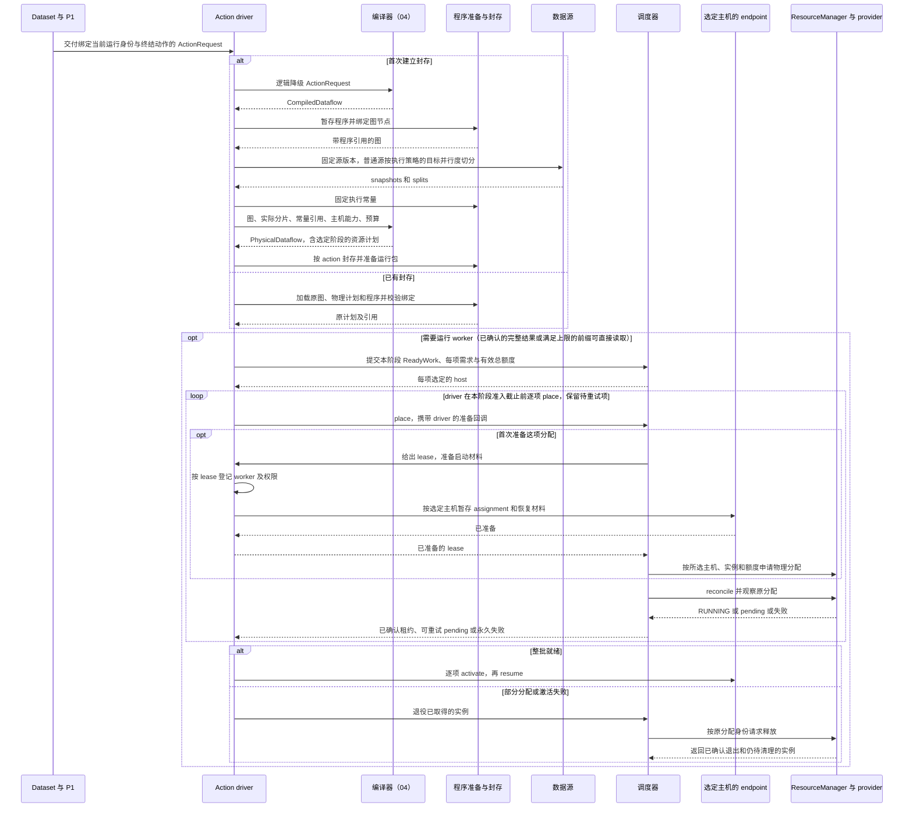

##### 2.3.2.2 行处理、投递与提交

接续分区激活，展开行处理、跨分区投递和一致提交。Prompt 调用、跨分区传输和 sink 按实际计划参与。[2.3.2.1 从 Dataset 到可激活的分区](#2321-从-dataset-到可激活的分区)

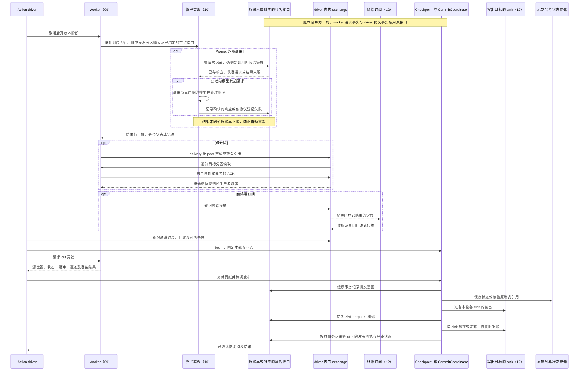

##### 2.3.2.3 取消、清理与恢复

展开运行中的取消、清理与显式恢复。取消可与发布重叠，关闭订阅另有传输释放动作。[2.1.2.4 单项目 Run 的准备、启动与恢复](#2124-单项目-run-的准备启动与恢复)

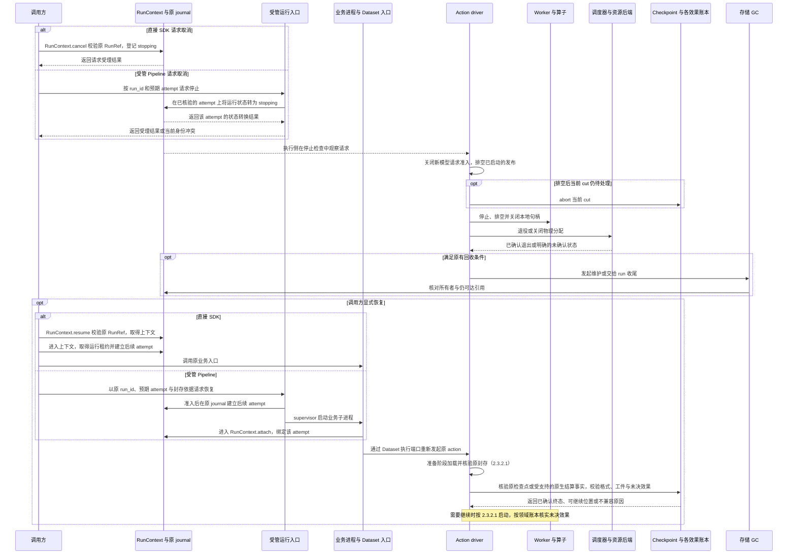
