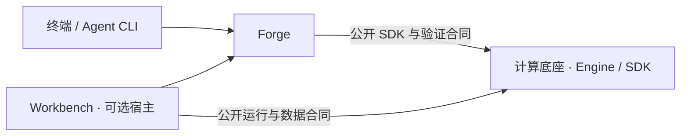
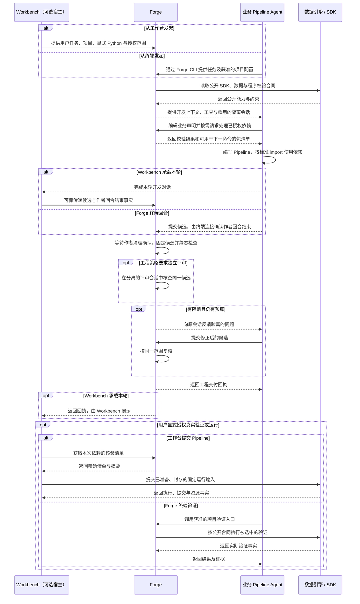
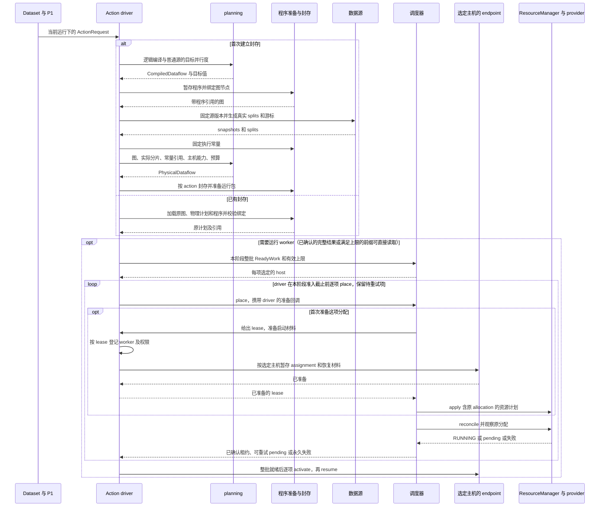
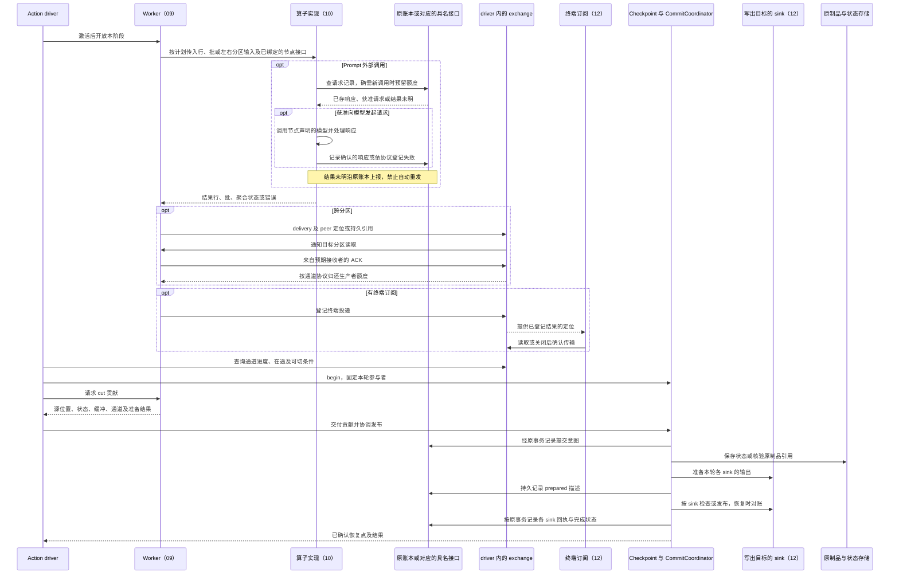
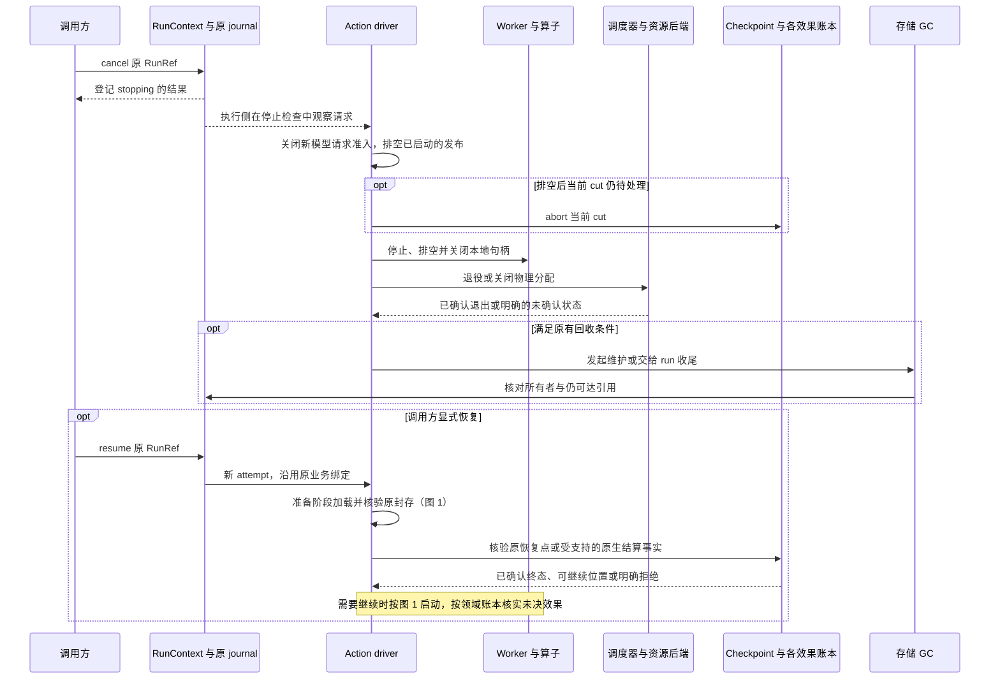

# DemiFlow 架构规约

版本 v1.6，2026-11-26。本文统一规定平台三模块的职责、调用方向、状态归属和计算底座内部规约。架构规定目标与约束，当前可用能力以公开入口、实际代码和验收证据为准。

**适用顺序。** 同一事项有冲突时，依次适用最新真人明确决定、[仓库发版规范](repository-rules.md)、本规约、已批准的具体设计。决定和例外限于点名的对象和范围。P1、P2、P4、F2 等具体设计提供对应合同细节和验收依据。修改本规约须在隔离任务分支提出，列明受影响的模块、调用方和兼容影响。

## 一　平台模块职责与调用方向

产品意图是让用户看懂、配置和运行 Pipeline，并灵活分析、比较和评测数据。平台由以下三个模块组成。用户业务项目是独立资产，源码、参数、数据、Notebook、运行记录和结果留在项目及显式配置的存储中。Forge 定义业务项目的工程契约，Workbench 的项目登记只保存发现与授权引用。

| 模块 | 职责 | 调用边界 |
|---|---|---|
| Forge | 定义项目工程契约，负责依赖管理、静态检查、独立评审、Agent 工具和上下文、开发与评审沙箱，以及工程交付闭环。终端可独立使用。 | 通过计算底座公开合同取得 SDK 和验证能力。宿主通过中立参数或受控回调提供授权及传输。禁止反向导入 Workbench。 |
| Workbench（可选宿主） | 产品 API/UI、项目登记、授权、开发会话及 Provider 传输、人工队列、管线运行管理、Notebook/SQL、Case 和媒体。 | 调用 Forge 的工程能力，并可直接使用计算底座公开的运行、数据和结果合同。Forge 拥有 Agent 工具及上下文的定义。 |
| 计算底座（Engine / SDK） | SDK、程序检查、编译、算子执行、原生封存、恢复、资源与固定版本数据和结果合同。 | 通过公开合同接收上层准备好的 Python 环境、程序与封存输入。禁止依赖 Forge 或 Workbench。 |



三块可以同仓、同包、同进程部署。箭头表示允许的代码调用。调用方通过中立合同提供事实，状态仍由各模块的实际所有者持有。

### Forge 项目与依赖契约

- `pyproject.toml` 是项目唯一的依赖配置，开发 Agent 可在授权范围内编辑。`[project].dependencies` 声明 A 类可安装包，使用项目显式选择的 Python 环境；`[tool.demiflow.packages]` 声明 B 类外部源码包，支持 `local_ref` 和 `vendored`。没有该表的项目沿用旧行为，仅使用 A 类依赖的新项目可用空表显式启用。
- `packages/` 按需创建，存放 Forge 校验的 vendored 正规 Python 包。从 Git 检出的已有副本按同一规则校验。包须含 `__init__.py`，顶层名称不得与项目角色、标准库、`demiflow` 或当前环境已有 import 根冲突。B 类包接纳有界的普通 Python 源码，拒绝权重、数据集、压缩包、Notebook、二进制、缓存与符号链接，静态校验反向导入业务角色或平台的行为，包括项目限定名。文件上限 512 KiB，单包上限 256 文件和 8 MiB，项目上限 512 文件、16 MiB 和 16 包。数据及权重走原业务资源合同。
- Forge 从当前声明和磁盘生成精确包文件清单及内容摘要。读取外部源码之前，由 Forge 按宿主已授予的来源范围检查真实路径。包摘要用于校验、评审身份和封存；修改声明的权限只覆盖项目文件。运行端按精确包名和文件装载，保持目录权限有界。项目依赖无需额外锁文件、`sync` / `link` 刷锁或手工摘要审批。
- `vendor` 校验来源并将合规包放入本项目的 `packages/<包名>/`。`remove` 解除项目声明，涉及物理删除时限于本项目的 vendored 副本；`local_ref` 的源目录归其原所有者。涉及声明与副本的变更保持一致，并发编辑按既有项目写入边界处理。`dep list` 和 `dep verify` 读取项目事实，环境核验使用显式项目 Python。`dep install` 由受信操作者显式应用到指定项目环境。普通 `import` 和已有公开 SDK 继续作为业务代码入口。

### Forge Agent、沙箱及评审职责

- Forge 定义面向开发及评审 Agent 的工具、结构化参数与回执、上下文、`SKILL.md`、编写规范和评审指南。模型推理及工具循环由原 coding harness 执行。Workbench 提供结构化产品事实、项目与会话授权、Provider 传输及已有受控宿主通道。
- Forge 拥有开发和独立评审沙箱的范围、后端、进程启动回收及 `demiflow` / `python` / `pytest` 包装器。终端与 Workbench 的受限会话使用同一能力，可信本地模式显式选择。受限后端不可用时报告真实状态。依赖开发的受限会话使用明确的业务文件写入范围，`packages/` 与 `.forge/` 在 Agent 域内物理只读。`pyproject.toml` 的创建、保存和原子替换可走 Forge 已授权的文件入口。
- Agent 受限会话的 `forge dep vendor/remove` 通过窄操作通道由宿主调用同一 Forge 用例，限当前项目和已开放的源码来源。`vendor` 成功后下一条 Python 或 `pytest` 命令使用新清单，同时保持 `packages/` 物理只读。既有沙箱权限范围无法满足该条件时，Forge 回收旧隔离域并启用新范围。受限依赖操作沿用无外网边界，缺少 A 类包时报告所需环境配置。
- `forge check` 静态核对声明、目录、依赖身份和导入边界。独立评审核查业务变更、依赖引入理由与包摘要。`pyproject.toml` 全文参与本地身份核验，提供给评审模型的材料有界、脱敏并保留真实改动和行号，外部绝对路径与凭据由宿主保护。评审到第三方包边界停止展开，树摘要进入评审候选身份。包内容变化时，历史回执继续作为历史事实，当前候选重新核验。详见[编写规范](../demiflow/forge/standards/pipeline-authoring.md)和[评审指南](../demiflow/forge/standards/pipeline-review.md)。
- 依赖主路径收口与历史代码迁移分批交付。新增 Agent 命令、上下文及沙箱接口自引入起归 Forge，Workbench 提供宿主适配。历史开发/评审沙箱、MCP 工具和上下文拼装按独立批次收敛。现行命令和限制见[项目依赖使用说明](forge-project-dependencies.md)。

### Workbench 产品与执行边界

- 登记所选项目、显式 Python、参考范围、联网策略及用户权限。产品会话、HTTP 传输、界面、Provider 连接和人工队列由 Workbench 持有，开发工程闭环委托 Forge。普通查询、日志和停止沿各自权限与生命周期执行。
- 预览及管线运行的宿主控制进程使用宿主 Python，业务子进程使用项目配置的 Python。项目环境及其启动配置属于获准使用的执行输入。预览保留有界只读构图、固定表输入和宿主权限隔离。运行准备将核验过的 B 类源码封存到该 run。首次启动比较规范化的依赖声明、B 类内容和 A 类环境；恢复使用原 run 封存的 B 类源码及原环境绑定。迁移期继续兼容旧依赖锁和注册表字段。历史 run 和已有部署侧共享源码沿原合同读取。
- Notebook 新内核使用项目显式 Python 和经核验的包清单，已启动内核保有自己的 B 类源码版本。A 类包由所选 Python 环境提供。只读内核的产品权限及生命周期归 Workbench，隔离原语可复用 Forge。
- 计算底座按既有公开合同接收环境及封存源码。项目依赖收口在 Forge 和 Workbench 完成，验收对照原有架构守卫和 `FROZEN` 检查。

### 业务 Pipeline Agent 开发时序



图中独立评审使用分离会话。Workbench 承载开发时，由宿主可靠传递作者回合结束事实。工程交付回执保持与 Pipeline 运行授权和实际运行结果的区分。

### Forge 独立闭环

1. 公开入口统一为 `demiflow forge …`。CLI 与工作台调用同一 Forge 工程用例。Agent 传输是内部实现细节，不另建平行的 Forge 产品入口。
2. Forge 必须能在没有工作台服务、UI 或数据库时，把原始需求交给 coding Agent，接收其回合结束事实，完成检查、独立评审、反馈原 Agent、有限修正和同范围复核，留下可查询回执。仅独立执行一次 `check` 或 `review` 不构成此闭环。
3. Forge 编排工程交付回合。模型推理与工具调用循环仍归原 coding harness；Forge 不复制该循环、通用 Agent 框架或计算执行器。
4. 工作台须在作者回合结束后可靠触发 Forge，避免依赖 Agent 自觉调用；Agent 也可主动请求。两种触发复用范围、策略、候选身份与去重规则，显式缩小范围必须在回执中可见，不得默认只取首个 Flow。
5. Forge 拥有适用检查、完整目标覆盖、评审有效性、反馈内容、返工预算、复核与完成判定。工作台负责产品授权、真实传输、会话与人工队列、展示及自身领域的资源接入。开发与评审沙箱的执行边界归 Forge。
6. 原作者会话、提交、候选源码身份与评审身份必须关联。反馈针对已验证的当前候选并回到原会话；后续修正形成新候选，重新检查和评审。进程、Web 回合与工程交付、Pipeline run/attempt 分别标识。
7. 对外副作用之前先持久化反馈决定及稳定发送身份，投递、确认、完成分别记录。未知 ACK 不当成失败或成功，也不自动重发；崩溃恢复不得重置返工预算。宿主可用自身事务持久化 Forge 定义的回执和待发送记录，Forge 不要求第二份宿主数据库。
8. 人工排队消息保持顺序和语义。工程反馈不得静默丢弃、抢占用户新要求或以过期候选驱动修改；等待、被新要求替代、取消及需重新核验均明确记录。
9. 静态规范检查与付费独立评审的开关分开。免费检查失败仍可驱动有限修正；未要求独立评审不得表示已经评审通过。文档改动的自动评审按适用性决定，手动请求仍可执行。
10. 检查、评审不能代替真实项目测试。只在项目显式提供解释器和验证命令且获准时执行；不得使用工作台 Python 猜测业务环境，不自动运行生产 Pipeline 或付费业务模型。

编排声明 `workflows/*.json` 由 Forge 定义、登记和静态检查。独立评审按实际本项目节点关联源码、参数和消费者。外部项目的入口及运行授权由持有登记事实的宿主核验。运行产物引用由执行端在上游提交后核验。工作台通过同一回合授权向 Codex 和 DeepSeek 提供项目目录与受控操作，恢复原会话时重新绑定当前授权。

### 工程不变量

- 独立评审使用与作者分离的会话，保持现有无工具、只读证据模型。Forge 的受限开发与评审沙箱以 OS 边界和固定模型通道隔离，凭据不进入不可信作者/评审环境；可信终端如实报告其执行保证。
- 作者完成且清理已确认后才开始独立评审，可复用同一宿主执行槽位。未知清理继续保留所有权。普通开发回合的 warm reuse、模型连接及协议身份不因抽取工作流而丢失。
- 分片、补读、格式修复与返工共享明确的总请求/时间/字节预算。每片获得的是剩余预算；不能每调用一次重新给满额。不可拆的超预算对象明确 incomplete，不能悄悄删除目标、截断源码或扩额。
- 所有目标先固定为一个候选；按受影响 Flow、共享依赖和未归属改动划分检查材料，聚合后仍核对完整覆盖和全部源码身份。删除文件、无 Git 项目和原参数绑定均保留来源。
- 源码引用须精确到文件、前后版本、行号与字面摘录，校验失败不成为可执行反馈。报告完整度与已验真的阻断项分别表达；少量无效条目不能抹去其余合法证据，也不能被默默忽略后标为 passed。
- 完成评审和派发修正之前重新校验候选。有效旧结论保留历史身份，不能被用作当前版本的通过证明。
- 真人原始需求及已接收的补充要求具有显式来源；自动返工、评审触发、工具输出不伪装成新需求。预算不足要说明缺口，不能静默截断意图。
- 终端和工作台对同一物理根及父子根使用同一写入准入事实，保留实际进程 lease/清理证据。检查通过不授予文件、网络、模型、数据或运行权限。
- 受保护内容、宿主合法的目录操作、既有 dirty/staging、Notebook、对话及历史记录保持原义。平台会话只改平台，通过规范和反馈驱动开发助手修正业务源码。

### 既有进程与应用边界

`workbench/process.py` 只识别调用方已持有的辅助进程身份。Notebook、数据/媒体、开发对话直接使用它，不能为此依赖 `workbench/runs/`；该模块不反向依赖各领域，不建立 run/attempt 或中央调度器。
共享宿主配置继续由现有 `workbench/host_partition.py` 提供。

`workbench/runs/` 保持 Pipeline 提交、运行记录、停止与恢复。工程工作流调用适用的既有底座代码，运行仍有唯一控制 owner、预算、ACK、fence 和提交事实。
查询、日志、停止不追加开发评审前置。运行严格准入必须显式启用，不能借本次改造把历史 observe 行为升级成强制门禁。

Notebook、SQL、Case 和开发对话各自保留语义、事务及生命周期。SQL 可继续随 Notebook；本轮不抽取统一运行 SDK、运行中心、资源账本或 C1–C6 同名适配层。
底层原 C1–C6/R1–R4 的版本、能力、取消、未知状态、恢复和资源合同保持有效，实际使用以现行引擎接口为准。

## 二　计算底座内部架构

本章适用于 Dataset API、编译器、Local 与 Ray Core 运行时、平台算子实现，以及受管 Pipeline 进入引擎的接口。模块编号 01–17 属于计算底座内部。

### 模块职责与输入输出

每项职责由一个模块负责。一个 run 可含多个 action。编译器决定计划，数据源确定实际分片，封存模块固定这一 action 使用的程序和计划。driver 编排 action，调度器放置并准入任务，主机和资源后端负责实际分配。worker 驱动分区执行，算子实现定义逐行、批次和关系计算的语义与算法，Exchange 持有跨分区投递状态。Local 和 Ray 使用同一套计划、任务、提交和恢复契约。

**新增计算底座一级模块。** 提议者须在详细设计前说明现有模块为何无法承担该独立职责，在下表末尾追加稳定编号、职责、输入、输出、代码目录，并按本章「模块依赖规约与评审批据」核对与现有模块的依赖。已有编号不重排。已有职责内拆文件或增加内部函数沿用原模块编号。

| 编号 | 模块 | 职责 | 输入 | 输出 | 平台代码入口 |
|---|---|---|---|---|---|
| 01 | Pipeline 入口与运行上下文 | 受管 pipeline 绑定入口、run、attempt，一个 run 可包含多个 action | 入口、参数、RunRef 或受管提交 | RunContext、RunAction、取消请求的持久状态 | [run 上下文](../demiflow/execution/pipeline/run_context.py)、[pipeline 入口](../demiflow/execution/pipeline/driver.py) |
| 02 | Dataset API 与执行端口 P1 | 记录声明，将终结动作交给所选 executor，交还 API 规定的结果 | source、LogicalPlan、动作及参数 | Dataset 或 typed action spec，引擎端组装 ActionRequest，返回行、迭代器、标量或回执 | [Dataset](../demiflow/data/dataset.py)、[动作契约](../demiflow/data/execution_contract.py)、[执行端口](../demiflow/execution/executors/base.py)、[动作入口](../demiflow/execution/executors/dataflow_api.py) |
| 03 | Action driver | 管一次 action 的阶段、整批准入截止、逐项 place 的重试及终止 | ActionRequest、运行上下文、policy/bounds、worker 事件 | 启动/暂停/恢复命令、ActionHandle、终态或错误 | [DataflowExecution](../demiflow/execution/action_driver/dataflow.py) |
| 04 | 编译器 | 逻辑降级、确定目标并行度、根据实际分片做物理规划，选择 stage、融合与交换方式 | ActionRequest、CompileInputs、约束；物理阶段另收图、实际 splits、主机描述、常量引用 | CompiledDataflow、目标并行度、PhysicalDataflow | [逻辑编译](../demiflow/planning/dataflow_compile.py)、[物理规划](../demiflow/planning/dataflow_place.py)、[算子登记](../demiflow/planning/dataflow_registry.py) |
| 05 | 数据源 | 固定输入版本，按源格式生成分片和起始游标，在 worker 打开读取器 | 源声明、目标并行度、预算；恢复时给定原位置 | SourceSnapshot、SourceSplit、带来源位置的记录 | [源声明](../demiflow/data/sources.py)、[源切分](../demiflow/execution/sources/snapshots.py)、[Lance 读取](../demiflow/lance/read.py) |
| 06 | 程序准备与封存 | 固定程序引用，让 action 的图、程序、源和物理计划可重载、可校验 | 编译结果、程序/常量、实际计划、RunAction、存储 | 带程序引用的图、SealedExecution 或经核验的历史图与计划 | [程序准备与封存](../demiflow/execution/seal/plan.py) |
| 07 | 调度器 | 负责整批可行性、选机、单项准入及租约、运行和发布预留、退役等待。03 持有整批的重试与截止时间 | ReadyWork、stage profile、已探测主机、有效 worker/内存上限、当前占用 | 每项 host、WorkerLease、等待/不可行原因、退出观察结果 | [DataflowScheduler](../demiflow/execution/scheduler/placement.py) |
| 08 | 主机适配与资源管理 | 适配器在选定主机准备连接/派发任务；ResourceManager 对 provider 申请、核对和收回物理资源 | 选机、WorkerAssignment、租约与资源计划 | 可激活的 endpoint、实际分配状态、退出或待清理证据 | [主机端点](../demiflow/execution/hosts/endpoints.py)、[ResourceManager](../demiflow/resources/manager.py) |
| 09 | Worker 与分区执行 | 按物理计划驱动分区循环，绑定并调用算子，管理批次成员、进度和取消 | WorkerAssignment、源或通道输入、算子绑定、控制命令 | 行/批、进度、控制事件、分区 checkpoint 贡献 | [分区执行](../demiflow/execution/worker/dataflow_execution.py)、[图推进](../demiflow/execution/worker/dataflow_graph_runner.py)、[算子绑定与调用](../demiflow/execution/kernels/operator.py) |
| 10 | 算子实现 | 负责算子的计算语义和算法实现，包括 join 键匹配、DataFusion 查询、Arrow 批变换及模型调用。同一算子的不同算法遵守相同的输入输出契约。受管模型服务负责自身就绪和生命周期 | 输入行、批或左右分区数据，算子参数、业务函数及获准的账本或服务接口 | 结果行、批、聚合状态或外部调用结果（含失败或结果未明） | [算子实现](../demiflow/operators/)、[关系计算](../demiflow/operators/relational.py)、[DataFusion 查询](../demiflow/operators/relational_sql.py)、[Prompt](../demiflow/operator_llm/runtime.py)、[Embedding](../demiflow/embeddings/)、数据获取类算子（[SearchWeb](../demiflow/collect/operators.py)、[Fetch](../demiflow/collect/fetch_flow.py)、[ReadDocuments](../demiflow/collect/reading.py)、[RegisterDocuments](../demiflow/collect/document_library.py)、[DecodeDocument](../demiflow/collect/documents.py)、[EncodeImage](../demiflow/collect/image_resize.py)、[ParseWikitext](../demiflow/collect/wiki_syntax.py)）、[模型服务](../demiflow/services/manage.py) |
| 11 | Exchange | 管跨分区投递登记、路由、额度、确认与通道恢复状态；driver 进程负责中转通知 | ExchangeSpec、发送/接收端标识、记录定位、ACK | 下游投递、额度归还、可用于 cut 的通道进度 | [通道与传输](../demiflow/execution/exchange/)、[投递状态](../demiflow/execution/exchange/deliveries.py) |
| 12 | 终端结果交付与写出 | 向调用方交付 count、take 或流式读取的结果。需要写出时，对应的 sink 按目标协议准备输出、检查发布状态并提交 | 终端记录及其发布事实，或分区待写结果与写出上下文 | 标量、行/批、物化句柄、WriteResult 或 sink 回执 | [终端](../demiflow/execution/outputs/terminals.py)、[sink](../demiflow/execution/outputs/sinks.py)、[写出契约](../demiflow/data/datasink.py) |
| 13 | Checkpoint 与提交 | 收齐参与者状态，协调一致恢复点，按 sink 协议提交/对账 | CutRequest、源位置、核与缓冲状态、通道进度、sink 准备结果 | RecoveryImage、确认的输出与原生提交事实 | [checkpoint 协调](../demiflow/execution/checkpoint/coordinator.py)、[提交](../demiflow/execution/checkpoint/commit.py) |
| 14 | 运行产物存储 | 保存、校验、保留、释放引用、安全回收 | 有界字节流或 ArtifactRef、owner | ArtifactRef、已校验字节、引用变更或回收结果 | [对象存储](../demiflow/execution/storage/objects.py)、[引用与租约](../demiflow/execution/storage/lease.py)、[回收](../demiflow/execution/storage/gc.py) |
| 15 | 运行账本、观测与历史接口 | 按原事务记录运行事实；写观测；按指定运行和 attempt 只读解释 | 状态变更与授权、运行事件或查询条件 | 持久事实、观测指标、只读视图 | [账本](../demiflow/execution/journal/run_journal.py)、[观测](../demiflow/execution/journal/run_telemetry.py)、[历史读取](../demiflow/execution/journal/run_reader.py)、[P4 端口](../demiflow/execution/host/) |
| 16 | 声明、协议与编码 | 表达跨模块边界的既有值、身份与编码；由使用方执行具体操作 | 字段、声明和受支持协议版本 | 经校验的声明、消息、回执或错误 | [逻辑声明](../demiflow/data/plan.py)、[引擎协议](../demiflow/execution/contracts/)、[恢复协议](../demiflow/execution/contracts/recovery_contract.py)、[资源协议](../demiflow/resources/contracts.py) |
| 17 | 原生队列、获取和流式写入 | 在原生路径管理源单元、外部效果及确认，向 driver 和 checkpoint 提供可验证的事实 | 已绑定的源单元、位置、请求或分区输出 | 领取与结算事实、原生回执、可继续位置 | [原生 producer](../demiflow/execution/native_queue/dataflow_queue.py)、[队列](../demiflow/execution/native_queue/queue_producer.py)、[流式写出](../demiflow/execution/native_queue/dataflow_stream_lance.py) |

**跨阶段的四项所有权**

- 外部操作的业务语义归算子。Prompt 的模板、请求、响应、重放及结果未明归 Prompt 领域；引擎装配当前节点的账本、额度和权限。搜索的受控执行位置可以在 driver，搜索协议仍由其领域负责。
- 产物存储持有可校验字节和引用。算子程序和随包业务源码按实际长度与摘要封存和加载。
  `max_state_bytes` 约束计算状态及其恢复镜像。输出发布由 sink 确认，恢复点由 checkpoint 协调，队列领取和确认按原生协议登记。
- 取消由 RunContext 接收，driver 停止新准入并排空在途发布，worker 关闭本地资源，调度器等待后端确认退出。存储按所有者与可达引用裁定回收。
- 观测在事件发生处产生。历史读取按指定 run、attempt 查询已持久化事实。对外检查、控制通过已有 P4 端口，控制操作沿各自授权入口执行。
- **公开算子与 SDK 契约文档自描述**：所有暴露于公开 SDK（`demiflow.data`、`demiflow.execution`、`demiflow.operator_llm`、`demiflow.objects`、`demiflow.agent`）的算子、方法与契约类须在源码 docstring 中写明用途、关键参数/字段约束及返回值（禁止空文档或 `@dataclass` 自动签名复读机），由 `tests/merge_gate.py` 中的 `tests/test_public_sdk_docstrings.py` 棘轮门禁强制把关。

### 模块调用时序

**资源如何进入计划。** 01 保留调用方获准的上限。04 拿到实际分片和已暂存的程序后，根据执行方式计算每个阶段需要的资源。以内存传递数据时，上下游必须同时放得下；允许持久化交接时，下游可以随后启动。04 按候选方案中实际同时驻留的阶段核算窗口和请求，06 封存选定结果。运行时，07 结合当时的占用决定能否派发，08 申请并释放实际资源。

普通算子可以只声明计算。引擎了解执行方式，负责推导资源请求。对能逐次计量的任务，接收一行、产生输出和保存状态时，09 都要把当时仍存活的数据计入已获准的工作区。对共享实例、带自定义恢复逻辑的任务等无法可靠推导占用的情形，规划保留其固定需求。

程序分发和任务状态各有自己的计量对象。需要为任务单独加载程序时，封存载荷的实际字节数可用于核算加载缓冲；Python 对象解码后的堆占用还取决于对象实现。任务可变状态和恢复镜像按原状态预算校验。命中旧封存的 action 时，执行器读取原物理计划和恢复点。

三张图沿同一次 action 展开。假设 ds 是有界输入，pack 已声明 item 和 summary。这里 take 限制交付行数，max_requests 限制本节点跨 worker 的新请求数；并发和受支持的重试会影响实际请求数。纯计算的 filter/count 跳过模型调用，需要写出时使用对应目标的 sink。

```python
rows = ds.map_prompt("enrich", config=pack, inputs={"item": "text"},
                     outputs={"summary": "summary"}, max_requests=10).take(2)
```

**图 1　从 Dataset 到可激活的分区。** 新 action 的规划分两段，中间固定程序和真实源分片；找到原封存时复用原计划。虚线表示返回，箭头表示运行调用，回调不要求增加反向包导入。



**图 2　行处理、投递与提交。** 融合的相邻算子可在分区内直接传值。图中的跨分区路径只在物理计划存在对应边时经过。checkpoint 可以重复发生，订阅也可以边运行边读取。



图 2 将账本画在一列以便阅读。算子在 worker 侧经已绑定的请求接口读写领域事实；CommitCoordinator 在 driver 侧经自己的运行事务写提交事实。状态制品和 dataflow 字节对象沿各自的原存储写入。图中所示是新 cut；恢复已 prepared 的单元直接从准备描述对账。

**图 3　取消、清理与恢复。** 取消可与发布重叠。调用方关闭订阅还有独立的传输释放动作。



### 模块依赖规约与评审批据

这里的依赖指一段代码必须知道另一个模块的哪些类型、行为或状态才能工作。审查单位是“消费者中的具体调用点 → 提供方的具体符号 → 用途”。源码导入、函数内延迟导入、注册表中的符号路径、回调捕获的对象以及历史载荷中的限定名，都可能构成依赖。运行时从 B 回调 A，并不要求 B 导入 A 的实现。

下表按条款列出[合入闸实际选取的守卫](../tests/merge_gate.py)及其边界。右列由评审者对本次改动核实，并在涉及运行行为时引用固定提交的回归或实测。D4 至 D8 均无覆盖整条契约的专门合入守卫。

| 条款 | 合入闸已检查的部分 | 仍须评审或实测的部分 |
|---|---|---|
| D1 声明 | [P1 依赖](../tests/test_p1_dependency_boundary.py)、[关系声明](../tests/test_p1_relational_boundary.py)、[冷导入](../tests/test_package_cold_imports.py)检查既有依赖与构造行为。 | 新声明的真实提供方、持有的资源及副作用。 |
| D2 契约与装配 | [编译契约清单](../tests/test_compile_contract_inventory.py)检查已登记的分派、端口和部分实际执行判断。 | 精确识别、工厂构造、服务绑定与观测各自的类型语义，以及绑定后的实际效果。 |
| D3 计划、数据源与封存 | [包依赖](../tests/test_package_dependency_ratchet.py)、[编译输入](../tests/test_dataflow_compile_inputs.py)及编译契约清单检查规划器导入、输入解析和已盘点的隐式环境读取。 | 数据源执行实际 I/O 的位置、旧封存的分片与游标如何复用。 |
| D4 编排与资源 | 合入闸未覆盖从整批准入到进程退出的完整时序。 | 观察选机、启动材料、租约、激活和实际退役的先后。 |
| D5 计算与投递 | 编译契约清单检查已登记端口；跨分区投递与终端提交需运行验证。 | 核对通道进度、在途恢复和终端 ACK、提交的先后。 |
| D6 效果与提交 | 合入闸未覆盖从请求准入到提交确认的完整事务。 | 按所改路径核验效果账本、重入、结果未明和 sink 发布回执。 |
| D7 控制、观测与历史 | [工作台与引擎边界](../tests/test_workbench_engine_boundary.py)和[托管清理](../tests/test_p4_managed_cleanup.py)覆盖部分访问边界、取消竞态及清理。 | 指定 attempt 的历史只读、取消后排空与实际退出，以及资源是否仍可达。 |
| D8 跨版本续跑 | [旧路径保留](../tests/test_pre_v3_retention.py)检查已登记对象与调用者；[已知状态工具](../tests/test_engine_known_state.py)核对回归清单的比较规则。 | 旧版本写、新版本冷读、从原非最终恢复点续跑，核验旧回执和拒绝条件。 |
| D9 依赖可追踪 | 包依赖守卫检查私有导入预算、旧执行器导入方及失效的允许项。 | 回调、注册符号和封存限定名指向谁，新增依赖是否确有必要。 |

#### D1　声明只依赖声明和无副作用的校验

**适用模块**　02 Dataset API、04 编译器、05 数据源声明、06 封存、16 声明与协议。

**允许。** 多个模块消费同一种声明值。声明可持有业务提供的程序描述、配置或已有端口引用，复用有界的字段与拓扑校验。API 按公开契约读取用户明确指定的配置文件；声明阶段不能借此打开数据源、启动 worker、创建执行中的 actor、访问当前运行账本。终结动作通过 P1 执行端口交付。

**打回。** 新的声明或逻辑规划为了表达“是什么”，需要导入 kernel、主机后端或运行期服务的具体实现；或者把排序、落盘、锁、执行缓存等实现放进声明包，再让执行模块反向导入。用第二套 DTO、转发文件或函数内导入包住同一条依赖，也须按真实提供方裁定。

**用 join 裁定。** 左右输入、键、连接类型归声明。编译器消费这些值并展开两个端口；09 提供两个分区记录流，10 的关系算子执行匹配。`PlanInput`、`KeyedSource`、`UnionSource` 的历史导入路径是 `execution.local_kernel`。新关系操作复用声明入口。旧程序可能按原限定名解码类对象，并在解码后复算程序身份。移动定义须同时满足 D8，兼容出口只覆盖登记的原符号和用途。[关系组装](../demiflow/data/relational_declaration.py) · [编译](../demiflow/planning/dataflow_compile.py) · [执行](../demiflow/execution/kernels/relational.py) · [历史保留依据](architecture-upgrade-20261120/G/RETAINED-OBJECTS.md)

**评审批据。** 标出同一声明的定义、生产者和消费者，确认声明阶段启动了哪些资源；检查源码导入和冷进程实际加载的模块。涉及 join 时检查左右端口、重复键多重性、空键和执行器绑定。只有触及持久身份或旧路径才追加 D8 的历史验证。

#### D2　通用抽象依赖契约，具体算子由装配处选择

**适用模块**　02 Dataset API、04 编译器、06 封存、09 Worker 与分区执行、10 算子实现、15 观测。

**允许。** 编译、调度、分区执行等通用模块依赖完成本职工作所需的契约。具体实现依该契约提供能力，装配处选择实现。编译器处理声明种类和已登记的 lowering，通用 worker 按执行规格调用已绑定的算子。具体工厂可以导入并构造 `PromptActor`；专用绑定可以核对受支持的精确类型后，注入本 action/node 的账本、请求额度和恢复能力。算子拥有字段映射、请求与响应处理、领域重放语义。领域到引擎的依赖逐符号使用已有合同、注入服务或已批准的原生装配。[算子服务契约](architecture-upgrade-20261120/F/F2-SERVICE-CONTRACTS.txt)

**打回。** 通用 kernel 为普通 map 增加某个模型、客户或服务的分支；多个消费者各自判断具体 actor 并决定绑定哪套账本；算子直接取得整个 driver、全局数据库或任意 RPC 能力。用全局运行时注册器或字符串类名绕过原生类型校验，或把构造、准入、观测和持久身份塞进一种判断，也应退回。新增平台内置种类优先使用已有登记表和工厂。

**第三方可选数据类型。** 为避免仅检查配置就加载可选库，可以按限定模块或包命名空间和已列明的类名筛选待解析的数据值（如 PyArrow 的 CSV 选项、Schema）。新增识别点须按对应格式核验类型或字段，再编码。现有 CSV 选项按具体类型与字段处理；历史 Schema 编码按模块前缀和类名调用序列化，该路径仅说明已有格式，不能据此推定完成了类型核验。仅凭名字不得认定平台原生算子、选择其程序身份算法或授予运行服务。[CSV 选项](../demiflow/planning/dataflow_compile.py) · [恢复编码](../demiflow/execution/seal/program_identity.py)

**已知偏差（核对基线 `f12f2e40`）。** 编译器的 `_operation_semantic_facts` 用类名识别 `OperatorLLMMapOp`，`_source_semantic_facts` 和 `_source_kind` 用类名识别内部 `_LiteralEmptySource`。三处均应比较平台自己的真实类型。修正以真实节点的语义事实、身份字节保持一致以及伪同名对象不能命中专用途径为据。[编译器](../demiflow/planning/dataflow_compile.py)

**用 map_prompt 裁定。** 普通 `map_prompt` 在 Dataset 中追加 `OperatorLLMMapOp`，worker 依据已编译的 `kind="prompt"` 装配。`CacheCall` 包装模型时，缓存先绑定 checkpoint，随后由模型绑定模块识别内部 callable、选择本节点的账本。相同的精确类型谓词可以共用；不同输入、决定或子类语义分别由下表所列模块持有。[Dataset 声明](../demiflow/data/dataset.py) · [模型工厂](../demiflow/execution/operator_bindings/dataflow_model_factory.py) · [kernel](../demiflow/execution/kernels/operator.py) · [模型绑定](../demiflow/execution/operator_bindings/dataflow_models.py)

| 判断或操作 | 负责模块 | 边界 |
|---|---|---|
| “这个对象的类型恰好是受支持的原生 PromptActor” | 原生算子的类型识别与专用装配 | 相同的精确类型谓词可共用。缓存、路由、图像等调用方仍各自核验本用途的条件。外观相似的对象和子类沿原路径处理。 |
| “创建哪种 actor，绑定哪个账本” | 工厂与模型装配 | 工厂保留具体构造。绑定方按 spec、节点及受支持场景选择原有适配器。普通算子不会因此得到 Prompt 权限。 |
| “封存哪些算子事实” | 具体算子提供封存所需的算子事实；06 负责封存表示与校验 | 复用精确身份判断，保留 Prompt/agent 的环境校验、各自事实和原有字节。 |
| “是否计入已发生的用量或观测” | 15 观测与各指标生产者 | 保留已有 `isinstance`、路由子项和缓存解包语义。观测不能授予执行资格、扣费或证明提交。 |

**评审批据。** 给出“声明 → 工厂 → 已绑定实例 → 行结果”的一条真实链路；改哪种判断，就比较其真例、子类、伪同名类和不相关 callable 的原有结果。涉及缓存时检查 Prompt/agent 的绑定、普通缓存及重复扣费；涉及观测时检查用量；涉及封存时按 D8 验证。按实际行为裁定，无需以直接导入类的文件数作为合格线。[算子事实](../demiflow/operator_llm/flow_contract.py) · [原生模型观测](../demiflow/execution/journal/dataflow_model_observations.py) · [用量](../demiflow/execution/journal/dataflow_usage.py)

#### D3 至 D9　各模块间允许的依赖与退回条件

| 条款 | 允许的方向和输入输出 | 应退回的变化 | 最小评审批据 |
|---|---|---|---|
| **D3　计划、数据源与封存** | 03→04 请求逻辑计划及目标并行度；03→05 获取源快照和真实分片；04 消费实际分片生成物理计划；03→06 固定程序、图、源和常量。 | 编译器读 Lance 元数据、查询当前 run 或写封存；恢复时重切原输入、用新计划替代旧封存。 | 对照图 1，分别走一次新 action 和一次命中原封存的路径，明确哪个模块执行 I/O。 |
| **D4　编排、调度与资源** | 03 管重试截止与终止；07 管整批可行性、单项准入与选机；08 负责真实分配与退出。07 经准备回调让 03 先把 assignment、权限和恢复位置交给选定端点，随后申请资源，确认就绪后才激活。 | 新增第二处 worker 数或内存准入决策；07 持有具体 driver；08 在启动材料准备好之前启动 worker；把停止请求当作已退出。 | 能区分永久不可行、暂时等待和物理退出。Local/Ray 使用相同任务与回执，后端特有行为只在适配侧取证。 |
| **D5　计算、投递与终端** | 09 驱动分区，10 执行算子计算；11 在 driver 进程持有跨分区和终端投递、额度、ACK、持久通道在途状态；12 交付订阅结果或写出。 | worker 绕过当前协议直连；driver、订阅或算子另存一份权威投递表；用传输 ACK 代替输出提交。 | 对照图 2 验证分区内直传、跨分区 ACK 和终端关闭中本次受影响的路径；恢复证据含原通道进度。 |
| **D6　效果、提交与存储** | 算子或原生队列经具名端口登记领域效果；13 协调 cut 与提交；sink 根据 prepared 描述检查和发布；14 只持有可校验字节及其引用；15 按原事务记事实。 | 依据文件存在或观测计数判断发布成功；结果未明时自动重发；存储自行承认效果；增加并行真账本。 | 核实一次成功和一个对应的失败或重入窗口。区分请求已准入、效果已确认、提交已确认和结果未明。 |
| **D7　控制、观测与历史** | 01 接收取消，03 停止新准入并排空，09 关闭本地实例，07/08 观察实际退出，14 按可达引用回收。P4 inspection 消费指定 run/attempt 的事实，获准控制走 control。 | 通过指标推算成功或资源已释放；取消时误删旧提交；读取历史触发模型、恢复或写账本；底座反向依赖应用。 | 针对所改分支，区分停止请求、排空完成、实际退出；历史读取冷进程只读且指向指定 attempt。 |
| **D8　跨版本身份、解码与续跑** | 16 保有唯一的声明/编码；06 读取原程序与身份；13 按原恢复点继续。变更涉及限定名、编码、工厂、模块源身份或反序列化时，列出旧写端、新读端和实际载荷。保留原业务、程序和输入校验。 | 只验证新写新读，或只看历史列表就声称可续跑；改旧数据、跳过 code pin、放宽类型检查、恢复平台版本门禁，或让受支持的旧路径悄然失效。 | 从旧发布提交产生样本，新进程分别冷读已发布结果、从非最终 cut 真续跑；比较旧 seal、回执和 cut 前缀；适用时覆盖闭包引用被移动类，并保留损坏/不兼容输入的拒绝。更改兼容承诺单独裁定。 |
| **D9　依赖可追踪且与收益相称** | 新增跨模块边须指向已有合同、获准装配或实际状态所有者。函数内导入、注册符号和序列化引用一同审查。硬编码限于版本化协议枚举、字段或受支持能力；上限取自有效策略，业务参数取自声明。 | 跨包私有字段赋值、扩大白名单掩盖新依赖、以空转发或双写掩盖旧所有者；仅为减少文件数或环的数字迁移模块。 | 列清新增和删除的真实调用者；已批准的历史例外只覆盖原符号和用途。已有守卫适用时保持或收紧，静态环规模作为诊断。 |

#### 如何作出评审结论

设计阶段指出受影响的模块编号、输入输出、时序步骤及 D 条款。代码阶段对固定提交检查真实调用者、写入状态的唯一所有者和所改路径的行为证据。可用一行记录：**条款编号｜消费者 → 提供方与符号｜用途｜证据｜裁定**。

- **通过**：职责、时序与依赖符合条款，有足以覆盖本次改动的证据。沿用已登记的历史例外时注明原范围。
- **需补证**：设计边界合理，但具体兼容或行为结论尚无证据。指出哪项检查能够裁定；该项通过前不将受影响变更计为验收完成。
- **退回**：出现条款中禁止的依赖、错误所有权、时序倒置或已证实的回归。说明应由哪个既有模块接手，以及修正后如何复核。

评审只对变更及其影响范围作结论。低影响的现存缺口可单独记录。架构评审、合入闸、固定提交的回归验收按各自的证据给出结果。

## 三　状态归属与运行合同

### 状态的唯一归属

各领域可以共用现有 SQLite、文件系统及事务机制。拆逻辑仓库时保留需要一起提交的原事务。不以新建数据库或复制记录来证明解耦。

| 对象 | 权威归属 | 状态边界 |
|---|---|---|
| 业务程序/计算计划 | 业务项目 + SDK | 代码、配置、逻辑计划。不同于一次运行 |
| 当前项目依赖 | 业务项目依赖声明与当前环境，由 Forge 校验 | `pyproject.toml` 保存声明，运行时清单与哈希由 Forge 有界生成。外部来源权限由调用方持有。 |
| Forge 工程交付 | Forge 开发与交付工作流 | task、baseline、check、verify、review、原作者反馈及 ACK、修正、freeze 和 handoff，绑定候选身份 |
| 业务编排运行 | 工作台编排调度与业务项目记录 | wf_run_id、编排 attempt、依赖、节点与子 run 引用。子运行执行事实由原 Pipeline 记录提供 |
| 开发对话 | 开发会话 | conversation/turn/event。不代表验收状态 |
| Pipeline应用运行 | 业务 pipeline 项目的运行记录 | run/attempt/封存输入关联实际执行身份。工作台与 Forge 按权限读写同一记录。控制操作由原控制机制核验，不按入口复制账本。恢复消费原checkpoint |
| 引擎执行 | 业务项目中的执行记录，由引擎/执行SDK产生 | stage/task/batch/checkpoint/提交事实。引擎提供读写和观察能力，不拥有独立产品状态服务 |
| Notebook文档 | Notebook文档模块 | revision/cell输入。可脱离内核保存重开 |
| Notebook会话 | Notebook会话模块 | session/generation/内存/连接 |
| 单格执行 | Notebook执行模块 | execution/code hash/dispatch/output |
| SQL查询 | 查询模块 | operation/SQL/绑定/取消/结果引用 |
| 数据来源 | 数据目录与访问 | 表版本/schema/alias。业务数据留原后端 |
| 结果/产物 | 结果与来源 | 不可变对象/ready/producer。不拥有生产者生命周期 |
| 媒体读取 | 媒体访问 | ticket/range/read/capture。直接使用工作台进程工具，生命周期仍归媒体领域 |
| Case视图 | Case模块 | 分组/方案/字段身份与配置revision |
| 评测答案 | Case评测仓库 | head+event+media_basis同事务。expected更新 |
| 资源所有权 | 对应执行后端与所属领域 | lease/slot/cleanup 关联所属领域ID。工作台公共进程工具只读取身份，不另存权威状态、不接管引擎 worker |
| 环境与发布 | 交付装配 | 安装/依赖/工具版本。保留历史producer版本 |
| 项目与访问身份 | 项目登记 + 授权机制 | root映射与grant分开。Forge项目配置另有用途 |
| 模型服务 | 模型服务管理 | service/endpoint/lease。独立于run/attempt |
| 受控运维操作计划 | Forge运维工作流 | 目标/影响范围/授权或审批依据/执行关联与操作记录。引用领域结果，不成为第二份运行状态。 |

Forge 与工作台可以读取同一业务项目的运行记录。各自入口和工作流不代表独立的状态权威。同一次底层执行的控制机制必须明确且唯一，查询许可不自动包含控制权限。应用控制状态、命令受理、宿主进程退出、引擎提交结果和资源清理是不同事实。引擎 RunJournal/commit 是原生执行事实来源。应用可建立查询视图，但不能另造成功判断。Notebook 重启、SQL 取消、Pipeline checkpoint 恢复和 Agent 会话恢复分别解释。

### 与引擎升级线共同固定的接口语义

下表“运行管理”适用于 Forge 和工作台各自的代码/SDK 调用。“接口”不要求常驻服务、HTTP 或 RPC。记录在业务项目或其显式配置的存储，读取历史无需引擎服务在线。底层合同、执行事实和资源实现保持共用。应用身份如何映射到既有执行身份，在适配中保持或明确核验，不凭本文声称新增字段已获引擎支持。

| 合同 | 生产方与消费方 | 固定的语义 |
|---|---|---|
| C1 能力与版本 | 引擎 → Forge/工作台各自运行管理 | 支持模式、操作、协议和平台版本。未支持能力明确拒绝 |
| C2 固定运行输入 | 运行管理 → 引擎整作业入口 | 代码、平台、环境、入口、配置、输入输出和总预算的不可变引用。秘密只引用，不复制进上下文 |
| C3 控制与身份 | 运行管理 → 引擎 | start/observe/cancel/受支持 resume。run/attempt 映射、操作身份、expected 版本和期限。受理不等于完成 |
| C4 事实与结果 | 原生引擎 → Forge/工作台各自的观测适配 | 实际状态、有界日志指标、节点映射及新鲜度、已提交结果引用、独立的清理状态 |
| C5 恢复与兼容 | 引擎声明，运行管理核验后请求 | checkpoint/schema/工件兼容、剩余预算、未知语义。旧 attempt 和封存保持，跨版本恢复需明确验收支持 |
| C6 资源职责 | 运行管理 → E → A | 总额度准入、worker 需求、分配观察归还。说明支持的限制方式、总量与单 worker 口径及部分失败清理 |

**R1**　公共 ExecutionUnit/ResourceLease 与 A 复用同一资源执行实现。一个物理实例只有一个有效生命周期 owner 和计量事实。

**R2**　各应用运行管理核验本次总额度，E 形成需求，A 在同一部署域公共资源树分配和对账，不因应用分开而各自独占一份宿主总额度。driver、supervisor、worker 与退出未确认的占用都计入。父额度与子占用不双计，不能让每个 worker 各拿完整总额度。

**R3**　公共基础不依赖 Forge/Web/Pipeline 业务状态或引擎 D 实现。引擎的原生 fence 通过中立绑定验证。Notebook/SQL/媒体仍核验自己的权限和生命周期。

**R4**　引擎侧牵头 A 和 provider。工作台侧给出现有消费者和兼容要求并联审。共享 helper 每个补丁只有一个主写者。基础 IPC 与 C 的路由、背压、seal/barrier 语义分别负责。

以上是已对齐语义。精确类名、方法、编码和包路径在详细设计中固定。复用已有合同和实现，避免同时建设两个 launcher、调度器、恢复账本或资源分配器。

## 四　产品意图与架构职责索引

### 七个分支与二十七项职责

以下编号用于下拆任务和验收，不要求二十七个包或服务。表中最后一列界定职责范围。

#### AR.1 入口与界面

| 意图编号与职责 | 拥有的能力 | 依赖 | 职责限制 |
|---|---|---|---|
| AR.1.1 Forge CLI | Agent和人的受控命令入口。命令发现/帮助/结构化参数和有界JSON结果。稳定操作ID与错误、取消和查询交互 | Forge工具与开发/运维用例。需要时使用领域所有者的远程接口 | 重复领域状态机与授权规则。新增裸计算CLI作为默认入口。强制所有静态本地动作经过HTTP |
| AR.1.2 结构化API与传输适配 | 认证与协议转换。路由/序列化/连接流。请求边界与取消传递 | 工作台自身领域用例、按需复用的Forge公共用例及底层合同。中立身份/授权上下文 | 业务状态机。依赖Forge私有实现。要求领域回调具体WebService |
| AR.1.3 Web工作台 | D1.9导航/四tab/共享选择上下文。图/源码/日志的展示。Notebook/Case/开发交互。响应式与错误可达 | HTTP能力接口。通用展示组件 | 直接编排Python进程。重复规范或运行/评测逻辑 |
| AR.1.4 通用展示组件 | 表格/消息/文本/代码/JSON/HTML。图像缩放与音视频播放。不可信内容处理。局部展开/解码/订阅 | 呈现描述和固定引用。媒体/分页读取接口 | 答案权威记录。执行器/内核控制。业务数据变换 |

#### AR.2 Forge上下文、工具与工作流

| 意图编号与职责 | 拥有的能力 | 依赖 | 职责限制 |
|---|---|---|---|
| AR.2.1 Forge上下文 | 汇集项目规范、任务范围、SDK能力、源码和数据说明。按任务聚合运行日志/状态/故障及可用操作。标注来源、版本、时间和有界摘要 | Forge自身只读接口。底层公开事实/SDK描述合同。调用方通过中立合同提供的事实。Forge开发/运维记录 | 复制运行或数据的权威状态。以旧上下文代替操作时权限/状态检查 |
| AR.2.2 Forge受控工具契约 | 工具发现、结构化输入输出和能力说明。读写/副作用/适用范围与前置条件表达。将工具调用映射到共享用例或领域操作 | Forge自身开发/运维和运行用例。中立底层公开操作合同 | 自己运行Agent思考/工具循环。复制领域规则或执行器。只在CLI或提示词落实约束 |
| AR.2.3 Forge开发与交付工作流 | 规范版本、项目结构与依赖契约。初始化、范围、baseline、构建及开发/评审沙箱。检查、独立评审、向原作者反馈、有限修正与复核，直至 Freeze/handoff 及证据归档 | SDK/算子/程序公开合同。源码与构建测试工具。按验证类型使用Forge自身运行管理或底层通用执行接口 | 重新实现计算引擎。将应用运行/Notebook/SQL/Case状态混同开发任务。以代理文字结论代替验证事实 |
| AR.2.4 Forge运维工作流 | 故障上下文及操作目标/影响范围。诊断、前置检查、操作预览和必要的审批依据。组织适用授权下的停止/恢复等运维动作及结果关联 | Forge自身运行管理及底层受控接口。可观测信息/项目数据/授权机制 | 复制工作台运行状态或底层执行事实。任意自动重试或无授权执行。每个查询/停止都重跑开发验收。接管Agent自身会话生命周期 |

#### AR.3 独立应用能力

| 意图编号与职责 | 拥有的能力 | 依赖 | 职责限制 |
|---|---|---|---|
| AR.3.1 各应用的Pipeline运行管理 | Forge与工作台各自组织封存、准入及查询/停止/恢复流程。run/attempt及request_id沿用业务项目记录，明确关联底层执行身份 | 同一SDK程序/执行能力合同、C1–C6、共享资源与固定数据/产物引用。各自适用的中立授权/依据合同 | 依赖另一应用运行管理。复制底层调度、launcher、提交或资源事实。同一执行被双重接管。强制所有SDK调用建应用run |
| AR.3.2 交互查询与统计 | SQL文本/参数/表绑定。query operation/取消。有界结果与来源。目录统计/枚举计算 | 数据目录和访问合同。中立查询后端适配。工作台公共进程工具与既有执行后端。结果发布 | 查询不创建 Pipeline run。当前允许依附 Notebook。独立接口按新增消费者需求提取。 |
| AR.3.3 Notebook文档与会话 | 文档/cell/revision。session/generation。单格execution/输出。中断重启/旧代拒绝。显式Python↔SQL结果桥接 | Jupyter/Python适配。查询能力。数据/结果合同。工作台公共进程工具与既有执行后端 | Pipeline checkpoint语义。强制用户Python导入DemiFlow SDK。打开历史时重放代码 |
| AR.3.4 Case组织与评测 | 稳定Case/方案/字段身份。分组筛选选样翻页。可配置材料/问题/布局描述。答案head/event/revision及media_basis同事务。草稿/下一条/恢复与历史 | 固定表和结果引用。有界查询。中立呈现描述契约与媒体访问。领域记录仓库 | 直接依赖前端渲染组件。Notebook或Pipeline正在运行。为展示固化业务A/B/C分支。重新执行生产者 |
| AR.3.5 Agent会话与Harness连接 | conversation/turn/event和交互历史。可复用Harness/provider连接与工具交互。会话取消/恢复及未知结果呈现。通过 Forge 获得工程上下文与工具 | Forge 的工程上下文与工具接口。现有代码代理/provider。项目权限。中立命令协议。工作台公共进程工具 | 代替Forge验收。算子内agentmap。所有Agent必须经Web。等同Pipeline run或算子内Agent生命周期。为架构重划自建完整Harness |
| AR.3.6 外部能力与模型服务管理 | 服务声明/端点/租约。启动/观察/停止的独立生命周期 | 服务后端。环境与进程资源机制 | 在导入SDK/加载配置时隐式启动。把服务状态等同Pipeline attempt |

#### AR.4 计算核心

| 意图编号与职责 | 拥有的能力 | 依赖 | 职责限制 |
|---|---|---|---|
| AR.4.1 计算 SDK | 数据/类型/函数与Actor合同。Dataset逻辑计划。PipelineProgram与配置。能力描述与计划检查 | 数据/类型合同。按需算子与连接器。执行器接口（契约独立，具体引擎按需装配） | Web/CLI/Notebook/Forge任务和界面状态 |
| AR.4.2 算子与工具库 | 普通fn/Actor实现。模型/检索/媒体算子。算子内Agent循环及行预算 | SDK合同。第三方客户端/工具。受控数据与执行上下文 | 开发代理会话。为工具调用另建Dataset执行体系。业务规则转换 |
| AR.4.3 计算引擎 | 物理计划和stage/task。批次/背压/Actor/spill。计算提交与checkpoint。真实执行观测 | SDK计算合同。算子实现。查询/数据格式后端适配。低层执行和资源机制 | Forge开发任务。Notebook代次。Web图布局。Case答案 |

#### AR.5 项目、数据与结果

| 意图编号与职责 | 拥有的能力 | 依赖 | 职责限制 |
|---|---|---|---|
| AR.5.1 项目与能力登记 | workspace/root身份。公开声明发现。项目能力/授权引用 | 文件/声明协议。授权接口 | 吞并Forge开发项目配置。仅展示就授权执行 |
| AR.5.2 数据目录与访问 | 表/schema/固定版本。别名条件绑定。来源许可与有界读取 | 中立连接器/格式适配。资源所属的权限策略 | 重建存储引擎。访问数据必须经过Dataset计算 |
| AR.5.3 结果与来源 | ResultRef/ArtifactRef。生产者/输入/代码/环境引用。预留/发布/ready/保留。不可变内容及旧版本兼容 | 现有文件/对象存储与格式。发布事务及来源校验 | 统一所有对象为一个snapshot。把字节hash当授权。重新改写旧producer |
| AR.5.4 媒体访问 | 受控固定材料/capture。probe/HEAD-range/ticket/read。当前权限与历史来源核验。读任务取消和实际释放 | 结果/来源合同。原权限接口。媒体工具/字节读取适配。工作台公共进程工具与既有执行后端 | 媒体业务算子。Notebook内核必须活着。浏览器卸载即算已清理 |

#### AR.6 执行与资源基础

本职责描述执行与资源合同。开发及评审沙箱归 Forge，各产品入口按自身授权调用。引擎内部 worker 与资源实现仍归计算底座。工作台已持有子进程的身份查询落在 `workbench/process.py`，领域生命周期仍留在各应用中。公共进程工具不承载本节全部资源准入和计量能力。

| 意图编号与职责 | 拥有的能力 | 依赖 | 职责限制 |
|---|---|---|---|
| AR.6.1 执行与资源基础 | 执行后端/环境绑定和精确执行实例身份。启动握手/停止/退出/清理/退休。CPU/内存/磁盘/FD/并发的准入、计量与归还。同部署域共享资源核算和任务归属。有界IPC与数据传递 | OS/隔离后端/时钟/基础记录 | 通用业务run/session状态机。所有工作共享一个业务队列。将主动采样称为硬隔离 |

#### AR.7 公共机制、后端适配与部署装配

| 意图编号与职责 | 拥有的能力 | 依赖 | 职责限制 |
|---|---|---|---|
| AR.7.1 授权与身份机制 | 主体/项目/来源能力上下文。会话/对端身份认证。当前授权复查接口 | 已有身份与权限数据源 | 统一业务授权规则。把Web进程身份写死进底层接口。把提示词当权限 |
| AR.7.2 领域记录与持久化适配 | 各领域仓库接口。事务/expected版本条件更新。文件原子发布/必要同步 | SQLite/文件/对象后端 | 中央CAS产品或万能状态服务。合并业务状态权威。为迁模块复制第二份账本 |
| AR.7.3 通用故障与观测原语 | deadline/取消信号。日志/计时/错误与资源采样 | 时钟和日志基础 | 统一重试所有操作。隐藏unknown执行事实 |
| AR.7.4 中立第三方后端适配 | 查询/表格式/字节读写。Jupyter/模型客户端等小接口 | 当前受支持第三方库或服务 | 反向依赖Pipeline/Forge/UI。为了通用抽象重写第三方引擎 |
| AR.7.5 组合与交付 | 按需依赖与后端选择。构建包/安装/来源一致。领域迁移组织/备份/切换。测试装配与能力声明 | 各领域的公开构造接口与迁移入口 | 在核心SDK导入所有工作台依赖。把逻辑边界强制做成微服务 |

### 原始产品意图的架构落点

| 原始叶意图 | 必须保留的产品结果 | 主要架构职责 |
|---|---|---|
| R.1.1 | 项目侧栏、开发/管道/数据/Readme 四 tab 与既有开发历史 | AR.1、AR.3.5、AR.5.1 |
| R.1.2 | D1.9 的结构、层级、常用交互及自然响应式 | AR.1.3、AR.1.4 |
| R.1.3 | 紧凑上下文、目录收起释放空间、可达操作与清楚错误 | AR.1、AR.7.3 |
| R.2.1 | 实际代码的算子图、输入输出、参数和源码 | AR.4.1、AR.3.1、AR.1.3 |
| R.2.2 | 配置、检查、定位处理到真实提交 | AR.1.2、AR.3.1、AR.4 |
| R.2.3 | 每个 run/attempt 的封存图、观测、日志、结果、停止和受支持恢复 | AR.3.1、AR.4.3、AR.6 |
| R.3.1 | 数据目录、表字段版本与统计分布 | AR.5.2、AR.3.2 |
| R.3.2 | 同一 Notebook 的 Python/SQL、取消恢复、保存重开和结果互用 | AR.3.2、AR.3.3、AR.5.3、AR.6 |
| R.3.3 | 表格、message/dialogue、text/md/code/json、图片、音频、视频、tag、html | AR.1.4、AR.5.3、AR.5.4 |
| R.4.1 | 分组、筛选、选样、翻页与真实服务端标注状态条件 | AR.3.4、AR.3.2 |
| R.4.2 | 共享输入参考、多方案多字段、可配置角色预览与布局 | AR.3.4、AR.1.4 |
| R.4.3 | Case/方案/字段评测隔离、保存下一条、草稿历史冲突 | AR.3.4、AR.7.2 |
| R.5.1 | 单一平台、合理职责、复用和同批清理 | AR 全部 |
| R.5.2 | 有界资源、真实正常失败取消恢复及性能验证 | AR.6、AR.7、各领域 |
| R.5.3 | 保护业务、dirty/staging、Notebook/开发历史、权限来源持久化 | AR.2.3、AR.5、AR.7、各领域 |

## 五　实施与验收

### 实施与评审要求

1. **以实际代码为准。** 方案、实施和评审须沿实际调用点核对入口、调用方向、公开合同、状态所有者与真实消费者。未经核验的行为须标明待核验。每个模块只掌握履行自身职责所需的事实，通过规约允许的合同协作。
2. **保持职责清晰、实现整洁。** 优先复用现有实体和公开合同，按真实消费者抽取能力并同批切换、清理旧策略。禁止越界耦合、违规依赖、兼容垫片、业务个性化硬编码和无用代码。新增实体或中间层前，须说明其独立职责、真实消费者及现有能力为何无法承载。拆分须列明对应产品意图与 AR 职责、状态所有者、调用方向、权限与预算、受影响消费者以及正常与失败验收。资源上界须在读取、分配和调度前落实。
3. **分阶段评审，逐项关闭实质问题。** 方案和实现均须通过独立架构与质量评审。先审方案，实施中核查实际差异，交付前复核完整结果。负责人依据真实代码与用户确认的意图裁定反馈。未满足本节要求时须退回修正并复审，直至方案、实现和验收证据共同证明交付完整、正确并符合预期。

### 验收要求

验收必须涵盖无 Workbench 导入的真实 CLI 进程闭环、原会话回传和复核、工作台同策略、取消/失联/重启/人工队列/候选变化、资源与历史保护。
依赖链路验收从受限 Agent 编辑声明开始。用获准来源执行 Forge 获取，验证下一条 Python 命令可导入且 `packages/` 仍受 OS 写保护，再覆盖同一项目的静态检查、独立评审、预览、运行、外部源码升级后的历史恢复与 Notebook 版本绑定。终端路径独立验证。

源码、验收、合流、发布和预览分别记录，遵循 [发版规范](repository-rules.md)。
