# DemiFlow 架构规约

版本 v1.8，2026-11-27。本规约以定版方案规定模块职责、调用方向和状态归属。代码入口供定位，实施与复审以本规约为准。

[总体架构](#platform-overview) · [分模块架构](#platform-modules) · [Forge](#forge-module) · [Workbench（可选）](#workbench-module) · [计算底座（Engine / SDK）](#engine-sdk) · [实施要求](#implementation)

<a id="platform-overview"></a>

## 一、总体架构

DemiFlow 支持开发、理解和运行 Pipeline，并分析、比较和评测数据。

### 模块表

| 模块 | 职责 | 边界 |
|---|---|---|
| Forge | 定义项目工程契约，组织 Agent 开发、检查、独立评审与交付，管理单项目受管 Run。终端可独立使用。 | 调用计算底座公开合同。通过中立参数或回调接收宿主授权与事实。 |
| Workbench（可选） | 提供项目登记、授权、界面、开发会话、受管 Pipeline 和交互分析。 | 调用 Forge 工程能力，也可直接使用底座公开的运行、数据及结果合同。 |
| 计算底座（Engine / SDK） | 定义并执行 Dataset 和算子，管理原生计划、提交、检查点与物理资源。 | 接收已准备的程序和环境，通过公开合同交付事实。可独立于上层应用使用。 |

### 模块依赖关系图

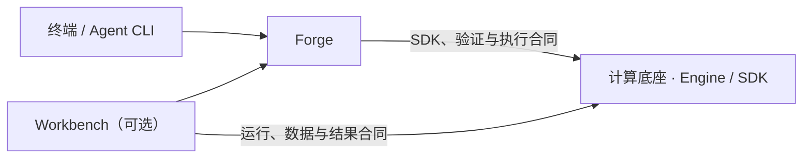

箭头表示代码依赖方向。终端和 Agent 是平台的调用者。

### 架构约束

<a id="run-ownership"></a>

1. **三模块与项目归属。** 平台由 Forge、可选 Workbench、计算底座组成。三者可同仓、同包或同进程部署。业务项目是用户的独立资产，持有源码、配置、数据、Notebook、运行记录与结果，或指向相应存储。
2. **依赖方向。** Workbench 调用 Forge 或计算底座的公开合同，Forge 可脱离工作台直接调用底座，禁止反向导入 Workbench。计算底座独立提供 SDK 与执行合同，禁止反向依赖 Forge 或 Workbench。宿主通过参数或回调提供授权与事实，各模块只依赖本职所需的合同。
3. **Agent 与开发授权。** 工程上下文、工具以及开发和评审沙箱统一归 Forge。项目可见、已登记与允许执行是三个独立事实。开发与评审的实际读写边界归 Forge 沙箱，会话传输归宿主，工程验收归 Forge。用户授权真实运行后才进入执行路径。
4. **AR.3.1　运行记录与控制权。** 单项目受管 Run 只有一个控制方，应用封存、准入与恢复归 Forge。引擎持有原生计划、RunJournal、检查点与提交事实。终端或工作台可按本次权限读取同一 `run_id`。准备操作可按 `request_id` 去重，后续控制按操作核验运行身份、预期 attempt、适用的封存摘要及权限。受理、进程退出与资源清理分别记录。历史可按固定记录只读查询。[受管入口](../demiflow/forge/runs/cli.py)

<a id="platform-modules"></a>

## 二、分模块架构

以下时序规定不同业务流程中的调用与交接。

**业务 Pipeline Agent 开发的端到端时序**

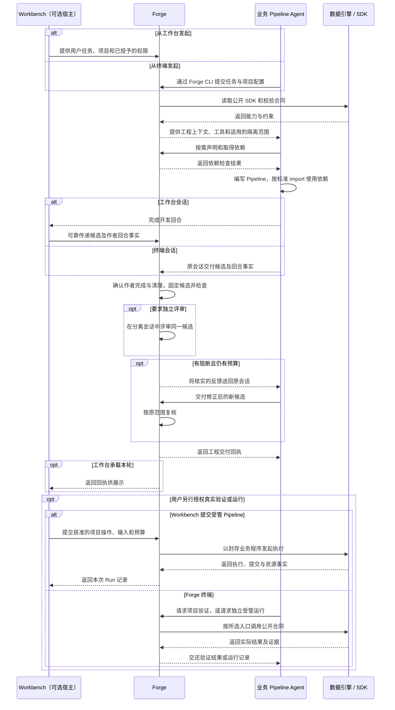

<a id="forge-module"></a>

### Forge

Forge 定义业务项目的目录角色、Flow 入口与参数绑定，以及工作流节点和产物引用。**AR.1.1　Forge CLI。** `demiflow forge` 是终端和 Agent 共用的工程入口，可脱离 Workbench 独立使用。`forge develop` 组织开发交付，`--resume` 续接原作者的工程回合。`forge run` 管理项目的业务运行。Workbench 可通过同一组能力提供产品入口。[工程命令](../demiflow/forge/cli.py) · [项目契约](../demiflow/forge/project.py) · [工作流声明](../demiflow/forge/workflow.py) · [开发回合](../demiflow/forge/development.py)

<a id="forge-project"></a>

#### 子模块表

| 子模块 | 职责 | 边界 | 代码入口 |
|---|---|---|---|
| 依赖管理 `deps` | 解析唯一依赖声明，生成单包文件清单、字节数和树哈希。管理 A 类包的核验与显式安装、B 类包的获取与移除。 | 枚举、读取和计算摘要均服从有效读范围。依赖内容校验统一复用 `check` 的规则。`vendor` 先校验单包，再写入受管副本。`remove` 只能删除项目内受管副本，解除 `local_ref` 保留外部原目录。 | [依赖声明与操作](../demiflow/forge/dependencies.py) |
| 静态检查 `check` | 统一定义并提供单包内容、导入边界和项目依赖校验规则，静态检查 Flow 接线、目录角色及导入。诊断定位到声明项或源码行，并标明覆盖范围。 | `deps` 的获取操作复用单包规则，整项目诊断归 `check`。检查静态读取候选。环境核验只用显式项目 Python，缺省时标明跳过项。业务验证归项目测试，运行准入归 `runs`。 | [项目检查](../demiflow/forge/pipeline_check.py)、[工程导入规则](../demiflow/forge/project_rules.py) |
| 作者上下文 `context`（AR.2.1） | 将用户要求、项目事实、Skill、编写及评审规范与当前公开 SDK 交给作者。提供按主题和符号查询的工程入口。 | SDK 的签名、返回契约和版本来自计算底座。宿主传递任务与事实，Forge 选择和组织工程材料，原生 Agent 负责推理与工具循环。 | [上下文查询](../demiflow/forge/context.py)、[SDK 目录](../demiflow/forge/api_reference.py)、[作者上下文拼装](../demiflow/forge/bridge/agent_context.py) |
| Agent 受控工具 `bridge`（AR.2.2） | 定义工具发现、参数、鉴权与分发，覆盖开发会话、Notebook 助手命令和 `run.*`。 | 开发与 Notebook 工具绑定当前授权回合，宿主注入输入、登记与 Cell 执行回调。`run.*` 按请求及 attempt 身份交给 `runs` 核验项目操作权限。 | [工程工具](../demiflow/forge/bridge/tools.py)、[控制桥](../demiflow/forge/bridge/server.py)、[Notebook 命令](../demiflow/forge/bridge/notebook_commands.py)、[Run 工具](../demiflow/forge/bridge/run_tools.py) |
| 开发与评审沙箱 `sandbox` | 依项目契约、操作角色和显式授权上限推导并执行 OS 读写边界，负责命令包装器、隔离进程与回收。 | 项目内实际可写范围归 Forge 沙箱。终端及 Workbench 传入宿主事实和授权上限。文件观察清单与依赖声明都不能扩大写权限。受限作者与只读评审复用隔离能力，分别使用各自角色允许的范围。 | [沙箱策略](../demiflow/forge/sandbox/policy.py)、[执行后端](../demiflow/forge/sandbox/backends/)、[命令包装器](../demiflow/forge/sandbox/sandbox_shims.py) |
| 独立评审 `review` | 对照需求和固定候选审查业务实现，核对引用、覆盖范围和阻断项，签发与候选绑定的评审回执。 | 只读评审会话独立于作者。补读由 Forge 在已授权材料与预算内执行。结论交给开发交付，反馈投递及返工归原开发回合。 | [评审](../demiflow/forge/review.py)、[评审证据](../demiflow/forge/review_evidence.py) |
| 项目 Python `runtime` | 使用终端显式传入或 Workbench 已选定的同一个项目 Python，提供受限启动、精确源码加载及依赖快照。业务操作需要 Python 时，解释器缺失或无效须在启动前报错。 | 解释器配置由调用方持有。加载范围限于所选包，外部父目录不加入 `sys.path`。实时或封存版本由调用场景指定。Run attempt 归 `runs`，预览和 Notebook 内核生命周期归 Workbench。 | [解释器与源码加载](../demiflow/forge/runtime.py) |
| 单项目受管运行 `runs`（AR.2.4） | 独立管理单项目的应用封存、幂等请求、槽位租约与设备配额、启停、恢复及产物和训练对账。 | 应用级 `run_id`、attempt 和控制请求由本项目的受管运行机制持有。解释器及源码加载交给 `runtime`，原生执行、检查点和提交事实归计算底座。Workbench 注入项目授权与索引回调，复用同一控制机制和 Run 记录。 | [Run 生命周期](../demiflow/forge/runs/manager.py)、[运行授权](../demiflow/forge/runs/authority.py) |

#### 子模块时序图

<a id="forge-agent"></a>

##### 开发回合启动与公开 SDK 查询

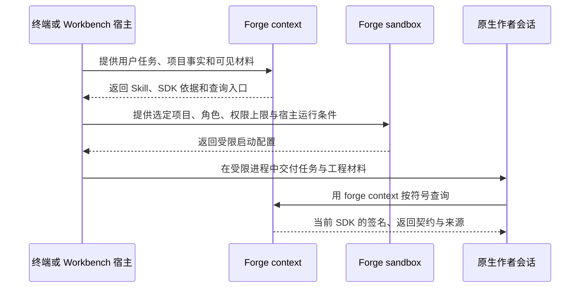

##### 获取受管依赖与同回合导入

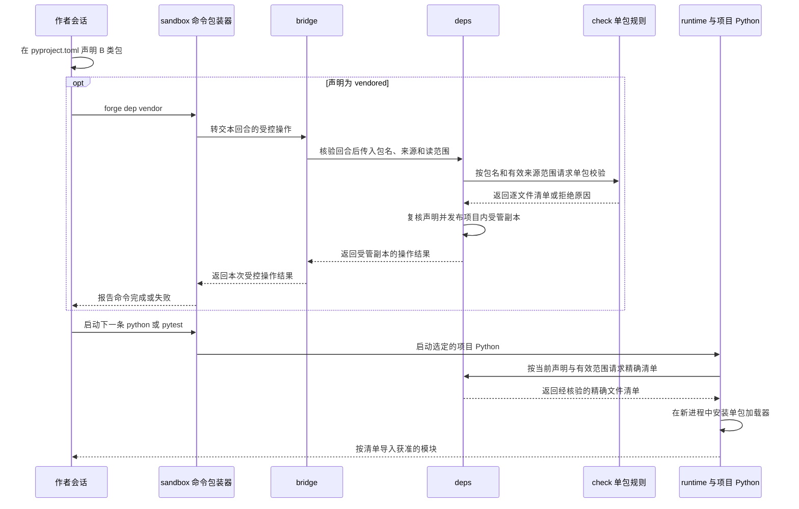

<a id="forge-delivery"></a>

##### 固定候选、独立评审与原作者返工

Forge 开发回合负责组织工程交付。它向 `check` 请求静态诊断，向 `review` 提交固定候选，并由原作者所在入口投递反馈。

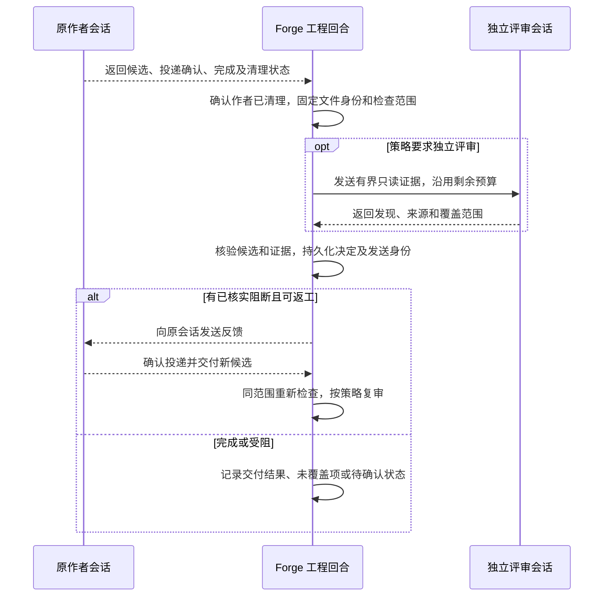

##### 单项目 Run 的准备、启动与恢复

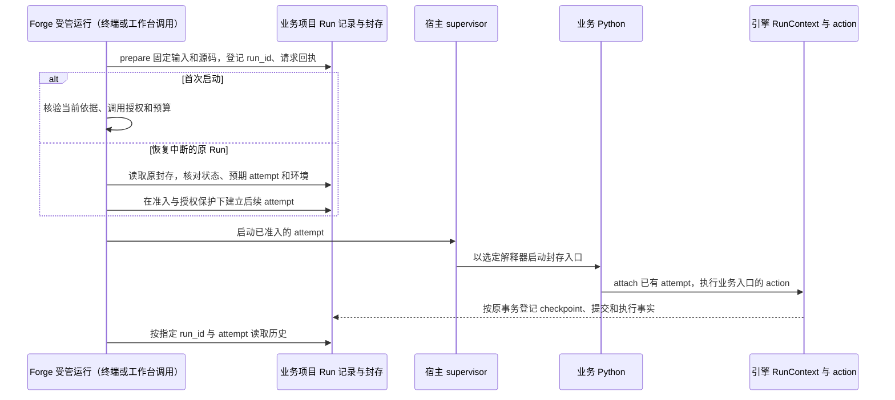

#### 架构约束

1. **项目声明与依赖。** 依赖契约由 Forge 定义在用户项目的 `pyproject.toml` 上。该文件是唯一配置，日常操作直接读取声明与磁盘，无需维护 `.forge/deps.lock.json`、执行 `dep sync/link` 或创建隐藏环境。`[project].dependencies` 声明 A 类可安装包，`[tool.demiflow.packages]` 声明 B 类源码包（`local_ref` 或 `vendored`）。无依赖表的旧项目沿用原有依赖声明与共享源码合同，只有 A 类包时可用空表启用。开发 Agent 可编辑声明。受信操作者用 `dep install` 在指定 Python 中显式安装，`list/verify` 展示或核验依赖。即使其他包缺失也可进入开发会话并逐包获取。失败或并发编辑时，须保全其他变更。[依赖用法](forge-project-dependencies.md)
2. **源码包与静态检查。** `packages/` 按需创建。包须有合法顶层名和 `__init__.py`，只接纳普通 Python 源码，忽略正常的 `__pycache__`。拒绝链接、权重、数据、归档、Notebook、二进制及反向导入业务角色或 `demiflow`（含项目限定名）。单文件上限 512 KiB，单包 256 文件、8 MiB，单项目 16 包、512 文件、16 MiB。`check` 持有供全平台复用的单包及依赖规则，定位缺失、非法、孤立或撞名的包、明确缺失的子模块和业务导入。传入项目 Python 时核验 A 类版本及环境撞名，否则列出跳过项。`TYPE_CHECKING` 和 `ImportError` 只豁免相应的缺失诊断。
3. **上下文、权限与受控修改。** 接口用法以当前 `forge context --topic sdk` 或 `--api 符号` 的返回为依据。运行或故障信息注明来源、版本、时间及范围。终端与 Workbench 的作者收到同一套工程规范和 `demiflow forge` 用法。开发工具包括 `manage_project_layout`、`request_pipeline_review`、`read_input`、`list_registered_projects`，按当轮实际能力开放。可见性统一由沙箱控制。普通开发默认继承 OS 读权限并排除敏感路径，只读或显式收窄的回合使用限定范围。范围内变更 `local_ref` 后，当轮下一条 Python 命令即可导入。超出显式范围时，只有宿主另行授权并启动新沙箱才可读取。`pyproject.toml` 可写，`packages/` 与 `.forge/` 对作者物理只读。受控依赖操作保持离线，复用进程前须核对其实际授权。终端默认受限。可信本地模式须显式选择。受限作者和评审只获本回合授予的模型通道，凭据由宿主持有。[编写规范](../demiflow/forge/standards/pipeline-authoring.md) · [模型通道](../demiflow/forge/bridge/model_channel.py)
4. **AR.2.3　按需求确认交付。** 用户补充要求是需求来源，评审和工具意见是反馈。无业务改动的讨论仅在显式要求下启动独立评审。实施任务须有与需求相符的候选或已验证的既有结果。自动触发与主动请求共用策略和去重规则，缩小范围写入回执。`watch` 用于观察变更，授权须另有依据。业务测试按项目指定命令、解释器及执行授权另行取证。
5. **固定评审候选。** 开发回合须先确认作者完成、投递及清理。清理未确认时保留原所有权。免费静态检查和付费评审各有开关，文档按适用性触发。评审独立于作者，在只读、无工具的模型会话中进行。一批目标先固定，再按受影响的 Flow、共享依赖与未归属改动分片，保留删除项、无 Git 项目、参数和工作流消费者的依据。补读、格式修复和返工共用请求、时间及字节预算，未覆盖项单列。
6. **证据与反馈。** 评审核对业务调用和引入依赖的理由。外部包的源码展开止于包边界，只提供脱敏且保留行号的 TOML 及包名、来源类型、文件数、字节数和树哈希。覆盖完整度与已核实的阻断项分别记录。声明原文与包树哈希纳入 `evidence_id`。引用须匹配文件、前后版本、行号和摘录，空文件使用相应版本的空文件依据。结论与反馈发送前复核候选。发送身份、投递、ACK 与完成分别记录，ACK 未知时等待核实，禁止自动重发。返工沿用剩余预算，新候选保留旧回执。人工消息保留原顺序，过期反馈记录被替代、取消或待核验。两入口对同一物理项目根及父子根使用同一写入准入，保留租约及清理证据。[候选取证](../demiflow/forge/source_snapshot.py)[评审指南](../demiflow/forge/standards/pipeline-review.md)
7. **应用封存与恢复。** `prepare` 固定入口、参数、代码、环境、输入和预算。首次启动核验当前声明、B 类内容及 A 类环境。恢复通过原 `run_id` 读取封存字节，核验原环境、剩余预算、上一 attempt 的清理和引擎恢复依据。外部包随后升级不改变本次封存。可续跑时在同一 Run 建立后续 attempt，依据不足时保留可读历史并明确提示新开运行。顶层 `demiflow run --config` 仍消费已封存的 `PipelineBundleRef`。[Bundle 入口](../demiflow/cli.py)

<a id="workbench-module"></a>

### Workbench（可选）

Workbench 提供项目登记、交互界面、开发会话、运行编排和数据分析。它持有产品与会话状态，单项目工程操作复用 Forge，数据与结果读取使用底座公开合同。

<a id="workbench-ui"></a>

#### 子模块表

| 子模块 | 职责 | 边界 | 代码入口 |
|---|---|---|---|
| 项目登记 `projects`（AR.5.1） | 保存用户目录引用、选定的 Python 与操作授权，按本次操作传给 Forge。 | 项目发现、登记与授权分别核验。文件可见性归沙箱。依赖采用项目声明，旧登记可继续读取，无需额外目录白名单或摘要审批。 | [项目登记](../demiflow/workbench/projects/registry.py) |
| API 与传输（AR.1.2） | 管理 HTTP 认证、路由、序列化、流式连接与取消传递。 | 路由调用所属领域的操作，状态变更归该领域。 | [API](../demiflow/workbench/api.py) |
| Web 界面（AR.1.3） | 提供 D1.9 导航、四个 tab、共享选择、响应式布局与错误提示。 | 算子图、源码、配置、历史和日志按用户选择的对象读取。 | [Web 入口](../demiflow/workbench/web/app.js) |
| 通用展示组件（AR.1.4） | 依固定引用呈现表格、消息、文本、代码、JSON、HTML、图像和音视频，处理不可信内容、分页、缩放、展开与订阅。 | 答案、数据修改与运行控制由对应领域持有。 | [展示组件](../demiflow/workbench/web/workbench-presentation.js) |
| 开发会话 `conversations`（AR.3.5） | 持有会话 HTTP、SQLite 记录、Provider 传输、人工队列和回合恢复，向 Forge 传递用户要求、投递、作者完成和清理事实。 | 工具与反馈返回原作者，重连按当前回合核权。工程上下文、工具契约、沙箱策略和交付回执归 Forge。会话、算子内 Agent 和 Pipeline attempt 各自使用原身份。 | [会话调度](../demiflow/workbench/conversations/worker.py)、[会话存储](../demiflow/workbench/conversations/store.py) |
| 预览与算子图 `worker / graph` | 固定表输入，调度只读业务子进程构图，关联算子、参数与源码。 | 控制进程使用宿主 Python。业务预览统一通过 `forge.runtime` 使用显式项目 Python，在解释器启动配置生效前施加隔离。既有 `shared-sources.json` 与 `DEMIFLOW_WORKBENCH_SHARED_SOURCES` 沿原合同使用，包名冲突须报告。 | [预览调度](../demiflow/workbench/worker.py)、[算子图](../demiflow/workbench/graph/preview.py) |
| 受管运行入口 `runs` | 持有多项目授权、历史索引接入、HTTP 与视图，展示单项目 Run 的状态、attempt、产物与历史。 | Web 和 `demiflow workbench run` 按入口核验调用方的当前授权，将单项目操作统一委托 `forge.runs`。运行 supervisor 使用宿主 Python。 | [运行授权](../demiflow/workbench/runs/authority.py)、[产品视图](../demiflow/workbench/runs/view.py) |
| 工作流编排 `workflows` | 管理本项目或跨项目工作流的 `wf_run_id`、编排 attempt、节点依赖和子 Run 引用。 | 子 Run 按其项目授权提交，下游按上游实际提交的产物读取。查询、日志和停止各自核权。 | [工作流调度](../demiflow/workbench/workflows/manager.py)、[项目解析](../demiflow/workbench/workflows/resolver.py) |
| Notebook `notebooks`（AR.3.3） | 持有文档与已存输出、内核连接、Cell 派发和中断。文档版本、内核代际及单格执行各有身份，历史输出可独立读取。 | 文档可脱离内核保存重开。Jupyter Server 使用宿主 Python。内核通过 `forge.runtime` 使用项目 Python 与固定包快照，调用 `forge.sandbox` 施加只读隔离。助手命令契约归 `forge.bridge`，实际 Cell 执行归 Workbench。 | [Notebook 服务](../demiflow/workbench/notebooks/service.py)、[内核启动](../demiflow/workbench/notebooks/kernel_launcher.py)、[Cell 操作](../demiflow/workbench/notebooks/cell_commands.py)、[分析会话](../demiflow/workbench/analysis/sessions.py) |
| 查询与统计（AR.3.2） | 持有 SQL、参数、固定表绑定、查询操作、取消与有界结果。 | SQL 可随 Notebook 保存，Python 与 SQL 显式交换结果。目录统计与枚举使用查询预算。 | [查询](../demiflow/workbench/analysis/query.py) |
| 数据目录与访问（AR.5.2） | 通过有界接口查询表、Schema、固定版本、别名和来源。 | 数据留在原后端，目录或存储核验来源许可。产品查询可独立于 Dataset 计算。 | [数据目录](../demiflow/workbench/catalog.py) |
| Case 组织与评测（AR.3.4） | 用稳定的 Case、方案和字段身份筛选、分组和翻页，支持配置材料、问题及布局。 | 答案 head、event、revision 和 media_basis 按 expected 版本在同一事务中更新。草稿、下一条与历史引用固定材料。 | [Case 评测](../demiflow/workbench/analysis/case_review.py) |
| 媒体访问（AR.5.4） | 持有 ticket、range、读取、采集与资源释放。 | 按当前权限和历史材料来源读取。浏览器取消后跟踪实际退出，历史媒体读取独立于 Notebook 内核。 | [媒体访问](../demiflow/workbench/analysis/media.py) |

#### 子模块时序图

##### 开发会话与反馈投递

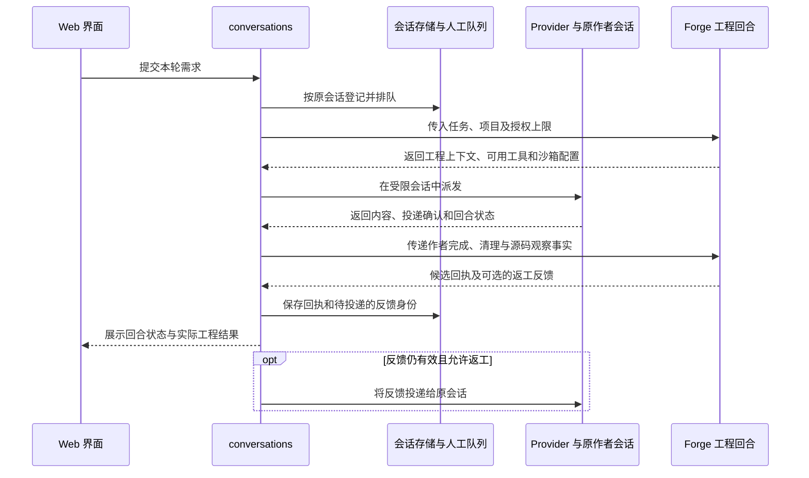

##### 只读预览与算子图

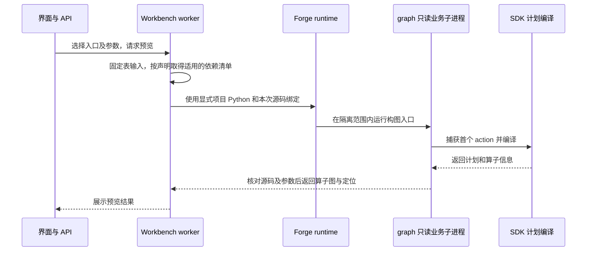

##### 工作流提交与子 Run 调度

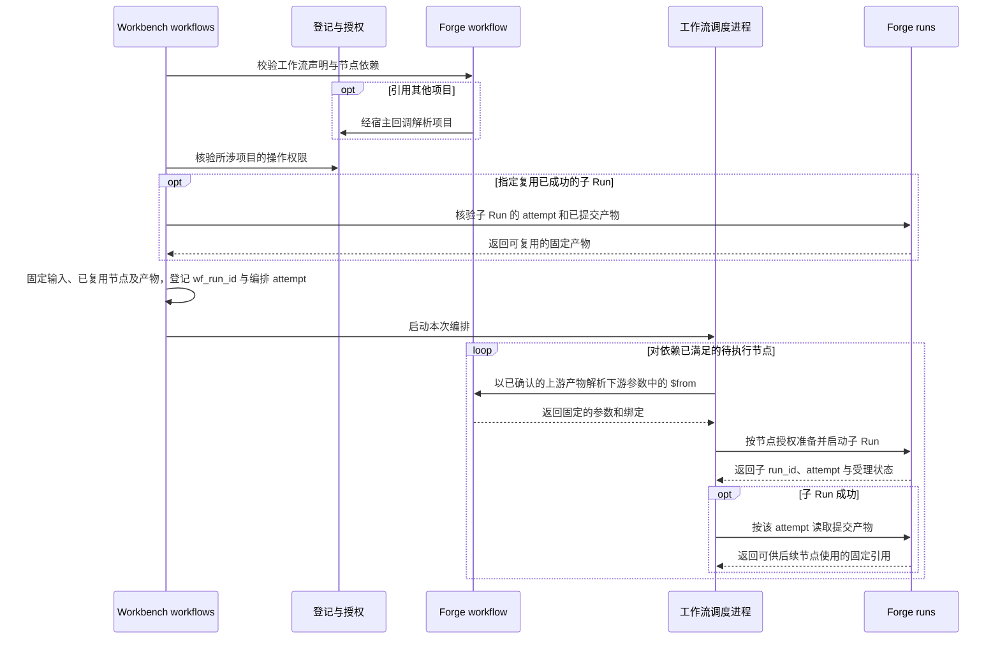

<a id="project-data"></a>

##### Notebook 文档与内核

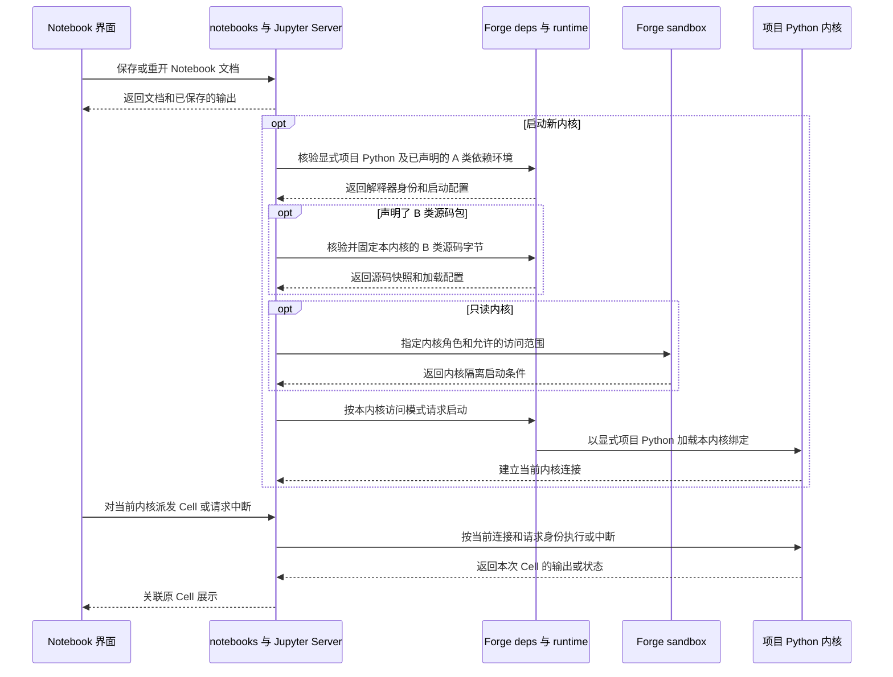

##### 数据查询、Case 与媒体访问

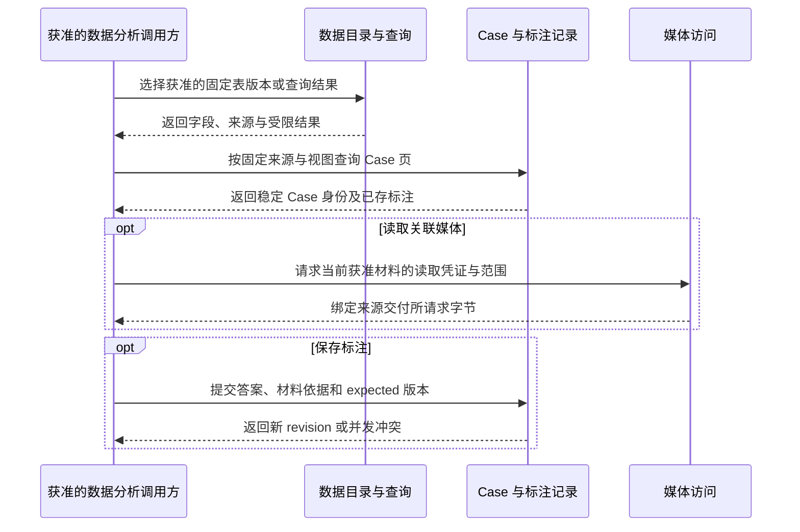

#### 架构约束

1. **项目与授权。** 产品持有目录引用、解释器选择和操作授权。Web 入口按服务权限上限及当前项目授权核验，命令行的本机授权绑定显式项目根。开发沙箱的有效读写范围归 Forge，项目登记不引入额外只读白名单或摘要审批。
2. **会话与交付。** Workbench 管理 UI、HTTP、Provider 传输和人工队列，按原作者、回合与授权投递反馈。工程上下文、Agent 工具契约及工程交付回执由 Forge 提供。会话是否结束、候选是否通过检查和需求是否交付分别记录。
3. **预览、Run 与编排。** 预览在只读业务子进程构图，控制进程使用宿主 Python。所有业务子进程通过 `forge.runtime` 使用显式项目 Python，受限执行须在解释器启动配置生效前施加隔离。既有 `shared-sources.json` 和 `DEMIFLOW_WORKBENCH_SHARED_SOURCES` 继续可用，名称冲突须报告。单项目 Run 的应用封存、请求回执与可重建的 `.forge/index.sqlite` 归 Forge，原生执行账本和提交归引擎。索引发布中断后可按项目记录重建。工作流独立持有编排 attempt 和节点对子 Run 的引用，严格运行准入须显式启用。[项目索引](../demiflow/forge/index.py)
4. **交互分析。** Notebook 文档可脱离内核保存重开，现有内核延迟导入仍取启动时快照。新内核核对当前环境与包。SQL、Case 与媒体分别核验自己的权限、预算和版本，读取既有结果服从对应数据或材料的访问授权。Cell 执行及媒体读取的实际退出由其所属领域确认。
5. **共用宿主能力。** Notebook、媒体、开发会话可复用 Forge 的进程身份及宿主配置。各领域持有自己的事务、权限和生命周期。[进程身份](../demiflow/forge/process.py) · [宿主分配配置](../demiflow/forge/host_partition.py)

<a id="engine-sdk"></a>

### 计算底座（Engine / SDK）

**AR.4.1　SDK** 定义 Dataset、数据与类型、函数和 Actor、Pipeline 程序及其配置和终结动作。具体 executor 按需装配，SDK 冷导入独立于 Forge 和 Workbench。**AR.4.2　算子与工具库** 负责普通函数、Actor、模型、检索和媒体操作。算子内 Agent 受行预算和公开工具契约约束。**AR.4.3　计算引擎** 把逻辑计划编译成阶段与任务，驱动 Local 或 Ray Core 执行、背压、提交、恢复及观测。一个 run 可以包含多个 action。

<a id="engine-modules"></a>

#### 子模块表

01–17 是计算底座已有的稳定编号。现有职责内的文件拆分沿用原编号。增加独立职责时追加编号，注明边界和真实代码入口，并按 D1–D9 审查。

| 子模块 | 职责 | 边界 | 代码入口 |
|---|---|---|---|
| 01　Pipeline 入口与运行上下文 | 绑定业务入口、运行参数、run 与 attempt，管理 RunContext、RunAction 和取消请求。 | 一个 run 可以包含多个 action。受管入口提供已准入的 attempt，原生上下文绑定其运行身份。 | [run 上下文](../demiflow/execution/pipeline/run_context.py)、[pipeline 入口](../demiflow/execution/pipeline/driver.py) |
| 02　Dataset API 与执行端口 P1 | 记录 source 与 LogicalPlan，终结动作经 P1 端口交给所选 executor。 | SDK 交付公开 API 约定的行、迭代器、标量或回执。引擎一侧将带类型的动作声明组装为 ActionRequest。 | [Dataset](../demiflow/data/dataset.py)、[动作契约](../demiflow/data/execution_contract.py)、[执行端口](../demiflow/execution/executors/base.py)、[动作入口](../demiflow/execution/executors/dataflow_api.py) |
| 03　Action driver | 处理一个 ActionRequest，协调阶段、整批准入截止、逐项放置重试和终止，持有 ActionHandle。 | 等待与重试截止归 driver，单项选机与租约归 07，物理分配和实际退出归 08。 | [DataflowExecution](../demiflow/execution/action_driver/dataflow.py) |
| 04　编译器 | 完成逻辑降级，再依据真实分片与策略选择 stage、融合及 exchange，生成逻辑和物理计划。 | 物理规划消费实际 splits、主机描述和常量引用。读取源元数据归 05，发布封存归 06。 | [逻辑编译](../demiflow/planning/dataflow_compile.py)、[物理规划](../demiflow/planning/dataflow_place.py)、[算子登记](../demiflow/planning/dataflow_registry.py) |
| 05　数据源 | 固定源版本并生成 SourceSnapshot、SourceSplit 与起始游标，在 worker 打开对应读取器。 | 源格式负责解析位置与产生带来源位置的记录，恢复从原位置继续。07 选机，08 在所选主机派发，09 执行分区。 | [源声明](../demiflow/data/sources.py)、[源切分](../demiflow/execution/sources/snapshots.py)、[Lance 读取](../demiflow/lance/read.py) |
| 06　程序准备与封存 | 固定程序、图、常量、源及实际物理计划，使既有 action 可重载并核验 SealedExecution。 | 引擎封存对应原生 action。项目入口、参数和应用依赖版本由上层固定，一致恢复点与提交归 13。 | [程序准备与封存](../demiflow/execution/seal/plan.py) |
| 07　调度器 | 判断整批可行性，按当前占用和有效上限逐项选机、预留、发放 WorkerLease，观察退役。 | 03 持有重试和截止时间。07 给出 host、租约或等待原因，由 08 向后端申请和归还物理资源。 | [DataflowScheduler](../demiflow/execution/scheduler/placement.py) |
| 08　主机适配与资源管理 | 在选定主机准备 endpoint 并派发任务。ResourceManager 向 provider 申请、核对和收回物理资源。 | 按给定 assignment、租约和资源计划记录实际分配、退出或待清理证据。是否选取该主机归 07。 | [主机端点](../demiflow/execution/hosts/endpoints.py)、[ResourceManager](../demiflow/resources/manager.py) |
| 09　Worker 与分区执行 | 执行分区循环，装配并调用算子，处理批次、进度与取消，向 checkpoint 提供分区状态。 | 09 驱动行或批的处理，具体算法归 10，跨分区传输和确认归 11。 | [分区执行](../demiflow/execution/worker/dataflow_execution.py)、[图推进](../demiflow/execution/worker/dataflow_graph_runner.py)、[算子绑定与调用](../demiflow/execution/kernels/operator.py) |
| 10　算子实现 | 实现 join、查询、Arrow 批变换、模型调用等计算语义，在获准的账本或服务端口上处理外部效果。 | 同一算子的不同算法遵守相同公开契约。算子确认请求、响应及未明结果，受管模型服务持有自身就绪与生命周期。 | [算子实现](../demiflow/operators/)、[关系计算](../demiflow/operators/relational.py)、[DataFusion 查询](../demiflow/operators/relational_sql.py)、[Prompt](../demiflow/operator_llm/runtime.py)、[Embedding](../demiflow/embeddings/)、数据获取类算子（[SearchWeb](../demiflow/collect/operators.py)、[Fetch](../demiflow/collect/fetch_flow.py)、[ReadDocuments](../demiflow/collect/reading.py)、[RegisterDocuments](../demiflow/collect/document_library.py)、[DecodeDocument](../demiflow/collect/documents.py)、[EncodeImage](../demiflow/collect/image_resize.py)、[ParseWikitext](../demiflow/collect/wiki_syntax.py)）、[模型服务](../demiflow/services/manage.py) |
| 11　Exchange | 管理跨分区投递登记、路由、额度、ACK 和恢复所需的通道进度。 | driver 进程中转通知，Exchange 持有通道状态并向 cut 提供进度，输出是否提交由 12/13 核实。 | [通道与传输](../demiflow/execution/exchange/)、[投递状态](../demiflow/execution/exchange/deliveries.py) |
| 12　终端结果交付与写出 | 向调用方交付 count、take 或流式读取结果。需要写出时，由对应 sink 准备输出、检查发布并提交。 | 终端交付的标量、行、物化句柄或 WriteResult 依其公开契约返回，写出状态依目标协议确认。 | [终端](../demiflow/execution/outputs/terminals.py)、[sink](../demiflow/execution/outputs/sinks.py)、[写出契约](../demiflow/data/datasink.py) |
| 13　Checkpoint 与提交 | 收集源位置、核与缓冲状态、通道进度和 sink 准备结果，协调一致恢复点与提交对账。 | 13 依据参与者事实生成 RecoveryImage 并确认输出。存储中的字节和传输 ACK 各自只证明对应步骤。 | [checkpoint 协调](../demiflow/execution/checkpoint/coordinator.py)、[提交](../demiflow/execution/checkpoint/commit.py) |
| 14　运行产物存储 | 按 ArtifactRef 保存和校验有界字节，管理引用、租约、释放与安全回收。 | 存储对字节与引用负责，领域效果与输出的提交归其生产者及 13。 | [对象存储](../demiflow/execution/storage/objects.py)、[引用与租约](../demiflow/execution/storage/lease.py)、[回收](../demiflow/execution/storage/gc.py) |
| 15　运行账本、观测与历史接口 | 沿原事务记录运行事实、观测和用量，按 run/attempt 提供只读历史与 P4 读取接口。 | 观测由事件生产者记录，历史读取只解释指定运行。取消及恢复仍经有授权的控制入口。 | [账本](../demiflow/execution/journal/run_journal.py)、[观测](../demiflow/execution/journal/run_telemetry.py)、[历史读取](../demiflow/execution/journal/run_reader.py)、[P4 端口](../demiflow/execution/host/) |
| 16　声明、协议与编码 | 定义逻辑声明、跨模块消息与身份、受支持的编码和解码。 | 协议表达可校验的值。执行操作、分配资源与确认状态由使用该协议的模块负责。 | [逻辑声明](../demiflow/data/plan.py)、[引擎协议](../demiflow/execution/contracts/)、[恢复协议](../demiflow/execution/contracts/recovery_contract.py)、[资源协议](../demiflow/resources/contracts.py) |
| 17　原生队列、获取和流式写入 | 在原生路径领取和结算源单元，管理外部效果、分区写入与确认，提供原生回执及可继续位置。 | 领域确认归原生队列或写端，向 driver 和 checkpoint 提供可核实的事实。 | [原生 producer](../demiflow/execution/native_queue/dataflow_queue.py)、[队列](../demiflow/execution/native_queue/queue_producer.py)、[流式写出](../demiflow/execution/native_queue/dataflow_stream_lance.py) |

#### 子模块时序图

**资源如何进入计划。** 01 保留调用方获准的上限。04 拿到实际分片和已暂存的程序后，根据执行方式计算每个阶段需要的资源。以内存传递数据时，上下游必须同时放得下；允许持久化交接时，下游可以随后启动。04 按候选方案中实际同时驻留的阶段核算窗口和请求，06 封存选定结果。运行时，07 结合当时的占用决定能否派发，08 申请并释放实际资源。

普通算子可以只声明计算。引擎了解执行方式，负责推导资源请求。对能逐次计量的任务，接收一行、产生输出和保存状态时，09 都要把当时仍存活的数据计入已获准的工作区。对共享实例、带自定义恢复逻辑的任务等无法可靠推导占用的情形，规划保留其固定需求。

程序分发和任务状态各有自己的计量对象。需要为任务单独加载程序时，封存载荷的实际字节数可用于核算加载缓冲；Python 对象解码后的堆占用还取决于对象实现。任务可变状态和恢复镜像按原状态预算校验。命中旧封存的 action 时，执行器读取原物理计划和恢复点。

三张图沿同一次 action 展开。假设 ds 是有界输入，pack 已声明 item 和 summary。这里 take 限制交付行数，max_requests 限制本节点跨 worker 的新请求数；并发和受支持的重试会影响实际请求数。纯计算的 filter/count 跳过模型调用，需要写出时使用对应目标的 sink。

```python
rows = ds.map_prompt("enrich", config=pack, inputs={"item": "text"},
                     outputs={"summary": "summary"}, max_requests=10).take(2)
```

**图 1　从 Dataset 到可激活的分区。** 新 action 先逻辑编译，随后固定程序和真实源分片，再做物理规划。普通源切分的目标来自本次执行策略的 `default_partitions`，原生队列源使用自己的布局。命中原封存时复用原计划。箭头表示运行调用，虚线表示返回。

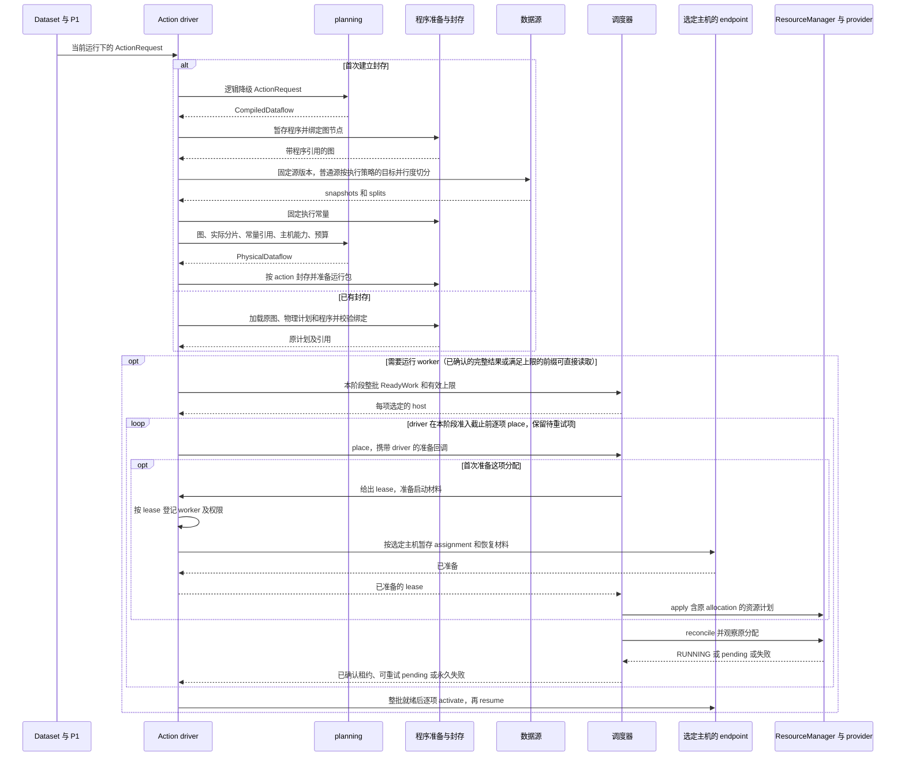

**图 2　行处理、投递与提交。** 融合的相邻算子可在分区内直接传值。图中的跨分区路径只在物理计划存在对应边时经过。checkpoint 可以重复发生，订阅也可以边运行边读取。

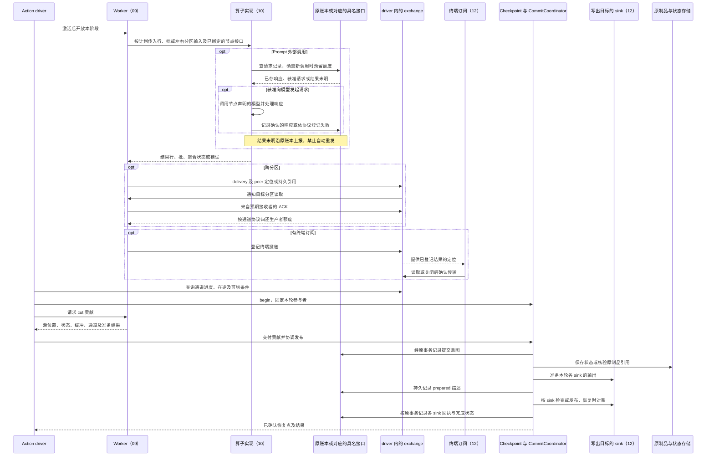

图 2 将账本画在一列以便阅读。算子在 worker 侧经已绑定的请求接口读写领域事实；CommitCoordinator 在 driver 侧经自己的运行事务写提交事实。状态制品和 dataflow 字节对象沿各自的原存储写入。图中所示是新 cut；恢复已 prepared 的单元直接从准备描述对账。

**图 3　取消、清理与恢复。** 取消可与发布重叠，关闭订阅另有传输释放动作。直接 SDK 在进入恢复上下文时取得运行租约。受管入口先在原 journal 推进 attempt，业务子进程再进入 `RunContext.attach`。两条路径均由业务入口发起原 action，沿同一执行身份核对既有提交。[运行上下文](../demiflow/execution/pipeline/run_context.py) · [受管恢复](../demiflow/forge/runs/manager.py)

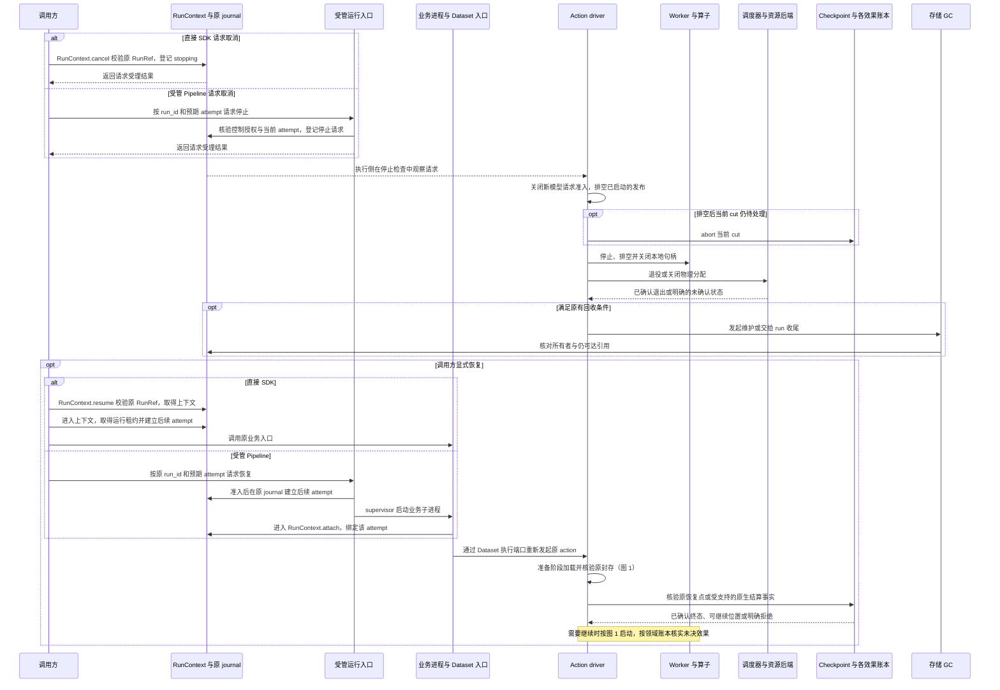

#### 架构约束

<a id="engine-resources"></a>

1. **AR.3.6　外部能力与模型服务。** 服务管理器持有 service、endpoint 和 lease，负责启动、就绪、观察和停止。服务按需装配。外部操作的语义归算子，例如 Prompt 负责请求、响应、重放和未明结果，搜索即使在 driver 受控执行也沿原领域协议。执行侧只绑定当前节点的账本与额度。[模型服务管理](../demiflow/services/manage.py)
2. **AR.5.3　结果与来源。** 各领域的生产者持有自己的结果发布状态。Pipeline 的 sink 提交输出，引擎记录回执，产品核验后登记固定结果引用。Notebook 和查询分别发布各自产物。ResultRef、ArtifactRef 追溯生产者、输入、程序和环境，保留旧版来源。存储负责可核验字节、引用与回收。程序和源码按实际长度及摘要加载，`max_state_bytes` 约束计算状态和恢复镜像。恢复点归 checkpoint，队列取得与确认归原生队列。
3. **AR.6.1　执行与资源。** 后端持有精确实例、分配、额度、退出和退休事实，在部署域内核算 CPU、内存、磁盘、FD 和并发。观测在事件发生处产生，采样值只作为观测。请求停止、排空与清理分别确认。P4 通过公开控制与只读历史端口处理指定 run/attempt 的操作。

##### 上层运行与资源合同

Forge 和 Workbench 分别核验自己的应用权限、输入和总预算，通过下列合同绑定底层执行身份。合同可在同一进程中调用，具体版本和编码以实际公开入口为准。

| 合同 | 交互方向 | 固定语义 |
|---|---|---|
| C1 能力与版本 | 引擎 → 应用 | 提供模式、操作、协议和平台版本，明确报告未支持的能力。 |
| C2 固定运行输入 | 应用 → 引擎 | 交付代码、平台、环境、入口、配置、输入输出和总预算的不可变引用。秘密只传引用。 |
| C3 控制与身份 | 应用 → 引擎 | start、observe、cancel 和受支持的 resume 携带 run/attempt、操作身份、expected 版本与期限，分别记录受理和完成。 |
| C4 事实与结果 | 引擎 → 应用 | 提供实际状态、有界日志、指标、节点映射与新鲜度，以及已提交的结果和独立的清理状态。 |
| C5 恢复与兼容 | 引擎声明，应用核验后请求 | 核验 checkpoint、schema、工件、剩余预算和未明状态。保留旧 attempt 与封存，跨版本恢复按已验合同执行。 |
| C6 资源职责 | 应用 → 执行编排 → 资源后端 | 总额度、worker 需求、分配、观察与归还逐级核验，说明支持的限制方式、单 worker 口径和部分失败清理。 |

- **R1**　公共 ExecutionUnit、ResourceLease 和资源后端复用同一执行机制。一个物理实例只有一个生命周期所有者和一份计量事实。
- **R2**　应用核验本次总额度，编排产生需求，后端在同一部署域的公共资源树分配与对账。计入 driver、supervisor、worker 和退出未确认的占用。子占用在父额度内核算，每个 worker 使用分给自己的额度。
- **R3**　公共基础只依赖中立身份及资源合同。引擎 fence 经中立绑定验证，提交与恢复实现留在引擎，Notebook、SQL、媒体分别核验自己的权限与生命周期。
- **R4**　引擎侧负责资源后端和 provider，工作台侧给出已有消费者与兼容要求并联审。共享代码的一次修改由一个主责方提交。基础 IPC、Exchange 的路由与背压、封存与 barrier 分属各自模块。

##### 模块依赖规约与评审批据

这里的依赖指一段代码必须知道另一个模块的哪些类型、行为或状态才能工作。审查单位是“消费者中的具体调用点 → 提供方的具体符号 → 用途”。源码导入、函数内延迟导入、注册表中的符号路径、回调捕获的对象以及历史载荷中的限定名，都可能构成依赖。运行时从 B 回调 A，并不要求 B 导入 A 的实现。

###### D1　声明只依赖声明和无副作用的校验

**适用模块**　02 Dataset API、04 编译器、05 数据源声明、06 封存、16 声明与协议。

**允许。** 多个模块消费同一种声明值。声明可持有业务提供的程序描述、配置或已有端口引用，复用有界的字段与拓扑校验。API 按公开契约读取用户明确指定的配置文件；声明阶段不能借此打开数据源、启动 worker、创建执行中的 actor、访问当前运行账本。终结动作通过 P1 执行端口交付。

**打回。** 新的声明或逻辑规划为了表达“是什么”，需要导入 kernel、主机后端或运行期服务的具体实现；或者把排序、落盘、锁、执行缓存等实现放进声明包，再让执行模块反向导入。用第二套 DTO、转发文件或函数内导入包住同一条依赖，也须按真实提供方裁定。

**用 join 裁定。** 左右输入、键、连接类型归声明。编译器消费这些值并展开两个端口；09 提供两个分区记录流，10 的关系算子执行匹配。`PlanInput`、`KeyedSource`、`UnionSource` 的历史导入路径是 `execution.local_kernel`。新关系操作复用声明入口。旧程序可能按原限定名解码类对象，并在解码后复算程序身份。移动定义须同时满足 D8，兼容出口只覆盖登记的原符号和用途。[关系组装](../demiflow/data/relational_declaration.py) · [编译](../demiflow/planning/dataflow_compile.py) · [执行](../demiflow/execution/kernels/relational.py) · [历史保留依据](architecture-upgrade-20261120/G/RETAINED-OBJECTS.md)

**评审批据。** 标出同一声明的定义、生产者和消费者，确认声明阶段启动了哪些资源；检查源码导入和冷进程实际加载的模块。涉及 join 时检查左右端口、重复键多重性、空键和执行器绑定。只有触及持久身份或旧路径才追加 D8 的历史验证。

###### D2　通用抽象依赖契约，具体算子由装配处选择

**适用模块**　02 Dataset API、04 编译器、06 封存、09 Worker 与分区执行、10 算子实现、15 观测。

**允许。** 编译、调度、分区执行等通用模块依赖完成本职工作所需的契约。具体实现依该契约提供能力，装配处选择实现。编译器处理声明种类和已登记的 lowering，通用 worker 按执行规格调用已绑定的算子。具体工厂可以导入并构造 `PromptActor`；专用绑定可以核对受支持的精确类型后，注入本 action/node 的账本、请求额度和恢复能力。算子拥有字段映射、请求与响应处理、领域重放语义。领域到引擎的依赖逐符号使用已有合同、注入服务或已批准的原生装配。[算子服务契约](architecture-upgrade-20261120/F/F2-SERVICE-CONTRACTS.txt)

**打回。** 通用 kernel 为普通 map 增加某个模型、客户或服务的分支；多个消费者各自判断具体 actor 并决定绑定哪套账本；算子直接取得整个 driver、全局数据库或任意 RPC 能力。用全局运行时注册器或字符串类名绕过原生类型校验，或把构造、准入、观测和持久身份塞进一种判断，也应退回。新增平台内置种类优先使用已有登记表和工厂。

**第三方可选数据类型。** 为避免仅检查配置就加载可选库，可以按限定模块或包命名空间和已列明的类名筛选待解析的数据值（如 PyArrow 的 CSV 选项、Schema）。新增识别点须按对应格式核验类型或字段，再编码。现有 CSV 选项先按限定模块和类名筛选，再按受支持的字段处理。历史 Schema 编码按模块前缀和类名调用序列化，须保留该格式的已有语义。仅凭名字不得认定平台原生算子、选择其程序身份算法或授予运行服务。[CSV 选项](../demiflow/planning/dataflow_compile.py) · [恢复编码](../demiflow/execution/seal/program_identity.py)

编译器对 `OperatorLLMMapOp` 和 `_LiteralEmptySource` 使用平台自己的精确类型。伪同名类不得取得原生语义，既有程序封存的身份仍按 D8 核验。[逻辑编译器](../demiflow/planning/dataflow_compile.py)

**用 map_prompt 裁定。** 普通 `map_prompt` 在 Dataset 中追加 `OperatorLLMMapOp`，worker 依据已编译的 `kind="prompt"` 装配。`CacheCall` 包装模型时，缓存先绑定 checkpoint，随后由模型绑定模块识别内部 callable、选择本节点的账本。相同的精确类型谓词可以共用；不同输入、决定或子类语义分别由下表所列模块持有。[Dataset 声明](../demiflow/data/dataset.py) · [模型工厂](../demiflow/execution/operator_bindings/dataflow_model_factory.py) · [kernel](../demiflow/execution/kernels/operator.py) · [模型绑定](../demiflow/execution/operator_bindings/dataflow_models.py)

| 判断或操作 | 负责模块 | 边界 |
|---|---|---|
| “这个对象的类型恰好是受支持的原生 PromptActor” | 原生算子的类型识别与专用装配 | 相同的精确类型谓词可共用。缓存、路由、图像等调用方仍各自核验本用途的条件。外观相似的对象和子类沿原路径处理。 |
| “创建哪种 actor，绑定哪个账本” | 工厂与模型装配 | 工厂保留具体构造。绑定方按 spec、节点及受支持场景选择原有适配器。普通算子不会因此得到 Prompt 权限。 |
| “封存哪些算子事实” | 具体算子提供封存所需的算子事实；06 负责封存表示与校验 | 复用精确身份判断，保留 Prompt/agent 的环境校验、各自事实和原有字节。 |
| “是否计入已发生的用量或观测” | 15 观测与各指标生产者 | 保留已有 `isinstance`、路由子项和缓存解包语义。观测不能授予执行资格、扣费或证明提交。 |

**评审批据。** 给出“声明 → 工厂 → 已绑定实例 → 行结果”的一条真实链路；改哪种判断，就比较其真例、子类、伪同名类和不相关 callable 的原有结果。涉及缓存时检查 Prompt/agent 的绑定、普通缓存及重复扣费；涉及观测时检查用量；涉及封存时按 D8 验证。按实际行为裁定，无需以直接导入类的文件数作为合格线。[算子事实](../demiflow/operator_llm/flow_contract.py) · [原生模型观测](../demiflow/execution/journal/dataflow_model_observations.py) · [用量](../demiflow/execution/journal/dataflow_usage.py)

###### D3 至 D9　各模块间允许的依赖与退回条件

| 条款 | 允许的方向和输入输出 | 应退回的变化 | 最小评审批据 |
|---|---|---|---|
| **D3　计划、数据源与封存** | 03→04 请求逻辑计划。03→05 传入普通源的策略分片目标并取得源快照和实际分片。04 消费实际分片生成物理计划。03→06 固定程序、图、源和常量。 | 编译器读 Lance 元数据、查询当前 run 或写封存；恢复时重切原输入、用新计划替代旧封存。 | 对照图 1，分别走一次新 action 和一次命中原封存的路径，明确哪个模块执行 I/O。 |
| **D4　编排、调度与资源** | 03 管重试截止与终止；07 管整批可行性、单项准入与选机；08 负责真实分配与退出。07 经准备回调让 03 先把 assignment、权限和恢复位置交给选定端点，随后申请资源，确认就绪后才激活。 | 新增第二处 worker 数或内存准入决策；07 持有具体 driver；08 在启动材料准备好之前启动 worker；把停止请求当作已退出。 | 能区分永久不可行、暂时等待和物理退出。Local/Ray 使用相同任务与回执，后端特有行为只在适配侧取证。 |
| **D5　计算、投递与终端** | 09 驱动分区，10 执行算子计算；11 在 driver 进程持有跨分区和终端投递、额度、ACK、持久通道在途状态；12 交付订阅结果或写出。 | worker 绕过当前协议直连；driver、订阅或算子另存一份权威投递表；用传输 ACK 代替输出提交。 | 对照图 2 验证分区内直传、跨分区 ACK 和终端关闭中本次受影响的路径；恢复证据含原通道进度。 |
| **D6　效果、提交与存储** | 算子或原生队列经具名端口登记领域效果；13 协调 cut 与提交；sink 根据 prepared 描述检查和发布；14 只持有可校验字节及其引用；15 按原事务记事实。 | 依据文件存在或观测计数判断发布成功；结果未明时自动重发；存储自行承认效果；增加并行真账本。 | 核实一次成功和一个对应的失败或重入窗口。区分请求已准入、效果已确认、提交已确认和结果未明。 |
| **D7　控制、观测与历史** | 01 接收取消，03 停止新准入并排空，09 关闭本地实例，07/08 观察实际退出，14 按可达引用回收。P4 inspection 消费指定 run/attempt 的事实，获准控制走 control。 | 通过指标推算成功或资源已释放；取消时误删旧提交；读取历史触发模型、恢复或写账本；底座反向依赖应用。 | 针对所改分支，区分停止请求、排空完成、实际退出；历史读取冷进程只读且指向指定 attempt。 |
| **D8　跨版本身份、解码与续跑** | 16 保有唯一的声明/编码；06 读取原程序与身份；13 按原恢复点继续。变更涉及限定名、编码、工厂、模块源身份或反序列化时，列出旧写端、新读端和实际载荷。保留原业务、程序和输入校验。 | 只验证新写新读，或只看历史列表就声称可续跑；改旧数据、跳过 code pin、放宽类型检查、恢复平台版本门禁，或让受支持的旧路径悄然失效。 | 从旧发布提交产生样本，新进程分别冷读已发布结果、从非最终 cut 真续跑；比较旧 seal、回执和 cut 前缀；适用时覆盖闭包引用被移动类，并保留损坏/不兼容输入的拒绝。更改兼容承诺单独裁定。 |
| **D9　依赖可追踪且与收益相称** | 新增跨模块边须指向已有合同、获准装配或实际状态所有者。函数内导入、注册符号和序列化引用一同审查。硬编码限于版本化协议枚举、字段或受支持能力；上限取自有效策略，业务参数取自声明。 | 跨包私有字段赋值、扩大白名单掩盖新依赖、以空转发或双写掩盖旧所有者；仅为减少文件数或环的数字迁移模块。 | 列清新增和删除的真实调用者；已批准的历史例外只覆盖原符号和用途。已有守卫适用时保持或收紧，静态环规模作为诊断。 |

<a id="implementation"></a>

## 三、实施要求

### 设计、实施与复审

同一事项依次适用最新真人明确决定、仓库发版规范、本规约和已批准的具体设计。决定或例外只覆盖点名的对象与范围。P1、P2、P4、F2 等设计给出对应的合同细节。规约修改须在隔离任务分支提出，说明受影响的模块、调用方和兼容性。

1. **按定版架构实施，用真实代码复核。** 对照本规约，沿调用点核对入口、提供方、合同、状态所有者和消费者。实现与规约冲突时修正归属或调用方，偏差及复验证据记入该项交付记录。变更架构边界须以新的明确设计决定为依据。
2. **以现有职责和合同实现。** 优先复用已有实体，新增实体或中间层须有独立职责和真实消费者。按实际调用切换并同批清理旧策略。禁止越界耦合、违规依赖、个性化硬编码和重复实现。兼容保留限于已登记的历史身份或格式，按 D8 验证。资源上界在读取、分配和调度前落实。
3. **方案和实现分别过架构、质量门禁。** 指明影响的产品意图与 AR、相关引擎编号和 D 条款、调用时序、权限、预算、正常与失败证据。负责人按原始意图和实际代码裁定。职责、时序与证据齐备可通过。证据不足要列出补证项，已证实的错误退回原职责模块，修正后复审，直到实际交付完整、正确。低影响事项按其对用户结果的影响安排。
4. **保护既有资产。** 保留用户 dirty/staging、Notebook 输出、对话与历史记录，保持原有事务和权限依据。平台工作修改平台代码与规范，业务项目由开发助手按 Forge 的检查与反馈修正。公开算子和 SDK 契约类的 docstring 须说明用途、参数或字段约束与返回值，合入时执行既有守卫。[公开 SDK 文档守卫](../tests/test_public_sdk_docstrings.py)

<a id="common-mechanisms"></a>

### 跨模块共用机制

| 职责 | 实施约束 |
|---|---|
| AR.7.1 授权与身份 | 复用实际主体、项目、会话、来源和对端认证。各领域负责操作前和关键状态变更处的当前授权，提示词和内容哈希只提供说明或内容身份。 |
| AR.7.2 领域记录与持久化 | 通过已有 SQLite、文件、对象存储及领域仓库执行事务、expected 版本更新、原子发布与必要同步。同一事务的事实一起提交，派生索引可由原记录重建。 |
| AR.7.3 故障与观测 | 复用 deadline、取消、计时、错误、日志和资源采样。记录已知、未明及清理状态，按领域的副作用与重试合同处理。 |
| AR.7.4 中立第三方适配 | 对已支持的表格式、查询、字节读取、Jupyter 和模型客户端按消费者提供有界接口。后端适配保持产品、Forge 和 Pipeline 语义独立。 |
| AR.7.5 组合与交付 | 按需装配依赖、后端和测试能力。核对安装来源与版本，组织领域迁移、备份、切换与历史 producer 兼容。SDK 冷导入只加载所需模块。 |

### 产品意图追溯

AR 编号标在对应职责的正文。以下索引用于按用户可见结果定位改动和验收范围。

| 原始叶意图 | 必须保留的产品结果 | 主要架构职责 |
|---|---|---|
| R.1.1 | 项目侧栏、开发/管道/数据/Readme 四 tab 与既有开发历史 | [AR.1](#workbench-ui)、[AR.3.5](#workbench-ui)、[AR.5.1](#workbench-ui) |
| R.1.2 | D1.9 的结构、层级、常用交互及自然响应式 | [AR.1.3](#workbench-ui)、[AR.1.4](#workbench-ui) |
| R.1.3 | 紧凑上下文、目录收起释放空间、可达操作与清楚错误 | [AR.1](#workbench-ui)、[AR.7.3](#common-mechanisms) |
| R.2.1 | 实际代码的算子图、输入输出、参数和源码 | [AR.4.1](#engine-modules)、[AR.3.1](#run-ownership)、[AR.1.3](#workbench-ui) |
| R.2.2 | 配置、检查、定位处理到真实提交 | [AR.1.2](#workbench-ui)、[AR.3.1](#run-ownership)、[AR.4](#engine-modules) |
| R.2.3 | 每个 run/attempt 的封存图、观测、日志、结果、停止和受支持恢复 | [AR.3.1](#run-ownership)、[AR.4.3](#engine-modules)、[AR.6](#engine-resources) |
| R.3.1 | 数据目录、表字段版本与统计分布 | [AR.5.2](#project-data)、[AR.3.2](#project-data) |
| R.3.2 | 同一 Notebook 的 Python/SQL、取消恢复、保存重开和结果互用 | [AR.3.2](#project-data)、[AR.3.3](#project-data)、[AR.5.3](#engine-resources)、[AR.6](#engine-resources) |
| R.3.3 | 表格、message/dialogue、text/md/code/json、图片、音频、视频、tag、html | [AR.1.4](#workbench-ui)、[AR.5.3](#engine-resources)、[AR.5.4](#project-data) |
| R.4.1 | 分组、筛选、选样、翻页与真实服务端标注状态条件 | [AR.3.4](#project-data)、[AR.3.2](#project-data) |
| R.4.2 | 共享输入参考、多方案多字段、可配置角色预览与布局 | [AR.3.4](#project-data)、[AR.1.4](#workbench-ui) |
| R.4.3 | Case/方案/字段评测隔离、保存下一条、草稿历史冲突 | [AR.3.4](#project-data)、[AR.7.2](#common-mechanisms) |
| R.5.1 | 单一平台、合理职责、复用和同批清理 | [全部 AR 职责](#platform-overview) |
| R.5.2 | 有界资源、真实正常失败取消恢复及性能验证 | [AR.6](#engine-resources)、[AR.7](#common-mechanisms)、各领域 |
| R.5.3 | 保护业务、dirty/staging、Notebook/开发历史、权限来源持久化 | [AR.2.3](#forge-delivery)、[AR.5](#project-data)、[AR.7](#common-mechanisms)、各领域 |

### 计算底座的验证依据

依改动涉及的 D 条款挑选守卫，并用固定提交上的行为证据核验对应合同。[合入闸](../tests/merge_gate.py)

| 条款 | 验证入口 | 需核验的行为 |
|---|---|---|
| D1 声明 | [P1 依赖](../tests/test_p1_dependency_boundary.py)、[关系声明](../tests/test_p1_relational_boundary.py)、[冷导入](../tests/test_package_cold_imports.py) | 声明的提供方、持有的资源及构造副作用。 |
| D2 装配 | [编译契约清单](../tests/test_compile_contract_inventory.py) | 精确识别、工厂构造、服务绑定、观测及绑定后的实际效果。 |
| D3 规划 | [包依赖](../tests/test_package_dependency_ratchet.py)、[编译输入](../tests/test_dataflow_compile_inputs.py) | 数据源执行 I/O 的位置，以及恢复如何复用原分片和游标。 |
| D4 资源 | 从准入到退出的运行记录 | 选机、备妥启动材料、租约、激活和退役的顺序。 |
| D5 投递 | 编译契约与通道回执 | 通道进度、在途恢复、终端 ACK 与提交的顺序。 |
| D6 效果 | 效果账本与 sink 回执 | 请求准入、重入、结果未明与发布确认。 |
| D7 控制 | [上层调用边界](../tests/test_workbench_engine_boundary.py)、[受管清理](../tests/test_p4_managed_cleanup.py) | 指定 attempt 的只读历史、取消后的排空、退出与资源归还。 |
| D8 恢复 | [旧路径保留](../tests/test_pre_v3_retention.py)、[已知状态](../tests/test_engine_known_state.py) | 旧版写入、新版冷读、从原非最终恢复点续跑，以及损坏或不兼容时的拒绝。 |
| D9 依赖 | 包依赖守卫与调用点复核 | 回调、注册符号、封存限定名的提供方以及新增依赖的必要性。 |

### 对应交付的验证

- **项目依赖。** 在真实的受限终端开发回合与工作台回合分别验证从缺包开始编辑声明、逐包获取、直接切换已授权的 `local_ref`、下一条 `pytest` 导入，以及回合结束后的持久性。用同一项目核对静态检查、独立评审、预览和运行。已打开的只读 Notebook 内核在延迟导入时仍取启动时的源码，新内核读取最新核验版本。首次依赖主路径交付用 CPU 样本验证训练回调与 Predictor 都能导入 B 类包并读取封存权重。后续变更按实际受影响的消费路径选取回归。沿旧样本分别验证首次启动、原封存恢复、历史只读和应当拒绝的环境漂移。
- **开发沙箱与上下文。** 从空项目分别启动受限终端作者与工作台作者。核对首轮能发现 `forge context` 并查询同一个公开接口。用作者实际使用的编辑操作，在当轮通过 Forge 建立的获准目录内写入源码，在根目录新建并原子保存 `pyproject.toml`，确认受保护文件仍只读。平台临时文件的清理不得制造变更或误触发评审，用户保存的空文件须保留。复用热进程时重新核验实际可写范围。
- **Agent 工程闭环。** 对比只讨论、已验证现有实现、要求实施却未能交付的回合，分别核对回执、实际候选和评审调用。两个入口均覆盖原会话反馈与复核、取消、失联、重启、人工队列、候选变化和历史保护。用归属守卫核对开发 MCP、Notebook 助手及 `run.*` 契约、上下文和沙箱的调用方向。
- **独立 Forge。** 在禁止导入 Workbench 的进程中走通依赖管理、静态检查、独立评审与开发沙箱。单项目受管 Run 从准备、启动走到非最终检查点，停止后升级外部包，再在新进程按原 `run_id` 续跑，核对原封存、已有提交和后续 attempt。工作台随后打开同一项目可查到该 Run，索引发布中断后可恢复。
- **引擎与发布。** 按涉及的 D 条款、运行时序及历史兼容承诺选择固定提交的守卫和行为验证。记录具体调用点、用途、证据和裁定。源码交付、合流、发布和预览分别留存实际结果，遵循仓库发版规范。[发版规范](repository-rules.md)
