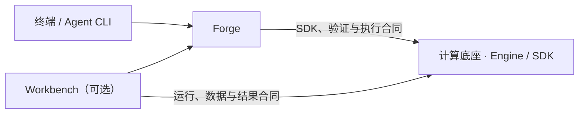
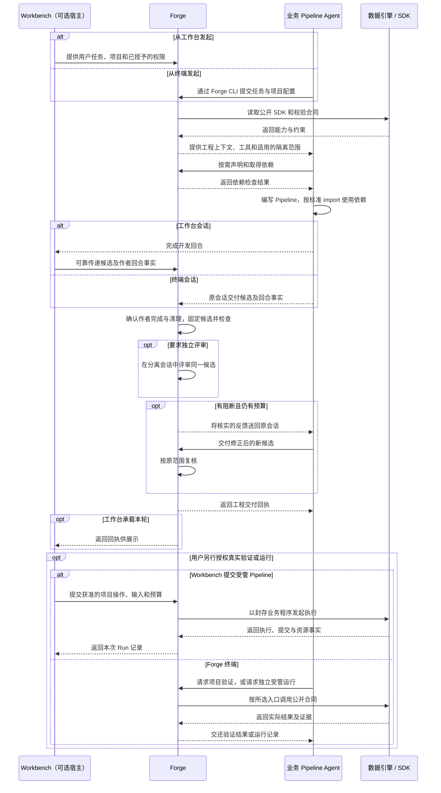
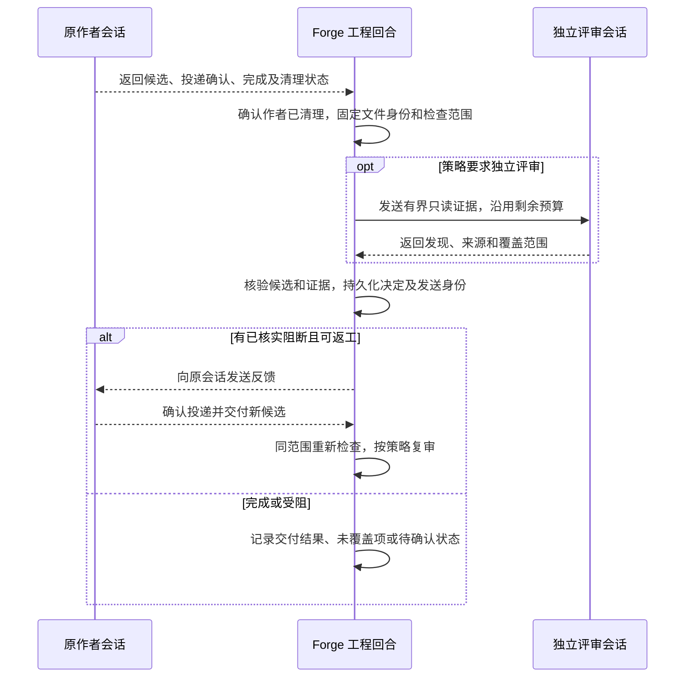
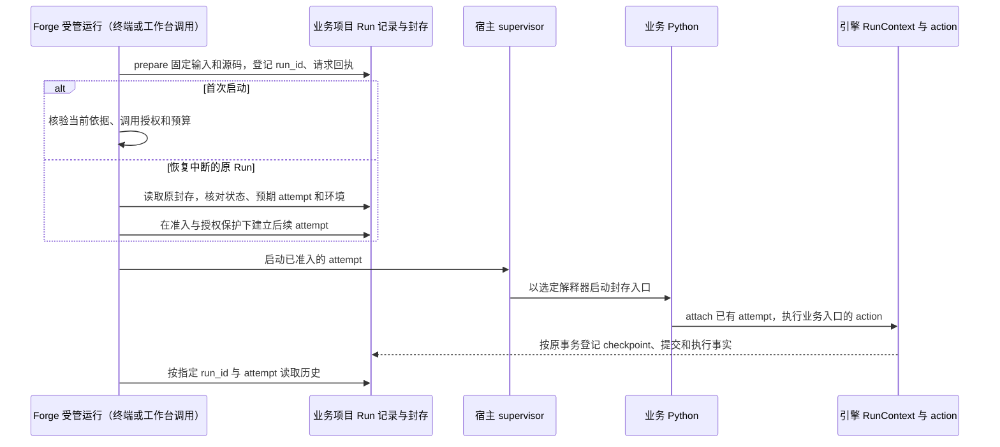
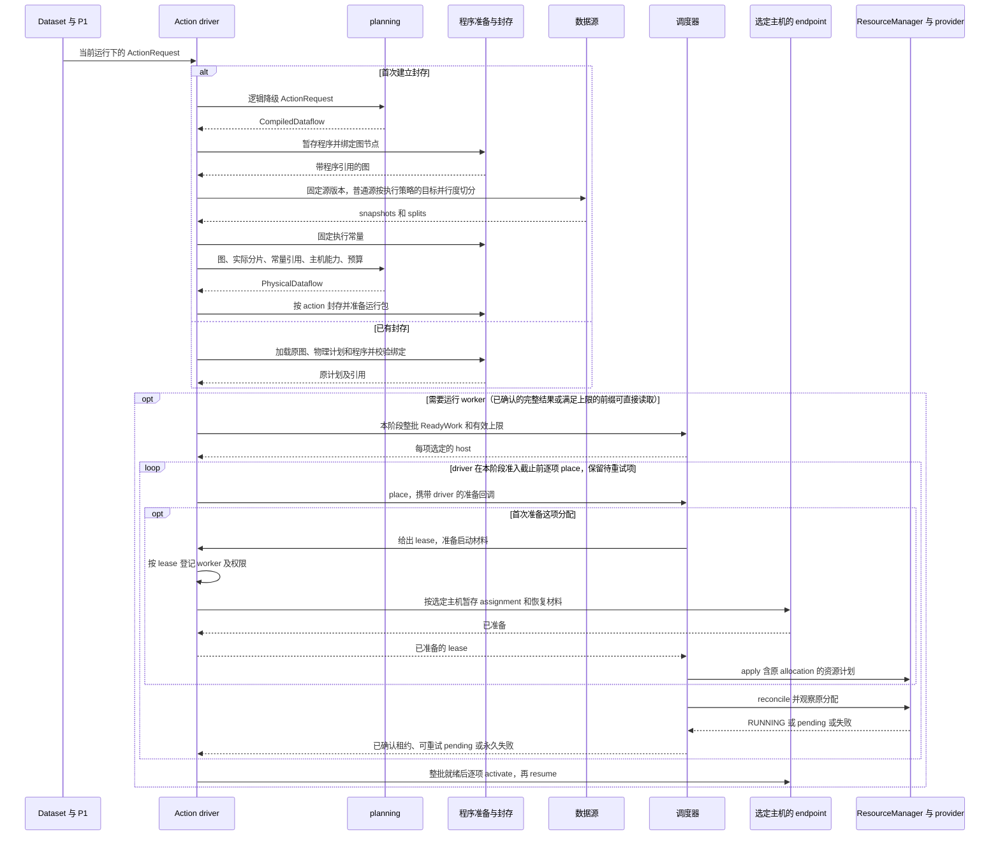
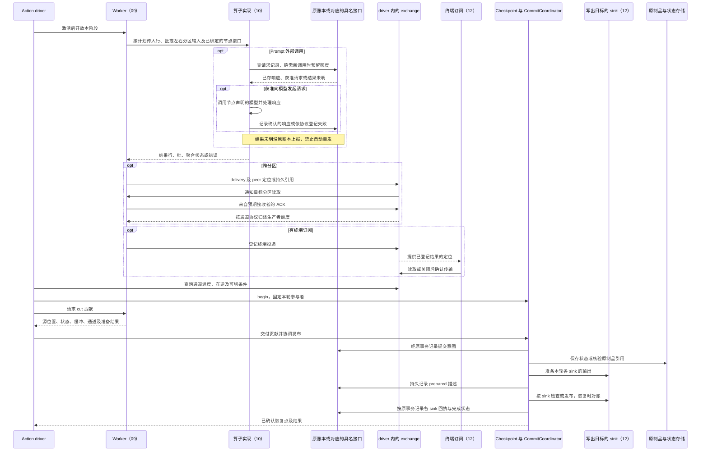
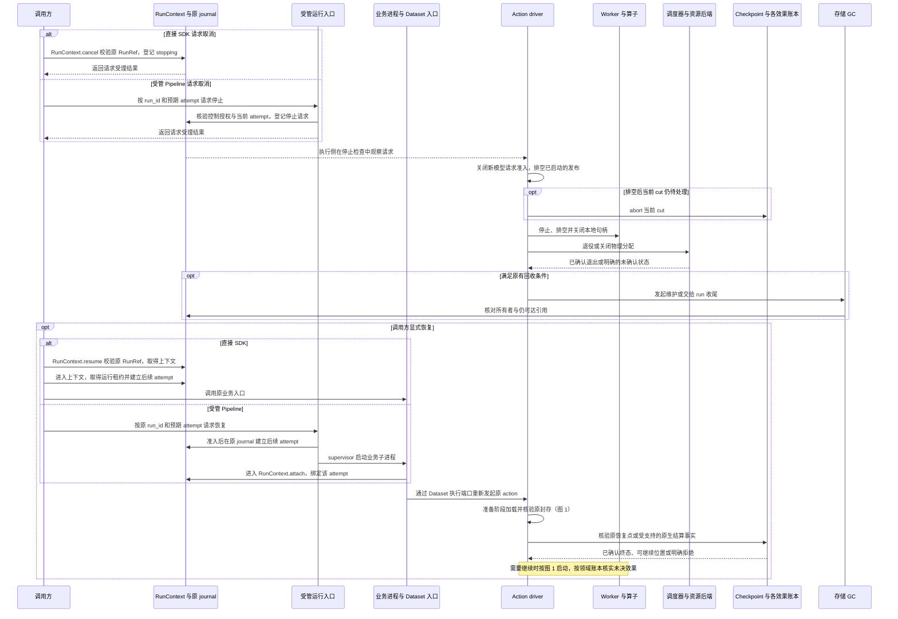

# DemiFlow 架构规约

版本 v1.7，2026-11-27。本文规定平台模块的职责、调用方向、状态归属和运行合同。各章分别说明现有入口和待实现的能力。

[总体架构](#platform-overview) · [Forge](#forge-module) · [Workbench（可选）](#workbench-module) · [计算底座（Engine / SDK）](#engine-sdk) · [实施要求](#implementation)

<a id="platform-overview"></a>

## 总体架构

DemiFlow 支持用户开发、理解和运行 Pipeline，并分析、比较和评测数据。业务项目是用户的独立资产，持有源码、配置、数据、Notebook、运行记录和结果，或指向显式存储中的相应对象。

| 平台模块 | 职责 | 允许的调用 |
|---|---|---|
| Forge | 定义项目工程契约，组织 Agent 开发、检查、独立评审与交付。终端可独立使用。 | 调用计算底座公开合同。通过中立参数或回调接收宿主授权与事实。 |
| Workbench（可选） | 提供项目登记、授权、界面、开发会话、受管 Pipeline 和交互分析。 | 调用 Forge 工程能力，也可直接使用底座公开的运行、数据及结果合同。 |
| 计算底座（Engine / SDK） | 定义并执行 Dataset 和算子，管理原生计划、提交、检查点与物理资源。 | 接收已准备的程序和环境，通过公开合同交付事实。可独立于上层应用使用。 |



箭头表示代码依赖方向。三个模块可以同仓、同包或同进程部署。项目登记引用用户资产，读取项目的许可与执行操作的授权分别核验。

<a id="run-ownership"></a>

### 运行记录与控制权

**AR.3.1　Pipeline 应用运行。** Forge 持有单项目受管 Run 的准备、应用输入封存、准入、启动和恢复。终端通过 `demiflow forge run` 独立运行，Workbench 可通过同一机制提交用户授权的操作。Forge 的 Python 运行时负责解释器与源码加载。引擎持有执行、检查点与提交事实。直接使用 Dataset SDK 也可沿原入口执行。[受管入口](../demiflow/forge/runs/cli.py) · [Python 运行时](../demiflow/forge/runtime.py)

两个入口可按授权读取同一项目的 `run_id`、`attempt` 和 `request_id`。发起应用组织本次运行，其他入口发出的控制请求也须交给该 Run 既有的控制机制，由它核验当次权限及预期 attempt。查询授权只用于读取。应用保存受理、预算与运行输入。引擎的 RunJournal、提交回执和检查点记录实际执行结果。进程退出与资源清理各有确认依据。查询和读取历史可以在原服务离线时使用固定记录。

### 业务 Pipeline Agent 开发时序

这张图描述工程交付与用户另行授权的业务运行。终端和工作台共用 Forge 的工程交付与受管运行能力。



<a id="forge-module"></a>

## Forge

<a id="forge-project"></a>

### 工程入口与项目契约

**AR.1.1　Forge CLI。** `demiflow forge …` 面向开发者和 Agent，提供可发现的命令、参数、稳定操作身份、有界的结构化结果，以及适用的查询、取消和错误信息。静态工程操作可在本地执行。`forge develop` 已能承接需求、检查、评审并向原生作者会话反馈，工程回执的 `--resume` 恢复的是开发操作。业务运行使用独立的 `forge run` 命令组。[Forge CLI](forge-cli.md) · [终端开发入口](../demiflow/forge/development_cli.py)

业务 Pipeline 使用公开 SDK、普通 Python 导入和自己项目登记的入口与参数。Forge 定义项目结构、`workflows/*.json` 编排声明、登记和静态检查。工作流评审关联本项目实际使用的节点、源码、参数及消费者。持有登记事实的宿主核验外部项目入口和运行权限，上游产物提交后由执行端核验引用。

### 项目依赖与 Python 运行时

Forge 从声明及获准的源码目录计算当前依赖。执行入口沿用项目配置的显式 Python。[项目依赖用法](forge-project-dependencies.md) · [依赖解析](../demiflow/forge/dependencies.py)

| 能力 | 工程合同 |
|---|---|
| 声明 | 用户项目的 `pyproject.toml` 是唯一依赖配置，开发 Agent 可新建和编辑。`[project].dependencies` 声明 A 类可安装包。`[tool.demiflow.packages]` 声明 B 类源码包，支持 `local_ref` 和 `vendored`。无该表的旧项目沿用原行为，只有 A 类包时可用空表启用。 |
| 精确清单 | 读取外部目录及计算哈希前，先核验调用方授予的实际来源范围。按包名生成文件清单、字节数和树哈希。清单服务于检查、评审和加载，项目日常操作直接读取声明与磁盘。 |
| 获取与清理 | `dep vendor` 校验单包后写入 `packages/<name>/`，允许先声明多个缺失包再逐个获取。缺少 A 类包时也能获取 B 类源码。`dep remove` 按名解除声明，物理删除限于项目内受管副本。并发编辑和失败回滚须保全其他变更。 |
| 静态校验 | `vendor` 和 `forge check` 复用单包规则，整项目诊断归 `check`。按声明项或源码行报告非法、缺失、孤立或撞名的包、明确缺失的 B 类子模块及可静态确认的业务导入错误。`TYPE_CHECKING` 和 `ImportError` 保护仅豁免相应的缺失诊断。依赖不齐时仍可进入开发会话修复。 |
| 项目环境与加载 | `dep list` 展示项目事实。`verify` 核验指定 Python 的依赖版本与模块撞名，`install` 由受信操作者显式发起。环境核验使用调用方选择的解释器，缺省时静态检查标明跳过的环境项。业务进程需要解释器时，缺失或无效配置须报错。精确加载器按当前清单或封存字节验证实际导入位置，开放范围限于所选包。 |

`packages/` 按需创建，Git 检出的受管副本按同一规则核验。B 类包须有合法顶层名和 `__init__.py`，仅接纳普通 Python 源码，忽略正常的 `__pycache__`。拒绝软链、权重、数据、归档、Notebook、二进制，以及对业务角色和 `demiflow` 的反向导入（包括项目限定名）。名称避开项目角色、标准库和选定环境中的已有导入根。单文件上限 512 KiB，单包 256 文件、8 MiB，单项目 16 包、512 文件、16 MiB。

<a id="forge-agent"></a>

### Agent 上下文、工具与沙箱

- **AR.2.1　上下文。** `forge context`、Skill、编写规范和评审指引用同一项目事实说明目标、依赖与缺失项、SDK 能力、源码和数据。运行日志和故障摘要注明来源、版本、观察时间和范围。权限在操作时重新核验。[工程上下文](../demiflow/forge/context.py) · [编写规范](../demiflow/forge/standards/pipeline-authoring.md)
- **AR.2.2　受控工具。** Forge 定义工具发现、输入输出、适用条件、读写与副作用，映射到所属领域的既有操作。宿主按回合提供授权、参考目录、会话、登记、输入或 Cell 执行能力。工程工具和上下文由 Forge 统一提供，模型推理与工具循环由原 coding harness 执行。
- **开发与评审沙箱。** 终端与 Workbench 的受限会话共用 Forge 的 OS 隔离、进程回收及命令包装器。终端默认受限，后端不可用时提示配置。宿主仅向受限作者或评审开放本回合固定的模型通道，凭据和对上游的连接由宿主持有。可信本地模式须显式选择。[沙箱策略](../demiflow/forge/sandbox/policy.py) · [工程工具](../demiflow/forge/bridge/tools.py) · [模型通道](../demiflow/forge/bridge/model_channel.py)
- **受限编辑。** 开发 Agent 可通过获准的文件入口创建和保存 TOML。`packages/` 和 `.forge/` 在 Agent 域内物理只读。`vendor/remove` 通过当前回合的窄操作通道调用同一 Forge 用例。写入受管副本或直接改指已授权的 `local_ref` 后，下一条 Python 或 `pytest` 命令使用新清单，合法变更在回合结束后保留。新外部范围须由宿主授权，再启用相应隔离范围。受限依赖操作保持离线，宿主凭据留在受信域。

<a id="forge-delivery"></a>

### 工程交付与独立评审

**AR.2.3　开发与交付。** Forge 持有任务、原始需求及补充要求的来源、baseline、候选身份、检查和评审回执、返工预算、候选冻结及交接证据。工作台可靠传递作者回合事实，终端使用同一工程判定。自动触发与作者主动请求复用范围、策略和去重规则，显式缩小范围须记入回执。用户补充要求记为需求来源，评审或工具给出的修正意见记为反馈。[开发闭环](../demiflow/forge/development.py) · [评审指南](../demiflow/forge/standards/pipeline-review.md)



1. 独立评审须等作者完成、投递已确认且清理已确认。评审模型使用与作者分离的无工具、只读证据会话，需要补读的材料由 Forge 在授权范围与剩余预算内提供。清理未知时保留原所有权，正常回合可以复用已授权的连接、槽位和协议身份。免费静态检查与付费独立评审各有开关，文档改动按适用性触发，也允许显式请求。真实验证须有项目指定的命令、解释器和执行授权。
2. 一次固定全部目标，再按受影响的 Flow、共享依赖和未归属改动分片。保留删除项、无 Git 项目和原参数绑定的来源。分片、补读、格式修复和返工共用总请求数、时间和字节预算。超限或未覆盖的目标在结果中明示。
3. 对已启用项目依赖的项目，评审在外部包边界停止展开，同时核对业务调用、引入理由、脱敏且保留行号的 TOML，以及包名、来源类型、文件数、字节数和树哈希。原文和树哈希参与本地候选身份 `evidence_id`。引用须对得上文件、前后版本、行号与摘录，覆盖完整度和已核实的阻断项分别记录。[评审证据](../demiflow/forge/review_evidence.py)
4. 结论与反馈发送前复核候选。发送身份、投递、ACK 和完成分开记录。ACK 未知须等待核实，既不标成功或失败，也不自动重发。崩溃后沿用剩余预算。修正生成新候选，旧回执作为历史保存。回执和待发消息可持久化在宿主已有事务中。人工消息保留原顺序和语义。工程反馈不得抢占用户新要求，须如实记录等待、被新要求替代、取消或需重新核验的状态。两个入口对同一物理项目根及其父子根使用同一写入准入事实，保留进程租约和清理证据。

### 运行与运维

**AR.2.4　受控运维。** Forge 按授权组织操作预检、执行和查询。独立受管入口 `demiflow forge run` 通过同一项目记录完成应用封存、准入、停止和按原 `run_id` 恢复。顶层 `demiflow run --config` 仍消费已封存的 `PipelineBundleRef`。[受管入口](../demiflow/forge/runs/cli.py) · [Bundle 入口](../demiflow/cli.py)

<a id="workbench-module"></a>

## Workbench（可选）

<a id="workbench-ui"></a>

### 项目登记、界面与开发会话

| 职责 | 产品持有的事实与操作 |
|---|---|
| AR.5.1 项目登记 | 登记保存项目目录引用、显式 Python、操作权限及获准读取的参考目录，按本次操作把授权传给 Forge。项目发现、登记和授权分别核验。[项目登记](../demiflow/workbench/projects/registry.py) |
| AR.1.2 结构化 API 与传输 | 持有 HTTP 认证、路由、序列化、流式连接和取消传递。路由调用本领域用例及公开合同，领域操作负责状态变更。 |
| AR.1.3 Web 工作台 | 保留 D1.9 的导航和四个 tab、共享选择上下文、响应式和错误可达性。算子图、源码、配置、历史和日志均定位到用户选择的对象。 |
| AR.1.4 通用展示组件 | 按固定引用和呈现描述显示表格、消息、文本、代码、JSON、HTML、图像和音视频。处理不可信内容、分页、缩放、局部展开与订阅。答案、数据修改和运行控制由各自领域负责。 |
| AR.3.5 开发会话 | 持有 conversation、turn、event、Provider 传输和人工队列。关联工程回执与原作者，重连 Codex 或 DeepSeek 时按当前回合核权并绑定工具。会话取消、未知结果和恢复由会话处理。工程验收、算子内 Agent 和 Pipeline attempt 各自使用原身份。 |

### 预览、运行与编排

产品预览固定表输入，在只读业务子进程构图。宿主控制进程与运行 supervisor 使用宿主 Python。已启用依赖机制的项目使用显式选定的业务 Python，包括其获准的启动配置。受限路径在解释器启动前施加隔离，业务 bootstrap 按清单加载并核验实际位置。已有 `shared-sources.json` 与 `DEMIFLOW_WORKBENCH_SHARED_SOURCES` 沿原合同使用，包名冲突须报告。[预览入口](../demiflow/workbench/worker.py) · [源码加载](../demiflow/forge/runtime.py)

`demiflow workbench run` 可在没有 Web 服务时调用工作台管理能力。准备阶段固定入口、参数、代码、环境、输入和预算，并将 B 类源码按核验的内容封入本次 Run。第一次启动核对有效依赖声明、B 类内容和 A 类环境。中断后的恢复核验原封存、原 Python 环境、剩余预算及执行状态，然后使用原封存的 B 类字节。旧版已准备、已中断和只支持读取的历史各按其合同处理。[运行管理](../demiflow/forge/runs/manager.py) · [受管 worker](../demiflow/forge/runs/worker.py)



项目级 `.forge/index.sqlite` 是可重建视图。修改 Run 前登记待更新项，再按项目记录发布索引。两个入口按授权查询同一 Run，索引发布中断后可重建。工作流调度另存 `wf_run_id`、编排 attempt、依赖和子 Run 引用，节点结果沿各子 Run 的原始提交读取。查询、日志和停止各按当次权限处理，严格运行准入须显式启用。[项目目录索引](../demiflow/forge/index.py) · [运行授权](../demiflow/workbench/runs/authority.py)

<a id="project-data"></a>

### Notebook、SQL、Case 与媒体

| 职责 | 生命周期、状态与边界 |
|---|---|
| AR.3.3 Notebook | 文档持有 revision 和 cell 输入，可脱离内核保存重开。会话持有 session、generation 和连接，单格执行持有代码摘要、派发及输出。中断、重启和旧代拒绝按内核处理，查看历史只读已存输出。Jupyter Server 使用宿主 Python，内核使用项目 Python 和启动时固定的 B 类源码，延迟导入仍取该版本。新内核读取最新核验的依赖。只读内核执行既有写范围，Cell 实际执行归产品。[内核启动](../demiflow/workbench/notebooks/kernel_launcher.py) |
| AR.3.2 查询与统计 | SQL 文本、参数、固定表绑定、query operation、取消和有界结果归查询模块。SQL 可随 Notebook，Python 与 SQL 显式交换结果。目录统计和枚举按各自查询预算执行。 |
| AR.5.2 数据目录与访问 | 数据留在原后端。表、Schema、固定版本、别名条件和来源许可由相应目录或存储核验。产品通过有界接口读取，支持独立于 Dataset 计算的查询。 |
| AR.3.4 Case 组织与评测 | 用稳定的 Case、方案和字段身份筛选、分组、翻页，材料、问题和布局可配置。答案 head、event、revision 和 media_basis 在同一事务中按 expected 版本更新。草稿、下一条与历史处理引用固定材料，读取 Case 历史无需重跑生产者。 |
| AR.5.4 媒体访问 | ticket、range、read、capture 和实际释放归媒体领域。访问先核验当前权限及历史材料来源。浏览器取消后跟踪读取任务的实际退出，历史媒体读取独立于 Notebook 内核。 |

Notebook、数据与媒体、开发对话可直接复用 `forge/process.py` 查询已持有的辅助进程身份。共享宿主配置由 `forge/host_partition.py` 提供，进程工具的依赖方向朝向中立的身份核验。原领域持有其权限、预算、事务和生命周期。[进程身份](../demiflow/forge/process.py) · [宿主分配配置](../demiflow/forge/host_partition.py)

<a id="engine-sdk"></a>

## 计算底座（Engine / SDK）

<a id="engine-modules"></a>

### 公开能力与内部职责

**AR.4.1　SDK** 定义 Dataset、数据与类型、函数和 Actor、Pipeline 程序及其配置和终结动作。具体 executor 按需装配，SDK 冷导入独立于 Forge 和 Workbench。**AR.4.2　算子与工具库** 负责普通函数、Actor、模型、检索和媒体操作。算子内 Agent 受行预算和公开工具契约约束。**AR.4.3　计算引擎** 把逻辑计划编译成阶段与任务，驱动 Local 或 Ray Core 执行、背压、提交、恢复及观测。一个 run 可以包含多个 action。

下表是计算底座内部的稳定编号。新增独立职责时先说明现有模块为何无法承载，再在末尾追加编号、职责、输入输出及代码入口，按 D1–D9 评审。已有职责内的文件拆分沿用原编号。

| 编号 | 模块 | 职责 | 输入 | 输出 | 平台代码入口 |
|---|---|---|---|---|---|
| 01 | Pipeline 入口与运行上下文 | 受管 pipeline 绑定入口、run、attempt，一个 run 可包含多个 action | 入口、参数、RunRef 或受管提交 | RunContext、RunAction、取消请求的持久状态 | [run 上下文](../demiflow/execution/pipeline/run_context.py)、[pipeline 入口](../demiflow/execution/pipeline/driver.py) |
| 02 | Dataset API 与执行端口 P1 | 记录声明，将终结动作交给所选 executor，交还 API 规定的结果 | source、LogicalPlan、动作及参数 | Dataset 或 typed action spec，引擎端组装 ActionRequest，返回行、迭代器、标量或回执 | [Dataset](../demiflow/data/dataset.py)、[动作契约](../demiflow/data/execution_contract.py)、[执行端口](../demiflow/execution/executors/base.py)、[动作入口](../demiflow/execution/executors/dataflow_api.py) |
| 03 | Action driver | 管一次 action 的阶段、整批准入截止、逐项 place 的重试及终止 | ActionRequest、运行上下文、policy/bounds、worker 事件 | 启动/暂停/恢复命令、ActionHandle、终态或错误 | [DataflowExecution](../demiflow/execution/action_driver/dataflow.py) |
| 04 | 编译器 | 逻辑降级，根据实际分片和策略做物理规划，选择 stage、融合与交换方式 | ActionRequest、CompileInputs、约束；物理阶段另收图、实际 splits、主机描述、常量引用 | CompiledDataflow、PhysicalDataflow | [逻辑编译](../demiflow/planning/dataflow_compile.py)、[物理规划](../demiflow/planning/dataflow_place.py)、[算子登记](../demiflow/planning/dataflow_registry.py) |
| 05 | 数据源 | 固定输入版本，按源格式生成分片和起始游标，在 worker 打开读取器 | 源声明、目标并行度、预算；恢复时给定原位置 | SourceSnapshot、SourceSplit、带来源位置的记录 | [源声明](../demiflow/data/sources.py)、[源切分](../demiflow/execution/sources/snapshots.py)、[Lance 读取](../demiflow/lance/read.py) |
| 06 | 程序准备与封存 | 固定程序引用，让 action 的图、程序、源和物理计划可重载、可校验 | 编译结果、程序/常量、实际计划、RunAction、存储 | 带程序引用的图、SealedExecution 或经核验的历史图与计划 | [程序准备与封存](../demiflow/execution/seal/plan.py) |
| 07 | 调度器 | 负责整批可行性、选机、单项准入及租约、运行和发布预留、退役等待。03 持有整批的重试与截止时间 | ReadyWork、stage profile、已探测主机、有效 worker/内存上限、当前占用 | 每项 host、WorkerLease、等待/不可行原因、退出观察结果 | [DataflowScheduler](../demiflow/execution/scheduler/placement.py) |
| 08 | 主机适配与资源管理 | 适配器在选定主机准备连接/派发任务；ResourceManager 对 provider 申请、核对和收回物理资源 | 选机、WorkerAssignment、租约与资源计划 | 可激活的 endpoint、实际分配状态、退出或待清理证据 | [主机端点](../demiflow/execution/hosts/endpoints.py)、[ResourceManager](../demiflow/resources/manager.py) |
| 09 | Worker 与分区执行 | 按物理计划驱动分区循环，绑定并调用算子，管理批次成员、进度和取消 | WorkerAssignment、源或通道输入、算子绑定、控制命令 | 行/批、进度、控制事件、分区 checkpoint 贡献 | [分区执行](../demiflow/execution/worker/dataflow_execution.py)、[图推进](../demiflow/execution/worker/dataflow_graph_runner.py)、[算子绑定与调用](../demiflow/execution/kernels/operator.py) |
| 10 | 算子实现 | 负责算子的计算语义和算法实现，包括 join 键匹配、DataFusion 查询、Arrow 批变换及模型调用。同一算子的不同算法遵守相同的输入输出契约。受管模型服务负责自身就绪和生命周期 | 输入行、批或左右分区数据，算子参数、业务函数及获准的账本或服务接口 | 结果行、批、聚合状态或外部调用结果（含失败或结果未明） | [算子实现](../demiflow/operators/)、[关系计算](../demiflow/operators/relational.py)、[DataFusion 查询](../demiflow/operators/relational_sql.py)、[Prompt](../demiflow/operator_llm/runtime.py)、[Embedding](../demiflow/embeddings/)、数据获取类算子（[SearchWeb](../demiflow/collect/operators.py)、[Fetch](../demiflow/collect/fetch_flow.py)、[ReadDocuments](../demiflow/collect/reading.py)、[RegisterDocuments](../demiflow/collect/document_library.py)、[DecodeDocument](../demiflow/collect/documents.py)、[EncodeImage](../demiflow/collect/image_resize.py)、[ParseWikitext](../demiflow/collect/wiki_syntax.py)）、[模型服务](../demiflow/services/manage.py) |
| 11 | Exchange | 管跨分区投递登记、路由、额度、确认与通道恢复状态；driver 进程负责中转通知 | ExchangeSpec、发送/接收端标识、记录定位、ACK | 下游投递、额度归还、可用于 cut 的通道进度 | [通道与传输](../demiflow/execution/exchange/)、[投递状态](../demiflow/execution/exchange/deliveries.py) |
| 12 | 终端结果交付与写出 | 向调用方交付 count、take 或流式读取的结果。需要写出时，对应的 sink 按目标协议准备输出、检查发布状态并提交 | 终端记录及其发布事实，或分区待写结果与写出上下文 | 标量、行/批、物化句柄、WriteResult 或 sink 回执 | [终端](../demiflow/execution/outputs/terminals.py)、[sink](../demiflow/execution/outputs/sinks.py)、[写出契约](../demiflow/data/datasink.py) |
| 13 | Checkpoint 与提交 | 收齐参与者状态，协调一致恢复点，按 sink 协议提交/对账 | CutRequest、源位置、核与缓冲状态、通道进度、sink 准备结果 | RecoveryImage、确认的输出与原生提交事实 | [checkpoint 协调](../demiflow/execution/checkpoint/coordinator.py)、[提交](../demiflow/execution/checkpoint/commit.py) |
| 14 | 运行产物存储 | 保存、校验、保留、释放引用、安全回收 | 有界字节流或 ArtifactRef、owner | ArtifactRef、已校验字节、引用变更或回收结果 | [对象存储](../demiflow/execution/storage/objects.py)、[引用与租约](../demiflow/execution/storage/lease.py)、[回收](../demiflow/execution/storage/gc.py) |
| 15 | 运行账本、观测与历史接口 | 按原事务记录运行事实；写观测；按指定运行和 attempt 只读解释 | 状态变更与授权、运行事件或查询条件 | 持久事实、观测指标、只读视图 | [账本](../demiflow/execution/journal/run_journal.py)、[观测](../demiflow/execution/journal/run_telemetry.py)、[历史读取](../demiflow/execution/journal/run_reader.py)、[P4 端口](../demiflow/execution/host/) |
| 16 | 声明、协议与编码 | 表达跨模块边界的既有值、身份与编码；由使用方执行具体操作 | 字段、声明和受支持协议版本 | 经校验的声明、消息、回执或错误 | [逻辑声明](../demiflow/data/plan.py)、[引擎协议](../demiflow/execution/contracts/)、[恢复协议](../demiflow/execution/contracts/recovery_contract.py)、[资源协议](../demiflow/resources/contracts.py) |
| 17 | 原生队列、获取和流式写入 | 在原生路径管理源单元、外部效果及确认，向 driver 和 checkpoint 提供可验证的事实 | 已绑定的源单元、位置、请求或分区输出 | 领取与结算事实、原生回执、可继续位置 | [原生 producer](../demiflow/execution/native_queue/dataflow_queue.py)、[队列](../demiflow/execution/native_queue/queue_producer.py)、[流式写出](../demiflow/execution/native_queue/dataflow_stream_lance.py) |

<a id="engine-resources"></a>

### 跨阶段的状态归属

- **AR.3.6　外部能力与模型服务。** 服务管理器持有 service、endpoint 和 lease，负责启动、就绪、观察和停止。服务按需装配。外部操作的语义归算子，例如 Prompt 负责请求、响应、重放和未明结果，搜索即使在 driver 受控执行也沿原领域协议。执行侧只绑定当前节点的账本与额度。[模型服务管理](../demiflow/services/manage.py)
- **AR.5.3　结果与来源。** 各领域的生产者持有自己的结果发布状态。Pipeline 的 sink 提交输出，引擎记录回执，产品核验后登记固定结果引用。Notebook 和查询分别发布各自产物。ResultRef、ArtifactRef 追溯生产者、输入、程序和环境，保留旧版来源。存储负责可核验字节、引用与回收。程序和源码按实际长度及摘要加载，`max_state_bytes` 约束计算状态和恢复镜像。恢复点归 checkpoint，队列取得与确认归原生队列。
- **AR.6.1　执行与资源。** 后端持有精确实例、分配、额度、退出和退休事实，在部署域内核算 CPU、内存、磁盘、FD 和并发。观测在事件发生处产生，采样值只作为观测。请求停止、排空与清理分别确认。P4 通过公开控制与只读历史端口处理指定 run/attempt 的操作。

### 上层调用的运行与资源合同

Forge 和 Workbench 分别核验自己的应用权限、输入和总预算，通过下列合同绑定底层执行身份。合同可在同一进程中调用，具体版本和编码以实际公开入口为准。

| 合同 | 交互方向 | 固定语义 |
|---|---|---|
| C1 能力与版本 | 引擎 → 应用 | 提供模式、操作、协议和平台版本，明确报告未支持的能力。 |
| C2 固定运行输入 | 应用 → 引擎 | 交付代码、平台、环境、入口、配置、输入输出和总预算的不可变引用。秘密只传引用。 |
| C3 控制与身份 | 应用 → 引擎 | start、observe、cancel 和受支持的 resume 携带 run/attempt、操作身份、expected 版本与期限，分别记录受理和完成。 |
| C4 事实与结果 | 引擎 → 应用 | 提供实际状态、有界日志、指标、节点映射与新鲜度，以及已提交的结果和独立的清理状态。 |
| C5 恢复与兼容 | 引擎声明，应用核验后请求 | 核验 checkpoint、schema、工件、剩余预算和未明状态。保留旧 attempt 与封存，跨版本恢复按已验合同执行。 |
| C6 资源职责 | 应用 → 执行编排 → 资源后端 | 总额度、worker 需求、分配、观察与归还逐级核验，说明支持的限制方式、单 worker 口径和部分失败清理。 |

- **R1**　公共 ExecutionUnit、ResourceLease 和资源后端复用同一执行机制。一个物理实例只有一个生命周期所有者和一份计量事实。
- **R2**　应用核验本次总额度，编排产生需求，后端在同一部署域的公共资源树分配与对账。计入 driver、supervisor、worker 和退出未确认的占用。子占用在父额度内核算，每个 worker 使用分给自己的额度。
- **R3**　公共基础只依赖中立身份及资源合同。引擎 fence 经中立绑定验证，提交与恢复实现留在引擎，Notebook、SQL、媒体分别核验自己的权限与生命周期。
- **R4**　引擎侧负责资源后端和 provider，工作台侧给出已有消费者与兼容要求并联审。共享代码的一次修改由一个主责方提交。基础 IPC、Exchange 的路由与背压、封存与 barrier 分属各自模块。

### 子模块调用时序

**资源如何进入计划。** 01 保留调用方获准的上限。04 拿到实际分片和已暂存的程序后，根据执行方式计算每个阶段需要的资源。以内存传递数据时，上下游必须同时放得下；允许持久化交接时，下游可以随后启动。04 按候选方案中实际同时驻留的阶段核算窗口和请求，06 封存选定结果。运行时，07 结合当时的占用决定能否派发，08 申请并释放实际资源。

普通算子可以只声明计算。引擎了解执行方式，负责推导资源请求。对能逐次计量的任务，接收一行、产生输出和保存状态时，09 都要把当时仍存活的数据计入已获准的工作区。对共享实例、带自定义恢复逻辑的任务等无法可靠推导占用的情形，规划保留其固定需求。

程序分发和任务状态各有自己的计量对象。需要为任务单独加载程序时，封存载荷的实际字节数可用于核算加载缓冲；Python 对象解码后的堆占用还取决于对象实现。任务可变状态和恢复镜像按原状态预算校验。命中旧封存的 action 时，执行器读取原物理计划和恢复点。

三张图沿同一次 action 展开。假设 ds 是有界输入，pack 已声明 item 和 summary。这里 take 限制交付行数，max_requests 限制本节点跨 worker 的新请求数；并发和受支持的重试会影响实际请求数。纯计算的 filter/count 跳过模型调用，需要写出时使用对应目标的 sink。

```python
rows = ds.map_prompt("enrich", config=pack, inputs={"item": "text"},
                     outputs={"summary": "summary"}, max_requests=10).take(2)
```

**图 1　从 Dataset 到可激活的分区。** 新 action 先逻辑编译，随后固定程序和真实源分片，再做物理规划。普通源切分的目标来自本次执行策略的 `default_partitions`，原生队列源使用自己的布局。命中原封存时复用原计划。箭头表示运行调用，虚线表示返回。



**图 2　行处理、投递与提交。** 融合的相邻算子可在分区内直接传值。图中的跨分区路径只在物理计划存在对应边时经过。checkpoint 可以重复发生，订阅也可以边运行边读取。



图 2 将账本画在一列以便阅读。算子在 worker 侧经已绑定的请求接口读写领域事实；CommitCoordinator 在 driver 侧经自己的运行事务写提交事实。状态制品和 dataflow 字节对象沿各自的原存储写入。图中所示是新 cut；恢复已 prepared 的单元直接从准备描述对账。

**图 3　取消、清理与恢复。** 取消可与发布重叠，关闭订阅另有传输释放动作。直接 SDK 在进入恢复上下文时取得运行租约。受管工作台先在原 journal 推进 attempt，业务子进程再进入 `RunContext.attach`。两条路径均由业务入口发起原 action，沿同一执行身份核对既有提交。[运行上下文](../demiflow/execution/pipeline/run_context.py) · [受管恢复](../demiflow/forge/runs/manager.py)



### 模块依赖规约与评审批据

这里的依赖指一段代码必须知道另一个模块的哪些类型、行为或状态才能工作。审查单位是“消费者中的具体调用点 → 提供方的具体符号 → 用途”。源码导入、函数内延迟导入、注册表中的符号路径、回调捕获的对象以及历史载荷中的限定名，都可能构成依赖。运行时从 B 回调 A，并不要求 B 导入 A 的实现。

下表按条款列出[合入闸实际选取的守卫](../tests/merge_gate.py)及其边界。右列由评审者对本次改动核实，并在涉及运行行为时引用固定提交的回归或实测。D4 至 D8 均无覆盖整条契约的专门合入守卫。

| 条款 | 合入闸已检查的部分 | 仍须评审或实测的部分 |
|---|---|---|
| D1 声明 | [P1 依赖](../tests/test_p1_dependency_boundary.py)、[关系声明](../tests/test_p1_relational_boundary.py)、[冷导入](../tests/test_package_cold_imports.py)检查既有依赖与构造行为。 | 新声明的真实提供方、持有的资源及副作用。 |
| D2 契约与装配 | [编译契约清单](../tests/test_compile_contract_inventory.py)检查已登记的分派、端口和部分实际执行判断。 | 精确识别、工厂构造、服务绑定与观测各自的类型语义，以及绑定后的实际效果。 |
| D3 计划、数据源与封存 | [包依赖](../tests/test_package_dependency_ratchet.py)、[编译输入](../tests/test_dataflow_compile_inputs.py)及编译契约清单检查规划器导入、输入解析和已盘点的隐式环境读取。 | 数据源执行实际 I/O 的位置、旧封存的分片与游标如何复用。 |
| D4 编排与资源 | 合入闸未覆盖从整批准入到进程退出的完整时序。 | 观察选机、启动材料、租约、激活和实际退役的先后。 |
| D5 计算与投递 | 编译契约清单检查已登记端口；跨分区投递与终端提交需运行验证。 | 核对通道进度、在途恢复和终端 ACK、提交的先后。 |
| D6 效果与提交 | 合入闸未覆盖从请求准入到提交确认的完整事务。 | 按所改路径核验效果账本、重入、结果未明和 sink 发布回执。 |
| D7 控制、观测与历史 | [工作台与引擎边界](../tests/test_workbench_engine_boundary.py)和[托管清理](../tests/test_p4_managed_cleanup.py)覆盖部分访问边界、取消竞态及清理。 | 指定 attempt 的历史只读、取消后排空与实际退出，以及资源是否仍可达。 |
| D8 跨版本续跑 | [旧路径保留](../tests/test_pre_v3_retention.py)检查已登记对象与调用者；[已知状态工具](../tests/test_engine_known_state.py)核对回归清单的比较规则。 | 旧版本写、新版本冷读、从原非最终恢复点续跑，核验旧回执和拒绝条件。 |
| D9 依赖可追踪 | 包依赖守卫检查私有导入预算、旧执行器导入方及失效的允许项。 | 回调、注册符号和封存限定名指向谁，新增依赖是否确有必要。 |

#### D1　声明只依赖声明和无副作用的校验

**适用模块**　02 Dataset API、04 编译器、05 数据源声明、06 封存、16 声明与协议。

**允许。** 多个模块消费同一种声明值。声明可持有业务提供的程序描述、配置或已有端口引用，复用有界的字段与拓扑校验。API 按公开契约读取用户明确指定的配置文件；声明阶段不能借此打开数据源、启动 worker、创建执行中的 actor、访问当前运行账本。终结动作通过 P1 执行端口交付。

**打回。** 新的声明或逻辑规划为了表达“是什么”，需要导入 kernel、主机后端或运行期服务的具体实现；或者把排序、落盘、锁、执行缓存等实现放进声明包，再让执行模块反向导入。用第二套 DTO、转发文件或函数内导入包住同一条依赖，也须按真实提供方裁定。

**用 join 裁定。** 左右输入、键、连接类型归声明。编译器消费这些值并展开两个端口；09 提供两个分区记录流，10 的关系算子执行匹配。`PlanInput`、`KeyedSource`、`UnionSource` 的历史导入路径是 `execution.local_kernel`。新关系操作复用声明入口。旧程序可能按原限定名解码类对象，并在解码后复算程序身份。移动定义须同时满足 D8，兼容出口只覆盖登记的原符号和用途。[关系组装](../demiflow/data/relational_declaration.py) · [编译](../demiflow/planning/dataflow_compile.py) · [执行](../demiflow/execution/kernels/relational.py) · [历史保留依据](architecture-upgrade-20261120/G/RETAINED-OBJECTS.md)

**评审批据。** 标出同一声明的定义、生产者和消费者，确认声明阶段启动了哪些资源；检查源码导入和冷进程实际加载的模块。涉及 join 时检查左右端口、重复键多重性、空键和执行器绑定。只有触及持久身份或旧路径才追加 D8 的历史验证。

#### D2　通用抽象依赖契约，具体算子由装配处选择

**适用模块**　02 Dataset API、04 编译器、06 封存、09 Worker 与分区执行、10 算子实现、15 观测。

**允许。** 编译、调度、分区执行等通用模块依赖完成本职工作所需的契约。具体实现依该契约提供能力，装配处选择实现。编译器处理声明种类和已登记的 lowering，通用 worker 按执行规格调用已绑定的算子。具体工厂可以导入并构造 `PromptActor`；专用绑定可以核对受支持的精确类型后，注入本 action/node 的账本、请求额度和恢复能力。算子拥有字段映射、请求与响应处理、领域重放语义。领域到引擎的依赖逐符号使用已有合同、注入服务或已批准的原生装配。[算子服务契约](architecture-upgrade-20261120/F/F2-SERVICE-CONTRACTS.txt)

**打回。** 通用 kernel 为普通 map 增加某个模型、客户或服务的分支；多个消费者各自判断具体 actor 并决定绑定哪套账本；算子直接取得整个 driver、全局数据库或任意 RPC 能力。用全局运行时注册器或字符串类名绕过原生类型校验，或把构造、准入、观测和持久身份塞进一种判断，也应退回。新增平台内置种类优先使用已有登记表和工厂。

**第三方可选数据类型。** 为避免仅检查配置就加载可选库，可以按限定模块或包命名空间和已列明的类名筛选待解析的数据值（如 PyArrow 的 CSV 选项、Schema）。新增识别点须按对应格式核验类型或字段，再编码。现有 CSV 选项先按限定模块和类名筛选，再按受支持的字段处理。历史 Schema 编码按模块前缀和类名调用序列化，须保留该格式的已有语义。仅凭名字不得认定平台原生算子、选择其程序身份算法或授予运行服务。[CSV 选项](../demiflow/planning/dataflow_compile.py) · [恢复编码](../demiflow/execution/seal/program_identity.py)

编译器对 `OperatorLLMMapOp` 和 `_LiteralEmptySource` 使用平台自己的精确类型。伪同名类不得取得原生语义，既有程序封存的身份仍按 D8 核验。[逻辑编译器](../demiflow/planning/dataflow_compile.py)

**用 map_prompt 裁定。** 普通 `map_prompt` 在 Dataset 中追加 `OperatorLLMMapOp`，worker 依据已编译的 `kind="prompt"` 装配。`CacheCall` 包装模型时，缓存先绑定 checkpoint，随后由模型绑定模块识别内部 callable、选择本节点的账本。相同的精确类型谓词可以共用；不同输入、决定或子类语义分别由下表所列模块持有。[Dataset 声明](../demiflow/data/dataset.py) · [模型工厂](../demiflow/execution/operator_bindings/dataflow_model_factory.py) · [kernel](../demiflow/execution/kernels/operator.py) · [模型绑定](../demiflow/execution/operator_bindings/dataflow_models.py)

| 判断或操作 | 负责模块 | 边界 |
|---|---|---|
| “这个对象的类型恰好是受支持的原生 PromptActor” | 原生算子的类型识别与专用装配 | 相同的精确类型谓词可共用。缓存、路由、图像等调用方仍各自核验本用途的条件。外观相似的对象和子类沿原路径处理。 |
| “创建哪种 actor，绑定哪个账本” | 工厂与模型装配 | 工厂保留具体构造。绑定方按 spec、节点及受支持场景选择原有适配器。普通算子不会因此得到 Prompt 权限。 |
| “封存哪些算子事实” | 具体算子提供封存所需的算子事实；06 负责封存表示与校验 | 复用精确身份判断，保留 Prompt/agent 的环境校验、各自事实和原有字节。 |
| “是否计入已发生的用量或观测” | 15 观测与各指标生产者 | 保留已有 `isinstance`、路由子项和缓存解包语义。观测不能授予执行资格、扣费或证明提交。 |

**评审批据。** 给出“声明 → 工厂 → 已绑定实例 → 行结果”的一条真实链路；改哪种判断，就比较其真例、子类、伪同名类和不相关 callable 的原有结果。涉及缓存时检查 Prompt/agent 的绑定、普通缓存及重复扣费；涉及观测时检查用量；涉及封存时按 D8 验证。按实际行为裁定，无需以直接导入类的文件数作为合格线。[算子事实](../demiflow/operator_llm/flow_contract.py) · [原生模型观测](../demiflow/execution/journal/dataflow_model_observations.py) · [用量](../demiflow/execution/journal/dataflow_usage.py)

#### D3 至 D9　各模块间允许的依赖与退回条件

| 条款 | 允许的方向和输入输出 | 应退回的变化 | 最小评审批据 |
|---|---|---|---|
| **D3　计划、数据源与封存** | 03→04 请求逻辑计划。03→05 传入普通源的策略分片目标并取得源快照和实际分片。04 消费实际分片生成物理计划。03→06 固定程序、图、源和常量。 | 编译器读 Lance 元数据、查询当前 run 或写封存；恢复时重切原输入、用新计划替代旧封存。 | 对照图 1，分别走一次新 action 和一次命中原封存的路径，明确哪个模块执行 I/O。 |
| **D4　编排、调度与资源** | 03 管重试截止与终止；07 管整批可行性、单项准入与选机；08 负责真实分配与退出。07 经准备回调让 03 先把 assignment、权限和恢复位置交给选定端点，随后申请资源，确认就绪后才激活。 | 新增第二处 worker 数或内存准入决策；07 持有具体 driver；08 在启动材料准备好之前启动 worker；把停止请求当作已退出。 | 能区分永久不可行、暂时等待和物理退出。Local/Ray 使用相同任务与回执，后端特有行为只在适配侧取证。 |
| **D5　计算、投递与终端** | 09 驱动分区，10 执行算子计算；11 在 driver 进程持有跨分区和终端投递、额度、ACK、持久通道在途状态；12 交付订阅结果或写出。 | worker 绕过当前协议直连；driver、订阅或算子另存一份权威投递表；用传输 ACK 代替输出提交。 | 对照图 2 验证分区内直传、跨分区 ACK 和终端关闭中本次受影响的路径；恢复证据含原通道进度。 |
| **D6　效果、提交与存储** | 算子或原生队列经具名端口登记领域效果；13 协调 cut 与提交；sink 根据 prepared 描述检查和发布；14 只持有可校验字节及其引用；15 按原事务记事实。 | 依据文件存在或观测计数判断发布成功；结果未明时自动重发；存储自行承认效果；增加并行真账本。 | 核实一次成功和一个对应的失败或重入窗口。区分请求已准入、效果已确认、提交已确认和结果未明。 |
| **D7　控制、观测与历史** | 01 接收取消，03 停止新准入并排空，09 关闭本地实例，07/08 观察实际退出，14 按可达引用回收。P4 inspection 消费指定 run/attempt 的事实，获准控制走 control。 | 通过指标推算成功或资源已释放；取消时误删旧提交；读取历史触发模型、恢复或写账本；底座反向依赖应用。 | 针对所改分支，区分停止请求、排空完成、实际退出；历史读取冷进程只读且指向指定 attempt。 |
| **D8　跨版本身份、解码与续跑** | 16 保有唯一的声明/编码；06 读取原程序与身份；13 按原恢复点继续。变更涉及限定名、编码、工厂、模块源身份或反序列化时，列出旧写端、新读端和实际载荷。保留原业务、程序和输入校验。 | 只验证新写新读，或只看历史列表就声称可续跑；改旧数据、跳过 code pin、放宽类型检查、恢复平台版本门禁，或让受支持的旧路径悄然失效。 | 从旧发布提交产生样本，新进程分别冷读已发布结果、从非最终 cut 真续跑；比较旧 seal、回执和 cut 前缀；适用时覆盖闭包引用被移动类，并保留损坏/不兼容输入的拒绝。更改兼容承诺单独裁定。 |
| **D9　依赖可追踪且与收益相称** | 新增跨模块边须指向已有合同、获准装配或实际状态所有者。函数内导入、注册符号和序列化引用一同审查。硬编码限于版本化协议枚举、字段或受支持能力；上限取自有效策略，业务参数取自声明。 | 跨包私有字段赋值、扩大白名单掩盖新依赖、以空转发或双写掩盖旧所有者；仅为减少文件数或环的数字迁移模块。 | 列清新增和删除的真实调用者；已批准的历史例外只覆盖原符号和用途。已有守卫适用时保持或收紧，静态环规模作为诊断。 |

<a id="implementation"></a>

## 实施要求

### 设计、实施与复审

同一事项依次适用最新真人明确决定、仓库发版规范、本规约和已批准的具体设计。决定或例外只覆盖点名的对象与范围。P1、P2、P4、F2 等设计给出对应的合同细节。规约修改须在隔离任务分支提出，说明受影响的模块、调用方和兼容性。

1. **以真实代码为依据。** 沿实际调用点核对入口、提供方、公开合同、状态所有者和消费者。区分已实现的行为与目标，标明待核验之处。每个模块只掌握履行本职所需的事实。
2. **以现有职责和合同实现。** 优先复用已有实体，新增实体或中间层须有独立职责和真实消费者。按实际调用切换并同批清理旧策略。禁止越界耦合、违规依赖、个性化硬编码和重复实现。兼容保留限于已登记的历史身份或格式，按 D8 验证。资源上界在读取、分配和调度前落实。
3. **方案和实现分别过架构、质量门禁。** 指明影响的产品意图与 AR、相关引擎编号和 D 条款、调用时序、权限、预算、正常与失败证据。负责人按原始意图和实际代码裁定。职责、时序与证据齐备可通过。证据不足要列出补证项，已证实的错误退回原职责模块，修正后复审，直到实际交付完整、正确。低影响事项按其对用户结果的影响安排。
4. **保护既有资产。** 保留用户 dirty/staging、Notebook 输出、对话与历史记录，保持原有事务和权限依据。平台工作修改平台代码与规范，业务项目由开发助手按 Forge 的检查与反馈修正。公开算子和 SDK 契约类的 docstring 须说明用途、参数或字段约束与返回值，合入时执行既有守卫。[公开 SDK 文档守卫](../tests/test_public_sdk_docstrings.py)

<a id="common-mechanisms"></a>

### 跨模块共用机制

| 职责 | 实施约束 |
|---|---|
| AR.7.1 授权与身份 | 复用实际主体、项目、会话、来源和对端认证。各领域负责操作前和关键状态变更处的当前授权，提示词和内容哈希只提供说明或内容身份。 |
| AR.7.2 领域记录与持久化 | 通过已有 SQLite、文件、对象存储及领域仓库执行事务、expected 版本更新、原子发布与必要同步。同一事务的事实一起提交，派生索引可由原记录重建。 |
| AR.7.3 故障与观测 | 复用 deadline、取消、计时、错误、日志和资源采样。记录已知、未明及清理状态，按领域的副作用与重试合同处理。 |
| AR.7.4 中立第三方适配 | 对已支持的表格式、查询、字节读取、Jupyter 和模型客户端按消费者提供有界接口。后端适配保持产品、Forge 和 Pipeline 语义独立。 |
| AR.7.5 组合与交付 | 按需装配依赖、后端和测试能力。核对安装来源与版本，组织领域迁移、备份、切换与历史 producer 兼容。SDK 冷导入只加载所需模块。 |

### 产品意图追溯

AR 编号标在对应职责的正文。以下索引用于按用户可见结果定位改动和验收范围。

| 原始叶意图 | 必须保留的产品结果 | 主要架构职责 |
|---|---|---|
| R.1.1 | 项目侧栏、开发/管道/数据/Readme 四 tab 与既有开发历史 | [AR.1](#workbench-ui)、[AR.3.5](#workbench-ui)、[AR.5.1](#workbench-ui) |
| R.1.2 | D1.9 的结构、层级、常用交互及自然响应式 | [AR.1.3](#workbench-ui)、[AR.1.4](#workbench-ui) |
| R.1.3 | 紧凑上下文、目录收起释放空间、可达操作与清楚错误 | [AR.1](#workbench-ui)、[AR.7.3](#common-mechanisms) |
| R.2.1 | 实际代码的算子图、输入输出、参数和源码 | [AR.4.1](#engine-modules)、[AR.3.1](#run-ownership)、[AR.1.3](#workbench-ui) |
| R.2.2 | 配置、检查、定位处理到真实提交 | [AR.1.2](#workbench-ui)、[AR.3.1](#run-ownership)、[AR.4](#engine-modules) |
| R.2.3 | 每个 run/attempt 的封存图、观测、日志、结果、停止和受支持恢复 | [AR.3.1](#run-ownership)、[AR.4.3](#engine-modules)、[AR.6](#engine-resources) |
| R.3.1 | 数据目录、表字段版本与统计分布 | [AR.5.2](#project-data)、[AR.3.2](#project-data) |
| R.3.2 | 同一 Notebook 的 Python/SQL、取消恢复、保存重开和结果互用 | [AR.3.2](#project-data)、[AR.3.3](#project-data)、[AR.5.3](#engine-resources)、[AR.6](#engine-resources) |
| R.3.3 | 表格、message/dialogue、text/md/code/json、图片、音频、视频、tag、html | [AR.1.4](#workbench-ui)、[AR.5.3](#engine-resources)、[AR.5.4](#project-data) |
| R.4.1 | 分组、筛选、选样、翻页与真实服务端标注状态条件 | [AR.3.4](#project-data)、[AR.3.2](#project-data) |
| R.4.2 | 共享输入参考、多方案多字段、可配置角色预览与布局 | [AR.3.4](#project-data)、[AR.1.4](#workbench-ui) |
| R.4.3 | Case/方案/字段评测隔离、保存下一条、草稿历史冲突 | [AR.3.4](#project-data)、[AR.7.2](#common-mechanisms) |
| R.5.1 | 单一平台、合理职责、复用和同批清理 | [全部 AR 职责](#platform-overview) |
| R.5.2 | 有界资源、真实正常失败取消恢复及性能验证 | [AR.6](#engine-resources)、[AR.7](#common-mechanisms)、各领域 |
| R.5.3 | 保护业务、dirty/staging、Notebook/开发历史、权限来源持久化 | [AR.2.3](#forge-delivery)、[AR.5](#project-data)、[AR.7](#common-mechanisms)、各领域 |

### 对应交付的验证

- **项目依赖。** 在真实的受限终端开发回合与工作台回合分别验证从缺包开始编辑声明、逐包获取、直接切换已授权的 `local_ref`、下一条 `pytest` 导入，以及回合结束后的持久性。用同一项目核对静态检查、独立评审、预览、运行和 Notebook 内核的版本边界。首次依赖主路径交付用 CPU 样本验证训练回调与 Predictor 都能导入 B 类包并读取封存权重。后续变更按实际受影响的消费路径选取回归。沿旧样本分别验证首次启动、原封存恢复、历史只读和应当拒绝的环境漂移。
- **Agent 工程闭环。** 在无 Workbench 导入的 CLI 进程及工作台上验证原会话反馈与复核、取消、失联、重启、人工队列、候选变化和历史保护。通过归属守卫核对开发 MCP、Notebook 助手与 `run.*` 工具的契约，以及沙箱和上下文的调用方向。
- **独立受管 Run。** 在没有 Workbench 的进程中从准备、启动走到非最终检查点，停止后升级外部包，再在新进程按原 `run_id` 续跑，核对原封存、已有提交和后续 attempt。工作台随后打开同一项目可查到该 Run，索引发布中断后可恢复。
- **引擎与发布。** 按涉及的 D 条款、运行时序及历史兼容承诺选择固定提交的守卫和行为验证。记录具体调用点、用途、证据和裁定。源码交付、合流、发布和预览分别留存实际结果，遵循仓库发版规范。[发版规范](repository-rules.md)
