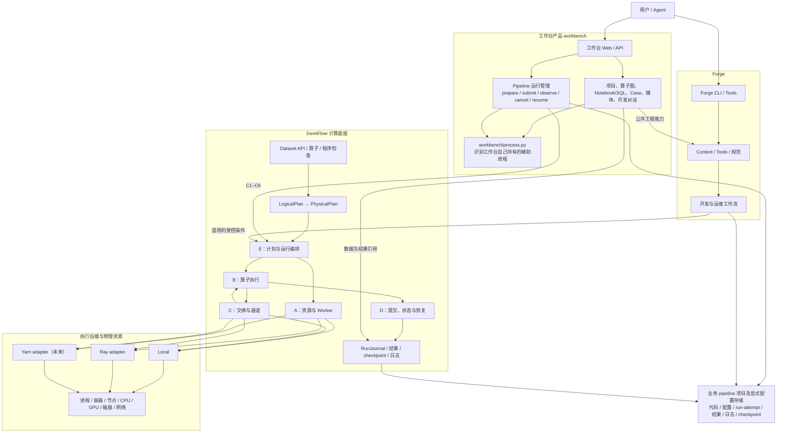

# DemiFlow / Forge / 工作台全局架构（本地重写）

> 版本：2026-11-08  
> 状态：架构基线和依赖边界；不宣称所有代码已按图完成迁移。  
> 关联记忆：[demiflow 升级完整记忆文档](<demiflow升级完整记忆文档.md>)

## 1. 目标和架构边界

产品目标是做一个统一、真正可用的 DemiFlow 工作台，让用户看懂、配置和运行 pipeline，并灵活分析、比较和评测数据。计算底座目标是用同一套 Dataset 计算语义支撑本地与分布式真实业务。

系统分成三块：

1. **DemiFlow 计算底座**：SDK、Dataset、算子、LogicalPlan/PhysicalPlan、Run/Attempt、执行、交换、提交、恢复和资源合同。
2. **工作台产品**：Web/API、项目、算子图、Pipeline 运行管理、Notebook/SQL、Case、媒体、开发对话及其产品状态。
3. **可复用 Forge**：Context、Tools、规范、开发/运维工作流、检查、验证、Review、Freeze 和受控操作。

工作台可以依赖和复用 Forge 公共 Context/Tools；Forge 不反向导入工作台，不依赖工作台服务或数据库。计算底座不依赖工作台或 Forge。双方按各自入口和权限读取业务项目的同一份运行事实，不能各建一份权威运行账本。

## 2. 总体依赖图



图中箭头表示依赖或能力调用，不表示必须部署独立 HTTP 服务。业务项目是运行事实和结果的保存位置，不是另一个调度中心。工作台公共进程工具只识别工作台自己持有的辅助进程，不接管引擎 worker、不创建 Pipeline run/attempt。

## 3. 统一入口和计划链

用户可以提交任意 Python 程序作为外层作业入口，但“任意入口”只说明从哪里启动，不会让平台自动理解普通 Python 循环、第三方进程或隐藏副作用。被 DemiFlow 管理的计算应通过 Dataset API 或明确的引擎 API 表达。

```text
代码包、入口命令、配置、依赖、运行目标和预算
                         ↓
Pipeline Entry / Driver（整作业身份）
                         ↓
调用 DemiFlow Dataset API
                         ↓
LogicalPlan（数据语义、算子、依赖、源码位置）
                         ↓
PhysicalPlan（分区、通道、并行度、资源需求、恢复身份）
                         ↓
Run / Attempt（固定输入、控制身份、状态和结果）
                         ↓
Local / Ray / Yarn ExecutionBackend
                         ↓
算子、通道、checkpoint、commit、ACK、fence 和结果
```

`PipelineProgram` 是整作业入口合同，可以组织一个或多个 Dataset 和多个输出；Dataset 是计算表达和计划生成层。两者不应被混成一个“图入口”。当前 `demiflow/data/plan.py` 已提供 LogicalPlan 基础，但具体工作台图、计划捕获、物理计划和统一提交仍必须以当前代码和验收证据为准。

### 计划相关能力合同

计划能力可以先落实为同一进程内的版本化对象、不可变快照和执行合同，不要求马上拆服务：

```text
build logical plan
compile physical plan
explain plan
bind plan to run/attempt
submit plan to backend
observe plan execution
recover from plan-bound checkpoint
```

工作台展示的权威算子图应来自 DemiFlow 生成的计划，并保留节点与真实源码调用位置、输入输出、参数和配置引用。源码概览可以辅助理解，不能替代原生计划。

### 计划预览和动态分支

预览/检查模式可以运行入口的“只构建计划”路径，但不得读取大数据、调用模型、写结果或制造业务副作用。运行时由同一入口和固定输入生成并执行计划。依赖运行结果的动态分支只能在预览中标为“运行时决定”；实际运行产生的阶段计划和观测要回填同一个 Run/Attempt 图，而不是另外建立一张图。

## 4. A–E 模块职责

| 模块 | 所有权和职责 | 明确不拥有 |
|---|---|---|
| A 资源与 Worker 生命周期 | 资源规格、CPU/GPU/内存/磁盘/线程/句柄预算；worker 启动、扩缩、重启、停止、释放和计量；同一部署域公共资源树 | Forge backend、工作台页面、业务规则或第二资源账本 |
| B 算子执行 | source/transform/sink、普通函数/Actor、局部状态、有界缓存、增量输出、快照和恢复接点 | 作业级状态机、产品页面、Agent 开发会话 |
| C 数据交换与通道 | channel、shuffle、分区、路由、成员、序列、背压、credit、ready work、取消和传输引用 | 业务提交事实、工作台图布局、独立调度中心 |
| D 提交、状态与恢复 | RunJournal、状态迁移、checkpoint、commit、ACK、fence、恢复兼容、失败、未知结果和清理 | Forge 任务状态、Notebook 代次、Case 答案、第二份运行账本 |
| E 计划与运行编排 | LogicalPlan/PhysicalPlan 编译、节点/阶段身份、Run/Attempt 绑定、提交、观察和编排 | 物理资源分配、工作台 UI、Ray/Yarn 私有业务语义 |

Ray、Local 和未来 Yarn 都是执行后端适配器。Ray Data 可以作为 Ray 适配器内部实现，但不能成为 DemiFlow 的权威 LogicalPlan、恢复账本或结果提交 owner。

## 5. C1–C6 能力合同

| 合同 | 内容 | 验收重点 |
|---|---|---|
| C1 能力与版本 | 后端、操作、协议和支持版本 | 未支持的模式明确拒绝；版本绑定不可变 |
| C2 固定运行输入 | 代码、环境、入口、配置、Dataset 计划、输入输出、依赖和预算 | 运行中不被当前编辑替换；秘密只引用不复制 |
| C3 控制与身份 | start、observe、cancel、受支持 resume；Run/Attempt 和操作身份 | 受理不等于完成；停止绑定封存版本和当前授权 |
| C4 事实与结果 | 状态、日志、指标、节点观测、新鲜度、已提交结果和清理 | 区分模拟/观测/未观测；不把 UI 状态当执行成功 |
| C5 恢复与兼容 | checkpoint、schema、工件版本、剩余预算、unknown 处理 | 旧 attempt 保留；未知结果先查询，不自动重放 |
| C6 资源职责 | 上层总额度、E 的需求、A 的分配/观察/释放 | 父额度与子占用不双计；失败、取消、父进程退出都清理 |

这些是能力和语义合同，不要求本轮增加引擎 HTTP/RPC 服务。Forge 和工作台可以有各自入口与规则，但对同一次底层执行必须使用明确且唯一的控制身份。

## 6. 三块职责和状态归属

| 领域 | 拥有的状态/能力 | 边界 |
|---|---|---|
| 工作台 | 项目登记、图展示、Pipeline 运行管理、Notebook/SQL、Case、媒体、开发会话及产品 API/UI | 不重建引擎图、scheduler、恢复账本或资源分配器；Notebook/SQL/Case 不自动变成 Pipeline run |
| Forge | Context、Tools、规则版本、开发任务、检查/验证/Review/Freeze、开发/运维工作流 | 不反向依赖工作台；不把 Context 中的旧摘要当当前权限；不代替引擎执行事实 |
| 业务项目 | 代码、配置、输入输出引用、run/attempt、日志、checkpoint、结果和来源 | 不成为平台调度中心；记录位置由项目或显式配置决定 |
| 计算底座 | Dataset 语义、计划、执行、交换、提交、恢复和资源合同 | 不依赖 Web、Forge 或 Case/Notebook 状态 |
| 执行后端 | 进程、Actor/Task、Container、节点、传输和物理资源生命周期 | 不拥有 DemiFlow 业务计划、恢复账本和结果提交权 |

应用状态与引擎事实分开：应用操作受理、宿主进程退出、引擎提交结果和资源清理是不同事实；工作台或 Forge 可以形成查询视图，但不能用自己的状态文件替代 RunJournal/commit/ACK/fence。

## 7. 工作台与 Forge 的接法

工作台的算子图、运行记录、Notebook 和 Case 通过结构化 API 使用产品领域能力；需要工程规则、来源上下文、工具说明或开发/运维流程时调用 Forge 公共用例。Forge CLI/Tools 和工作台 Web/API 可以拥有不同的认证入口，但适用规则、输入合同、错误、取消和 unknown 语义要一致。

运行管理的边界是：

- `prepare`：固定代码、配置、计划、输入输出、预算和运行身份，记录适用规则依据。
- `start`：锁内核对准备凭证、封存版本、目标 attempt、授权和资源；不把当前编辑替换历史封存。
- `show/list/logs`：读取权限、明确 run/attempt、有界分页和日志游标；不重新运行开发验收。
- `cancel`：核对当前控制权限和合法状态转移；分别表达“已受理”和“已退出”。
- `resume`：核对旧 attempt、清理完成、剩余预算、封存版本和原生恢复兼容；未知结果不能自动重派。

工作台可以复用 Forge 的规则和工具描述，但不应把 Forge 的私有工作区格式、开发任务实现或 Web 服务直接变成运行管理的唯一依赖。当前实现 Review 已把三个后续边界切口列为：共享操作合同、工程准入依据与运行领域接口、Context/Tools 对领域查询和控制的适配。

## 8. 资源、数据和历史保护

所有新增或修改都要按对象生命周期核算内存、磁盘、CPU、线程、连接、文件句柄、并发和时间；批次同时受行数和字节约束；慢消费者、磁盘不足、单对象超限、取消和父进程退出必须有明确背压、失败或清理语义。RSS/cgroup 是最后保护，不能冒充主动资源管理。

业务数据和历史保护要求：

- 运行输入、计划和结果固定版本；当前编辑与历史运行分离。
- 已提交结果、checkpoint、日志和必要清理证据不可被新版本覆盖。
- dirty/staging、Notebook 输出、开发对话和历史答案保留原语义。
- 不读写用户未授权的生产数据、付费模型或排除的业务会话。
- 迁移按版本切换；旧运行固定旧 revision，新版本不保留两套执行/恢复开关。

## 9. 当前实现状态和后续顺序

当前基线以 [architecture-master-intent-v1.md](architecture-master-intent-v1.md)、[architecture-implementation-review-20261107.md](architecture-implementation-review-20261107.md) 和 [execution-foundation-contract.json](execution-foundation-contract.json) 为准。

已确认：

- 工作台代码已收敛到 `demiflow/workbench/`，Forge 代码位于 `demiflow/forge/`；根 CLI 负责装配入口。
- `workbench/process.py` 是工作台公共进程工具；`workbench/runs/` 是 Pipeline 运行管理，二者职责分开。
- SQL 当前可随 Notebook；本轮不以独立查询服务或新引擎为交付前置。
- Forge 与工作台的运行管理都消费同一底层能力和项目记录，不复制权威账本。
- 当前实现主体可以保留，但 Forge 工程规则、运行管理、CLI/API 操作合同和 Context/Tools 仍有逐步收敛缺口。

恢复后的顺序：

1. 先核对最新主仓、分支/worktree、dirty/staging 和真实调用者。
2. 先处理影响 R.1/R.2 用户路径、AR 边界或历史保护的必要问题。
3. Forge 线继续按 R5.1→R2.2 的阶段结果收口；不把历史样稿或安装证据当成整体验收。
4. 引擎线先核 barrier 候选是否仍与当前主仓和业务变更兼容，再决定是否主仓合入；不自动恢复历史总控或旧业务追踪。
5. 任何引擎改造保持独立分支/工作目录和验证环境，完成后再做 Forge/工作台组合验收。

## 10. 验收门槛

- 图来自 DemiFlow 原生计划，且能回到真实源码调用和固定运行输入。
- 配置、检查、问题处理、提交、状态、日志、结果、停止和受支持恢复使用同一 Run/Attempt 身份。
- 正常、失败、取消、清理、未知结果和恢复都有真实证据；未观测部分明确标注。
- Local/Ray 的语义一致，Ray/Yarn 只替换后端承载；不出现第二套业务图或运行账本。
- Notebook、SQL、Case、媒体和开发会话保留各自生命周期，不被强行变成 Pipeline 状态。
- 资源峰值、并发、磁盘、句柄和副作用有界；数据、权限、历史和 dirty/staging 未被破坏。
- 低影响不足可以后延，但必须写清影响、理由和未验证范围，不能隐含成“已完成”。

## 11. 参考文件

- [Forge 协调指南](/yzp/zhaozy/yangzepeng/0905/FORGE_COORDINATION_GUIDE.md)
- [demiflow/AGENTS.md](/yzp/zhaozy/yangzepeng/0905/demiflow/AGENTS.md)
- [架构总意图 v1.3](architecture-master-intent-v1.md)
- [当前实现与架构边界 Review](architecture-implementation-review-20261107.md)
- [执行基础合同](execution-foundation-contract.json)
- [Forge 当前交接](/yzp/zhaozy/yangzepeng/0905/_demiflow/forge_coordination_20261104/resume.md)
- [DemiFlow 平台恢复记录](/yzp/zhaozy/yangzepeng/0905/_demiflow/platform_coordination_20261104/resume.json)
- [DemiFlow 平台原始意图与暂停记录](/yzp/zhaozy/yangzepeng/0905/_demiflow/platform_coordination_20261104/takeover_01a1b5db_20261107/root-intent.json)
- [统筹升级 demiflow](codex://threads/01a1bb1f-c000-7811-bcc6-c876956818fe)
