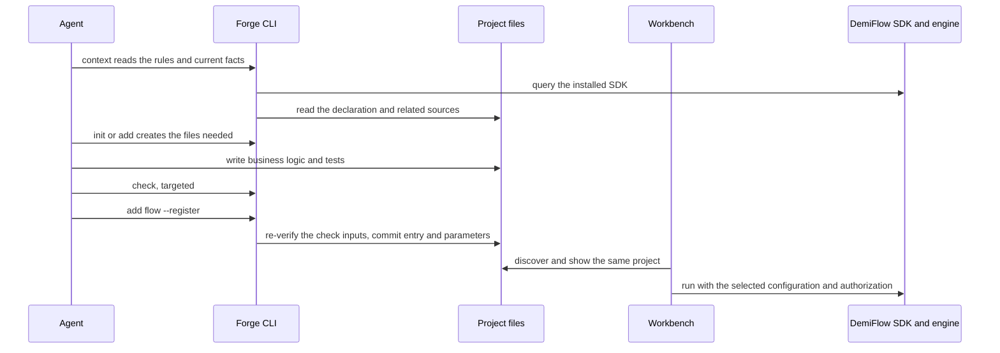

# Developing a DemiFlow project with Forge

Pick a project root in a terminal and an agent can write Flows, operators and Prompts to the standard. To use the product, open the same directory in the Workbench. Whether a Flow is visible depends on the entries registered in the project declaration. The sources, parameters and tests of a project describe the business facts; no project-specific development standard has to be maintained.

| What development needs to know | Who provides it | How to use it |
|---|---|---|
| What to do next | [demiforge Skill](../../demiflow/forge/skills/demiforge/SKILL.md) | The agent picks from the commands below according to the task. Pure reading usually needs only `context` |
| Pipeline rules and practical experience | [Forge authoring guide](../../demiflow/forge/standards/pipeline-authoring.md) | `context` gives the core rules by default; ask for the flow, operator or prompt chapters as needed. The experience helps to choose an approach |
| What the current SDK really supports | The public symbols and native semantic declarations of the installed SDK | `context` gives a summary by default; query a full symbol for its signature and origin |
| Which entries and definitions the project has, and who a change affects | `workspace.json` in the root, the sources, the parameters and explicitly selected material | `context` returns an overview of the directory by default; locate entries and consumers by relative path |
| Whether the static contract holds and the business result is right | Forge's native static check and the project's own business tests | Record the static diagnostics and the results of the tests actually run separately |
| Whether business choices sit at the right wiring point and the delivery evidence is sufficient | An independent DeepSeek CLI session and the [Forge pipeline review guide](../../demiflow/forge/standards/pipeline-review.md) | Use `review` on the sources and evidence of the current candidate, fix what it locates, then review again |
| Data, execution permissions, actual execution results | The Workbench and the native run service | The Workbench reads the same registration and resolves, operates, runs and displays under the deployment's authorization |

## Development commands

The commands below work while the Workbench is closed. Add `--existing` when running `init` on an existing source directory. `init` writes the project identity, an empty entry list and an SDK snapshot. `add` creates each role directory when it is needed. For an initialized project, start from `context`.

```bash
demiflow forge init --root ./experiment
demiflow forge context --root ./experiment
demiflow forge context --root ./experiment --api demiflow.data:Dataset.filter
demiflow forge add flow counts --root ./experiment
demiflow forge add operator is_even --root ./experiment
```

The agent fills in `flows/counts.py` and `operators/is_even.py` according to the user's goal. When a model is needed, look at `context --topic prompt` first, then create a native definition with `add prompt NAME --root DIR --from FILE`; FILE is a path relative to the project, or `-` to read standard input. For a stateful code operator use `add operator NAME --actor`.

```bash
demiflow forge check --root ./experiment --entry flows/counts.py:run
demiflow forge review --root ./experiment --entry flows/counts.py:run --goal "Count the records that pass the filter"
demiflow forge add flow --root ./experiment --register --entry flows/counts.py:run
demiflow forge check --root ./experiment
```

When there are business parameters, keep Flow parameters and business configuration files together in `configs/` (without `--params`, `configs/<flow>.json` is created and bound by default; `parameters/` already registered by existing projects stays compatible). The standard role directories are `flows/`, `operators/`, `prompts/`, `configs/`, `data_tools/` and `notebooks/`; tables and run outputs go flat into `data/`, readable run logs into `logs/`. Give the same `--params configs/REL.json` to the targeted check and to the registration command. A registered configuration is edited at the same path. Use `--path REL`, repeatable, to check the affected entries and definitions. Actual business behaviour is verified by the user project's tests; a scalar count, for example, can be asserted directly in the project's SDK test. Execution managed by the Workbench requires a supported local write target; the run result follows the actual receipt.

Before running an independent review in a terminal, point `DEMIFLOW_FORGE_REVIEW_CONFIG` at the DeepSeek provider JSON configuration file of this machine, or at a development deployment file that contains `providers.deepseek`. The settings `executable` and `node` are the absolute paths of the installed dsh and Node, `version` is the accepted dsh version (`0.2.1-rc.2` for the first release), and `model` selects the model. `deepseek-official` uses the API key environment variable named by `credential_env`; `deepseek-account` uses the reference to a local authentication file in the configuration. Account material is managed on the local machine.

A review can cover the current entry or files, or compare a local baseline with the current business sources using `--base REF` (including uncommitted changes, new files and deletions). Without an explicit scope it selects the project's actual changes relative to HEAD. Repeat `--evidence REL` to attach test or small-sample results. The output separates line numbers before and after the change, problems that affect delivery, suggestions, and evidence still to be supplied. The default time limit is 180 seconds; `--timeout` sets the time budget of one run. `--json` keeps the full report. Exit code 0 means the review completed, 1 that it found problems affecting delivery, 2 that the invocation was invalid, 3 that the review did not complete.

Every command supports `--json`. Exit code 0 means the selected operation completed or the static check is explicitly not applicable, 1 a known violation or content conflict, 2 an invocation error, 3 insufficient evidence, uncovered scope or an exhausted budget. A check result states what it actually covered. After a successful registration, select the entry from the pipeline list of the Workbench.


