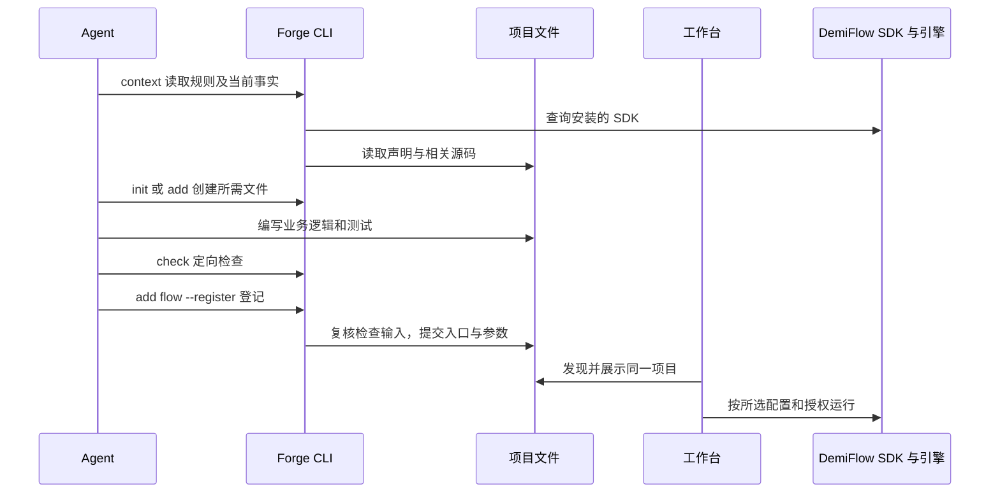

# 用 Forge 开发 DemiFlow 项目

在终端选定一个项目根，Agent 就能按规范编写 Flow、算子和 Prompt。需要使用产品时，在工作台打开同一目录。Flow 是否可见取决于项目声明中登记的入口。项目中的源码、参数与测试描述业务事实，无需维护一份项目专用的开发规范。

| 开发时需要知道什么 | 由谁提供 | 怎样使用 |
|---|---|---|
| 下一步做什么 | [demiforge Skill](../demiflow/forge/skills/demiforge/SKILL.md) | Agent 按任务选用下列命令。纯解读通常只需要 context |
| Pipeline 规范和实践经验 | [Forge 开发指南](../demiflow/forge/standards/pipeline-authoring.md) | context 默认提供核心规则，按 flow、operator、prompt 取相关章节。经验用于选方案 |
| 当前 SDK 实际支持什么 | 已安装 SDK 的公开符号和原生语义声明 | context 默认提供摘要，按完整符号查询签名和来源 |
| 项目有哪些入口和定义、本次会影响谁 | 根目录里的 workspace.json、源码、参数和显式选择的资料 | context 默认返回目录概况，按相对路径定位入口和消费者 |
| 是否满足静态契约，业务结果是否正确 | Forge 原生静态检查、项目自己的业务测试 | 分别记录静态诊断与实际运行的测试结果 |
| 数据、执行权限、实际执行结果 | 工作台和原生运行服务 | 工作台读取同一份登记信息，按部署授权解析、操作、运行和展示 |

## 四个命令

以下命令可在工作台关闭时使用。对已有源码目录执行 init 时加 `--existing`。init 写入项目身份、空入口清单及 SDK 快照。add 按需建立各自角色目录。对于已初始化的项目，从 context 开始即可。

```bash
demiflow forge init --root ./experiment
demiflow forge context --root ./experiment
demiflow forge context --root ./experiment --api demiflow.data:Dataset.filter
demiflow forge add flow counts --root ./experiment
demiflow forge add operator is_even --root ./experiment
```

Agent 根据用户目标填写 `flows/counts.py` 和 `operators/is_even.py`。需要模型时先查 `context --topic prompt`，再用 `add prompt NAME --root DIR --from FILE` 创建原生定义，FILE 为项目相对路径，也可通过 `-` 读取标准输入。需要有状态的代码算子时可用 `add operator NAME --actor`。

```bash
demiflow forge check --root ./experiment --entry flows/counts.py:run
demiflow forge add flow --root ./experiment --register --entry flows/counts.py:run
demiflow forge check --root ./experiment
```

有业务参数时，在定向检查和登记命令上指定相同的 `--params REL.json`。已登记的配置在同一路径编辑。检查受影响的入口和定义可用 `--path REL`，可重复给出。实际业务行为由用户项目的测试验证。

各命令支持 `--json`。退出码 0 表示所选操作完成或静态检查明确不适用，1 表示已知违规或内容冲突，2 表示调用错误，3 表示必要依据不足、范围未覆盖或达到预算。检查结果给出实际覆盖的内容。登记成功后再从工作台的管道列表选取该入口。


