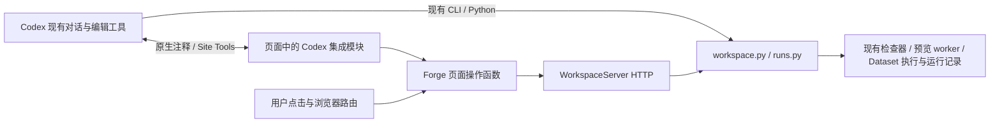

# Forge 与现有 Codex 客户端联动：中粒度方案

日期：2026-11-03。状态：用户已批准，代码已落地；实施结果与剩余宿主验收见[验收记录](forge-codex-panel-acceptance-20261103.md)。下文保留获批设计的范围和保证边界。

后续意图修订：用户明确只在 Codex 对话，操作台保持同一工作区的状态一致，不需要从 Case 发起讨论。交互主流程及下一步验收以[共享工作区修订方案](forge-shared-workspace-panel-design-20261103.md)为准；下文保留为历史设计，不再以注释/Site Tools 闭环推动本期工作。

配套：[源码级方案](forge-codex-panel-source-plan-20261103.md)、[复审与验收矩阵](forge-codex-panel-review-20261103.md)。本方案接续已实现的工作区、运行与通用算子基础能力，不启动 Review/Freeze/交付阶段。

## 1 目标与使用效果

Codex 保持对话、代码编辑和开发工具的宿主；Forge 页面成为同一客户端内可调起的操作面板。人能够独立查看项目、表、接线、运行和 Case；需要分析或开发时，把明确的对象交给当前对话。agent 能定位和刷新同一页面。

首轮闭环：打开工作区 → 查看 Case/节点 → 携带准确引用讨论 → Codex 修改工作树代码 → 复核或重新检查 → 通过现有入口准备/运行 → 定位新结果与 A/B 对照。

首轮支持单个 Case、检查报告/节点、运行/节点的讨论，以及现有两次运行对比的定位。比较两条 Case 时可分别添加原生注释。批量选取收藏、独立聊天界面、聊天记录同步、自动修复循环和生产交付不属于本轮。

## 2 现有能力与真实缺口

| 现有代码 | 已有职责 | 本轮需要补齐 |
| --- | --- | --- |
| `forge/workspace.py` | 工作区、固定表引用、检查、报告状态、预览入口 | 预览身份及读取前的预期身份核对；统一单表描述入口 |
| `forge/runs.py` | prepare/start、运行事实、结果引用、封存源码、证据 | 直接复用；本轮不改变运行语义 |
| `forge/workspace_worker.py` | 有界隔离的检查与预览 | 解析一次表身份，在同一 worker 中核对并读取 |
| `forge/workspace_view.py` | 单工作区 HTTP、鉴权、静态资源、离线导出 | 接入只读身份字段、资源文件和导出适配 |
| `forge/web/app.js` | 页面操作、图、Case、运行轮询 | 明确当前视图/选择，加入深链接和请求乱序保护 |
| 现有 Codex 宿主 | 对话、编辑、面板、浏览器能力 | 通过公开扩展能力连接页面；不在 Forge 内重建会话 |

源码发现的缺口：

1. 当前 `currentPage/selectedTable/preferredCompare` 等是内存变量；刷新总是回总览，无法准确定位一次运行或某条 Case。
2. Case 列表、详情与图片各自用 alias 重新解析。固定 Lance 版本保证一次读取的版本，不保证两次 alias 解析一定得到同一份引用。
3. `caseSequence` 主要区分表/页面，同表快速点击不同 Case 没有独立的详情请求代次。
4. 图节点默认选择第一项，不能把链接指定但已不存在的节点也按此回退。
5. token 初始化会清除整个 fragment；引入路由后必须只移除 token，保留视图。
6. 注释、站点工具尚未接入；现有 v1 coding-agent skill 也不能拿来指导 workspace 流程。

## 3 职责与依赖

| 部分 | 拥有的状态和职责 | 不承担的职责 |
| --- | --- | --- |
| Codex 宿主 | 对话历史、模型、代码编辑、工具权限、原生注释发送 | Forge 的数据身份、运行完成判定 |
| 页面集成 `web/codex.js`（新增） | 官方能力检测、注释元数据、四个站点工具注册 | HTTP token 管理、读取文件、启动进程、生成业务状态 |
| 页面 `web/app.js` | 视图、所选对象、表单草稿、HTTP 调用、页面渲染 | 解释执行 DAG、推测运行成功、维护聊天副本 |
| 定位 `web/view.js`（新增） | 有界视图描述的验证与 URL 编解码 | DOM、网络、宿主 API、业务运行 |
| HTTP `workspace_view.py` | 会话鉴权、参数准入、转调已有工作区能力 | 通用 RPC、任意 shell/Python 调用、Codex 会话管理 |
| 工作区与运行 API | 表绑定、检查、准备与启动、事实和结果读取 | 浏览器选择、宿主协议 |
| 原生层 | Dataset 运算、提交与现有资源管理 | Forge 页面、Codex/插件 |

依赖只能由入口指向现有能力。后端和原生层不得导入宿主 SDK、页面协议或 Codex 名称。页面集成通过显式函数参数调用页面已有操作，不创建通用 adapter 基类、消息总线、服务注册表或平行执行器。

## 4 什么是唯一事实，什么只是视图

- 当前业务代码：工作树内 `flows/`、`operators/` 与已有配置。
- 检查事实：既有不可变 report digest 及其 binding。相对当前源码是否过期由 `report_status` 判定。
- 历史运行：既有 run manifest、RunJournal、封存源码和原生提交回执。
- 数据身份：已解析位置、原生 DatasetRef、明确 Lance 版本；alias 只是入口。
- 页面状态：正在看的对象、投影、分页和一个有界运行表单草稿，不成为后端业务实体。
- 对话：由 Codex 保存；Forge 不存 thread_id、聊天历史或“agent 认为已完成”的状态。

视图引用仅是现有身份的序列化，不新建数据库、选择集仓库、实验实体或会话同步协议。

## 5 定位与数据不漂移

### 5.1 视图描述

统一使用 `v:1 + workspace + kind + 对应已有标识`。类型为 overview/tables/flows/runs、table/case、inspection、run、run_compare。深链接、站点工具和页面选择使用同一份描述。

- Case：workspace、alias（含已有 `run:<id>:<output>`）、binding_digest、字符串 row_id；columns 是可选显示范围。
- 检查节点：report_digest + node_id。
- 运行节点：run_id + report_digest + node_id；节点必须属于该运行封存报告。
- 两次运行对照：left/right run_id；业务键匹配继续由用户明确选择。

row_id 只在对应固定表身份内定位，不充当跨表业务键。引用中不写会话 token、模型凭据、样本正文、图片或绝对任意文件访问指令。

### 5.2 表身份

新增预览用 binding_digest，按 `{workspace, uri, reference}` 的规范 JSON 摘要计算，复用已有 digest 函数。uri 为解析后的实际表位置，reference 为已有 control/DatasetRef。当前 control digest 继续用于 replace/detach；两个摘要语义不混用。

列表/单表描述给出身份；详情、分页、对照和媒体读取携带 expected_binding。worker 解析一次，先比较预期，再用这一次解析得到的 ref/uri 读取并返回身份；图片响应体保持原格式，以响应头传回绑定摘要。alias 被替换、位置改变、版本删除时明确失败，不跟随 head、不自动跳到新表。旧 alias 引用失效后不承诺平台能找回已解除绑定的旧表。

普通 Python/CLI 的新鲜读取仍可省略 expected_binding；由已有页面对象继续读取时必须携带。该核对保证本次读的来源一致，不承诺外部存储在恶意并发修改下的全局事务一致性。

### 5.3 URL 与会话

采用 fragment 内的版本化 view 参数。首次 URL 可同时包含 token 与 view；立即把 token 存入现有 sessionStorage 并从地址清除，只保留 view。复制定位链接不复制 token。

新浏览器会话需先通过当前服务地址认证；旧链接不是访问凭据。服务重启换 token 后要求重新连接，不扫描端口、不猜 token。workspace 不匹配时拒绝恢复对象。SSH 转发变更只影响连接地址，不改变业务身份。

## 6 双向联动

### 6.1 页面到当前对话

在已成功加载的 HTML Case 卡片、报告/节点详情和运行摘要上提供“与 Codex 讨论”。节点图是 SVG，注释目标使用其 HTML 详情卡片。元数据从该卡片的已提交选择快照生成，不从此刻可能已经变化的全局选择反查。

通过官方 `document.oai.annotation.request` 在用户点击内同步调起，随后由用户编辑和发送。不能在点击内先 await 请求再调用宿主，也不能把 `accepted` 当成“消息已发送”。最多六个扁平字段、单字符串 256 字符、总 JSON 2,048 字节；超限显示限制，不截断身份或生成不可解析的临时 ID。

上下文默认是身份及可见内容。读取更多字段/证据需显式按引用操作。Lance 版本不固定外部图片内容，页面保留现有提示；本轮不新增图片归档或图像自动传给模型的保证。

### 6.2 对话到页面

首轮固定四个 Site Tools，输入是封闭 schema，执行函数复用页面普通函数：

| 工具 | 操作 | 副作用 |
| --- | --- | --- |
| `forge_get_context` | 返回当前已加载对象、workspace、身份和刷新状态 | 无数据/运行写入 |
| `forge_open_view` | 按准确引用打开表、Case、报告、运行或对照 | 改变本页视图，可有有界读取 |
| `forge_read_case` | 在明确身份下读取一条 Case 的指定字段 | 有界只读，不默认读取图片/账本 |
| `forge_refresh_view` | 重新读取当前视图；检查报告复核既有依据 | 不调用 inspect，不创建 report/run，不修改配置 |

工具不接受任意 endpoint、路径、脚本或 action 名称。`open_view` 返回对象已经加载或具体失败，不能把“已经发起导航”当成成功。选择加载中/已失效时 `get_context` 明确返回状态，不把前一条 Case 当成当前选择。

Site Tools 的权限检查由宿主进行；数据读取仍走当前页面鉴权的既有 HTTP 服务。readOnlyHint 是声明，不替代校验。工具仅属于当前页面，关页后失效。

### 6.3 运行与改代码

运行按钮调用现有 prepare/start/cancel/reconcile；agent 获授权后的运行仍可使用既有 CLI/Python。首轮不重复注册网页执行工具。只读面板开关只控制 HTTP，不伪装成 Codex shell 的全局权限边界。

Codex 编辑工作树，页面刷新复核当前报告；准备仍封存实际配置，启动仍检查 prepared digest 与当前依据。历史运行继续看当时封存事实。当前状态的刷新有观察时间，不宣称编辑保存瞬间全局同步。未保存编辑器内容不属于工作树事实。

## 7 插件、面板与 SSH 的边界

Codex 支持可安装 Plugin，能包装 Skills、MCP 工具与 Hooks。此处首先利用宿主已存在的面板/浏览器能力；页面工具无需额外 MCP 服务。

插件作为后续分发包装可以只包含 workspace 使用 Skill：识别工作区、读取明确引用、修改工作树、使用既有检查/运行入口。其 instructions 不代替后端硬检查。现有 `integrations/coding-agent/demiflow-forge/SKILL.md` 固定 v1 生命周期，保持独立，不能把它直接用于当前 workspace。

本轮不为“像插件”而新增 MCP server、Hooks、CLI 子进程聊天或 Forge agent runtime；不承诺任意原生客户端面板扩展。操作页使用宿主浏览器面板。MCP Apps 自定义 iframe UI 在所核对官方文档中明确面向 ChatGPT，不能由此推定当前 Codex 安装支持。

服务继续由 `forge workspace view ROOT --port ... [--enable-runs]` 启动。客户端负责显示本机可访问地址及 SSH 端口转发；Forge 后端没有权限或足够信息管理用户本机隧道。可使用宿主已有项目 action 启动服务，但不在仓库固定用户主机、端口、token，不引入守护进程/服务发现。

## 8 状态、错误和有限资源

- 页面导航与 Case 选择分别有请求代次；每次提交 DOM、URL、选择前核对代次。旧响应不得覆盖新选择，图片迟到也不创建失去归属的 blob。
- 每次页面加载只注册一次工具；接口不存在/注册失败/权限拒绝分别展示，不无限重试。普通浏览器保留全部原有查看/运行功能。
- 视图描述解码后最多 4 KiB、编码后 fragment 最多 16 KiB；字段和类型封闭。只保存当前视图与一个不超过 64 KiB 的表单草稿。未提交草稿不写 URL 或模型上下文；agent 请求更换其 Flow 时返回 draft_active。
- 工具输入及普通上下文最多 16 KiB，Case 工具响应最多 64 KiB；使用原有先投影、单条最多 1 MiB 的隔离预览。64 KiB 是工具输出上限，不是 native 解码/RSS 上限；超限请求减少投影，不截断后报成功。HTTP 编码后的 query 还须满足现有独立路径长度上限。
- 单页至多一个 agent 导航/刷新操作和一个 agent Case 读取；额外调用立即 busy，无后台排队。现有 HTTP 工作数/worker/读取/媒体缓存限额继续有效。
- 运行页复用现有轮询；页面隐藏时暂停页面轮询，关闭页面不取消运行。报告显式刷新及重新可见时按需复核，最多一个在途请求，重复触发合并，失败不自动重试。
- 无轮询“给 Codex 发消息”、无服务端 push 聊天、无任意 postMessage 通道、无私有客户端存储访问。

## 9 实施阶段和结束条件

1. **宿主可行性验证**：真实客户端验证可调起页面、原生注释携带引用、注册/调用一个只读工具、SSH 转发访问。工具元数据和官方文档仅证明存在接口，不能替代实测。失败则报告具体宿主限制，不暗换私有接入。
2. **通用面板基础**：表身份核对、深链接、恢复与乱序处理，普通浏览器先验收。
3. **双向上下文**：接入注释与四个站点工具，人工动作与工具动作同路，完成真实宿主验收。
4. **完整闭环验收**：自有示例中查看 Case → 讨论 → 改代码 → 报告变 stale → 重新检查/准备/运行 → 打开真实新结果 → A/B 对照。记录实现测试与真实宿主测试两种证据。

任何阶段不通过则修正相应模块，不降低原有检查，不新建绕行通道。只通过 Playwright mock 不算 Codex 集成完成。

## 10 外部能力依据与待实测项

- [Browser Annotation API](https://learn.chatgpt.com/docs/annotations-extensibility)：用户选择与元数据进入对话；站点可请求打开编辑器，用户决定发送。
- [Site Tools / WebMCP](https://learn.chatgpt.com/docs/webmcp)：官方示例使用 `document.modelContext.registerTool`；页面工具复用现有应用逻辑。
- [插件架构](https://developers.openai.com/plugins/concepts/plugins?site_locale=en)：插件是能力包装，Skill 可以独立存在。
- [MCP server 与 UI](https://developers.openai.com/plugins/build/app-quickstart)：工具与可选 ChatGPT UI 的宿主范围分别判断。
- [本地项目 Actions](https://learn.chatgpt.com/docs/environments/local-environment)：动作在宿主终端运行，不等同于自动获得本机 SSH 配置。

截至设计完成，只读核对了源码与官方文档，并确认当前会话暴露打开 Codex 网页面板的工具元数据。没有在用户当前客户端验证注释或 Site Tools、没有重启服务/改端口转发，也没有创建或安装插件。
