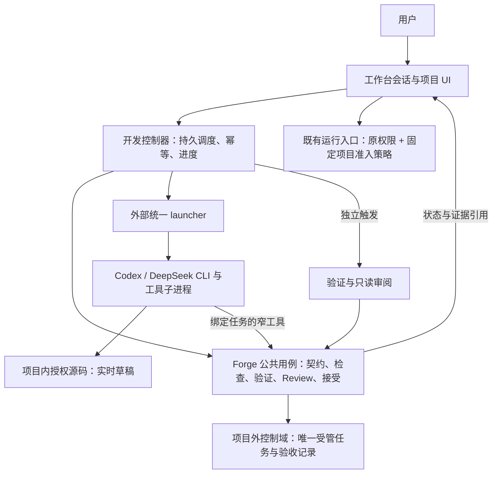

# 工作台开发入口：通用 Harness 与 Forge 硬规范完整方案 v2

**2026-11-19 实施更新**：G2/B1/I1 已进入联合验收，当前实施契约见[实施契约](forge-development-harness-contract-20261118.md)，实际后端见[B1 边界](forge-development-execution-boundary-20261118.md)。实际使用 user/PID/network namespace、清零能力、Landlock 与 seccomp，不申请独立宿主账号，不修改项目 ACL；§3.2 原身份/ACL 路线保留为设计阶段记录，已由实际后端替代。设计写作时的“未实施”等状态不代表本版交付状态。

**2026-11-18 工作位置记录**：当前实现位于 `fix/prompt-replay-delivery-20261118` / `gpt_prompt_replay_20261118`，基线 `dab45bb`；后续不直接主仓开发。当时 59866 运行 `74d2f99`；最终运行版本以交付验收记录为准，迁移代码本身不等于更新试用服务。v1 原件按原字节保留，其相对路径以编写时主仓位置解释；当前入口以本页和实施契约为准。

日期：2026-11-18，Asia/Singapore。状态：**根据外部 Review 修订的设计建议，待 Review；未实施产品、未部署、未启动真实模型。** 本轮完成源码核对及一次性宿主能力探针，探针只操作临时文件和自身子进程。v2 为当前方案；[v1](forge-development-harness-design-20261118.md)保留原字节供追溯。

**同日后续进展**：真人已授权进一步深入 Review 后按模块交由 subagent 审阅与实现。新发现、冻结契约和第一批 G1 范围见[实施契约](forge-development-harness-contract-20261118.md)；下文“本轮只做设计/探针”描述的是 v2 写作时的状态。L2 的控制 IPC、可信后代回收、ACL 与凭证边界仍有实质待解项，§3 的选定组合路线不能直接作为可启用的安全后端。后续实施状态以实施契约及验收记录为准，整体 DH 尚未完成。

## 1. 原始目标与本次取舍

权威目标仍为[DH.1—DH.9](../../../forge_coordination_20261104/original_task_intents.md#dh-20261118开发入口-harness-与-forge-硬规范原始意图)：工作台复用通用 coding harness，Forge 自动装配和落实项目规范，用户自然表达需求并取得符合规范的成果。harness 拥有模型/工具循环，Forge 拥有开发契约与验收，工作台拥有产品交互。原始 R/15 叶、工作台→Forge 单向依赖、数据与历史保护不变。

本版吸收[外部 Review](../../../shared-review/CLAUDE-REVIEW-forge-harness-design-v1-20261118.md)的主要意见，并作出以下**方案层决定**，不冒称用户逐项批准或已授权上线：

1. **检查门禁先成为独立交付能力，防篡改执行边界单独推进。** 门禁级交付不等于 DH.4 完成，也不等于整体“硬规范”已交付。
2. **现有项目首版默认只展示开发检查状态，不新增运行阻断。** 保留原运行检查与权限。需要严格运行准入的项目使用受信部署策略显式启用，不能按源码或 agent 请求自动切换。
3. **业务代码、流程、Prompt、契约和验证定义的变化默认触发独立只读模型审阅。** 无审阅者或审阅失败保持未完成，不回落成自评。默认身份、预算和轻量路径见 §8。
4. **默认在项目内就地编辑。** 用户立即可见草稿和图；通过门禁改变接受状态，不增加每次开发都必须经历的源码复制与多文件回应用事务。
5. **防篡改从进程外统一包住整个 CLI。** 选用独立非 root 身份、ACL、Landlock、seccomp 和受控网络通道；Codex/DeepSeek 使用同一启动边界，harness 自有权限只是附加限制。

## 2. 保证分层与交付含义

| 层级 | 实际保证 | 不能声称 | 用户状态 |
|---|---|---|---|
| L0 规范引导 | 有来源的标准、Skill、任务范围进入上下文 | 代理必然照做、已检查 | 开发中/尚未检查 |
| L1 检查门禁 | 可信本地使用假设下，控制器独立触发 check/verify/Review；禁止用聊天结论、旧证据或 turn 完成替代检查 | 阻止拥有宿主 root 权限的代理主动篡改控制器或记录 | 检查通过 · 可信本地；详情注明未防篡改 |
| L2 防篡改执行 | 经验证的外部进程边界保护规范、控制域、凭证和写范围；后代继承约束 | 任意业务语义已被证明、所有宿主 root 进程都受控 | 检查通过 · 受限执行 |

L1 是开发流程的确定性约束，在现有 trusted_local 上就可形成价值；不是安全隔离。将记录放到项目外只能减少误写，不能抵御同 UID/root 代理。L2 必须经过实际 backend 与 CLI 验证后才能标识；失败时不将 L2 会话静默降级到 L1。

L1 与 L2 共用同一规范、任务、检查器和状态机制。它们是执行保证的差异，不是维护两套标准或两套任务账本。L1 可以先完成阶段交付，DH.4 与整体目标仍明确未完成，后续不能以“最常见错误已经挡住”为由取消 L2。

检查结论只覆盖本次任务及明确依赖，不把一次通过宣传成整个旧项目的全面认证。未受影响的已验能力不重复全量测试；关键依赖证据缺失仍不能忽略。

## 3. 宿主事实、反例与选定后端

### 3.1 已核事实

主仓 HEAD `e40a6dd3dd756aba423dca4c7d995ada0a4bff65`；candidate.10 参考树 HEAD `74d2f9941377a0a2ca82e492d7be3a6b02e3d014`。两者仍按 v1 的界限区分，候选未被当成主仓交付。详细证据及脚本见[探针目录](../../../shared-review/forge-harness-v2-20261118/host-facts.json)、[文件/身份探针](../../../shared-review/forge-harness-v2-20261118/results.json)、[工作区 ACL 探针](../../../shared-review/forge-harness-v2-20261118/workspace-acl-results.json)。

| 事实 | 本轮结果 | 结论 |
|---|---|---|
| 旧 Codex/bwrap 探针 | 11 月 4 日已记录 `Failed to make / slave: Permission denied` | 必须引用[旧设计 §7.1](forge-development-chat-design-20261104.md)，不能假定原生沙箱可用 |
| `unshare -Urm true` | mount propagation 报 Permission denied | 默认路径不可用 |
| `unshare -Urm --propagation unchanged true` | 成功 | “所有挂载命名空间都不可创建”过强；没有据此证明 bind/remount/bwrap 可用 |
| `unshare -Urn true` | root 与已降权子进程均成功；直接 `unshare -n` 失败 | user+network namespace 路径可创建；网络连通/出口控制尚未端到端验证 |
| 降到 UID/GID 65534、清 groups/capabilities、no_new_privs | 子进程能写获准测试文件，不能读写 root 控制目录，不能恢复 UID 0 | 身份隔离可行性已实测；65534 仅用于临时探针，生产不得共享 nobody 身份 |
| 当前工作区文件系统 POSIX ACL | root 所有的临时文件授予非 root 写后可写，撤销后不可写；owner 未改 | 就地写入不必递归 chown 项目或复制源码；现有文件 ACL 本轮未改 |
| Landlock ABI | 1 | 支持部分文件访问控制，没有 ABI 3 的 truncate 控制或 ABI 4 的 TCP 控制 |
| 实际 Landlock 规则 | 越界 open/read/write 被拒绝、fork 后继承；`truncate`、`chmod`、`O_RDONLY\|O_TRUNC` 仍可修改测试文件 | 只查询 ABI 或只验证普通写不足以声称写路径限制完备 |
| 降权 + Landlock + 定向 seccomp | 上述截断/权限修改反例被拒绝，正常授权写仍成功 | 组合路线有正反向证据；探针不是完整安全 profile 或 CLI 兼容验收 |

Linux 官方文档明确说明 ABI 1 的截断与元数据限制缺口，以及 ABI 4 才引入网络控制；本轮在临时文件上复现了对应截断反例。[Linux 5.17 Landlock 文档](https://kernel.org/doc/html/v5.17/userspace-api/landlock.html)、[Linux 6.8 Landlock 文档](https://www.kernel.org/doc/html/v6.8/userspace-api/landlock.html)。

已确认本轮可见的 `demiflow.cli` 和两处 `demiflow.workbench.analysis` 进程为 UID 0；没有据此声称所有进程或某个当前开发 agent 的身份均已确认。未读取认证文件、未打印服务命令中的秘密。

### 3.2 设计阶段的身份/ACL 路线（已被实际 B1 替代）

**选定无只读挂载依赖的外部 launcher：每个活动执行域独立非 root 身份 + 项目精确 ACL + Landlock 文件白名单 + 补缺 seccomp + user/network namespace 中的受控出口。** 不以 bwrap、挂载传播或内核升级作为这版方案前提。

固定启动顺序：

1. 控制器绑定任务、物理项目根、writes/read sources、基线、验证定义、预算与已选 provider；把权威状态留在 worker 无法访问的控制域。
2. 获得一个未被其他活动任务使用的非 root 身份和执行租约；记录当前 ACL，再对必要目录/文件给予最小访问。不能使用全局 `chmod 777`、递归 chown 或永久放宽整个项目；原 owner、staging 和已有 ACL 保持可恢复。
3. 从受信启动点进入 user+network namespace，配置局部网络通道；对外 UID 保持该独立非 root 身份。清除补充组、所有 capability 集及继承的无关 FD，设置 no_new_privs；封锁再次获得新 namespace/capability 的路径后再 exec CLI。
4. Landlock 允许声明的源码/运行依赖读取、精确源码写入与私有临时目录；不允许管理凭证、其他任务和控制域。只授予路径访问不能授予已打开的越界 FD，启动器必须关闭它们。
5. seccomp 补齐当前 ABI 缺口：路径截断、只读 open 携带 O_TRUNC、未支持 openat2、权限/所有权/扩展属性修改、挂载、进程注入等。选定方案必须同时审计 FD、兼容 syscall/ABI、链接及设备路径；不能把本轮几个规则当完整 profile。普通编辑优先临时文件与同目录替换；必要 chmod/跨目录移动走既有窄文件操作授权，不能自动解除过滤。Landlock ABI 1 的跨目录 rename 限制须在真实 CLI 兼容检查中覆盖。
6. 执行域没有宿主网络路由。只通过启动器交给它的已连接通道与外部固定出口通信；CLI 使用 namespace 内 loopback 代理，出口校验任务、目标模型服务、端口及额度，禁止任意 CONNECT/宿主 loopback 管理接口。优先使用现有获准代理；缺少局部转接时只补固定模型通道，不做通用代理平台。验证进程默认不配网络或模型凭证。
7. 同一边界包住 Codex、DeepSeek 及其所有工具子进程；provider HOME 仅含本任务所需配置/最小模型认证，不包含控制域或生产凭证。模型认证的具体保护与额度按实际接入核验，不能只靠子 shell 环境过滤承诺父进程凭证不可读。
8. 清理确认后撤销本任务临时 ACL、回收身份与额度；撤销按原始 ACL 和租约比对，不能覆盖其他人的权限变更。崩溃后先对账并清理旧进程，身份不能提前复用。

D0 已证明身份/ACL/基础文件约束与网络 namespace 创建可行。**尚未证明的是整个启动链、模型出口、完整 syscall profile、真实 CLI 编辑/取消/恢复及 ACL 崩溃回收。** 这些是选定后端的实现与验收项，不再是“后端待选”；完成前保持 L2 未就绪，L1 可以独立交付。

## 4. 架构与物理状态位置



逻辑框不等于新服务。开发控制器扩展现有 `conversations.Service` 的生命周期调度；规范、结果和判定仍在 `forge.development`，Forge 不导入工作台。模型/tool loop 归 harness，外层仅有有限的检查/续修流程。计算底座、Pipeline run/attempt、Notebook 与 Case 仍归各自 owner。

权威受管记录确定放在部署的 `state_root/forge-development/<project-id>/<task-id>/`，**项目树之外，由控制器身份持有**；与现有 conversation Store 共用部署生命周期，但领域记录不复制进聊天库。物理路径仅由受信配置指定，不能从 agent 请求、业务配置或用户输入拼接任意 state root。

项目内 `.demiforge/project.json` 继续是公开项目声明；旧 `.demiforge/tasks` 继续保存历史本地任务。新受管任务只在外部位置有一份权威记录，项目内最多写不含秘密的引用/只读投影，UI 不从投影判断通过。旧任务不搬迁、不重新签署，不出现外部/内部双写两套真相。

为复用当前 `tasks.py`，给项目/存储装配增加受信的 `TaskStore` 定位能力：默认仍为既有本地路径，受管实例由控制器绑定外部根。领域的 baseline/check/verify/review/fingerprint 用例继续只有一份。普通 CLI 可继续操作旧本地任务；受管 CLI/HTTP/动态工具调用必须经过受信装配，不能接受 agent 自报 `--state-root` 或 reviewer 身份。

## 5. 就地开发与历史保护

| 方案 | 优点 | 代价 | 本版选择 |
|---|---|---|---|
| 就地编辑 + 当前版本接受状态 | 复用既有行为，源码/图即时可见；不需要每轮复制及多文件应用事务 | 草稿可能暂时不合规；外部编辑器并发不能靠本应用锁完全消除 | 默认 |
| 独立工作副本 + 条件回应用 | 适合已知多人重叠写入、实验分支或用户要求先看 patch | baseline 映射、候选展示和合并恢复更重 | 只在已有明确需要时复用现成副本机制；不作为全任务前置 |

草稿保存与接受分离：文件可以已落盘，但仍显示“未检查/检查中/有问题”；停止或失败保留当前内容和差异，不自动 reset、删草稿或覆盖 Notebook 输出。Git staging 不自动变更。用户要求“只设计/先看 diff”时，沿已有阶段与写授权执行，不擅自就地改产品代码。

开始时记录含 dirty 的实际工作树基线。平台内相交写路径共用租约；非平台编辑器仍可能并发写入，发现变化就失效/暂停而非猜测作者。已知有外部并行写同文件时选独立副本；不能宣称事后 hash 比较能防止所有并发覆盖。

验收时停止本任务写入并排空工具，建立一次有界的只读验证快照供 check/verify/Review；快照用于证据稳定，不是日常开发工作副本，也没有多文件“应用”阶段。验证后再次比较现场与快照；发生变化则结果仅保留为历史。运行仍消费原有封存内容，不能把验证完成后变化的活源码夹带进启动。

## 6. 所有写入口及失效范围

本表从主仓与 candidate.10 参考树核对；候选独有入口尚未据此宣称主仓可用。HTTP 方法是 POST 不等于修改源码；按实际写入对象分类。

| 入口/源码位置 | 实际写入对象 | 本方案处理 |
|---|---|---|
| `conversations` 中 CLI 原生文件/shell 工具 | 授权项目源码、Prompt、README、测试等 | 统一 L1 门禁；L2 外部执行边界；任意相关变更使对应证据失效 |
| 候选 `flow-arguments-save` → `projects/flow_arguments.save` | 当前流程唯一参数 JSON，校验入口源码摘要和参数 revision | 保留 config_write、类型与 CAS 校验；自动重新检查受影响参数/图，不能冒充源码未变或实际运行成功 |
| `parameters-update` → 候选 `graph/parameters.update` | 登记的参数文件，经 graph binding 与内容摘要核对后 replace | 同上；已有返回 `needs_check=True` 接入统一失效投影；`parameter-preview` 不落盘 |
| 项目/流程登记与权限：`project-create/register/remove`、`flow-register`、`project-permissions/capabilities` | 项目元数据、登记和权限 | 现有 owner 与授权保持；受管项目规则/验证策略变更走控制器，不能由源码修改隐式授权 |
| `analysis-notebook-create/patch` → `analysis/records.py` | 分析数据库的 documents/document_revisions，并非直接写业务 `.py` 或 `.ipynb` | 保留 revision/CAS/analysis_write 与输出历史；普通 Notebook 保存不触发 pipeline 完整代码审阅 |
| `analysis-cell-submit`、Jupyter/Python/SQL 执行 | 执行环境可能产生文件/数据副作用 | 独立分析权限与生命周期；不借本任务重构 Notebook。若改了受监控源码，状态失效并在受管接受/运行时核 hash；现有 root trusted_local Notebook 不被本方案冒称已隔离 |
| 仓库内 Notebook 文件经 agent/外部编辑器修改 | 注册 notebook 的源代码与输出 | 依当前标准检查源代码、保留输出；源代码改变影响开发证据，展示/输出变化不擅自重写历史 |
| `view-save`、`annotations-save`、媒体导出 | 分析视图、Case 答案/媒体及自身版本 | 保留原契约；除实际引用的业务输入/契约改变外，不触发代码验收 |
| 运行 prepare/start/resume/cancel、结果 attach | `.forge` 等原运行/结果记录 | 不成为开发 task；执行策略见 §7；停止/历史查询保持可达 |
| 外部编辑器、外部 CLI | 可能改源码/参数/登记 | 事件通知尽快标 stale；读取“当前通过”、接受、启动时重新核对，不依赖 watcher 永不丢事件 |

证据依赖区分代码、规则、测试定义、参数和数据绑定。现有单一 fingerprint 无法安全细分时先整体失效；仅在实现并验收依赖划分后，才复用未受影响的审阅/测试，不能把旧证据换个 hash 重新贴绿。

参数值在既有类型/契约内变化，不默认触发模型语义审阅；参数定义、默认业务逻辑、模型/Prompt 或验证口径变化则触发。Notebook 作为分析文档保存与“发布为业务流程代码”是不同动作；后者必须进入代码开发契约。

## 7. 运行门禁的确定行为

运行策略是受信项目/部署配置 `development_acceptance = observe | require`，agent 不可改，源码变更不会导致模式回退。两种模式都保留既有规范/编译检查、运行授权、数据权限与资源准入；本节没有放宽它们。

| 情形 | `observe`（现有项目首版默认） | `require`（显式启用的严格项目） |
|---|---|---|
| 从未经过受管开发 | 显示未验证，按原运行规则执行 | 先建立与当前代码匹配的开发验收，否则拒绝新 prepare/start |
| 开发检查通过且当前有效 | 显示真实等级与证据；原运行权限仍必需 | 匹配项目要求的保证等级、规则与源码后允许继续原准入 |
| 检查失败或外部编辑后 stale | 如实显示，不新增阻断；不自动替用户启动 | 拒绝新运行；外部编辑不能借“非受管来源”绕过 |
| 已封存历史 run、停止与只读查询 | 保持原合同 | 不追溯补新开发认证；停止/查询不被阻断 |
| 恢复历史 attempt | 原恢复合同 | 使用已封存原身份；如更换代码/输入而形成新执行，按新执行规则核验 |

`observe` 是兼容交付建议，不是完整强制运行保证。L1 的开发完成门禁始终生效，与 observe 不冲突；DH.4 和严格受管运行目标继续保留。`require` 及其要求的最低保证等级由部署/项目负责人明确设置，不能为了迁移顺利悄悄自动开启或关闭。

未来启用 require 时，prepare、start、resume 及其 HTTP/CLI 公共入口共用同一判定；校验已封存对象身份，不在启动时另读一份活源码。参数/数据/环境仍按运行合同验证，开发通过不等于这些运行事实已通过。

## 8. 默认审阅规则与预算

以下为本版明确的默认策略建议，由受信任务契约保存；更严格的适用标准优先，不能在检查失败时动态改成轻量模式。

| 变化类别 | 默认检查与审阅 |
|---|---|
| flow、operator、Prompt、schema、业务身份/输入输出、模型设置、失败/恢复、资源或公共契约 | 相关机械/行为验证 + 独立只读模型审阅，聚焦差异和关键后果 |
| 测试实现、验证范围/命令、规则/登记边界 | 独立审阅；缩小验证、改变规则或扩大授权还必须由有权修改该契约的主体明确接受，审阅模型不能自己批准 |
| 已有契约内的业务参数值 | 类型/schema、绑定、受影响编译与必要 fixtures；定义/业务含义改变转上一类 |
| 纯非规范文档、格式或显示文字，且不改变可执行内容/声明/验收 | 相关机械检查和轻量结构化自评；如适用标准要求独立审阅，照该标准执行 |
| 仅讨论或读取；普通分析 Notebook/Case 保存 | 不运行 pipeline 开发验收；各自领域校验继续 |

默认 reviewer 为**当前开发 provider 的已配置模型，另建独立、只读、非继承开发权限的会话**；不要求换模型厂商，也不把同模型的第二意见称为形式化证明。身份由控制器绑定 `role=reviewer` 和精确候选，输出覆盖每条适用 Review 规则、理由与源码/测试依据。只允许受信读工具，不给原生可写 shell；做不到只读能力的 provider 不可充当默认 reviewer。

L1 的审阅接入不以 OS 沙箱为前提：优先使用可验证禁用原生执行工具的协议模式；没有该模式时，使用已配置、同 provider/model 的无工具模型请求，由控制器提供有界完整审阅输入。这是独立审阅调用，不是另一套开发 agent loop。两条都不可用则保持 review unavailable，不能退回全权限 CLI 再仅靠提示词声称只读，也不能自动换付费接入。G1 的机械门禁仍可交付，要求语义审阅的任务不得据此显示完成。

默认一次审阅最多 180 秒，初次一次，必要修复后复审最多一次；调用纳入同一用户请求预算。模型能报告的 token/成本用于观测，不能承诺未实现的内部调用硬上限。没有审阅者、容量不足或超时，标为 `review_pending/unavailable`，保留代码和其他结果；不改成 self-review，不无限等待或自动切换收费模型。其他独立检查继续，不因排队停止整个界面。

用户只处理真正的业务歧义、权限/契约扩大或预算决定。Reviewer 对技术问题的失败先反馈给开发 harness 修复；不能每个文件都问用户是否批准。

新增普通 flow/operator/Prompt 声明在用户已授权的项目与路径内，由控制器按固定 schema 和当前角色规则处理；这不授权新增执行命令。新增 verifier、改变其 argv/副作用、缩小 watch 或移除断言口径需要明确的契约变更权限；无此权限则保持待处理，不能把“自动登记”解释成自动批准任意命令。

## 9. 规则到强制落点

| 规则 | 确定性部分 | 语义部分与未覆盖项 |
|---|---|---|
| DF-01 | 目标/来源/范围绑定、送达、基线比较；L2 实际文件/进程边界 | 授权含义和上下文充分性由必要 Review 判断 |
| DF-02 | schema、角色 owner、声明入口、Notebook 源码约束和静态依赖 | 流程拆分、业务参数相关性、README 实质内容 |
| DF-03 | 已支持的静态导入及原生编译契约 | 动态模型调用、隐藏子流程、资源/编排合理性不能假装全自动证明 |
| DF-04 | 身份/schema/绑定检查及相关 fixtures | 业务 ID、范围、空输入和完成语义 |
| DF-05 | Prompt 原生格式、变量和响应 schema | 渲染内容与业务问题是否正确；默认不用真实模型调用作验证 |
| DF-06 | 超时、输出、并发与资源预算；清理观察 | 实际增长/复用/失败行为按改动选择必要验证 |
| DF-07 | 同版本证据、身份和完整性、缺口与 stale 判定 | 测试相关性及 Review 来源明确，不以 stdout/self 声称独立通过 |

标准与 Skill 唯一来源不变，旧版本保持原绑定。candidate.10 迁移必须显式采用；业务特定语义不写进通用工作台 handler。未知项是未覆盖，需要相应验证/审阅或保持未完成，不自动视为不适用。

## 10. 控制器流程、状态与接口草图

### 10.1 自然挂点

`worker.py` 现有 provider done 事件只结束 provider turn；其 finally 当前会排空进程、捕获变更并生成 result。**在排空确认与变更观察完成后，向 Service 投递幂等 `development.turn_ready` 事件，由 Service 恢复驱动检查。** 不把整个验证链塞进 worker 的 finally，不依赖 agent 自己调用 check，也不因 worker 崩溃漏掉验收。

Service 持久记录 `task_id/turn_id/source_fingerprint/sequence`，恢复时查已完成步骤，不重发不确定的模型请求或写操作。讨论、取消、失败、清理未知、范围越界与“请求提交候选”分别处理：有有效开发成果才进入验收；取消后不自动续修。原 provider history/event 模型保留。

```text
用户需求 → 绑定任务/规则/范围 → 就地开发
    → provider 结束且工具排空 → 控制器读取真实差异
    → check → 固定 verify → 必要只读 Review → 接受当前版本
                  ↓失败
       结构化问题 → 同一开发任务继续修复（有总预算）
```

接受没有源码应用步骤。每次修订重新观察并失效相应证据；恢复和上下文压缩后重新绑定目标/规范/当前源码，不只读聊天摘要。更换 provider 续接同一 Forge task，公开进度可传，原生线程和私有推理不假装互通。

### 10.2 最小合同

```json
{
  "task_id": "…",
  "project_id": "…",
  "contract_digest": "…",
  "baseline_fingerprint": "…",
  "source_fingerprint": "…",
  "assurance": "gate_only",
  "run_policy": "observe",
  "verification_policy_digest": "…",
  "review_policy_digest": "…",
  "development_state": "checking",
  "gates": {"check": "pending", "verify": "pending", "review": "pending"},
  "remaining_repair_rounds": 3,
  "deadline": "…"
}
```

名称为接口设计，不表示已有 schema。规则/平台/输入/验证定义等仍进入适用 fingerprint；增加版本字段而不重解释旧记录。状态值区分 passed/failed/missing/stale/unknown/unavailable，未知不能生成绿色完成。

公开操作建议复用/扩展：`prepare_task`、`observe_changes`、`check`、`verify`、`record_review`、`evaluate_acceptance`、`status`；harness 仅有固定 task 的 context/read/note/request_check/submit_candidate/propose_definition。`record_review` 由认证 reviewer 调用；`evaluate_acceptance` 只由控制器驱动，agent 不能提供 accept、authority 或任意 verifier argv。

Controller 发给 harness 的失败项含 `rule_id/path/location/reason/evidence/allowed_next_action`。输入位置不能来自不可信路径直接拼接控制文件。接受前再次核现场 fingerprint、规则与未解决问题；UI 只读该结果，不解析聊天中的“通过”。

### 10.3 用户状态

```text
准备 → 开发中 → 检查中 → 验证/审阅中 → 本次开发完成
                ↘ 自动修复 ↗
任一步 → 需要决定 / 未完成 / 正在停止 → 已停止
已通过 + 当前内容改变 → 需要重新检查
```

“本次开发完成”同时带 L1/L2 保证级别。代码与图显示当前草稿身份和对应检查状态；切换流程/版本隔离迟到响应。用户可持续看实时修改，不等后台验收后才发现文件变化。

## 11. 用户无感、资源与等待

常规已授权任务的规范手工操作数目标为 **0**：不填写 task ID、不选标准文件、不手动串命令、不反复批准已有权限。范围自动识别必须有现有声明和原始需求依据；不确定的业务含义用一个具体问题澄清。

建议默认总请求预算 900 秒、最多 3 轮自动修复；所有开发、检查和审阅共享预算，不按新 turn 重置。单次机械检查最多 30 秒、fixture 验证默认最多 120 秒（项目已授权的更严格限额优先）、审阅 180 秒；剩余总预算更小时取剩余值。连续两轮同一源码及同一失败停止无效循环。超时是未完成，不是跳过门槛。

小型标准示例的机械检查反馈目标为 p95 ≤5 秒，进度应在进入检查后立即可见；这是待测体验目标，不是已测性能承诺，也不作为无关性能专项。真实模型审阅耗时按状态显示；不存在“所有开发都在几秒内完成”的承诺。

复用现有进程/Store/上下文和字节预算；worker、verifier、reviewer 共同计量，按活动数和保留数限制快照/日志。清理本任务资源后才释放额度；不能借失败清理删除业务数据、历史输出或其他任务。总额度不足时排队/停止并说明，不自动扩额或启动额外模型。

## 12. 复用与新增范围

| 现有能力 | 复用方式 | 必要新增 |
|---|---|---|
| Codex/DeepSeek adapters、transport、Store、compaction、existing HTTP owner | 保留真实协议差异、历史、恢复和单 owner | 外部 launcher 接口、控制器完成事件，不重造 loop |
| `context.py`、固定公开 CLI、Skill/标准 | 唯一上下文来源与窄工具 | 自动任务登记、外部受管 TaskStore 装配与权限绑定 |
| `tasks.py`、checks、coverage、runner | 同一 baseline/fingerprint/check/verify/review 领域用例 | 控制器触发、受信 reviewer、门禁投影和验证执行边界 |
| `changes.py`、现有项目 CAS/锁 | 就地差异与 stale/冲突判定 | 各实际写入口的失效通知及读取时复核 |
| `workbench/process.py`、已有进程/资源公共合同 | worker 归属、清理、预算 | L2 固定 launcher 与专属身份/ACL 租约管理，不依赖 runs |
| candidate.10 项目/算子/Prompt/graph | 按该任务实际交付接入，唯一来源 | 当前源码/检查身份一致性，不复制展示定义 |
| `runs` 原接口/权限/封存 | observe 默认不变，严格模式窄接线 | 固定项目准入策略的统一判定 |

不新增通用 worktree 管理、全局运行中心、第二套引擎、规范编辑器或跨服务调度平台。正常用户路径不展示内部协议、UID、ACL、syscall 参数。

## 13. 实施顺序与验收

本轮只完成 D0 修订与有界可行性探针；以下均为后续实施安排。

| 交付线 | 内容 | 验收 |
|---|---|---|
| G1：门禁最小闭环 | turn_ready → 控制器 check/verify → 同版本状态；独立于 agent 工具调用 | agent 未检查即宣布完成、stdout 造绿、旧证据、源码变更都不能导致流程误判；界面明确 L1 |
| G2：用户完整开发 | 默认 Review、有限续修、写入口失效、就地实时显示、恢复/取消 | 一个通用标准项目真实走通失败→修复→验收；正常规范手工操作 0；两个 provider 按实际能力核验 |
| B1：选定 L2 后端 | 非 root/ACL/Landlock/seccomp/固定出口的完整 launcher | 完整 CLI、子进程与验证代码的正反向文件/网络/进程/凭证边界、清理与权限恢复；禁止拿 D0 小探针代替 |
| I1：组合与收口 | G 与 B 组合、显式 require 运行策略、历史兼容与替代路径清理 | 同一规则/身份/证据机制，差异仅保证等级；独立验收后才能宣称整体 DH 已交付 |

G 与 B 无强制串行依赖；组织上沿阶段节点集中 Review，不因本方案自行新建任务或唤起旧负责人。L1 提前交付后 B/I 仍是明确待交项，不能从计划中消失。

核心负例必须覆盖：控制记录伪造、改 verifier/watch/标准、只改测试掩盖回归、reviewer 冒名、遗漏检查、外部修改失效、原生 shell/子进程绕过、ABI 1 截断与元数据缺口、未知 provider 响应、验证失败/超时、停止及 ACL 回收、数据/Notebook/历史和 staging 保持。

这些负例按保证分层验收：L1 验流程决策、版本失效及未防篡改标识；文件/进程/凭证/控制域主动篡改与 syscall 绕过由 B1/L2 证明。不能要求 L1 在 root 全权限模式通过 L2 对抗场景，也不能从 L1 测试绿推导 L2 已完成。

就地模式还要验证草稿失败后保留、实时图/源码与检查身份对应、平台写入口与外部编辑的 stale 行为；不能承诺应用锁覆盖任意外部编辑器。严格运行模式测试 observe/require 两种策略及 prepare/start/resume 的一致性；原停止和历史读取不被阻断。

## 14. Review 处理与尚未交付的事实

| Review 项 | 处理 |
|---|---|
| P1-1 后端未选/漏不利证据 | 接受；补旧 bwrap 证据、实际探针和固定路线；纠正“所有 mount namespace 不可用”的过强归纳 |
| P1-2 没有中间交付 | 接受；G 线独立，L1 不冒充 L2，完整 DH 仍未完成 |
| P1-3 Review 无默认值 | 接受；§8 固定触发、身份、预算、不可用行为 |
| P2-1 权威记录位置不清 | 接受；新受管记录唯一放项目外，旧任务原位；普通定义登记与变更验证策略分开 |
| P2-2 工作视图偏重 | 接受；默认就地，验证快照仅为证据稳定，取消强制多文件应用事务 |
| P2-3 运行适用范围 | 接受缺口；明确 observe 默认与 require 显式启用，保留原准入与历史 |
| P2-4 harness 无关 | 接受；外部 launcher 包住整个 CLI，自带沙箱仅叠加 |
| P2-5 写入口遗漏 | 接受；已核 API/参数/Notebook 实现，按实际写入对象分类 |
| P3 无感与接口 | 补手工操作 0、反馈目标/硬超时、事件挂点与最小数据合同；性能数值未冒充已测 |

当前仍未完成任何 L1/L2 产品实现、完整 launcher 或真实模型验证。两份方案、原始 Review、原意图与证据分开保存；不得把本轮建议记成真人批准降低最终目标，或把有限探针结论扩成完整隔离认证。
