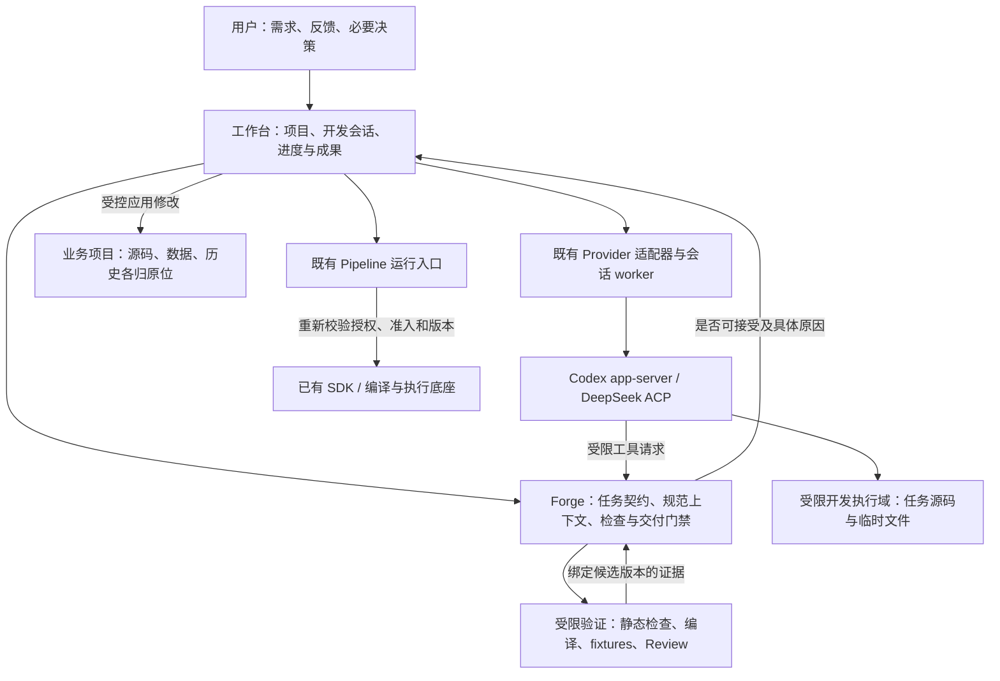

# 工作台开发入口：通用 Harness 与 Forge 硬规范完整方案 v1

日期：2026-11-18，Asia/Singapore。状态：**设计稿，供 Review；原始方向已由真人确认，具体设计和实现尚未验收。** 本轮只更新意图与文档，没有启动模型、测试业务代码、修改产品实现或变更服务。

## 1. 原始目的与本版结论

本任务原始目的：工作台内复用 Codex、DeepSeek 等通用 coding harness，通过 Forge 自动落实项目规范，让用户自然完成开发，无需了解或手工操作规范流程。权威原话与 DH.1—DH.9 拆解见[原始意图](../../_demiflow/forge_coordination_20261104/original_task_intents.md#dh-20261118开发入口-harness-与-forge-硬规范原始意图)。原产品 R/15 叶和[三块架构](architecture-master-intent-v1.md)继续适用；本专项主要落实 R.1.1/R.1.3、R.2.1—R.2.3、R.5.1—R.5.3。

“开发节点”是项目内的开发入口/会话，不是 Pipeline 中再增加一个开发算子，也不是业务 `agentmap` 的运行时。

本版建议采用如下分工：**harness 负责开发能力，Forge 负责开发契约与验收，工作台负责用户体验和应用操作。** 在现有实现上补齐强制边界，不重写 agent loop，不新建一套运行中心。

硬规范的产品承诺是：

- 每次受管开发都有适用的规范、原始目标、授权范围和可追溯基线。
- 未满足机器检查及必要 Review 的当前版本，不能被受管入口接受为合格成果或据此放行运行；未知、缺失和过期不能等同通过。
- 开发代理不能通过改规则、改测试准入、伪造证据或直接调用其他入口给自己放行。
- 开发中可以有语法错误和不完整实现，平台自动反馈并推动修复；业务语义仍依靠相关测试和明确责任的 Review，不承诺任意程序的数学证明。
- 保证覆盖受管入口与已验证的执行环境。拥有宿主管理员权限的人在产品之外手工操作不属于此保证；下次进入受管流程仍必须重新核对版本与权限。

“用户无感”是无需承担规范操作成本；不隐藏修改、不隐瞒失败、不自动取得新的业务或生产权限。

验收结论覆盖本次任务及其明确依赖，不把一次开发通过宣传成整个旧项目的普遍认证。结构检查可覆盖全部声明流程；行为验证按受影响范围选择。关键依赖缺少必要证据时仍须补齐，未受影响的已验部分不为本任务重复全量执行。

## 2. 现状依据与版本界限

本版阅读两份源码，区分主仓已有能力与前会话候选，未把候选当成已合入：

| 来源 | 本轮核对位置/HEAD | 用途 |
|---|---|---|
| 主仓 | `/yzp/zhaozy/yangzepeng/0905/demiflow`，`e40a6dd3dd756aba423dca4c7d995ada0a4bff65` | 已有开发会话、Forge 开发协议与历史兼容基线；本设计文档保存于此 |
| 前会话候选 | `/yzp/zhaozy/yangzepeng/0905/_demiflow/worktrees/gpt_forge_project_flows_20261118`，`74d2f9941377a0a2ca82e492d7be3a6b02e3d014` | candidate.10、多流程、代码/Prompt 定义与编译图能力的只读设计参考 |

两份源码的 `conversations/{codex,deepseek,policy,context,worker,store,existing_http}.py` 和 `forge/development/tasks.py` 本轮比较字节相同。candidate.10 标准和 `workbench/graph/preview.py` 仅存在于上述候选；`development/coverage.py` 两份不同。实施前必须选择届时经过集成的同一基线；不得复制候选目录覆盖主仓或把另一个会话的在途工作算入本任务交付。

已有[开发对话设计](forge-development-chat-design-20261104.md)继续提供历史背景；本文对新受管开发的强制门禁与用户流程作增量设计，旧设计、旧标准和旧验收原件不改写。

## 3. 总体架构与唯一 owner



图表示逻辑职责，不要求每个框成为服务、数据库或新包。Forge 接收中立的执行能力和结果，不导入 `workbench`；工作台装配这些能力。运行管理引用 Forge 准入结果，不把开发会话当作 Pipeline run。

| owner | 本方案负责 | 明确边界 |
|---|---|---|
| `workbench/conversations` | 会话/turn/event、provider 适配、worker 生命周期、用户反馈、领域身份关联 | 不复制标准、静态规则、独立验收判定或模型 loop |
| `forge/development` | 目标/范围/baseline、规范绑定、规则覆盖、检查/验证/Review、受管交付准入 | 不拥有聊天 UI、业务运行账本、Notebook 状态或通用 agent loop |
| harness | 推理规划、代码编辑、原生工具、上下文压缩、修复 | 没有改准入策略、自发签署验收或扩大权限的权力 |
| 受限执行设施 | 文件/进程/网络/凭证可达性、任务资源与清理 | 复用可用设施，不开发通用容器平台；不能由 Python 路径检查冒充 |
| `workbench/projects` 与 `graph` | 项目/流程定位、唯一代码和 Prompt 定义、真实编译图及详情 | 不维护展示专用代码副本，不执行模型以生成预览 |
| `workbench/runs` 与现有底座 | 运行授权、准备/封存/提交、状态、停止、恢复 | 开发验收不授予运行权限；不增第二个 scheduler/launcher/运行账本 |
| 业务项目 | 代码、参数、Notebook、数据及历史的真实来源 | 不嵌入工作台专属 adapter、daemon 或另一套规范 |

工作台单向使用 Forge 公共能力。Forge 规则和门禁也能被 CLI/其他客户端复用，HTTP、动态工具和 MCP 只是入口，不能各有一份规则。原本的本地 CLI 工作流可以继续使用，但其 `accepted-local` 不自动等于受管验收。

## 4. 现有能力：保留什么、补齐什么

| 能力与源码 | 已有事实 | 本轮设计要求 |
|---|---|---|
| [Codex 适配](../demiflow/workbench/conversations/codex.py) | app-server、恢复、中断、动态工具和事件；固定版本 0.164.0；当前实际 sandbox 为 `danger-full-access` | 保留协议与 loop；接入合格的执行域、能力核验和 Forge 反馈。不能沿用全权限配置却宣称强制范围 |
| [DeepSeek 适配](../demiflow/workbench/conversations/deepseek.py) | ACP、私有 profile、继续/停止、MCP；固定 0.2.1-rc.2；当前不支持与 Codex 等价的提问/历史重放 | 保留 ACP；以同一规范验收，能力缺口明确。继续会话与故障恢复不能假装完全等价 |
| [上下文与工具桥](../demiflow/workbench/conversations/context.py) | 来源/摘要/分页、上下文送达、固定可信 CLI launcher；check/verify/self_review/handoff | 复用唯一来源与操作；任务绑定自动化、恢复补送达、受信边界补齐；送达不等于模型理解 |
| [Service/Store/worker](../demiflow/workbench/conversations/service.py) | 持久意图、单 owner、活动任务/事件预算、请求身份、项目写入协调和清理 | 保留会话与事件模型，增开发任务关联、候选验收及自动续修；provider 完成不再被当成果完成 |
| [范围与资源](../demiflow/workbench/conversations/policy.py) | 显式 grant、writes/watch、受保护控制路径、宿主预算；只有 trusted_local 可启动 | 范围检查升级为执行时限制；实测的受限模式才显示硬保证；采样保护与内核限制分开 |
| [现有 HTTP owner 转接](../demiflow/workbench/conversations/existing_http.py) | 原 owner 继续拥有历史/权限和 CAS；客户端不接管上游 | 保留历史读写归属；旧 owner 未升级时不伪装支持受管交付 |
| [任务与证据](../demiflow/forge/development/tasks.py) | 基线、范围变化、源码 fingerprint、check/verify/review/handoff、stale 检测 | 复用其领域语义；增加可信 authority、独立 reviewer 身份及不可绕过的接受判定 |
| [验证执行](../demiflow/forge/development/runner.py) | 固定命令、超时、输出限制和进程组清理，明确不是 OS sandbox | 验证项目代码也放入受限环境；测试进程不能写权威记录或读取服务凭证 |
| candidate.10 与 source coverage | 候选已有项目多流程、角色所有权、受限静态导入分析与未知范围 | 集成已有成果；按已绑定版本使用，不重写旧标准；动态语义不能假称全覆盖 |
| 候选 `graph/preview.py`、`preview_guard.py` | 原生编译预览与只读系统调用保护 | 复用预览机制；补同一候选快照绑定。只读 guard 不是任意读权限的完整隔离 |
| 既有运行准入 | `runs/requests.py`、`authority.py` 等拥有运行领域规则 | 在受管开发成果消费处接统一门禁；不改造现有执行引擎或复制运行状态 |

现有 `worker.py` 在 provider 结束后记录变更，并将证据标为 stale/missing；尚无自动完成完整 Forge 验证、续修及受管接受的链路。`tasks.review` 接收 reviewer 字符串和声明；`handoff` 明确为 local acceptance，不是独立语义证明。这些是需补齐的边界，不应否定或重做已有功能。

## 5. “硬”的落点：四道相互补充的约束

### 5.1 规范与任务契约

启动时由平台解析项目声明、适用 AGENTS、标准版本、Skill、用户原始目标与最新决定，形成有来源的不可变任务契约。用户不必挑文件或填写规范版本。

规则适用顺序沿既有来源权威和作用域，不简单用“最新文件覆盖一切”。标准/项目说明有实质冲突时先明确处理；代理不能选择更弱版本让任务通过。已有项目延续其明确绑定版本；新项目采用部署已审支持的标准。candidate.10 迁移必须单独完成显式采用，旧任务的 baseline 和标准不变。

每个声明的代码/Prompt/流程归入已有 owner。新增流程、算子、Prompt 时，在获准项目范围内由受信操作更新登记并校验；代理可提出结构化变更，不能直接修改整个 `.demiforge/project.json`、验收命令或 readonly 规则。普通用户的“加一个流程”不应变成手填登记 JSON。

### 5.2 操作与执行边界

**建议的受管模式采用任务源码工作视图 + 不可由开发进程访问的控制域。** 工作视图从当前工作树建立，包含已存在 dirty 内容及明确依赖；仅授权路径可写。Git worktree 不是必需机制，不复制业务数据，也不改变本次文档任务的主仓工作位置要求。

受信控制域保管 Forge 程序/标准、部署策略、任务基线、验证命令身份、验收记录及交付权限。开发与验证进程不能读取控制凭证、修改这些对象、向 owner 发任意 HTTP 请求，或利用同 UID 的 `/proc`、进程控制、开放 socket 绕过它。目录放到项目外、文件 chmod 0700、私有 HOME 或签名记录本身，都不能在无隔离的同 UID 全权限进程之间建立这种保证。

部署实现选型原则：**复用能够通过能力验证的已有沙箱/独立执行身份，首版只交付一个受支持后端。** 优先核验 harness/部署已有的限制是否覆盖本节；不足时使用现有部署设施提供独立 worker 身份与受限文件/网络视图，不新增自制安全引擎。当前代码的 restricted 明确尚未可用，因此实施第一节点必须验证可行性；本文不假定本机已经支持某种容器、namespace 或管理员配置。

执行域最低要求：

| 对象/操作 | 允许范围 | 强制位置 |
|---|---|---|
| 源码读写 | 本任务只读依赖与精确可写路径；临时文件有界 | 实际文件权限/沙箱；路径规范化、链接和挂载逃逸检查作为补充 |
| shell、Python、子进程 | 可在任务域编译/测试/编辑，后代继承相同限制 | 执行环境；不能只拦 `apply_patch` 而放开 shell 写文件 |
| 规则、授权、基线、证据 | 仅受信 Forge 操作可改；agent 读到的是必要只读投影 | 控制域权限及窄工具接口 |
| 模型连接与网络 | 已配置开发模型连接；其他外部操作按既有任务授权 | 部署网络策略、最小凭证；不继承工作台管理或生产写入凭证 |
| 数据/历史 | 默认不向 worker 开放正式可写数据；验证使用已授权 fixture/只读输入 | 挂载/权限及操作授权；不依靠“请勿修改数据” |
| 其他服务与任务 | 不能读其控制凭证、停止其进程或调用其管理接口 | 身份、进程、网络与接口权限共同约束 |

如后端无法覆盖这些要求，受管写开发不可标为可用，也不静默回退到 trusted_local。既有可信本地会话和历史不强制迁移或中断；可维持原有能力并准确标识，不能获得本方案的新保证。安装环境由部署方处理一次，不让业务用户在每轮开发中选择隔离参数。

### 5.3 验证与 Review

控制器选择固定版本的检查器和已授权验证定义，在封存候选上执行；证据的任务、快照、退出状态、日志摘要和来源由受信控制域记录。验证子进程输出只能成为日志，不能自己写通过状态。测试代码属于待验证输入：即便来自项目 tests/，也不能因此取得控制域权限。

编译预览同样可能导入业务代码，也必须在验证域内运行；不能因为名为“编译”就放到受信控制进程中。验证域默认不带模型凭证、生产写权限或网络授权；真实模型/外部服务验证必须使用单独明确的授权与预算。

必要行为验证来自原有项目注册、平台契约和本次实际改动。允许修改业务测试，但删除/弱化既有验收条件必须由独立的契约变更流程处理，不能靠“把失败断言删掉”通过。可复用已有固定 fixtures 与原测试基线；不以构造大量新测试作为文档或低影响修改的前置。

语义审阅复用标准已有 Review 要求；每项明确为通过、失败、未知或有依据的不适用。结构化 reviewer ID 必须由受信调用方绑定，不能接受 agent 自填身份。写代码的会话只能 self-review。自动审阅可由独立、只读的审阅会话承担，它无权改代码/标准或接受自身产物；这是责任与来源独立，不宣称模型意见是形式化证明。

审阅覆盖与投入按实际影响分级：流程边界、模型调用藏入 UDF、数据/身份语义、历史保护优先；纯展示文字等低影响变更使用相关检查和轻量审阅。遇到业务歧义才向用户提问，不默认把每次代码修改都升级为人工审批。

### 5.4 接受、应用与运行入口

接受动作由受信控制器执行，不能作为 agent 可直接获得的 `accept=true` 权限。所有必需证据必须匹配同一候选、任务契约、标准、平台和验证定义；还要核验独立 Review 要求、未解决问题、实际覆盖及目标工作树是否改变。

应用前暂停本任务写入并确认进程排空，封存候选，然后对目标工作树做基线比较。按文件内容及相关元数据检查并发变化；不能只比 Git HEAD，因为 dirty 文件也属于基线。出现冲突则保留两边并明确定位，不 force/reset/clean，不自动重建任务以消除差异。

应用只写本任务差异，保留原 staging 和其他 dirty 内容。多文件应用需要可恢复的事务记录：准备 → 写入 → 读回核对 → 提交状态；失败不能留下“通过但只应用一半”的结果，恢复只能处理本任务仍匹配的写入，不能覆盖后来他人修改。接受证明绑定实际应用后的源码；若只能使用更严格的整体 fingerprint，宁可整体失效，也不未经证明推断局部可复用。

受管运行入口在原权限检查之外，再消费精确的验收结果并重新核对将封存的源码/参数身份；检查后改文件不能继续沿用旧通过。封存后执行已有不可变内容，不在提交和执行之间偷偷读取可变源码。业务参数、输入数据版本、权限和环境仍按原运行契约检查。停止、查看历史、恢复既有封存运行不因新的开发稿失败而失去入口；不把新验收规则追溯应用到旧历史。

## 6. 规范如何变成可执行检查

不另写一份“工作台规范”。下表是既有标准到强制落点的实施映射；每个版本由 Forge 维护支持范围和未知项，展示层只消费结果。

| 既有规则 | 可机械落实 | 仍需行为验证/Review | 失败时的动作 |
|---|---|---|---|
| DF-01 目标、上下文与范围 | 任务绑定、来源摘要、必读页送达、writes/readonly 与执行域 | 上下文是否足够、真实业务授权含义 | 缺来源阻止写开发；范围越界在操作前拒绝 |
| DF-02 项目/流程/共享定义 | 注册 schema、每个入口、唯一 owner、代码/Prompt 路径、静态依赖、README 基本检查 | 拆分是否合理、参数是否业务相关、README 是否实际更新 | 返回具体文件/定义/规则；支持范围内自动修复 |
| DF-03 流程与模型边界 | 已支持静态导入方向、原生编译契约；可靠可判定模式 | 隐藏模型客户端/子流程、重复扫描和无意义编排；动态 Python 全语义不可判定 | 无法确定标 unknown 并要求对应审阅，不伪造静态通过 |
| DF-04 身份/范围/完成语义 | schema/API 校验、固定身份绑定 | 相关小样例验证 ID、空输入、失败和完成边界 | 不改业务含义来绕过失败 |
| DF-05 Prompt 与 Review 契约 | 原生 Prompt 格式、引用、变量绑定和 schema 校验 | 渲染后的内容、问题定义、预期输出和实际业务适用性 | 默认 fixture/渲染验证，不自动真实付费调用模型 |
| DF-06 失败/复用/资源 | 已有预算、超时、输出上限、取消与清理观测 | 受影响路径的失败行为、热点资源增长与复用 | 保留失败证据；预算不足不自动扩额 |
| DF-07 验证/交付 | 同快照证据、可信 reviewer、stale/corrupt 检测和接受门禁 | 测试相关性、未验证范围与必要审阅 | 不完整就保持未接受，不能由代理文字改变 |

用户追加要求保留原文；可转为有来源的检查项时附带对应测试/规则，但模型自行拟出的测试不能单独证明它已满足用户意图。项目新增更严格要求时使用同一 Forge 扩展入口；不能在某个 pipeline 的工作台 handler 中硬编码特判。

## 7. 一个开发请求的完整路径

1. **定位**：从当前项目与用户请求识别目标；选中流程/图节点是有来源的上下文，不自动把允许写范围扩大到整仓。需求有关键歧义才澄清。
2. **绑定**：复用或建立 Forge task，保存原始目标、规范版本、范围、来源、验证授权与 baseline。区分项目、开发任务、聊天会话与 provider thread；它们不是同一个身份。
3. **准备**：检查执行能力和预算，建立当前源码工作视图，自动装配规范、Skill、API 与相关历史。首次任务登记由受信操作完成，不要求用户预填 task ID。
4. **开发**：harness 自主完成规划、工具调用和编辑；Forge 不插入另一套逐 token/逐工具规划器。允许在草稿里出现临时错误。
5. **触发检查**：agent 主动请求检查、提交候选或一个开发 turn 结束时，平台判断是否形成需要检查的变更。讨论、澄清和只读请求不触发完整验收；不每改一行就全量测试。
6. **自动修复**：检查失败时，将精确规则、位置、证据及允许修复范围送回同一 harness。外层只驱动有限的“检查—继续开发”生命周期，内部模型循环仍归 harness。
7. **验证与审阅**：冻结候选，停止其写入，在同一版本完成相关行为验证与必要独立审阅。任何修订都使受影响证据失效。
8. **应用与呈现**：通过后按用户已有开发授权自动应用本任务差异，保存权威结果，更新当前源码、算子定义和图。用户要求“先给方案/先看 diff”时停在对应阶段，不能擅自应用。
9. **运行**：用户请求运行时走既有运行授权和提交；开发完成、图预览成功都不等于运行获准或实际成功。

新建项目、已有项目修改和旧版本项目都走此路径。未登记项目先做有界识别；没有明确标准/验证定义时显示准备缺口，不套一个默认通过。注册/迁移在已授权任务内自动组织，但未知业务含义不猜测。

## 8. 状态、数据与接口约定

### 8.1 状态不混同

保留既有会话/turn/event 状态，不重写历史终态；新增开发任务结果投影：

```text
准备中 → 开发中 → 检查中 → 验证/审阅中 → 应用中 → 已完成
                ↘ 自动修复 ↗
任一步 → 需要你的决定 / 未完成 / 正在停止 → 已停止
已完成 + 依赖源码或契约变化 → 需要重新检查（旧证据保留为历史）
```

“provider turn completed”只表示一轮对话结束。“已完成”表示本次开发目标的当前成果通过所需门禁并按约定应用。仅讨论的正常结束使用会话状态，不伪造开发验收。源码未改但规则/依赖/验证命令改变，同样需要失效处理。

源码详情、图预览和验收状态共同绑定 project/flow/candidate 身份。切换项目或候选时隔离迟到响应；草稿预览可以展示，但明确为尚未验收的候选，不能贴到已接受版本或历史运行上。

### 8.2 数据归属

| 对象 | 唯一权威 owner | 关键绑定 |
|---|---|---|
| 会话文字、provider 线程、事件序列 | 既有 conversations Store | project / conversation / turn / provider epoch |
| 开发任务契约与基线 | Forge development | task / goal / scope / rule binding / original baseline |
| 候选与验证/审阅证据 | Forge development | candidate fingerprint / rule / platform / verifier / reviewer identity |
| 应用事务与结果 | 受信交付操作；Forge 记录其可核对引用 | candidate / target-before / target-after / idempotency key |
| 项目源码、Notebook、数据/运行历史 | 原业务项目及其显式存储 | 原身份、路径和版本 |

任务记录原则上继续保留在原 `.demiforge` 生命周期体系，工作台只存关联与展示投影；agent 工作视图不挂载可写权威目录。为受管 authority 增加版本化记录字段和执行根映射，不能复制成第二套任务状态库。旧本地记录继续按原语义读，不自动升级为受管证明。

记录至少可追溯：用户原始要求及后续决定、适用规则摘要、任务范围、代码和只读依赖指纹、平台/工具版本、测试定义与日志、Review 来源、缺口、接受与应用身份。尽量复用现有 fingerprint；新增字段必须明确版本与失效范围，不能误重解释旧 fingerprint。

### 8.3 公共操作

保留 `context/read/refresh/check/verify/review/handoff` 的既有职责，扩展有真实消费者的受管操作；名称以下仅表达合同，不强制另建 HTTP 服务：

| 调用方 | 操作 | 必须由服务端绑定 |
|---|---|---|
| 工作台 | 准备/继续开发任务、停止、读取状态 | 项目、用户授权、task、契约和当前版本 |
| harness 工具桥 | 读取上下文、记问题、请求检查/验证、提交候选 | 固定 task、允许操作及预算；不接受任意项目路径或命令 |
| harness 工具桥 | 提议新增流程/定义及参数声明 | 已授权项目、允许角色及范围；不能变更验收策略 |
| 验证控制器 | 执行固定 verifier、记录结果 | verifier 身份、候选指纹、日志和真实退出状态 |
| 独立 reviewer | 提交审阅 | 认证身份、只读快照、覆盖与结论；不能 agent 自填冒名 |
| 受信控制器 | 判定接受、应用、读取受管运行准入 | 当前事实及原权限；agent 不持有此权限 |

统一返回 rule ID、状态、位置、证据引用、覆盖范围和可执行下一步。操作需幂等和版本前置条件；重连不能把一次不确定的模型/提交操作自动重发。HTTP、CLI 与 provider 工具都调用同一用例；普通 CLI 输出或项目内同名 JSON 不能充当受管凭据。

## 9. 用户无感的具体产品行为

默认只展示需求/对话、当前进度、修改文件摘要与成果入口；规范版本、证据、日志等放到按需展开的“检查详情”。使用已有开发布局和组件，不另做审批中心或规范配置向导。

| 情况 | 用户看到 | 后台处理 |
|---|---|---|
| “给筛选流程加一个条件” | 开发中 → 检查中 → 已完成；可看 diff 和图 | 自动绑定目标/规则，检查与有限修复，按原授权应用 |
| agent 第一版违反结构规范 | “正在调整流程结构”及可展开原因 | 反馈具体违规，继续同一开发任务 |
| 要求含糊，影响业务含义 | 一个明确问题，例如条件作用于哪一批数据 | 保留当前进展，不让用户选择 protocol 或 verifier |
| 已授权范围内正常测试 | 正常进展，无重复确认 | 使用已绑定 fixture 验证权限 |
| 要求新增付费调用/生产写入 | 操作含义、影响和必要决策 | 没有授权则不执行；不是默认开发附带能力 |
| 外部编辑造成冲突 | 冲突文件与具体影响，成果保留 | 不覆盖外部修改，不重置旧基线 |
| 环境暂不支持受管开发 | “开发环境尚未就绪”与部署原因 | 保留历史阅读；不把配置问题转成用户手动规范操作 |
| 检查失败或预算耗尽 | “未完成”、剩余问题、已有成果 | 保留可恢复记录，不伪造完成或无限重试 |

“用户无感”也要求提问去重：同一决定绑定原始意图与适用范围，后续回合继续使用；只有实质变化才重问。界面所选对象与检查版本对应，历史运行仍读封存来源，不能因开发完成替换历史详情。

## 10. Provider 适配与上下文恢复

Codex 优先复用 app-server；官方文档将其用于持续会话、流式事件、中断、工具和审批的产品集成。[OpenAI 官方说明](https://developers.openai.com/blog/codex-as-a-platform)、[app-server 协议](https://learn.chatgpt.com/docs/app-server)。本方案不因文档更新就升级本地固定 CLI；升级需对实际安装版本做协议与边界验证。

DeepSeek 继续复用当前已实现的 ACP 通道，以本地适配器事实为准，不推断其他版本能力。模型替换与 harness 替换分开：前者不自动改变工具权限，后者必须核验生命周期、工具、取消、恢复与上下文送达。

最小适配合同为 start/resume、stream、interrupt、工具请求/结果、权限请求、能力声明与终态观察。提供方特有能力可保留，但通用完成语义归 Forge。对 provider 不支持的能力明确降级或禁用，不为了表面统一伪造事件。

恢复时重新核当前任务契约、规则与代码，而不是只加载聊天摘要。保留原始要求和长期决定，重新提供最小约束与精确来源索引；重要页按实际送达记录。压缩不是所有规范一直驻留的证据；检查器和执行边界独立于模型记忆。

更换 harness 不搬运私有推理，也不假装能恢复对方原生 thread；建立新 provider 会话，续接同一个 Forge task、当前候选、公开进度及未解决问题。丢失响应的原 turn 先核状态与实际改动，不能盲重放写操作或付费请求。

## 11. 资源、并发与生命周期

复用现有 admission、Store 字节上限、事件分页、worker 清理及 `workbench/process.py`，按当前平台公开资源合同对接；不让开发依赖 `runs` 的配置/进程实现，也不以本方案改造计算底座。

建议首版自动修复最多 3 轮，包含在一次用户请求的共同时间/资源预算内，不为每轮重置预算；连续两轮相同候选与同一失败原因则停止无效循环。具体阈值属于部署默认建议，实施时校准，不是真人已指定数字。独立审阅也计入总预算。

保持上下文、源码快照、候选、验证输出和事件都有限；按现有项目 snapshot limits 执行，超限明确失败，不递归复制整个工作区或业务数据。快照数量按活动任务及有限保留配额核算；清理仅针对本任务临时对象，保留必要失败证据。

同一项目的写入/应用操作复用已有互斥；独立只读浏览不受影响。外部编辑器不遵守此锁，所以接受时仍需基线比对。取消同时停止活动 harness、验证和自动续修，确认后代清理才释放额度；清理未知不能显示已停止。崩溃恢复按原操作身份对账，不重新执行全部历史命令。

实际可报告的 provider token/费用只作观测；provider 内部模型调用次数、费用硬上限等未实现能力必须写明。RSS/磁盘采样不能表述成瞬时内核上限；受限执行后端的硬限制以实际验证为准。

## 12. 历史、兼容与同批清理

- 保留旧开发会话、事件、归档、压缩和原 provider 线程；旧 `completed` 继续表示当时的会话事实，不批量写成“合规完成”。
- 旧 candidate.1—9 任务保持原标准、原始基线和收据。candidate.10 新采用创建明确的新任务/绑定，不挪用旧通过记录。
- 继续支持既有本地任务查看和使用；受管入口只接受受信 authority 产生且当前有效的受管证据。旧 accepted-local 不删除，也不自动升级。
- 生产数据、run/attempt、checkpoint、Notebook 输出和用户 staging 不作为升级迁移素材；未涉及的产品能力不重验。
- 按已确认业务意图，流程、代码算子与 Prompt 定义各有唯一来源；相同定义可在算子目录与图节点完整展示，但不能复制成不同事实。

| 保留 | 替换/补齐 | 同批撤下的行为 |
|---|---|---|
| provider adapter、Store/event、公开开发协议、既有检查器 | 受管操作、执行约束、验收与结果投影 | 以 provider completed 代替成果完成的映射 |
| trusted_local 的原语义及历史读入口 | 经验证的受管模式能力声明 | 把 trusted_local 默认为受限模式的降级路径 |
| 旧任务/标准/收据 | 新任务的版本化 authority/身份字段 | 从 stdout、项目可写 JSON 或 reviewer 字符串直接造受管通过 |
| 既有项目/图/运行公共能力 | 精确候选引用与运行前准入调用 | UI、CLI、MCP 各自重复维护的规范判定 |

清理不指删除仍有消费者的 legacy API 或历史数据。先列实际调用者，再替换其行为；不建立永久双份任务状态或多套规范。

## 13. 实施拆分、验收节点与依赖

本版是 D0 方案交付。后续若进入实施，建议同一负责人端到端负责闭环，按自然节点集中 Review；不是按文件拆成大量会话或逐步等待审批。

| 阶段 | 交付 | 进入下一阶段的必要证据 |
|---|---|---|
| D0：本方案 | 原意图、源码差距、职责/权限/状态、测试与兼容设计 | 完整设计 Review，确认强制保证及历史边界 |
| D1：强制边界最小验证 | 一个实际可用执行后端；受信任务/证据与窄工具合同；现有 Forge 检查复用 | 从 shell/子进程/伪造记录等关键路径不能绕过；若部署不支持，明确环境缺口，不假交付 |
| D2：Codex 完整产品链路 | 需求 → 开发 → 检查失败 → 自动修复 → 验证/审阅 → 应用 → 图展示 | 一个通用标准化示例真实走通，失败/冲突/取消与历史保护通过；不是只有协议 fake |
| D3：DeepSeek、恢复与收口 | 同一规范下的第二 provider、恢复/能力差异、运行入口对接、替代路径清理 | 相同核心准入场景通过、独立产品验收与具体部署材料齐备 |

依赖项：candidate.10/多流程和图预览能力按其自身验收成果集成；既有运行入口只增加使用同一准入结果所需的窄接线；受限执行后端必须实测可用。当前平台编译/运行契约升级由其原任务推进，本方案不接管、不阻塞无关历史任务，也不为此改计算底座。

这三项属于重点设计 Review：受信控制域如何在目标宿主成立；快照/证据/应用与现有任务格式的兼容；语义 Review 的实际身份及自动化授权。其他例如更多 provider、统计仪表盘、规则编辑器、成本优化或通用插件市场可后延，不作为本目标交付前置。

## 14. 验收矩阵：必须证明能挡住什么

以下是后续实现的验收计划，**本轮未执行，不表示已通过**。优先已有 tests/fixtures，新增只覆盖本次真实边界，避免重复测试实现细节。

| 场景 | 预期结果 | 对应意图 |
|---|---|---|
| 合规项目新增/修改流程，共享代码和 Prompt | 自动完成登记/开发/检查/应用，图从同一真实定义读取；没有专属 adapter | DH.1/2/7/8 |
| 隐藏模型调用、错误跨入口引用、缺 Prompt 变量 | 可判定部分定位并修复；语义未知进入必要 Review，不能直接通过 | DH.2/5/6 |
| agent 不调用检查就声称完成，或 stdout 输出 passed | 平台仍触发门禁，不能形成受管接受 | DH.5 |
| 改标准、缩 watch、改 readonly、删验收命令或伪造 review | 实际操作拒绝或候选不被接受；原权威记录不变 | DH.3/4/5 |
| shell/Python/后代进程绕过文件工具，访问控制接口或凭证 | 由实际执行边界拒绝；不能只靠 UI 权限卡 | DH.4 |
| 测试代码试图改日志/任务记录、读取服务凭证或写正式数据 | 验证域阻断；日志保留，不能靠 exit 0 伪造证据 | DH.4/5 |
| 改动仅测试以掩盖业务回归、自评冒充独立 reviewer | 验证定义与审阅身份检查拒绝；保留原门槛 | DH.5/6 |
| 检查后修改源码/规则/只读依赖，或接受与运行间发生修改 | 旧证据失效，重新检查或拒绝提交；不执行未验证版本 | DH.5/8 |
| 外部编辑、staging 已有内容、多文件应用中断 | 不覆盖他人内容；应用可恢复且不产生虚假完成 | DH.3/9 |
| 浏览器断开、provider 响应丢失、压缩或切换 provider | 保留原目标与任务；不重放写入，不把上下文遗失当新任务 | DH.1/3/7 |
| 停止、超时、存储不足、验证失败、修复无进展 | 有限结束，清理可核对，保留成果与未完成事实 | DH.6/9 |
| 旧标准、旧会话/owner、历史运行及 Notebook 输出 | 原语义保持，不强制迁移或补造新认证；新任务不能借旧通过 | DH.2/8/9 |
| 无实际受限能力的部署 | 不宣称硬规范受管开发可用，历史仍可读 | DH.4/7 |
| 真实页面正常开发及一次必要业务问题 | 不手填规则/命令、不反复审批已授权步骤；结果与图对应 | DH.7 |

重点复用测试族：`test_forge_development_chat_{providers,lifecycle,http,browser,compaction,context_budget}.py`、`test_forge_development{,_public,_source_coverage,_snapshot_links,_multiflow}.py`、`test_forge_development_existing_http.py`。协议 fake 适合故障注入，不能代替真实 harness 与执行边界验收；真实模型验证必须沿届时明确的调用授权和预算。

## 15. 本轮 Review 结论与下一步

方向与已确认 DH 一致：复用成熟 harness，Forge 承担规则与验收，工作台提供自然交互。已有代码足以作为基础，主要缺口集中在实际执行边界、受管 authority/独立 Review、自动检查续修与交付/运行接线；不需要另建通用 agent 或重写引擎。

本轮已从源码确认缺口并完成设计的一致性检查；**尚未做实现级独立验收，也没有证明目标宿主已具备受限执行能力。** 后续先完成 D0 方案 Review，再按 D1 的关键边界验证推进。新增具体取舍应挂到 DH 编号并保留依据，不能把本设计中的建议阈值、执行后端或阶段安排冒称为用户逐项指定的原始要求。
