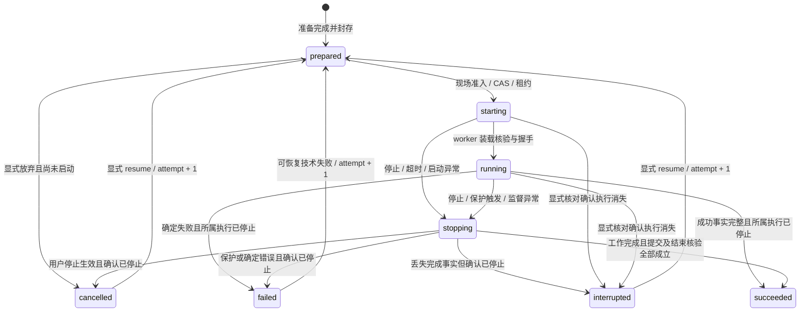
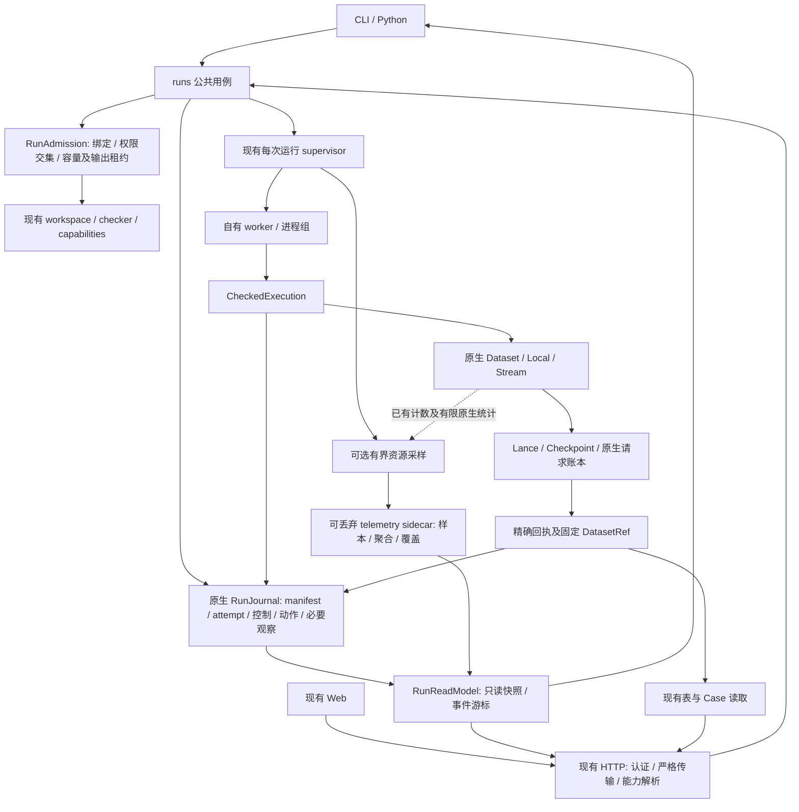
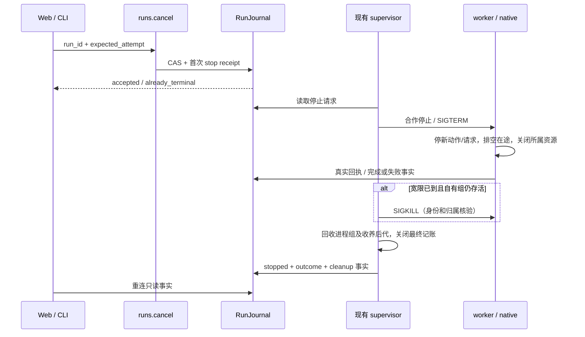

# Forge 作业运行态管理设计

> 当前实施与验收以 [最终组合报告](forge-job-runtime-management-implementation-20261104.md) 为准。新基础统一 RunContext/RunJournal，退役显式 checkpoint/SQLite prompt journal；collect/lookup 和单 worker 固定 batch 的具体适配与验收见该报告；其余未适配 buffered 能力不由早期设计承诺授予支持。
日期：2026-11-04（Asia/Singapore）。状态：**P0—P2 隔离实现与离线验收完成，待总控最终 Review**。批准依据为 [总控 Review](forge-job-runtime-management-review-20261104.md)。源码只在本任务隔离副本修改，正式合入与服务发布由总控最终 Review 安排；不产生真实模型、业务或生产执行许可。

## 已批准的实施收敛（2026-11-04）

D1—D8 全部按总控决定执行：首版限原生 Local；submit/control/attach 分离并兼容旧 allow_runs；同域默认一活跃、无队列；先可靠控制再指标与界面；CPU/RSS/动作吞吐/输出为实际观测，缺测不补零；遥测目标 16 MiB；只用自有 fixture；基线包含迁移初始化修复和 Web 最终组合。下文“待决定”表保留设计问题原貌，结论以本节及总控 Review 为准。

两项修正纳入实现：原生 query 的诊断根独立于作者 resource_root，不写封存 source。每个 query 的日志在管道消费过程中限量，普通诊断有单文件、运行总量及保留上限；必要结果/异常交接有独立有限预算，不能被日志轮转删除。运行/多 query/多 attempt 的峰值由 RM-16 实测。query pool 仍由每 run TMPDIR 决定，只是该临时域的内层准入；部署租约在外层核算全部受管运行，不统一普通 Dataset 资源池。

资源分类明确为：活跃 work/scratch（默认 4 GiB，结束确认后可清理）；恢复 evidence/checkpoint（默认 64 MiB，不自动删除）；持久历史（源码/平台封存、可靠 journal、日志、可选遥测/诊断，工作区默认 4 GiB，明确排除 scratch 和恢复证据）；业务输出（默认累计增长 2 GiB，保留原提交语义）。外层按设备核算活跃 scratch、恢复证据、输出和管理写入余量，历史实际占用体现在可用空间与历史准入，不重复预留已用字节。默认单运行须在足够可用设备空间下准入，active>1 必须满足合计 RSS/CPU/设备预算。所有容量仅约束参与者，非恶意同 UID 隔离或内核硬上限。

RM-03 补持久身份先于执行、目录 fsync 与原子替换故障窗口；RM-05 补不同 TMPDIR/项目/CLI/HTTP 和 active>1；RM-08/09 使用实际另起 session 的 DataFusion 后代，覆盖父进程消失、启动窗口、leader 先退出及无关 canary；RM-16 覆盖默认值一致、历史/活跃交集、SQLite 旁文件、原生日志写入过程。停止未确认保持非终态、占有租约且 cleanup=pending。

实施收敛记录：实际生效的资源默认值、历史兼容及当前模型恢复语义以[运行管理说明](forge-runtime-management.md)和[实现验收记录](forge-job-runtime-management-implementation-20261104.md)为准。设计的 22 项编号保留，不能把未执行的场景当成已验证。

## 1. 推荐结论与首版边界

把现有 Forge 受管实验完善为统一的作业运行入口：用户选择已明确登记的原生 Flow 和配置，核对固定输入、实际输出与资源预算后提交；在“运行记录”查看当前动作、资源、吞吐、结果和错误；停止请求持久保存，确认所属执行单元停止后再给出终态。浏览器、CLI、HTTP 使用同一公共用例和同一运行事实。

**执行继续沿用 `runs → supervise/execute → CheckedExecution → Dataset/Local → Lance/Checkpoint`。** 不根据展示图调度节点，不新增业务调度引擎，不包装假的 PipelineBundle，不运行识别出来的任意命令。现有 `resume`、节点观察、原生请求账本和固定结果复用是基础能力，不能重新造一套。

首版完成如下闭环：

1. 从“流程与配置”准备、核对、提交；支持准备请求的持久幂等回执，避免失联后重复准备。
2. 项目内单活跃运行、无等待队列；增加覆盖参与本次部署的 CLI/HTTP 的有界容量准入，保留原生 query/request 准入。
3. 运行详情首屏呈现状态、停止情况、当前动作、已核验产物、CPU、进程 RSS、吞吐与资源预算；I/O 按可获得范围展示。
4. 停止、重连、监督进程故障、部分提交、提交待核对、历史 attempt 和显式恢复使用同一事实。
5. 有界状态/事件/日志/指标查询；采样器独立于浏览器存在；所有持久记录和临时资源有容量、超限和清理规则。

首版服务对象是**当前原生契约真正准入的 Forge Local 作业**，包括当前已支持的同步/流式算子、actor、固定 lookup、显式 schema、CAS overwrite、受管 checkpoint 等原生组合；具体集合由当前平台检查器和 capability 判定，不能用本文静态名单扩大或缩小。原生 HTTP 模型节点已有实现与模拟验收，但本轮不授予任何真实模型/生产执行许可。

下列能力只留扩展边界：原生不可变 PipelineBundle 的 Local/Ray 托管、GPU 作业、原项目 `config → run_pipeline` 协议。没有这些能力的新准入、停止归属及恢复验证，页面只展示原有只读信息和明确缺口。定时、优先级、公平队列、自动重试、跨项目 DAG、跨表事务、任意脚本执行和生产发布不进入首版。

## 2. 调查依据、已有能力与缺口

### 2.1 依据与可信程度

已读工作区 `AGENTS.md` / `FORGE_COORDINATION_GUIDE.md`、本仓 `AGENTS.md`、[当前工作区指南](forge-workspace.md)、[HTTP 契约](forge-http-api.md)、[客户端指南](forge-client-integration.md)、[第三阶段设计](forge-stage3-execution-design-20261102.md) / [验收](forge-stage3-acceptance-20261102.md)、[通用算子验收](forge-operator-foundation-acceptance-20261102.md)、[roadmap](forge-roadmap-20261101.md)、[跨层审查](forge-cross-layer-review-20261104.md)、[Web 改版设计](forge-web-redesign-design-20261104.md)及其[实施状态](forge-web-redesign-implementation-20261104.md)。

源码为 **2026-11-04 18:42（UTC+8）附近的工作目录静态调查**；Git HEAD 为 `49527158d9c4f37f57f264adc28adbc556cfffba`，大量代码尚为 dirty/untracked，HEAD 不能代表调查内容。附录提供关键文件摘要。调查只读源码、文档和测试定义，没有复跑历史测试、扫描生产运行目录或核验正式服务正在加载哪份代码。报告中的既有通过数是原负责人历史证据，不是本方案的新验收。

第三阶段的“仅同步/create、无 resume、最多 128 次运行”已经被后续实现和工作区指南扩展；不能原样作为当前准入规则。旧 Forge v1 的 Freeze 和三节点协议独立保留，不能套用到现代工作区，更不能因原项目识别成功继承执行许可。

### 2.2 逐项盘点

| 领域 | 已有、可复用的事实 | 本方案需要补齐的部分 |
| --- | --- | --- |
| 提交与封存 | `forge/runs.py:prepare/_prepare/start/_preflight`；现代工作区要求显式入口/配置登记，重新 inspect 有效参数，封存源码、资源和平台 Python，固定输入，检查修改范围与环境 | 把准入结论变成所有客户端共用的可读结构；准备请求幂等；解释“可读但不能运行”的具体原因 |
| 状态与 attempt | manifest v4 / journal v2；`RunJournal.transition/begin_attempt` 有 CAS、attempt 栅栏、历史读取和累计用量 | 正式列出合法转换及停止事实；控制事件游标；明确状态 revision、节点 sequence、指标 sequence 不同 |
| 监督 | `run_worker.py:supervise()` 管独立 worker 进程组、子进程收养/回收；没有单独的 `run_supervisor.py` | 抽清进程所有权、保护采样、可选观测和终态落盘顺序；不另起常驻控制服务 |
| 停止 | cancel 写 `stopping`；worker 的 `check_stop`、SIGTERM、宽限后 SIGKILL；父进程死亡绑定、subreaper、排空 | 保留首次请求和执行结果；提供停止阶段；终态必须晚于停止确认；监督失联不能假装“已取消” |
| 恢复 | `reconcile` 只核对原生提交/补登记；`resume` 新 attempt、复用已核验写入、保留账本及累计预算 | 恢复前给出可解释的拒绝原因；崩溃/容量/归属异常矩阵；未知最终用量不能靠指标曲线补成完整 |
| 输出 | action intent / receipt / operation_id；create、固定基线 overwrite、checkpoint 原生核对；`DatasetRef`、result_digest、历史 attempt 结果 | 运行结论、提交确定性、登记和可用性继续分列；跨项目相同输出位置的互斥准入 |
| 日志 | `RunLog` 四段有界尾部，稳定字节游标；`runs.logs` 最大 64 KiB，轮转显式标截断 | 监督启动日志纳入预算；停止/错误不能依赖日志解析；客户端流式 UTF-8 边界和 DOM 上限 |
| 节点观察 | `CheckedExecution` + `RunJournal.node_observations` 已有 action/node/occurrence、行数/调用/错误/耗时/actor 生命周期；持久化失败会使受管执行失败 | 展示现有语义，做轻量投影；与可丢弃的性能采样区分；不再设计第二套节点计数 |
| 当前资源计量 | supervisor 约 0.2 秒采样 worker 树 RSS、scratch/evidence、OutputWatch；持久累计时间和输出分配量，结束保存 sampled_peaks | 实时当前值、时间序列、采样覆盖与开销；CPU、I/O 尚无统一持久采样 |
| 原生额外统计 | `LocalExecutionSession.stats`、`ExecutionMetadata`、DataFusion 报告、StreamStats/StreamResources 有任务、队列、耗时、模型请求等信息 | 当前未统一接入 Forge 实时面板；只按明确字段和有界快照接入，不能 dump 任意 stats 对象或读取整份模型账本 |
| 多客户端 | HTTP/Web/CLI 复用 `workspace`/`runs`；attempt/摘要条件写入；Web 单链约 3 秒同步、隐藏暂停，保留深链接 | 分开静态详情与高频运行快照；短控制请求容量；新鲜度、过期游标和请求乱序一致处理 |
| 当前权限 | console `allow_runs ∩ --enable-runs` 管 HTTP；本地 CLI 依 OS 权限；入口/写位置/模式/契约再准入 | 明确 read/control/submit/资源效果授权的差别；提交被禁用后仍可停止已有自有运行 |
| 原生资源准入 | `native_resources.dataset_session → DataFusionSession` 已有跨 session 的 query slot、内存/线程预留；原生请求 gate、流式队列有自身准入 | 这些覆盖 query/request，不覆盖所有 Flow driver、空闲流式或跨项目运行；增加薄的整次运行容量租约，不能拿 query slot 替代 |
| 存储 | `.forge/index.sqlite` 为可重建目录，最多 100 万条 / 256 MiB，pending 256；journal 有动作/观察/文件读取上限 | 目录条目上限不等于运行历史总磁盘预算；补总量预留、控制事实写前保留、遥测保留和显式 prune |

### 2.3 Pipeline、Dataset、Local、Ray 的边界

| 路径 | 实际能力 | 对 Forge 本次工作的含义 |
| --- | --- | --- |
| 原生 `Pipeline.run` | 单个 PipelineProgram；portable/native backend affinity；在传入 DatasetExecutor 下执行 | 是现有程序抽象，不是 Forge Flow 展示图的执行器 |
| `LocalPipelineBackend` | 不可变 bundle、环境制品/依赖准备、隔离 driver、取消/超时、best-effort observer、有限返回 log tail | 不能直接代替当前封存 Flow worker；其环境准备可能写缓存，当前 Forge“不安装共享环境”的语义不能被偷偷替换 |
| `RayPipelineBackend` | Ray Jobs 提交，稳定 submission_id，状态轮询，stop 后确认终态；不确定时有 `PipelineRunIndeterminate` | 已有能力应复用；当前没有 Forge 托管归属和准入。已有 `list_jobs()` 全量查找、`get_job_logs()` 全量取回后截尾，不能据此声称管理链有界 |
| `LocalDatasetExecutor` / local_execution | 原生分区、线程/进程、DataFusion、stream；stats 为最近 action 的实际统计 | Forge 继续直接使用；资源配置当前固定 local worker=1、thread、native threads=2，而不是可随意调优的 CPU/GPU 申请器 |
| `RayDatasetExecutor` | 原生 Ray Data lowering，CPU/GPU/memory 等逻辑资源进入已有物理计划；`stats()` 返回 native 字符串；`execution_metadata()` 当前返回 None | 有 Ray API 不等于有 Forge checked Ray 契约；`capabilities.py` 当前拒绝 backend != local。不能给受管 Flow 加一个 Ray 下拉框便开放 |
| 原项目识别 | 识别 native_flow 和 `config_run_pipeline`，保留原始运行引用；后者明确 unsupported_flow_protocol | 只读原始记录没有 supervisor/进程/输出所有权；不能“接管”或显示停止按钮 |

仍未证实：实际 Ray 集群版本/API 超时、GPU/NVML/MIG、cgroup 委派、所有真实模型端点授权、真实生产容量、原项目迁移范围。以上都不是首版成立前提，不以设计图标示为已支持。迁移初始化回归和 Web 改版由既有负责人处理；实施以其明确交付的最终组合源码为基线。

## 3. 产品路径和界面草图

### 3.1 用户路径

| 入口状态 | 用户可做的操作 | 反馈 |
| --- | --- | --- |
| 已登记原项目，只有识别信息 | 阅读入口/配置、历史记录、固定表和 Case | “可查看；尚无可托管原生入口”，展示协议/绑定缺口，不生成可执行 wrapper |
| 已登记原生 Flow，提交权限关闭 | 查看检查与历史；有 control 权限时停止已有自有运行 | 具体说明缺少部署许可、项目提交许可或执行准入；不将按钮禁用解释为静态失败 |
| 可准备 | 选择明确配置、固定输入、输出身份/路径、已有资源预算；准备 | 绑定后的实际差异、准入结论、未支持项；准备不开始计算 |
| prepared | 核对后“提交运行” | 返回同一 run/attempt 的持久状态；容量不足保留 prepared，不悄悄排队 |
| active | 查看实时概览、动作/节点、指标、日志；“停止” | 先显示“已请求停止”，继续监控直至停止确认；有已提交结果时始终可见 |
| stopped / unknown | 看错误和固定结果、显式核对、符合既有条件时恢复 | “核对”不会重算；“恢复”沿用封存绑定/剩余预算；“重新运行”是新的 run 与显式目标 |

准备页不把全部哈希和内部类名放到主路径。首屏保留入口、配置、输入版本、输出及有效预算；精确依据、环境、资源效果与原始 JSON 收起。overwrite 显示旧固定版本和明确写入影响；已有危险影响的显式确认与数据位置授权继续生效，不增设每次纯读取的确认流程。

### 3.2 运行记录与详情

延续 Web 改版的五项导航、浅色背景、留白、收敛强调色；复用既有列表、详情、Case 与图组件。以下为虚构数据的布局草图，数值不表示真实测量。

```text
项目 / 运行记录                          可查看 · 可停止 · 可提交   刷新

运行记录                  当前活动 1     [状态筛选] [入口/配置筛选]
配置           状态           已运行     当前动作           结果
select_a       运行中         02:18      写入 selected       1 已提交
select_b       已取消         00:46      已停止              0
原项目记录     只读引用        —          未托管              查看来源

← 运行记录    select_a · r…9ad1    尝试 [2 ▼]       运行中  [停止]
02:18 · Local · 最近采样 2 秒前 · 部分结果已提交
当前动作：selected 写入（动作 2/3；此数量不是行进度百分比）

CPU 使用       进程 RSS             当前动作输出吞吐       输出分配计量
1.34 核        780 MiB / 4 GiB      1,240 行/秒           180 MiB / 2 GiB
               采样阈值            最近 10 秒观察窗口      非设备写带宽

[概览] [步骤与节点] [性能] [日志] [执行依据]

本次产物
scores     已提交并核验   v1 · 4,200 行   [查看结果] [与输入对照]
selected   计算/写入中    提交尚未确认

性能：CPU / RSS 两条轻量曲线；缺采样保留空隙
更多：scratch、证据空间、可用 I/O、线程/进程、观察覆盖
GPU：本执行配置未启用；远端模型资源不属于本作业

最近事件：请求停止 → 停止新工作 → 等待在途写入 → 确认停止
日志按需展开；来源/采样语义/完整哈希位于执行依据
```

活动列表每页默认 20、最多 100，不为列表逐条读取完整报告/曲线。首版列表只显示当前页原始事实及必要摘要；筛选依索引和 capabilities 支持，未实现全历史筛选时只允许明确标注的“本页筛选”，索引覆盖不足明确提示，不为筛选扫描全历史。索引中的活动/状态只能选取候选，最终展示仍读该页 journal。跨项目总览不作为首版要求。

详情默认当前 attempt；明确选择历史 attempt 后，新的 attempt 出现只提示，不替换视图。沿用 `run_id/attempt/report_digest/node_id` 定位，Case 继续带固定绑定与字符串 row_id。历史结果保持可核验的原 DatasetRef；不把 `run:<id>:output` 的当前投影写进历史链接。新指标窗口是可选查看参数，不改变原对象身份。

390px/320px 下卡片两列或单列，主要状态和停止入口保持可见，曲线不要求横向拖动才能读数。表格和源码容器内部滚动；图表提供文字当前值/峰值/时间范围，键盘可切换，颜色之外有文本状态。页面局部更新不重建整页、不打断日志选择和滚动。

### 3.3 不确定与失败如何呈现

- 采样超过 10 秒未更新：数值标“上次观测”，不继续画平线、不改运行结论；显示状态读取与资源采样各自时间。
- 停止控制请求失联：显示“停止请求结果未确认”，读取同一 attempt 的 stop receipt，再决定是否重发；不能在浏览器先标 cancelled。
- supervisor 不可用：显示“监督失联，执行/提交待核对”，同时展示仍可靠的已提交结果。心跳过期不是进程死亡证明。
- 已提交但登记失败：可见回执事实和“登记待完成”；没有核验引用时不打开猜测路径的 Case。
- 部分输出已提交而其他未知：顶部明确“部分结果已提交，另有提交待核对”，不只有一个成功/失败徽标。
- 原表版本被外部清理：历史提交事实保留，结果显示“固定版本不可用”，不替换为最新版本。

## 4. 身份、状态和不变量

### 4.1 身份模型

| 对象 | 身份 | 语义 |
| --- | --- | --- |
| 部署/准入域 | 明确配置的 domain_id + 主机/UID/分配域 | 界定本次容量租约覆盖的参与者；不是整机或跨用户隔离承诺 |
| 项目 | 现有稳定 workspace_id + 实际 root | 同名 clone/worktree 不是同一运行根；manifest 搬迁仍拒绝 |
| 作业定义 | workspace_id + 已登记 entry + 参数位置 | 列表/表单的“作业”；首版不新增 job 数据库或永久 job_id |
| 定义版本 | 当前原生 report/binding digest | 包含实际读取闭包、有效参数、固定输入、平台/依赖等；入口名本身不是版本 |
| 一次运行 | 现有 run_id + immutable manifest digest | 一次封存提交意图及累计预算；修改代码/输入/预算后新建 run |
| 一次尝试 | run_id + attempt | 显式 resume 创建；最多 32，但还受累计观察/事件/资源容量限制，不承诺总能用完 32 次 |
| 动作/节点实例 | run_id + attempt + action_id + node_id + occurrence | 复用现有观察身份；共享上游被多个 action 消费分别计数；静态节点不等于一个可独立运行的任务 |
| 提交 | 原生 operation_id / checkpoint 身份及提交版本 | 不与 run/attempt/PID 混用；恢复只凭原生证据 |
| 进程 | boot_id + PID + start ticks，另绑定 supervisor/worker/进程组启动令牌 | PID、命令字符串、同 UID 或相同工作目录单独都不能授权 signal |
| 遥测 | run/attempt + sampler_epoch + sequence + scope | 重启、PID 复用或计数重置不跨 epoch 计算速率 |
| 控制命令 | request_id / run_id / expected_attempt | 记录“收到请求”与“发生了什么”；客户端名称不是可信的人类身份 |

首版不新增自动重试。`resume` 是用户显式的同一绑定恢复；新的实验或改变预算走新的 prepare。materialize 仍只在所属执行生命周期内复用；跨运行复用必须有原生固定提交。

### 4.2 主状态机



图中的恢复箭头指向**新的 attempt**，旧 attempt 终态保持原值。容量/依据不满足时 start 留在 prepared，返回原因；不进入 queued。启动失败若未产生任何 worker且有确定证明，可直接失败；图以需要清理的通用路径表示。

以下与主状态正交，不能压缩成额外几十种 status：

| 维度 | 建议值 / 事实来源 |
| --- | --- |
| 监督/通信 | available / stale / lost / unverifiable；OS 身份及独立采样时间 |
| 停止请求 | absent / accepted / draining / term_sent / kill_sent / confirmed / outcome_unknown |
| 所属执行停止事实 | not_started / live / stopped / unknown；组回收、原生后端确认及身份覆盖 |
| 提交 | 现有 not_started / writing / committed / unknown，按输出/动作保存 |
| 结果登记/可用 | pending / verified / unavailable / mismatch；可用性为带时间的读取观察，不改历史回执 |
| 清理 | not_required / pending / complete / failed；每类资源分别列明 |
| 遥测覆盖 | available / partial / stale / unsupported / unavailable / disabled，带具体原因 |

必须保持：

1. 正常新运行只有一个当前 attempt、一个受管 worker；任何旧 attempt 的进程和写入都被 journal 栅栏拒绝。
2. 受管执行的最终 outcome 与终态发布，必须等所属进程/后端确认停止。资源保护失败优先于正常成功；worker 退出 0 不足以成功。
3. 出错但未确认子进程已回收时保留 stopping/执行未知，容量租约不释放；不能先发布 failed、再在 finally 里尝试停止。
4. succeeded 要求全部预期动作、必要节点/控制事实、回执、固定版本核验、登记、绑定核验及最终资源记账成立。没有全局事务，多输出独立提交。
5. unknown 不自动变 not_started；采样缺失不自动变 0；观察 pending 不证明代码没执行；“处理了全部行”不能从节点成功或某个 limit 反推。
6. 晚到或未生效的停止不推翻已经满足成功条件的工作。记录请求时间/最终效果并说明“工作已完成”；若因停止阻断后续动作，则为 cancelled，已提交产物保留。
7. GET 不补事件、不迁移 schema、不启动恢复、不建立结果别名。派生索引、图和指标不参与授予执行权限。

源码注意点：现有 supervisor 异常分支在 finally 排空前写 failed，cleanup 分支也需要核对“未排空却标 complete”的可达性；cancel 重发会刷新请求时间。上述是由静态路径推导的实施检查点，本轮未用故障注入证实其实际触发。应在原监督机制内修正顺序和不变量，不另造状态机服务。

## 5. 统一准入、授权和并发

### 5.1 可读、可控制、可提交与资源效果

| 边界 | 首版建议 |
| --- | --- |
| 可读 | 已认证连接 + 项目在当前 registry + 原有对象读取权限；不扩大源码/日志/媒体/外部位置读取范围 |
| 可控制 | 独立的 run_control 能力：停止与显式核对既有自有运行；不允许因此创建新 attempt 或输出；核对只修复控制记录及准确引用 |
| 可提交 | run_submit 能力：prepare/start/resume，仍与已登记 entry/参数、当前检查/范围/平台、资源准入取交集 |
| 别名管理 | attach 属于已有数据引用写入，保留独立资格与 expected_result；不会因为可停止就能改表别名 |
| 执行效果 | writable location、write_modes、固定基线、网络/凭据/账本/对象资源的原生声明及适用许可；普通算子不能隐藏副作用 |
| 进程归属 | 启动时登记并持有的 execution unit；不按名称、PID 搜索或原项目路径接管其他任务 |
| 数据归属 | 明确位置授权 + 精确目标 + 自有 intent/operation_id 或 checkpoint owner；有文件系统写权限本身不等于有本次提交归属 |

沿用本机单 OS 用户的信任模型，不引入多租户账号/RBAC。HTTP token 是连接权限，不是人类签名；CLI/Python 的本机用户可绕开 Forge 执行任意 Python，这里只规范受管入口，不声称形成恶意同用户隔离。

建议 registry 的新显式版本把 `allow_runs` 拆为 `allow_submit` / `allow_control` / `allow_attach`，服务同时给对应能力上限；解析旧 v1 时三者映射原 allow_runs，保持原语义，不自动提权。新增独立 control-only 部署模式允许关闭新提交后继续停止已启动运行。旧字段 `runs_enabled` 保留兼容投影，新客户端消费有效能力对象和 reasons。权限修改使用原有 expected digest/CAS 和本机管理入口，首版页面不增加权限配置编辑器。

授权解析集中成公共能力函数；HTTP 不能自行凭 UI 声明构造“允许”。本地 CLI 显式走 local-OS 调用上下文，HTTP 走 registry 解析上下文，调用同一准入函数；其身份信息为进程内可信参数，不能从 POST 接收。准入后的异步启动，在真正生成执行单元前再次核验提交能力和绑定；已经启动后撤销 submit 只阻止新启动/恢复，不自动杀现有运行。紧急停止无需原作者源码、当前平台检查重新通过，但仍验证自有运行/attempt/原监督协议。

移除项目登记沿用当前行为：不停止已启动任务，移除后该 registry 的请求返回 404。UI 移除前说明影响并给运行定位/原有本地控制命令；需要后续控制时可用拥有 OS 资格的原目录 CLI，或明确重新登记。不为“方便找回”保留绕过 registry 的隐蔽控制端点。

### 5.2 准入报告

新增一个薄的、共享的 `RunAdmission` 投影，返回 `allowed / blocked / unknown`、稳定 reason code、具体对象/位置、当前有效预算和每条保证范围。它不保存另一份检查 pass。

检查顺序：

1. 解析项目身份与调用资格，确认 native_flow 协议和现代显式 entry 登记；文件参数须在该 entry 的登记配置中。保留现有 Python 公共入口的显式内联结构化参数及输入覆盖能力，按原契约校验、完整封存其来源和值，不将内联变体暗中登记成作者配置文件。
2. 复用现有 checker 和 scope/audit 当前现场核验，绑定原生 report、实际闭包、有效参数、配置/文件资源、平台/依赖。
3. 固定输入 DatasetRef/版本；原项目临时预览观察到的 head 不自动成为可执行输入。
4. 输出位置/模式/基线/互不重叠/输入输出不冲突；精确解析实际文件系统，不靠目录名字判断数据角色。
5. 调用原生 capabilities、组合与资源解析；逐项说明当前 backend/profile 是否覆盖，缺事实返回 unknown 并阻断。
6. 核算运行、原生池、流式队列/在途载荷、临时/输出/证据、记录/日志/指标、进程/线程及时间预算；模型请求及 token 等沿用各原生量纲，不把资源数值当授权。
7. 最后获取短期准入租约、输出互斥和工作区执行锁，重新检查必要身份，再原子推进 starting。

准备只给某一时点的结论，不保证稍后必能启动。start/resume 重新核验；readiness 的 GET 只读取/有界验证现有事实，报告缺失时返回“需要准备”，不自动保存 inspect 或预留容量。源码许可校验不是将网络/生产许可授予某个已识别项目的途径；首版只开放部署已经明确授权的原生效果，新增端点/生产范围需单独确认。

### 5.3 幂等与请求失联

保留两步公共协议，产品中的“提交”对应已准备 run 的 start；不增一个自动准备并立即执行的隐含入口。

| 操作 | 条件与重发语义 |
| --- | --- |
| prepare | 新增可选 request_id；同项目同 ID、同规范请求返回同一 run/准备结论；不同请求返回 conflict。新客户端必须生成并在发出前持久保留 ID |
| start | 现有 run_id + manifest digest + expected_attempt；重复请求返回这个 attempt 的事实，不自动新建 attempt |
| cancel/stop | run_id + expected_attempt；首次 accepted 请求持久保留，重发不重置宽限/停止原因；已终态返回事实与未生效原因 |
| resume | 保留 expected_attempt 和 digest；一次 CAS 只生成 N+1。失联先查 current_attempt；重发旧 N 不能生成 N+2，不默认为最新 |
| reconcile | expected_attempt；只核对已停止的自有执行与原生提交，补事实幂等；不会重跑 Python 或重置 usage_complete |
| attach | 现有显式 attempt + expected_result；保持不覆盖已有别名；不将同名当同结果 |

request_id 建议用“创建 epoch 秒 + 128-bit 随机值”的固定长度格式，避免引入 UUID 版本库。新未知 ID 仅在创建后 24 小时内接受，允许最多 5 分钟正向时钟差；已登记的同 ID 回执可读/复用 7 天。保留期后，携带原创建时间的旧 ID 明确 expired，不能重新成为新 prepare。重启/时钟异常时保守拒绝新命令，不删除证据来恢复可用性。

`.forge/requests/` 是最多 4,096 个、每项至多 4 KiB 的命令映射，编码内容最多 16 MiB，另给目录/临时替换/元数据1 MiB预留并计入项目管理总量，记录 request hash、预分配 run_id、阶段及有界错误；不保存运行状态/动作/结果。作者请求与有效运行 manifest 分别留摘要。写入方式为同目录临时文件、fsync、原子替换，受工作区控制锁；pending 上限 16，满返回 busy。此映射是命令回执，运行事实仍只在 RunJournal。

先持久保留 ID→run_id，再生成 source/report/journal，最后发布 prepared 回执，保证“执行前已经能找回身份”。崩溃后：映射在但 run 未完整封存，显示 preparation_incomplete；只允许显式有界检查/回收本次准备工件，确认没有 starting/进程后才能继续同 ID 的准备。不能因“目录不完整”删除可能已启动的运行。若 journal 已 prepared、命令回执未完成，可核对 manifest 中 request identity 后补回执，不再创建 run。无 request_id 的旧 prepare 保留当前每次新建及“不可盲重放”的行为。

### 5.4 并发与资源租约

首版保持每项目一个活跃执行、等待队列长度 0。prepared 是历史准备记录，不是等待任务；忙时返回资源原因，用户稍后明确重试 start。

为避免 128 个项目各启动一个 driver，建议增加**整次运行的薄容量租约**，默认本部署 active=1、launching=1、waiting=0；明确配置后 active 上限 16，并同时满足内存、CPU 预算及每存储设备余量。该租约是参与者间的准入，不宣称 cgroup/CPU 硬隔离。无意扩大首版并发；默认 1 与已有单项目行为一致。

租约放在部署明确指定且同 UID 可访问的本机运行控制目录；所有受管 CLI/HTTP 使用同一 resolver 和 admission domain。路径不能由 HTTP 请求任意指定，不能按 registry 分池；缺配置使用同主机/UID/分配域的固定默认域。固定槽文件 + 有界 owner 记录即可，无守护进程、无任务队列、无第二份运行数据库。域只覆盖实际使用该策略的参与者，不覆盖不同 UID、容器或绕过 Forge 的进程。

已有 DataFusion/query slot 和模型 request gate 继续管理内部单位。运行租约不能持有 query slot 来“预约整次作业”，否则多动作/流式可能死锁或长期占槽；内层准入在原有动作时获取。等待原生准入显示相应 phase，纳入原预算，不能叫“Forge 已排队”。

固定锁顺序：部署短 admission 锁 → 项目 execution lock → 按规范位置排序的输出 lease → workspace control lock → journal 事务。下层原生 query/request 锁不回调获取上层控制锁；cancel 只做小型 attempt/CAS 事务，不等 execution lease。取不到立即/有界退出，不在锁内全表扫描或等待执行结束。

输出 lease 按规范化本地目标与设备身份绑定：已存在目标使用实际 dev/inode，尚不存在目标绑定最近已存在父目录的 dev/inode 与剩余路径；还需在既有路径深度预算内核对目录祖先关系，不能只比较 URI 字符串或忽略绑定挂载别名。覆盖共同参与域内跨项目同路径及祖先/后代冲突；create 用唯一目标默认避免碰撞，overwrite 仍须原生 CAS。固定最多 16 active × 32 outputs 的 owner 记录；获取时比较有界活动集合，不能为每个历史 URI 留永久锁文件。输入共享不阻断，但同一域内与活动写入重叠的读取须明确拒绝/只读固定快照语义验证，不能未经证明假设安全。

租约 FD 由 supervisor 和主要 worker 持有，owner 记录指向 journal/attempt/启动令牌；只有确认所属执行停止才清 owner。锁自动释放但 owner 仍 unresolved 时槽位保守阻断，显式 reconcile 才解除，不能凭陈旧 PID 复用槽。进程/输出/磁盘预算变化与预留需要原子记账，异常保留可核验 owner。

磁盘余量按**实际 scratch/输出/证据/控制目录所在设备**分开核算，不能只检查 workspace root。预留与原生分配检查共同使用；外部写入仍可能耗尽磁盘，预留不是配额。超出既有配置保证时拒绝，不安装 cgroup、不改共享系统配置来使准入“通过”。

## 6. 推荐架构、模块与接口



### 6.1 模块落点

| 模块 | 职责和修改原则 |
| --- | --- |
| `forge/runs.py` | 保留现有公共用例及兼容签名；组织 prepare/start/stop/resume/reconcile。不继续把采样、查询和锁细节都堆进去 |
| 拟增 `forge/run_admission.py` | 统一 RunAdmission 及调用上下文解析，复用 workspace/checker/capability；部署容量/输出 lease 的窄实现。不是 backend/plugin 注册系统 |
| `forge/run_worker.py` | 保留固定 `supervise/execute` 入口和独立生命周期；提取内部进程所有权/采样职责，修正先清理后终态顺序。无需更名 worker 协议 |
| 拟增 `execution/process_observation.py` | Linux OwnedProcessSet 与有界 CPU/RSS/I/O 快照；纯平台模块，不 import Forge。可在后续 Pipeline Local 路径复用 |
| `execution/checked.py` / 原生执行器 | 继续持有 action/node/occurrence 计数、契约与停止检查。若补原生阶段计量，在所属边界导出有界纯数据，不查询业务对象 |
| `execution/run_journal.py` | 唯一可靠运行控制/动作/必要观察事实；attempt 栅栏、关键容量预留、有限控制事件和轻量只读投影 |
| 拟增 `execution/run_telemetry.py` | 可选样本/聚合与有限 SQLite sidecar；不保存调度状态、命令、回执、别名或执行权限 |
| 拟增 `forge/run_view.py` | 组装状态/步骤/结果/指标可用性的只读 RunSnapshot，轻重查询分开；旧 `show` 可复用其投影，不复制领域规则 |
| `run_cli.py` / `workspace_view.py` / web | 传输和展示；接入同一报告、快照、游标和错误。Web 只持有查看选择与表单草稿 |

这是职责划分建议，不要求机械创建所有文件或 class。简单纯函数足够时不引入 repository/service/factory 多层包装。现有 `forge/process.py` 是 pytest 子进程工具，不能因同名将它变为通用运行执行器。新增模块保持 `data/lance/原生契约 → execution → forge → transport` 的合理依赖，不制造 facade 冷启动导入环。

首版不实现抽象 backend 插件框架。数据中明确 `execution_kind=forge_native_flow, backend=local`，内部仍直接走现有实现；出现第二个经过批准的托管协议时，再以真实两个实现提取最小接口。

### 6.2 公共接口草案

以下为拟增/增强接口，**不是已经可用的命令或 HTTP 路由**：

```text
runs.admission(root, entry_or_run, observed_binding, call_context) -> Admission
runs.prepare(..., request_id=None)                              -> existing Run + request receipt
runs.request(root, request_id)                                  -> bounded command receipt
runs.start(root, run_id, expected, expected_attempt, ...)        -> same attempt
runs.cancel(root, run_id, expected_attempt, reason_code=...)     -> stop receipt + snapshot
runs.snapshot(root, run_id, attempt, if_revision=None)           -> RunSnapshot
runs.events(root, run_id, attempt, cursor, limit<=100)            -> event page
runs.metrics(root, run_id, attempt, window, cursor, points<=600)  -> bounded series
runs.logs(...) / reconcile(...) / resume(...) / attach_result(...) retain existing semantics
```

HTTP 在现有 `/api/workspaces/{id}/` 下增加 capability-advertised 的 `run-admission`、`run-request`、`run-snapshot`、`run-events`、`run-metrics`。扩展字段/端点有独立 `runtime_contract=demiflow_forge_runtime_v1`，保留 `demiflow_forge_http_v1` 和旧 `run`/`run-logs`。未支持客户端继续读取旧 `show`；不能把没有指标的旧服务解析成全 0。

snapshot 默认不含 report、源码、原参数和全量 action_history；仅含状态/输出摘要、当前动作、少量计数、覆盖信息和独立 revisions。重型定义由用户打开执行依据时读取原 `run?report=1`。snapshot/metrics/events 请求都必须明确捕获 attempt；选“跟随当前”时客户端先解析 current_attempt，再在同轮固定，变动返回 conflict/新身份提示，不将两个 attempt 拼接。

条件读取使用独立的 opaque snapshot_revision，组合控制state revision、action facts水位、usage revision、observation revision、telemetry epoch/sequence及当次存活性观察；不能仅看现有state.revision，因为 `record_usage` 和节点观察当前不会递增它。服务端年龄/时效字段另返回，不因内容未变便停止计算过期；有界缓存同样按这些真实水位失效。

沿用严格未知字段拒绝、原始成功结果和稳定错误 code；领域 reasons 增加如 `unsupported_protocol`、`submit_denied`、`basis_stale`、`capacity_busy`、`ownership_unverifiable`、`accounting_incomplete`、`telemetry_unavailable`。通过现有 conflict/operation_rejected/busy/resource_limit 等 HTTP 分类返回，不为每个 reason 发明一套状态码。

示意快照：

```json
{
  "format": "demiflow_forge_run_snapshot_v1",
  "run_id": "r...",
  "attempt": 2,
  "state_revision": 17,
  "status": "stopping",
  "termination": {"status": "live", "coverage": "owned_execution_unit"},
  "stop": {"status": "draining", "requested_at": 1793786400},
  "current_action": {"action_id": "a2", "phase": "computing_or_writing"},
  "telemetry": {
    "sequence": 40,
    "sampled_at": 1793786410,
    "age_ms": 1200,
    "coverage": "partial",
    "cpu_cores": 1.34,
    "rss_bytes": 817889280,
    "io_read_bytes": null,
    "missing": [{"metric": "io_read_bytes", "reason": "permission_denied"}]
  }
}
```

实际 schema 使用真实 run_id，不接受示意的 `r...`。epoch 时间存 UTC，UI 按客户端时区显示绝对时间；速率/时效依据服务端单调时间和返回 age，不能相信浏览器/服务器时钟同步。

## 7. 持久化、恢复与清理

### 7.1 单一事实源及可丢弃遥测

```text
.forge/
  execution.lock                       # 既有项目执行租约
  requests/<request_id>.json            # 有限命令身份映射，不是运行状态库
  index.sqlite / index-pending/          # 既有可重建列表目录
  runs/<run_id>/
    run.sqlite                          # 原生唯一可靠运行事实
    source/ runtime/ inspection.json    # 原封存依据
    effective-params.json
    telemetry.sqlite                    # 拟增，可删除的性能样本/聚合
    logs/attempt-N/...                   # 有界诊断
    work/attempt-N/...                   # 停止后可回收
    evidence/ checkpoints/               # 原生声明资源，按恢复/结果语义保留
```

使用 sidecar 是为了不让频繁指标写入竞争回执事务，也不挤占现有 RunJournal 64 MiB 文件读取边界。它只存数值、时间、范围、覆盖，不存任何运行/提交结论，删掉后仍能停止、核对并读取已提交结果。不是新的运行数据库或模型请求账本。

RunJournal 增加版本化 control_events 与每 attempt 的小型终态资源摘要；manifest 新版本显式绑定 runtime/采样策略、准入域/预算和 request identity。**新增内容不回写旧 manifest、baseline、旧 action 或旧 attempt。** 新字段需要新运行；旧 journal 无表时读者返回 unsupported，不在 GET 中建表。

control_events 与状态 CAS 在同一事务写入，事件有 run 内单调序列、attempt、类型及有界纯数据；只记录启动、停止、phase 关键变化、终态、恢复/清理等，不写每次 heartbeat/资源样本。现有 action_events 的不可变 `(attempt, action_id, kind)` 和原生回执保持原样。

`run-events` 首版暴露这条控制事件流，必要时附原生action事实的精确引用/短摘要；action原始payload继续由既有详情/证据接口读取，不把最多256KiB的原生事件原文塞入128KiB事件页。与关键action转换关联的控制引用必须在同一journal事务生成。控制sequence、原生action sequence和节点sequence是各自序列，不凭同一个整数宣称存在完整全局时间线；原生计数变化由snapshot的独立水位发现。分页同时受条数/字节限制，返回实际可容纳条数和准确next cursor。

SQLite 使用明确 page/cache/temp/journal 预算、短事务和 busy 截止；关键事实在副作用前预留容量，不能只在读取时检查文件大小。控制库保持现有 64 MiB 读取上限，新增预算检查以实际页数、索引和回滚文件为准：物理 DB、一次最大事务回滚及临时文件共预留至多 128 MiB/运行；逻辑 manifest≤8 MiB、action facts≤16 MiB、累计 node reservation≤32 MiB、控制事件/摘要≤2 MiB 是各自上限，**不承诺能同时填满**。prepare/resume 根据实际已用页和下一尝试最坏终态/回执空间检查交集，不能容纳则拒绝新动作/attempt；实现需通过小页预算测试证明预留真实生效。

关键回执、终态和必要观察不得被可选指标消耗；必要观察仍按当前受管契约处理持久化失败，不能以“best-effort 指标”为由静默放过。optional telemetry 写失败仅使性能页 unavailable/partial；不调用作业取消。保护采样或可靠记账失效则按资源保证处理，停止/保留用量未知，与可选观测失败分开。

逻辑页预留不等于文件系统一定还有可写空间。关键控制/事务旁文件需要实际磁盘余量或可验证的预分配策略，外部写满、fsync失败仍须故障验收；不能把成功预留宣称绝对可靠。若连停止请求都无法持久保存，客户端得到“未确认”，不返回 accepted；现存 supervisor 对自己的可靠记账失败按保护规则停止所属执行，保留原始错误/无法落盘的事实缺口，不伪造终态。读取损坏或写入失败也不能阻止本机人员依据已核实归属处理自有执行。

### 7.2 恢复规则

| 故障窗口 | 读取时展示 | 显式恢复动作 |
| --- | --- | --- |
| 准备映射保存后、封存完成前 | preparation_incomplete；没有提交运行的证据 | 只核对/回收该次准备工件；不运行入口 |
| starting 后、worker 握手前 | starting + 启动进程/租约可用性；超过 deadline 标需核对 | 验证启动令牌、两级进程和未消费副作用；确定停止后 interrupted/launch_failed |
| worker 完成前 supervisor 消失 | 原持久状态 + supervisor lost + 停止事实 unknown | 不自动杀 PID；核实 boot/start/自有执行单元；确认停止后 interrupted，再核对输出 |
| 写意图后无回执 | writing 或 unknown，已知提交不抹去 | 原生 create/overwrite operation_id 或 checkpoint 只读核对；无足够证据保持 unknown，不重写 |
| 回执已保存、固定结果登记失败 | committed + registration pending | 原生版本核验后幂等补登记；不重算 |
| 最终用量区间未关闭 | accounting_incomplete | 不用曲线峰值/最后样本补齐消费，不允许 resume 重新拿预算；只读结果仍可用 |
| telemetry 丢失/损坏/轮转 | unsupported/unavailable/partial，不改运行结论 | 停止后的可丢弃遥测可显式重置；不回放业务来重建曲线 |
| index/pending 更新失败 | 列表不完整；按已知 run_id 可读原事实 | 原有显式同步/重建，预算不足保留 pending；不回滚原提交 |
| 主机重启 | 旧 boot 的进程确认不存活，完成/提交仍可能缺失 | 核对并标 interrupted；用量未知仍阻断 resume |
| registry 移除 | 原登记连接无访问；任务继续原生命周期 | 通过本机原目录/重新登记恢复管理，不能 GET 隐式接管 |

reconcile 不能把“未发现匹配提交”解释成证明从未提交；扫描超限、存储不可读和归属冲突分别记录。提交/回执历史为事实，结果当下不可用是读取观察。新终态不能在清理未知时声称资源已释放；scratch 清理失败可与 stopped 同时成立，但 cleanup 必须 pending，容量中的剩余磁盘预留保留至明确处理。

resume 继续走现有实现：只有停止确认的 cancelled/interrupted 或标明 recoverable 的技术失败；重查绑定、范围、固定版本/自有输出、全部必要原生证据、累计剩余额度与记录预留。使用既有 checkpoint/请求账本恢复和 prior_writes；不能让存在 uncertain 的外部请求静默重发。业务 guard、契约失败、未知最终用量或记录空间不足不能恢复。N+1 已建立而 start 未成功时显示 prepared 的 N+1，不再建立 N+2。

### 7.3 清理所有权

- work/未提交 spill：仅在所属执行已停止后，按无符号链接、精确 run/attempt 白名单清理；异常显示 pending，不能顺着用户给定路径删除。
- output/evidence/checkpoint：停止不等于可删除。已提交表、operation_id 证据、请求账本、恢复索引和被后续运行引用的固定版本保留。
- 日志/遥测：按预算轮转，可自动淘汰旧性能样本；显式标保留窗口和缺失。历史控制事实、源码封存与表版本不随性能 TTL 删除。
- 运行历史：只提供独立、显式的 `prune` 设计边界；须 dry-run 列出具体类型和摘要条件，保留最小历史身份/结果引用及恢复证据；不与停止/移除项目耦合。首版如未实现安全 prune，额度满就拒绝 prepare，提供原生导出/人工维护说明，不能静默删记录腾空间。

## 8. 停止协议与进程/数据安全

### 8.1 本地执行的停止过程



1. 请求在 journal 持久确认才叫 accepted，不能只依赖 HTTP 200 或前端按钮。相同 attempt 的重复停止不延长宽限，其他 attempt 返回 conflict。
2. Cooperative stop 用现有原生取消路径：停止后续 action、新分区/流式调度和新模型请求，取消尚未开始的 future；已在执行的阻塞线程不能保证立即停止。当前 `check_stop` 并不证明每条 native 阻塞路径都可抢占，须逐路径验收。
3. 允许在预算内排空已开始的写入/外部请求和 actor 清理，不在提交临界区假造回滚。模型 HTTP 取消不证明远端服务取消或未计费；原生账本 uncertain 语义保留。
4. 默认宽限沿用有效 cancel_grace_s=10 秒；当前原生资源分析要求覆盖实际 drain_timeout_s + 余量，不能新增 UI 固定 10 秒覆盖已有较长声明。超时/保护触发仍是有限流程，升级原因明确保存。
5. 超宽限后只对本运行自有进程组强制结束；主 worker退出不等于所有后代停止。保留 subreaper/parent-death 机制，跟踪已确认的后代，检查组/资源租约及回收结果。
6. 强制结束后不删除输出碎片来制造“未提交”；按 operation_id/checkpoint 核对或保持 unknown。停止确认、记账完整与结果核对分别记录。

首版无需额外“立即强杀”按钮：现有宽限后的受控升级已覆盖一般需求。若后续确有紧急 force 操作，应独立能力、明确 expected_attempt/执行单元身份，记录 requester/reason 和不确定提交影响；不开放任意 PID signal 或集群级 stop。

### 8.2 supervisor 失联及身份竞态

进程表中的存活与归属分开验证。每次信号前核对 boot/PID/start、worker/session/组启动令牌与 journal 当前 attempt；可用时使用 pidfd 固定进程身份，group kill 仍需活跃自有执行单元证明，不能靠 pidfd 假定整个 PGID 永不复用。身份已消失或无法核验时不发信号。

执行异常分支也必须先关闭/排空，再发布终态与释放租约。若进程处于不可中断 I/O、后代逃离受支持范围或所有权证明不足，显示 stopping + outcome_unknown，保留容量阻断及清理待办；不能承诺 SIGKILL 在固定时间内让任何内核任务消失。首次版本不自动接管失联 supervisor 的控制；显式核对可确认已经停止和修复结果，若仍有无法管理的自有进程则返回需要本机管理处理。

现有已封存的 worker 平台副本不会被服务更新替换。新的控制代码只对其声明支持的历史 supervisor 协议发送已有安全操作；不将新信号/握手强加给旧活跃进程。更新服务不随便重启作业或替换封存源码。

### 8.3 远端后端的自然边界

未来 Ray 停止必须复用 `RayPipelineBackend` 的 job submission_id 与 stop/confirm；本机 orchestrator 被杀不能当作 Ray job 已停止。只针对绑定 cluster/namespace/metadata 的自有 submission，绝不停止共享 Ray 集群、模型服务或清理 object store。stop API 超时/断网时保存请求和 backend outcome_unknown，直到实际后端查询证明；不把控制面失败改成 cancelled。

当前 `_stop_and_confirm` 已有不确定结果异常，但“调用时返回过任一终态”与“为何终止、哪些输出提交”仍需托管层保留原始事实；不能无条件把 STOP 请求后的 SUCCEEDED 映射 cancelled。已有代码中调用方未使用返回 status 的路径应在未来适配时专项验证。

## 9. 指标来源、语义与可得性

### 9.1 指标目录

“当前已有”指静态确认源数据/计量，不等于本轮已完成实时 UI。首版不安装监控 agent、不探测共享模型服务，不为显示指标做全表 count 或全磁盘扫描。

| 指标 | 当前来源 / 首版方案 | 精确口径与限制 |
| --- | --- | --- |
| 状态/当前动作/耗时 | journal state、action intent/completion；usage.elapsed_ms | 区分准备、starting、执行、停止宽限、累计 attempt 时间；墙钟仅展示，计费/预算沿用原单调记账。动作 2/3 不等于完成 67% |
| CPU | 拟增 `/proc/<pid>/stat` 的 utime+stime，OwnedProcessSet 两点差 | 默认显示“核数”=ΔCPU 秒/Δwall 秒，可大于 1；100%=一个核时必须标明。不要加 cutime/cstime 再加子进程，避免重复。未观测到的短命进程会漏计，标 sampled/partial，不声称精确整次 CPU 账单 |
| RSS | 已有 `_tree_rss`；复用有界进程集，读 statm/status | 现有保护覆盖 worker 及其后代，不包含 supervisor 自身；首版主卡保持同口径，控制开销另列。进程 RSS 相加可能重复共享页；采样峰值不是实际最高峰；不是 native pool 使用量或 cgroup memory.current |
| native pool | 现有 memory_bytes 是配置上限，部分原生引擎报告有自身测量 | 未导出真实占用时只显示预算，不画“已用 pool”；不能用 RSS 减常数反推 |
| 输出分配量 | 现有 OutputWatch.poll 与 usage.output_bytes | 本次已观察文件增长的累计分配计量，可能因缓存淘汰/外部改写保守重计；不等于当前输出目录体积、提交字节或设备写流量。通知丢失导致记账未知，不能靠目录扫描补成完整 |
| scratch/evidence/checkpoint | 现有私有路径 `_tree_bytes`，未来增量计量可复用通知机制 | 当前编码/文件长度快照，有文件数/深度/耗时界；包含未提交临时资源。保护探针超限必须停止，UI 探针不得另扫一遍 |
| I/O | 拟增仅自有进程 `/proc/<pid>/io`；可得时导出 read_bytes/write_bytes，rchar/wchar 分列 | 前两者为存储层归因估计，后两者为调用字节；cache 命中可能 read_bytes=0。mmap、文件系统/延迟写、进程退出及回收归并会影响；不等于表大小/网络/设备吞吐。首版不盲加父子 io 计数：优先同存活集合稳定窗口，发生退出/回收或无法证明不重计时该窗口 partial/无速率 |
| 行数/调用/错误 | 已有 node observations、原生 callable/iterator 边界 | 精确到 action/node/occurrence 的已观测消费/产出；dropped 是该节点记录的丢弃，errors 是可测次数；未测量为 null，不能都加总为作业唯一行数 |
| 吞吐 | 同一身份同一计数器的最近 10 秒增量/实际采样间隔 | 显示输入读取、某节点输出或 action sink 吞吐的具体口径。只有完成回执才有行数的路径，运行中显示“尚无流式计数”。复用历史提交不算本次新处理吞吐 |
| 总量/百分比/ETA | 固定版本元数据只说明表行数；原生边界可证明分母时才计算 | filter、join/flat_map 扩增、多输入重复消费、limit/分支不套输入总行数。首版默认无全局百分比/ETA；局部可证分母必须带 scope，不能将记录不足归为 0% |
| 节点/融合耗时 | 现有 elapsed_s + timing_scope + group_members | node 为该边界测量；group 为融合组累计 worker time，含读/解码/spill，不能分摊或叠加成各节点独占墙钟；未覆盖节点留空 |
| 任务/队列/等待 | Local task stats、StreamResources/ObservedQueue 已有 counters/peak/wait | 当前未统一实时持久化；首版先展示已可靠导出的摘要，后续在原生边界做有界采样。queue capacity 是实际配置，不能把未完成 task 数猜成驻留 payload 字节 |
| 模型/请求 | 已有原生 ledger/CallMetrics、请求 gate、token usage/延迟 | 仅已声明且获准节点按 action 提供有限聚合；不读取正文，不扫描整账本。journal lifetime totals 与本 action 分开，reused 与新增请求分开；未知 usage 不按 0 费用/0 token 展示 |
| GPU/显存 | 当前 worker `CUDA_VISIBLE_DEVICES=''`，Forge 无 GPU profile；首版 unsupported | 远端 HTTP 模型的 GPU 不属于本作业。未来需明确自有设备/进程及 NVML 能力；仅能读到整卡指标时标“共享设备上下文”，不得冒充作业利用率 |
| Ray 资源与执行指标 | 当前 job 状态/heartbeat；RayDataset.stats 字符串，结构化 metadata=None | 不能用本地 driver RSS代表远端任务；资源申请是逻辑准入。未来只有带 cluster/job/node/worker 归属且稳定 schema 的已有 exporter 才接；否则 unsupported，不从日志字符串猜统一数值 |
| 网络/磁盘利用率/硬限 | 当前无作业级完整来源 | 不以整机 net/dev/diskstats 填入本作业；不承诺 CPU、GPU、内存、磁盘硬配额。专属 cgroup/设备配额仅在部署已有且委派明确时作为以后可选 profile |

Linux 官方说明区分 RSS 近似值、CPU 自身/子进程时间及存储 I/O 与字符 I/O；因此本设计采用明确范围和缺测状态，详情见 [Linux /proc 文档](https://www.kernel.org/doc/html/latest/filesystems/proc.html)。Ray 的 CPU/GPU/memory 调度资源是逻辑资源，不能写作物理使用硬限，见 [Ray 官方资源说明](https://docs.ray.io/en/latest/ray-core/scheduling/resources.html)。未来 NVML 逐进程利用率还受设备/驱动支持和 MIG 限制，需现场验证，见 [NVIDIA Device Queries](https://docs.nvidia.com/deploy/nvml-api/latest/api/group__nvmlDeviceQueries.html)。这些资料仅校准指标语义，未证明当前环境具有其能力。

### 9.2 计量包络与聚合

每个样本使用封闭字段，含 `run_id/attempt/sampler_epoch/sequence`、UTC sampled_at、单调 elapsed、sample interval、source、scope、coverage、reason；计量值区分 gauge/counter/configured_limit/sampled_peak。缺值为 null + reason，不用 NaN、负数或 0 表示未知。

允许标签只来自有界静态身份：backend、最多 32 actions、当前预留的 node instances、固定 metric enum。禁止以 row_id、请求正文、URI、异常消息、模型任意输出作指标标签。不存整条业务 payload、环境变量值或任意原生 stats 字典。

聚合规则：

- CPU/吞吐/I/O速率按实际有效时间窗口计算，不用名义 2 秒；counter 回退、epoch/PID 变化或采样缺口则中断窗口，不插值、不取绝对值。
- gauge 保留 last/min/max/sum/count 和实际覆盖时长；滚动窗口平均按时长加权；峰值以 max 聚合，不能“平均峰值”。
- counter 保留可证明连续区间的起终值/增量及覆盖时间；不相加重复 action、融合节点或历史复用。不同 attempt 的时间序列分段，累计预算仍取可靠 usage。
- 历史 downsample 保留区间开始/结束、有效样本数和 gap，不能把一分钟稀疏平均画成每秒精度。控制事实和原生回执优先于性能样本。

### 9.3 采样、保留和开销预算

以下是待验收的首版默认值，不是本轮的性能测量。

| 环节 | 默认/硬上限 | 超限、降级与清理 |
| --- | --- | --- |
| 必要保护采样 | 复用当前约 0.2 秒循环；进程≤128、每进程线程枚举≤256，路径≤65,536 项/深度24；读取总耗时纳入循环 | 保护覆盖丢失或计量通知 overflow 走 fail-closed，停止自有执行并保留 accounting unknown；不静默降低保护频率 |
| CPU/RSS/I/O 遥测 | 每 2 秒；与保护采样共享同一次进程集/RSS，不重复 walk；一个批次≤16 KiB，进程表≤128，采样器状态≤256 KiB | 新增可选探针每 tick 目标≤20ms、最多50ms，超时/不可读标 partial；不阻塞控制/回执。Linux只读文件访问也可能受内核延迟影响，不能用目标时间声称硬抢占 |
| 可选采样执行 | 每运行最多 1 个隔离采样 helper、1 个在途请求/1 份待写快照，helper RSS 预算128 MiB，输出≤16 KiB | 不在 supervisor 主控制循环调用可能无限阻塞的第三方/GPU API；请求≤0.5秒，超时停 helper并禁用该探针。必须计入部署/监控自身预算，不能为每个浏览器起 helper |
| 控制进程开销 | 每运行另为 supervisor 预留256 MiB、helper128 MiB，合计384 MiB；每者FD≤256，采用加载可信依赖后的有限地址空间余量和有界对象 | 与worker树4GiB阈值分列并计入整次运行准入；不把控制开销隐藏在业务RSS之外。无法容纳则拒绝新运行，不扩大工作区预算；辅助进程也遵守父退出清理 |
| 写入节奏 | 内存最多8样本或128 KiB；每10秒/结束批量刷，最新快照可每2秒覆盖写 | 满则合并/丢旧可选样本并增加 dropped_count；绝不丢关键回执。单写失败退避最多60秒，不无界堆积 |
| telemetry.sqlite | 整个 run 共16 MiB DB，含所有 attempt、索引/最新值/摘要；额外回滚预留≤16 MiB，cache≤2 MiB，mmap=0 | 写前 page/row/byte 准入；固定ring/覆盖旧槽，禁止“先无限 append 再 vacuum”；无空间时禁用遥测，控制继续 |
| 2秒原始样本 | 整个 run 最近30分钟，最多900个16 KiB槽 | 全局ring，attempt 是槽字段；旧attempt细粒度可被新attempt淘汰，明确 retained_from，不为32attempt各分16MiB |
| 1分钟聚合 | 最多7天，10,080个≤512字节槽，全run共用 | 超期覆盖；保留32份≤4KiB终态摘要，无无限时间序列；按16MiB物理交集准入，不能把900×16KiB与其他上限同时填满 |
| 节点/动作最新值 | 复用既有预留观察，不新增每节点曲线 | 首版时间序列只存运行级固定数值和当前动作引用，避免1024nodes×长期采样膨胀；历史节点终态仍在journal |
| 关键控制事件 | 每 run≤1,024条、每条≤2KiB、共≤2MiB（含终态小摘要预算） | 只记录稀疏控制转换；预留终态/停止，满则拒绝新attempt/非必要新命令，停止所需容量必须已保留 |
| 日志 | 当前有效 log_bytes，默认16MiB/attempt，上限256MiB；新增本run累计保留默认64MiB，supervisor启动日志计入 | worker日志轮转；旧attempt诊断可淘汰并标记；正在写的错误尾部有预留。supervisor stdout/stderr须有界，不能旁路写无上限文件 |
| 历史总量 | 拟增每项目 `.forge/runs` 管理空间默认4GiB、配置上限64GiB；含封存、journal/旁文件、日志/遥测；不含业务结果 | 所有新准备/attempt先按实际清单预留；legacy超额只读仍可用，停止不被配额拒绝；不恢复128条总数量限制 |
| 部署控制记录 | slot/owner固定≤16；request编码16MiB另预留1MiB元数据；index保留当前256MiB/100万、pending256 | 容量满拒绝新提交；命令过期只清命令回执，不删run；reconcile/prune为显式有界操作 |

16 MiB telemetry 预算中的槽数量均是上限；实现需选择能容纳固定数值 schema 的实际槽大小，使 raw+rollup+索引+摘要真实不超物理预算，而不是把每项最大值相乘后忽略交集。推荐运行级实际编码≤2 KiB，从而原始约1.8 MiB、分钟聚合约5 MiB，剩余用于索引/页及最新值。若实际 schema 接近16KiB，应减少槽数并在 capabilities 中公开保留窗口，不能静默撑大数据库。

上述30分钟/7天是文件中保留的最近执行时间窗口；停止后文件保持有限大小，直到显式清理，不承诺有一个尚未部署的定时器在第7天删除历史。helper 的枚举用计数/字节受限的迭代读取，在追加前检查；不得先 list 全目录或读无限长 proc/第三方返回再截断。进程/线程数量上限、采样器对象预算和helper进程预算均须独立成立。

保护循环目前对 scratch/evidence 定期遍历，不能因已有上限就声称开销小；实施先记录代表性目录项数、扫描次数/耗时和 CPU，再决定复用 OutputWatch 风格增量计量的必要范围。增量方案必须覆盖 rename/delete/overflow/初始状态与归属；丢通知不能转为假完整。可选图表不允许再启动全目录扫描。

以新增观测自身 CPU、RSS、磁盘写入、事件/样本数和 dropped 为开销指标。目标：代表性的≥60秒受管离线任务，新增观测墙钟开销≤3%、helper/缓冲在预算内；短任务单列固定启动成本，不用百分比误导。现有 CheckedExecution/节点观察开销单独计基线，不能把它全部归到新采样或复用历史基准宣称达标。未达到目标先减少可选采样/编码频率，不放宽资源保护或关键事实。

## 10. 多客户端监控与传输预算

首版继续有界轮询，不增加 WebSocket、消息总线、Prometheus 服务或每客户端持久订阅。采样归 supervisor/执行生命周期；浏览器关闭后继续，HTTP 服务重启不重启作业。旧封存 worker没有遥测时显示 unsupported。

| 查询 | 客户端节奏 / 返回预算 |
| --- | --- |
| 工作区 changes | 沿用单链，上轮完成后等3秒；隐藏暂停；只是刷新提示 |
| 活动运行快照 | 详情可见时2秒，与changes合并调度；每页最多1个运行快照请求；≤128KiB，不含报告 |
| 指标 | 性能面板打开时5秒；≤600点、≤256KiB、固定字段集，支持cursor/窗口；概览只读最新值 |
| 控制事件 | 复用snapshot返回cursor后按需拉；每页≤100、≤128KiB；可靠事件不因读者慢而新增无限缓存 |
| 日志 | 展开且自动跟随时2秒、每次≤64KiB；浏览器最多保留128KiB文本，暂停不丢游标；轮转显示gap |
| 历史attempt | 首次读取后不轮询完整详情；数据可用性查询为显式、有时效的观察 |

相同查询允许服务器进程内短缓存，仅限纯读取投影；最多32项/8MiB/TTL1秒，键含workspace/run/attempt/revisions及授权范围，不跨项目复用。缓存永不成为启动准入或停止依据；不缓存任意Case正文。HTTP重启缓存丢失无语义影响。

保留10个 admitted request线程和有限socket backlog，重新分配现有2个 operation slot：1个短控制通道供cancel/轻量snapshot，1个常规通道供inspect/prepare/重型读取；reconcile/启动的昂贵预检走常规通道，不占停止通道。短通道只接有界小查询，SQLite busy最长1秒，等待队列≤2且最多1秒，满则busy；cancel不等待60秒检查。状态/指标读取容量耗尽可暂时不可用，UI保留旧值并标时间。capabilities准确公开新路由、预算、队列和可选观测范围。

每个客户端最多1条同步链+1个显式写请求；读失败按2/4/8/16/30秒退避并抖动，恢复后重新读快照。409先刷新观察条件，不盲重放POST；503只对允许重发的只读/同一stop请求有限重试。generation/selection token、AbortController、attempt固定、历史选择与草稿保护沿用现有实现。插件/CLI可用相同API，不能各建任务缓存事实。

事件游标含run/attempt/store_epoch/sequence；日志游标沿用attempt+绝对字节offset，并带保留基点；指标游标带sampler/store epoch。跨attempt/epoch无效，缺失窗口返回cursor_expired及新的起点；不得静默从头返回而冒充连续。节点sequence是各实例自身序号，不能拿state_revision当全局变化标记；snapshot另带observation_revision/telemetry_sequence。

日志是任意UTF-8诊断：按字节游标推进，浏览器流式解码保留跨块最多3个未完成字节或服务端返回对齐续接字段；轮转gap重置decoder，日志内容只作文本、不解析HTML。不得默认打印token、凭据环境、请求/响应正文。沿用明确敏感键/URL脱敏并测试；普通业务字符串中任意秘密不能承诺自动识别，因此日志读取权限仍与源码/运行敏感信息同级，不能因是图表页面就公开。

## 11. 现有 Pipeline/Local/Ray 的演进路径

首版对 native Flow 的生命周期和数据边界保持原协议；Pipeline 托管是后续独立准入类型，不由只读识别自动转换。

| 演进 | 直接复用 | 开放前必须补齐 |
| --- | --- | --- |
| 当前 Forge Local | runs/worker、CheckedExecution、Dataset、journal、原生回执 | 本方案的准入/停止顺序、容量、观测/展示与故障验收 |
| PipelineBundle Local | PipelineRunRequest/Target、backend_for、LocalPipelineBackend、readiness、原生observer | 合法bundle与运行资格、制品身份历史兼容；环境缓存配额/取消/清理；后台身份/所有权与可靠运行记录；完整stdout临时文件及stderr长行读取的有界性 |
| PipelineBundle Ray | RayPipelineBackend、submission_id、metadata、stop/confirm、现有Ray Data lowering | 集群/namespace授权和owner核验；提交部分成功的持久映射；稳定SDK/API deadline、增量或有界日志接口；控制面失联语义、归属明确的指标；真实后端受控验收 |
| GPU | 原生资源计划可声明GPU | 设备授权/可用性、归属与隔离范围、NVML能力/失败预算、共享/MIG语义、终止和内存恢复；无来源时N/A |
| 原项目config_run_pipeline | 原声明/配置/运行引用读取 | 先定义可检查和可封存的入口协议及效果/恢复边界；业务迁移获授权后再适配。不执行声明命令或导入development runner作兜底 |

`PlatformRuntimeIdentity` 当前仍限制历史 distribution=`demiurge` 等身份，整合公开命名不能静默重写这些历史绑定；新制品迁移应有新格式和兼容读取，依赖主会话的单平台交付安排。不能为打通一个按钮修改历史ABI或构造伪制品。

Ray阶段只需要薄的托管适配：`prepare/submit/observe/request_stop/confirm_stopped/reconcile` 对应已有backend真实能力。分区、task、actor调度由Ray/Dataset管；Forge持久化请求意图、后端执行ID、归属及控制事实。Ray中的PENDING可成为backend_phase，先不把Forge变成优先级排队系统。Ray已有逻辑资源不提供CPU/GPU/显存硬限，指标来源未验证就保留缺口。

## 12. 关键取舍与备选

| 问题 | 推荐 | 备选及采用条件 |
| --- | --- | --- |
| 作业抽象 | 用现有entry/配置表示定义，run/attempt表示执行 | 独立job模板/调度DB：只有明确需要定时/审核模板生命周期时另议 |
| 执行机制 | 现有Flow worker/原生Dataset，不改图为执行计划 | 统一全部转PipelineBundle：当前制品/环境及checked语义不同，不能为统一名称强转 |
| 指标存储 | 有限sidecar，只做性能；RunJournal独占可靠事实 | 全存RunJournal：可避免sidecar，但高频写竞争和64MiB交集更难；外部TSDB：当前部署收益不足 |
| 监控传输 | 轮询+游标，复用现有HTTP | SSE可减少轮询但占连接/慢消费者状态；有真实并发证据且完成预算后再引入。WebSocket/消息总线暂无需求 |
| 并发 | 单项目1/部署默认1、无排队 | 小型持久队列需新增排队状态/取消/过期/公平策略；不能以prepared冒充，另行Review |
| 停止 | 合作停止、有限排空、现有自有组强制升级 | 立即force按钮：只有明确紧急控制需求及独立权限后增加 |
| 故障恢复 | 显式reconcile/resume，未知保留 | 自动重试会放大模型/写入不确定与预算问题；当前不推荐 |
| 资源隔离 | 原有分配保护+采样+有限队列/原生池；准确显示保证范围 | 专属cgroup/容器/磁盘配额可增强，但需要部署授权与委派，不能偷偷改共享环境 |
| 低成本观测 | 复用已有边界计数和进程/文件探针 | 逐行事件/堆栈采样/全量profile显著增加开销；应为独立显式诊断任务，不默认持续开启 |

## 13. 兼容、实施顺序与交付门槛

### 13.1 兼容约束

保留现有workspace ID、入口登记、DatasetRef/固定版本、result_digest、历史attempt、Case深链接、原始回执/operation_id、只读识别、旧v1及manifest v1—v4的读取语义。新manifest/控制契约用于新prepare；不迁移或重绑旧运行来获得新证据。旧活跃运行使用自己的封存平台，不能因Web升级替换；首版可监控其已有字段，新增指标显示unsupported。

HTTP旧路由/CLI命令保留。新增CLI的monitor/metrics/events和prepare request-id是设计中的可选扩展；现有cancel名称兼容，UI可显示“停止”。客户端通过capabilities决定可用字段；旧allow_runs沿原值映射，独立权限显式升级。接入通用Pipeline/Ray必须新execution_kind及明确授权，不能由原有入口名暗中选backend。

部署不强制重绑所有项目平台，原先stale保持stale；新功能只有在用户显式采用新平台并重新检查/prepare后适用于新作业。wheel/sdist封装新增模块/资源/协议，冷启动边界必须与迁移回归交付联合验证，不通过Web预热掩盖导入问题。

### 13.2 分阶段实施建议

| 阶段 | 端到端结果 | 进入下一阶段的证据 |
| --- | --- | --- |
| P0 基线与可靠控制 | 在迁移/Web最终组合源码上固定基线；准入报告、命令身份、停止顺序/归属、容量预留及故障闭环；保留公共runs入口 | 幂等/并发/取消/崩溃/回执/历史attempt的CLI/Python/HTTP矩阵通过，原生/v1不回归；不需要用户先启动真实作业 |
| P1 必要运行态与指标 | snapshot/events、CPU/RSS/吞吐/实际可用I/O、sidecar、容量/保留/开销测量 | 小预算和慢读取/磁盘不足/采样失败真实触发；采样故障与保护失效区别成立；开销实测及覆盖明确 |
| P2 Web整合与交付 | 改版风格下的准备/提交/停止/监控/固定结果；多客户端、历史、SSH重连和包外演示 | 1440/390/320px、键盘、深链接、失联/重连、只读/control-only、完整wheel路径验收；主会话Review最终差异与证据 |
| 后续独立范围 | 经主会话确认的PipelineBundle Local/Ray/GPU或原协议适配 | 另有准入、归属、环境/指标来源及后端受控验收；不能作为P0—P2顺手增加 |

P0—P2由同一负责人闭环，不把模块拆成多个重复Review等待。与当前初始化修复/Web负责人只通过明确最终交付物衔接；本方案不接手其修复。设计批准后可在隔离副本实施、离线fixture和故障注入验证；正式服务更新仍以主会话的具体范围和最终Review安排为准，不在本设计阶段执行。

## 14. 可验证验收矩阵

所有新增执行验收用自有临时工作区、固定小Lance/模拟网络、受控子进程与小预算，不调用真实模型、不提交/停止生产任务、不安装共享环境。旧测试只表示可复用的回归入口，实施必须在最终组合源码实际重跑相关集合，不能引用历史通过数替代。

| 编号 | 场景与方法 | 通过条件 / 证据 |
| --- | --- | --- |
| RM-01 准入边界 | 原项目识别成功但协议未支持、未登记Flow/配置、只读位置、未授权效果、旧平台stale；分别CLI/HTTP调用 | 全部明确拒绝且零入口导入/业务读取/网络请求/输出；readiness不保存pass。复用project/discovery/public_api相关用例 |
| RM-02 实际绑定 | prepare后改helper、参数、输入绑定、平台、scope；不相关文件变化作对照 | 相关变化阻断；无关变化不误伤；历史封存不改；实际worker来源一致。复用run boundaries/native semantics |
| RM-03 提交幂等 | 同request_id并发prepare、不同payload复用ID、HTTP响应丢失、映射/journal各崩溃窗口、过期key | 一份绑定/一个run；冲突/不完整/过期分别明确；恢复回执不再执行或创建新run |
| RM-04 启动/恢复竞争 | 两CLI/页面start同run、两个不同run、stale/None/bool attempt、resume响应丢失 | 只一个当前attempt执行；N+1不变N+2；busy保留prepared；旧attempt无法写入。复用run_attempts/public_api/resume |
| RM-05 跨项目容量 | 两项目同部署域/两个HTTP进程及CLI竞争；相同output URI、祖先/后代重叠；独立设备预算 | 默认最多1active，无隐式queue；输出租约与原生CAS共同有效；共享输入规则明确；capacity/磁盘租约可核验 |
| RM-06 正常闭环 | 同步、关系、stream actor、checkpoint、显式schema空结果、overwrite CAS、多输出 | 与既有原生结果/回执语义一致；仅已支持能力准入；普通Dataset及旧v1不受新上下文影响 |
| RM-07 合作停止 | action前、长map、慢consumer、原生准入等待、actor初始化/排空、模拟HTTP在途各停止 | 新工作停止；资源关闭/账本真实；无隐藏额外请求；停止请求先于终态，部分提交保留。复用faults/foundation cancellation |
| RM-08 强制升级 | 不合作阻塞worker、父进程退出、组leader退出而后代存活、监督进程SIGKILL、清理异常 | 仅自有组停止；无误杀无关canary进程；未确认停止不终态/不释租；cleanup如实；进程组回归保持 |
| RM-09 停止竞态 | 重复stop、stop与正常finish/资源超限/resume竞争；进程身份复用模拟 | 首次请求/宽限不刷新；成功与失败优先规则确定；旧PID/旧attempt不发signal；请求失联可查询 |
| RM-10 不确定提交 | intent后崩溃、提交后丢回执、错误operation_id、head已前进、后输出失败、登记失败 | unknown不猜成功/未提交；原生固定版本恢复；不重写已提交表；已提交但未登记可修复。复用forge_runs/stream_checkpoint/reconcile |
| RM-11 资源恢复 | 最终usage未关闭、用量耗尽、观察预留耗尽、技术/业务错误、N+1建立但start失败 | 保留累计预算/历史；unknown不能靠曲线补完整；技术许可不扩大到业务失败；不足明确拒绝resume |
| RM-12 CPU/RSS/I/O语义 | 可控CPU忙/睡眠、cache读取、子进程退出/回收、RSS共享、PID变化、proc不可读；人工独立计数对照 | 单位/范围正确；无父子重复计算；缺测为null/partial；不编硬限；sampled peak不大于声称真实峰值的虚假结论 |
| RM-13 进度语义 | filter丢弃、flat_map扩增、join多重匹配、共享上游重复action、limit、复用历史提交、融合组 | 计数按action/node/occurrence；不相加成唯一总行数；无假全局百分比/ETA；group时间不分摊 |
| RM-14 遥测故障 | 关闭/损坏sidecar、满page预算、慢writer、reader落后、采样helper超时/退出、多客户端 | 控制/回执与业务结论保留；有限丢弃并标coverage/gap；helper/缓冲/DB/回滚不超预算；不无限排队 |
| RM-15 保护失效 | OutputWatch overflow、目录项/线程/进程超限、scratch监控失败；区别于可选I/O不可读 | 保护失败停止自有运行并保持accounting未知；可选指标失败仅降级；两种路径不能混淆 |
| RM-16 存储总量 | 小项目管理配额、关键终态/回执预留、32attempt交集、日志/启动日志爆量、跨设备磁盘不足 | 新提交/attempt写前拒绝；停止容量始终预留；原事实和Notebook/业务表不删；实际峰值含SQLite旁文件与日志 |
| RM-17 只读与授权 | read-only/control-only/submit权限交集、撤销submit、移除registry、跨项目请求、伪客户端身份 | 可读不获得控制；control不获新attempt/别名写入；submit撤销不阻止合法停止；GET零写；本地OS边界准确 |
| RM-18 多客户端与游标 | CLI启动Web看，Web停止CLI看；关闭浏览器/SSH重连，服务器重启；历史attempt与新attempt竞争 | 同一事实/原身份；状态与telemetry各自新鲜度；过期游标显式gap；历史和草稿不被替换；轮询/请求数有界 |
| RM-19 Web/可访问性 | 真实浏览器1440/390/320px，键盘、空/只读/运行/停止中/失联/部分提交/缺指标 | 首屏能回答运行/结果/下一步；无整页横滚；不靠颜色传意；深链接、Case与固定引用原样工作 |
| RM-20 观测开销 | 代表性≥60秒同步/关系/stream任务，观测开关对照、慢日志/宽事件、小预算，多次独立进程 | 独立测真实结果相同；新增开销目标≤3%或明确未达标；CPU/RSS/磁盘/I/O与采样覆盖一并报告，无大模型/生产实测冒充 |
| RM-21 冷启动与分发 | 源码/wheel独立新进程导入、包外CLI准备/提交/停止/恢复、HTTP/Web组件组合、历史journal只读 | 没有导入预热兜底；新模块/schema/资产随包；来源摘要与最终代码一致；不修改共享环境 |
| RM-22 未来后端默认拒绝 | 在首版请求ray/gpu/arbitrary script/原config协议 | 明确unsupported/denied，不fallback成本地或执行原声明；mock不能宣称真实Ray/GPU验收完成 |

最终交付证据至少包含：最终文件摘要及基线差异、按用例ID去重的相关结果、故障注入的控制/动作/进程与固定提交证据、小预算实际峰值、观测开销原始值、浏览器/包外演示、已支持与未覆盖清单。设计审阅通过、离线实现验收和真实业务运行授权分别记录。

## 15. 需主会话集中决策的事项

推荐默认值已给出；这些是方案 Review 决策，**当前不等待额外用户输入、不代表已经获准实施**。

| 决策 | 推荐默认 | 影响 |
| --- | --- | --- |
| D1 首版托管范围 | 只覆盖当前真正准入的Forge原生Local；PipelineBundle/Ray/GPU/原config协议后续单独确认 | 决定是否有额外制品、集群与业务迁移任务；不要将已识别原项目自动纳入 |
| D2 提交和控制权限 | 显式拆分submit/control/attach，旧allow_runs同值兼容；支持control-only | 需要registry新版本和capabilities扩展；不引入多人RBAC |
| D3 跨项目容量 | 默认同部署域1active、无队列；所有受管CLI/HTTP统一resolver；保留内层原生准入 | 决定部署域/状态目录归属，以及是否将跨项目1active作为本次必须能力；它不是整机硬配额 |
| D4 可靠控制优先级 | P0落实停止确认、终态顺序、准备幂等、关键容量预留后再交运行UI | 可避免把现有“有取消按钮”当作完整运行态验收；不改变原生执行机制 |
| D5 指标首屏 | CPU/RSS/动作吞吐/输出计量；I/O按可得性，GPU/Ray明确unsupported | 避免把所有指标卡都做成必有数值；全局百分比/ETA暂不承诺 |
| D6 遥测与历史容量 | 可丢弃16MiB sidecar，2秒/30分钟raw、1分钟/7天聚合；项目管理空间默认4GiB | 需确认默认保留/磁盘成本与实际使用规模；满后拒新提交，不自动删历史/业务表 |
| D7 真实模型/生产边界 | 沿用当前已明确授权，设计/离线验收不开放真实调用；新效果另行确认 | 原生能力已经存在与业务获准运行分别判断；本设计不触发任何业务执行 |
| D8 与当前交付衔接 | 以迁移初始化回归与Web最终组合制品为基线，原负责人继续本方案实施 | 避免修复职责交叉；正式服务发布具体安排由总控Review最终结果决定 |

## 附录 A. 关键源码定位与调查摘要

以下路径均相对本仓；行号为本次调查时的定位，实施前须核对实际差异。

| 文件 / 主要定位 | SHA-256 |
| --- | --- |
| `demiflow/forge/runs.py`：prepare 178，start 561，resume 677，cancel 752，register_results 809，reconcile 920，logs 973 | `ae33a67d8271fa9b8294e7c4341ff6d5121035a444d621ceac8e0106fc4e43fd` |
| `demiflow/forge/run_worker.py`：execute 28，tree_rss 156，RunLog 213，supervise 244 | `fe0b8ecf32ea033e7455f9354ebc1eed1c3f31eabc217f1424dc5d1cddad3aa5` |
| `demiflow/forge/run_limits.py` | `21fea571c478f6f2717d596f7e6cbc49468619cb713d164be21ced1a6c174b21` |
| `demiflow/execution/run_journal.py`：transition 159，begin_attempt 181，usage 205，action_event 266，execution_view 293，reserve/observe_nodes 344/362 | `f40848701996ada9a9bfc2a8d30e98baa6b8bb017964644f2409e39b436c644f` |
| `demiflow/execution/checked.py`：observation 69—179，action 422 | `29ee3a168ee5c7ea4f210db1489128f08552bb96a7ed82a5a48a8809cd7bc3c1` |
| `demiflow/execution/capabilities.py` | `320815735a37597802c092256728c39076f54553a6cbed720deeb0a1e363c749` |
| `demiflow/forge/workspace.py` | `783c5efe3c93b74b98dc141e2a6925a4e359fc2d4c33cb25a83ff3b83d6aed1a` |
| `demiflow/forge/console.py` | `d230fc94cc70eefffddf6fe7e7f4912a6b6c18cb1d293af404eee203f0c4500e` |
| `demiflow/forge/workspace_view.py` | `5a07309a2115473f90bcdc8be32c6491466b12d48db8baab377e5e264fbdec7a` |
| `demiflow/forge/web/app.js`：runs/showRun 649/680，节点事实 743以后 | `5e48da985b8e78416eaf5293cf6d3606fc8d59de6c463b29b8c8e89d14314163` |
| `demiflow/pipeline/core.py` | `480626dc4b7658f87e611b89d81551c929db34017c40ac72f608557297252b81` |
| `demiflow/execution/contracts.py` | `f28e386fb5e03acaee95740231e666682f6e9ed7b9a11467a60475cdf40754b3` |
| `demiflow/execution/local.py` | `7d00ebd925e888beb5b9568d20c688463232df3679fef8b485216ce0d9ffaf35` |
| `demiflow/execution/ray.py`：submit 253附近，wait 393，stop 454 | `1509928e6c47d59a8dfb7fc63af0eb664728d39ee5370aa487b2f546f651f8d7` |
| `demiflow/execution/executors/ray.py`：stats/metadata 610/616 | `ab993291bb5ebdc4b2e40be68a878ef7886628db47f4793a28a1c826f96c7b9b` |
| `demiflow/execution/output_watch.py` | `6dfa5c53bb6efd50ba89e726205b024b21d94eb1f4905f8b122d2504f75ee82b` |
| `demiflow/observability.py` | `2467e9289bd35357c10b7f38c4f60044b55884c3798e9f306dc7b0b0fd45b0a1` |
| `demiflow/execution/observation.py` | `d9983fb905b6c80f22c02489f9f61175edc8d01ad628f78346ce84e2ceb07a3b` |

补充调查了 `native_resources.py` / `datafusion.py`、`local_tasks.py` / `dataset_native.py`、`stream.py` / `stream_resources.py`、`run_cli.py` / `workspace_worker.py` / `index.py` / `project_discovery.py` 和对应测试定义。源码事实、已有验收陈述、推荐新增行为和未验证后端已在正文分别标识；本文自身不构成任何运行认证。
