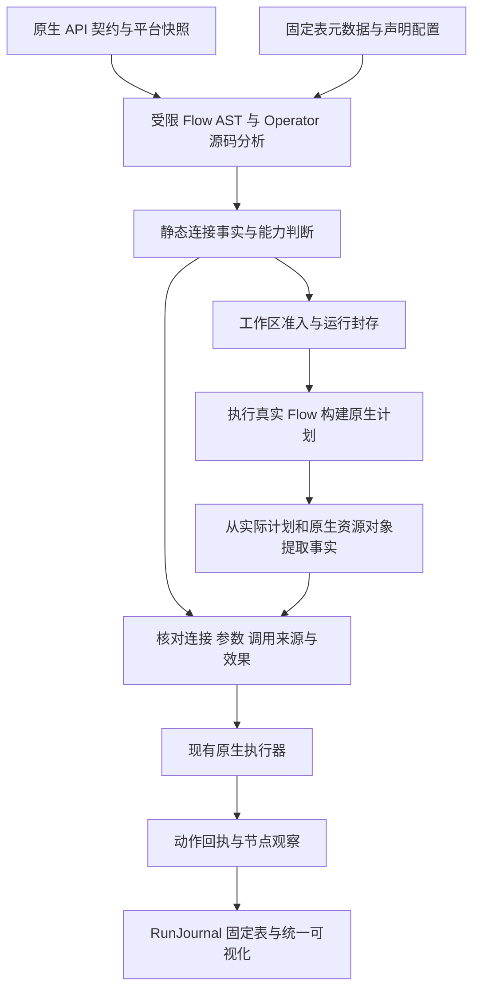

# Forge 通用算子基础能力设计

日期：2026-11-02。状态：用户已批准，已按本方案实施；最终证据、实际支持范围及性能见 [实施验收](forge-operator-foundation-acceptance-20261102.md)。以下保留批准时的设计基线，具体内部名称以源码为准。正式验证、Review/Freeze 与生产交付仍不在本次范围。

本阶段让原生算子的契约、接线检查、执行核对、资源边界和可视化使用一致的事实。已有工作区、Flow、Dataset、执行器、运行记录和数据表机制继续使用。模型只是需要验证的一类原生能力，不能成为 Forge 中的一条专用运行路线。

配套文档：[源码级方案](forge-operator-foundation-source-plan-20261102.md)、[方案复审与验收矩阵](forge-operator-foundation-review-20261102.md)。

## 1 现状与问题

### 1.1 已有通用基础

- 原生公开 API 动态发现、源码与标准快照已经存在。
- Flow 已支持多节点、多输入、多输出和明确物化，不再固定三节点。
- 业务 operator 仍是普通 fn/actor；Forge 静态分析业务源码，不导入执行候选代码。
- 受管运行复用 Dataset 与 RunJournal；结果有准确提交回执、固定表版本和统一查看入口。
- 原生同步与流式执行器已有各自的调用、生命周期、队列、资源和观察机制。

### 1.2 代码确认的缺口

| 问题 | 实际代码事实 | 影响 |
| --- | --- | --- |
| 发现覆盖不等于契约覆盖 | AST 盘点 `Dataset` 自身有 69 个公开方法定义，其中 11 个带 flow 声明；`read_api.py` 有 20 个公开函数，其中 1 个带声明 | 不能声称所有 API 已具备检查与受管运行能力；这些数字包含动作和查询，不是“89 个算子” |
| 语义分散 | `flow_contract.py` 的语义类型、`FlowChecker._native()` 分支、`runs._prepare()` 支持集合、`CheckedExecution.plan()` 核对逻辑分别存在 | 参数、模式和支持范围可能漂移 |
| 混合结构与能力判断 | 静态检查把多个流式组合统一拒绝；原生流式执行实际支持 map、filter 等组合 | 原生可执行、静态可检查、当前策略允许三个问题没有完全分开 |
| API 与执行节点不同构 | `map_prompt_async()` 最终生成 `AsyncMapOp`，模型配置保留在原生 actor 中；filter 会折叠进流式 stage | 不能仅用底层类名识别原 API 或把一个 stage 当成一个图节点 |
| 异步检查接点未贯通 | `materialize()` 的异步路径使用原 `self`；`materialize_stream()` 又通过追加内部 map 调用公开 `run_stream()` | 放开运行名单会漏掉检查后计划，或形成重复受管动作 |
| 值与失败语义覆盖不足 | 同步 `StandardCallable` / `BoundCallable` 有值检查；异步 stage 直接调用；`map_async` 可以返回 row / None / list[row] | 不能沿用一入一出的类型与计数假设；硬检查异常还可能被业务 catch 吞掉 |
| 状态粒度有限 | RunJournal 保存动作事实；页面对普通节点显示“未单独测量” | 需要真实节点对应和有界观察，不能给节点伪造进度 |

以上是源码分析结论，没有通过本轮运行测试证明新增能力。

## 2 中粒度方案

### 2.1 一个事实来源 三个判断

原生模块负责自己能力的语义，Forge 负责受限源码与工作区使用规则。支持结论分三层：

1. **契约是否完整**：端口、字段、基数、配置、资源和副作用是否有可核对的来源。
2. **后端是否支持**：选中的原生后端能否执行这组操作与选项，包括组合限制。
3. **本次是否允许**：工作区位置、输出方式、授权范围和预算是否满足。

运行准入必须三者同时满足。执行后的“实际验证通过”是另一种证据，不能从这三个静态判断推导。

缺契约显示 unknown；原生后端不支持显示 unsupported；策略不允许显示 denied；参数不合法显示 invalid。界面同时保留原因和源码位置，不压成一个含混的“不可用”。

### 2.2 契约描述共同边界 不复制执行器

在现有原生 flow 声明上升级协议，描述：

| 契约内容 | 说明 |
| --- | --- |
| API 角色 | 数据源、变换、物化桥接、终结动作、纯配置值、查询；公开类/辅助函数不自动成为图节点 |
| 端口 | Dataset 的输入位置、数量、输出形状；普通参数签名仍来自真实 API |
| 语义 | 字段传播、缺失/null、基数变化、顺序保证、调用方式 |
| 配置与资源 | 声明文件、实际有效参数、输入资源、运行所需的账本/临时路径及所有权 |
| 副作用与能力需求 | 表读写、请求、资源生命周期、需要的执行模式、预算口径 |
| 执行对应与观察 | 能从哪些实际原生对象核对配置、怎样关联节点、实际可观察哪些事实 |

固定协议字段、数据类型规则、通用执行类别、资源与效果类别可以硬编码。业务名称、具体业务目录、某个模型名、某条 Flow、某个 API 别名不得成为 Forge 分支条件；`flows/`、`operators/` 这些已批准的通用目录规范保留。

join、批处理、模型、表写入各自仍需要原生语义实现。它们属于可复用的平台规则；不能为了“通用”用反射猜测、副作用名称猜测或任意回调执行来代替。

不新增业务算子注册、基类、OperatorAPI、插件框架、通用规则 DSL 或第二份可执行 DAG。新的 API 复用已有语义时自动进入相同链路；真正新语义只在所属原生模块与执行器实现必要支持。

### 2.3 静态报告与实际计划独立产生 再核对



静态阶段只执行受信平台的有界、无外部副作用语义分析；绝不执行候选 Flow、operator、构造器、属性或装饰器。实际阶段必须从真实对象读参数，与封存事实比较；把预期摘要复制到执行节点不算核对。

API 与计划的一对多、多对一关系由原生降低规则解释。普通别名复用相同语义；高级 API 仍显示其公开名称。实际节点未知、无法对应、缺额外副作用声明时阻断，不退化成普通 map。

### 2.4 执行机制保持原生职责

| 模块域 | 负责 | 不负责 |
| --- | --- | --- |
| `data` 与各原生能力模块 | 语义、参数规范化、字段/基数/效果、配置解析 | 工作区路径授权、人工 Review、业务验收 |
| `forge/source`、`operator_check`、`flow_check` | AST 闭包、来源、调用形状、组合与诊断 | 节点调度、模型客户端、猜测原生参数默认值 |
| `execution` | 后端组合能力、真实计划核对、调用校验、队列、取消、资源释放 | 决定用户允许访问哪里、维护第二份业务图 |
| `forge/workspace`、`runs`、`run_worker` | 表/文件绑定、封存、准入、监督、执行状态和结果入口 | 每个算子的业务分支、重新实现 stream 或请求重试 |
| 原生账本与 Lance | 请求事实、提交、准确版本、核对恢复 | 用普通日志推断成功 |
| 页面与 CLI | 展示和操作同一报告、状态和证据 | 维护支持名单或自行推断字段、成功状态 |

依赖方向：Forge 调用原生契约和执行机制；原生实现不依赖 Forge、工作区 JSON、前端或业务仓。`planning/traits.py` 仍负责资源规划特征，其通用 fallback 不能作为“已支持受管执行”的依据。

### 2.5 统一观察 不要求所有节点产生相同指标

每个节点至少能定位 API、源码、有效配置、输入输出契约和能力状态。执行事实按实际采集能力提供：

- 动作意图、提交回执、物化与失败是可靠运行事实，继续使用现有记录。
- 已测量的节点次数、输入/输出数量、等待和耗时附带作用域与计量口径。
- 融合执行保留逻辑节点对应；无法拆分的耗时显示执行组，不分摊假数字。
- 模型请求、文件产物等通过原生证据引用关联，不在通用 journal 复制完整载荷。
- 中间 Case 只查看实际保留字段、明确物化表或显式有界样本；不为看图自动重算或把每条边落表。

同一上游被两个动作消费可能执行两次。记录按 run、action、node、执行次序区分；相同 label 只影响显示，不能合并身份。

## 3 覆盖范围与完成口径

### 3.1 所有公开数据能力都要被盘点

最终目录从实际公开命名空间派生，每项显示角色、契约、后端能力和策略状态。上文 AST 数字只是当前两个文件的基线；不能替代公开导出、继承成员和别名的完整发现，也不能作为手工支持清单。

| 能力族 | 本阶段落点 |
| --- | --- |
| 已开放的同步 read/map/filter/join/union/列变换/limit/materialize/write | 全部迁入一致机制，保持已有行为 |
| 普通同步/异步 fn、actor、flat_map、批处理 | 补类型、基数、调用与生命周期事实；在原生已支持的本地模式中贯通 |
| 关联、分组、归约、排序、采样及其他表变换 | 原生语义和后端约束分别落实，不能统一伪装成一入一出 map；无确定 schema 时明确缺项 |
| 模型、向量、文档/图片读取等领域能力 | 在所属模块提供契约与证据引用，通过相同基础链路；请求与资源预算按原生边界约束 |
| checkpoint、持久流式写入、队列、外部数据源 | 完整报告其效果及缺少的准入条件；不能借“通用化”默认打开恢复、append 或外部写入 |
| 查询、资源配置、普通辅助 API | 明确角色；可能执行数据的查询仍须动作检查，不能全部视为纯 metadata |

“统一接入”不等于解除既有安全和执行范围。默认仍为本地、固定输入、create 输出；Agentic、远程后端、新写入/恢复模式和生产操作不随本阶段开放。模型与其他外部效果必须有显式配置、预算和允许范围，离线/模拟验收不授权真实请求。

### 3.2 防止只做一层空壳

完成本阶段必须同时满足：

1. 已支持能力全部通过新链路，不依赖长期保留的新旧双判定路径。
2. 普通异步函数、带生命周期 actor、批处理/展开、关系操作和一个有请求账本的原生节点都有真实集成验收。
3. 非模型的有资源原生能力也能使用同一接入与证据机制，验证设计没有围绕模型定制。
4. 新增一个已有语义的 API 别名，无须修改 Forge checker、runner 或页面；测试必须真实构建并执行，不能只改目录 JSON。
5. 新语义缺少原生支持时明确阻断，不能仅声明 `supported=true` 获得执行许可。
6. 目录中没有未经说明的“通用支持”结论；保留项列明缺什么原生机制，而不是仅写 TODO。

## 4 用户使用方式

用户或 coding agent 仍在 `flows/` 使用平台 API 接线、在 `operators/` 写普通业务函数；无需写注册表或框架子类。

编写任意组合后，页面先说明：每个节点是什么、字段怎么变、配置来自哪里、所选后端能否执行、当前预算/权限是否允许。点击准备时展示本次准确绑定；执行后沿图查看实际动作和可测量的节点事实，再打开结果及原生证据。

示例仍使用普通原生代码，结构为：

```text
固定 Lance 表
  → 普通 map
  → 原生异步处理
  → filter
  → 显式 materialize
  → join 另一张固定表
  → create 新结果表
```

其中异步处理可以是普通 async fn、声明过生命周期的 actor 或原生模型节点；同样遵循契约与运行入口。替换节点时输入输出不兼容，静态检查定位到连接；真正返回不合法值时，执行边界终止并保留准确失败事实。

## 5 实施分段

| 分段 | 交付 | 进入下一段的条件 |
| --- | --- | --- |
| A 契约与事实 | 覆盖盘点、原生语义协议、参数规范化、静态/实际事实表示 | 已有同步能力通过独立语义对照；职责和依赖无反向引用 |
| B 执行与资源 | 实际计划对应、异步/批处理校验、物化接点、生命周期与预算 | 类型、取消、资源、catch 和重复动作故障验收通过 |
| C 原生能力贯通 | 关系操作及领域能力按同一机制接入；效果准入与证据引用 | 多类能力端到端通过；不完整能力准确阻断 |
| D 统一界面与回归 | 能力解释、节点事实、结果/证据查看、兼容和分发 | 真实浏览器、CLI、Python 同门禁；旧行为和资源边界回归通过 |

本方案通过后再实施，实施过程中发现需要扩大原生语义或改公共 API 时，先修订对应设计和验收，不通过临时放行绕过。

## 6 资源与证据边界

继续使用当前静态预算（节点 1,024、边 4,096、深度 32、源码合计 16 MiB、报告 8 MiB）及运行预算；不得通过增加副本、隐藏缓存或无界事件抵消限制。

流式链需要额外核算 reader 预读、每级队列、并发调用输入/输出、批缓冲、展开结果、序列化和 sink。行数有界不等于字节有界；平台只对自己管理的载荷给出可验证上限，候选内部临时分配仍需原生资源限制和进程保护。

观察采用固定容量聚合与合并更新；生命周期、提交等必需事实不能静默丢弃，诊断采样丢失必须显示。磁盘满、取消、部分初始化、进程终止分别验收；同一工作区仍单活跃运行，无新增调度队列。

完整的预算公式、源码接点、状态规则与验收条件见配套两份文档。
