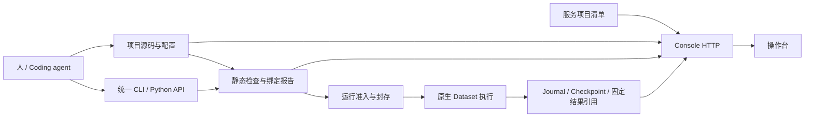

# 真实项目正式接入：通用架构与中粒度方案

日期：2026-11-03。状态：方案自审修订稿，等待用户 Review；未实施。

配套：[源码级方案](forge-project-onboarding-source-plan-20261103.md)、[方案复审与验收矩阵](forge-project-onboarding-review-20261103.md)。

## 1. 目标与范围

提供统一的真实项目接入协议：项目登记一次，同一操作台展示其规范接线、配置、固定数据、检查、运行及结果。人在 Codex 对话，操作台读取已保存事实；不依赖聊天、Notebook 或特定 coding agent。

`identity` 与 `concept_images` 是首批业务验收对象，不是平台的能力类别。平台不得根据项目名、目录名、模型名、业务字段名选择处理逻辑。另以结构不同的非模型 Flow 验证无需修改平台即可新增业务。

用户允许调整不符合规范的存量 pipeline。本方案选择整理实际实现，不保留第二份接线，不新增调用整条旧 pipeline 的 operator/转发壳。业务规则、固定历史数据、调用证据和 Notebook 已保存输出保留；源码和当前入口可以按规范迁移。

本阶段目标包括：真实数据 Review、规范 Flow 检查、隔离环境中的完整受管执行与恢复。真实模型调用、对生产表的更新和全量运行分别按实际授权及验证范围开放。接入完成不等于业务质量或全量资源容量已获验收。

## 2. 已核实的缺口

| 当前事实 | 对方案的约束 |
| --- | --- |
| `init_workspace` 只允许空目录，`WorkspaceServer` 固定一个 root | 增加既有项目初始化及一个服务下的显式项目登记 |
| 工作区扫描 `flows/` 全部公开函数，参数文件未与入口明确关联 | 正式项目显式登记入口与配置；helper 不自动成为 pipeline |
| Forge 只允许 `data/` 写入，受管运行仅支持新建目标 | 必须表达输出所有权、稳定表 CAS 更新、阶段写入和恢复，不能暗改为每次新表 |
| `reduce_by_key`、`count`、`save_lance` 等缺少完整受管契约；`run_stream` 拒绝 checkpoint | 不是只扩展模型节点，还要覆盖查询、归约、流式落盘及动作间结果引用 |
| 当前模型契约仅覆盖部分 HTTP 文本 JSON；取消排空按短请求限定 | SystemOne、图片、多题及真实请求时限需要原生契约与资源策略一起扩展 |
| 普通业务函数中有文档读取、图片读取/编码、第三方语法解析 | 拆开显式资源节点与业务纯计算，不用信任注解绕过 OP-06 |
| 原生位置索引已有增量解析和 SQLite 派生缓存；Lance 路径解析仍有整份 JSON 读取 | 复用原生索引能力，不能在 Forge 再实现迁移路径解析 |
| 当前预览限制祖先位置文件 1 MiB；实际 Lance 位置文件约 2.2 MB、artifact 位置文件约 784.5 MB | 接入必须验证真实路径链，不复制小样本到 `/tmp` 冒充生产接入 |
| DemiForge 当前结构规则固定 `config/run_pipeline` 和三格 Notebook | 先版本化统一规范；不得让项目文档、结构检查和 Forge Flow 契约冲突 |
| 两条 pipeline 的旧开发任务未取得认证，曾受监测源码 256 MiB 上限阻塞 | 不能以操作台接入追认旧任务；通用快照容量与新登记必须独立解决 |

当前源码依据和具体改动位置见源码级方案。上表描述已读取的代码与文件元数据；未证明生产预览性能。本轮受限元数据探测未完成，已终止该探测，不能计入验收。

## 3. 唯一来源与依赖方向

| 层 | 拥有的事实与职责 | 不拥有的职责 |
| --- | --- | --- |
| DemiForge | 版本化开发规范、任务范围、上下文、测试及语义 Review 证据 | 数据调度、操作台业务状态 |
| 项目工作区 | 明确入口、参数文件、表引用、允许的数据位置、平台绑定 | 复制平台规则、提供任意 handler/认证豁免 |
| `flows/`、`operators/` | 接线与业务规则；字段、阈值、完成条件 | HTTP 客户端、调度器、事务或恢复引擎 |
| demiflow 原生领域模块 | 公开 API、资源效果、类型、实际执行与可验证契约 | identity 标签、候选筛选等业务语义 |
| 原生 RunJournal、checkpoint、Lance receipt | 运行、恢复和提交事实，各自只记自己的事实 | 用日志文字推断成功、全局多表事务 |
| Forge 工作区/运行 API | 绑定、静态检查、准备、准入、调用原生执行、读取证据 | 第二套 DAG 执行器 |
| Console HTTP / 页面 | 项目选择、通用查看、调用同一 API | 业务计算、聊天、代替权限检查 |

`demiflow.forge` 不导入 Demiurge，也不读取 `.demiforge/project.json`。DemiForge 在开发阶段通过既有的受信验证命令检查公开 Forge 契约；操作台运行时不依赖 DemiForge。



图只描述依赖和数据流；不存在由页面执行的图。

## 4. 项目、Flow 与配置如何登记

### 4.1 一个工作区包含多个 Flow

工作区是代码和数据权限边界，不要求一个目录对应一条 pipeline，也不强制一个仓库对应一个工作区。首批采用 `demiwtg` 作为一个真实工作区。

```text
demiwtg/
  workspace.json                 # 稳定工作区 ID、入口索引、位置与平台绑定
  flows/<业务名>.py               # 唯一接线
  flows/<业务名>/                 # 该接线的参数、Prompt 等声明资源
  operators/<业务名>/             # 类型明确的业务函数、业务 schema 和规则
  operators/<共享业务能力>/        # 有明确维护者的纯共享逻辑
  tables/<alias>.json             # 固定 DatasetRef 和可选展示声明
  .forge/                        # 平台封存、检查和受管运行
  <既有业务目录>/README.md、tests/、可选 Notebook
  <既有数据目录>/                 # 不为接入迁移历史数据
```

`workspace.json` 的入口索引只声明显示名、`flows/file.py:function`、对应参数文件和业务说明位置，不再描述一份节点/边。多个配置引用同一入口；参数只传值，不能声明 Python 回调、插件或执行命令。新项目沿用 `data/` 默认位置，真实项目可显式登记既有位置。

正式工作区使用版本化 v2 描述。旧 v1 只按旧格式解释，显式升级后才获得新能力；不按缺失字段静默补权限。非空目录初始化只创建缺失的受管控制项，不覆盖 README、Git、已有目录或 Notebook，出现冲突就报错。

### 4.2 同一服务登记多个工作区

服务持久清单只保存稳定项目 ID、绝对根目录及该项目的读取/运行权限上限。清单是本机管理配置，不放进业务事实库。用户通过 CLI 显式加入、列出、移除项目；移除只删除服务入口。

请求使用项目 ID，由服务从清单解析 root。请求不能提交任意根目录；ID 与工作区自身 ID 不一致、根路径替换、路径越界均拒绝。权限是服务配置、工作区声明、本次操作三者的交集。

服务沿用一个端口、现有回环鉴权和 SSH 入口，由现有进程管理工具保持长期运行。新增项目和 Flow 不要求重启或新建转发。不建设新的 daemon 管理器、MCP、聊天桥或多租户系统；此版本的部署范围是单用户服务器/SSH。

旧深链接中的绝对路径只可匹配已登记根目录，成功后转换为带稳定 ID 的新链接；不得据链接自动登记项目。旧报告/运行原绑定仍保留。

## 5. 契约扩展：按原生能力归属，不按业务定制

### 5.1 接线与算子

- 接线继续集中在 `flows/`，只使用公开原生 API 和可检查 helper。配置可决定有限分支；数据运行结果不能选择任意新的函数、节点或子 pipeline。
- ordinary operator 只处理明确的行、批或分组。增加 TypedDict 等明确类型；归约 accumulator 与最终输出分别检查；借用输入与新建可变容器的归属要区分。
- 标准库纯计算只在有明确签名/效果的支持集合中检查。第三方解析、图像处理和对象读取必须有原生领域契约；不能通过登记业务函数路径、`trusted=True` 或输出类型声明获得信任。
- 通用第三方语法解析只输出有界、可检查的语法记录。模板取舍、导语选择等业务规则仍留业务算子。解析前限制字节，解析过程受隔离 worker/时间/内存保护，输出限制节点数和深度。不能把某个业务文本清理器整体搬进平台。
- 类型符合与静态效果符合不证明业务正确、进程 RSS 恒定或任意 Python 的形式化安全；这些保证分别验收。

### 5.2 原生能力闭环

| 能力 | 必须扩展的通用契约 |
| --- | --- |
| 归约 | `reduce_by_key` 的键、accumulator、输出、分组增长及执行事实 |
| 查询与运行时约束 | count、有限聚合摘要、schema 检查和失败即停止的 guard；不收集全量业务行到 Python |
| 原生值 | 固定声明生成的 Arrow schema、预算、checkpoint；静态阶段不构造有副作用实例 |
| 动作间引用 | 消费真实 receipt/checkpoint 的已提交固定引用，不重新取 head |
| 资源读取 | 固定文档/对象引用、位置、摘要、字节、解码像素和结果尺寸；读取节点在接线上可见 |
| 模型 | 复用 `map_prompt_async`、原 Prompt pack、SystemOne 单题/多题、文本/图片、原始回答及逐题错误 |
| 写入 | create、显式 CAS overwrite、同一受管 run 的流式 staging/append 与 checkpoint |
| 运行观察 | 动作、原生节点、请求证据、恢复尝试和真实输出；不从输出倒推缺失输入指标 |

静态报告中允许原生 query/receipt 产生带类型和来源的未知值。使用范围限定为有界摘要、断言、声明输出的后续读取，以及有静态上界的预算；不能决定 import、endpoint、任意路径或拓扑。报告记录依赖，运行时使用实际 query/receipt 核对。报告仍不是可执行 IR，真实执行仍调用封存的 Python Flow。

流式空输入必须有显式 schema 和真实空表提交语义。不能用额外 Python/Arrow 空表分支绕开受管 sink。校验前置条件必须在模型/最终写入前完成；不能靠惰性计算的书写顺序声称前置已执行。

### 5.3 模型与副作用边界

有效 Prompt、模型 revision、endpoint、图片处理参数和预算在 prepare 时明确并封存。现有参数覆盖若保留，须经同一原生解析入口显式生成有效配置，检查和运行使用完全相同的内容；不能运行时悄悄修改 YAML。

请求额度、问题额度、输入/响应字节、图片像素、并发/队列、journal 磁盘和超时分别计量。字符数不冒充 token 数；原生 token profile 按原契约核验。模型与请求时长属于配置，不硬编码 pplx/d3 名称、50 题或某业务阈值。

HTTP deadline、重试上限、锁等待与取消排空按本次 profile 联合校验，取消超时才升级终止。恢复沿用持久请求预算。已提交响应可复用；远端已接收但本地未保存的请求不能宣称 exactly-once，按原生未决请求策略处理并展示。

模型 revision 的配置声明和服务实际回报身份分别记录；配置中写了 revision 不能证明服务确实加载了该制品。真实运行前核对部署证据/实际响应，缺证据明确显示。协议测试不能代替此验证。

不增加服务启动、模型自动部署或 Agentic 调度。本期模型节点消费已明确提供的服务。

## 6. 表、对象与历史证据

### 6.1 位置与写权限

位置声明区分表、对象、运行证据的用途，并有明确访问模式。输出逐项声明所属位置、目标、写入模式、预期版本及 schema。只读输入不能因为也在项目目录中就自动变成可写。

稳定表更新必须有 `expected_version`，在准备、开始及原生提交时核验；不能偷偷改为新表，也不能为了复现实验改写原有稳定表。隔离验收显式使用自有目标，界面显示该有效目标。多表提交依然不是全局事务；若明细已提交而摘要失败，保留明细和未完成状态。

允许同一物理表作为固定旧版本输入和 CAS 更新目标，前提是读取始终绑定旧版本，写入基线明确且由原生提交核对；这不是允许运行中读 head。输出别名、原生回执和后续读取都必须保留具体版本。

### 6.2 历史接入

1. 原生 Catalog 有精确身份时复用；否则显式给出业务标识与 schema 版本。
2. `--head` 仅在登记时解析一次，保存固定版本。后续 head 更新提示有新版本，不替换用户正在查看的旧版本。
3. 用原生精确位置映射解决历史路径；核验最终路径属于声明位置，保留逻辑引用、物理目标和所用映射事实。拒绝按文件名猜测、前缀兜底或失败后读取另一张表。
4. 历史模型账本和回执作为有类型、有位置、有大小限制的证据引用查看。JSON 字符串只有经声明的证据解析器校验后才可跳转，不能成为任意文件读取入口。
5. 只有结果表、没有受管 manifest 的历史产物标记为“历史结果”；保留来源回执，不伪造 RunJournal、不赋予新契约通过状态。

历史内容寻址对象若采用确定的 SHA 布局，可以显式声明原位置、目标对象库与布局版本，校验原 URI 与该 SHA 的对应关系后再核验目标内容摘要。此类已声明迁移与精确索引同属原生对象解析；不能退化为任意路径前缀替换或“找得到就读”。

新受管运行由 receipt 自动发现结果；旧程序直接改表不能冒充已接入的受管运行。对其新版本需显式登记，或先完成代码标准化。

### 6.3 规模与展示

原生位置索引缓存是可删除重建的派生数据，不是新的事实库。索引构建有显式磁盘/时间预算，不能每 3 秒解析大 JSON。固定版本预览验证实际引用的 manifest/fragment，避免枚举所有历史版本和整库对象。

分页、投影、过滤、嵌套字段展开、单条详情和按需图片共用通用查看器。展示声明只指定字段路径、主键、列、文本/图片/数值/结构化详情和证据位置；不含 Python/JS、SQL 模板或业务判断。展示配置变化不应使数据身份和无关执行报告漂移。

表查找可以无索引但必须有扫描/时间预算；超限给出明确诊断，不能无上限全表搜索。图片只在明确查看时读取并核验范围和摘要，缩略图是显示派生物，不替代原始对象身份。

## 7. 运行、恢复与长期服务

RunJournal 是执行事实，Lance receipt 是提交事实，checkpoint 是恢复事实。业务 `complete` 是业务输出，不由“进程正常退出”推导；页面分别展示执行状态与声明的业务完成字段。

同一不可变 run 可有按序的恢复尝试。尝试序号只用于运行生命周期和日志，仍属于同一原生 RunJournal；不新增业务 pipeline 实体或任务调度服务。源码、Prompt、输入版本、配置及预算改变必须新 run。恢复前核验原 checkpoint 与已提交目标版本，旧 worker 不能写入新尝试状态。模型失败的业务行不因恢复自动重打。

目录数量、证据保留和列表分页不能继续隐含依赖演示期的 128 条全量读取。新增一个可重建的工作区列表索引，只索引 report/run 的定位与摘要，不存完整结果/原始响应；详情仍读取源事实。索引失败不改变运行提交，界面明确索引是否完整，修复/重建按有界任务执行。历史证据不自动删除；归档与容量策略显式声明。

索引发布需有可恢复的待更新标记，避免进程在事实提交后、索引更新前退出导致静默漏项。索引不参与执行互斥、写权限、提交真实性或认证判断；这些判断读取原事实并使用原生锁/CAS。

管理配置给出资源上限，工作区和 run 只能在该范围内声明预算。默认值与平台硬支持边界分开；不足时拒绝，不自动放大。预览和运行 worker 均有资源、超时与清理边界，服务进程不承担图片解码和全表计算。

## 8. 统一 DemiForge 标准

拟发布下一候选标准（暂记 candidate.7，实施时核对未被占用），不改写 candidate.6 及历史任务证据。

- 唯一正式入口由工作区和公开平台契约定位；不再把函数必须叫 `config/run_pipeline` 作为通用要求。
- 模型和 I/O 显式、算子不得隐藏流程、固定输入与输出归属、失败/恢复、资源预算和语义 Review 继续强制。
- Notebook 可选，不再承担接线、注册或唯一可视化职责；存在时仍不得藏执行实现，并保留已有输出。
- 在项目规范中落实统一的 `flows/`、`operators/` 布局，业务 README/tests/数据可以保留原归属目录。迁移目标入口登记为项目相对路径和明确符号。
- DemiForge 通用核验仍不绑定 demiflow 内部模块；通过已有受信 fixture/CLI 验证命令消费公开报告。
- 监测快照保留完整覆盖和脏基线，复用流式哈希；将总 I/O、文件数和时间上限变成显式、版本绑定的通用预算。不得删 Notebook 输出、排除出错文件或隐式缩小 watch 来解决 256 MiB 问题。

规范、工具、项目绑定更新是单独的标准化步骤，完成后新建任务；旧任务不静默 rebase。结构检查、受管契约通过、隔离行为测试、人工业务 Review 和生产放行各自报告。

## 9. 首批标准化与等价性验收

### identity

迁移为一份接线，audit/import_labels 由明确配置选择。标签合并、导语选择、模型阈值及状态语义保留。文档读取从普通函数拆到显式原生资源节点；语法解析与业务模板规则分离。

历史 `identity_assessments@44392`、`summary@21` 原位登记。1,026,275 行、297,506 行导入标签/两份原模型记录用于核对既有交付，不当成平台常量。`labels_imported.complete` 只表示导入完成，不能显示为所有概念身份审核通过。

隔离数据验证完整导入、不重打标、不丢原字段、重复键/范围外原始记录拒绝、CAS 冲突失败，以及 audit 更新身份时保留旧标签与其源 revision。生产历史表不因验收重新导入。

### concept_images

迁移为一份接线。身份规范化、分组、分块、独立两个模型、完整明细和 accepted 的关系保持。纯业务逻辑留 operators；读取、图片编码、模型和 sink 以原生能力显式呈现。

保留单关系 unchanged、多关系双侧达到阈值才 accept、失败 null 不补 0、第二个模型看不到第一个答案等语义。恢复用完整原候选重建分块，已提交块复用；覆盖不足不能生成完整完成声明。阈值、模型名称、分块参数均是业务配置。

真实新审核未运行，页面显示此事实。隔离模拟服务验证完整运行、故障恢复和证据查看，不冒充模型质量样本。公共关系表不在本次接入写入目标中。

### 第三种 Flow

增加不含模型的多输入归约/校验/多输出 Flow，使用同一工作区、登记、展示和运行 API。新增它只能改示例/fixture 和业务配置，不能改平台分支；用同名 run/alias 在不同项目的情况检验隔离。

## 10. 以后怎么加入

| 场景 | 使用流程 |
| --- | --- |
| 新项目 | 初始化工作区元数据 → 声明位置与资源策略 → 加入服务清单 |
| 已有项目 | 非覆盖初始化 → 固定历史引用 → 审计当前入口 → 按通用规范迁移需要接入的源码 |
| 新 Flow | 写一份接线与算子 → 保存参数 → 登记入口及配置 → 检查 → 准备/执行 → 自动显示结果 |
| 同接线新实验 | 新增/修改参数，固定输入，检查后新 run；不复制 Flow |
| 仅查看历史数据 | 登记固定表与证据，标识历史来源；无需执行 pipeline |
| 使用新原生能力 | 原生模块补契约/实现/测试 → 显式采纳平台版本 → 重检 Flow；不添加业务豁免 |

后续 CLI 的准确语法在源码方案中标为拟新增。人和 coding agent 使用相同入口。无需页面对话、业务专用 HTML 或手工绘图。

## 11. 实施顺序与完成条件

| 阶段 | 交付 | 阶段退出条件 |
| --- | --- | --- |
| P0 规范与基线 | 统一规范、登记协议、容量预算与旧证据保护 | 新旧绑定明确，登记和标准不再互相矛盾 |
| P1 真实项目与历史查看 | 非空接入、单入口多项目、真实固定表/对象/证据查看 | 两条业务的真实已有材料在同一服务可见；不声称已可执行 |
| P2 原生契约闭环 | 上述资源/模型/归约/写入/恢复能力 | 静态、实际计划、运行验证和失败测试逐项通过 |
| P3 业务标准化 | 两条正式接线和受管配置、受影响消费者/文档/登记同步 | 无双入口/隐藏 I/O，业务等价性和 DemiForge 新任务证据通过 |
| P4 集成验收 | 真实面板、隔离完整运行、第三种 Flow、长期服务操作 | 验收矩阵通过，展示与执行权限明确，旧数据/证据完整 |

每个阶段先核对设计再实现并做代码 Review；跨阶段不能用“页面已出现”代替契约或运行通过。真实 canary/全量和生产发布的批准单列。本方案获批前不实施上述代码、规范迁移或服务切换。
