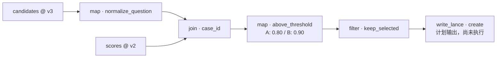

# Forge 第二阶段接线契约与工作区设计

日期：2026-11-02。状态：用户已通过并授权实施；实现与验收记录见 [第二阶段验收](forge-stage2-acceptance-20261102.md)，实际用法及支持边界见 [工作区指南](forge-workspace.md)。本方案替代 2026-11-01 的第二阶段提案；旧文档保留追溯用途。本文是设计约束，示例中的业务输出预期不代表候选 Flow 已执行。

本次修订细化 FL-06 字段传播、OP-06 调用来源，限定 OP-07/08 的静态保证，并给出静态检查、运行时验证和分阶段验收的明确边界。Review 重点见第 4.4、5.3—5.5、6.2 和 10.4—10.5 节。

第二阶段交付一个有明确接线规范、硬检查和统一查看界面的数据工作区。Flow 必须通过平台 API 连接数据；Operator 实现节点内业务计算；平台执行器负责执行；可视化展示同一份连接事实和真实表内容。

灵活性来自平台能力、连接和参数的组合。任意 Python、隐藏数据流或私人调度不因放进 flows/operators 目录就成为合格实现。平台缺少能力时，先扩展原生 API 及其版本化契约，再由 Flow 使用。

## 1 交付与架构边界

| 对象 | 唯一职责 | 不承担 |
| --- | --- | --- |
| 工作区 | 组织表引用、多个 Flow、参数、说明及检查记录 | 充当一条固定 Pipeline，或要求全区共用一个 request |
| Flow | 用平台 API 表达读、转换、关联、模型节点、物化与输出 | 直接处理整表、隐式业务计算、另写执行调度 |
| Operator | 处理平台交给它的行、批次或 actor 调用 | 嵌套 Pipeline、隐式读写业务表、隐藏模型客户端 |
| 原生平台 | API 契约、数据读取、执行、资源和提交语义 | 维护某条业务流程的固定排列 |
| Forge | 工作区绑定、标准检查、身份与派生报告 | 第二套执行器、Dataset 代理或业务算子注册系统 |
| 查看界面 | 项目总览、看表/case、查看接线与诊断 | 独立解释业务执行逻辑、维护第二份可执行 DAG |

本阶段提供：工作区及固定表引用、Flow/Operator 静态硬检查、本地只读工作区界面、有界 case 浏览与对照、报告比较和导出。

本阶段不接通新格式业务运行、运行事件叠加、局部重跑、正式 Verify/Freeze、审核结果写入或 Agentic 编排。第三阶段复用原生执行器建立实验闭环；第四阶段接通正式验证与受管交付。第二阶段的结构检查不能授予运行许可。

## 2 工作区与数据表

```text
workspace/
  README.md                       # 项目用途，界面直接展示
  workspace.json                  # 工作区、数据位置、标准和平台绑定
  tables/
    candidates.json               # 固定表引用
    scores.json
  flows/
    questions.py                  # 接线、默认参数及 A/B 入口
    questions_a.json               # 参数多时就近保存，可选
    questions_b.json
  operators/
    question_rules.py             # 业务函数、类型声明与必要 helper
  data/                           # 默认真实表位置
  .forge/
    platform/                     # 不可改写的平台快照
    inspections/                  # 固定身份的报告与导出
```

不设独立 compositions 管理层。配置属于对应 Flow，简单参数直接写在入口默认值或变体调用中；较长参数文件放在 flows 内。原生模型配置按需要就近存放或共享，其格式不由 Forge 重造。

Notebook、脚本和 coding agent 都可以调用同一 Flow 入口。Notebook 是可选辅助代码，不是平台中心；登记 Flow 的连接不能有一部分藏在 cell 或 kernel 状态里。辅助代码是否属于实现依赖，由实际引用决定。

表的规则：

1. 真实表默认在 data/；已有共享表留在原地，以显式本地数据根只读接入。初版不建设远端统一 Catalog。
2. tables 保存 alias、location_id 与原生 DatasetRef。固定版本、schema_hash 和 row_count 必须核对；不改变既有 DatasetRef/Catalog 格式。
3. alias 不是全局身份。位置配置与 DatasetRef 一起参与绑定；跨根同名、同版本的表不混淆。更换根是明确重新绑定，不以相同行数/schema 证明数据内容相同。
4. --head 只在显式接入/替换时解析为整数版本；检查不追随 latest。旧版本不可读即失败。
5. 已登记表复用明确匹配的 Catalog 记录。未登记表需提供 dataset_id、schema_name、schema_version；业务名称/版本仍是声明，不能冒充数据验证。接入不写共享 Catalog。
6. 取消引用、删除 Flow、清理派生报告不删除表。输出只允许工作区自有可写位置；第二阶段只展示计划输出，没有伪造的提交版本。

引用替换采用旧摘要比对和原子写入。更新 A/B 共用的 alias 会使两者相对当前绑定过期，但不改写历史报告；需要长期比较不同版本时使用不同 alias。

## 3 契约来源与原生能力

### 3.1 契约只维护一次

| 内容 | 权威来源 |
| --- | --- |
| 平台 API 参数与默认值 | 当前公开代码签名，第一阶段目录动态发现 |
| Dataset 输入/输出角色、节点效果、执行方式限制 | 原生 API 定义旁的版本化机器可读语义 |
| 业务 Operator 参数与返回结构 | operators 中的签名、类型注解及必要的 TypedDict |
| 字段如何接给函数、结果写到哪列 | 原生 inputs/output/outputs/fn_kwargs 等调用参数 |
| 业务条件、异常和边界行为 | Operator 实现与后续绑定同版本的契约测试 |
| 接线是否合法、目录和职责边界 | 独立版本的 Forge 工程标准及检查器 |

不重复手写一份平台方法名单、参数 schema 或业务 DAG。API 可动态增加；业务接线仍必须通过同一套通用检查。

### 3.2 已有能力与必要补充

已核对代码：

- [data/plan.py](../demiflow/data/plan.py) 的 CallableSpec、字段绑定校验和 BoundCallable 已有参数冲突、必需参数、结果映射等规则。
- [data/dataset.py](../demiflow/data/dataset.py) 已提供 map/filter/join/union、物化、模型节点和终结动作；同步与流式执行的限制必须保留。
- [lance/refs.py](../demiflow/lance/refs.py) 与 [lance/registry.py](../demiflow/lance/registry.py) 提供固定引用与本地登记；部分查询仍需补足有界读取。
- [forge/platform.py](../demiflow/forge/platform.py) 当前 native_semantics 仍为 unknown。目录能发现签名，不等于已经能判断所有连接和效果。
- [operator_api.py](../demiflow/operator_api.py) 面向 Agent 工具声明，会 import 自定义实现；不能直接用它检查普通 Dataset Operator，也不能在绘图时调用其装载过程。

本阶段必要补充：

1. 原生 API 就近提供 `demiflow_api_flow_v1` 纯数据语义：Dataset receiver/参数、结果形态、callable 参数及字段绑定角色、字段传播规则、基数/顺序保证、读写目标、效果、配置资源和执行方式限制。字段引用必须对应真实签名；仅有 read/write 等效果标签不足以检查接线。
2. 将已有签名/绑定规则中实际需要共用的部分保持为原生纯值校验逻辑；Forge 只把 AST 解析出的签名事实送入校验，不 import 候选函数。避免在 Forge 复制一套长期分叉的规则。
3. 为可静态表示的 Operator 类型、字段传递和 schema 兼容补足纯值规则，归属原生调用/数据语义模块。当前代码没有完整的注解到 schema 或返回值类型验证能力，不能以文档代替实现。
4. 平台目录/快照以明确 v2 格式保存新增语义，复用第一阶段发现、哈希、进程与差异机制。旧 v1 仍按原格式和范围比较；本次源码变化会正常使旧绑定 stale，需要显式重新绑定。

同一语义格式下新增公开 API，只需原生实现、就近语义和一致性测试，Forge 不新增方法名分支。出现新的语义类别时，应明确升级平台契约和通用处理能力，不能假装所有未知行为都能自动接入。

### 3.3 原生语义的一致性

语义声明和处理这些声明的纯值规则由原生层维护，Forge 负责提取候选代码事实。不得由工作区提供任意 Python 回调来补齐 schema 或效果推断，也不新增平行插件注册表。

每项准入能力必须验证：声明引用的参数存在；默认值解析一致；合法/非法绑定与原生判断一致；字段传播、缺失/null、基数类别、执行方式和提交限制与原生行为一致。平台测试可以执行自有小型 fixture 验证原生实现；用户的 inspect/view 仍不得执行候选业务代码。

一致性测试区分原生限制与 Forge 工程标准的额外准入限制。例如首轮类型兼容范围可以比普通 Python 调用严格，但必须说明这是受管契约限制，不能声称原生执行已禁止这种调用，也不能顺手改变已有 Dataset 执行行为。

声明缺失或语义类别不支持时，对使用该能力的 Flow 报 incomplete。已确认的声明与实现矛盾是平台缺陷，不能通过业务豁免放行。版本或来源变化必须使相应证据过期。

## 4 Flow 的具体契约

### 4.1 入口与参数

Flow 入口是 flows 内可静态定位的顶层同步函数。一次检查明确选择入口与完整参数；多个入口可调用同一个受检查的 helper。普通函数是编写形式，函数体必须符合接线语言。

参数分为固定表引用、输出目标、普通有限值和明确配置资源。界面/CLI 将它们解析为原生调用使用的普通值，并绑定实际参数摘要；不注入新的 Forge 上下文对象。

只允许关键字可绑定参数；不透明装饰器、动态默认值、任意 args/kwargs 装配和隐藏全局状态不能作为合格入口。源码模块初始化只允许静态 import、定义和受限常量；不会执行模块来判断它是否安全。

### 4.2 可写的接线表达

允许：平台 API 调用、Dataset 变量赋值/传递、可静态解析的常量与参数索引、明确的 fn/actor 引用、同样受检查的 Flow helper，以及在已绑定参数上可确定的有限构建分支/展开。

不允许：Flow 内逐行循环处理表、collect 后用普通 Python 加工再回灌、直接调用业务函数处理 Dataset、自己启动任务/线程/模型客户端、反射选方法、执行任意代码、读取业务数据决定下一步拓扑。

按行条件使用平台 filter 等能力。构建分支只能依据已绑定配置；运行时分支/循环需要对应平台控制 API 的明确契约后再开放。本阶段不新增此类编排能力。条件无法确定不能简单画两条猜测路径后算通过。

### 4.3 Flow 硬检查

以下编号属于本方案拟新增的详细检查码；实施时随工程标准内容版本发布，不能由业务代码关闭。

| 规则 | 必须满足 | 阻断例子 |
| --- | --- | --- |
| FL-01 入口与来源 | 入口/helper 在 flows，实际依赖及初始化可解析；没有隐含环境输入或共享可变状态 | 入口依赖 notebook 全局变量；默认参数中创建客户端 |
| FL-02 平台调用 | 主数据节点解析到已绑定平台 API；helper 展开后仍全部合规 | `process_all(ds)` 是不透明业务函数；伪造同名 map |
| FL-03 参数绑定 | 依据原生签名校验必需参数、名称、重复绑定和可确定值约束 | 拼错参数；同一参数既来自 inputs 又来自 fn_kwargs |
| FL-04 完整接线 | 每条 Dataset 的来源、多输入、去向和终结动作可识别 | 未知返回对象接 join；隐藏终结动作；丢弃未声明的处理支路 |
| FL-05 数据身份 | 每个表输入绑定允许位置与固定版本，实际引用可读且元数据吻合 | 缺省 version；失效旧版本回退 latest；路径逃逸 |
| FL-06 字段与结构 | 依据原生规则传播字段的存在性、null、类型和来源，并核对端口兼容 | inputs 左右颠倒；left join 后可能缺失的字段绑定为必需输入 |
| FL-07 效果与控制 | 读写、模型和物化效果明确；无非平台调度或运行时构图 | HTTP 模型调用藏在 Flow；通过 count 决定未声明的下一阶段 |
| FL-08 原生执行限制 | 接线遵守原生同步/流式、后端及物化约束 | 流式模型结果直接接仅支持同步输入的动作 |
| FL-09 输出提交 | 自有目标、明确模式/条件/回执；多写入和读写交叠具有原生支持的顺序与版本语义 | 向只读源表写入；同目标多写但顺序或版本条件无法确定 |
| FL-10 身份与预算 | 分别核对源码/参数/资源/平台/标准身份，以及检查器自身的有限预算 | 检查期间改文件；平台 stale；无限展开 |

FL-06 对未知类型或不可解析 schema 返回 incomplete，不能假设兼容。类型“声明兼容”和“真实数据验证通过”在报告中分开。

多个输出允许存在，各自是独立提交边界。共享变量不意味着只执行一次；图标明动作边界，后续运行不能假设跨表事务。无终结动作的 helper 可以返回 Dataset，但本方案选中的完整 Flow 入口必须给出可定位的原生终结动作；不能把纯 helper 当作完整交付入口。

### 4.4 FL-06 字段传播与兼容判定

每条边保存四类事实：字段名与来源、字段是否必然存在、存在时是否允许 null、值类型。证据分为固定表元数据、Operator 声明和原生规则推导；这些是派生报告事实，不要求业务再维护一份 schema 文件。

**字段存在性和 null 独立处理。** `TypedDict` 按 total、Required、NotRequired 解析每个键；默认必需，`NotRequired[T]`/`total=False` 可声明键可能不存在，`T | None` 表示值可以为 null；二者不能相互替代。字段式 map 的原生绑定先取指定字段，字段缺失时不会自动使用函数默认值。整行 Operator 可以显式接收可选键并处理缺失。

首轮兼容规则如下：

| 对象 | 判定规则 |
| --- | --- |
| 基础标量 | 原生 reader 明确支持的 Arrow bool、整数、浮点、字符串、二进制，分别对应 bool、int、float、str、bytes；保留原物理类型信息，不把此映射视为存储转换 |
| 类型转换 | bool 不当作 int；不隐式把 int 接成 float，也不把字符串转数字。需要转换时通过明确的原生能力或有契约的计算节点表达 |
| nullable | 非空 T 可接 T 或 T 与 None 的联合；可空 T 不能接只接受 T 的参数 |
| 必需字段 | 上游必须保证存在；只有可选键声明不能满足必需字段，函数参数有默认值也不改变字段式绑定规则 |
| 容器与结构 | 有限深度 list/tuple/dict、TypedDict 按已支持的原生行表示递归检查；整行输入允许额外字段，返回结构必须明确 |
| 输出存储 | Python int 注解不证明数值落在某个 Arrow 整数范围内；目标 schema、数值范围及实际序列化仍需原生写入校验 |
| 不支持或未知 | 对本次投影和连接必需的类型、schema、表达式语义无法表示时 incomplete；Any 或样本推断不能兜底。无关字段可先用原生投影排除 |

日期、时区、扩展类型等不因存在 Python 注解就自动准入；只有对应原生转换规则和一致性测试具备后才开放。空表仍须通过固定元数据或明确声明取得结构，不运行候选算子来猜。

字段传播由原生语义决定，首个验收闭环至少覆盖：

| 节点语义 | 字段结果 | 基数与顺序边界 |
| --- | --- | --- |
| 固定表读取与投影 | 使用实际固定版本 schema，检查投影列/表达式；保留来源 | 行数受原生过滤/limit 影响，不扫描全表预测结果 |
| 字段式 map | 保留原字段；output 存完整返回值，outputs 按“返回键 → 目标列”映射且要求键必然存在；覆盖列标明旧/新类型；无 output/outputs 时返回须为 None | 成功调用按原生协议产出行；配置 catch 时可能丢行，并发模式不推定有序 |
| 整行 map | 返回 TypedDict 成为新行结构，未返回的旧列不自动保留 | 不根据函数名称或注释猜测字段、行数 |
| filter | 保留输入结构 | 不增加行数；不因任意 Python 谓词而推断字段非空、键唯一或顺序增强 |
| inner join | 检查两侧键与类型、同名列处理和 suffix；按原生字段规则组合 | 重复键保留多重匹配，可扩增；null 键不匹配；不承诺排序 |
| left join | 同上，并传播未匹配时右侧字段的缺失性；物化后若转为 null，按该原生边界单独传播 | 不推断一对一，不静默选择第一条匹配 |
| 显式物化与写出 | 按目标 schema 和原生转换规则核对；区分计划目标和实际版本 | 空输入、写入冲突和提交结果遵守原生动作，不推定跨表事务 |

union、flat_map、批次及模型等能力使用各自原生语义；不能简单套用 map 传播规则。目录发现到 API，但本次连接所需语义尚未覆盖时，仍为 incomplete。

FL-06 的判定顺序固定为：解析投影后的输入事实 → 绑定函数参数/行结构 → 应用原生字段传播 → 核对下游端口和目标 schema。确定冲突为 invalid，必要事实未知为 incomplete。过滤后的准确行数、真实分数分布等属于运行结果，未知不阻断静态检查，也不能标成已验证。

原生允许在写入时推断物理 schema 的目标，可以依据明确的逻辑返回结构和原生推断契约检查，不要求输出表已经存在。报告保留“计划 schema/声明结构”，实际物理 schema 和版本由回执关联；不能冒充已读取输出元数据。若动作要求显式 schema 却未提供，才按该原生条件阻断。第 7 节未提供写入 schema 时的空结果失败属于明确的运行语义。

最小反例：将第 7 节的 inner join 改为 left join 后，即使 scores.score 的原始声明非空，后续字段式 map 仍不能直接绑定可能缺失的 score。将 above_threshold 的参数改为 `float | None` 也不能解决键缺失。业务须用已有原生能力明确处理缺失，或通过接受可选键的整行 Operator 产出明确结构后再连接。

### 4.5 身份 效果与动作边界

- 来源闭包包括本地 import 链、包初始化、函数默认值/装饰器、类体及构造相关定义；只扫描入口文件不合格。不支持的循环依赖/递归按分析范围不足报告 incomplete，不宣称所有此类代码都违反业务语义。
- 平台 API 必须解析到实际绑定的实现；import 别名可用，符号覆盖、动态替换或同名伪实现不能通过。解析不了的效果不能被丢弃。
- 配置常量可以参与有限构图；时间、环境变量、随机源和可变全局状态不能成为隐藏输入。需要这些值时显式传入并绑定，随机策略还须由原生契约支持；固定 seed 不等于保证所有后端逐位复现。
- 完整性只针对本次选定入口及有效参数下的图；不把其他入口或未选配置分支画成已使用节点。helper 调用链和同一源码处的多次展开分别保留身份。
- 同目标多写、读写交叠必须能按原生条件确定合法顺序，否则 invalid 或 incomplete；检查时合法不替代运行前复核及提交时并发校验。多输出部分成功时须保留各动作的真实状态。
- FL-10 的分析预算约束 inspect/view；业务运行的队列、内存、磁盘、取消和写入预算另有运行时验证，不能混用。

## 5 Operator 的具体契约

### 5.1 形式与结构

业务实现仍是 operators 内实际定义的函数或 actor，不要求继承基类或注册装饰器；通过转导入伪装归属不合法。计算 helper 可以复用，但也要在分析闭包内，不能把越界行为移进 helper 逃避检查。

| 契约内容 | 表达位置及要求 |
| --- | --- |
| 调用形状 | 函数/actor.__call__ 签名；普通计算与异步调用必须匹配原生节点 |
| 输入 | 字段式 map 用参数注解加 inputs 映射；整行入口使用明确的行结构，必需字段可静态识别 |
| 输出 | 标量用返回注解；映射结果用 TypedDict；filter 返回 bool；基数变化遵循原生 map/flat_map/批次协议 |
| 固定参数 | 原生 fn_kwargs 或构造参数；与数据字段参数分开，不可重复绑定 |
| 错误 | 实现与测试明确业务拒绝、空值和技术失败，不以宽泛 catch 吞掉技术错误 |
| 生命周期 | 核对所选原生节点支持的初始化/调用/清理协议；检查不构造对象，不证明清理代码一定完成 |
| 资源 | 核对原生预算配置及已知限制，记录增长变量和运行验证要求；业务函数不另建调度，不以配置证明峰值有界 |
| 外部效果 | 默认计算型 Operator；模型、表级读写和外部资源访问走有契约的原生节点/工具协议 |

首轮静态类型范围：基础标量、明确 nullable、有限嵌套容器、TypedDict，以及原生已明确支持的批次/actor 协议。注解以 AST 读取，不 eval 字符串、不调用候选 get_type_hints。Any、动态类型工厂或无法解析的注解不能作为对外端口契约。

TypedDict 行输入表示必需读取的字段集合，允许上游携带其他字段；整行 map 的返回结构必须明确它产出的字段。字段式 map 按原生语义保留原行，并使用 output/outputs 写回结果。不得为画图猜测隐藏新增列。

函数参数/返回值的运行时真实性不由注解保证。第二阶段核对声明、绑定和静态边界；后续由绑定同版本的契约测试与原生运行校验验证实际行为。新增的类型规则是拟实现检查能力，不改变普通 fn/actor 的执行接口。

### 5.2 Operator 硬检查

| 规则 | 必须满足 | 阻断例子 |
| --- | --- | --- |
| OP-01 实现归属 | 实际定义可定位，依赖闭包和构造参数可绑定 | 从其他目录转导入；依赖未捕获闭包 |
| OP-02 调用协议 | 形参、字段绑定、固定参数与 sync/async/actor 协议一致 | 参数缺失/冲突；同步 map 接异步函数；不支持的变参 |
| OP-03 端口声明 | 输入输出结构明确，nullable、返回字段和基数与节点匹配 | filter 声明返回 dict；outputs 引用未声明键；裸 Any |
| OP-04 单节点职责 | 不接收/创建/执行嵌套 Dataset，不负责表级调度 | 在 map 内 read_lance/write_lance；传入 Dataset 后自行遍历 |
| OP-05 外部效果 | 模型、网络、表写入、服务、进程和调度不藏在计算节点 | 模型 SDK/HTTP 客户端、subprocess、私有线程池、另一套重试调度 |
| OP-06 调用来源与效果可判定 | 解析实际符号、接收者和调用闭包；每项外部能力有绑定版本的效果边界 | eval/动态 import、猴子补丁、未知 callable；整包导入被当成纯计算证明 |
| OP-07 生命周期协议与资源配置 | 无初始化资源副作用；节点协议和预算配置合法，未验证的执行保证单列 | import 时启动服务；非法并发；资源 actor 使用不支持其清理协议的节点 |
| OP-08 错误处理结构与策略 | 阻断已知异常抑制模式；原生错误策略显式可见；不静态证明业务失败语义 | 捕获 BaseException 后正常返回；finally 的 return 吞掉异常 |

检查按解析后的符号来源和调用闭包实施，不能只做关键字黑名单。计算语法与已确认的基础值操作可使用；第三方调用只有属于已核对的平台/依赖能力边界时才能通过。未知外部调用返回 incomplete，不因包已安装或名称像计算函数就自动准入。

这套规则约束的是可受管 Operator。静态分析不能证明任意 Python/本地扩展没有隐藏副作用；真实外部权限、取消、资源释放和行为仍需执行阶段的机制与测试。阶段二不得用“static passed”代替这些未完成保证。

### 5.3 OP-06 调用解析与准入范围

检查器解析代码，不 import 或调用候选实现。一次调用必须归入下列类别，报告记录符号实际来源、接收者类型/来源、调用位置、依赖身份和效果依据：

| 类别 | 可以通过的条件 | 缺口处理 |
| --- | --- | --- |
| 已支持的基础值操作 | 接收者属于已支持的具体值类型，操作及参数形态有明确规则；如本例的 len、str.split、str.join、比较和 ValueError 构造 | 不把同名自定义方法视为内置操作；重载或类型不明则 incomplete |
| 本地函数/helper | 静态定位实际定义，展开调用闭包；局部绑定和 import 别名解析一致 | helper 内已知越界效果按 OP-04/05 阻断；无法解析的目标按 OP-06 阻断 |
| Actor 方法与生命周期 | 类和方法来源明确，self 状态结构及方法目标可解析，满足所选原生协议；不预先构造实例 | 动态继承、元类、描述器或运行时增删方法等首轮不支持的形式为 incomplete |
| 平台或已核对依赖能力 | 实际实现/依赖来源摘要、版本、调用方式和效果契约已绑定；只信任具体函数或明确能力范围 | 安装了某个包、来源于标准库、名字像计算函数均不足以准入 |
| 未知或动态能力 | 无自动豁免路径 | 未知 callable/反射目标为 incomplete；eval、exec、动态 import、猴子补丁等明确越界形式为 invalid |

业务内部允许局部赋值、已支持值运算、if、对已知容器类型的 for/推导式、显式异常和可解析 helper。按所有可达数据分支检查调用效果，不运行样本来选择路径。可解析的局部函数别名允许使用；数据携带的 callable、不透明闭包、动态函数工厂及首轮不支持的递归等返回 incomplete。未覆盖 AST 形式必须给出诊断，不能静默跳过。接受循环结构不意味着证明循环成本或终止时间有界。

依赖能力边界由平台维护并纳入现有平台上下文及语义版本，至少包含实际来源、支持的调用/值类型、外部效果和适用限制。已有目录承载这些事实，不增加工作区依赖豁免表、业务“纯函数”装饰器或审批注册中心。新增第三方能力须先补充原生边界与一致性测试；Forge 不为业务临时放行。

初始化分析覆盖 import 链与类/函数定义时会求值的部分；可信平台或依赖的初始化按其固定来源契约处理。业务类型注解仅做 AST 解析，不执行字符串或 get_type_hints。受信依赖内部行为属于信任边界，不标成由候选源码分析证明。

共享输入、嵌套输入对象及固定配置按只读约定使用；能识别的原地修改及共享全局写入直接阻断。允许局部新建值和原生 scope 内的 actor 私有状态；别名或接收者来源无法确定时阻断必要的效果判断。此约定不新增整行 deepcopy 包装，运行中是否发生未被静态识别的修改仍须验证。

该规则只保证“支持范围内的调用来源与政策判定有依据”。它不证明任意第三方实现、原生扩展或谎报类型的运行值没有副作用，也不替代执行环境的实际权限限制。

### 5.4 OP-07 静态保证与运行责任

静态只检查：初始化不得创建未声明资源；调用/构造/清理方法形状与当前节点协议一致；有效默认值和显式预算满足原生值域/组合约束；已知不支持的资源使用方式被阻断。纯计算 actor 不因没有清理方法被统一拒绝；使用资源的 actor 必须走原生支持的资源与生命周期协议，不能自建资源调度。

| 项目 | 第二阶段能确认 | 必须由运行机制和验证确认 |
| --- | --- | --- |
| 生命周期 | 方法存在性、签名、scope 和原生支持范围 | 是否在成功、失败、取消时正确调用，阻塞工作是否排空，资源是否真正释放 |
| 资源配置 | 并发、队列、超时等已暴露配置是否有效，默认值是否明确 | 单行/批次/状态增长、同时驻留对象、峰值内存/磁盘/句柄是否受约束 |
| Actor 状态 | 可解析私有状态及原生共享方式；已知共享状态误用 | 线程安全、跨行污染、复用/重试后的行为 |
| 超限处理 | 所选能力声明的超限策略和未覆盖项 | 实际背压、准入、终止、清理和提交状态 |

queue_depth 只限制记录数时必须如实记录；长度检查发生在值已读入之后，不能当作 reader 分配前的保护。存在 cleanup 方法不等于清理成功；有限输入行数不等于任务内存有界。必要协议未知则 incomplete；已明确但尚待执行验证的资源保证标为 not_run，不伪装成静态失败或静态证明。

### 5.5 OP-08 错误处理检查范围

首轮确定阻断的结构包括：裸 except 或捕获 BaseException/Exception 后正常返回、pass 或继续循环且没有原生明确的错误通道；finally 中 return/break/continue 导致异常被抑制；已知违反声明的直接返回，例如声明 bool 却直接返回字典。命中规则时定位具体处理分支，不以出现 except、None 或空集合本身判错。

允许捕获后重抛或显式抛出异常，包括为清理而宽泛捕获后重抛；允许原生支持的清理协议，以及通过已声明的业务结果结构处理具体业务拒绝。原生 catch 等丢弃策略按该节点真实契约核对，并在图中显示丢弃/计数语义；它不能被标成“所有记录均成功”。宽泛 catch 是否为原生合法配置按原生与工程标准判断，不由检查器自行改写。

检查器不根据变量名 success 或注释判断业务成败，也不证明某个异常类别确实代表业务拒绝。部分可确认的类型/返回矛盾可阻断；复杂计算的实际返回值、遗漏的失败路径、错误计数与业务含义交给契约测试和运行校验。源码中存在测试文件不是测试已通过的证据。

## 6 检查过程与结果

### 6.1 检查流程与状态

```text
工作区与固定表引用 ─┐
Flow + 参数       ─┼→ 有界静态读取 → 规则检查 → 同一份检查报告
Operator + 声明   ─┤                         ├→ CLI / agent JSON
平台契约与标准     ─┘                         └→ 界面接线图与诊断
```

流程：固定输入范围 → 读取源码/配置有界副本 → 按接线语法解析入口和 helper → 解析平台/API 来源与 Operator 闭包 → 校验签名、结构、效果、执行方式和预算 → 派生节点/边 → 再次核对来源身份 → 原子发布报告。

不得 import 候选业务模块，不运行函数、构造器、装饰器、默认值或 Notebook cell，不为画图调用 Dataset 动作或候选 schema。可信平台检查继续复用第一阶段的独立检查进程。

| 状态 | 含义 | 是否通过第二阶段检查 |
| --- | --- | --- |
| checked | 所有本阶段必需的静态规则通过，声明和接线完整 | 是，仅限静态契约 |
| invalid | 确定违反规则 | 否 |
| incomplete | 来源/结构/效果无法确定、能力未覆盖或预算超限 | 否 |
| stale | 绑定内容已变化 | 否，重新绑定/检查 |

任何未解决的必需项都不能被降成 warning 后放行。可生成局部诊断图帮助修复，但不能将其作为完整 Flow。平台不会通过“先执行看看”或事后日志使不合格接线合法化。

报告同时列明：wiring、operator_shape、operator_policy、data_schema 的检查结果和证据来源；operator_behavior=not_run、execution=not_enabled_stage2。模型配置若尚不能在不 import 工具的条件下核对，也必须保留阻断项。

诊断至少有规则码及具体子项、严重程度、源码位置、节点/字段、预期与实际、证据来源、修正建议。明确违例使用 invalid；必要事实无法确定使用 incomplete，不以主观猜测替代。失败退出码为 1，参数错误为 2。无阻断项才退出 0。

身份绑定源码闭包、有效参数、表引用和位置、原生配置、标准、平台与检查器。API 内部变化也会使绑定过期。报告按摘要保存，不覆盖旧报告；源码并行变化或中断不发布混合/半份报告。无关 Flow 的改动不改写已有报告，共享依赖变化会使相关报告过期。

### 6.2 静态检查和运行时验证的分界

| 保证对象 | 第二阶段必须完成 | 后续运行时必须完成 |
| --- | --- | --- |
| 接线与调用 | 来源、参数、节点/边、效果和执行组合可判定，绑定到所选入口与参数 | 执行前重新核对身份；实际使用相同入口、参数、平台和固定表 |
| 数据结构 | 固定表元数据核对、声明兼容、原生字段传播、已知结构矛盾阻断 | 算子实际返回值、缺失/null、目标转换及数值范围校验 |
| 外部效果 | 支持范围内无已知越界调用，未知必要效果阻断；说明可信依赖边界 | 实际文件/网络/模型权限、超时及资源访问限制；不承诺 AST 是安全沙箱 |
| 生命周期和资源 | 配置与协议合法，列明增长变量、已有保护和待验证项 | 分配/调度前准入、背压、内存/磁盘/并发预算、取消与资源清理 |
| 错误与业务结果 | 已知异常抑制/结构违例阻断，原生错误策略可见 | 正确结果、拒绝/失败分类、错误计数、失败传播与边界行为 |
| 提交与结果身份 | 输出权限范围、模式、版本条件和动作边界明确 | 原子提交和冲突校验，真实回执，部分成功或提交不确定状态处理 |

not_run 只用于本来就属于运行验证的保证，不能用来替代 FL/OP 必需静态项。必要字段类型、调用来源、效果或原生限制未知，仍然阻断。过滤后的准确数量、未执行算子的真实耗时或峰值未知，不影响已满足要求的静态检查，但报告不能为它们显示通过。

结构兼容使用元数据和声明，不证明全部实际值正确，也不证明所有行都能成功处理。声明中的资源策略、唯一键或业务假设只有经过对应验证才成为行为证据；相同 row_count/schema 不能替代数据身份或键唯一性验证。

报告中每项证据标明来源及作用范围：metadata 表示核对了固定表元数据；declared 表示代码/配置声明；derived 表示按原生规则推导。后续 observed/tested 证据必须有真实运行或测试记录，并绑定相同实现和数据范围；不能由字段名或计划节点生成。

### 6.3 入口一致性与架构约束

CLI、Python、UI 和 coding agent 使用相同检查入口和报告。查看已有诊断图可以不通过检查，但不能据此显示合格状态。新格式受管运行接入后必须用同一检查器复核必要静态项及当前身份，不能信任用户提交的 passed=true，不能用旧 v1 路径承接失败的新格式 Flow。

直接用普通 Python 执行源码不构成 Forge 受管运行或验收证据；静态检查不负责阻止操作系统层面的所有执行。Notebook 不获得额外豁免。

18 个编号是诊断分组，不对应 18 套独立扫描器。共享源码/符号解析、原生纯值绑定与结构规则、效果判定和身份管理；FL-03/OP-02、FL-06/OP-03 分别复用同一底层事实。仅保留派生报告供展示，不新增可执行 DAG、Dataset 代理、第二套执行器或通用 Python 验证框架。

## 7 完整例子 题目规范化与评分筛选

本例使用原生 read_lance/map/join/filter/write_lance。它演示接线与业务实现的关系，不涉及真实模型调用。以下是设计示例，静态报告与结果均为预期形态，不是已经运行新检查器或业务 Flow 的证据。

### 7.1 输入与业务约定

工作区绑定 candidates@v3 和 scores@v2。下面三条是完整的小型示例数据；正式验收将使用自有 fixture，禁止读取生产表充当演示。

| candidates.case_id | question | image_uri |
| --- | --- | --- |
| c01 | `  三角形的面积是多少？  ` | `media/triangle.png` |
| c02 | `增长率是多少？` | null |
| c03 | `这个结论一定成立吗？` | null |

| scores.case_id | score |
| --- | --- |
| c01 | 0.95 |
| c02 | 0.84 |
| c03 | 0.72 |

候选表 schema：case_id:string 非空，question:string nullable，image_uri:string nullable。评分表：case_id:string 非空，score:float64 非空。示例约定评分键唯一且都能匹配；原生 join 不替业务证明唯一性，遇到重复键会保留原生多重匹配，不能静默取第一条。

方案 A 阈值 0.80，方案 B 阈值 0.90；输出目标分别为自有 data/selected_a.lance、data/selected_b.lance。业务语义：规范化题面，关联评分，保留达标 case；null 题面转为空字符串，超长题面或非法分数是技术/输入错误。空结果在本示例中视为失败，不发布空表；若业务需要合法空表，必须另行明确输出 schema 并采用原生空表提交契约。

### 7.2 Operator 实现

`operators/question_rules.py`：

```python
from typing import TypedDict


class SelectionRow(TypedDict):
    selected: bool


def normalize_question(text: str | None, *, max_chars: int = 4096) -> str:
    """将空题面归一为空串，合并空白；拒绝超长输入。"""
    if not 1 <= max_chars <= 4096:
        raise ValueError("max_chars must be within 1..4096")
    if text is None:
        return ""
    if len(text) > max_chars:
        raise ValueError("question exceeds max_chars")
    return " ".join(text.split())


def above_threshold(score: float, *, minimum: float) -> bool:
    """评分与阈值均在 0..1，返回本条是否达标。"""
    if not 0.0 <= score <= 1.0 or not 0.0 <= minimum <= 1.0:
        raise ValueError("score and minimum must be within 0..1")
    return score >= minimum


def keep_selected(row: SelectionRow) -> bool:
    """filter 只消费 selected 字段，其余列由原生节点保留。"""
    return row["selected"]
```

这里没有 Dataset、表 IO、模型客户端或执行器。SelectionRow 是输入字段声明，不是业务基类。normalize_question 的返回 str、above_threshold 的返回 bool、filter 的必需字段都可静态核对；分数范围和函数真实行为由代码守卫与后续契约测试验证，不宣称 AST 会自动证明所有业务条件。

max_chars 检查发生在函数入口，只约束后续字符串分配；不能证明 reader 之前的分配有界。实际运行仍需原生 reader 的行/字节准入、节点预算和超限策略，第三阶段不能把这个检查当作整条链路的内存保证。

### 7.3 Flow 接线和 A/B 入口

`flows/questions.py`：

```python
from demiflow import data
from operators.question_rules import (
    normalize_question,
    above_threshold,
    keep_selected,
)


def _select(*, candidates, scores, target, minimum):
    source = data.read_lance(
        candidates["uri"], version=candidates["version"],
        columns=["case_id", "question", "image_uri"],
    )
    normalized = source.map(
        normalize_question,
        inputs={"text": "question"},
        output="normalized_question",
        fn_kwargs={"max_chars": 4096},
    )
    grades = data.read_lance(
        scores["uri"], version=scores["version"],
        columns=["case_id", "score"],
    )
    joined = normalized.join(grades, on="case_id", how="inner")
    marked = joined.map(
        above_threshold,
        inputs={"score": "score"},
        output="selected",
        fn_kwargs={"minimum": minimum},
    )
    selected = marked.filter(keep_selected)
    return selected.write_lance(
        target["uri"], mode="create", return_receipt=True,
    )


def select_a(*, candidates, scores, target):
    """方案 A：评分至少 0.80。"""
    return _select(
        candidates=candidates, scores=scores, target=target, minimum=0.80,
    )


def select_b(*, candidates, scores, target):
    """方案 B：评分至少 0.90。"""
    return _select(
        candidates=candidates, scores=scores, target=target, minimum=0.90,
    )
```

每条主数据连接都由平台 API 表达。_select 是同样需要展开检查的 Flow helper；A/B 在同一文件维护差异。业务函数只作为平台节点的 callable 参数传入，不能在 Flow 中直接 `normalize_question(source)`。

注意原生方向：inputs 是“函数参数 → 行字段”，所以 text 绑定 question；output 表示把整个函数返回值写入新列，保留其他列。三条 fixture 均能匹配评分，原生 inner join 的输出顺序不保证，不能以列表位置做输入输出对照。

write_lance 未提供 schema：对本例空结果会按当前原生行为失败，而不是制造成功空表；显式 create 拒绝已存在目标。新格式受管执行尚未接通，本阶段只检查这些效果与条件。

### 7.4 就近保存调用参数

`flows/questions_a.json`：

```json
{
  "format": "demiflow_forge_flow_parameters_v1",
  "arguments": {
    "candidates": {"kind": "table", "alias": "candidates"},
    "scores": {"kind": "table", "alias": "scores"},
    "target": {
      "kind": "output",
      "location_id": "local",
      "relative_uri": "selected_a.lance"
    }
  }
}
```

B 文件只将目标改为 selected_b.lance；阈值在各自 Flow 入口中定义，不重复抄到配置。若不保存文件，也可在界面提供同样明确的绑定，检查报告保存本次实际值。表 alias 解析为固定版本与绝对 URI，不能依据 Notebook 当前目录解析。

### 7.5 平台派生的接线图



图不是单独维护的 DAG。map 是平台节点，normalize_question 是该节点绑定的业务实现；不能把函数内部的 split/join 另画成平台流水线。

| 节点 | 声明的输入与输出 | 点开后显示 |
| --- | --- | --- |
| 读取候选 | 固定表版本的三列 | 位置、schema、版本与进入 case 浏览 |
| 规范化 map | question → text；新增 normalized_question:str | 原生签名、字段映射、参数、Operator 源码与未做的行为验证 |
| join | 两个 Dataset，键 case_id | 两侧版本/字段、inner 语义、重复键与顺序说明 |
| 阈值 map | score:float → selected:bool | minimum 的入口来源、A/B 参数差异 |
| filter | 必需 selected:bool，保留通过行 | Operator 声明、源码与基数变化 |
| 写入 | 自有目标，mode=create | 计划目标、空结果/冲突条件；没有 committed_version |

输入表 schema 的证据是实际固定版本元数据；新字段类型的证据是 Operator 声明。界面分别标识，不能把 declared 当作已运行验证。

### 7.6 正确结果和错误诊断

按示例数据和函数手工推导，未来执行的预期结果如下；不是本阶段已产生的表：

| 方案 | 预期 case_id 集合 | 预期规范化题面 |
| --- | --- | --- |
| A | c01、c02 | `三角形的面积是多少？`、`增长率是多少？` |
| B | c01 | `三角形的面积是多少？` |

保留原列和 score、normalized_question、selected；输出顺序不作为断言。候选分母为 3，A 保留 2、B 保留 1 的业务统计要在实际运行后核对，不能从图上的节点计数得到。

| 将代码改为 | 预期阻断 |
| --- | --- |
| inputs={"question": "text"} | FL-03：函数无 question 参数；FL-06：输入表无 text 字段 |
| fn_kwargs 同时提供 text | FL-03 / OP-02：同一参数重复绑定 |
| 删除 candidates 的固定版本 | FL-05：输入未固定 |
| filter 改成返回 dict 的函数 | OP-03：返回结构与 filter 契约冲突 |
| Operator 内调用 data.read_lance | OP-04：嵌套数据流程 |
| Operator 内通过 helper 调用 HTTP 模型客户端 | OP-05：隐藏模型效果；无法解析 helper 时 OP-06 阻断 |
| Flow 调用普通函数处理整个 Dataset | FL-02：非平台接线调用 |
| 从 ds.count() 的结果决定下一段接线 | FL-07：业务动作驱动未声明的运行时构图 |
| 未知动态调用或注解 | incomplete；不是 warning，也不能算通过 |
| inner join 改为 left join，仍直接绑定 score | FL-06 invalid：score 可能缺失；把参数改成 nullable 也不能解决 |
| outputs 引用返回 TypedDict 的可选键 | FL-06 / OP-03 invalid：原生取值要求该结果键存在 |
| 业务 helper 读取环境变量或改写共享输入 | 已解析的隐藏输入/修改按 FL-01/07 或 OP-01/07 阻断；无法判定来源时 OP-06 incomplete |
| 原生 API 被同名本地函数覆盖 | FL-02 invalid：实际来源不再是绑定的平台 API |

后续 Operator 契约测试至少覆盖：null/空白、长度上界与超长失败、阈值边界、非法分数、实际返回类型、输入不被意外修改。Flow 行为测试覆盖：A/B 集合、缺失/重复评分、原生 join 多重性、空结果失败、create 冲突、取消与失败不假报提交。

本例检查时可以知道候选源表有 3 行，但不执行过滤来证明 A/B 的保留数量。c01/c02 等结果集合属于后续行为验收。评分唯一、分数处于 0..1、规范化不会意外修改输入等也不由签名或连线证明。

### 7.7 用户怎样查看

1. 项目总览显示“规范化题目并筛选评分”的用途及 A/B 入口，说明来自 README/docstring。
2. 数据表页面查看 candidates@v3 的 c01，显示原题面与图片；c02/c03 显示文本。无需打开 agent 或 Notebook。
3. 接线页面选择 select_a，点击规范化节点查看原生 map 参数及 Operator 源码；切到 select_b，明确标出阈值和目标差异。
4. 第二阶段计划输出节点显示“未运行”，没有可点击的虚构结果表。已有结果表可以独立接入查看，但不能凭同名目标认定由当前代码生成。
5. 第三阶段有真实回执后，再将实际输出版本关联到该报告，按明确 case_id 对照输入输出。现阶段的 case 对照可使用已接入的真实表或标明来源的自有 fixture。

## 8 可视化与 case 读取契约

日常入口为本地工作区界面，包含项目总览、数据表、case 浏览、加工组合。薄查看服务只绑定本机回环地址，使用会话令牌与来源检查；CLI/Python/UI 共用检查与读取逻辑，不建立另一套业务 API 或数据库。

图直接消费检查报告。节点保存原生 API、callable、字段/参数、输入输出角色、效果、源码与证据；边保存 Dataset 依赖及原生端口角色。绘图不执行候选代码，不读取所有数据来猜 schema，不为不同业务方法另写一份语义规则。

可视化必须满足以下检查条件：

- 节点身份由报告绑定及源码调用位置/helper 调用路径/展开位置确定；相同绑定得到相同身份，不能只用显示名称区分节点。跨版本无法确认对应关系时显示新增/删除，不伪造一一对应。
- 图中的节点、边、参数和效果与报告逐项一致。折叠只能隐藏展示层级，展开后必须能找到全部事实；无终结动作、未知连接和局部诊断图不能显示整体通过。
- 共享上游、多动作、物化与独立提交边界可见；模型调用、catch 丢弃等已声明效果不能藏在普通节点说明之外。
- 节点详情可追踪字段的存在性、null、类型、映射及证据；声明/推导不能标成已观测结果。计划产物没有实际版本、运行成功状态或推测行数。
- 图、CLI 和导出引用同一报告摘要和有效参数。历史报告只说明检查时事实，未重新核对时不显示实时 current；内容变化不回写旧报告。

case 直接对应固定表版本中的可定位记录。列表按需投影、分页，详情按用户选定字段读取；显示文本、图片、小表格和原始字段，不写死 question/answer/image。跨表对照要求明确关联键，缺失/重复匹配显式显示，不能按行号误配。

文本显示截断与读取准入分开；变长字段必须有可核对读取上界或原生分块能力，不能先解码巨大值再切片。图片先核对来源、大小和图片头再解码，外部媒体身份未固定时单独标记。普通字符串不自动触发任意本机路径或远端请求。

图不自动读 case；打开项目不自动执行检查或刷新 alias。明确刷新静态检查可以保存派生报告，但不能写业务数据或审核结论。独立表浏览不要求先通过某个 Flow 检查。

离线导出保存固定报告和明确选择的数据范围，默认不嵌入样本；无法跟踪工作区后续变化，不显示实时 current。界面和导出均转义源码、表字段和说明内容。首版不提供拖线编辑、执行按钮、评分/通过/驳回或多人审核写入。

## 9 人与 coding agent 的入口

以下为拟定命令：

```bash
demiflow forge workspace context ./workspace --json
demiflow forge flow inspect ./workspace flows/questions.py:select_a --params flows/questions_a.json --json
demiflow forge flow inspect ./workspace flows/questions.py:select_b --params flows/questions_b.json --json
demiflow forge workspace view ./workspace
```

人和 agent 都读取当前平台目录与标准，修改 flows/operators 及就近参数，执行相同 inspect，修复全部阻断项。agent 不手写图、不修改报告冒充通过，也不能修改标准来为业务放行。用户可独立在界面查 case、接线、源码与差异。

命令面保留 workspace init/location/context/view、table attach/list/show/sample/replace/detach、flow inspect/view/diff，以及第一阶段 platform 命令。已有旧 v1 项目命令和历史证据保持原含义，不让新检查失败回退到旧三节点路径绕过门禁。

上下文必须同时列出“已发现的平台 API”和“本版检查器可判定的能力范围”。发现能力不等于已经支持全部语义；遇到缺口应定位缺少的原生事实或解析形式，不提示业务通过别名、放宽注解或关闭规则绕过。

## 10 资源约束与实现范围

### 10.1 初始资源上限

| 对象 | 上限与超限行为 |
| --- | --- |
| 工作区索引 | 数据位置 16、表引用 1,024、Flow 入口 256；分页默认 50、最多 200 |
| 源码与配置 | 目录项 1,024、深度 16、单文件 1 MiB、闭包 16 MiB；说明 64 KiB；先准入再读取 |
| AST 与调用闭包 | 单文件 50,000 节点、总计 200,000，调用上下文 256、深度 32；递归/动态目标不通过 |
| 接线构建 | 有限 for 最多展开 32 次；图 1,024 节点/4,096 边；超限 incomplete |
| 语义与 schema | 每 API 声明 16 KiB；schema 最多 2,048 字段、深度 16、规范化 1 MiB |
| 列表与详情 | 列表 20 行默认、最多 100 行/16 列/256 KiB；详情单次 1 MiB，文本默认展示 16 KiB |
| 图片 | 原始文件 8 MiB、解码 16 百万像素、缩略图 512 KiB；解码前准入 |
| 查看服务 | 数据 worker 最多 2、等待请求 8、媒体缓存 32 MiB；超限返回繁忙/资源不足 |
| 派生产物 | 报告 8 MiB、HTML 16 MiB；保存区 1 GiB/128 份报告，含临时预留；不自动删历史 |
| 时间与清理 | 单次检查/读取最多 60 秒，子进程输出和临时文件有界；取消、异常和超时清理本任务资源 |

Catalog 查询固定登记表版本、过滤/投影和分页，不能先全量 to_table 再切页。编码字节上限不是 RSS 上限，Lance/Arrow/图片解码的原生分配需要隔离、余量和实际压力验收。普通文本与图片 case 必须实际可用，不能以只显示 schema 代替交付。

### 10.2 模块职责

| 修改位置 | 必要内容 |
| --- | --- |
| forge 工作区与引用模块 | 控制文件、位置/引用解析、参数、摘要与原子更新 |
| forge 检查模块与标准资源 | Flow 受限语法、Operator 静态适配、规则、诊断和报告；所有原生语义从原生层取得 |
| data 原生 API/调用语义 | 只读连接/效果声明、共用纯值绑定/字段传播规则及一致性测试；保留执行接口与已有行为 |
| lance 所属读取/登记模块 | 有界 Catalog 查询、稳定行定位与投影读取；Forge 不另写存储适配器 |
| forge 查看模块与静态资源 | 项目/case/接线界面、薄本地接口、导出；不增加执行引擎 |

不顺手改模型客户端、运行账本、生产服务或业务数据。标准 FE-02/03 等的内容版本与覆盖声明按实际实施更新，不能追改第一阶段证据或先把未完成能力标成已验证。

### 10.3 实施顺序与验收

Review 通过后依次实施：原生契约事实及最小 Flow/Operator 检查闭环 → 工作区与固定表绑定 → 有界 case 读取 → 共用报告与界面 → 联合兼容验收。各步有对应测试；不先做一个能画图但没有契约约束的界面。

第一步先交付第 7 节最小例子所需的原生语义、FL-06 和 OP-06 判定闭环，并用破坏用例验证。若某项平台能力未覆盖，应公开标为 incomplete；不能删掉必要检查来让界面先显示成功。其余已承诺能力按下面矩阵完成后才算第二阶段交付。

### 10.4 第二阶段验收矩阵

以下全部为实施后的必需验收，不是本次设计修订已执行的测试。测试结果绑定实现、平台、规则和自有 fixture 版本；不得用生产数据或真实模型请求代替。

| 验收组 | 必测场景 | 通过标准 |
| --- | --- | --- |
| 合法组合 | 第 7 节 A/B、多输入 join、多 map/filter、同 helper 多次调用、有限配置分支/展开、多个独立输出 | 各绑定 checked；完整图和参数符合预期；不固定三节点排列，也不把一个配置的结果复用于另一个 |
| 来源与绑定 FL-01/02/03、OP-01/02 | 正常 import/函数别名；同名覆盖；转导入伪归属；默认值/包初始化效果；缺参/重复/互斥参数；sync/async/actor 组合 | 合法别名保留真实来源；已知违例 invalid；不支持来源 incomplete；原生规则一致，额外受管限制单列 |
| 端口 FL-06、OP-03 | 有无字段、可选键与 null 的四种组合；字段式/整行 map；output/outputs；覆盖列；TypedDict 额外字段；空表；未知类型；合法推断 schema 的计划输出 | 存在性与 null 分开判定；结构逐节点传播；未知不猜测；确定类型/结构冲突 invalid；不要求计划输出已存在 |
| 关系语义 FL-06/08 | inner/left join、重复/缺失/null 键、列名/suffix 冲突、字段缺失的物化边界 | 纯值规则与自有原生 fixture 结果相符；不暗含唯一、排序或固定行数；不调用候选 Flow 推断 schema |
| 调用闭包 OP-04/05/06 | 同一越界调用直接出现、通过别名/helper/actor 间接出现；未知 callable；自定义同名方法；动态 import；未覆盖 AST | 已知嵌套 Dataset/外部效果均 invalid；必要目标或效果未知均 incomplete；没有按名字或整包放行 |
| 支持范围 OP-06 | 本例基础操作、普通条件/容器循环、局部 helper/别名、已支持 actor 协议；未声明第三方能力 | 支持的普通计算可用；不支持项给出具体来源/表达式诊断；无额外业务注册或“安全”注解豁免 |
| 状态与资源 OP-07 | 初始化创建资源、非法预算、原生 scope/生命周期不匹配、已识别共享输入修改；合法纯计算 actor | 静态违例阻断；合法协议可过；真实清理、峰值和线程安全均不得被标记为已验证 |
| 异常策略 OP-08 | 宽泛捕获后正常返回、finally 抑制；具体/宽泛捕获后重抛；明确业务拒绝；合法原生 catch；直接返回类型矛盾 | 已知违规处理阻断，合法结构不因出现 except 而失败；catch 效果可见；业务正确性保持 not_run |
| 动作 FL-04/07/09 | 丢弃支路、运行结果驱动构图、同目标多写/读写交叠、只读位置写入；合法独立输出 | 缺少连接/效果/提交条件阻断；多动作和重复执行边界可见，不推定跨表事务 |
| 原生语义 | 新增同语义格式的公开 API；缺少声明；声明参数/默认值与实现矛盾；新的不支持语义类别 | 已支持语义无需 Forge 方法名分支；缺失/矛盾不能冒充可用；平台一致性测试可检出漂移 |
| 身份 FL-10 | 改入口参数、helper、配置、表根/版本、依赖或平台；检查中并发修改；无关 Flow 改动 | 相关报告相对当前绑定 stale；不扩大到无关 Flow；不发布混合身份的成功报告 |
| 不执行候选代码 | 模块/包顶层、类体、注解、默认值、装饰器、构造器、工具装载和 Dataset 动作探针 | inspect/view 不触发任何探针；不以执行候选代码补齐静态缺口 |
| 检查器预算与失败 | 小预算触发源码/闭包/AST/图超限，超时、取消、损坏报告 | 有明确非通过结果和资源清理；不发布半份成功报告，不退出 0 掩盖失败 |
| 图与报告一致 | 同名节点、多次 helper 展开、A/B、部分诊断图、折叠/导出、声明 schema、计划输出 | CLI/JSON/图使用同一事实与摘要；身份确定；不存在漏节点/边、虚构结果或整体通过标记 |
| 表与 case 界面 | 真实自有图文 fixture、输入输出对照、重复/缺失关联键、大字段、超大图片、路径越界、慢客户端 | 无 agent/Notebook 也可找到用途/表/源码并查看 case；读取在预算内，明确多重匹配和超限，不先全读再截断 |
| 兼容与打包 | 第一阶段目录/快照、旧 v1 项目、直接原生 Dataset 调用、wheel/sdist、各受管查看/检查入口 | 保留旧语义；资源完整；同一输入给出一致判断；新格式失败不能借旧入口获得通过 |

每项规则至少有合法、确定违例和涉及未知时的不可判定用例。断言不仅检查退出码，还检查状态、规则及源码定位、字段/节点、证据范围和是否产生副作用。测试数目不是覆盖证明；未完成的必需组使阶段验收失败。

### 10.5 后续运行验证与放行条件

以下是第三阶段建立实验运行闭环、第四阶段正式 Verify/Review/Freeze 时必须接续的验证。本阶段在报告中明确保留这些责任，不实现运行器，也不将其计入已完成保证。

| 验证项 | 必需证据与失败行为 |
| --- | --- |
| 实际端口与业务结果 | 原生执行验证返回类型、缺失/null、目标类型范围；本例 A/B 集合、阈值、异常分数、空输入/空结果、重复键行为通过绑定版本测试 |
| 原生执行与数据身份 | 执行前核对源码/参数/平台/表位置与固定版本；不一致拒绝启动。输出引用来自真实回执，不由计划路径推定 |
| 权限与外部效果 | 对所用能力验证实际访问范围、请求/重试预算和超时；不具备必要限制的能力不得获得相应受管运行放行 |
| 资源与生命周期 | 以小预算实际触发宽行、单条超限、关联扩增/倾斜、慢消费者、并发叠加、磁盘不足、异常与取消；验证准入/背压、峰值、排空与清理，覆盖实际使用路径 |
| 状态与错误 | 验证输入不被意外修改、actor scope/并发/复用行为、技术失败不变成业务成功、丢弃/失败计数和取消传播 |
| 提交与恢复 | 验证 create 冲突、版本冲突、提交失败/不确定、多个动作部分成功；保留已提交版本，不将未确认提交标成功，不暗含跨表回滚或自动重试去重 |

开发阶段的真实测试记录和运行回执随后由第四阶段正式生命周期绑定和审核；不能等到第四阶段才发现实际返回值、预算或提交完全未受控。任何测试只证明其固定条件和覆盖范围，不能泛化为任意数据或任意 Python 的正确性。

## 11 本次 Review 的关键决策

1. Flow 是必须通过检查的平台 API 接线；未知主连接、效果和结构均阻断。
2. Operator 保持普通 fn/actor 形式，但必须有明确签名、端口和职责边界；不增加注册装饰器或平行算子 schema。
3. 接线、默认参数和变体集中在 flows，参数文件可选，不设 compositions 层。
4. 契约事实由原生 API 所有，Forge 负责版本化工程检查；可视化只消费同一报告。
5. FL-06 分开检查字段存在性、null、类型和原生传播，不以抽样或函数注解证明实际返回值；未知必要结构阻断。
6. OP-06 采用有限支持范围和来源/效果闭包；普通计算可表达，未知调用阻断，不新增业务注册/豁免系统或通用 Python 证明器。
7. OP-07 仅保证生命周期协议和资源配置符合已知规则；OP-08 仅保证错误结构/策略通过已支持的检查。真实释放、峰值、业务失败语义由后续执行验证。
8. 第二阶段以第 10.4 节矩阵验收静态检查、报告和真实 case 浏览；第 10.5 节运行责任明确保留，不以 not_run 替代必要静态项。
9. 完整例子与破坏用例作为验收主线，先形成契约闭环，再接界面；本次修订完成后仍待用户 Review，不启动实现。
