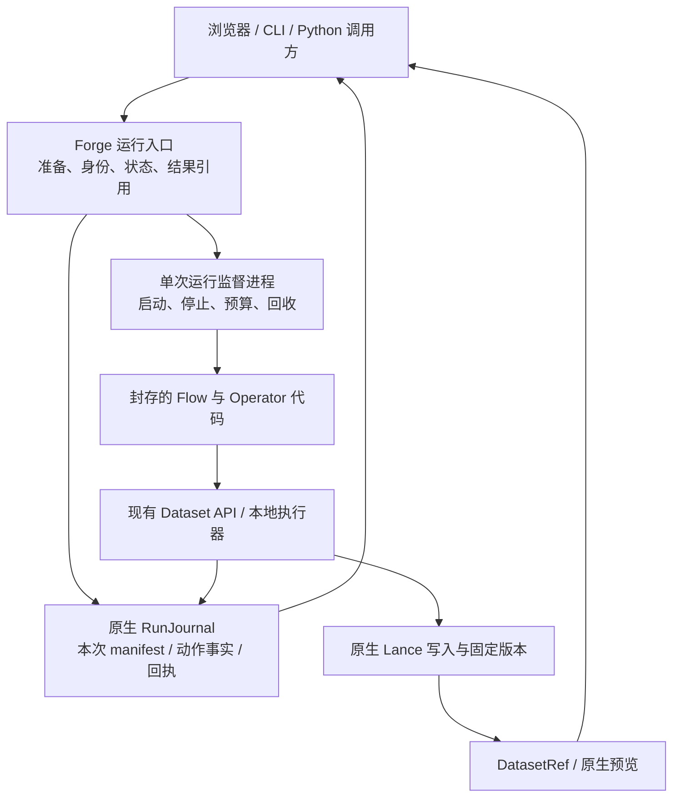

# Forge 第三阶段：执行、结果表与实验查看

日期：2026-11-02。状态：方案已获用户批准并实施。实际验收与当前限制见 [第三阶段验收](forge-stage3-acceptance-20261102.md)。

前置：第二阶段已完成工作区、Flow/Operator 静态契约、固定版本表引用及独立查看界面。第三阶段接通一次本地实验的执行与结果查看，不修改旧 Forge v1 的三节点生命周期，不把静态检查报告改造成执行引擎。

## 1 用户最终完成的操作

用户可以选择 Flow、配置和固定输入版本，查看本次将使用的输出位置与预算，启动一次实验；离开浏览器后实验继续。重新打开工作区可查看运行状态、错误、真实输出表及图文 case，按明确业务键对照输入输出，比较 A/B 两次实验，并选择已提交的结果版本作为另一条 Flow 的输入。

例子：当前题目筛选 Flow 的 A 配置门槛为 0.80，B 为 0.90。第三阶段实际运行并保存两份独立结果。当前演示 fixture 已验证 A 包含 c01/c02，B 包含 c01，输出顺序不作保证；实际运行身份见验收文档。

| 用户操作 | 第三阶段的交付 |
| --- | --- |
| 准备运行 | 选择已有 Flow/参数、固定输入、输出身份与资源配置；查看实际将执行的接线和路径 |
| 开始、查看、取消 | 获得独立 run_id；查看状态、耗时、当前动作、有限日志；发起取消并等待停止事实 |
| 看结果 | 从运行详情或输出节点直接打开已核验的固定版本表，不需要手工寻找路径 |
| 看前后变化 | 选择输入/输出表及业务键，查看对应 case、字段变化和图片；明确缺失/多重匹配 |
| 比较实验 | 对照代码/参数/输入版本、实际输出行数及指定 case；不把静态配置差异称为效果差异 |
| 继续加工 | 将某次运行的准确输出版本接给已有 Flow；新建运行，保留来源关系 |
| 修改方案 | 人或 coding agent 在 flows/operators 修改代码，再检查、准备和运行；接线图仍为查看入口 |

本阶段不提供拖拽编辑、Notebook 状态捕获、自动最小重算、失败后自动续跑、模型/Agentic 执行、定时调度、多人审核写回或生产发布。实验成功不等于业务质量通过，也不等于第四阶段的正式放行。

## 2 从代码确认的复用点与缺口

| 现有实现 | 确认的事实 | 第三阶段处理 |
| --- | --- | --- |
| `forge/workspace.py`、`flow_check.py` | 报告绑定源码闭包、有效参数、固定表、平台；要求受管写入返回回执，已有多动作事实 | 保留检查器；运行必须引用一次具体检查结果，不接受只传函数路径直接跳过检查 |
| `data/dataset.py`、`execution/local_kernel.py` | 原生 Dataset 执行动作，local_execution 提供本地执行与预算入口 | 直接调用封存的 Flow；不按图逐节点重放，不改写成固定三节点 |
| `data/plan.py` 的 StandardCallable/BoundCallable | 存在原生业务 callable 调用入口；目前并不完整验证注解描述的实际返回值 | 增加可选的原生运行契约校验，默认原生调用行为不变 |
| `lance/model.py`、`write.py` | 回执有真实 committed_version、schema_hash、行数、committed/indeterminate；create/版本冲突有原生语义 | 原样保存原生回执，按回执读回；不能凭文件存在或进程退出 0 判成功 |
| `execution/run_journal.py` | 已有不可变 manifest、stage 引用和完成记录；还没有完整的运行状态、动作意图和有界事件接口 | 在同一个 RunJournal 中增加版本化的有限运行事实，不另建 Forge 运行数据库 |
| `observability.py`、`execution/observation.py` | 已有动作与读取进度日志，观察通道是 best-effort，解析器会丢弃部分字段 | 作为显示进度的辅助信息；提交回执使用可靠记录通道，不从日志反推 |
| `lance/refs.py`、`registry.py`、`preview.py` | 已有 DatasetRef、Catalog 和有界 case 读取 | 继续使用同一种表引用和原生预览；按运行结果扩展入口，不另造结果存储 |
| `execution/local.py`、`contracts.py` | 完整 PipelineBackend 要求 PipelineBundle/环境制品，运行身份仍有限定 demiurge 的历史条件 | 本阶段使用 Dataset 原生执行及通用进程设施，不生成伪 Pipeline 包绕过条件；正式包交付保留给第四阶段 |

原生 `DatasetCommit` 目前主要封闭 append 的意图窗口，`reconcile_lance_append` 依赖 append 的准备信息，不能直接宣称已解决 create 运行在崩溃后的恢复问题。

## 3 架构与所有权



- **Forge** 管一次运行的身份、前置检查、进程生命周期、运行记录及结果入口；不调度数据分区或逐节点任务。
- **data/execution** 管原生计划、callable 调用、动作边界、资源与实际执行。运行契约校验和可靠动作通知属于这一层，不依赖 Forge 模块。
- **lance** 管提交、回执、固定版本及提交核对。Forge 不直接拼 Lance manifest、推测版本号或替换写入算法。
- **界面** 读同一份检查报告和运行记录，发起明确操作；不持有另一份 DAG、状态机或表身份。

新增一个薄的 Forge 运行模块和一个固定 worker 入口即可。既有工作区模块、查看服务、原生 journal 和 callable/action 边界做必要扩展；不引入队列服务、工作流框架、全局调度器或业务算子注册层。

## 4 工作区、接线与一次运行

```text
workspace/
  flows/                         # 人/agent 维护的接线、参数及实验配置
  operators/                     # 普通 Python fn/actor
  tables/                        # 用户选择保留的固定表别名
  data/
    ...                          # 原有数据
    runs/<run_id>/selected.lance  # 本次实际结果；本地自有数据根
  .forge/
    inspections/                 # 原有检查报告
    runs/<run_id>/
      run.sqlite                 # 原生 RunJournal；运行记录的唯一事实源
      source/                    # 本次候选源码闭包
      runtime/demiflow/           # 本次绑定的平台 Python 副本
      inspection.json            # 精确检查报告的不可变副本
      effective-params.json      # 本次实际参数；派生记录，不是新的配置作者入口
      logs/                      # 有上限的诊断日志
      work/                      # 本任务临时文件；生命周期独立于结果表
```

数据仍在已声明的数据根。`.forge/runs` 存记录和代码，不存另一套业务数据。外部输入保持原位置、只读、固定版本；运行不自动复制整张输入表。

运行 ID 标识一次尝试，表版本标识一次提交；二者不能混用。修改 Flow、重新执行或改变输入配置，都创建新运行，旧运行的事实不改写。

本次 manifest 使用独立的 `demiflow_forge_run_manifest_v1` 格式，至少记录 run_id、入口、检查摘要、源码闭包摘要、参数来源与有效参数、固定输入引用及位置、输出计划及业务元信息、平台/环境身份、资源配置，以及可选的来源 run/output。比较键是查看配置，不能改变 Flow 的业务参数。动作记录另存 action_id、意图、原生回执、错误与结果引用；可变状态不参与不可变 manifest 摘要。

## 5 准备与执行协议

### 5.1 准备：得到一份可核对的执行计划

1. 选择 Flow 入口和 flows 内的参数文件；输入表在准备时固定，禁止执行时追随 head。
2. 展示输出名、位置、写入模式、表业务标识及 schema 名/版本。schema 名/版本是业务元信息，不证明实际数据结构；结构以回执及原生表元数据为准。
3. 默认建议将本次新输出放到 `data/runs/<run_id>/<output_name>.lance`。**这是准备阶段显式生成的有效参数，必须显示与原配置的差异，并重新 inspect；运行中不暗改目标路径。** 精确使用配置中路径也可以，但必须是尚不存在的自有目标。
4. 使用既有参数/接线接口做完整检查，保存绑定真实输出路径的报告。原检查报告只作为来源，不能拿旧路径的摘要批准新路径。
5. 为各个已声明输出补齐 DatasetRef 所需的 dataset_id、schema_name、schema_version；这些是运行请求中的表登记信息，不改变业务 callable 的签名，也不增加第二份字段 schema。UI 与 CLI 使用同一结构。
6. 以源摘要核对后复制候选闭包，包含实际导入的 helper 和包初始化文件。记录平台、规则、环境、输入、资源配置、比较键等事实，形成不可变 manifest。
7. 返回 `run_id + prepared_digest` 和诊断。本步不导入候选代码，不读全量业务行，不执行 Flow。

原参数格式、Flow 的 `target['uri']` 用法和原生 Dataset API 保留。自动生成的有效参数只是本次运行证据；用户要把变体作为项目默认配置保存，仍明确保存到 flows，不能把 `.forge/runs` 变成另一处接线作者目录。

### 5.2 启动：只执行刚才准备的内容

`start(run_id, expected=prepared_digest)` 在短期工作区锁内原子核验并启动；同一启动请求重发返回同一运行，不重复执行。主动重跑创建新 run_id 和新目标。

- 核对 prepared 状态、摘要、源文件、原配置/表引用和平台是否仍一致；准备后发生相关变化则拒绝，提示重新准备。未依赖的源码文件不影响本次。
- 输入固定版本仍须存在，输出须自有、无越界/符号链接、互不重叠且不覆盖输入；所有输出在启动前先检查一次。
- 独立进程只加载封存的候选闭包。候选与可信平台导入空间分开，拒绝通过工作区同名模块覆盖平台。
- 平台 Python 代码按绑定快照保存有限、只读的执行副本并核对实际导入来源；现有依赖环境只读使用，运行不安装包、不修改共享环境。依赖身份运行前后复核，运行期间发生变化时标记绑定异常，已提交数据保留但不能标为该绑定下成功。
- 本阶段不承诺完整环境的离线重建或恶意同用户进程对抗。封存代码和受限子进程也不等于完整 OS 沙箱；正式依赖制品交付属于第四阶段。

### 5.3 调用：执行原 Python，图只用于核对与展示

worker 在显式 local_execution 配置下调用封存的 Flow。Flow 中的原生 write_lance/materialize 按原有 Python 顺序触发动作，Dataset 执行器负责计算。

增加一个原生的可选运行上下文，负责两件事：

1. **执行前核对。** 在动作开始读取/计算之前，将实际原生逻辑计划、输入版本、callable 身份、动作类型及目标与绑定报告对应的动作核对；未知、多余、缺失或不一致都阻断。多动作以报告中的动作顺序及原生计划事实匹配，不只按函数名称或目标 basename 匹配。materialize 产生的原生句柄关联其动作身份，不把内存地址当稳定身份。
2. **记录实际事实。** 在动作前持久化意图，在动作结束记录真实结果/异常，尤其是写回执；记录失败时停止后续动作。记录和回执关联失败的提交保持待核对，不能把记账失败当成写入没发生。

原生计划规范化由 data/execution 所有，读取既有连接语义；Forge 不再解释一套方法名，也不通过 monkey patch、AST 改写、假的 Dataset 或逐节点调度来执行报告。原生 API 未启用该上下文时保持现有调用语义。

### 5.4 实际 Operator 端口验证

静态注解不能证明函数实际返回值，因此受管运行需要在原生 StandardCallable/BoundCallable 入口启用校验。校验契约取自本次绑定的同一份参数/返回事实，以纯数据随原生执行传到实际 worker，不新增业务装饰器或业务注册表。

- 在调用前检查实际消费的字段是否存在、null 是否允许、值类型是否符合输入契约。
- 在返回后、映射/过滤前检查返回类型与必要键。filter 必须实际返回 bool；不接受 dict/整数的 truthiness 冒充布尔契约。
- 字段式 map 与整行 map 保持既有字段保留/替换规则；TypedDict 的可选键与 nullable 分开验证。
- 契约错误带动作、节点、算子位置和有界字段定位；不记录整条业务 payload。契约错误不能被普通 catch 丢弃后继续冒充正常行。
- 所有实际经过校验入口的行都检查，不只抽样；未经过的分支、被 limit 截断的行不声称已验证。
- 不承诺证明业务正确性、输入对象未被修改、所有异常路径或线程安全。算子抛出异常仍按已支持原生语义处理。

第三阶段首批运行范围是已通过检查的 **本地同步** read/map/filter、join/union、列操作/limit、materialize 和 create 写入，支持多个独立输出。纯计算 actor 仅在同步调用与清理协议确实覆盖的范围内准入；异步 actor/stream、模型节点、第三方未知调用等显示“静态可查看，当前运行配置不支持”，不能悄悄改成另一种执行方式。

## 6 结果表与提交边界

### 6.1 一次写入的闭环

```text
保存动作意图
  → 调用原生写入
  → 持久化原生回执
  → 按 committed_version 核对表的 schema/行数
  → 构造原生 DatasetRef
  → RunJournal 登记本次产物
  → 界面提供“查看结果”
```

不猜版本号，不用 latest，不凭输出目录存在认定成功。回执行数是该次写入的行数，读取表元数据也必须指向同一固定版本。

输出的稳定定位为 `run_id + output_name → location_id + DatasetRef`。表级来源关系放在运行 manifest/journal：本次输入、Flow、代码、配置、平台、动作及回执；不修改既有 DatasetRef 字段。

运行产物自动出现在运行详情和“数据表”的运行产物分组。它们直接使用 DatasetRef 进入原有预览，**不为每次运行自动创建几十个 tables 别名**。用户点“保留为输入表”才建立明确别名，冲突时按现有摘要比较替换规则处理。

第三阶段不强制将每次临时实验写入长期 Catalog/ReleaseRegistry。RunJournal 已登记结果的来源，工作区别名管理复用已有 attach；需要长期 Catalog 登记时只能调用原生能力，不让 Forge 新建登记表。生产发布仍属第四阶段。

### 6.2 写入范围与空结果

- 首批受管运行采用 create，新实验默认新目标，不提供 append/overwrite/merge 执行。第二阶段能静态检查这些调用，不等于本阶段已经覆盖它们的运行恢复；原生 API 本身保持原能力。
- 已存在目标直接报冲突，不自动删表、改名后偷偷重试或覆盖。
- 多输出各自独立提交。前一个输出成功、后一个失败，保留前者并显示“部分结果已提交”，不声称全局回滚。
- 当前检查器不支持在 Flow 内构造 Arrow sink schema。无显式 schema 的原生空写入继续明确失败，不生成假的空表。**首批运行因此不能把空筛选结果保存为成功的 0 行表。** 若后续增加空表支持，必须先在原生 API 定义可检查的 schema 输入，单独验收后开放；不能在 Forge 根据粗粒度注解猜 Arrow schema。
- 外部文件图片不随表版本自动固定或搬运。输出仍引用同一自有数据根中的图片时可直接预览；跨数据根的路径字符串不自动转成有权限的媒体引用，可在输入侧 case 对照查看原图。

### 6.3 中断与提交不确定

动作意图先落盘，写回执随后落盘；进程可能在两者之间停止。此时输出状态必须为“待核对”。不能自动重跑，也不能宣称一定未写入。

需要在 lance 所属层补充 **仅用于本阶段 create 的只读提交核对**：核对事先保留的精确目标与原生 request_hash、事先记录的唯一 operation_id 提交标记、对应固定版本、schema/行数等可用证据。既有 append 恢复不冒充 create 恢复。request_hash 只证明请求形状，不能区分同一路径上的另一笔 create；每次写动作必须在意图中记录独立 operation_id，并由原生 writer 写入提交标记。

- 证据齐全时记录 recovered committed，并核验实际表；核对不调用算子或再次写业务数据。
- 证据不齐、版本/归属冲突或扫描超限时保留 unknown。不能凭“没查到”断言全历史未提交。
- 运行中或未确认原 worker 停止时不启动恢复写操作。本阶段恢复只有读取证据、补结果登记；没有自动续跑。
- 提交成功但结果登记失败：保留原生回执和已提交表，界面显示“已提交，结果登记待完成”。允许幂等补登记，不重新执行 Flow。
- 存储暂时不可读是可用性故障，不改写历史提交事实。历史结果被外部清理后显示“版本不可用”，不自动换到新版本。

## 7 运行状态、取消与服务生命周期

### 7.1 分清运行结论和每个输出的事实

| 运行状态 | 用户含义 |
| --- | --- |
| prepared | 已准备，尚未执行 |
| starting | 正在准入/装载，尚未进入业务动作 |
| running | 原生动作正在执行 |
| stopping | 已请求取消，正在停止和排空；不能立即显示“已取消” |
| succeeded | 入口正常结束，全部预期动作完成，全部输出回执与固定版本核验通过，结果已登记 |
| failed | 有确定执行/契约/资源错误；同时展示已提交、未开始和待核对输出 |
| cancelled | 因用户取消终止，实际任务已停止；已提交输出仍保留 |
| interrupted | 监督进程/worker 非正常消失，按动作意图及回执核对结果 |

每个输出独立保存 `not_started / writing / committed / unknown` 及结果核验、登记状态。UI 在 unknown 时优先显示“待核对”，有 committed 但运行未成功时显示“部分结果已提交”。不把这几种情况压成单一红绿灯。

取消原因、超时、预算超限、异常类别单列，不靠日志字符串猜终态。实际提交已经完成且满足全部成功条件时，晚到的取消不改写为 cancelled。

### 7.2 进程与连接

- 每个工作区最多一个活跃运行，无待执行队列；准备中的记录不是已排队任务。多个 CLI/页面竞争由持久锁和状态比较原子处理。
- 单次监督进程与浏览器 HTTP 请求解耦，持有运行租约，启动并管理原生 worker 进程组。刷新、关闭页面或 SSH 端口转发断开不取消任务；服务器进程仍在的前提下可重连查看。
- 启动握手前不报告 running。HTTP 重发通过 run_id/摘要幂等处理；不能仅靠前端禁用按钮避免重复运行。
- supervisor 失效时清理属于本运行的 worker/子进程；下次打开按锁、进程启动身份和持久事实展示“疑似中断，待核对”，不能仅凭 PID 猜测或杀进程。只读查看不修改终态；显式 reconcile 核实后写入 interrupted 及输出核对事实，不重启任务。
- 取消先合作停止新工作并排空正在提交的动作，有限宽限后才强制结束本任务进程组。强杀后的不确定提交按第 6.3 节处理。
- 已提交表和恢复证据不属于可自动清理的临时文件。磁盘清理只处理该运行确认为临时且未提交的资源。

现有只读 `workspace view` 保留默认语义；显式运行模式增加运行操作入口。查看、导出、刷新状态均不能隐式启动、续跑或变更数据。SSH 的回环 Host/Origin、会话 token 和请求限制继续保持。

## 8 可视化方案：围绕用户任务组织

沿用现有界面与 case 组件，新增“运行记录”入口，调整 Flow 详情的主次，不建设另一套前端产品。

### 8.1 Flow 页：我要运行什么

页面首先显示用途、输入表、配置差异和计划输出，再显示图与源码。主操作为“准备运行”。准备页显示实际输入版本、参数变更、真实输出位置、资源配置以及阻断原因，点击“开始运行”后进入运行详情。

技术摘要、平台摘要、原始 JSON 和完整规则放到可展开详情。用户正常浏览 case 不需要阅读契约编号或哈希。

### 8.2 运行详情：现在怎样，有什么结果

顶部显示状态、开始时间/耗时、配置名、来源 Flow 和“取消”操作。紧接着是产物列表：输出名、实际版本、行数、提交/核验状态与“查看结果”。错误应显示可定位原因和下一步，例如重新准备、修复算子、释放自有临时空间或核对提交。

同一张静态接线图叠加本次运行事实：

- 写入/materialize 动作显示未开始、执行中、完成、失败或待核对。
- 懒节点不伪装成逐个顺序完成；默认显示“属于当前动作的计算范围”。没有单节点测量就显示未单独测量。
- 同一上游被多个动作使用时展示动作归属和可能重复计算，不能标成全局只运行一次。
- 实际完成只表示观察到的执行范围；limit/过滤后的消费不能证明全部上游行都执行了某个算子。
- 有可靠行数/批次就展示其口径，未知总量不显示百分比或预计剩余时间。过滤、join 扩增不拿输入总行数充当进度分母。

第一版每 1 秒有界轮询状态/增量事件即可，不引入 WebSocket、消息总线或逐行日志。日志是辅助排错入口，不能成为用户理解业务流程的主入口。

### 8.3 结果页：看 case 和对照

“查看结果”直接进入固定版本数据表，沿用分页、投影、文本、图片和原始字段查看。顶部说明由哪次运行生成、使用哪些输入版本和参数。

“与输入对照”必须选择表对及业务键；可把常用选择保存在运行查看配置中。默认不使用行号或假定一一对应；重复键显示全部预算内匹配并标明还有更多，缺失明确说明。若结果未保留关联键，解释原因，不伪造行级血缘。

### 8.4 A/B 对比与继续加工

- A/B 对比同时展示配置/代码/输入身份差异、实际产物行数，以及选定 case 的字段对照。
- 没有质量指标契约时，不自动打“更好/更差”结论。首版不是全量差异分析器，不默认全表 join 生成“仅 A/仅 B”统计；这些统计可由明确、有预算的 Flow 产生。
- “继续加工”把选定输出的精确 DatasetRef 接给已有 Flow 的输入槽，再准备一份新运行；记录来源 run/output，不修改旧结果，也不自动追随该逻辑表的最新实验。
- materialize 只是原生执行期间的物化，不能当作重启后可复用的中间表。希望跨运行复用时必须显式 write_lance 保存；局部实验用明确入口和固定中间表，不自动切任意图边执行。

## 9 人与 coding agent 的同一操作入口

拟定入口（设计名称，当前不可用）：

```text
forge workspace run prepare ROOT ENTRY --params flows/select_a.json ...
forge workspace run start ROOT RUN_ID --expected PREPARED_DIGEST
forge workspace run list/show ROOT ...
forge workspace run cancel ROOT RUN_ID
forge workspace run reconcile ROOT RUN_ID
forge workspace run compare ROOT RUN_A RUN_B
```

prepare 的结构化请求包含参数来源、明确输入选择、输出计划/元信息及有限资源配置；为保留旧 v1 的 `forge run PROJECT --config ...`，实际命令归于 `forge workspace run`。CLI 与 UI 使用同一数据结构，Python 使用同一运行函数。开始、取消、核对均为明确写操作入口；GET 只读取事实。

Notebook 和普通脚本可以调用这些入口。直接调用原生函数仍是普通原生运行，不自动获得 Forge 运行凭证；不能把任意 Notebook 内存状态补写成通过记录。

## 10 资源、保证范围和初始限制

沿用源码/检查/预览的现有上限。以下为本地实验默认配置；实现必须真实传到每条受支持执行路径。无法覆盖时拒绝该路径，不仅写入 manifest 声称受限。

| 资源 | 初始配置与处理 |
| --- | --- |
| 并发 | 每工作区 1 个活跃运行、0 个等待任务；本地 Python worker 默认 1，原生线程至多 2 |
| 时间 | 准入 30 秒、运行 600 秒、取消宽限 10 秒；到期停止本任务，记录真实原因 |
| 原生池与进程 | 原生管理池 256 MiB；整个运行进程树 RSS 监控阈值 4 GiB，计入 driver、Python worker、native worker；不得只看父进程 |
| 分配保护 | 各受管进程加载可信依赖后，虚拟地址空间上限设为基线加 1 GiB、绝对至多 8 GiB；可用余量不足则拒绝，不能先无限分配再校验 Python 返回值；该限制不等于 RSS |
| 行与批次 | 批次至多 256 行并受原生字节约束；单行预算对齐原生至少 8 MiB 的限制，不虚构更小原生硬限制；Python 值递归校验受深度/项数/字节限制 |
| 实验规模 | 输入元数据行数合计默认最多 100,000；每个物化/写动作输出最多 200,000 行，超限失败而非截断提交；join 扩增仍需批次/输出/磁盘保护 |
| 临时与输出 | 临时目标预算 4 GiB，结果编码文件目标预算 2 GiB；启动前检查余量，运行中计量本任务路径；不足时停止，不删除别人的数据 |
| 记录 | 最多 32 个动作、10,000 条控制事件/16 MiB；日志总计 16 MiB，轮转并明确截断；关键回执预留容量，不能被心跳挤掉 |
| 运行目录 | 每工作区最多 128 个运行记录；元数据及源码副本合计最多 1 GiB，不包括业务结果；满后拒绝新建，不自动删历史 |
| 文件与查看 | 子进程句柄上限 1,024；状态分页及日志游标有界；case/图片继续使用第二阶段的原生预览限制 |

保证必须分层说明：原生内存池只覆盖其管理分配；RSS 和目录容量的轮询阈值允许检测间隔内的超调，不是 cgroup 或磁盘配额硬隔离。受管 worker 还需分配限制与有限进程/队列作为最后保护，不能以事后检查冒充分配前限制。若环境提供本任务专属 cgroup/配额可以收紧，但第三阶段不要求修改共享系统配置，也不把它当作默认存在。

输入投影、预读、Python 对象及序列化副本、关系引擎、writer 缓冲都必须计入实际路径验收。尤其要补齐纯 Lance copy、窄 map/filter、关系 join/union 和 materialize 的差异，不能只测 join 路径的 native_resources 就宣布所有路径受限。

当前预览的直连本地表、目录/fragment/祖先位置索引限制继续适用。第三阶段不借执行入口绕过这些身份和读取支持范围，也不自动接入生产大型索引。

## 11 新增运行门禁与验收矩阵

既有 FL/OP 编号和含义保留。新增运行检查属于运行协议，不能用放宽 FL/OP 让原先 unknown 的代码执行。

| 门禁 | 检查时机及保证 | 必测场景与通过标准 |
| --- | --- | --- |
| EX-01 身份一致 | 准备、启动、worker 装载及结束；实际执行封存代码与绑定环境 | 改源码/helper/参数/输入/平台；准备与启动竞争；候选模块覆盖；相关漂移拒绝或记录异常，无关文件不误伤 |
| EX-02 执行能力 | 启动前核对原生语义和本地运行配置覆盖 | 合法多输入、多 map/filter、关系操作与多输出；async/模型/不支持写模式明确阻断；新同语义 API 无方法名旁路 |
| EX-03 位置与版本 | 启动和实际动作前，输入固定、写入自有新目标 | 输入版本消失、只读输出、读写重叠、符号链接、create 冲突、并发占用；不读 head、不覆盖原表 |
| EX-04 实际端口 | 原生实际调用前后，实际计划核对与值校验 | 返回类型不符、filter 非 bool、必需键缺失/null、重复/缺失 join 键、limit；正确行保持原语义；契约失败不被 catch 吞掉 |
| EX-05 提交事实 | 动作前意图、提交后回执、固定版本读回 | 回执丢失、提交后崩溃、版本归属不符、登记失败、空结果；无证据不标成功；核对不重复执行 |
| EX-06 停止与资源 | 准入、实际数据路径与取消清理 | 宽行/不可拆对象、倾斜与 join 扩增、慢消费、磁盘不足、时间到期、取消、监督进程死亡；任务资源可回收，已提交结果不删 |
| EX-07 多动作 | 每个动作独立事实、完整运行结论 | 第一表已提交第二表失败/取消；materialize 与共享上游重复计算；只保留真实提交，不虚构回滚或全部成功 |
| EX-08 结果入口 | 表引用必须来自已核验回执/恢复证据 | 真实 A/B 集合、schema/行数与引用一致；case 对照重复/缺失；结果继续接下游固定版本；外部清理不切换 latest |
| EX-09 操作幂等 | 启动/取消/核对与记录更新 | 重复点击、HTTP 超时重发、两个终端启动、取消与结束竞争；同 run 仅执行一次；主动重跑创建新 run |
| EX-10 可见事实一致 | UI、CLI、Python 和运行图使用同一记录 | 断开浏览器/SSH 后重连、有限日志分页、进度口径、历史与当前代码差异；未知进度和提交明确展示 |

验证方式：自有离线 fixture 与故障注入，不调用真实模型、不触碰生产表或共享环境。A/B 业务预期、实际 Operator 值契约、资源压力和崩溃窗口要有各自证据；正常小数据运行不能代替边界验收。

必须验证原生直接调用与旧 Forge v1 不被新上下文影响；运行入口、前端资源、worker 和规范随 wheel/sdist 正确打包。运行成功仅证明本次输入、范围和覆盖项；第四阶段仍需正式测试/Review/Freeze。

## 12 实施顺序与 Review 重点

Review 通过后按以下顺序实施，每一步都有可观察验收：

1. **执行最小闭环**：精确 prepare/manifest/源码封存、同步原生调用、实际端口校验、create 回执和读回。先用 CLI 实际跑通现有 A/B fixture。
2. **失败闭环**：多动作记录、取消、预算、进程中断、提交不确定与幂等补登记；完成必要边界测试后再开放 UI 运行按钮。
3. **结果接入**：原生 DatasetRef 结果列表、case 输入输出对照、固定版本继续加工，保持表与运行所有权清楚。
4. **界面与联合验收**：准备/开始/状态/取消/查看结果/A-B 对比，验证真实 SSH 转发及浏览器断开重连；给出可独立操作的完整使用演示。

本轮 Review 的关键决策：

1. 运行真实 Flow 代码，复用 Dataset 执行；图和检查报告不是第二份可执行 DAG。
2. 首批聚焦本地同步计算、新建结果表和多输出；不顺手开放模型、远程存储及覆盖/追加。
3. 每次实验独立身份和默认独立结果路径；路径变化在准备时可见并重新检查。
4. 实际值校验与可靠动作/回执记录在原生层；结果管理使用现有 RunJournal 和 DatasetRef。
5. 状态、提交确定性与结果可用性分开；部分成功、登记失败、待核对不被简化成成功或空结果。
6. 继续加工靠显式固定中间表，materialize 不等于可长期复用结果；没有自动续跑或图切片引擎。
7. 无 schema 的空输出保留原生失败边界；首批不猜测 schema 创建空表。这是明确的用户功能限制。
8. 界面优先呈现输入、配置、运行状态和结果 case；底层摘要收起，用户不必依赖 agent 解读项目。

已更新工程标准内容版本至 2.1.0，并按本方案实施。历史报告不改写；最终证据、实际结果和分发验证见第三阶段验收文档。
