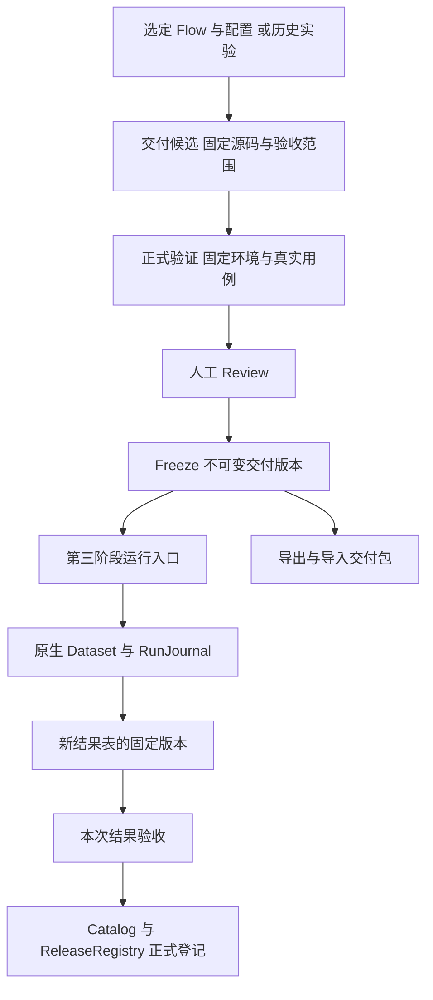

# Forge 第四阶段正式验证与受管交付设计

日期：2026-11-02。状态：待用户 Review，尚未实施。

第四阶段把选定的实验实现变成有验收依据、可审查、可冻结、可重复执行的交付版本，并将每次执行的实际结果登记为正式结果集。工作区继续支持多条 Flow 和自由实验；冻结对象是选定的实现与配置，不是整个工作区。

本阶段沿用第三阶段的本地同步、纯计算 fn/actor、固定 Lance 输入和 create 新表范围。模型、Agentic、远程执行、append/overwrite、自动续跑及生产放行继续留在后续阶段。

## 1 用户能完成什么

| 用户操作 | 得到的结果 |
| --- | --- |
| 从历史实验选择“创建交付候选” | 明确选中的封存源码、配置、输入版本、输出定义；工作区后来修改的文件不会偷偷混入 |
| 填写验收要求，关联测试与 Case | 看见每条要求用什么测试或人工检查验收，哪些还未完成 |
| 点击“正式验证” | 在固定制品环境中重新执行规定用例，得到测试、实际结果、资源与失败证据 |
| 打开 Review | 看固定接线、源码差异、覆盖情况、输入输出 Case，提交通过或驳回及具体问题 |
| 点击 Freeze | 生成不可变交付版本；缺少必要证据、存在 blocker 或身份不一致时明确拒绝 |
| 导出、导入交付包 | 在满足宿主要求且具备相同输入版本的位置恢复该版本，检查缺失依赖与数据 |
| 从冻结版本发起受管运行 | 新建运行和输出表，用同一套第三阶段运行界面查看、取消、核对提交 |
| 验收本次结果并“登记交付结果” | 得到关联冻结版本、运行、结果验收和固定表版本的正式结果集 |
| 继续编辑工作区 | 开展新实验；旧冻结版本、历史 Review 和已登记结果保持原来的含义 |

界面分别显示“实现已冻结”“运行成功”“结果已验收”“结果已登记”。任何一个状态都不冒充其他状态。

## 2 架构与职责



| 层 | 本阶段职责 | 复用位置 |
| --- | --- | --- |
| Flow / Operator | 保持已有接线、参数、调用闭包和运行时端口约束 | `forge/flow_checks.py`、原生 callable/flow/runtime contract |
| Forge 交付生命周期 | 选定版本、证据绑定、Review、Freeze、交付包与门禁 | 新的工作区交付模块，薄 CLI / HTTP 入口 |
| 原生环境管理 | 校验 wheel 闭包，构建并核对隔离环境 | `execution/contracts.py`、`requirements.py`、`python_environment.py` |
| 受管运行 | 在冻结来源上准备和运行，继续记录实际提交与失败 | `forge/runs.py`、`run_worker.py`、`execution/checked.py`、`RunJournal` |
| 数据登记 | 结果表固定引用、整组结果的可见登记 | 原生 `Catalog`、`ReleaseRegistry` |
| 可视化 | 展示同一份身份、证据、Case 和状态；调用相同门禁 | 现有工作区页面与结果查看组件 |

**保持一个接线标准、一套 Dataset 执行、一套运行事实、一套表登记机制。** 验收文件只定义要求和用例，不表达第二份图；测试执行器只运行受限测试进程，不调度业务节点。

### 2.1 与现有代码衔接的具体决定

旧 `forge/manifest.py` 仍按 v1 的单 map 结构取节点，旧 `lifecycle.py`、`verify.py` 基于单项目检查。工作区 Flow 使用新的版本化交付记录，不向旧 v1 Manifest 填多节点，也不借用旧通过记录。旧命令和历史证据保留各自含义。

原生 `PipelineBundleRef` / `LocalPipelineBackend` 当前以 `PipelineProgram` 为入口；直接套用会引入另一套启动路径，并缺少第三阶段的相同检查和运行事实。第四阶段细化路线图中的“复用原生 Pipeline 执行”为：**复用原生环境、Dataset、journal 与表发布机制，直接扩展已完成的 Flow 受管运行入口**。用户不需要补写 `PipelineProgram`，平台也不生成伪包装程序。将来确有远程后端需求时再单独设计接入。

环境身份中 `distribution == "demiurge"` 等硬编码应在原生所属层修正，依据实际 wheel 的发行名、内容与契约版本识别独立 demiflow。严格制品策略使用新版本，旧 ABI / 策略保留兼容测试；不伪造发行名，也不以兼容垫片绕过检查。

## 3 交付单元与存放位置

### 3.1 首版固定什么

一个交付候选固定以下内容：

1. 一条 Flow 入口及静态可确定的源码、operator、helper、声明资源闭包。
2. 一份主配置、输出名称和端口约束，以及规定的有限验证用例配置。
3. 主配置和用例的准确输入表版本、数据根身份与内容完整性证据。
4. 业务用途、验收条目、必需测试、人工检查范围。
5. 平台 wheel、工程标准、依赖 wheel 的完整闭包，以及宿主兼容要求。
6. 验证和执行的资源上限、允许的能力范围。

**首版建议固定业务参数和输入版本。** 改阈值、输入版本、代码、测试、验收要求或依赖，都产生新候选，并重新验证、Review、Freeze。内容相同的文件和环境制品可复用，旧业务通过结论不能沿用。

运行时仅允许生成新 run ID、新输出路径，以及显式迁移同一数据根中的相同固定输入。预算可在预先定义的合法区间内收紧，不能提高冻结上限；收紧导致失败不改写历史验证结论。首版不增加“任意输入或参数范围已获认证”的策略引擎。

这限制的是正式证据的适用范围，工作区的动态组合和实验入口保持原能力。需要长期重复加工不同批次时，后续单独设计输入条件与批次验收契约。

### 3.2 文件与数据的分工

```text
workspace/
  flows/
    questions.py                  # 唯一接线来源
    select_a.json                 # 已有参数规范
    select_a.acceptance.json      # 新增：验收条目及用例引用
  operators/                      # 已有算子规范
  tests/                          # 普通 pytest 业务断言
  tables/                         # 人可读的表引用及别名
  data/                           # 业务输入、各次实际输出
  notebooks/                      # 可选使用者，不是交付接线入口
  .forge/
    deliveries/<candidate_id>/    # 固定载荷及追加的验证、Review、Freeze 记录
    runs/<run_id>/                # 沿用第三阶段运行记录
    artifacts/                   # 按摘要复用的 wheel 与原生受管环境缓存
```

候选只收集可确定的相关闭包；同文件内暂时无法安全拆分的内容按完整文件封存。未解析的导入、仓库外 helper、隐藏 Notebook 内存状态不进入正式交付。与选定入口无关的其他 Flow 和 Notebook 编辑不会修改已经封存的候选。

业务数据仍在声明的数据根。交付包默认包含代码、环境制品和证据，输入数据通过固定引用关联；不默认复制整张业务表。包内显示完整依赖清单，导入后必须显式绑定数据位置，缺表或内容不符时不可运行。看 Case 使用的外部图片若属于验收依据，其文件也必须声明并绑定摘要；表里有图片 URI 并不等于图片内容已冻结。

### 3.3 身份链

| 身份 | 覆盖内容 |
| --- | --- |
| `candidate_digest` | 固定源码、主配置、验证用例、输入身份、验收规则、环境锁和预算 |
| `verification_id` 与报告摘要 | 一次正式验证的准确候选、检查结果、用例 run ID、日志和证据摘要 |
| `review_id` 与记录摘要 | 准确候选及准确验证报告、结论、问题、人工 Case 判断 |
| Freeze 回执 | 候选、验证和 Review 三者的摘要与协议版本 |
| `run_id` | 某次真实执行及其位置绑定、实际参数、提交事实 |
| `release_id` | 某次已验收结果的完整表引用集合、Freeze、run 和结果验收记录 |

验证报告和 Review 追加在载荷之外，避免把自己的摘要递归纳入自身。导出包另有传输摘要；重新打包不改变候选身份。创建候选时需给出“与所选实验一致 / 存在哪些差异”；从历史实验创建必须读取该实验封存内容，不能静默使用今天的工作区版本。

## 4 正式验证

### 4.1 验收契约

新增一个封闭字段、版本化的验收 JSON。首版包含：用途、Flow 入口、主参数文件、验证用例、验收条目。每个条目有稳定 ID、具体判定描述，以及必需 pytest node ID 或人工 Case 检查范围。依赖端到端数据的条目必须指定适用用例；主配置必须有对应的成功用例和结果验收条目，不能只测试旁路配置。

测试分两类：

- **实现验证**：在冻结的有限用例上验证行为、边界、失败语义；正式验证时执行。
- **结果验收**：验证本次真实输出满足什么条件；正式验证和每次待登记运行都执行。

至少有一个真实 Flow 端到端用例，以及一个结果验收条目。人工检查可覆盖题面、图片、可读性等不能由现有断言充分判断的内容。每项人工结论绑定具体结果版本、Case 键和内容摘要；抽查必须显示抽查数量、选择规则及总量，不能显示成全量质量通过。首版按预先声明的有限 Case 键检查；键缺失或不唯一直接阻断该项，复杂抽样策略留待独立设计。

验收 JSON 不增加表达式语言或通用规则引擎。断言仍写普通 pytest，平台提供读取本次固定输入输出、受限批次和 Case 的小型 fixture。人负责确定正确要求与预期，coding agent 可据此编写测试；测试数量和通过率不能证明业务要求本身完整。

### 4.2 验证顺序

1. 核对候选内容与工程标准，检查 Flow / Operator 闭包和必要静态事实；未知或不支持项阻断。
2. 核对环境制品，准备严格环境，核对输入固定版本与内容证据。
3. 在该环境中重新生成并核对接线与静态报告，保证图、检查器和实际执行平台一致。
4. 由平台经第三阶段运行入口逐一执行声明用例，生成新表与真实 journal；不把历史实验成功直接当正式通过。
5. 固定测试进程读取平台产生的实际输入输出引用，执行必需测试和结果验收，记录完整收集与执行清单。
6. 核对输入、载荷和环境完整性以及实际提交；封存有界日志、报告与用例结果索引。

自动步骤完成后显示“自动验证通过 / 待人工 Review”；人工项在 Review 中补齐。只有两者都完成才可 Freeze，不将自动报告的 passed 显示成全部业务验收已完成。

必需 node ID 必须确实收集、执行并通过。零测试、缺失、skip、xfail、xpass、进程超时、被取消、报告不完整都不能满足该必需项。平台测试套件通过与业务测试通过分别展示。额外未映射测试可以提供补充证据，不能抵消缺失的必需项。

用例默认预期 Flow 成功；负向用例必须声明具体平台错误码、动作和预期提交状态。观察到准确错误且提交状态匹配，才可认为该负向用例通过；任意异常、崩溃、超时不能当作“预期失败”。

测试由固定驱动收集事实；候选代码写出一个 `passed.json` 没有认证效力。普通 Python 测试仍处于本地可信开发代码模型，私有工作目录、超时、预算和内容核对不构成恶意代码沙箱。证据完整性校验也不提供对同一 OS 用户的防篡改签名。

### 4.3 数据完整性与比较口径

固定 Lance 版本、schema 和行数不足以证明内容相同。正式验证增加有界内容核对，摘要作为交付清单中的独立证据；不改写已有 DatasetRef，也不把文件哈希塞进含义不同的 `content_digest`。

使用原生已定义的内容摘要算法及其支持范围，记录算法版本；不支持的值类型或超过扫描预算时明确拒绝。固定版本在验证前后、正式运行前后及结果登记前按需核对，读回的数据仍通过第三阶段实际值和资源检查。输入只读声明约束受管访问，不声称阻止同一用户从系统外修改文件。

业务结果对比按条目定义：键、重复多重性、null、行数、字段值分别判断。join 的输出顺序仍不保证；用于固定表完整性的顺序相关摘要不能代替跨运行的业务等价断言。

### 4.4 可重建环境的真实要求

第三阶段保存的依赖元数据可用于追溯，但不能证明环境可重建。本阶段的正式通过要求：

- 平台、业务依赖、测试依赖及全部传递依赖均有精确版本、兼容 wheel、摘要和来源记录；解析 extras 与环境 markers，检查依赖冲突。实际安装后的包集合和内容必须匹配清单。
- 在独立环境中离线安装固定闭包，使用 `--no-index` 和哈希校验；禁止 editable、VCS、源码临时构建和缺包时联网回退。测试插件只允许锁定清单内显式启用的插件。
- 平台 wheel 内的源码及标准与候选所声明的平台快照一致；当前 checkout 不能通过 `PYTHONPATH` 覆盖交付环境。禁用复用共享 site-packages / 当前解释器环境的快捷路径。
- 环境缓存由原生层维护：构建锁覆盖整个构建过程，临时目录构建后原子发布，复用前核对安装内容；损坏环境拒绝复用，使用中的环境不得删除重建。
- 宿主 Python、ABI、系统和架构兼容条件明确列出，并执行固定导入预检。可重建 Python 环境不等于封装了操作系统、驱动或完全相同的硬件行为。

制品准备和正式验证分开。制品可在显式准备阶段获取或构建，正式验证、导入后的环境安装及受管运行不自动下载。例如当前定制 `pylance==12.0.0+demiflow.arrowfix1` 必须有匹配制品，不能用共享环境里“已经能 import”代替。

## 5 Review 与 Freeze

### 5.1 Review 看什么

Review 页面固定展示本次候选与验证报告，包含用途、要求覆盖、接线图、源码、配置、输入版本、环境制品、用例结果及 Case。与上一冻结版本比较时，明确列出源码、参数、数据和验收规则分别发生的变化。

Review 记录包含 reviewer、`self` 或 `independent` 声明、通过/驳回、说明、问题列表及必要人工 Case 结论。问题分 blocker / warning；通过不能留下未解决 blocker，保留 warning 必须写明接受理由。静态失败、身份漂移、测试未通过等硬门禁不能由一条 Review 意见豁免。

首版建议 Freeze 必须有用户明确确认的人工通过结论。agent 可以生成 Review 草稿、定位问题、补测试；agent 自评不自动替代人工通过。记录应分别保存评审关系（self / independent）和是否声明人工确认，不把作者本人审查一律当成 agent 自评。当前单用户本地部署的 reviewer、独立性和人工身份均为声明：平台强制要求相应记录存在且绑定正确，但不能技术上证明操作者是人或独立第三方；实名、多用户权限及签名认证属于未来部署能力。

### 5.2 Freeze 的准入条件

Freeze 在同一候选操作锁内一次性核对并原子写入回执：

1. 候选载荷、平台与环境制品完整且身份一致。
2. 最新正式验证尝试已完整通过，没有仍在执行、失败或取消的后续尝试。
3. Review 明确引用这一份验证报告，且必要人工项全部满足。
4. 所有必要证据存在、摘要匹配、没有未解决 blocker。

重复 Freeze 同一证据组合返回同一回执，冲突内容拒绝；失败时不留下“部分冻结”。被冻结的候选结束验证与 Review 写入，变更需创建新候选。冻结前重新验证会使先前 Review 不再适用，不能挑选旧的成功尝试掩盖最近失败。

Freeze 固定的是实现及通过证据，不把表目录、操作系统环境或任意未来输入都变为不可变，也不自动启动运行或登记结果。

### 5.3 什么变化会影响什么

| 变化 | 处理 |
| --- | --- |
| 工作区其他 Flow 或 Notebook 编辑 | 不影响已封存候选和冻结版本 |
| 同一 Flow 修改、阈值改变、输入改版本、验收项改变 | 新候选；原版本及其历史结论保留 |
| 冻结包、证据或实际安装环境被改动 | 显示完整性异常，拒绝新执行和结果登记，不覆写原回执 |
| 同一输入固定版本迁移到新位置 | 显式绑定并核对内容；不得跟随新位置的 head |
| 新机器缺 wheel、宿主不兼容或缺输入 | 显示“冻结有效，当前不可运行”及具体缺项 |

首版不引入撤回审批流程、自动切换 latest 或通用签名系统；历史版本和已登记结果保留可追溯引用。

## 6 受管交付与结果登记

### 6.1 交付包

导出包括固定载荷、全部必需 wheel、验收与 Review 证据、Freeze 回执，以及输入和外部资源清单。业务大表默认是外部固定依赖；有限的人工证据附件可以包含在包内。历史验证的结果表同样以准确引用关联，清单区分“本次运行必需的数据”和“复查历史 Case 所需的数据”；后者缺失时明确显示不可复查，不能把附件样本展示成完整原表。

导入仅做有界解包、协议和摘要检查，不导入候选 Python，不自动安装和启动。拒绝路径穿越、符号链接、重复路径及超量展开；同身份重复导入幂等，内容冲突拒绝。新宿主绑定数据位置后才可显式准备环境和运行。导入界面区分“包完整”“环境就绪”“数据就绪”。

### 6.2 用冻结版本运行

扩展第三阶段运行清单的版本，增加 `workspace` / `delivery` 来源和 Freeze 引用；旧运行格式继续可读。业务仍执行原 Flow，采用同一监督进程、实际计划核对、预算、取消、原生写入与提交核对机制。

准备时展示冻结版本、准确输入、新输出位置和预算。开始时核对冻结证据、环境和数据，将实际位置绑定重新实例化为静态报告，并由原生 checked execution 核对。只允许已声明的 I/O 位置替换；路径相关逻辑若造成拓扑、operator 参数或端口改变，必须拒绝。不能简单删除路径字段后声称两个计划相同。

每次新执行都有新 run ID、新输出位置，保留 create-only 约束。同一次 start 重试幂等；再次业务运行是新尝试。多输出部分成功、失败、取消和提交待核对继续按第三阶段真实事实显示，不能自动发布，也不自动重算。

### 6.3 本次结果怎么成为正式结果

```text
运行成功且所有必需输出已提交
  → 对这次输出执行结果验收
  → 完成这次所要求的人工检查
  → 用户明确登记
  → Catalog 核对 + ReleaseRegistry 写入结果集
```

代码在验证用例上通过，不能代替这次结果的验收。结果检查失败时，运行仍可显示技术执行成功，同时显示“结果验收失败”；保留实际输出用于分析。必须检查全部必需输出，不能只登记已经成功的部分来冒充完整交付。

发布采用原生 `Catalog` 与 `ReleaseRegistry`，引用 Freeze、run、结果验收报告和固定 DatasetRef。写入发布记录之前逐表核对提交、内容及可读版本；每组至多 32 个必需输出，沿用本地统一结果数据根，不在首版拼装跨根全局发布。该发布记录是整组结果对消费者的正式可见边界，**不是跨表数据事务**。

Catalog 已有部分登记、ReleaseRegistry 尚未登记时，只补登记和核对；同 release ID、同内容幂等，冲突拒绝，绝不重新执行计算。可显式关联上一 release ID，不自动覆盖别名或替换 latest。表可在发布前存在，但只有完整 release 记录表示正式结果集可用。

登记读取与列表在原生 registry 层补齐有界精确查询和分页，避免先全量读再切页；不在 Forge 维护另一套结果数据库。

## 7 页面与人机使用方式

新增一个“交付”入口，沿用已有图、源码、运行及 Case 组件：

- **概览**：用途、入口、主配置、输入版本、与上一版本差异、当前门禁和明确缺项。
- **验证**：条目 → 必需测试 / 人工检查 → 实际用例 → 结果表 / Case；显示失败、未执行和不适用的原因。
- **Review**：固定证据、问题、Case 结论、通过或驳回；Review 后可 Freeze。
- **交付版本**：导出 / 导入、环境与数据就绪情况、从本版本准备运行。
- **交付结果**：运行、结果验收、登记状态、结果表及输入输出 / A/B 查看。

页面不自动执行候选代码来预览，也不因打开历史结果启动环境安装。只读服务继续默认只读；交付验证、Review、Freeze、导入与登记另需显式启用写操作，沿用现有 token、同源与 POST 保护。启用普通实验运行不隐含开放交付操作。

人通过页面选择版本、理解接线、看 Case、审查并登记；coding agent 编辑 flows / operators / tests / 验收文件，调用同一 CLI / Python 入口取得结构化诊断。Notebook 只调用这些公开入口，不承担证据库或隐藏接线角色。直接修改 `.forge/` 文件不构成有效生命周期操作。

拟议 CLI 使用独立命名空间 `forge workspace delivery`，包含 `prepare`、`verify`、`review`、`freeze`、`export`、`import`、`prepare-run`、`validate-results`、`publish`、`show` / `list`。`prepare-run` 委托现有 run 准备，随后仍用现有 start / cancel / reconcile；命名空间不表示新增执行器。以上为待实现接口，不是现有可用命令。

## 8 完整示例

沿用第三阶段真实示例 `flows/questions.py:select`：

```text
candidates@v3 → normalize_question ─┐
                                  join(case_id)
scores@v2 ─────────────────────────┘
  → above_threshold(minimum=0.80) → filter → 新表 target@v1
```

接线继续写在 Flow，算子继续定义在 `operators/question_rules.py`。新增验收文件的内容示意如下；这些字段属于本阶段待实现的协议：

```json
{
  "format": "demiflow_forge_acceptance_v1",
  "purpose": "规范题面并按固定评分筛选候选题",
  "entry": "flows/questions.py:select",
  "parameters": "flows/select_a.json",
  "cases": [
    {"id": "baseline", "parameters": "flows/select_a.json", "expected": "succeeded"}
  ],
  "criteria": [
    {
      "id": "Q-01",
      "description": "固定示例结果恰为 c01 和 c02，重复多重性正确",
      "stage": "result",
      "cases": ["baseline"],
      "tests": ["tests/test_selection.py::test_selected_cases"]
    },
    {
      "id": "Q-02",
      "description": "验证规范化、阈值边界和非法分数拒绝",
      "stage": "verification",
      "tests": ["tests/test_selection.py::test_rule_boundaries"]
    },
    {
      "id": "Q-03",
      "description": "查看结果题面与图片是否对应",
      "stage": "result",
      "manual": {"case": "baseline", "output": "target", "key": "case_id", "values": ["c01", "c02"]}
    }
  ]
}
```

封存时解析别名为固定 DatasetRef；`cases` 引用的仍是标准参数文件。主配置是正式运行使用的配置，`baseline` 对应该主配置；其他参数文件只作为验证场景，不能通过追加用例偷偷扩大主配置的执行授权。

用户操作：

1. 在实验 A 点“创建交付候选”，选择验收文件，核对源码、输入和平台是否与 A 一致。
2. 点“正式验证”，得到新验证运行，Q-01 / Q-02 对真实输出和规则断言；在 Q-03 逐个看题面和图片，提交检查记录。
3. Review 页面核对要求与证据，人工通过后 Freeze，例如显示 `题目筛选 / 版本 1` 和实际摘要。
4. 点击“从此版本运行”，产生新输出 `target@v1`；自动重做 Q-01，对这次结果重新完成 Q-03。
5. 点击“登记交付结果”，打开正式结果集，看见输出、上游固定表、运行、验收和 Freeze 的完整关联。
6. 工作区把阈值改为 0.90 后仍可实验；若要正式交付，生成新候选。原版本 1 继续代表阈值 0.80 与原输入。

例中 c01/c02 只表示固定 fixture 的正确选择，不代表题目生成质量已验证。实际业务应独立定义其要求、样例和判定；候选实现不能以自身输出自动生成“正确答案”。

## 9 资源约束与失败行为

正式验证继续继承第三阶段的执行限制，包括每工作区单活跃 Flow、默认每次 600 秒、取消清理期限、行/批字节限制、输入和输出行数限制、内存与磁盘保护。本阶段不扩大这些运行能力；RSS / 磁盘采样仍不是精确硬配额。

新增默认上限建议如下，生效前统一做准入，超限明确拒绝或终止，不截断后报通过：

| 增长对象 | 默认上限与处理 |
| --- | --- |
| 候选控制文件与源码 | 1,024 个文件、32 MiB，单文件至多 8 MiB；流式复制和哈希 |
| 验收规模 | 16 个顺序用例、64 条要求、256 个必需 node ID、100 个明确人工 Case；验证前预留所需 run 名额 |
| 验证时间 | 总计 1,800 秒；单 Flow 继承 600 秒，单测试进程至多 300 秒；均受总 deadline 约束 |
| 环境准备 | 单次 600 秒，服从取消；同工作区一次重操作，无后台无界队列 |
| 制品 | 128 个 wheel、单个 512 MiB、合计 2 GiB；展开内容至多 8 GiB、100,000 个条目，计入磁盘预留 |
| 制品与环境缓存 | 工作区合计 16 GiB；构建计入临时峰值，只显式清理未使用缓存，不自动删证据或业务结果 |
| 内容扫描 | 每次核对合计 4 GiB 逻辑内容，另继承输入行数、单行、单批和时间限制；预算不足则不可验证 |
| 证据与列表 | 每次验证日志至多 16 MiB，附件合计 16 MiB；列表每页至多 100 条；必要证据不可静默截断 |
| 记录与并发 | 至多 32 个候选；单候选至多 8 次验证尝试；继续服从工作区总 run / 控制存储限额，先触及者阻断 |

源码证据、业务数据、wheel/环境分别计量，新增缓存预算不借用第三阶段日志/源码上限来掩盖增长。检查压缩包声明大小、单成员实际读量和总展开量；不先完整读入后检查。导入、安装、测试、哈希和 registry 查询都有独立行数/字节/时间界限。

重操作的崩溃留下可辨识的未完成记录；重试只创建新验证尝试或补齐同一次原子登记。环境临时目录、测试临时目录按所有权清理，不删除已经提交的表或其他工作区进程。

## 10 硬检查与验收矩阵

新增交付协议与 DL 检查码，工程标准内容版本拟升为 2.2；保留 FL / OP / EX 原含义。验证、Review、Freeze、运行来源清单均版本化，旧 v1 通过记录不能自动升级为工作区交付认证。

| 检查 | 必须阻断的情况 | 验收证据 |
| --- | --- | --- |
| DL-01 选定身份 | 拿当前源码冒充历史实验、闭包不明、主配置漂移 | 修改工作区后从旧实验生成仍取旧封存；未知依赖拒绝；不相关编辑不改冻结版本 |
| DL-02 环境制品 | 缺传递依赖、wheel 哈希不符、共享环境回退、安装内容漂移 | 离线新环境可运行；删包/换同版本 wheel 拒绝；并发构建、取消、半成品不误命中缓存 |
| DL-03 输入与资源 | 输入版本/内容变化、图片证据未固定、扫描或制品预算超限 | 同 schema/行数但内容不同拒绝；显式同内容迁移通过；超限不截断后认证 |
| DL-04 验收执行 | 必需项缺失、零测试、skip/xfail/xpass、负例错误不匹配 | 精确收集执行清单；真实输出驱动断言；故意改错算子能被独立预期发现 |
| DL-05 Review | 混用验证报告、未完成人工项、存在 blocker、缺少人工通过声明 | 重验证后旧 Review 失配；warning 需理由；Case 记录绑定准确版本与内容；不把声明显示成身份认证 |
| DL-06 Freeze | 最新验证未通过、证据缺失/篡改、并发改状态 | 同组合原子幂等、冲突拒绝；中途崩溃无半冻结；工作区继续修改不破坏旧回执 |
| DL-07 包与导入 | 缺制品/证据、路径穿越、符号链接、展开超限 | 新目录导入及依赖诊断；导入不执行 Python；重复导入幂等、错误包无半完成状态 |
| DL-08 冻结运行 | 运行新源码、换输入版本、输出覆盖、位置绑定改变业务计划 | 同一 checked execution 和 journal；每次新目标；严格平台/计划/参数核对；取消与局部提交回归 |
| DL-09 结果验收 | 技术成功但质量失败、拿验证结果替代本次结果、人工检查未完成 | 每次结果有独立判定；质量失败仍保留真实表，发布入口明确阻断 |
| DL-10 正式登记 | 缺输出、提交不确定、结果内容漂移、同 ID 冲突 | Catalog/ReleaseRegistry 故障窗口补登记；幂等且不重算；完整结果集可按固定版本读回 |
| DL-11 界面与入口 | UI/CLI 门禁不同、只读请求触发安装/运行/修改、未授权写操作 | 真实浏览器完成创建→验证→Review→Freeze→运行→验收→登记；经 SSH 转发重连一致 |
| DL-12 兼容与分发 | 旧 v1 生命周期、第三阶段运行或普通 Dataset 语义被改变 | Forge/相关原生回归，wheel/sdist 内容和仓库外严格离线安装；普通路径不强制新门禁 |

测试数量由实际实现确定，不能提前承诺某个通过数字。第三阶段的 309 项相关测试是既有基线，不是第四阶段验收结果。正式验收必须附真实候选、报告、Freeze、run、release 和浏览器截图，包含失败与恢复场景。

## 11 实施顺序与本轮 Review 决策

按依赖关系分四步实施，每步先落实必要的细节和验收，再继续下一步：

1. **交付身份与环境**：选定闭包、验收协议、候选封存、严格原生环境和输入完整性；先证明正式运行用到哪份内容。
2. **验证与 Review / Freeze**：真实用例、必需测试清单、人工 Case、精确报告绑定与原子 Freeze；先形成 CLI / Python 门禁闭环。
3. **受管运行与结果登记**：交付包导入导出、冻结来源接入同一运行入口、本次结果验收与原生登记。
4. **统一界面与验收演示**：接入所有门禁，演示成功、驳回、漂移、部分提交和登记恢复，完成兼容与分发验证。

本轮需要 Review 的主要决定是：冻结单条 Flow 的实现闭包；首版固定业务参数与输入版本；正式验证要求实际离线环境制品；人工通过后 Freeze；每次结果独立验收后才登记；沿用第三阶段执行入口与原生 registry。整个方案通过后再实施。

## 12 设计依据

- [工作区阶段规划](forge-roadmap-20261101.md)
- [第三阶段设计](forge-stage3-execution-design-20261102.md) 与 [第三阶段验收](forge-stage3-acceptance-20261102.md)
- [旧 v1 Manifest](../demiflow/forge/manifest.py)、[旧生命周期](../demiflow/forge/lifecycle.py)、[旧验证](../demiflow/forge/verify.py)
- [工作区运行](../demiflow/forge/runs.py)、[运行监督](../demiflow/forge/run_worker.py)、[实际执行检查](../demiflow/execution/checked.py)
- [原生环境身份](../demiflow/execution/contracts.py)、[环境准备](../demiflow/execution/python_environment.py)、[依赖解析](../demiflow/execution/requirements.py)
- [原生表登记与发布](../demiflow/lance/registry.py)、[固定表引用](../demiflow/lance/refs.py)、[内容摘要](../demiflow/lance/digest.py)
