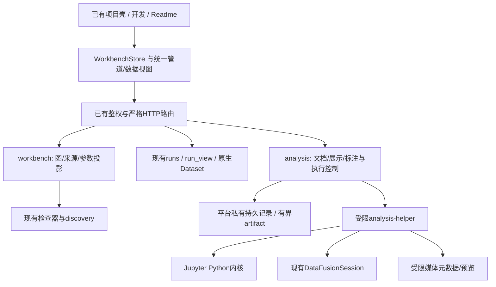

# DemiFlow 统一管道与数据工作台：工程方案 E2

日期：2026-11-05（Asia/Singapore）。负责人：`01a1aa6d-aebb-7073-b91a-2199b1606b4a`。总控：`01a1aa74-951d-75d3-924e-b41a1150dc73`。

**状态：E1 Review修订后提交E2，优先请求P1门槛核对；尚未批准产品实施。** 用户已确认 D1.9 能代表意图，授权按“完整方案 → 总控 Review → 同一负责人实施、验证、集成交付 → 总控独立验收”推进。本文件是当前工程版本；E1精确快照及原清单保留在任务证据目录engineering_plan_20261105/，E1-R1—R3修订见第15—16节。此前 D0—D1.9 讨论原文已按原字节保存为 [讨论记录](forge-workflow-workbench-discussion-20261105.md)，不以本文件改写历史结论。总控自己的 [Review 记录](forge-workflow-workbench-review-20261105.md)仍由总控维护。

负责人承担下述全部阶段，包含集成和旧 UI 清理；总控作方向、架构、资源与边界决策，审阅精确版本并独立验收。没有拆新会话、委派子代理或继续润色 demo。identity 业务由用户改造；实施验证只用自有隔离原生夹具、假提供者和无付费数据，不运行生产管道、已有 Notebook 或付费模型。

## 1. 意图基线、源码基线与完成定义

### 1.1 冻结依据

- D1.9 清单：`_demiflow/forge_coordination_20261104/workflow_workbench_20261105/d19-delivery-manifest.json`，SHA256 `047496d5393880cdbd783a785d925eaaf1a05e14e92324af3a5aeed9842045ba`。9 份样稿资产保持原值；样稿当前独立 55972→59866，不接正式运行 API。
- 讨论记录 SHA256：`4bee94e4e7afe504dc6d3e803c61f2782a662d57da8abfd889db155e62930bfa`。旧清单中的设计文件内容现在也可在上述讨论文件找到；旧清单不修改。
- 正式仓库：`/yzp/zhaozy/yangzepeng/0905/demiflow`，HEAD `49527158d9c4f37f57f264adc28adbc556cfffba`。当前有418项工作区状态记录，暂存 diff 为空；已保存初始 status、工作区 diff、暂存 diff。HEAD 不能单独代表当前正式源代码。
- 本轮只读冻结包：任务目录 `engineering_plan_20261105/`。`formal-source-baseline.json`覆盖包内源代码/声明文本及 pyproject、AGENTS，共864文件、16,067,808字节，清单 SHA256 `afe4a6f95d0d003e257ff59d617960f738e0b3d6571cc9349bbc613a9fcb5019`；外部安装包另记版本，不声称该清单包含所有宿主依赖。
- 当前正式服务：PID32480、birth1905038683、远端59865、cwd为上述仓库；只读取得 app.js/style.css/view.js/development.js 公共静态资产，均与工作区一致。app.js SHA256 `7392c675116a8f3a26dedc79c026597ad47f09f75540f444b350a66a417f306d`。没有读取会话 token、项目凭据或调用控制 API。证据为 `formal-service-source-observation.json`。

实施开始前重验上述源文件和部署身份。候选在独立目录从当前已验运行基线建立，只提交本任务差异；不能从旧 HEAD 直接重建并丢失当前未跟踪平台代码，也不能把其他 dirty 改动一起提交。原 checkout、staging、业务文件与 Notebook 输出保留。候选树和精确差异清单是集成依据，源码变更时重新冻结相关验收。

### 1.2 产品终态

项目导航固定为“开发、管道、数据、Readme”。管道以有明确依据的算子图为主体，串联配置、检查处理、真实提交、选中运行的监控/停止/结果。数据为可收起目录、真实统计、同一本带 SQL/Python 类型的 Notebook，以及复用输出协议的三部分可配置 Case。

整体完成必须同时满足 P1、P2、P3 的真实闭环及第13节总门槛。某阶段测试通过、功能默认关闭、仅有按钮或模拟演示，均不代表整体完成。Python/标注不是永久待办；环境缺口列为依赖并进入总控决策和阶段验收。

### 1.3 demo意图到正式交付的对应表

| ID / 意图 | 当前正式基础与缺口 | 正式能力及契约 | 阶段 / 验收 |
| --- | --- | --- | --- |
| F01 四tab、紧凑一屏、目录收起 | app.js已有项目壳与开发，正式仍有flows/checks/runs平行页 | 保留项目壳，统一管道视图；数据上下文工具栏，展开原位完成 | P1；UI01、UI02 |
| F02 图理解代码 | FlowChecker报告有nodes、三类edges、source/line/operator；原项目discovery为局部事实 | `graph_v1`投影，图类型/完整性/未知/显示裁剪分开；不新建流程定义 | P1；G01—G04 |
| F03 图/节点配置 | parameters读取、输入与预算覆盖已有；无参数来源写回契约 | 明确参数来源JSON pointer、字段来源/共享影响；原文件CAS保存，仅可证绑定可写 | P1；C01—C04 |
| F04 检查和问题定位 | inspect/project_check统一；FL-01常混合原因，部分截断 | 生产者提供原因/范围，保留原结论、原诊断及覆盖；节点/边/全局问题互相定位 | P1；G03、C04、A1—A5 |
| F05 图下真实源码 | source有摘要核对；run-source限封存闭包，未有统一节点/Prompt投影 | 实现/调用点/配置/Prompt四类绑定；当前与封存分离，缺失不回退 | P1；S01—S04 |
| F06 一次主动操作“运行” | run-prepare/start、run_requests持久幂等及C1保护已有 | 同一command上下文串联准备/封存/启动，响应丢失先核对原请求/运行 | P1；R01—R04 |
| F07 多运行/attempt监控停止 | runs/run_view已有；旧renderer与图分离；小快照仅64条观察 | 一份运行选择；快照/图/观察/指标/日志/结果/停止绑定同一身份，保留真实覆盖 | P1；R05—R10 |
| F08 运行结果/恢复 | 原生回执、保留前代输出、run-attach/reconcile/resume已有 | 结果显示真正提交和retained_from_attempt，不用运行颜色代替提交事实 | P1；R08—R10 |
| F09 数据目录/字段/枚举分布 | context、project-discovery、固定版本table/sample/media已有；无通用profile | 注册与发现来源并列，schema/元数据与抽样/全量统计分清 | P1目录、P2统计；D01—D04 |
| F10 Python/Jupyter与SQL | 已安装Jupyter相关包；已有原生DataFusionSession；无分析服务或硬隔离执行端 | 同一本显式语言单元；Python真实内核，SQL复用原生查询；平台受控结果互用 | P2；N01—N08、X01—X06 |
| F11 通用输出/11种格式 | reading、table_view和受限图片预览可复用；其余仍是demo | 版本化MIME/字段输出，类型化渲染与隔离HTML/媒体；未知格式有明确降级 | P2基础输出、P3全部格式；O01—O05 |
| F12 Case三部分可配置 | 正式有单行Case阅读，D1.9配置/浏览器标注只在样稿 | 内容角色/renderer、筛选分组、问题定义分离，UI配置与Notebook描述复用 | P3；K01—K04 |
| F13 正式评测/标注保存 | 业务评测仅可读，正式持久人工记录未实现 | 平台自有不可变定义/答案历史，CAS并发、恢复/配额；不写原表 | P3；K05—K09 |
| F14 少弹窗/原状态保留 | 已有项目壳与生命周期，旧运行表单/弹窗仍在 | 原位上下文/详情；旧深链迁移为同一页面，无第二套运行状态 | P1—P3；UI02、M01—M04 |

## 2. 当前实现的真实调用关系

| 领域 | 当前调用 / 权威 | 本次复用与变化 |
| --- | --- | --- |
| HTTP/权限 | `workspace_view.WorkspaceServer/Handler` → `console.resolve_workspace/permissions`，GET/POST字段白名单、会话token、worker槽 | 路由只做鉴权/字段校验/小状态；新增路由沿用；新功能权限按`4迁移，run权限不重建 |
| 检查 | `workspace.inspect_flow → workspace_worker.operation('inspect') → _inspect_flow → FlowChecker.inspect` | 不执行业务；新图读模型复用报告；必要兼容诊断扩展来自生产者 |
| 原项目 | `workspace_context → project_discovery.discover`；source prerequisites复用SourceTree | 复用有限读取与紧凑事实，不导入模块、扫全仓或再建宽松检查器 |
| 提交 | app.js `flows.submit/prepareIdentity/prepareRecovery` → `run-prepare/run_requests.prepare` → `runs.prepare/_prepare` → `run-start/runs.start` | 迁移为command控制器，保留原request_id、载荷摘要与预期代次；不复制准备账本 |
| 运行 | `runs.show/list_runs`、`run_view.snapshot/events/metrics` → 原生journal/telemetry；`cancel/reconcile/resume` | 新统一选择订阅，仍读原账本；不新建节点执行引擎 |
| 日志 | `runs.logs(root,run_id,offset,attempt)`，文本分段；events响应`control_events_only` | 保留运行/attempt文本范围；可关联节点观察另呈现，不伪造完整节点日志 |
| 源码 | `workspace.source_text`（.py、≤1MiB、expected_sha256）；`runs.source`（封存sources/config闭包及摘要） | 新节点来源门面复用底层读取/校验，补片段、映射和允许的配置公开投影 |
| 真实数据 | `table_binding/project_discovery.table` → `lance.preview`受地址空间保护worker；table_view负责声明/证据 | 保留固定版本/字段投影和授权图片；新增profile、Case查询与其他媒体适配 |
| SQL | `execution.datafusion.DataFusionSession.query` → 受管worker/私有结果；已禁DDL/DML/statements | 直接复用，收紧options和允许来源；补分析准入、隔离和输出持久化，不复制浏览器SQL解释器 |
| 开发 | `development_chat.service/http/store`、`web/development.js.mount/dispose` | 原项目单一对话、归档、迭代历史及提供者权限原样复用；不调用模型验证本次UI |
| 阅读/路由 | `web/view.js`严格v1/v2引用；`reading.js`与Markdown worker | 扩充正式引用类型并迁移旧深链；复用文本阅读，不把demo的#draft用作产品路由 |

`DataFusionSession`当前明确采用采样RSS/scratch保护而非内核RSS上限；`workspace_worker`预加载Arrow/Lance后限制地址空间为baseline+384MiB（封顶4GiB），有准备lease时另传768MiB树RSS预算。它们都不是任意Python代码的完整硬隔离，不能直接拿来开放Notebook。

## 3. 目标模块与职责



| 模块 | 职责 / 计划变更范围 | 明确边界 |
| --- | --- | --- |
| `web/workbench.js`、`workbench-state.js`、`workbench.css` | 图/配置/检查/运行/来源/结果视图与一个选择模型 | 不持有第二份执行真相，不发送业务任务到demo引擎 |
| `web/analysis.js`、`outputs.js`、`case-view.js`及相应CSS | 目录、Notebook、Case与共用renderer，统一dispose | 不执行Python/SQL，不用任意renderer脚本或远程CDN |
| `web/app.js/view.js/index.html/style.css` | 保留壳、已有开发/阅读、API封装；导航和旧引用迁移；删除失去消费者代码 | app不再兼任旧运行composer和新工作台两套入口 |
| `forge/workbench/{model,source_view,parameters}.py` | 不可变图投影、节点来源、参数CAS和公开能力 | 不生成第二份流程定义；不改变原生执行语义 |
| `flow_check.py/project_check.py/project_discovery.py` | 按需增加有来源的诊断/紧凑原项目事实、参数来源旁路信息 | 复用唯一检查；旧报告不重写，未知原因不猜 |
| `run_view.py` | 如现有详情不足，新增分页node/action/occurrence只读投影 | 不增加采集器、调度或另写运行数据库 |
| `forge/analysis/{http,service,policy,store,kernel,query,outputs,media,sandbox}.py` | 文档/输出/Case事实；kernel与native query适配、受控IPC | 与pipeline运行账本分属不同业务对象，不为pipeline复制状态 |
| `analysis-helper`部署入口/固定OCI配置 | 按固定镜像/挂载/配额创建和清理本任务沙箱，独立watchdog | 不接受浏览器传任意命令/镜像/宿主路径；不成为任意root执行代理 |
| `console.py/host_partition.py/workspace_view.py` | 兼容权限/固定宿主预算扩展与新路由接入 | 不默默扩大旧grant或现有run/development额度 |
| 测试/操作文档 | 第12—13节；锁定依赖、源摘要、部署与回退记录 | 不为迎合新DOM删除C1/历史/生命周期语义测试 |

分析文档/执行记录是Notebook对象自身的事实：`notebook_id/session_id/kernel_generation/execution_id`，不冒充pipeline的`run_id/attempt`。pipeline仍只有runs/run_view一个权威；同样，分析查询只调用原生DataFusionSession，不再实现SQL执行器。

## 4. 权限、部署与状态所有权

P1即交付现有console的v3读取/显式迁移与config_write服务上限（细节见第15.1节），统一保存新增grant：`config_write、analysis_execute、analysis_write、case_annotate`；既有`run_submit、run_control、attach`保留原值。登记项目的只读能力沿用当前成员身份。v1/v2读取兼容时所有新增grant默认为false；显式CAS迁移为v3，新权限需部署者配置。旧`project-permissions`只更新原三项，不能覆盖或提升新字段；新能力管理使用显式版本化操作，仍受service ceiling限制。P1不引入analysis数据库/持久卷，分析三项grant及服务ceiling保持false。

`config_write`只允许已登记参数路径及可证字段；`analysis_execute`控制SQL/Python计算，`analysis_write`控制Notebook/保存视图与平台分析artifact，`case_annotate`独立控制人工记录。看数据不等于执行代码，执行不等于能写原数据。服务端每次访问重新核对项目和grant；执行权限撤销停止新broker读取/执行并关闭相关内核，已读入内存的数据不能被描述为已撤回。服务配置提供固定环境、来源范围、状态根与资源上限，不另存一份run权限。开发代理既有细粒度grant保持其原权威，不因console新字段扩大代理范围。

当前服务是一份本地owner会话授权，不存在已验的多用户登录系统。第一版principal取服务端固定`local-owner:<deployment identity>`；多浏览器并发通过CAS隔离。客户端不能自报author充当审计身份。将来接认证主体时需独立迁移principal，不把现在的共享token说成多用户认证。

平台私有状态置于部署者提供的持久、本地POSIX卷，位于业务目录及凭据目录之外，目录0700/文件0600。本机任务挂载filesystem识别为UNKNOWN，不能直接假定适合SQLite WAL；`/var/tmp`当前为overlayfs，也不能仅因可写就作为重建容器后仍持久的卷。P2启用前实测锁、CAS、fsync、WAL/备份恢复和卷持久性；不改原项目表、Notebook或workspace控制文件以容纳标注。

## 5. 管道图、配置、检查和源码

### 5.1 图的三种依据

`graph_v1`返回：
`binding={workspace_id,basis_kind,basis_digest,entry,params?,run_id?,attempt?}`；
`completeness={semantic,display,reason}`；
有界nodes、typed edges、原诊断/总数、source_refs、parameter_bindings、观察覆盖与新鲜度。graph_binding是带格式版本的规范引用，不是权限票据；服务重新校验项目、报告/封存摘要、节点归属与当前摘要。既有参数JSON语义digest与新增原文件字节sha分列，不能混作CAS基线。

- **源码观察图**：取公开声明及有限静态事实，只连接可证明引用；普通调用/变量引用可用reference/value线，但未知返回类型不伪装为Dataset数据边。动态分支、未展开helper、未登记入口明确未知。不按文件顺序或算子列表补边。
- **原生报告图**：原样投影FlowChecker nodes及data/value/action边；检查失败仍呈现已有部分及原因，图能画出来不代表检查通过。
- **封存运行图**：依据runs的封存报告，叠加所选attempt真实观察。当前代码、配置、登记或Flow删除不替换封存依据，历史缺少材料明确不可用。
- 语义完整性与显示裁剪分开。默认显示≤128节点/256边，图投影硬上限256节点/512边/1MiB；大报告提供范围/定位/有界子图，保留全部诊断计数。完整原始报告仍沿用既有有界读取，不因画面裁剪宣称检查只覆盖可见节点。

原项目提取复用discovery/SourceTree的安全路径、摘要和紧凑事实。每请求最多16文件/4MiB源码、单文件1MiB，超限返回partial/unknown；不常驻AST、不导入业务。与原生报告共享投影契约，不再造静态语义检查器。

### 5.2 参数唯一来源与保存

图不是第二套定义。配置仍为原登记JSON文件；展示描述仅存标签/折叠等视图参数。`parameter_binding`包含原文件/sha256、JSON pointer、允许类型、来源形式、共享使用节点、可写原因及预期图依据。

第一版可写范围为明确输入引用、入口keyword参数、受支持输出相对路径及平台允许收紧的预算。原生节点参数只有在可证明来自该JSON pointer时才可写；直接Name/容器路径可旁路追踪来源，计算、动态索引、同值碰巧相等或代码字面量均只读。不能按值相等猜来源。实际调用值、来源描述、当前草稿分别保存，不改FlowChecker实际值语义。

`parameters-update`只接受replace操作（≤32项），仅限当前注册参数文件与新鲜binding允许路径；拒绝workspace.json、隐藏目录、符号链接逃逸、未授权字段、未知参数/超限JSON。单文件≤64KiB，先parameter-preview得到候选sha，再持原有control_lock重验expected/proposed摘要后写同目录临时文件、fsync、原子替换及目录fsync。参数写不接受request_id且不产生receipt；丢响应通过parameter-state读回，只认当前内容是否匹配，不把匹配当成写入归属或持久性证明。409保留草稿；对不协作锁的外部编辑器不承诺全局原子CAS。完整状态/错误/恢复及保证范围见第15.1节。

保存后当前图/检查标记待核对，重新检查生成新报告。run-prepare仍现场核验有效覆盖和输出CAS；保存成功不是运行准入通过。共享参数一次修改在图上列明影响节点，封存视角一律只读。

### 5.3 检查如何落在图上

继续使用inspect/project-check。由诊断生产处兼容新增`cause/code/scope/related_nodes`等事实，保留rule/status/category/detail/path/line、entry/params、报告摘要和截断计数。已知源码违规、平台/读取失败、资源超限及未接通能明确区分；旧报告缺字段显示未知与原文，不用英文文本或FL-01猜分类，也不改变原检查结论。

问题可归节点、边或全局；筛选仍显示总数/未显示数量，裁剪节点的问题可定位展开。项目整体静态/行为/Review证据与某配置接线、有效运行准入分别表达。无法构图仍可检查、定位源码、查看历史和控制旧运行。

### 5.4 节点下的真实来源

`source_ref`区分implementation/call/prompt/config，绑定项目、图依据、node/callsite、文件摘要、符号/范围。实现使用report.operator或明确callback来源；同实现多调用保留不同调用点。Prompt来自已声明原生资源的模板和公开配置投影，不等于某条Case的实际请求/回答；实际证据只从已有run/attempt/Case引用读取。

`graph-source`门面复用source_text/runs.source的闭包与摘要校验，最多读取1MiB文件、返回≤64KiB/≤400行片段，明确截断。当前.py核对expected_sha256；历史只读封存source且缺失/损坏不回退。配置/Prompt只开放已声明资源与原生schema允许的公开字段，凭据仅显示引用名；未知配置不直接整份回显。已有run-source是run级封存闭包，attempt切换保持各自显示身份，并不假装每个attempt都有另一份当前源码。

缓存键含workspace/basis/node/call/kind/file-sha/span，客户端总片段≤512KiB、最多4项，服务复用同一图读取槽，不另开无限源读取池。切项目/节点/依据/attempt均受选择代次约束。

## 6. 统一选择、缓存、真实提交与多运行

### 6.1 一个状态来源

`WorkbenchStore`统一持有：
`project、editSelection(entry,params,expected_sha,dirty patch)、basis(current/report/run)、selectedNode、runSelection(run_id,attempt,seal_digest,revision)、viewMode、commandIntent、requestEpoch`。
selectedNode自身绑定graph_binding和node_id；换依据后不存在的节点清空并说明。原projectDrafts/全局draft与旧运行renderer私有选择迁入该store；状态可按项目记忆，但同一选择只有一个权威。真正运行事实仍来自后端。路由只序列化定位引用，不放草稿值、凭据、SQL正文或答案。

正式引用增加pipeline/data_notebook/case_view等严格类型，保留现有v1/v2读取和旧flows/checks/runs/inspection/run/case深链迁移。旧run+node仍必须绑定报告；attempt省略时先解析并固定具体代次，不在后续子请求继续隐式“latest”。demo的#draft、虚构ID和浏览器fixture标注不导入正式数据。

每次选择切换递增epoch并取消旧read controller/定时器。任何快照、图、来源、事件cursor、日志offset、指标、结果和错误响应，均核对`workspace_id/run_id/attempt/basis/epoch`后应用；仅AbortController不足。写请求在点击时捕获projectId/载荷/目标，API显式接收该projectId，不能在await之后用全局新选择发后续操作。

### 6.2 新鲜度和订阅

当前图/检查进入、恢复前台、配置保存、开发完成/外部变化提示和写操作前触发核对。可见期间最多每15秒核对当前依据摘要；超过时效未完成核对显示“最近已核对/待核对”，不长期显示当前通过。缓存不授予运行权限。封存图按封存摘要缓存，真实运行状态单独更新。

客户端图LRU≤4项/4MiB，服务序列化图缓存≤8项/8MiB且有短期失效；实际解析对象不等于序列化字节。不同项目/报告/有效参数不能共用同键。读取失败保留带时间的最后事实，显示待更新，不推断运行失败或已停止。

采样epoch变化时趋势重置并显示缺口，不把重启前后的序列直接连接。运行列表每页20、接口硬上限100，状态筛选若仅在本页则明确标注。详细图/日志/指标优先只订阅一个选中run/attempt；同一通道一次在途，快照约2秒、指标5秒、日志仅展开时按需读取，控制事件按原cursor。隐藏页面退避/暂停，离开视图dispose；断线指数退避至30秒，不对所有历史运行轮询。pipeline小快照与停止继续走原保留控制槽；图/查询/媒体不能占用它。

### 6.3 “运行”命令与不确定结果

运行主按钮对已登记原生入口/有效参数和run_submit开放。当前已知且仍新鲜的阻塞明确禁用并定位；未检查/过期可说明将现场检查，后端prepare是最终准入，不让旧报告代替有效覆盖核验。未保存文件草稿先保存，运行输入/预算覆盖显式构成本次载荷。

1. 捕获项目、选择代次、入口、参数文件及覆盖；生成并先保存原request_id和payload摘要，单命令防双击。
2. 调run-prepare，沿用run_requests的持久原请求。丢失响应查询run-request，必要时显式reconcile；同ID不同载荷409，不另建一个请求逃避恢复。
3. 已知run/attempt/digest先持久记住，再按原授权调用run-start(expected,expected_attempt)。准备期间选择/权限变化中止自动串联；已准备事实仍可恢复，不向新项目启动。
4. 启动响应丢失先读同一run/attempt；显示“已准备/启动待核对”等实际状态。继续启动复用原身份，不自动新建run或重试代次。
5. 新一次主动提交使用新request_id，真实产生独立运行记录。浏览器未决命令最多16项、合计512KiB；达到上限先处理旧请求，不静默丢弃未确认项。权威请求账本仍是run_requests。

### 6.4 节点、日志、停止和结果

运行观察严格按action/node/occurrence及timing_scope呈现；融合组只列一份组统计并在相关节点注明归属。snapshot截断64条时，缺条显示“未覆盖/需读详情”，不能直接标未单独观测。必要新增`run-observations`分页投影（≤64项/96KiB），按node/action过滤既有journal，游标绑定run/attempt/过滤身份与观察revision，期间变化返回reset_required并重读当前页，不跨版本拼成完整覆盖；不新增遥测生产者。

run-events仅控制事件。run-logs仍是run/attempt文本，offset与轮转/淘汰标记原样处理，客户端尾部≤64KiB，切身份重置或分键保存offset。点节点查看关联观察/异常证据，只有已有可靠关联才提供相应片段；原始文本搜索不称为节点完整日志。

停止捕获原project/run/expected_attempt，仅依赖现有run_control与运行控制协议，不依赖当前Flow、图或合规。旧代次只读；代次冲突409先核对，不能自动向新attempt转发停止。已接受请求显示正在停止，直到进程退出及清理证明成立；未确认保留容量/cleanup原因。

结果独立按原生回执展示，包含retained_from_attempt、固定版本、部分提交、写入/未确认与清理状态。失败/停止不回滚已提交事实；run-attach沿用expected_result，恢复沿用原seal/预算与expected_attempt，不把恢复等同重新按当前代码提交。

## 7. 真实数据目录、统计与SQL

数据目录复用context注册表、discovery已证引用和run结果引用，区分“已登记/只读发现/运行输出”；下游表由已证明的图输出/已有回执关联，未知动态输出不凭文件名猜。固定绑定至少含project、dataset身份、Lance版本、schema、来源摘要/允许范围；别名只是显示入口。表切换不重解释旧输出，其来源与版本保留。

schema/行数/字段类型优先用既有固定版本元数据；枚举、空值、分布默认显式抽样（最多1000行、16字段、8MiB输入），显示抽样方式、覆盖与是否全量。高基数只列top20并显示other/截断，空值/缺键分开。全量统计必须显式请求并在预算内真实扫描完成；超限返回resource_limit和已读取范围，不把中途样本标成全表分布。旧配置/表版本变化立即使profile待核对。

SQL复用`DataFusionSession.query(sources={name:{uri,version}})`及已有私有结果，选择来源必须由服务端绑定；不接受任意URI、路径、Python UDF或自定义provider。保留现有DDL/DML/statements禁用，URL table功能不开放。原生query产生受控暂存结果，前端分页20行/最多16显示字段；UI的LIMIT/分页不是查询内存或完整扫描的保证。

P2统一部署准入与隔离后承载该会话；收紧DataFusion pool、线程、scratch、输出与wall time，同时套外层进程/cgroup和私有scratch配额。已有native预留不能绕过；同一部署的query调用用同一资源目录/一致slot capacity。分析查询与pipeline预算分别在固定host envelope中计入，不从run槽里暗借。官方文档也明确SQL语句限制、文件权限与总进程内存保护各自需要落实。[DataFusion安全边界](https://datafusion.apache.org/library-user-guide/securing-datafusion.html)

首版真实分析绑定已授权本地Lance/平台结果，保留null、固定版本和原生类型；远程存储只有原生读取与显式凭据代理已获部署支持后才能成为来源，不继承Web/DeepSeek/个人环境的凭据。原表只读；所有查询输出、派生表和导出落平台私有artifact，导出/下载不自动写业务目录或注册为生产结果。

## 8. Notebook与Python/Jupyter执行

### 8.1 推荐组织及互用

采用同一本Notebook，单元显式`python/sql/markdown`；Python为常规灵活分析，SQL作为受控查询单元。语言组织不再停等用户选择。Python用已安装jupyter_client/ipykernel协议，SQL用原生DataFusion；两者输出归同一格式和来源模型，不把SQL限制为固定表格。

SQL结果命名为受控handle（如orders_summary），Python通过平台helper取Arrow/pandas或有界批次；Python产出的Arrow须经过第15.2节的有界IPC→私有Lance v1物化，broker再解析为{uri,version}交原生SQL，不直接注册Arrow/DataFrame。每次注册核对schema/大小/来源，不能把任意文件路径当表。重跑SQL生成新output generation，旧输出不偷偷变成新结果；Python中旧变量是旧handle，过期访问明确报错。

保存采用nbformat4兼容文档结构、稳定cell_id及`metadata.demiflow.language`；SQL不是原生Python内核语法，外部Jupyter直接执行需平台SQL helper/magic，导出时明确提示，不谎称任意外部Jupyter原生支持混合SQL。导出可生成显式helper调用版；原SQL源与语言保留在metadata。已有Notebook只在显式导入时只读取源，默认不导入执行历史输出，不覆盖原文件。[Notebook文件结构](https://nbformat.readthedocs.io/en/latest/format_description.html)

Notebook源/视图保存与单元执行分开。草稿代码变化不重标旧输出；输出绑定document revision、cell source hash、source manifests、kernel generation、execution_id/count和完成/截断/异常事实。“运行全部”明确串行、遇错停止策略；不因换表、切布局、恢复页面或重启内核自动执行代码。

### 8.2 生命周期与消息

服务端`AnalysisService`管理文档与受限执行端连接，不在HTTP进程eval/exec；受控provisioner启动真实Python内核。浏览器只见opaque session/execution ID，不见ZMQ连接文件、HMAC key或服务token。

会话状态：
`starting → idle → busy → interrupting → idle`；
异常可为`failed/dead/cleanup_pending`；
显式重启/停止走`stopping → stopped`，确认所属进程/挂载清理后释放名额。
同一project最多1活跃内核，部署默认总计1；单内核一次执行在途、最多2项显式排队，忙时不无限积压。空闲10分钟、总寿命1小时触发有记录的关闭；用户关闭tab只停止UI订阅，服务继续有界drain直到执行结束/TTL。

IPC使用Jupyter支持的本地传输，内核连接文件仅在私有目录；执行消息绑定parent msg_id与kernel generation。接收stream、execute_result、display_data、update_display_data、clear_output与error，stdout/stderr有界；stdin交互首版关闭并明确不支持。完成需匹配execute_reply及对应idle，idle本身不等于成功；后台线程晚到输出标明归属或丢弃，不污染新单元。自定义kernel provisioner、消息和关闭能力均以真实集成验证为门槛。[Jupyter消息协议](https://jupyter-client.readthedocs.io/en/stable/messaging.html)、[KernelManager接口](https://jupyter-client.readthedocs.io/en/stable/api/jupyter_client.html)

取消先中断2秒，未退出则终止该沙箱所属执行，必要时杀整个cgroup；此时kernel generation失效，变量状态不再保证。重启不重放旧代码。Web父进程退出/SIGKILL由独立helper watchdog监测父pidfd/lease并清理本任务cgroup；只等进程组信号不足。重连只读原execution事实，结果未知先核对，不自动再次执行可能有副作用的Python。

### 8.3 文件、网络和输入范围

**默认无网络、无平台/模型/个人凭据、无业务目录写入。** 固定只读镜像中安装受审Python库；用户HOME、.codex/.dsh、SSH、Docker socket、Webtoken及工作区注册文件不挂入。项目辅助代码可按明确允许清单形成只读源码快照，不把整个项目/宿主文件系统挂入。

不能整目录挂Lance表再声称只授权某版本/字段。默认通过可信broker按固定版本/投影导出受控Arrow输入到私有只读快照；超大数据由Python helper向限定IPC broker请求有界query/批次。broker只允许已绑定来源与预算，内核拿不到宿主读文件或run控制权限。raw URI和请求中的自报路径一律不作为授权。

内核可写范围只有有配额的scratch与临时输出，不能改业务表、已有Notebook和平台源。持久化输出必须经可信接收器验证类型、总量、摘要和归属后进入平台artifact。源码/SQL/本地输出是用户代码和数据，不授予调模型/提交pipeline/更改项目权限的能力。

## 9. 分析隔离、宿主预算与当前缺口

### 9.1 已核对事实与推荐

`analysis-host-preflight.json`记录：jupyter_client8.10.0、ipykernel7.3.0、nbformat5.11.1、pyzmq27.2.0、pyarrow25.0.1、DataFusion54.0.0、pandas2.3.3、pylance12.0.0+demiflow.arrowfix1已安装；Jupyter Server/JupyterLab、Docker/Podman/runc/runsc/bwrap、ffprobe/ffmpeg不在当前PATH。PID1为tini，无systemd系统总线；`unshare --user --map-root-user --net true`独立子进程探测成功，但cgroup挂载只读，未能建立受控子分区。现有host_partition仅预算runtime/development/other，无analysis预留。

推荐**外层宿主上的受限OCI analysis-helper + delegated cgroup v2 + 持久本地状态卷**。当前容器仅连接固定Unix socket，helper核对SO_PEERCRED/部署调用者；按固定镜像摘要、命令、挂载与上限执行。协议只接收opaque job/input ID和有界载荷，宿主路径由helper在其拥有的根下解析；不能让Web提供任意bundle、argv或bind mount。内核不挂载helper socket。普通Web参数不能控制OCI选项。runc/等价OCI runtime采用部署者固定版本/摘要与有限rootfs，不使用容器内缺失的systemd-run冒充可用。需要在可配置的宿主/执行节点落实这层能力，不能在本容器悄悄remount、装共享环境或扩大服务授权。[runc的cgroup v2与delegation要求](https://github.com/opencontainers/runc/blob/main/docs/cgroup-v2.md)

总控已按B1采纳同机外层宿主受控执行端的架构；外层入口/资源授权与部署仍未取得。本负责人准备第15.4节管理员审阅包，由总控协调取得唯一外部executor binding；若同机入口确实不可取得，由总控再决定等价执行节点。不降级为无硬边界的普通子进程后宣布Python完成。P1可先实施；P2总门槛须真实执行端通过才放行。此依赖保持活动，不变成永久“未实现”。

### 9.2 有效隔离要求

沙箱使用user/mount/pid/network/ipc namespace、非宿主root身份、capabilities全部丢弃、no_new_privs与受审seccomp；rootfs只读，禁止宿主设备与任意bind mount。私有网络无出站，IPC broker权限限定只读数据；受审镜像不装个人凭据。Python子进程也继承同一cgroup/namespace，不靠Python提示词或库白名单实现安全。

创建时先落实cgroup limits、tmpfs和FD约束，再允许内核执行；不能先启动后补限额。helper预检cgroup.kill、memory/pids/cpu控制与真实限制读回。kernel可以fork/线程，但均计入总pid/内存/CPU。controller/输出接收器本身也在分析预算内，恶意多段消息不能拖垮Web控制进程。

cgroup.memory.max是内核主要约束，仍需为暂时超额、内核/文件缓存和控制路径留余量；cpu.max约束带宽而非总时长，另有wall deadline；pids.max计入线程。tmpfs按bytes/inodes限制用户可写总量，计入内存预算；持久artifact由可信服务预留与有界写入。[Linux cgroup v2约束](https://www.kernel.org/doc/html/latest/admin-guide/cgroup-v2.html)

### 9.3 初始预算建议（Review后冻结，缺项拒绝启用）

| 对象 | 初始上限 / enforcement |
| --- | --- |
| 整个analysis slice | 候选memory.max 3GiB；cpu.max相当2核；pids.max64；swap0；1活跃kernel + 1native query + 1媒体预览；controller、独立watchdog和余量计入（第15.3节） |
| kernel | memory.max1536MiB，pids32，cpu≤1核；scratch tmpfs256MiB/4096inode；单元30秒（部署上限120秒），无累积后台作业逃逸 |
| native query | memory.max1024MiB，DataFusion pool256MiB/max_rss512MiB/headroom128MiB，1slot/1thread；sampled scratch192MiB、tmpfs硬256MiB；默认30秒；每结果32MiB/100,000行/16投影字段，超限不作完整成功 |
| 媒体预览 | memory.max256MiB、1worker/pids8、单请求5秒；与controller/安全余量合计在3GiB内，不额外申请无限池 |
| controller/接收 | controller128MiB +独立watchdog32MiB +jobs余量96MiB，合计仍为候选3GiB；有界IPC；ZMQ frame/message、队列与复制同时计入；解析失败/超限关闭对应执行，不落入Web进程 |
| 消息/单元输出 | 接收frame≤8MiB、multipart总量≤8MiB、最多16帧；HWM≤4；先核对frame数/总量再复制JSON；单元≤16MiB/32输出对象，stream≤1MiB；超限截断明确或终止，不无界累加 |
| 文档 | 每项目≤32本、每本≤64单元、单元源码≤16KiB；文档总源≤1MiB；单次patch/POST沿用≤64KiB，GET分页/引用不回全量输出 |
| 持久状态 | 本地DB128MiB + WAL32MiB +备份/临时预留；artifact全局2GiB/项目256MiB，文件≤4096；输入暂存≤256MiB/会话；先预留再写并计替换副本 |
| client | 当前工作集：图4MiB、来源512KiB、日志64KiB、Notebook输出16MiB、媒体编码32MiB；渲染按需释放；这些不是浏览器RSS硬保证 |
| 队列/生命周期 | 每类有限准入，kernel总活跃1、单核排队≤2，普通满载503；取消独立通道；等待/执行/清理均占原lease，只有真实退出后释放 |

数据复制、Arrow原生分配、Jupyter字符串/base64和JSON副本、媒体解码/缓存、tmpfs及保留输出分别计入；不能把DataFusion pool或序列化字节当总RSS。某个宽行/单一媒体无法在预算内处理时明确拒绝，不能无限单行例外。controller接收超大畸形multipart仍以自身cgroup作为最后保护，helper在外继续负责清理。

host-budget v2在现有v1基础上增加analysis内存/磁盘/状态根及活跃上限，校验
`run reservation + development reservation + analysis reservation + other headroom ≤ host envelope`，
设备计算同时包含每工作区history、分析DB/WAL/备份/artifact/输入暂存。v1继续运行旧能力，analysis不可启用；迁移须参与者静默、明确预算与预检，不能暗占other最低读worker/控制预留。外部进程与内核临时超额仍需独立余量，准入时再查真实可用内存/设备。

父进程死亡、超时、取消和OOM都由helper对任务cgroup执行终止，并核对populated=0、pidfd结束和挂载/私有scratch清理后才释放lease。证据不足保留cleanup_pending与占用；服务重启按持久owner身份恢复核对，不收养其他任务。持久已提交输出/答案不因kernel关闭而删除。

## 10. 共用输出协议与Case

### 10.1 版本化描述和来源优先级

`output_v1`包含project/notebook/cell/execution与kernel generation、source manifests、MIME集合、覆盖/完整性、artifact引用及字节摘要。优先原生text/plain、JSON、图片和类型化表/图；HTML进入隔离预览，不进入平台DOM。输出解码不执行用户代码；unknown MIME保留原文/下载引用与不支持原因。

Case用`application/vnd.demiflow.case-view+json`：
`{version,source_snapshot,case_key,variant_key?,fields[],grouping,filters,layout,questions_schema_ref?,origin}`。
Python helper与UI预设生成同一描述，内容字段角色(input/output/reference/context/evaluation)、renderer和评审问题各自独立。字段标input不使它自动成为实际模型请求证据。

Notebook输出的初始描述、已保存view_ref/revision、UI临时修改有明确来源：显式view_ref时该版本是基线，UI修改为草稿；保存产生新view revision，刷新恢复保存版本。重新执行Notebook只产生新输出，不双向重写任意Python，也不静默覆盖未保存视图；不兼容时在原位选择采用新输出或保留配置重新绑定。换布局/筛选不暗中执行Notebook、模型或pipeline。

通用模板固定三部分：导航分组筛选/Case输入输出材料/评测与标注；支持单条、对照和画廊等同一字段组件布局。日常改字段/格式/条件/问题只改描述；缺失renderer由AI coding作为平台组件经代码Review后新增，不允许上传任意JS或每次改参数都重生成页面。

### 10.2 字段与预览支持

| 格式 | 正式首版呈现 / 校验及降级 |
| --- | --- |
| text / md | 原文折叠复制；复用现有Markdown阅读器，HTML默认关闭，远程资源受限 |
| code | 语言/行号/复制与保留原文；不执行，完整语法高亮不是必要依赖 |
| json | 有界树与原文，深度≤8/初始≤256节点，超限分段，保留完整artifact引用 |
| message / dialogue | 明确role/content schema、最多32轮/每轮8片段；文字/图/音视频复用类型组件，不兼容结构回退 |
| image | 授权引用/摘要，编码≤8MiB、头部/像素校验；默认受限缩略图，原位放大；SVG不作为未经验证的脚本载体 |
| audio | 明确MIME/codec/元数据、编码≤16MiB/时长≤600秒；按需播放器/已有转写，不自动转写 |
| video | 编码≤64MiB/时长≤300秒/≤1080p30；预检后range读取，不自动抽全片或后台解码 |
| tag | 数据标签与可选筛选，不等同人工确认 |
| html | 有界清理后的独立sandbox srcdoc；不允许script/form/iframe/任意CSS或外部URL；保留准确源码查看 |

HTML仅allowlist标签/属性，限制节点/深度/字节；子文档opaque origin、CSP拒绝脚本、表单和外部连接，不含allow-same-origin或平台token。图片等引用必须经授权资产改写，不能让HTML自行读宿主路径。任意JS、Jupyter comm/widget和自定义脚本型交互首版不开放，明确以text/PNG/JSON降级；普通Python复杂图可产PNG/受控HTML，不限制成固定业务图表。

媒体只接受声明表/行/字段或平台artifact引用，不开任意文件/URL代理。复用图片preview并新增受限ffprobe/预览适配；若缺codec/probe能力明确不可预览，P3全部格式门槛要求受审工具实际到位。单个range≤1MiB、限制并发和总编码量；逐页授权，不能用一个asset ID跨项目读取。浏览器默认preload=none、一次一个播放器，切Case/格式/离开释放src、decoder和object URL。可见缩略图/展开图有像素预算，但不将浏览器原生播放器缓冲说成进程RSS硬隔离。

### 10.3 数据身份、选样与评测

Case身份为`project + source_snapshot_digest + stable_case_key`，可再含variant/field稳定键。原Lance优先使用业务声明唯一键，重复/缺键显式报错；也可使用固定版本内的Lance row_id，不能用当前页号/排序位置。派生Notebook结果先固定为不可变平台Case数据集，再允许持久标注；内存DataFrame变量名不算稳定身份。

筛选使用类型化eq/in/range/contains/is_null及有界and/or（深度≤4、总节点≤32），不接收任意Python/正则/SQL片段；分组/排序字段必须来自已绑定可见schema，缺键与null分开，最后以稳定Case键打破排序并列。Case查询绑定view revision、固定来源、筛选/分组/排序与标注watermark，生成有界结果/游标；source-only条件由原生query执行，人工字段从平台记录取值，不向原业务表join写回。跨页保留同一查询快照与最后稳定键，不长持WAL读事务。全量筛选超出扫描/结果预算应拒绝或要求显式抽样，不把本页筛选说成全集。标注变化提示刷新选样；保存并下一条按原可见序列推进，不能因当前Case退出过滤而跳项。

评测指标/理由只读已有字段和run/Case证据并带版本来源；界面不隐式发起付费评测。人工评分、标签、偏好、备注/纠正值为独立记录；多人仲裁/标注工作流分发不在本版范围，单一owner并发语义明确。

### 10.4 平台持久记录和历史

平台私有SQLite保存：
`source_snapshots、notebooks/cells/revisions、executions/output_refs、case_views/view_revisions、question_definitions、annotation_events/current_heads、operation_receipts`。
artifact按摘要/归属保存，有界引用与配额先预留。分析/标注持久记录写操作有request_id/expected_revision和事务，结果丢失查询原receipt；后端生成principal与时间，客户端不能改权威身份。

问题类型首版为单选、多选、有限范围评分、文本；偏好可用明确variant选项表达，未知类型拒绝而非当文本吞掉。question definition以规范化内容hash形成不可变定义（稳定question_id、类型、选项、范围、必填、标题等）。变更任何定义不把旧答案解释成新题；新旧答案按definition独立保存，历史可展开。保存标注不隐式保存视图：可以携带合法但尚未发布的题目定义，事务中先保留该不可变定义再存答案，并明确“对应未保存视图的定义”；刷新旧view时该答案仍可作为历史解释，不成为旧题的当前答案。

标注目标含source/Case/variant或field、principal、definition；服务核对源身份与权限后以expected_revision更新head并追加事件。两个客户端基于同一rev保存时仅一方成功，另一方409保留草稿，不自动覆盖/推进。撤销也是新事件，不删原答案。初始每Case/definition≤100次修订、每view≤32字段/16问题；超配额拒绝并保留旧事实，管理员先导出/归档，默认不自动丢弃人工历史。

原业务数据只读，不写回评测表或原Notebook。原外部表版本将来可能被数据所有者清理；只读权限不能保证保留它。平台保留准确来源与人工答案，源失效时显示不可用，不回退最新表；需长期看Case时显式固定有界快照到平台artifact并计入保留配额。

数据库在本地持久卷使用事务/CAS、有限busy timeout/连接池、page/缓存与WAL预留；短读及时结束，checkpoint不阻塞停止。schema migration先备份，单写者锁内升级，失败保持旧文件；未知版本只读/拒绝写入。验收含崩溃写、磁盘满、WAL压力、缺源和从备份恢复。默认不迁移D1.9 synthetic localStorage为正式答案。

## 11. 接口与状态契约

项目功能接口在`/api/workspaces/<id>/`下；console管理仍沿用`/api/project-*`层，新增project-capabilities及本地显式迁移见第15.1节。使用现有会话鉴权、严格字段与错误码；表中为增量设计，当前均未实施。body≤64KiB；返回不可读数据时给明确code，而不是空数组成功。耗时执行返回202+稳定ID，快照/分页读取有界；不可经GET执行代码或改数据。

| 新/扩接口 | 核心字段 / 返回 / 并发或范围 |
| --- | --- |
| GET graph | basis_kind +对应entry/params、report_digest或run_id/attempt；返回graph_v1、依据/覆盖/source_refs及freshness；互斥字段严格校验 |
| GET graph-source | graph_binding、node_id、kind、expected_sha、range；≤64KiB片段/允许配置投影；身份不合409，未封存not_found |
| POST parameter-preview / GET parameter-state | 预览给base/proposed SHA与public diff；state只读observed SHA/公开值，不能证明写入归属；第15.1节 |
| POST parameters-update | path、expected_sha256、proposed_sha256、graph_binding、replace[]；不接收request_id；返回applied/new SHA或409，丢响应读回；P1 config_write |
| GET run-observations | run_id、attempt、node_id或action_id、cursor/limit≤64；返回分页、覆盖、continuation；复用既有journal |
| GET analysis-capabilities | enabled/permissions、环境摘要、kernel/query/媒体能力及禁用原因；不含secret/连接文件 |
| POST analysis-notebook-create/update | request_id、id/expected_revision、单元patch；返回revision；analysis_write；不接受整份超限输出 |
| GET analysis-notebook | id、revision?、cell_cursor；返回有界文档/输出引用，非自动启动kernel |
| POST analysis-session-start | request_id、notebook_id/revision、source_binding；返回session_id/kernel_generation/admission；analysis_execute |
| POST analysis-cell-start | submission_id、session_id、expected_generation、cell_id/source_sha、language；返回execution_id；单队列幂等，Python经内核，SQL经native |
| GET analysis-execution/events | execution或session+generation、cursor、limit；返回状态/有界输出引用、完成/丢失范围，游标不能跨generation |
| POST analysis-execution-cancel | execution_id、expected_generation、request_id；accepted/cleanup状态，不能取消其他session或新generation |
| POST analysis-session-control | session_id、expected_generation、action=restart/stop、request_id；重启不重跑代码，cleanup不明不释放lease |
| GET analysis-output/media | opaque artifact_id、expected_binding、offset/range；有界读取/Content-Range/编码类型，不接受宿主路径或URL |
| POST analysis-result-pin | request_id、result_id、expected_digest；固定不可变Case来源/保留引用并计配额，不再执行查询 |
| GET table-profile / POST analysis-query-start | 固定source_binding、明确scope/columns/typed profile或SQL、预算；只读真实统计，耗时返回execution_id |
| GET/POST case-view | view_id/revision；保存携request_id/expected_revision/descriptor；analysis_write；不可变历史和新head |
| POST case-query / GET case-records | source/view revision、typed filters/sort、annotation watermark；查询ID与有界页，记录identity和范围 |
| GET case-annotations | source/Case/variant/definition、revision/cursor；当前与历史可区分；项目/来源授权 |
| POST case-annotations-save | request_id、target、definition、expected_revision、answers；CAS/receipt；case_annotate，source稳定且定义可解释 |

operation_receipts只在P2/P3覆盖分析文档/标注写和分析执行幂等，不复制runs/run_requests；P1参数CAS明确无receipt。对使用request_id的操作，同ID不同载荷409。所有读取也核对项目成员/资源授权；引用ID不是授权票据。SQL、代码、HTML、答案全部按原类型处理，不能插入平台DOM或成为命令参数拼接。

错误语义：401/403会话或能力失效；409来源/版本/代次/定义冲突；413字节/节点/资源上限；422不支持或无准入；503有限槽满。未知成功/失败不能触发重放写操作。新权限/host协议显式版本化；既有GET/POST契约与CLI兼容保留。run-source仍按run级封存闭包，不假装新增attempt封存文件。

## 12. 同批清理、迁移与交付阶段

### 12.1 旧运行UI的保留 / 替换 / 删除

| 真实消费者/代码 | 处置与迁移目标 |
| --- | --- |
| `app.js runManagement`、说明卡/run-readiness/composer、`updates.runManagement` | P1删除；能力/缺口移到管道上下文/空状态；原flow注册与权限公共能力保留 |
| `flows(request,runtimeHost)`双用途、旧静态/运行表单 | P1替换为唯一图配置与command控制器；捕获草稿/参数读取保护迁到WorkbenchStore；删除runtimeHost分支 |
| `runSetupDialog/runPermissionDialog/closeRunDialog`及runDialog/current检查 | 登记/权限原位设置；C1项目+epoch+表单载荷捕获等保护移入命令边界；旧DOM/helper在最后消费者迁完同批删除 |
| `runs/showRun/runtimePanel/renderReport/drawGraph`平行renderer | 运行列表/比较/封存图迁为同一图工作台视角；原观察/生命周期/结果/封存源码语义保留；旧渲染分支删除 |
| `prepareIdentity/prepareRecovery`、request_id恢复 | 保留语义并抽成一个command模块，旧实现失去消费者后删除；不能出现两套prepare缓存 |
| `projectDrafts/draft/continueInput/updates.activeRun等` | 按真实引用迁移到统一store/订阅控制器；有消费者的结果继续流转能力保留，无用flag/helper删除 |
| `console/workspace/runs/run_view/run_requests`及CLI | 公共能力保持，不因旧UI清理删除鉴权、准入、原生引擎、停止或历史账本 |
| 原table/Case/reading renderer | P2/P3复用字段/来源读取，最终统一outputs renderer；阶段内仍有消费者的旧能力明确列出，P3终态不留平行Case状态 |
| `tests/test_forge_runtime_dialog_scope.py`等旧DOM断言、旧HTTP/UI文档 | C1场景迁新DOM，删除只要求旧弹窗/说明卡存在的断言；故障/权限语义测试保留并补新路径；同步当前文档入口 |
| 离线报告导出 | 保留只读引用、许可证和数据缺省范围；迁共用图renderer，不让离线页发API或控制作业 |

实施交付附实际引用图/删除清单、旧symbol检索和新调用验证。这里的“删除”是正式代码P1/P3计划，不能拿D1.9删除mock分支冒充已经完成。

### 12.2 分阶段真实闭环

| 阶段 | 工作与依赖 | 放行门槛 / 本阶段不冒充的完成 |
| --- | --- | --- |
| P0 完整设计 | E2+源/宿主证据+总控A1—A5/C1及R1闭合；B1架构已定、部署待外部提供 | 总控Review精确SHA；未通过前不改产品代码 |
| P1 图管道闭环 | 唯一store/图与参数来源、P1 console v3/config_write显式迁移与CAS/读回保存、诊断、真实源码；真实prepare/start与多run/attempt监控/停止/部分结果；四tab及旧运行UI同批清理；复用现有目录/阅读/开发 | 自有原生夹具从配置→检查→提交→监控→停止/完成→固定结果走通；R/C/G/S/UI/M回归和精确候选审阅。数据新增执行尚未交付，不能报整体完成 |
| P2 真实Notebook分析 | B1执行端/持久卷/host-budget v2、P1已预留且默认false的分析grant显式启用；真实profile/native SQL/Python内核、文档保存与通用基础输出；环境/依赖冻结 | 同一Notebook SQL→Python→真实通用输出/重启/取消，硬隔离资源与父死清理真实验收；P1与开发回归。环境不具备则此门槛未过，不用mock代替 |
| P3 通用Case及整体整合 | 复用P2来源/输出/执行隔离；三部分配置、全部11格式、受审媒体工具、平台持久答案/历史/CAS/恢复；清理旧Case renderer | 多个非identity数据场景可配置复用、保存/刷新/冲突/缺源/备份恢复真实闭环，全部格式与预算验证，整体验收通过后才可说统一重构交付 |

每阶段有源manifest、差异清单、必要测试命令与结果、浏览器截图/可复现脚本、资源事实/未过门槛、集成候选和回退说明。阶段的真实结果用于后续，不重复造样稿。P2/P3环境和持久能力提前准备，不等P1完成才发现无执行端。

### 12.3 集成、部署和回退

1. 原dirty/staging与业务/Notebook原始摘要保持，独立候选按当前source manifest建立。平台外部依赖需冻结版本/镜像/工具哈希，不能依赖共享venv“当前刚好可用”；不在原共享环境升级包。
2. 在候选自有临时workspace/domain/state_root运行真实夹具，输出不指向用户数据。所有provider为假实现或无付费原生算子，真实DeepSeek/Codex会话仅保留能力不启动。
3. 总控审精确源与测试/资源/集成证据；有外部改动则按函数/文件精确整合并重验，不覆盖他人文件。原服务配置、已授权project grants、开发对话DB和原生run历史不迁掉。
4. 发布前核对既有服务pid/birth、代码/配置摘要、活跃run/development/analysis与未决command；状态升级在静默门槛内进行。缺少前提保持旧服务运行，给出具体阻塞，不直接停掉用户作业。
5. 发布由精确候选与原服务flags加显式已审增量进行，原正式59865/本地55971保持；原样稿55972独立冻结。检查既有开发对话/项目历史/旧深链与新真实闭环，先用隔离夹具，不跑生产/付费模型。
6. 回退先禁止新分析准入、确认本任务执行清理，再切回已备份Web/服务版本。v3权限/host-budget v2与分析DB有离线备份和导出；旧二进制不读新schema时恢复对应配置备份，新增平台状态完整保留。原run/history/业务版本不回滚或删除；未知控制结果仍按原身份核对，不能当失败重跑。

## 13. 可复现验收矩阵与总门槛

以下为待实施验收定义，尚未运行产品测试。默认`env/bin/python -m pytest`在独立候选、临时workspace/私有state/domain执行；浏览器用本机已有Chromium和Playwright。新增文件名为计划，不将不存在的测试算通过。

| ID | 真实场景 / 证据 | 阶段与测试载体 |
| --- | --- | --- |
| G01 | native图、数据/值/动作边、同函数多调用、未知原项目引用；与报告逐项同源 | P1 `test_forge_workbench_graph.py` + existing native_semantics/flow_checks |
| G02 | 无登记/无Flow/已删文件仍看历史、项目检查和停止旧run | P1 workbench browser + existing project/removal/run tests |
| G03 | 同一FL-01不同生产原因、未知码、检查自身失败、裁剪/诊断截断、行为/Review缺失 | P1 graph/check tests；原静态结论不变 |
| G04 | 单文件/闭包/AST/节点边超限，冷启动、多项目并发、超时取消、读取饱和仍可停止 | P1 worker boundary tests +实测内存/队列/控制延迟 |
| C01 | JSON pointer精确来源、共享参数、代码字面量/动态来源只读；同值不同来源不误绑 | P1 `test_forge_workbench_parameters.py` |
| C02 | 保存expected sha冲突、两浏览器、symlink/路径/控制文件拒绝、原子写/失败保草稿 | P1 parameters tests与文件摘要 |
| C03 | 保存后检查待核对、覆盖值prepare重查、当前/封存配置隔离 | P1 browser/real prepare |
| C04 | 外部编辑/开发完成/权限/平台标准变化使缓存失效；读失败不保当前通过 | P1 async/freshness tests |
| S01—S04 | 实现/调用点/Prompt/配置真绑定，历史缺源/摘要坏不回退，资源公开投影、迟到源码不串节点 | P1 source tests；无secret/无import业务 |
| R01 | 原生夹具一次Run真正prepare/start；新主动提交生成不同run，双击/相同ID不重复 | P1 migrate `test_forge_runtime_core_flow.py` |
| R02 | prepare/start响应丢失、刷新发生在start期间、500/超时先核对；同ID改载荷409 | P1 existing core-flow fault tests迁新UI |
| R03 | C1 A→B切换/已脱离表单/迟到成功失败不能向B操作或恢复旧页面；取消读不释放未结束worker | P1 migrate runtime_dialog_scope；新command边界 |
| R04 | 无权限/仅控制/权限在途变更、新输入/预算/输出CAS；不得自动扩权限 | P1 permission/HTTP tests |
| R05 | 同项目多run与attempt，快照/来源/事件cursor/日志offset/指标/结果/停止同身份 | P1 real runtime+journal +可控hold响应 |
| R06 | snapshot64条截断与node详情分页，融合/occurrence多次/未观测/不完整；不补造耗时 | P1 native observation fixtures |
| R07 | 日志轮转/淘汰/UTF-8边界/偏移、无节点关联、控制事件范围；日志慢读不阻塞停止 | P1 existing run_logs/runtime tests + new graph consumer |
| R08 | 停止accepted≠退出、未确认/cleanup pending、旧attempt冲突不重定向 | P1 process-group/故障夹具 |
| R09 | 部分提交、attempt沿用输出、停止/失败仍可看固定版本和回执；attach CAS | P1 resume/recovery/result tests |
| R10 | 服务重启、恢复预算、旧协议历史只读、封存源码缺失、当前Flow删除 | P1 lifecycle/history tests |
| D01—D04 | 注册/发现/下游来源、固定版本、schema/rowcount/抽样与全量profile、高基数/宽字段/来源变化 | P1目录；P2 native profile/query tests |
| N01 | 同本SQL→Python变量/Arrow互用、Python自定义图/JSON/HTML真实输出、无再问AI配置 | P2真实隔离内核+SQL |
| N02 | 重跑/旧输出源hash、kernel restart变量清空且不重放、未保存源与执行revision区分 | P2 notebook tests |
| N03 | execute_reply/idle顺序、stdout flood、update/clear display、错误/unsupported stdin | P2 fake kernel协议+真实ipykernel |
| N04 | 请求丢失/同submission不同源/刷新重连、代次晚到IOPUB不串新cell，不自动重跑 | P2 controlled IPC faults |
| N05 | 中断响应/忽略中断/子孙进程、Web父死、watchdog断连、OOM后真实清理及lease保留 | P2真实OCI/cgroup故障 |
| N06 | 无service token/个人env/HOME/业务写/出站，路径/IPC越权；合法数据helper可用 | P2真实沙箱deny/allow证明 |
| N07 | nbformat导入/导出SQL语义、原Notebook/输出字节不变、保存/冲突恢复 | P2文件与DB证据 |
| N08 | kernel/query/backend或环境缺失给disabled原因；不能返回模拟成功 | P2 capabilities tests |
| X01—X06 | memory/threads/CPU/wall/scratch/inodes/输出/磁盘准入；宽行/倾斜join/慢consumer/并发/清理失败 | P2受小预算实际触发；引擎与cg/tmpfs证据分开 |
| O01—O05 | 11格式/不匹配降级、HTML逃逸/外部资源、坏媒体/像素/编码/时长、消息嵌套、切换释放 | P2基础/P3全格式；真实媒体与浏览器 |
| K01—K04 | 内容/角色/renderer/筛选/问题分离；多布局复用；重复key、稳定排序/过滤/分页；save-next不跳项 | P3真实非identity表+Case query |
| K05 | 视图与答案分别保存；题名/类型/选项变化旧答案不重解释；未保存定义可解释 | P3 definition/store/browser |
| K06 | 多浏览器CAS失败保草稿、跨project/Case权限、未知写结果receipt恢复 | P3 race/HTTP/store tests |
| K07 | 崩溃提交、磁盘满/DB与WAL上限、备份/迁移失败恢复 | P3小配额持久卷夹具 |
| K08—K09 | 原数据/Notebook未写；原版本删除仍有答案历史、无最新表回退；显式固定快照与配额 | P3源删除/归档恢复测试 |
| UI01—UI02 | 四tab/原位详情/目录收起、320/390/1024/1440/1920、键盘焦点、图和Notebook可用 | 各阶段browser截图与操作，不只无overflow |
| M01—M04 | 旧深链/离线导出、一次选择来源、旧symbol/样式/DOM测试清理、新/旧调用关系和实际集成回退 | P1/P3 cleanup manifest与版本证据 |
| DEV01 | 项目单一对话、历史/归档/上下文压缩、IME/停止/权限、切tab dispose和迭代时间线 | 各阶段既有development_chat browser/lifecycle/http/compaction，假provider，不发真实模型请求 |

固定阶段命令组（新增文件在实施阶段创建，当前不计测试结果）：
- P1：现有`test_forge_runtime_core_flow.py、runtime_dialog_scope.py、runtime_protocol.py、runs.py、run_browser.py、native_semantics.py、project_checks.py、markdown_reading.py、development_chat_browser.py`及新增workbench组。
- P2：新增`test_forge_analysis_{http,notebook,kernel,query,isolation,resources,recovery,browser}.py`，真实Jupyter/SQL/OCI探测；P1关键路径和DEV01回归。
- P3：新增`test_forge_case_{views,identity,annotations,concurrency,recovery,browser}.py`和`test_forge_outputs_media.py`；P1/P2端到端及DEV01回归。
- 环境不满足时测试返回“前提未满足/未验收”，发布门槛不把skip计入成功。各次manifest记录实际命令、退出码、候选SHA、环境/预算、失败修正和局限，不能预先承诺通过数量。


P1最小复现命令（从候选仓库根执行，夹具自行设置临时domain/state，不传正式registry）：

```bash
/yzp/zhaozy/yangzepeng/0905/env/bin/python -m pytest -q \
  tests/test_forge_runtime_core_flow.py \
  tests/test_forge_runtime_dialog_scope.py \
  tests/test_forge_runtime_protocol.py \
  tests/test_forge_runs.py tests/test_forge_run_browser.py \
  tests/test_forge_native_semantics.py tests/test_forge_project_checks.py \
  tests/test_forge_markdown_reading.py tests/test_forge_development_chat_browser.py
```

新增组使用显式文件清单写入各阶段verification.json；不要用未展开的shell通配符把缺文件算成空测试通过。P2先运行真实helper preflight（cgroup创建/限额读回/本任务清理/持久卷锁与恢复），再跑kernel/isolation/query组；P3在同一受验环境跑持久与媒体组。执行端缺失时mock协议测试可单列通过，真实隔离/资源门槛保持未验收。

整体放行要求：F01—F14对应真实能力；A1—A5/C1及上述故障/资源场景闭合；旧运行/Case平行UI按消费者清理；没有mock ID或模拟状态进入正式API路径；真实来源/持久记录/隔离执行可复现；配置/历史/业务/Notebook保留；集成与回退材料完整。独立Review不以负责人自报测试总数替代实际差异与关键验证。

## 14. 请求的完整设计 Review 与未闭合事项

本版对产品/工程常规选择给出默认方案，不再就SQL/Python入口、三部分Case或图主体重复询问用户。请总控对**本E2精确摘要**作完整设计Review，优先裁决P1候选实施放行，重点核对：

1. P1—P3是否覆盖D1.9意图并形成真实闭环、范围/消费者清理是否恰当；
2. 原生检查/运行/来源复用、当前/封存/attempt身份与C1保护是否正确；
3. B1架构已由总控采用；第15.4节提供管理员包与唯一外部binding，3GiB仅为待校准候选而非已分配额度。P2部署/资源证明门槛不阻塞独立P1；
4. 新grant/固定host-budget v2与平台自有记录、输出/HTML/媒体和数据只读边界是否可放行；
5. 正常/故障/异步/资源/历史/开发回归及精确发布回退门槛是否足够。

唯一外部前提为B1 executor binding的取得，架构选择已由总控闭合；其余实现取舍由本负责人按本方案完成，Review发现问题在同一版本链闭合。设计未通过前不改正式产品；通过后直接承接实施，不重复向用户索取同一开发授权。当前交付仅为工程方案和只读证据，不宣称真实重构已完成。

## 15. E2 对 E1 Review 的逐项闭合

本节是 E2 的增量工程契约，与前文同步修改处共同生效。E1原文/清单保留于证据目录，未改历史。总控认可方向不等于产品实施放行；E2提交后先由总控裁决P1，B1外部取得性只阻塞P2真实环境验收。

### 15.1 E1-R1：P1权限、CAS保存与丢失响应

**阶段归属**：P1交付console v3读取/显式迁移、新capability管理、`--enable-config-write`服务上限和参数保存；不需要P2 SQLite、analysis state root、OCI或持久卷。P1的analysis_execute/analysis_write/case_annotate字段存在但一律默认false，服务ceiling固定false，不能通过v3迁移开启分析功能。

v1/v2只读解析补全新增false而不落盘；显式迁移在console原有registry锁和content digest CAS下进行，保存原registry备份，原run_submit/run_control/attach逐项保留。迁移本身不授config_write。随后部署者用新`project-capabilities`操作（expected registry digest）显式授config_write，服务必须同时以`--enable-config-write`启动。enable_runs或control_only不会隐式授文件写入；单workspace模式同样需要显式project config_write grant，不能复用历史allow_runs=true推导。P1未配置新的service flag时仍为只读图配置。

P1增量接口明确为：`console migrate --registry <path> --expected <digest> --format demiflow_console_v3`只做显式格式迁移；`POST /api/project-capabilities`在既有console管理路由层接受`workspace_id/expected/capabilities`（新增四项严格bool），锁下CAS合并，响应新registry digest；P1拒绝三项analysis能力为true。服务上限由`WorkspaceServer/serve(enable_config_write=False)`经console与workspace两个serve CLI的`--enable-config-write`传入，不能由HTTP修改。root单workspace模式另以`workspace_config_write=False`构造参数/`--workspace-config-write`CLI旗标提供该项目grant，缺省false；它与service ceiling同时为true才可写，console模式不接受该root专用旗标。新能力在resolve/能力清单/临界写入处逐项求交，不能沿用旧实现对所有permissions统一与enable_runs求交。preview与update均要求config_write及ceiling；parameter-state仅返回已授权公开字段，沿用读权限。

旧`project-permissions`只更新原三项，在v3中merge保留其他字段且不降回v2；新增项目的四项新grant全false。v3迁移/新grant操作受现有会话鉴权与对应service管理上限控制，不能靠客户端传permissions=true。参数临界写入前重新核对当前registry成员、root与grant；授予随后被撤销时按检查点拒绝尚未提交写入，不宣称能够撤回已经完成的文件写入。P1发布回退先关新写入、等待在途保存结束，旧binary恢复对应v1/v2 registry备份，保存v3备份供前向恢复；参数文件保持用户已保存的值，不因程序回退覆盖它们。

**选定最小协议：CAS + 读回核对，没有参数request_id回执账本。** 不向P1引入operation_receipts、也不复用运行request_id做文件保存。pipeline提交仍沿用原run_requests；P2分析/标注receipt范围不变。

| 路由 | 必要字段与确定语义 |
| --- | --- |
| POST parameter-preview | path、expected_sha256、graph_binding、replace[]；只计算/校验不写。返回base_sha256、proposed_sha256、允许字段的public_diff和serialization_version；不回显未允许配置 |
| POST parameters-update | path、expected_sha256、proposed_sha256、graph_binding、replace[]；不接受request_id。锁下重新构造同一候选字节、比对两端sha、检查授权及来源、原子写+fsync；成功返回applied=true、new_sha256、needs_check |
| GET parameter-state | path（只能是已登记允许的参数）；返回observed_sha256、有限公开值/来源核对状态。它报告读取时的内容，不能证明谁写或另一在途请求是否已结束 |

预览与保存共用`parameters-json-v1`：严格JSON解析拒绝重复键/非有限数，保留未修改键值；替换完成后用Python `json.dumps(value, ensure_ascii=False, allow_nan=False, indent=2, sort_keys=True)`加一个LF并编码UTF-8，候选文件仍须≤64KiB。preview给出该候选字节的SHA和serialization_version，客户端不模拟Python编码；不可替换路径在生成候选前拒绝。候选等于base时前端走no_change，不发送保存。保存仍要求expected==锁下观察SHA；已成功保存后重送同一旧expected会409，不进行第二次replace。proposed_sha不一致或graph来源失效同样409；字段/授权非法为400/403/422，资源限制413，槽满503，IO失败500；rename后fsync失败属于结果/持久化未确认，不能显示保存成功。

客户端保存状态：`draft → previewing → ready_to_save → saving → applied/unknown/conflict`。一份intent保存path、base/proposed_sha、replace与选择epoch（≤32KiB），仅是本浏览器恢复草稿，不是权威receipt。正常applied响应只证明该请求在响应时完成了写入；之后外部变化另标待核对。

unknown时按原path读回（读失败/忙则保持unknown）：

- observed==proposed：显示“当前内容符合本次草稿；写入归属未确认”，不是“已证明是我保存成功”。另一客户端提交相同内容、原请求成功但响应丢失，无法仅凭SHA区分。保留intent供确认采用当前版本；不自动重写、发receipt或冒充持久化证明。
- observed==base：只能说尚未观察到变化，原请求可能仍在途；允许显式按**原expected/proposed/patch**重试。遵守同锁的两个请求竞争，至多一次base→proposal提交，其余409后读回；不能改expected偷偷变成覆盖保存。
- observed不同于二者：conflict，保留原草稿并展示公开差异；必须重新读取/核对新基线，不能自动rebase。rename/fsync错误时即便字节匹配，持久性仍未确认，保留IO错误事实。

**保证范围**：workspace现有control_lock下的同平台协作写具备互斥与digest CAS。原子replace保证读者不会看到半份文件；多次hash/stat检查能发现检查点前的变化。没有遵守同一锁的外部编辑器仍可能在检查与rename之间写入，因此不能承诺文件系统对所有编辑者的原子compare-and-swap；发现外部变化即失效草稿，不能把加一次stat当作消除此竞态。需要严格不覆盖保证时须协调同锁写入/停用图上写回，沿用开发修改后重读；不锁死、改权限或接管用户编辑器。

P1新增最小验收：

| ID | 情景与应有结果 |
| --- | --- |
| C05 | v1/v2迁v3，旧三grant原值保留，新四grant false；旧权限更新不擦v3字段；缺ceiling或grant保存403 |
| C06 | A/B相同base、不同proposal，仅一方applied；另一方409保草稿；相同proposal的读回只认内容匹配，不认写入者 |
| C07 | 自身写完丢响应、原请求仍在途时读到base、读失败/忙、同条件重试；均不另造receipt/新expected，不污染另一项目/参数 |
| C08 | rename前/后、fsync失败、外部非协作写变化；可见性/持久性/写入归属分别报告，源文件无半写；原锁保证范围不被夸大 |

### 15.2 E1-R2：Arrow、私有Lance固定对象与跨进程交付

当前`DataFusionSession.query`只接收`DataFusionResult`或精确`{uri,version}`（内部CSV另论）。`Arrow/Table/DataFrame`不会直接注册给现有接口。采用新`analysis materializer`适配：**有界Arrow IPC → 平台私有immutable Lance v1 → server解析opaque ID为query sources**；SQL执行仍是原DataFusionSession，没有新SQL引擎。

输入类型为Arrow IPC stream/file；客户端Python helper可从pa.Table/RecordBatchReader生成，pandas需显式schema和NaN/null策略。禁止pickle、Python extension type/回调和任意URI。首批支持已验证Arrow基本类型bool/int64/float64/utf8/binary；date/timestamp、list/struct等仅在该镜像的Lance/DataFusion往返能力表实际验证后列supported，未通过明确拒绝，不默默转成string。保留schema、nullability、validity bitmap与浮点NaN区别；非nullable列见null立即失败。字典解码、pandas转换及schema变化在内核/适配器的既定配额内计复制；全null但无明确目标类型不作为SQL来源发布。

批次同时按行和字节：≤1024行且逻辑≤1MiB，单行≤1MiB，用户列≤16，Arrow metadata≤64KiB、嵌套上限4；整个结果≤100,000行/32MiB逻辑量。32MiB不是encoded Lance或RSS上限：再为incoming Arrow、writer副本、encoded文件与manifest预留，暂存/最终encoded各≤64MiB，每publish先保守预留128MiB磁盘（全局2GiB/项目256MiB内），失败/取消后真实清理才能退还。native Session可能先生成较大但有界的私有结果，logical32MiB在接受/公开前验证；其瞬时输出仍受query cgroup、tmpfs256MiB、单文件64MiB和wall deadline约束，不声称native当前存在max_result_bytes选项。

物化过程：

1. 同analysis受限native-job gate分配transfer_id/publish_id和owner(execution/project/generation)，写pending意图与配额预留；内核只上传有界framed Arrow，不提供保存路径。
2. materializer在query/native子分区解析、逐批验证，调用现有`lance.write_lance(LanceWriteSpec(uri=<owned staging>/data.lance,mode='create',schema=...),batches,limits=...,check_stop=...)`。只写本次平台私有空目标，绝不指向原业务uri；limits/check_stop及operation_id使用既有原生writer约定。
3. 在进程/cgroup/磁盘配额内核对回执committed、version=1、row_count、schema hash、文件清单/摘要与无symlink，fsync文件/目录；任何indeterminate均未ready。输出对象不append/overwrite，只能发布新ID。
4. 同卷rename-noreplace到`objects/<opaque object_id>/`，再在SQLite事务中将pending→ready并保存manifest与operation receipt；**DB ready提交才是对外发布点**。文件先到但DB未ready的孤儿不可被ID读取。
5. 崩溃恢复凭pending owner/manifest/配额重验，只在未取消且来源/权限仍有效时完成发布，否则清理本意图孤儿。取消与ready事务竞争：取消先胜则不发布；ready先胜则保留已发布对象并报告该事实，不删已确认数据。客户端丢响应读原receipt，不创建另一个对象。
6. SQL产生DataFusionResult后，须在原Session退出前导出/提升；session退出会清除私有目录，不能把原temporary URI存进长期handle。持久对象再解析为`{uri,version:1}`交现有query；不手造DataFusionResult来掩盖物化步骤。

对象manifest至少含`workspace_id、object_id、generation、kind(ephemeral/pinned)、lance_version=1、schema_hash、rows、logical_bytes、encoded_bytes、parents/source_binding、execution_id、field/Case identity、file_manifest_sha256`。名字如adjusted只是Notebook内alias；重跑可重新指向新对象，旧handle仍绑定原ID/generation。默认inter-op物化为有TTL的immutable ephemeral对象（计analysis_execute产生结果的配额）；显式pin需analysis_write。Case持久标注只接受原固定来源或已pin对象，不能把即将失效的内存变量冒充持久源。

稳定Case键：可声明唯一、非null的业务键（验证计数/键字节预算，重复则拒绝）；或显式选择平台私有Lance v1内row_id，并将object_id/version纳入身份。不能用SQL本次返回位置/当前页号当跨执行Case身份。新物化/重跑产生新对象，即使内容相同也不能擅自复用原Case身份；parent lineage不等于身份相同。

**进程与路径视角（固定根由管理员绑定，客户端不可指定）**：
| 进程 | 可见/可写 | 不可见/不可写 |
| --- | --- | --- |
| Web/可信source exporter | 原已授权表固定版本/字段；私有transfer outbox；小metadata | 不执行Python，不持有kernel任意代码；不向内核传Webtoken/原业务路径 |
| 外层manager/opaque resolver | state/objects、独立inbox/outbox、job配置与lease；解析opaque ID/项目授权 | 不接受kernel传宿主路径/OCI选项；不把helper socket挂入kernel |
| kernel容器 | 只读镜像、私有scratch、Notebook IPC及**限定数据broker**；收到受权Arrow字节/只读input快照 | 原业务目录、Lance对象目录、DB、native slots、request.pickle、query scratch/diagnostics均不挂入 |
| native/query容器内的可信broker + 原生worker | 服务解析的`/sources/<object_id>/data.lance`只读且固定version；本job /scratch；analysis-only native slot元数据 | 原业务目录、个人HOME/凭据、其他project对象、外层完整cgroup树；用户没有在此执行Python callback的入口 |
| materializer/导出worker | 本意图的只读Arrow ingress和固定owned staging；受控native子分区 | 不读kernel自报文件路径，不反序列化其pickle，不写已ready对象或原表 |

外层与容器内broker用长度前缀/≤1MiB chunk的Unix IPC传manifest与Arrow流。socket被调用者身份和session/execution capability限定；outer resolver拥有项目/grant/object映射，inner broker只拿本job白名单（`object_id → 固定guest path/version/schema/范围`）。所有host/guest根由受审部署绑定生成；用户数据字符串不参与路径拼接。内核上传流由可信broker以O_EXCL/NOFOLLOW写自分配ingress，adapter只能消费该FD/ID；不会因为Arrow metadata含path就读宿主文件。native内部cloudpickle仅由受信代码生成，kernel永远不能读写其request/diagnostic文件。

原业务表的固定版本/允许字段先由现有受信读取worker导出为上述受控input对象。默认按声明的完整范围在输入quota内导出；超限必须失败，或用户**显式**改为过滤/抽样范围并在binding标明。不能默默取前N行后让SQL仍冒充查询全表。首版输入总量有界，海量表超额不通过整目录挂载绕过；quota可在部署Review后调整。

具体例（自有三行夹具，无业务/模型调用）：

- 来源orders固定v8，order_id=A/B/C，amount=11.5/null/7.0；受权导出并发布input `o_in@v1`，manifest注明原binding和完整3行。
- SQL cell1：`SELECT order_id, amount FROM orders`。服务将orders解析为唯一`{uri:'/sources/o_in/data.lance',version:1}`；消费原DataFusionResult并物化为`o_sql@v1`。
- Python cell2：`t=df.arrow('sql_cell1')`取有界Arrow；用pyarrow.compute将amount乘2得到23/null/14。`df.publish_arrow('adjusted',t2,case_key='order_id')`经有界IPC/adapter发布`o_py@v1`，null保持null。
- SQL cell3：`SELECT order_id, adjusted FROM adjusted WHERE adjusted >= 14`；adjusted仅解析成`{uri:'/sources/o_py/data.lance',version:1}`。不会向DataFusionSession传pa.Table。
- 显式pin o_py后，Case源绑定其object/version/schema及唯一order_id，显示输入/输出/评测并存新答案；原orders、原Notebook和业务目录均未写。取消、超额、丢响应、session退出和重跑alias的行为按上述提交点分别验收。

### 15.3 E1-R3：实际原生参数、cgroup视角与swap

下面是**候选参数及校准计划**，不是已分配/已通过的资源保证。不改DataFusionOptions全局默认，不改变pipeline原资源目录/槽/预算。analysis SQL、profile、Arrow适配等受**同一个部署native-job gate（活跃1）**；SQL内部还走原DataFusionSession准入，不能因外层gate存在而跳过它。

native/query job的coordinator与其DataFusion worker在同一个1GiB叶子cgroup中；cgroup namespace/mount使二者`/sys/fs/cgroup`都指向该叶子，memory.max=1,073,741,824、memory.swap.max=0、cpu.max=100000 100000、pids.max=16。不是让coordinator看宿主512GiB或analysis父3GiB、worker看另一个限制。只读挂载自身cgroup视图，不允许进程迁到别组。

显式调用形状（内部固定路径，不来自HTTP）：
```python
MiB = 1024 ** 2
options = DataFusionOptions(
    memory_bytes=256*MiB,
    max_rss_bytes=512*MiB,
    max_scratch_bytes=192*MiB,
    partitions=1,
    threads=1,
    batch_rows=1024,
    timeout_s=30,
    admission_timeout_s=2,
    cgroup_headroom_bytes=128*MiB,
    prefer_hash_join=False,
    max_row_bytes=1*MiB,
)
with DataFusionSession(
    resource_directory="/var/lib/demiflow-analysis/native-slots",
    options=options,
    max_concurrent=1,
    slot_capacity={"max_rss_bytes_per_slot": 512*MiB,
                   "threads_per_slot": 1},
    temp_directory="/scratch/native",
    diagnostics_directory="/scratch/diagnostics",
    managed_diagnostics=True,
) as session:
    result = session.query(sql, sources=resolved_fixed_lance_sources)
    # Validate/promote the result before this context closes.
```

resource_directory是**analysis独占但跨项目/客户端共享的同一个固定目录**，外层绑定至analysis状态卷的小型slots子目录，永不指向pipeline native resource_directory。capacity.json预期为1slot/512MiB/1thread；不匹配即拒绝，不改写已有capacity或临时换目录逃避门槛。参数/容量升级须原analysis job清空并明确迁移同一deployment版本。host-budget v2把analysis预留与原pipeline/development/other并列相加，不凭“分开目录”冒充没有并发总量。

该组合的静态必要条件：

- options.memory_bytes 256MiB < max_rss_bytes 512MiB；
- `slot_rss * 1 + headroom = 640MiB < 1024MiB`，满足__enter__严格小于检查；
- query叶子CPU quota=1核，因此threads=partitions=slot_threads=1，不沿用E1的2线程；
- _admit仍要求**当前working set + 640MiB < 1024MiB**，即当前working set须<384MiB。冷启动/保留cache超过就busy/超时退出，不能绕过、把headroom改0或用宿主根视图通过；
- _run_query继续以同一叶子视角检查working set是否接近limit-headroom（896MiB），并保留0.1秒worker RSS>512MiB、wall time与scratch采样保护；cgroup OOM只是最后防线。
- native scratch采样限额192MiB，实际/scratch tmpfs硬容量256MiB/4096inode，另有/work tmpfs≤1MiB/64inode并计入同一叶子memory；RLIMIT_FSIZE64MiB、NOFILE128。result输入/公开另有第15.2节的logical/encoded上限，不能把它们虚构为已有DataFusionOptions字段。单批边界分拆不能证明原生执行前无大分配，过大输出可在cgroup内失败并明确归因。

query环境由镜像/launcher固定且只作用本job：TOKIO_WORKER_THREADS/RAYON_NUM_THREADS/OMP_NUM_THREADS/OPENBLAS_NUM_THREADS/MKL_NUM_THREADS/NUMEXPR_NUM_THREADS/LANCE_CPU_THREADS=1，Arrow CPU/IO由现有worker随threads设为1；普通query现有LANCE_MEM_POOL_SIZE为pool/4即64MiB。PYTHONPATH/解释器只指受审镜像；绝不改变Web、pipeline或共享venv的环境。

**候选3GiB拆分修订**：kernel1536MiB + native1024MiB + media256MiB + controller128MiB + 独立watchdog32MiB + jobs余量96MiB = 3072MiB。controller与watchdog分属不同子组，watchdog不导入Arrow/Jupyter、只处理小控制消息与pidfd/cgroup.kill；controller OOM或父Web死亡时它仍可杀所属job并保留cleanup_pending。它不能证明清理就不释放lease。独立于controller组不等于免疫宿主/父slice OOM；管理员还须提供宿主监督器的固定job清理/重启核对策略，缺少时P2不启用。总pids64拆为kernel32/native16/media8/controller6/watchdog2；外层analysis父cpu.max为2核总带宽。父层对并发预留和真实使用再准入，不能只看query叶子剩余空间。

所有analysis父/子组显式设置并读回**memory.swap.max=0**；tmpfs也计入相应memory，而非换到未预算磁盘。OCI配置以v2 unified字段设置swap上限，不把OCI memory.swap=0误当禁止swap（该字段是memory+swap总量）；无法落实/读回零时disabled。固定scratch/tmpfs不使用宿主默认/tmp或外部swap。[OCI Linux资源字段](https://github.com/opencontainers/runtime-spec/blob/main/config-linux.md)

P2真实校准必须留证：coordinator/worker看到的cgroup路径、limit/current/stat/cpu/pids/swap；原生capacity/admission/guard报告；镜像冷导入的RSS/线程；SQL小结果、32MiB边界、宽行/倾斜join、Arrow适配与慢消费者的峰值和失败；query/内核/媒体并发下controller/watchdog余量、取消/父死/清理。3GiB或128MiB controller不足时提交实测和新候选预算由部署门槛审阅，不静默提额、不预称能通过。

### 15.4 B1部署包与门槛

总控已选定同机外层宿主受限OCI helper、delegated cgroup v2、平台私有持久卷。**架构决定已闭合；外层入口、额度与部署授权尚未取得。** 本对话不remount/改变共享venv、原服务或原grant。P1只依赖自身config_write/CAS方案，B1不作为P1候选实施的阻塞；P2/P3仍为同一任务。

可审管理员包：`engineering_plan_20261105/E2/administrator-package/`。含host-binding.template.json、固定resource-profile.json、namespace/mount角色契约、query OCI模板、只读preflight脚本与安装/校准/回退清单。模板含未提供字段，不能宣称是已部署环境；helper/image由本负责人在P2交付固定版本/摘要，不要求管理员写程序。

**外部唯一交付项：一个经管理员授权、填妥并验证的B1 executor binding**（部署入口、非宿主root helper身份、delegated子树、socket与传输映射、持久卷、runtime和资源授权引用）。它不包含个人/API凭据。执行端可取得性与真实限制/内核验收在P2门槛；本包的静态检查不代替它。

## 16. E2 Review 请求与修订验收

| E1 finding | E2处置 | 门槛 |
| --- | --- | --- |
| E1-R1 | P1 v3/显式config_write+service ceiling；参数preview/CAS/读回，无参数receipt；协作锁/外部编辑保证范围与C05—C08 | 请求总控优先核对，裁决P1候选实施放行 |
| E1-R2 | Arrow IPC→私有Lance v1原子发布；固定ID/类型/null/配额/归属；进程路径/数据broker与SQL→Python→SQL/Case例 | P2适配器/故障及真实互用验收 |
| E1-R3 | 1GiB叶子实际DataFusionOptions、单槽/单线程、准入算术/视角、swap0、独立watchdog与3GiB候选校准 | P2真实执行端资源/挂载证明 |
| B1 | 架构采用总控决定，准备管理员包；未取得部署/额度，不在本容器自行修改 | 外部B1 binding + P2实际预检，不阻塞P1 |

E2未开始正式产品代码或原生业务执行；仅设计、接口例与部署审阅包。请求总控核对E2精确摘要，优先闭合R1和P1放行；R2/R3的代码与环境证明按P2门槛，全部P1—P3与独立验收通过才整体收口。

