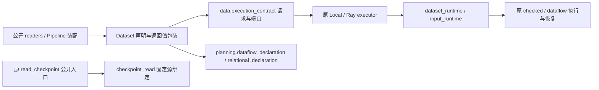

# P1：SDK 与执行侧边界交付

本次按共享评审 v3 合同先实施 A，再实施 B。目标是让 Dataset 表达声明与动作意图，执行侧统一拥有动作生命周期；沿用现有 executor、checked、编译器和 dataflow 引擎。

## 最终边界

- `execute(ActionSpec)` 接收原 source/plan 与动作特定字段，返回原标量、行、批、惰性 iterator、handle、Lance receipt 或 StreamStats。各请求有独立 frozen dataclass 和返回类型 overload；schema/batch/aggregate 保留原后端值类型。
- `prepare_input(InputSpec)` 接收原有有界 items/Arrow/NumPy/pandas 值，返回原输入 handle。公开 summary items 桥继续执行受管 1–128 行、256 KiB 检查及登记；原始 DataAPI 输入不增加这一受管限制。
- Dataset 仍包装 MaterializedDataset、决定公开返回 None/receipt，并保留原参数接受规则。首拉迭代、提前关闭、捕获、Lance 登记及提交后的异常时序由执行侧保留。
- 执行器上下文只有一个 ContextVar。默认宿主仍由原公开装配层选择；没有新增有状态 Runtime 或服务。

A 删除了 16 个重复的低层 executor 动作/输入方法；保留 `materialize_graph`、只读查询、规划、资源和仍有真实调用方的辅助方法。图执行仍使用原请求绑定。两个旧 stream 探针改用原 `make_action_request/run_dataset_action`，借用其已有动作作用域。

## B 的声明和读取合同

23 处只做预检的 SDK 调用改为纯 `validate_native_operation(...)->None`，与真实构造入口共用 JSON、名称、别名和原 NativeOperation 全部校验规则。两个 execution initializer 按需导出原对象；预检实际调用的冷进程闭包不加载运行 owner。

关系声明 helper 接收原 PlanInput，返回原 KeyedSource/UnionSource；SDK 负责 Dataset 包装。原声明类型路径、类体、端口顺序、union 展平规则和预算规则保持。Prepend 通过 `PlanView.replace_plan` 重绑定，持久字段仍持有原 Dataset，保留 executor/stages。

Checkpoint 读取核心返回 `CheckpointReadBinding(source, plan, reference)`；同一个 source 在 checked 登记后由原公开入口包装。固定 Lance 源由 SDK 与读取核心共同调用唯一 `make_lance_scan_source` 构造。未提交分支保留 Arrow schema/metadata 与 MaterializedDataset 类型。原公开 checkpoint 能力退役检查继续生效；读取核心 seam 测试不表示恢复了该能力。

## 核验时收紧的细节

- 公开 items 与 checkpoint 的默认宿主选择必须发生在原校验/checked/锁之后。私有装配选择回调只用于保持此顺序，不进入 ActionSpec/InputSpec 或持久协议，不提供跳过校验策略。
- materialize 与 Lance checked 调用仍不传 arguments（原 None）；不能统一为 `{}`。完成证据也没有统一补写。
- 包级私有导入预算将纯上下文与 canonical checkpoint 装配改为精确符号例外；execution→data 的其余预算降至 7，pipeline→data 不再有泛化私有预算。
- 保留依赖按调用方、符号及对象使用形状受测试约束；并未把整个 execution 模块加入 SDK 豁免。

## 身份与保留范围

本次没有改写历史 journal、receipt、manifest 或序列化类型路径。函数身份包含整文件哈希，因此 Dataset 文件改动会改变 `prepend` 和 `deduplicate` 内部平台 lambda 的 source_hash；后者是实施核验新增的明确枚举。两者代码、默认值、闭包、occurrence ID 均保持，计划派生身份必须用原公式复算。

真实 `_native_operation_factory` 仍定义在原 dataflow_api，函数体保持，其文件哈希变化单独取证。没有把纯预检临时 marker 放入计划。旧运行仍依原固定环境恢复，不能把新平台版本冒充原版本。

七个冻结文件、原生/cache 类、关系类型与 StreamCheckpoint 的历史身份保护另有逐文件/类体核验。

原 `_run_stream` 主体与图执行路径保留给 P8。六类原生实例以及 CachedMap/CachedSyncMap/CacheCall 仍存在已审定的运行依赖；本次没有迁出其状态访问，也不声称这些部分已完全解耦。

## 验证与集成记录

A：动作/输入边界、L/Y 适配、真实 Local 行为、输入身份、Lance 登记与恢复检查通过。B：组合纯边界测试 123 项通过，包括错误顺序、冷进程、固定源登记及 Prepend 重绑定。

合并 P4 后的组合回归 **246 passed**；最终端口、原生用途 guard、编译输入及 kind 合同 **89 passed**。真实单机 Ray 图与 Local 等价验收 **1 passed**；另有真实 Ray SDK probe 验证 count、提前关闭、join、关闭 executor 后读取已物化结果。没有据此声称多机/GPU 或全仓测试通过。

357 个 corpus 案例中 354 个逐字一致，3 个仅为已明确枚举的平台 lambda 文件哈希及可精确重算的派生值；30 个动作捕获全等。真实 NativeOperation factory 另有双树身份/声明/wire 补证，原直接 NativeOperation 编译拒绝保持。原始 compare 的 exit 1 与全部差异保留，未重写快照。

仓库通用依赖 ratchet 为 6 passed / 1 failed：工作台 conversations.inputs 对 Lance preview 两个私有符号的既有导入超预算。冻结原基线也得到相同唯一失败；P1 没有增加预算或改这两个跨会话文件。P1 的精确边界 guard 全部通过。

A 与 B 的完整 corpus、原始 wire、逐字段差异、身份复算、真实宿主检查、独立 review 和最终集成摘要保存在共享目录 `_demiflow/shared-review/p1-implementation-20261119/`，`validation.json` 记录最终结果。

P4 提交 `9188be2` 已先合入 P1 隔离树。合入候选前再次核查候选与 P8 的实际差异；运行预览版本另行管理，本次不重启服务。
