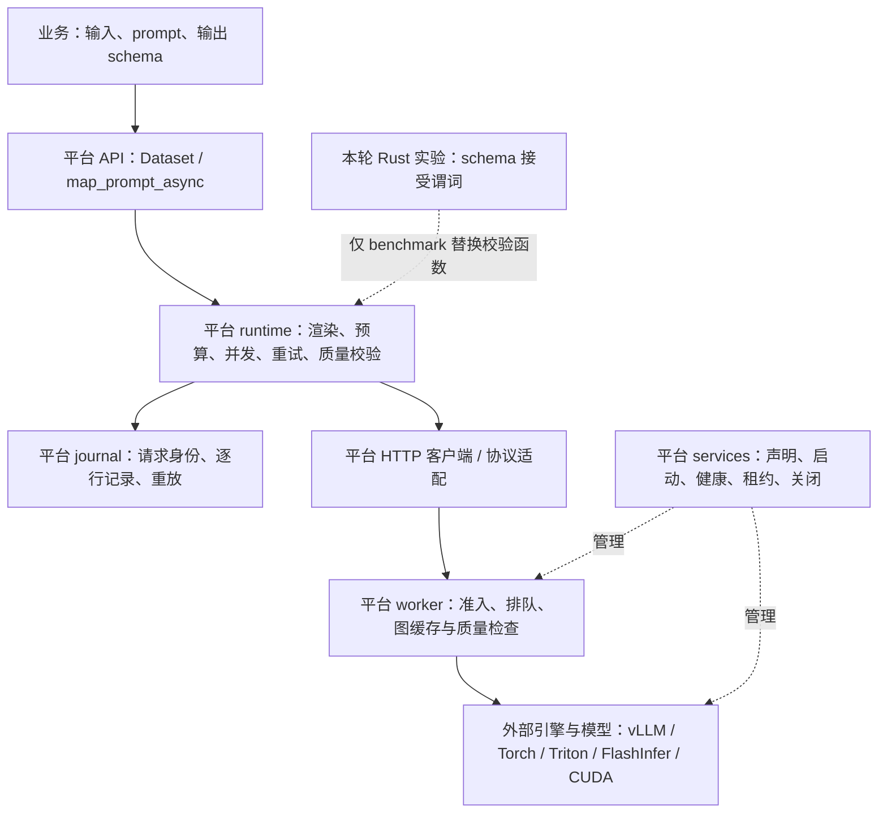

# 平台 CPU 与 Rust 实验 review（2026-11-01）

## 决定与实现边界

保留一处正式 Python 改进：`AsyncOperatorLLMRuntime.transport_context` 复用已绑定
的部署声明，消除每请求重复解析。Rust schema 原型留在 `benchmarks/`，不进入
生产默认路径，不添加打包依赖、服务、线程池、队列或全局缓存。当前证据不足以
证明用 Rust 改造这一小段 CPU 工作能稳定改善完整链路。

实现前的边界与 review 见 [设计](platform-cpu-rust-design-20261101.md)。原始证据
统一在 `/tmp/demiflow-cpu-rust-20261101`；benchmark 入口与复现说明见
[`benchmarks/rust_schema/README.md`](../benchmarks/rust_schema/README.md)。

CPU 平台与 GPU 推理优化属于不同边界。外部引擎的 kernel、GDN、CUDA 同步或
内核派发耗时，不因把平台 runtime 换成 Rust 就自动减少。services 管生命周期；
算子 runtime 管请求语义；worker 管模型执行与资源；本轮不重建其中任何一层。

## 端到端基线与真正的 CPU 热点

完成基线为 `jev-baseline-v3/report.json`：JEV 200 条不同业务输入，真实 HTTP、
runtime、Dataset checkpoint、journal 写入与 2048 条重放。两条执行通道，
`batch=false`；GPU 1，自有服务。冷/热阶段覆盖默认图缓存渐进捕获。

| 阶段 | 行数 | wall | 客户端 CPU | worker CPU | p95 / p99 |
|---|---:|---:|---:|---:|---:|
| HTTP 冷阶段 | 200 | 16.379 s | 0.360 s | 16.100 s | 306.7 / 1081.2 ms |
| HTTP 后续阶段 | 200 | 12.406 s | 0.290 s | 14.040 s | 281.1 / 345.5 ms |
| runtime 后续阶段 | 200 | 10.715 s | 0.560 s | 11.360 s | 156.5 / 256.2 ms |
| journal 重放 | 2048 | 1.469 s | 1.710 s | 0.010 s | 3.56 / 4.96 ms |

这几个阶段的缓存热度不同，不能用其差值宣称 runtime 比 HTTP 更快，也不能将
worker CPU 接近 wall 解读为平台 Python 是瓶颈。进程 CPU 包含 CUDA 驱动轮询。
上述非 cProfile 阶段仍有轻量线程计时，最终 A/B 不装这些探针。

worker 采用 py-spy GIL 栈采样。runtime-profile 的 893 个样本中，叶节点为
vLLM 353、Triton 146、FlashInfer 128、Torch 115、生成代码等 144，平台代码 7。
这是 GIL 持有栈分布，**不是**全进程 CPU 或 GPU kernel 占比。

平台客户端同步函数的 cProfile 独占 CPU 排序揭示两类热点：

| 链路 | 函数 / 工作 | 诊断结果 |
|---|---|---|
| 200 条 managed runtime | `deployment_config` | 200 次；独占 14.43 ms，含同步子调用 74.81 ms；租约已经存在仍重复构造声明 |
| 200 条 runtime | schema `_validate` | 独占 9.30 ms；输入/响应的类型、属性与范围检查 |
| 2048 条重放 | schema `_validate` | 独占 79.98 ms；平台函数中靠前 |
| 2048 条重放 | journal `lookup` / `references` | 独占 62.72 / 53.03 ms；SQLite 调用、引用路径和元数据构造 |
| 2048 条重放 | `decode` / 阻塞池 `run` | 独占 54.47 / 52.29 ms；响应解码及线程交接 |

绝对占比需要看无 cProfile 的阶段计时。2048 条重放的 journal 工作合计 CPU
423.5 ms，prepare 工作 117.0 ms，response 工作 93.6 ms，schema 40.6 ms。
前三项已包含各自的子函数，不能再与子函数求和。schema 约占该轮客户端 CPU
2.4%；JEV runtime 中约 6.68 ms / 560 ms（1.2%）。它值得隔离实验，但不是
支配 GPU 吞吐的热点。

诊断限制：cProfile 会显著改变小函数开销，重放从 1.469 s 变成 4.234 s；异步
协程累计时间也不用于关键路径判断。仅用同步函数独占 CPU 定位，再以关闭
profiling 的重复实验决策。初期两次探针失败分别是 Python 3.12 多线程 cProfile
冲突和 benchmark 漏走 Dataset checkpoint；探针已修，完整验收使用 v3。

## 正式 Python 改进与 review

2000 次 transport context 的 8 轮交替对照，真实解析部署配置、用惰性测试租约
隔离网络和模型：wall 中位数 **147.38 ms → 16.75 ms**，声明构造 **2000 → 1**。
这是该段 CPU 路径约 8.8 倍，不是端到端模型吞吐倍数。

review 核对：

* 配置已由模型声明冻结；租约仍按原模型键存放在原 `_service_owners`，无新缓存。
* 首次合法在线请求才构造、bind；journal 命中仍不启动服务。
* 冲突配置每次检查，`ensure_ready` 与 `request_slot` 仍逐次执行。
* 构造和写入 owner 之间没有 await，并发首请求复用同一 owner；关闭逻辑不变。
* 新测试覆盖 16 个并发调用、一次构造/关闭、逐次准入及已有 owner 时的冲突拒绝。

## Rust 实验、质量门槛和 CPU 结果

Rust 1.90.0 / PyO3 0.27.2，直接读取 Python 对象；不编码 JSON 再解析，不释放
GIL 后访问 Python 对象。只支持已明确实现的 schema 子集。无效值、不支持的
schema/对象类型或超限走原 Python 校验，保留错误类型、文本与顺序。
编译上限 12 层/512 节点，遍历上限 65,536 节点。schema 快照在复制前检查大小，
最多 8192 个结构值、262144 个字符、单字符串 65536 字符；没有全局缓存。

review 特别保留了每请求的 schema 变更检查，且要求精确 JSON 内置类型，防止
自定义 `__eq__` 或可变 dict 使陈旧编译结果漏检。这个保护计入性能，不能为了
漂亮的微基准删掉。Python 控制组同时测惰性类型判断和同样的编译/快照方案。

差分检查包括 1500 个固定种子 schema × 6 类值 = 9000 组输入，并覆盖 Unicode、
孤立 surrogate、bool/int、1024 位整数、NaN/Infinity、缺字段/多字段、nullable、
日期、Mapping/子类、schema 修改、超过快照/遍历上限。接受/拒绝以及错误类型、
文本均与原校验器一致。该证据不等于所有可能 schema 的形式化证明，故 PoC 不
替代原校验权威。

两个独立的 12 轮、每轮四种实现、每种 1000 行真实只读 journal 重放均精确一致。
第二轮每种实现先预热两次。无 cProfile 的第二轮中位数：

| 实现 | 完整校验入口 | 1000 行重放 | 吞吐 | 请求 p95 |
|---|---:|---:|---:|---:|
| 原 Python | 6.07 µs | 515.04 ms | 1941.6 行/s | 2.331 ms |
| Python 惰性类型判断 | 3.97 µs | 506.73 ms | 1973.4 行/s | 2.346 ms |
| Python 编译谓词 + 保护 | 10.14 µs | 515.79 ms | 1938.8 行/s | 2.343 ms |
| Rust 编译谓词 + 保护 | 7.72 µs | 514.42 ms | 1943.9 行/s | 2.351 ms |

Rust 谓词本体为 0.252 µs，Python 编译谓词本体为 2.23 µs；原 Python 是 6.07 µs。
“Rust 核心约快 24 倍”不能代表安全完整入口，更不能代表完整请求。
Rust 重放中位吞吐第一轮 +0.70%，第二轮 +0.12%。按同一轮次配对的几何平均
吞吐比则从第一轮 1.034 变为第二轮 0.985；第二轮按轮次 bootstrap 的描述性
95% 区间为 [0.957, 1.011]。共享机器上的小差异不稳定，不能作为上线收益。

## GPU A/B 和最终审计

GPU A/B 使用普通生产 worker，不装 profiling 探针。四种校验实现仅在客户端
进程替换；同一个模型实例、同一组 200 条输入、相同并发、逐轮轮转并反转顺序。
实验专用捕获上限为 32，预热完成后每个计时阶段断言 captures 保持 32；图缓存
仍为 4 GiB，上限和所有原有质量检查不变。生产默认捕获上限没有改动。

`schema-jev/report.json` 完成 8 轮 × 4 实现 × 200 条 = **6400 条 A/B 请求**。
1000 条预热后，另完成 200 条 journal 写入、200 条重放、200 条
`map_prompt_async(...).checkpoint(...).take_all()`。所有结果逐条精确一致，
重放没有增加 worker native/hit/check 计数；84 次在线质量复核、0 mismatch。

| 实现 | 吞吐中位数 | 客户端 CPU / 200 条 | p95 | p99 |
|---|---:|---:|---:|---:|
| 原 Python | 21.828 条/s | 453.9 ms | 141.33 ms | 188.41 ms |
| Python 惰性类型判断 | 22.034 条/s | 462.4 ms | 141.95 ms | 187.05 ms |
| Python 编译谓词 + 保护 | 21.865 条/s | 475.0 ms | 139.12 ms | 189.40 ms |
| Rust 编译谓词 + 保护 | 21.782 条/s | 480.4 ms | 144.98 ms | 188.94 ms |

Rust 吞吐中位数差异 -0.21%；按轮次配对的吞吐比 0.995，描述性 bootstrap
95% 区间 [0.988, 1.002]。这不支持端到端加速，也没有稳定的尾延迟收益。
客户端 RSS 中位数约 209.4 / 209.0 MB（Python / Rust）；同一模型实例最终图缓存
3,989,753,525 bytes < 4 GiB，allocator 峰值约 70.31 GiB < 74 GiB。

机器上的训练一直保留，第二次 CPU 复测也与部分 GPU 轮次重叠；这些小差异不能
当作严格隔离环境下的性能回归。该结果用于“不引入新生产复杂度”的决定；未来
若要宣称较小的正向收益，需要独占 CPU 测量窗口。第一轮与第二轮 CPU 配对
收益方向也不一致，保留两份证据，未挑选有利结果。

最终 review / 验收：

* 317 项相关 CPU 回归通过，包含 schema 差分、部署生命周期、并发/合批契约、
  四模型图缓存边界、journal、异步 Dataset、图片 state 与 HTTP 重试。
* JEV GPU 同进程数值一致性及 journal/Dataset 链路通过。本轮未修改模型数学，
  也未把它当作解决历史 JEV 跨启动漂移或四个模型重新跑完性能矩阵的证据。
* 284 个平台 Python 文件的起始快照中，仅 `operator_llm/runtime.py` 改变；
  Rust 与测量代码都在 benchmarks，`schema.py`、适配器和打包配置没有本轮改动。
* 108 个既有 dirty 文件中，仅 runtime 与相应 deployment 测试追加了本轮改动，
  其余哈希保持不变；无文件丢失。`systemone.py` 图片 state 等既有改动完整保留。
* 自有实验服务已关闭，无遗留模型/探针进程；GPU 0/1 显存均为 0 MiB，未操作
  GPU 2/3 或既有服务。工具链、扩展与产物约 693 MiB，仅在实验目录。
* HEAD 与起始相同，没有 commit/push；`git diff --check` 通过。

## 后续优先级

1. 保留已证明存在的重复工作消除；不因微基准更快就新增一个生产语言边界。
2. CPU 受限的重放链路，下一候选是 journal 引用/元数据构造与 SQLite 调用次数，
   以及一次请求的多次线程交接。先检查能否合并同生命周期工作，再考虑 Rust。
   SQLite 本身已经是原生实现，换宿主语言不会自动消除磁盘、锁或耐久性成本。
3. 若未来确有大规模 schema/JSON CPU 瓶颈，先设计统一且不可变的已编译契约，
   再测 Rust 谓词或解析边界，保留原错误与版本语义。不能偷偷假定现有 dict 永不变。
4. 单卡 GPU 继续看模型 kernel、输入准备、捕获与等待的关键路径。Rust 平台
   改造不承诺 GPU 利用率 100%，也不能用降低数值质量或改变 batching 语义换取收益。
