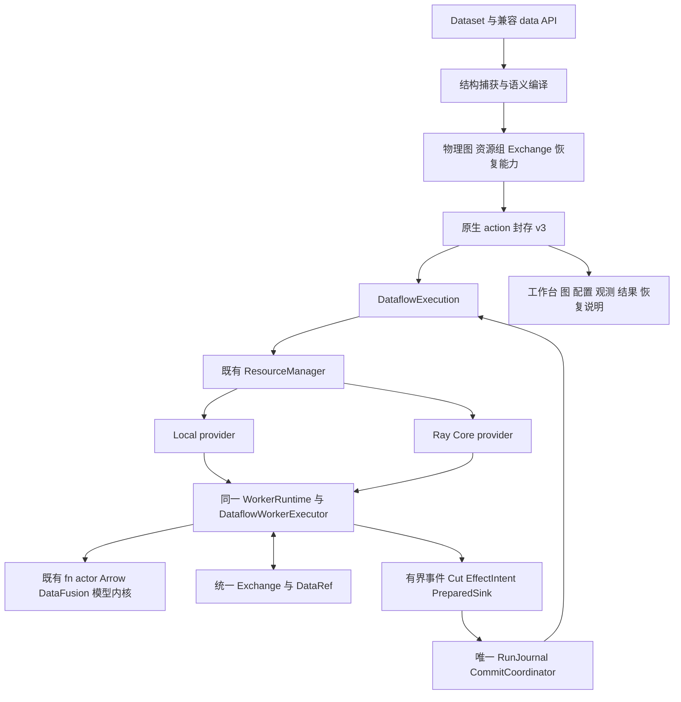

# 目标架构与已裁决设计

## 1. 唯一新运行路径

E 不重新分配物理资源；A 不决定业务图或提交；B 不创建 CommitCoordinator；C 不 ACK 外部任务；D 不运行第二份图；Workbench/Forge 不进入上述底层依赖。

现有 `chain.py`/`graph.py`/`queue_chain.py` 的公开调用兼容入口最终转向此装配；不再根据可序列化性、是否 map_async 或后端名称选择不同业务执行器。历史 v1/v2 读取函数保留；新 action 只生成 v3。明确 `UnsupportedCapability` 是诚实错误，但不能用它代替迁移矩阵中承诺支持的能力。

## 2. 图表示与身份（G）

复用现有 `LogicalPlan`、`CallableSpec`、SourcePlan 与业务操作事实。新增 v3 计划是完整可执行图，含有端口的多输入节点，不用旧 v1 composite-source 的单 `in` 端口表达 join 两侧。v1/v2 格式不改；`planning/dag.py` 字节冻结。

实例身份在结构捕获时建立：同一 Dataset 对象的共享前缀由同一结构 token 指向；两个分别调用同一函数形成两个 occurrence。Python `id()` 仅用于一次遍历中的别名表，不能进入持久哈希。序列化后保存引用拓扑与稳定 DFS 序号；已有历史身份不重算。新 action 采用显式 `dataflow-v3` 域的身份；attempt、host、worker 数不进入 logical identity。物理布局变化改变 plan_revision/plan_id，恢复必须先校验可兼容性，首批不做有状态在线 rescale。

公共终端一次提交一个 ActionRequest。多个终端属于同一 RunContext，可共享已封存结果；不自动合并两个已启动 action，也不偷偷把两次有副作用调用去重。一个 action 的分叉共享源只执行一次；多 action 的共享必须由显式物化或声明的已有结果绑定表达。

## 3. 物理编译与调度（P/E）

先解析每个节点的 KernelSpec、input requirement、effect/state capability、resource profile、输出上界；再确定分区、stage、可安全融合组、通道与 finite scope。逻辑一致不要求 Local/Ray 物理图字节相同。CPU/GPU/API/输出 I/O 是不同 role；业务模型 ID 不可为负载均衡替换。

有状态节点、模型初始化边界、不同资源/设备、fanout/fanin、durable/sealed 边均阻止不安全融合。纯、无状态、同资源的连续小算子可融合；融合内部仍保留 occurrence、预算与观测映射。每组副本由 policy、source splits 和资源可行性决定，不固定为 1，也不默认无限扩容。

调度队列只存 ReadyWork（引用、大小、分区、所需资源），不存大行。按组轮转的 deficit round-robin，缺额按字节/预计工作权重消耗；不能混淆 CPU 秒与字节配额。首批不做执行时间预测的正确性依赖。先给控制、sink/消费者和 renew 预留容量，再启动生产者；有限资源不够全部常驻时，只有 durable/sealed 边可允许安全分阶段排空。没有可行调度直接失败，不能等待永远不能启动的消费者释放磁盘。

## 4. 来源、三种交接与完整计算（S/X/K）

来源 snapshot 冻结版本/成员，不等于完整复制来源。Lance 固定版本、文件固定清单/大小/摘要、SQL 使用声明可重读的 snapshot 或先行持久 spool；不可重读有限iterator要求checkpoint时先有界完整capture+seal；可重开且有稳定cursor的源才逐段持久发布。任意一次性来源若既不持久捕获又要求可恢复，准入拒绝。连续队列通过 lease/offset 与 checkpoint 对接，不等待队列“全空”作为结束。

三种模式只改变边的 readiness/durability，不增加另一套批引擎。memory 每条可消费；durable 在不可变段发布后可消费；sealed 必须等待声明 finite membership 全部成功。物理 spill 不能把增量语义改为全量。用户 UDF 无法由 AST 推断完整输入需求，默认逐行；特殊 complete-input/state 通过单个算子级 contract 声明。

关系 kernel 复用 DataFusion 的受限外存计算，但输入是已获授权的 partitions/segments；输出进入同一 Exchange。join 保留 null 不匹配、多重性和默认无序；reduce_by_key 不把任意 Python reducer 当可结合函数；group_batches 明确组内输入序列。全局 sort 用有界 run sort + 外部 merge；random_shuffle 是固定随机键全局排序，不用随机重分区冒充；repartition(hash/rebalance) 增量与全量 sort 分开。计数/全局聚合通过 typed partial state + 最终 merge；任意 AggregateFnV2 的序列化/状态预算在调用前检查。

## 5. worker 与模型（B/M）

Local 进程与 Ray actor 装配同一 DataflowWorkerExecutor；WorkerRuntime 保留已存在的生命周期状态机。worker 下载/验证封存程序后本地构造 actor、HTTP client、GPU 模型；CallableSpec 不捕获 driver executor、锁、Task 或 journal。

Prompt/Embedding/Agent/Document/Cache保留公开配置和原生业务实现，通过worker内绑定的effect/资源接口运行；RawFetch/原生queue在driver受管服务持有原事务权威，计算前后缀仍在同一worker图，详见C16。普通 actor 的 JSON 业务状态、显式 state adapter、运行期资源分开；运行期锁/Task 不进入 checkpoint，也不能用“运行资源”标记抹去业务状态。未知付费结果阻止自动再执行。

每个 worker 的控制接收不运行用户函数。CPU 阻塞计算与 GPU 等待使用专用执行线程/进程；异步 UDF 不能在控制 event loop 上阻塞 `Future.result()`。取消先关准入，再有界排空，最后 stop/close；清理所有 owner，保留原业务异常并聚合清理异常。

## 6. checkpoint 与唯一提交权威（D）

一个全局 cut 固定 topology/route revision 与参与集合。channel 对齐负责阻止 post-cut 越界；worker 贡献 source cursor、operator state、buffer、effect refs、channel sequence/offset 和 prepared sink refs。每个 worker/partition 恰好一个贡献，不把多 worker token 压为 1。不因空分区缺消息永久等待：EOI 带最后序列并作为该输入已对齐的证据。

新 DataflowCheckpointCoordinator 是 CommitCoordinator 的编排消费者，不是新账本。source vector 存在本次 states 的保留键 `dataflow.sources.v3`；冻结的 SourcePosition 使用 `source_id=identity(['dataflow-vector',action_id])`、`next_ordinal=cut_sequence`，不把 cut_sequence 当业务行号。恢复必须同时读取 vector，禁止用该标量跳过所有来源。sink prepare/publish/reconcile/ACK 继续走既有单一协议。

intent-before-call、prepared-before-publish、队列结果与ACK同属原生finalize事务，普通cut只引用其事实；未知状态fail closed。crash 后重放 operation_id 不重复扣累计预算；瞬时 resident reservation 在退出确认/恢复对账后返还，与累计效果计费分开。未提交孤儿块依可恢复引用图回收，不能删除已提交/未知效果关联对象。

## 7. 真多机与权限（H）

driver 唯一打开 RunJournal 写连接。worker 不共享 SQLite 连接，不把 NFS 同一路径当 journal 一致性协议。控制复用现有 Local socket / Ray actor 消息，不增加引擎 HTTP 服务。新增 WorkerJournalPort 是既有 worker 所需的有限操作集合，类型化 allowlist；禁止任意 SQL、任意 method name、任意文件路径和 RunContext.start/complete/commit 权限。

worker 通过 HostEndpoint 获取有界 manifest/程序/只读配置，在本节点私有目录验证 code pin。大 payload 经 Ray object refs 或经验证的共享持久 store 直达 worker；driver 只接摘要和引用。共享 POSIX 首批作为跨节点 durable store：每个节点实读同一随机挑战工件并验证 namespace/marker/digest；不接受仅路径字符串相同。对象存储沿既有 store 能力接入，不为首批擅自开真实 COS。

Ray ObjectRef 不作为唯一恢复凭据；对应 checkpoint 的 durable ref 必须在 producer node 丢失后可读。worker grant 包含 run/attempt/fence/boot/revision/expiry；远端写先由 driver 校验当前 owner，迟到消息不能复活。effect response 丢失时同 operation_id 查询/重试取得原结果，不重新发付费请求。driver journal 所在持久存储丢失时不承诺恢复；网络分区禁止双主，不能用 timeout 推导原效果未发生。

## 8. API、产品和迁移

`Dataset` 方法签名保留；Local/Ray executor 最终只是同一 ActionRequest 的 provider 选择与返回值适配。公开 Ray 参数中有明确业务语义的先翻译为统一契约；纯 Ray Data 内部调优参数不能偷偷忽略，逐项记录替代/拒绝，作为显式兼容变更而非删除能力。现有 `data.xxx` 保留。

workbench 读取 v3 原生封存图、物理资源组、exchange 原因、恢复能力和观察映射；源码/参数/节点状态沿现有身份桥。没有真实观测的融合阶段标为无独立观测。Notebook/Case 不建立第二份引擎运行中心。

所有旧入口的迁移和清理有独立任务，不能只实现新模块。新运行禁用 Ray Data 的门覆盖公共入口、所有 terminal、失败与恢复；历史已提交结果只读不要求安装 Ray Data。历史未完成运行只有经历史兼容校验的原生格式可恢复；不重算旧身份、不默认启动旧 Ray Data。不兼容给出原 run/ref、具体原因和可用的固定结果，保留原工件供明确的原环境恢复。
