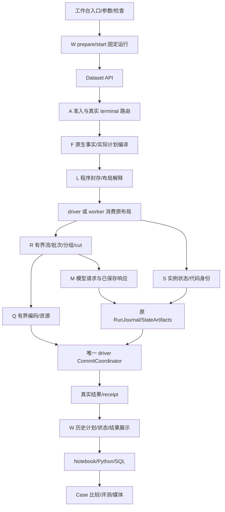

# 从函数补丁到完整产品：合流与验收

> **2026-11-14：修订中，不可按旧任务卡直接派发。** Qwen Review 发现真实接口与验收缺口；当前 `dispatch_ready=false`。先读 [逐条裁决](review-20261114/RESPONSE.md) 和 [七组关键修订](review-20261114/CRITICAL-REVISION.md)。下文旧目标/草案保留追溯，不代表已经闭合。

本文件是验收计划。当前状态为 not_run；样例通过不代表新功能通过。全部命令见 TEST-COMMANDS.md；机器索引为 gates.json 和 root-map.json。

## 1. 全局连接必须成立



箭头是调用或事实读取，不是另开服务。工作台可依赖 Forge；引擎不 import Forge/工作台。Notebook、开发、媒体和 Case 保留各自身份与生命周期；不借用 Pipeline run 作为所有操作的统一账本。

五条必须实际跑通的链路：

1. 合法流式 map→take/count/iter：A 准入→Q 预算→R native delivery；提前停止仍保持租约，线程退出后释放。
2. 流式/向量/模型→write：A/F/L→S 实例登记→R buffer/barrier→M 效果→Q 块→唯一提交→W 结果登记；恢复必须走同一链。
3. join/union/Arrow/Lance 原生路线：F 完整 ProgramSlice→L 逐段代码固定与 v2 解释→实际 backend 消费 stage_limits→原 sink 提交；take/iter 的关系路线也接入。
4. chain/graph/queue：保留 v1→真实 worker load/assignment/code-pin→driver ACK；重复重放路由、sequence、资源预留一致，取消/超时有界。
5. 工作台→历史运行→固定结果→Notebook→Case：同一数据版本；不重跑生产者；来源、权限、CAS、generation 和草稿历史保留。

## 2. 各包的输入/输出交接

| 生产者 | 交付给消费者的值 | 消费位置 | 拒绝条件 |
|---|---|---|---|
| F | Capability/OperationFact | A admission、Q payload_scope、身份编译 | 未表示原生语义/不完整参数 |
| A | ActionDecision | local take/iter/write、L compile_native_topology | 无效后端/退休参数/不支持组合 |
| F | LogicalDag + ProgramSlice tuple | L stage_native_programs/compile_native_topology | 路径循环、漏子计划、节点预算越界 |
| L seal | F1 + bindings v1/v2 | L interpreter、workers、W reader | 路径/大小/hash/身份/版本不符 |
| L interpreter | ExecutionLayout/Placement | driver/worker/backend | assignment错、所有权重叠、缺预算 |
| S | StatePolicy + snapshot/restore | precheck、OperatorSpec、OperatorStates、真实_MapWorker | 半套钩子、不支持资源状态、错identity |
| R | StageBufferSnapshot | 同cut状态提交与恢复 | 批次/分组引用错、跨cut、unknown伪成功 |
| M | borrowed RunPromptJournal + scoped RequestRecord | EmbeddingActor真实_exchange、原Prompt transport | 无scope、unknown、fresh限额不足 |
| Q | 保真有界块 + 原预留 | 原BlockSink/commit/replay | 单行/聚合越界、同预留变值 |
| W | declared/sealed来源 + 原运行状态 | 六个前端函数 | 历史载体不可用时不重算冒充 |

共享类声明在 interfaces.pyi；旧类字段和初始化源码在 class-state.json。新函数没有真实消费者则不能合入。动态协议（snapshot_state、native_stream_recovery）也必须在任务卡列消费方，不能只因为名字“像接口”就结项。

## 3. 原始意图逐项验收

| 原始意图 | 具体完成结果 | 验收门 |
|---|---|---|
| R.1.1 | 项目侧栏、四 tab、旧开发历史完整 | DEMO / DEVELOPMENT |
| R.1.2 | D1.9结构及真实响应式，宽窄屏实际操作 | DEMO |
| R.1.3 | 上下文紧凑、目录收起释放空间、操作/错误可达 | DEMO / WORKBENCH |
| R.2.1 | 真实图、源码、参数、输入输出与准确来源 | WORKBENCH / LAYOUT / HISTORY |
| R.2.2 | 配置→检查→定位→真实提交 | ADMISSION / WORKBENCH / WRITE |
| R.2.3 | run/attempt图、观测、日志、结果、停止与恢复 | WORKBENCH / RECOVERY / HISTORY |
| R.3.1 | 数据目录、版本、字段、统计分布 | NOTEBOOK / WORKBENCH |
| R.3.2 | 同Notebook Python/SQL、取消重启、保存重开、结果互用 | NOTEBOOK |
| R.3.3 | 表格、对话、文本/MD/code/JSON、图片/音视频/tag/HTML | NOTEBOOK / CASE；逐类型实测 |
| R.4.1 | 分组筛选选样翻页、服务端真实标注条件 | CASE |
| R.4.2 | 共享输入参考、多方案多字段、角色和布局配置 | CASE |
| R.4.3 | Case/方案/字段评测隔离、下一条、草稿历史冲突 | CASE |
| R.5.1 | 单一平台/清楚职责、无重复解释器或账本 | LAYOUT / ADMISSION + import/authority检查 |
| R.5.2 | 有界资源、正常/失败/取消/恢复与性能 | BOUNDS / RECOVERY |
| R.5.3 | 业务、dirty/staging、Notebook/开发历史和权限保护 | HISTORY / DEVELOPMENT / NOTEBOOK |
| 平台正确性 | 能力不退步、状态正确、身份不碰撞、值保真 | FACTS / STATE / IDENTITY / CODEC / RELATIONAL |
| 平台统一执行 | 同一封存布局驱动真实driver/worker/后端 | LAYOUT / GRAPH / QUEUE / RAY / STREAM |
| 平台恢复 | 路由、cut、代码、输出与效果都可证明 | RECOVERY / BUFFER / UNKNOWN / WRITE / HISTORY |
| 平台真实业务 | Prompt、Embedding、向量/分组/前缀与产品贯通 | PROMPT / EMBED / VECTOR / PREPEND / WORKBENCH |
| 平台资源性能 | 同预算、真实背压、单allocator、稳定吞吐/峰值 | BOUNDS / DELIVERY |

现有产品不因这次计划重写。V 的测试函数验证现有真实实现；若发现生产缺陷，报告到具体函数及 owner，不能靠改期望值结项。本轮可闭合已知缺口，但未知缺陷不会被设计文档消灭；因此不能提前承诺全局100%。

## 4. 测试必须表达业务语义

原117个失败的分工统计仍保留为历史输入：C28/B33/E20/N1 14/N2 12/N3 3，另7项原来后延。本包把它们指向的事实/状态/buffer/身份/资源问题原称全部提前分配，但Review发现遗漏，现以review-20261114/CRITICAL-REVISION.md为待补清单；实际验收还包括原来已通过但会受修改影响的用例。不能只跑旧失败清单。

强制反例：thread map.take(1)；无钩子类实例 Counter 真崩溃恢复；threshold/ContextVar配置差异；-0.0/+0.0和tuple/bytes；相同cut重复prepare；join右子计划改代码；Embedding batch_size=2/concurrency=2；group timeout/pressure/prepend空上游；Prompt unknown零重发；write create目标被外部创建；graph恢复路由；损坏bindings；worker无ACK；慢消费者/宽行/磁盘不足；历史读图与当前代码变更；Case跨窗口冲突和Notebook迟到输出。

测试迁移规则：

- N1 用 request_policy 重表达旧gate测试；保留 prompt_facts 私有journal拒绝，补正向锁测试和文档纠正。它已开工，作为M候选接收，不重复派发。
- N2 退休 checkpoint 测试迁移到原生协议，原测试想证明的恢复/拒绝/取消语义必须逐条映射；不能只删调用。
- 资源fixture若真实工作负载声明错误，可纠正声明并保留边界断言；不能为了绿而放大预算、禁用校验或改并发/批次语义。
- 外部模型只替换 transport；不能用假的PromptActor、假的allocator/interpreter/journal/commit替代真实组合链路。
- Ray/浏览器环境不可用记 blocked/unverified，skip 不计通过。DEVELOPMENT现有两个回归文件仅覆盖部分基础；仍必须完成V的真实开发历史流程。
- 已通过的无关集不重复重跑。改共享函数时跑直接调用方和核心反例；文件合流后跑相关组合门；最后一次整体业务门。

## 5. 性能和资源交付口径

同一输入、后端、预算、并发和机器，比较集成基线与候选：行数/多重性、wall time、rows/s、进程峰值RSS、队列与状态峰值字节、临时磁盘高水位、释放后占用、模型fresh/reuse次数。每项记录采样方法与环境，不能只贴平均吞吐。

首批工作负载：普通map→写；慢消费；宽行；倾斜分组；batch模型本地HTTP；join/union；取消后迟到线程；同cut多次恢复。目标在已有预算内；超过10%的吞吐/峰值退化触发定位，是本计划的工程检查阈值，不是用户承诺的SLA。解释器/JSON成本不能按总历史线性增长；失控历史扫描不得用小fixture掩盖。

最多两路轻测试并行，一路重测试独占；CPU/内存/磁盘以现有已分配预算为准。不要和在运训练争抢资源。所有产物写 /tmp/demiflow-*；不在主仓测、不重启现有服务、不使用付费模型。

## 6. 独立编码、合流与今晚顺序

分发时给每个agent：本包+指定tasks/ID.md+共同代码基线+独立worktree+交付根。调用方对interfaces/样例编码，生产者实现契约，两边无需等待；单元测试可使用固定边界样例。生产代码不得放stub或fallback让测试暂绿。

文件负责人仅装配同文件窄补丁、imports/字段/slots；不能重新定义接口。实现可以同时进行，组合顺序是：F/A/S/Q的契约实现→R/M/L实际接线→W事实与UI→V真实全链路。此顺序是合流门，不是要求后者晚开始编码。

以下旧时间预算已失效，不能据此承诺当晚交付。恢复分发须先完成七组修订与接口闭合。原相对时间预算：T+0分发全部叶任务和样例；T+30首次自测/阻塞回执；T+60–90合并独立底层补丁并试第一条真实写出；T+90–150贯通恢复与工作台；T+150–210跑受影响组合门/修缺陷。它是组织目标，不是“今晚必然100%”保证。原生v2/通用buffer是主要风险，若未完成保留未完成，不能撤验收门。

不需要真的新建144个会话：叶任务可以按文件/已有owner分批领取，但每个补丁仍可独立审核。N1在途任务继续收口；B/C/E/N2/N3已有候选逐函数吸收，避免整包回退和重复实现。

## 7. 回执与活跃协调

旧总控57bfe8f5不可作为接收者。用户指定一个活跃协调者，同时每任务写一个原子回执到 `DELIVERY_ROOT/<ID>.json`。DELIVERY_ROOT必须是用户分发时明确的隔离目录；未设置不得猜主仓路径。

```json
{
  "schema": "demiflow.task_delivery.v1",
  "task_id": "Q001",
  "state": "tested",
  "base_commit": "bbd93ffcc136c361093c5a4b6d79d0352c4c2557",
  "commit": "实际完整commit",
  "worktree": "实际隔离绝对路径",
  "files": ["demiflow/execution/block_sink.py"],
  "symbols": ["_canonical_row"],
  "contract_changes": [],
  "checks": [{"command": "实际命令", "exit_code": 0, "log": "/tmp/demiflow-.../test.log"}],
  "needs_decision": null,
  "updated_at": "带时区ISO时间"
}
```

state枚举：claimed/implementing/tested/needs_decision/integrated/accepted。tested必须有测试证据，accepted只能由独立验收者设置。needs_decision包含最小复现、预期/实际、相关契约、建议；不能空等旧会话消息。协调者按回执看进展，git diff只作旁证。禁止在无明确授权时自动跨会话发消息。

验收最终记录每个root：证据commit、测试命令与结果、浏览器/性能证据、已知限制。20项root映射全部有足够证据才可称本定义下100%；本文不赋予任何预先通过状态。
