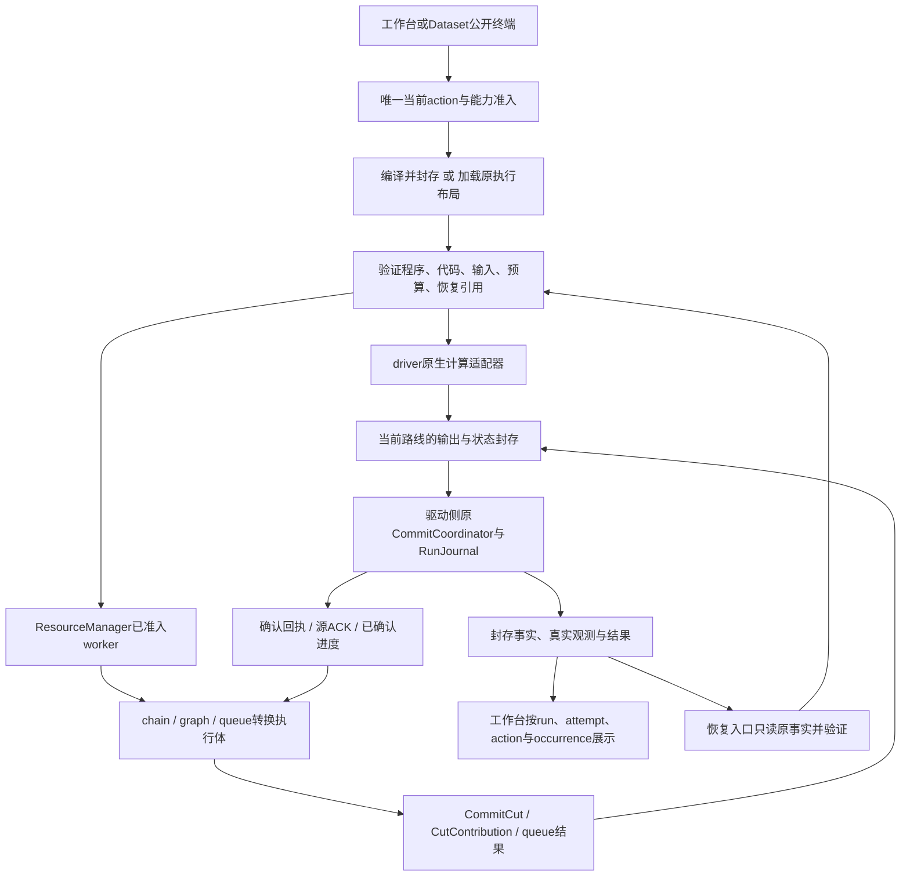

# 架构图 v6 独立复审：源码、接口与用户意图

日期：2026-11-14。结论：**五模块分工和多种执行路线的方向可保留；当前图有会误导实现的事实错误和范围遗漏，不能作为最终派工/验收依据。** 不需要推翻架构，先修权威、路由入口和恢复时序。

本次审阅的是 [full_architecture_v6.html](/yzp/zhaozy/yangzepeng/0905/_demiflow/platform_coordination_20261104/unified_execution_architecture_20261107/architecture_v6_20261114/full_architecture_v6.html) 的4张内嵌图、对应 Mermaid，以及其引用的真实源码。源码以隔离树 `bbd93ff` 为准，设计输入为 `0677dc2` 的188项版本；本轮修订后为198项。图原文件不改，主仓不改、不跑测试、不发消息给其他执行会话。

这是架构语义和接口复核，**不是浏览器交互、Ray运行、故障恢复或业务验收**。图中“实测”的旧探针属于 Qwen 既有证据，本次没有把它们冒充为重新执行的结果。

## 1. 按两大原始意图判断

产品 root：统一、真正可用的工作台，让用户看懂、配置、运行 pipeline，并分析、比较、评测数据。

平台 root：正确、稳定、高性能、通用、架构干净的统一计算平台；真实计划支配执行，资源/提交权威唯一，历史绑定当时代码，完整支撑实际业务。

图对“引擎职责如何分开”解释得比较清楚；对“用户从哪个入口进入哪条路、恢复时谁验证什么、已封存事实如何返回界面”还没有形成足够准确的闭环。不能从模块存在或导入边存在推导用户意图已实现。

| 原产品分支 | 本图覆盖程度与边界 |
|---|---|
| R.1：统一四tab、D1.9体验、紧凑与可达交互 | 只出现产品层方框；不能证明实际布局、响应式和操作路径 |
| R.2：看懂真实代码、配置检查运行、每run/attempt的观测与恢复 | 涉及较多，但身份桥和默认入口有错误；缺恢复的完整时序 |
| R.3：数据目录/统计、Python与SQL、通用媒体呈现 | 不在本图中；保持独立系统和验收，不能默认全部经过Pipeline执行 |
| R.4：选样筛选、输入输出比较、持久评测与冲突处理 | 不在本图中；不是引擎改好即可自动完成的产品功能 |
| R.5：单一职责、有限资源/真实集成、历史与数据保护 | 是本图重点；提交权威、资源覆盖和恢复边界必须准确表达 |

因此它应定位为“统一执行子系统的现状与设计对照图”，不能替代独立全局架构文档，也不能计算两大root的完成百分比。

## 2. 必须纠正的图中问题

这里的P1表示会误导架构实现或验收，不代表已经运行复现了一个P1生产事故。P2为范围/文档准确性问题。

### D01 / P1：三个进度适配器被称作“三条提交权威”

图定位：HTML 329、672、957–965；`v6_2_call.mmd`开头还写“谁传入progress，谁就是提交权威”。

源码事实：

- `StreamMaterialization.seal:438 → _commit:455` 在驱动内调用 `CommitCoordinator`。
- `worker/progress.py:67` 只把detach后的输出和状态交 `_request_commit`。
- `worker/graph_progress.py:204` 发 `CutContribution`，由 `graph.py:356 GraphCommitTerminal` 汇总并持久提交。
- worker两个请求方法接收驱动回执后才推进确认进度。queue还有驱动 `finalize_task` 路线，不能由“三个子类”穷尽所有提交适配。

**改法**：称“三种progress/发布适配器，共用驱动侧持久提交协议”。画出 `worker → 请求 → driver → CommitCoordinator/RunJournal → 回执 → worker`；不要把适配器画成拥有独立持久提交权。这里的唯一性指权威与账本，不是整个平台只能创建一个Python对象。

### D02 / P1：基类方法归属错，seal的副作用被省略

图定位：HTML704–708称三个子类共用 `bind_stages/align/seal`，把 `seal:438/_commit:455/finish:469` 列在 `StreamStageProgress` 下；827称“seal只返回thunk”。

源码事实：`StreamStageProgress` 本身**没有seal方法**；后三个方法属于 `StreamMaterialization`。三个子类共用的是 `bind_stages/align/restore_stages`，各自覆写seal。

`GraphWorkerProgress.seal` 在返回thunk前还会：detach输出、按source EOF/target EOI回写 `barrier.final`、发送 `output_router.barrier`、更新切点字段。thunk内部才写状态引用并请求驱动提交。故“seal不自己持久提交”成立，“seal没有副作用、只是返回函数”不成立。

**后果**：若按图把final做成全程只读，或只让R007基类负责人改字段而不约束三个seal，图路线会在终局/回执交界出错。这正是本次新增R023–R032与C13的原因。

### D03 / P1：把queue不传progress与普通流恢复缺口合并标红

图定位：HTML966–967及 `v6_3_roles.mmd:G3`。

源码事实：`queue_chain.py:1–20` 明确限定纯无状态maps后缀；worker只转行。driver保留claim/lease/RawFetch/finalize_task；`queue_execution.py:143–154`由同一协调器提交结果，再确认源交付。`queue_transform.py:86`不传progress符合这个边界。

普通 `stream_delivery` 确实没有完整checkpoint对齐，但其结果交付与恢复保证需要单独评估，不能与queue混判。

**改法**：每条路线列恢复保证和结算所有者。queue一栏写“任务级结算，纯转换worker无独立checkpoint”；若未来允许有状态后缀，要另有状态准入与恢复证据。不能为了把图涂绿给queue worker增加CommitCoordinator。

### D04 / P1：默认执行入口判断不完整，工作台实际上默认打开托管链

图定位：HTML366用 `LocalDatasetExecutor.__init__` 的默认False概括 `_unified_chain`，泳道1称“默认materialize”。

源码事实：

- `executors/local.py:127` 构造器默认False，正确。
- **公开 `local_kernel.py:121–124 local_execution` 默认 `unified_chain=True, unified_queue_chain=True`。**
- `workbench/runs/worker.py:104` 进入该公开context，没有覆盖这两个开关。
- 然后仍由 `local.py:861–864` 的eligible判定选择托管链；并非所有计划都能进入。

**改法**：区分直接executor/Pipeline入口、公开local_execution入口、工作台入口。托管链默认开启但仍受eligible限制，不能笼统说产品默认流式路径没接ResourceManager，也不能反向说所有工作台运行都已统一。

### D05 / P1：没有导入某个包，不能推导没有对应职责

图定位：HTML292、318–326，把 `stream.py` 无 `resources.* / exchange.*` 导入推导为“没有A也没有C，是意图缺口”。

源码事实：`stream_resources.py:44–58` 已有按行/字节限制的ObservedQueue，`stream_barrier.py`有进程内有序控制；A的ResourceManager主要处理独立worker的放置、准入、观察和退出。同进程driver不一定应另启动worker，也不必把内部asyncio.Queue强行替换为跨进程Channel。

**改法**：把模块定义为职责/契约。检查driver placement是否消费同一封存预算、队列是否满足上界、结束是否完成清理。只有这些义务未满足才判缺口；不能用包导入数代替功能与资源证据。统一计划允许多个适配器和计算内核。

### D06 / P1：原生路线“无容量准入、无退出证明”表述过强

图定位：HTML576–583。

源码事实：`native_resources.py:40–106 dataset_session` 已结合cgroup/继承envelope、run limits和原生配置，使用DataFusionSession的共享准入；`dataset_native.py:128–135 Engine.session`确实消费它。`local_tasks.py:425–514 TaskScheduler`限制worker和pending数量，并在退出时cancel/terminate/shutdown(wait=True)。

这些机制**不证明**所有分支受新的ExecutionPlacement/ResourceManager回执控制，也不证明整体RSS、Arrow临时写出/跨阶段峰值已闭合。真实缺口是这些既有机制与新布局/实际grant的接线与总量核算。

**改法**：标“已有原生准入与本地清理；尚未证明统一grant覆盖及协议级退出回执”。不要为误判的“全无”重造第二套allocator、进程池或取消机制。Arrow实际grant与临时写出仍是本设计阻塞项。

### D07 / P1：恢复闭环在图中主要是名词，没有明确验证/失败边界

图有RunJournal、restore、fence和code-pin说明，但主调用图缺少：

1. resume先读取原封存计划/bindings/program/source，不按当前编辑重算；
2. 验证来源、摘要、代码绑定、assignment与plan revision；
3. 读取已确认checkpoint，分别恢复源frontier、stage状态、egress ordinal与channel cursor/route epoch；
4. 先恢复再Activate/读源；错误不可降级为fresh或legacy；
5. 根据同一journal区分已提交、未确认、unknown效果，ACK与资源释放分别等相应事实。

源码中已能看到三种worker `_load_plan` 调 `verify_loaded_plan`，以及graph `_run`从restore读取egress ordinal。这些边应画出来，不能继续暗示历史graph code-pin完全缺失，也不能凭它们宣称所有恢复路径已验收。

**改法**：增加恢复时序小图并标出各验证责任；每条失败边保留原历史、拒绝启动。`cut_id`不能成为笼统的万用坐标；本地barrier对象、graph checkpoint、source/input/output/channel各自保留语义。

### D08 / P1（作为当前派工依据）：设计叠加已过时，且自身存在派发口径冲突

图定位：HTML16、1068、1115、1211、1223、1313。

图明确标了 `d82fe87 / 144卡 / 45文件 / 27门`，作为旧快照可以保留。**但不能拿它评价当前设计**：`0677dc2`已是188卡/52文件/29门；本次补10项后是198卡/54文件/29门。

图仍写“21新验收函数0条命令”“七组修订未写回卡”，在当前设计已不准确；21个函数已有required nodeid与selector，117条历史失败也已有验收门。这说明验收计划已修，**并不表示这些业务测试已实现/通过**。

图头写全部dispatch_ready=false，但F行写“可直接分发”，口径冲突。先用新plan/gates生成设计叠加；局部可编码条件与整包发布门必须分别列明，不得靠一个绿色模块绕开全局阻塞。

### D09 / P2：身份桥helper“休眠”定位错误

图定位：HTML1034–1037和 `v6_3_roles.mmd:G7`。

`workbench/graph/model.py:446–447`已有 `_resolve_bridge_node` 的生产调用。真实缺口是HTTP `GET_FIELDS['graph-source']`只有graph_binding/node_id/kind/resource，拒绝新logical_node_id/occurrence_id选择键；前端也需要正确传递选择。应修传输与选择消费者，复用既有helper，不能新建第二个身份桥。

Qwen第三轮报告已撤回这类推断，图尚未同步。当前W022–W027已覆盖相关装配/核验。

### D10 / P2：六泳道是实现路径分类，不能当成产品能力清单

图已经诚实写了graph显式opt-in、当前包内只有tests调用，这是优点。但读者仍可能把“有graph.py”读成“用户Dataset任意多输入计划已在产品里统一执行”。

**改法**：每泳道补4列：公开入口/选择条件、受支持算子与source、恢复保证、真实验收证据。保留Arrow/DataFusion独立计算体；目标应是“同一计划实际约束它们”，而不是强迫所有关系计算进入run_stream。多输入、join/聚合、写出等场景要有可运行组合证据。

## 3. 不应推翻的部分

- A资源、B算子执行、C数据交换、D提交恢复、E计划编排的职责方向合理；不等于要立即搬目录。
- 产品run管理与引擎编排分开；Forge是上层消费者，不能改造成资源后端。
- 引擎不依赖workbench/forge；UI消费引擎封存事实，不能从静态图重算执行账本。
- 本地与Ray复用同一资源协议；worker只贡献，驱动唯一持久结算。
- 同一run/fence贯穿资源和效果账本；结果先提交再ACK，unknown付费效果不盲重试。
- 普通buffer聚合和native row-local单token全注册表快照不是同一机制。Q56“只存首worker”已撤回，不能再按该错误前提重写原生模型并发。
- fail-closed应保留到每种buffer有真实跨cut/恢复证明，不能靠删除守卫实现“全部支持”。

## 4. 建议的准确全局连接

这是一张目标连接示意，不是新增运行时验收证据：

图中的S是职责，不是建议新增一个“大一统封存器”；实际由三种progress、delivery flush和queue finalize适配。源ACK、graph读者解锁、资源退出释放也不是同一个事件，不能画成一个ACK完成全部事情。

## 5. 本轮已落实与仍阻塞

第三轮任务修订见 [RESPONSE-3.md](RESPONSE-3.md)。Local与Ray接线分别有实现权限；新增函数/只读调用方矛盾已成为检查规则。新增10张提交传输与graph cut卡、共同C13及类型声明，保留现有权威，不改生产代码。

仍阻塞：普通buffer持久payload和参与者/EOF协议的可执行细节；Arrow真实grant及临时写出总量核算。真实业务、Ray、浏览器及性能验收未运行，`dispatch_ready=false`保持。

本次是一轮源码与架构专项复核，并非十遍全量复核。工具测试和卡数不能兑换为功能100%或用户意图100%。
