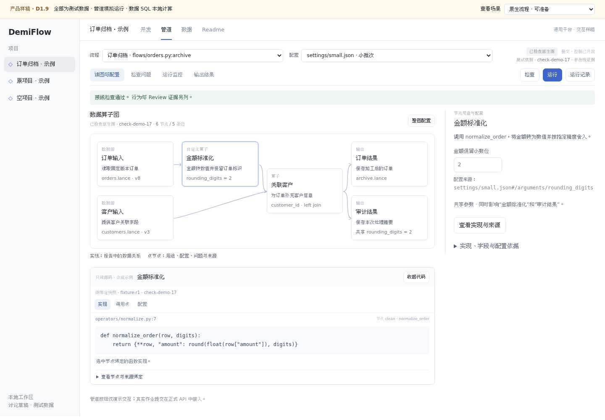
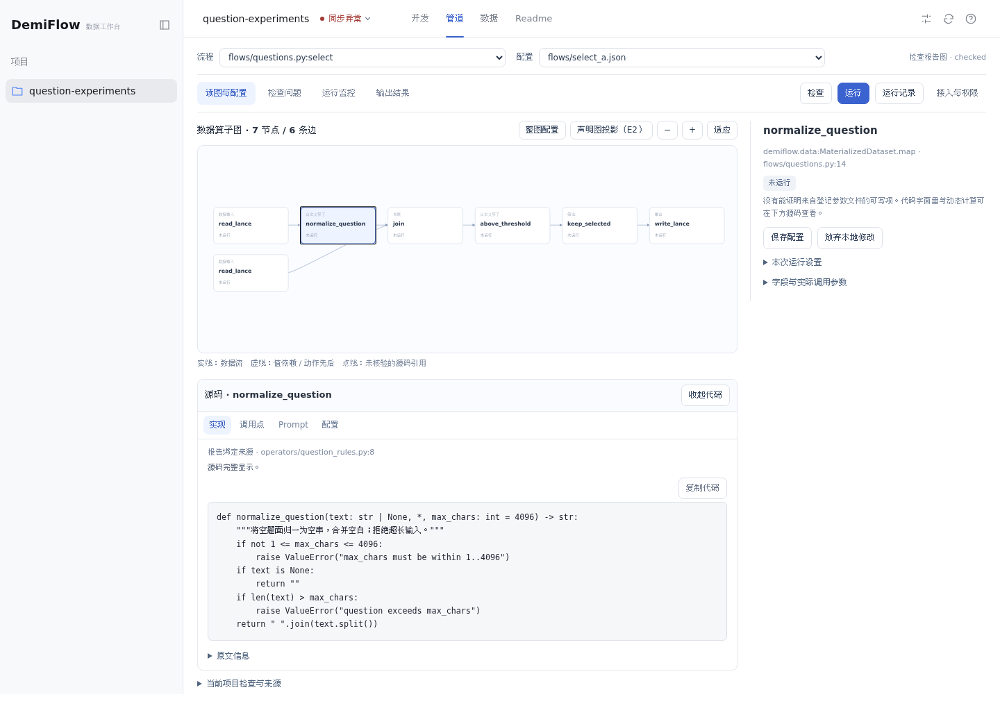
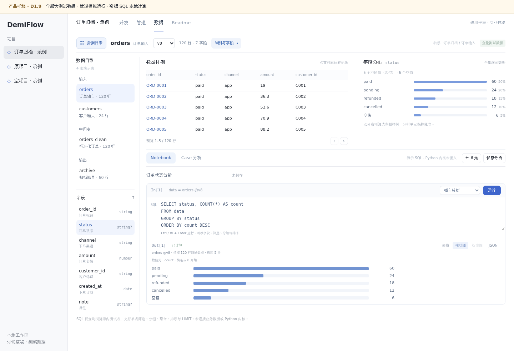
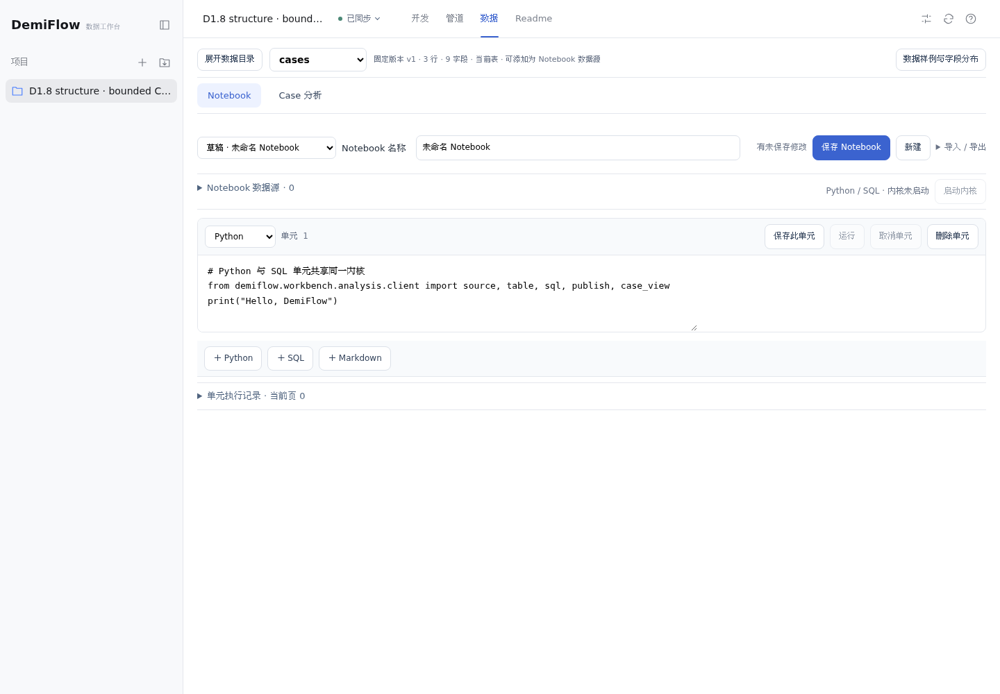
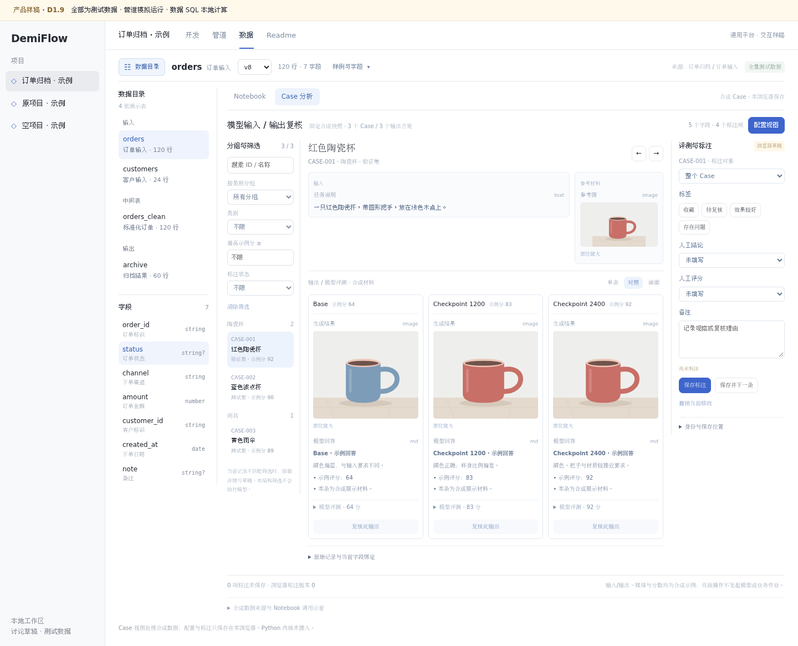
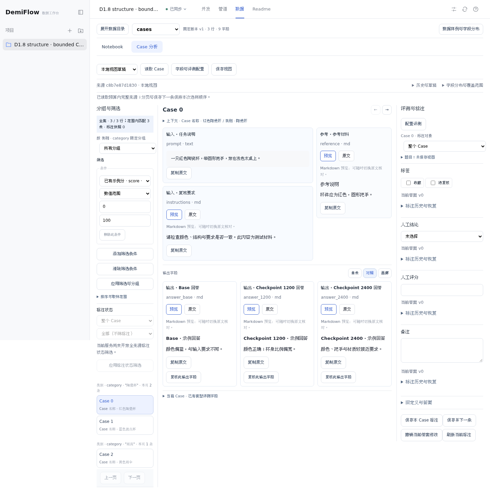

# D1.9 与实际前端：对比复核

## 1. 证据口径

- 接受基线：`docs/assets/workflow-workbench-20261105/index.html` 明示 D1.9，配套 prototype/data-demo/case-demo；意图依据见 `docs/forge-workflow-workbench-discussion-20261105.md` §20–22 和工作区 FORGE_COORDINATION_GUIDE。样稿的数据与运行是模拟的，只作体验基线。
- 当前代码：隔离树 `267b914`。本次真实浏览器从该树启动私有服务；管道使用 `examples/forge_workspace` 的合成数据，调用真实检查和 graph API，没有运行付费模型或用户业务。
- Case/Notebook 截图使用现有 representative_case 夹具：真实前端、HTTP、Records、Lance；分析 helper 是明确的元数据替身，`analysis_execute=False`、`execution_profile=None`。因此截图证明布局与交互结构，**不证明真实内核执行、所有媒体或服务能力缺失**。
- 夹具原先缺新增 execution_profile 属性，首次进入失败；只在 `/tmp` 补齐替身，不改产品。另一次捕获错误为 Playwright 的字符串 wait_for_function 被 CSP 拒绝，已改 locator 等待。两次均不记为产品缺陷。
- 开发/Readme 本轮查源码和旧测试，没有重做浏览器验收。历史运行页另参考此基线前一轮真实运行截图，不能与本次只读检查混称同一次运行。
- [证据索引](evidence/provenance.json)记录源码摘要、截图、夹具边界；本次不写旧交付“全部完成”的结论。

## 2. 直接可见的差距

| 编号/优先级 | 样稿与原意图 | 当前观察 / 源码依据 | 本批修改 |
|---|---|---|---|
| G01 P1 | 内容为主，紧凑项目栏 | 项目栏固定 264px；D1.9 为 190px；窄窗口易挤内容。四 tab 已存在，并非重做导航 | A 统一约 200–220px 可收起项目栏；有效内容宽度驱动布局 |
| G02 P0 | 初进即可看懂数据处理 | source 路径外层 `_select` 只观察到一个调用，完整 7 节点图在检查报告中；当前普通图与 E2 切换使用户承担内部模型区分 | B 明确“仅观察到入口/检查以展开”；历史默认封存计划，编辑默认报告/源码；C 单一画布。缺依据不画假图 |
| G03 P0 | 节点写用途、数据/参数摘要 | SVG 卡片 192×94，横向层间距224，readable 默认缩到约0.56；标题为API/函数名，屏幕文字过小 | C 分支布局、最低可读字号；节点类型/名称/两条有依据摘要；大图横向浏览及定位 |
| G04 P1 | 点击节点看输入、输出、配置、源码 | 右侧以 API 路径、原始参数/字段 details 为主；无参数节点也显示保存/放弃按钮 | B 先显示用途/输入输出/可编辑项，来源详情收起；无可改项无保存按钮 |
| G05 P1 | “检查问题→定位→处理”连续 | 真实检查已有；checks 模式把整个图隐藏，定位后的查看/修复上下文不够直接 | B 问题列表与图/inspector联动；按真实 related_nodes 定位，无关联则显示文件位置 |
| G06 P0 | 历史看到当时执行，控制目标明确 | 身份桥已接通；但主界面暴露 E2、dag_id、op_kind、stage.budgets，用户还要切换才能看封存计划 | B/C 默认真实封存视图，按action选择；高级诊断收起。历史缺桥不猜测，run/attempt不漂移 |
| G07 P1 | 目录、版本、样例、字段分布一个上下文 | 当前目录为多列表，分布需多层展开；table-versions 的 selected 仅返回metadata，样例仍绑定原版本 | A 紧凑目录/字段图；F 补只读版本链，不更改 tables/*.json 绑定 |
| G08 P0 | Notebook 运行当前代码自然直接 | analysis.js paintCells 中必须先保存、再启动内核、再运行；没有内核时按钮禁用。单元/输出重复“原始身份/格式”说明 | D 对已有授权合并保存→启动→提交，冲突/未知回执停下；编辑/输出内联且有版本依据 |
| G09 P1 | SQL结果表、柱/折线、JSON切换 | 输出已有 MIME/type 渲染和固定表/Case跳转；没有样稿中同一表结果的通用轻量图表切换 | D 对有界表页新增纯呈现图表，绝不在浏览器重跑SQL或声称全量聚合 |
| G10 P1 | Case 首屏主要是材料和评测 | 已有三栏，但四层工具/状态行；左侧条件编辑很长；每个md字段重复格式、预览/原文、复制等 | E 合并顶栏、快捷筛选；D compact field；异常仍在原位置清晰显示 |
| G11 P1 | 可配置多方案，每方案多材料 | 当前源码已支持 Case v2 output_groups；本次截图夹具是v1三输出字段，不能据图宣称“多方案未实现” | E 以v2真实例子验收；标题取配置的context文本；方案/字段目标保持后端证明 |
| G12 P1 | 窄屏可快速看材料并评测 | 两者均可纵向排列；当前390px Case整页4288px，样稿3875px，内容不同不能作严格性能比值；无横溢出也不代表好用 | E 窄屏分组筛选默认收起，Case导航和保存操作可达；原位预览；不隐藏未保存状态 |
| G13 P1 | 错误能理解且知道如何继续 | 捕获当前管道时曾出现 Worker capacity exceeded 同步异常；旧服务另有token/代码版本问题，不能归成绘图缺失 | A/B 读忙退避、保留内容、清晰重试；写不自动重试。部署绑定另验，不重启旧服务掩盖 |

P0 表示直接妨碍本批“看懂/操作真实流程”的产品交付，不代表新增引擎数据损坏。G02 不是要求静态分析能穿透任意Python；G08不是绕过内核/保存的契约。保留当前已经正确的能力：配置 CAS、精确运行/attempt、身份桥、固定结果、持久评测、媒体准入及草稿。

## 3. 同尺寸对照

### 管道

样稿：用途、参数与数据去向直接可见。

当前：真实7节点报告图，但缩小字体与技术信息占主导。

### Notebook

当前截图的执行按钮禁用是夹具未授权执行；多步骤的问题另由 `analysis.js::paintCells/paintKernel/save` 源码确认。

### Case

样稿含图片，当前夹具主要是文本；不比较素材美观或假定当前媒体不支持。比较的是栏位、主次、工具占用、字段噪声和选择/评测路径。

## 4. 产品与引擎之间保留的事实边界

画布的坐标、卡片文案、折叠状态是UI；节点/边/身份/运行状态不是UI推导的事实。当前编辑图只能称当前源码或检查图；历史主图必须来自封存action。编译失败、未封存、部分支持、恢复限制不能为了“好看”隐藏。schema来源缺失写“未提供”，不能拿后继字段伪造节点输入契约。

Notebook图表、Case布局是同一固定数据的呈现。切换版本/来源必须更换binding/source_snapshot；原内核保留原sources，旧答案保留原target。界面统一不等于把这些身份揉成一个“当前数据”。
