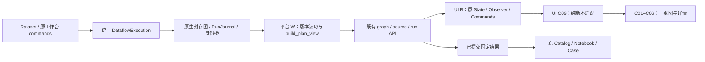

# Runtime v3 接线修订：UI-D1.9/2

日期：2026-11-15。依据：[平台总控 (2)](codex://threads/01a1da21-f648-7522-9324-760ac1c7c9af?hostId=remote-ssh-discovered%3Adevbox-codex) 的重新设计，以及隔离树中的设计和 W 路候选源码。**本次修改设计，不修改实现，不打断已在编码的 W 路。**

产品仍要让用户看懂、配置、运行管道，并分析、比较、评测数据；引擎仍要统一、正确、有界、保护历史。R1 四 tab/D1.9/紧凑上下文，R2 图与代码/检查提交/运行历史，R3 目录版本/Python+SQL/通用输出，R4 筛选/多方案材料/持久评测，R5 单一权威/真实集成/历史保护，均保留。改变的是 R2/R5 的运行事实接线；不因底层统一而另建 Notebook 或 Case 执行中心。

## 1. 已核对的影响

平台设计树：`/yzp/zhaozy/yangzepeng/0905/_demiflow/worktrees/gpt_runtime_contracts_v3_20261114`，分支 `docs/runtime-contracts-v3-20261114`。设计提交 `70e357c5c11ee9a594d3b5998ae397033372d69e`；本次读取到修订 `8479c04`（AMEND-001 增加 CAPACITY_PENDING）。依据为 `ARCHITECTURE.md`、`CONTRACTS.md` C12/C13、`IDENTITY.md`、`interfaces.pyi` 和 W001–W021。

候选实现只读取证：`runtime_v3_w_20261114`，观测时 HEAD 为 `70e357c`，含未提交实现，**不是已验收交付**。字节摘要与关键摘录在 [runtime-v3-inputs.json](evidence/runtime-v3-inputs.json)，不把可能继续变化的工作树当冻结证据。

| 接口面 | 原设计 | v3 的实际变化 | 本次修订 |
|---|---|---|---|
| 运行事实 | 原封存 logical/physical v1 | 新运行 DataflowGraph/PhysicalDataflow；旧运行按原版本读 | C09 做纯展示适配，服务端 W 做版本读取 |
| 图边 | v1 边只有 logical ID＋port | v3 原图有 edge_id、producer/consumer occurrence、端口 | v1 保留逻辑组；v3 一实例一节点，精确端口连线 |
| 物理详情 | stages 按 logical ID、channels、worker_groups | stages 按 occurrence、exchanges、profile、policy、recovery | 显式版本分支，不能套旧字段或按函数名 join |
| 选择与观测 | run/attempt＋旧图节点 | action/dag/plan/revision/occurrence 都需一致 | 在原 State 增强读取票据，迟到响应不能混入新计划 |
| 编码所有权 | B 独占 workbench.js，C 独占 workbench-graph.js | 平台 W018–W021 已在改同两文件 | W 交付后迁移其语义；B/C 可以隔离编码，最终各只有一个版本 |
| Notebook/Case/版本链 | 既有 source、session、Records、Catalog | 平台明确保留这些领域 | A/D/E/F 不改 API；V 用真实新平台回归 |

**已确认的一处接线缺口**：W 候选 `build_plan_view` 将 v3 边端点投影为 `_semantic(graph, edge.producer/consumer)`，丢掉 edge_id 和 occurrence_id。v3 的 semantic_id 不含出现序号；两个相同算子能同 semantic、异 occurrence。前端无法由这个投影还原精确连线，甚至会把同类串联误画成自环。需要补回原图已有字段，不能在浏览器重算或猜测。其余下述内容是整合验收要求，不能混称已复现缺陷。

## 2. 接线与单一权威

浏览器不调用 worker、资源 allocator、ArtifactStore 或编译器，不读取 journal，不新增 engine HTTP 服务。读取动作没有编译、恢复、模型执行副作用。原 API 鉴权、参数写入 CAS、pending intent 和服务端恢复准入保持。

## 3. 提供方最小补充（已有 W 任务内完成）

这些是 UI-D1.9/2 的**消费合同要求**。本次没有替 W 修改源码或其独立设计包，也没有发消息让它改工。`runtime-wiring.json` 将状态记录为 `required_not_verified`；合流必须拿真实 W 输出验证，不把本文存在当作提供方已落实。

### U1 · W004/W011/W015：保留原实例端点

沿现有 `graph.logical.actions[]` 提供 action；不新增 endpoint。v3 action 标明 `version='v3'`，`dag.schema_version='demiflow.dataflow_graph.v3'`，保留 action_id、dag.dag_id、plan_id、physical.plan_revision、status、binding_level。

- 节点沿候选 `{logical_node_id:<semantic_id>, occurrence_id, op_kind, input_ports, output_ports, traits}`；logical_node_id 是兼容投影名，不是新身份算法。一个 occurrence 只出现一次；不能按 semantic_id 合并。
- 每条边为 `{edge_id, from:{logical_node_id,occurrence_id,port}, to:{logical_node_id,occurrence_id,port}}`。edge_id、occurrence_id、端口逐项复制原 GraphEdge；旧 logical 字段保留。不能从 semantic_id 唯一反查来补端点，因为一对多正是需支持的场景。
- physical.stages 继续按 occurrence 索引，exchanges[].edge_id 与上述边精确关联。source/terminal occurrence 必须落在节点集合。plan_id 与 physical.plan_id 一致，revision 为非负安全整数。
- 同一个 action 的投影需满足现有 `ACTION_BYTES=96KiB`，图仍受原全局字节/节点/边预算限制。不能为增加详情扩预算、静默截掉边或留下悬空端点；超限显示明确 unavailable/partial，不能标完整执行图。
- 这是**只读展示 DTO 的加字段**。不修改封存 Graph、任何历史字节、dag_id/plan_id/identity bridge，也不把展示 DTO 写回引擎。

### U2 · W012/W017：本次观测的范围凭据

复用 `node_observations={available,attempt,has_more,entries,...}` 的既有分页包装。v3 增加 action_id、dag_id、plan_id、plan_revision，且每条 entry 保留 occurrence_id 和报告桥键；W 在服务端只接纳匹配页面身份的观测，不能给旧行补当前 plan_id 冒充已校验。受限页没有该项是 `not_in_page`，不是节点从未运行。

`build_plan_view(observations=())` 中的默认未观测列表、`plan_node_observations`、缺 scope 的原始数组只能用于“尚无本次独立观测”说明，不能覆盖有凭据的当前页或推算成功。现有 detail page 无 plan 身份时，v3 UI 不提升为节点指标；W 必须在真实生产读取路径提供已核验关联，不能靠前端拼一个当前身份。legacy 原页读取语义保留。

### U3 · W016：源码/配置定位与恢复

沿原 `graph-source(binding,node_id,logical_node_id,occurrence_id)`，不擅增 HTTP 参数。UI 先在选中 action 的真实 bridge 验证成员，再请求并用本地完整读取票据核验响应。W 的 bound_source 必须校验这对 logical/occurrence 属于该 run 的唯一封存 action；源码/code_pin_ref 必须取这一 action，不能取遍历到的第一个 v3 action。缺桥可看真实图和物理详情，源码明确不可用。

服务端 manager 决定 resume/cancel 权限及恢复准入；physical.recovery 是计划声明，不等于“现在能恢复”。`attempt_only`、未知效果、不兼容历史分别显示原原因。CAPACITY_PENDING 表示容量待满足，不是执行完成；不据此自动新建 run 或重复提交，UI 仍读原 run 的真实状态。历史 v1/v2 可读与可恢复分开，不因升级重编译或补写历史。

## 4. UI C09：一个纯适配函数

`normalizeExecutionPlan(entry, binding) -> ExecutionProjection`，在 `workbench-presentation.js`，由 C03/C04 使用；C03 一次规范化后把结果传给 C02，不能逐节点重新解析/建立并行缓存。

输入是原 graph response 中选中的一个 action 和原 GraphBinding。返回联合类型 `available:true`（精确身份、节点、边、物理摘要）或 `available:false,reason`。类型见 contracts.d.ts；不抛到整页，不发网络请求，不写 Store。

1. **legacy 分支**：只有 `dag.schema_version='demiflow.logical_dag.v1'` 且 version 缺省或为已知 v1/v2 才接受；未知 version 即使搭配旧 dag schema 也拒绝。保留原逻辑组＋成员选择。封存格式的 v1/v2 不等于 graph DTO 版本；不凭是否存在 exchanges 猜格式。
2. **v3 分支**：version 和 dag schema 双标记一致；核对 action/dag/plan/revision，节点唯一，边端点及端口存在，物理索引和 exchange.edge_id 存在。同 semantic 不合并；图节点直接使用 occurrence。缺 edge occurrence 返回 `v3_endpoint_identity_missing`，显示“执行图投影缺少实例端点”，可显式打开当时检查图；绝不悄悄按 legacy 画。
3. 未知未来版本、冲突身份、悬空边均 unavailable，reason 使用稳定本地枚举；这不是后端错误码，也不是新的运行状态。
4. legacy 绘图键继续 `[basis_digest,action_id,logical_node_id,null]`；v3 绘图键为 `[basis_digest,action_id,dag_id,plan_id,plan_revision,occurrence_id]`。只是 JSON tuple DOM key，不散列、不反写引擎身份。
5. 物理详情区分“计划声明”和“真实观测”：CPU/GPU/remote_api/io 取 traits.resource_role，profile 是请求/限额，不当作实际占用；replica_target 不是已启动数量。通道模式逐项映射 memory_incremental→逐条交接，durable_incremental→持久增量，finite_sealed→完整范围就绪；保留原 reason。融合只能显示阶段观测，不能复制为各成员指标。
6. 计划拓扑、物理详情和动态观测来自同一个选中 action；不把 metadata 缺失填为 0/成功。stage/profile 没有数据则说明缺失。作用域检查通过后才读当前观测。

## 5. B/A 接线与公共类型

在原 State 内保存 `ExecutionViewIdentity={project,basisDigest,runId,attempt,actionId,dagId,planId,planRevision,format}`，仅用于选择和读取票据。GraphBinding 的 HTTP 字段不改。source/report 使用 execution=null；sealed 必须完整。

- B11 `setGraphView`、acceptGraph 及 selection 更新让**图/源码/观测**读取票据随完整身份变化失效。旧源码响应即使 run/attempt 未变，action/plan 变了也丢弃。只有身份元组实际变化才使票据失效，普通指标轮询不递增选择代数；B14不得在每次paint中无条件重置State。运行级日志/stop 按原 run/attempt scope，不错误要求 node 归属。
- B14 唯一主图调用链：C01选择→C03调用C09→C02卡片→C06.update；B02 和 Observer.onSnapshot 都进入 B14。B05/C04 展示所选执行组/通道/恢复说明。C04 的物理详情是结构化字段，不塞到“参数可编辑”区域。
- B03 selection 带 execution identity。v3 点一次出现直接定位；legacy 多成员组仍显式选成员。B06 请求沿原字段，响应关联本地捕获票据及真实 bridge。
- A10 run URL 增可选**完整四元组** `dag_id/plan_id/plan_revision/plan_format`，只有全部提供才有效；必须已有 action_id 和明确 attempt。plan_format 为 legacy/v3；v3 新生成的实例链接必须带 occurrence_id。旧 URL 不加缺省字段、不重写字节；读取后按真实图补本地身份。新 URL 与服务端身份不符时显示过期定位，不回首节点冒充成功。
- B08/B09 保持真实 stop/resume 和 committed 输出。新引擎内部 ResultHandle/ArtifactRef 不能直接作为浏览器可访问表；只打开原服务已经确认、登记且绑定的结果。Notebook/Case 仍用原 source/session/Records。

## 6. 跨设计包文件交接

**“各包内部文件不冲突”不代表两包一起实施不冲突。** 机器清单列出两处重叠，不再声称全局零交叉。

| 文件 | 在途 owner | UI 最终 owner | 语义迁移 |
|---|---|---|---|
| workbench.js | 平台 W018/W019/W020 | B | logicalEntry→C01/C09+B14；renderLogical→C03/B14；chooseLogicalNode→B03/B13 |
| workbench-graph.js | 平台 W021 | C | mountLogical→统一 mount/update（C06），C07 删除重复入口 |

W 正常完成当前工作；B/C 可在各自隔离分支按本文编码。合流到单独候选树时，先记录 W 的交付提交，再由 B/C 把其 v3 事实语义迁入最终函数，**不做 ours/theirs 或整文件覆盖**。B18 专门删除已被替代的 logicalEntry；B16/B17/C07 负责其余旧入口清理。迁移表逐项核对资源/通道/恢复/精确节点定位；不能只解决 Git 冲突。

平台 W 的前端测试如果绑定旧函数名/DOM，由 UI V 在 UI 集成提交中改成最终入口，保留业务断言；不去改 W 正在工作的测试树。该跨包测试文件只在 UI V 合流阶段有兼容修改权限。平台 Python W 卡断言保持，双方都不能删断言让冲突消失。

平台其余17路的实现、W后端7文件均非UI写入范围。UI七路与平台同字母路一律使用 `ui:B` / `runtime-v3:B` 区分。没有因为本修订新增会话。

## 7. 合流必须验证

V03/V04 参数化两类真实输入：原生 legacy 历史夹具＋统一 runtime v3 新运行。v3 链含共享上游、两个相同 semantic 的不同 occurrence、join left/right、两个 action；屏幕的边/节点/端口与服务端封存逐项一致。

V04 必验：原生 v3 边丢 occurrence 必拒绝完整绘图；两个重复算子串联不变自环；物理 stage/exchange 精确关联；无观测/融合不伪造；旧历史图/源码/digest保持；不兼容历史恢复拒绝。V08 延迟返回覆盖同 run/attempt 下换 action/plan；V09 验证 C09 被真实调用且 W018–W021 的语义已迁移、旧入口全移除。

所有模拟响应仅用于消费合同反例。**最终必须使用合流后的真实 W＋Runtime；不能旧引擎也算出同样数据就当新接线通过。** 证据须有真实封存 schema、入口调用、dag/plan/occurrence和实际模块路径。Local 为基础门；Ray Core 表面接线需要其真实 provider 门，未提供环境保持 not_run；多机/GPU性能仍归平台已有验收，不在UI重造一套。

## 8. 可转给 Qwen 的整合说明

前端设计已升级 UI-D1.9/2；保留 D1.9 体验、Notebook/Case/历史版本链，增加一个纯适配函数 C09 和一个旧入口清理 B18，共95卡，仍7路。平台 W 不必停工。请在 W004/W011/W015 保留 edge_id 和两端 occurrence_id；W012/W017 提供有 action/attempt/dag/plan/revision 凭据的观测；W016 绑定选中实例所属 action 的真实源码。具体字段、失败行为、样本和验收见本文件及 runtime-wiring.json。两处共享前端文件在W交付后由UI B/C迁入单一主图，禁止整文件覆盖或保留双画布。本文没有宣称W已实现这些补充；整合前逐项核验，完整用户旅程结束后统一review和修复。
